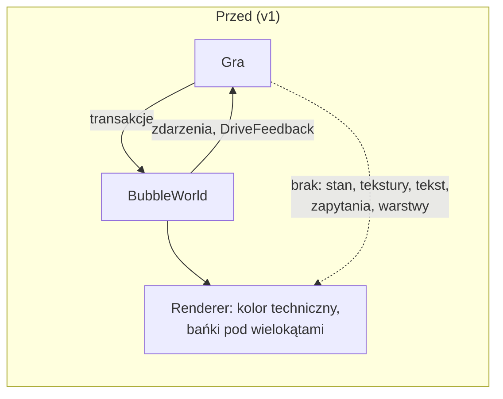
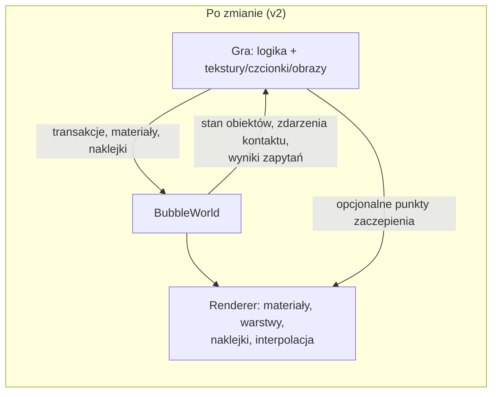
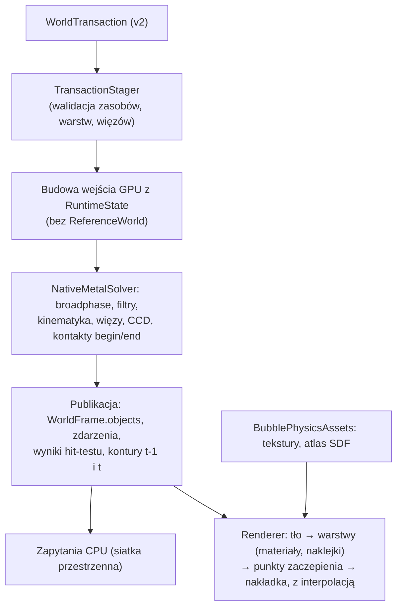

# Change Design: Fundamenty silnika BubblePhysics v2 pod wiele gier

**Date:** 2026-11-08
**Artifact:** change-design
**Status:** Draft
**Template version:** default/0.3.2
**References:** analiza braków silnika pod 2KBubbles (sesja 2026-11-08); audyt main@5d2c9a7 i PR #1 (`fix/audit-local-fixes`); zamknięta gałąź `magentic/2026-10-25-2kbubbles-engine-owned` (tag `archive/magentic-2026-10-25-2kbubbles-engine-owned`); `docs/superpowers/specs/2026-10-15-public-api-design.md`

**Plugin version:** 0.7.7
**Agent Sessions:** claude-code: 649434fc-a9e6-4308-b627-6edb14908e5b

---

<!-- hint: Keep the `**Artifact:** change-design` line — /plan and /implement use it to recognize this as a change-design artifact (requirements + design in one file) and skip the prd.md requirement. -->

> *Section audience —* 🔍 reviewer (understand the change without implementing it) · 🛠 author (implement the change). Sections without an icon serve both.

## Summary 🔍

BubblePhysics ma być silnikiem dla wielu gier. Pierwszą jest odnowione 2KBubbles, kolejne użyją też sztywnych figur i ruchu kinematycznego. Gra ma dostarczać tylko logikę i dane graficzne (tekstury, czcionki, obrazy), a silnik ma przejąć fizykę i cały rendering. Wersja `v1.0.0` tego nie umożliwia:
- gra nie może odczytać stanu obiektów;
- renderer nie zna tekstur, warstw ani tekstu;
- brakuje kinematyki o nieskończonej masie, filtrów kolizji, zdarzeń kontaktu, zapytań przestrzennych i więzów;
- krok CPU zawiera diagnostyczny solver referencyjny i pętle O(n²).

Zmiana wprowadza wersję `v2.0.0` z celowo łamanym API. Elementy wersji:
- publiczny stan obiektów publikowany z każdą ukończoną klatką;
- model materiału renderu z teksturami, dwoma trybami nakładania na bańkę, warstwami i blendingiem;
- naklejki przypięte do obiektów (tekst SDF z czcionki, tekst z atlasu gry, obraz);
- rola `kinematic`;
- kategorie i maski kolizji oraz zdarzenia kontaktu;
- zapytania przestrzenne: synchroniczne na CPU i dokładny hit-test konturu na GPU;
- punkty zaczepienia dla rysowania gry;
- interpolacja renderu dla 120 Hz, automatyczna pauza w tle i limit backlogu;
- sztywne koło i kapsuła, więzy (dystans, zawias, spaw), automatyczny moment bezwładności, CCD bryła–bryła i limit prędkości;
- usunięcie kodu diagnostycznego i pętli O(n²) z kroku;
- przykładowa aplikacja z dokumentacją integracji.

Wydajność jest warunkiem twardym. Po każdym etapie automatyczny strażnik na Macu porównuje czasy z poprzednim stanem. Na końcu gałęzi wymagane jest 60 FPS na iPhonie X przy 300 obiektach.

## Background & problem 🔍

Analiza z 2026-11-08 porównała mechanikę starego 2KBubbles (ObjC, 2014) z publicznym API silnika:
- gałąź `fix/audit-local-fixes`, czyli main z poprawkami z audytu;
- gałąź `magentic/2026-10-25-2kbubbles-engine-owned`.

Wynik: fizyka baniek, scalanie, chwyt palcem i wzrost promienia już działają. Brakuje natomiast fundamentów, których późniejsza zmiana złamałaby każdą grę.

- **Stan obiektów:** jest niedostępny dla gry (README.md:56). Jednocześnie CPU dostaje go po każdym kroku (`NativePublicWorld.swift:170-177`), więc udostępnienie nic nie kosztuje.
- **Shader bańki:** dostaje tylko `worldPosition` (`NativeRenderKernels.metal-source:4-7`), bez współrzędnych tekstury. Wielokąty zawsze leżą nad bańkami, a blendingu brak.
- **Gałąź `magentic`:** dodawała tylko semantykę 2KBubbles: wartość bańki, cyfry 7-segmentowe, paletę i arenę ze spawnem. To przeczy celowi „gra daje dane”, dlatego gałąź została zamknięta. Przenosimy z niej ogólne elementy:
  - hit-test konturu na GPU;
  - środek i promień bańki w danych wierzchołka;
  - hosta MTKView;
  - benchmark rundy.
- **Ścieżka sterowana:** obiekty `pathDriven` mają skończoną masę i dają się zepchnąć (`NativeRigidPolygonState.swift:139-145`), więc nie ma prawdziwej kinematyki.
- **Krok CPU:** w każdym kroku tworzony jest od nowa `ReferenceWorld` z `BruteForceBroadPhase` (`NativePublicWorld.swift:93-94`), a zdarzenia regionu szuka pętla `objects.first(where:)` (`NativePublicWorld.swift:199`). Produkcyjny moduł `BubblePhysicsNativeMetal` zależy od diagnostycznego `BubblePhysicsReference` (`Package.swift:32`).
- **Ekrany 120 Hz:** gdy w klatce nie wypada krok, nic się nie rysuje (`BubbleWorld.swift:160`), więc obraz szarpie.

## Goals and non-goals

### Goals

**G1: Wersja 2.0.0 z jawną migracją**
- [ ] G1-AC1 — Pakiet jest oznaczony jako `2.0.0`, a `docs/MIGRATION-v2.md` dla każdego usuniętego lub zmienionego publicznego symbolu z `v1` wskazuje jego zamiennik. · `verify: przegląd listy symboli publicznych v1 (swift-api-digester lub grep public) względem dokumentu`
- [ ] G1-AC2 — Wszystkie testy oraz `PublicWorldStressBenchmark` używają wyłącznie API `v2` i przechodzą (`swift test`: 0 błędów). · `verify: swift test`
- [ ] G1-AC3 — Moduły produkcyjne (`BubblePhysics`, `BubblePhysicsMetalRender` i ich zależności) nie zależą od `BubblePhysicsReference`, `BubblePhysicsReferenceMetal`, `BubblePhysicsLegacy`, `BubblePhysicsCore` ani `BubblePhysicsMetal`. · `verify: swift package show-dependencies / analiza Package.swift w teście`

**G2: Gra odczytuje stan obiektów**
- [ ] G2-AC1 — Każda opublikowana klatka udostępnia dla każdej istniejącej bańki i bryły: pozycję, prędkość, obrót, prędkość kątową i osiowy prostokąt otaczający. Bańka ma dodatkowo efektywny promień, a bryła typ kształtu. · `verify: test publicznego API po N krokach`
- [ ] G2-AC2 — Środek bańki w stanie zgadza się ze środkiem konturu z `debugContourSnapshot()` z dokładnością do 1% promienia. Prostokąt otaczający zawiera cały kontur. · `verify: test porównawczy na scenie stress-300`
- [ ] G2-AC3 — Obiekt usunięty w danej klatce nie występuje w jej stanie, a odczyt stanu nie zwiększa licznika odczytów konturów (`contourCPUReadbacks` = 0). · `verify: test usunięcia i licznika`

**G3: Materiał renderu z teksturą**
- [ ] G3-AC1 — Gra rejestruje teksturę z `CGImage` albo z gotowego `MTLTexture` i przypisuje ją do materiału razem z kolorem (RGBA), trybem mieszania (nieprzezroczysty, alfa, addytywny) oraz obrysem (kolor, szerokość). Render offscreen pokazuje teksturę z tymi parametrami. · `verify: test obrazu Metal (próbkowanie pikseli)`
- [ ] G3-AC2 — Tryb „przyklejony”: tekstura deformuje się i obraca razem z bańką. Punkt tekstury przypisany do punktu konturu zostaje przy nim po deformacji. · `verify: test obrazu z wymuszoną deformacją i obrotem`
- [ ] G3-AC3 — Tryb „pod maską”: tekstura jest kołem wokół środka bańki, obraca się z nią i nie deformuje się, a zdeformowany kontur ją przycina. · `verify: test obrazu z wymuszoną deformacją`
- [ ] G3-AC4 — Bryły (wielokąt, koło, kapsuła) mają współrzędne tekstury liczone ze współrzędnych lokalnych, z przesunięciem i skalą z materiału, więc tekstura obraca się razem z bryłą. · `verify: test obrazu obróconej bryły`
- [ ] G3-AC5 — Gra może zarejestrować własny shader (klucz i funkcja fragmentu), który dostaje udokumentowany zestaw danych wierzchołka: pozycja świata, współrzędne tekstury, współrzędne lokalne, środek, promień i identyfikator instancji. Zgodność układu sprawdza test ABI. · `verify: test ABI Swift↔MSL i test obrazu z własnym shaderem`
- [ ] G3-AC6 — Brak tekstury albo jej odrzucenie, np. przez nieobsługiwany format, odrzuca transakcję jawnym powodem i nie zmienia wyglądu istniejących obiektów. · `verify: test odrzucenia`

**G4: Warstwy, kolejność i tło**
- [ ] G4-AC1 — Każdy obiekt ma całkowitą warstwę. Obiekty rysują się rosnąco według warstwy, a w obrębie warstwy rosnąco według `ObjectID`, niezależnie od tego, czy to bańka, czy bryła. · `verify: test obrazu: bańka na warstwie wyższej przykrywa bryłę`
- [ ] G4-AC2 — Świat może mieć teksturę tła rysowaną pod wszystkimi warstwami, w trybie rozciągnięcia albo powielenia. · `verify: test obrazu`
- [ ] G4-AC3 — Materiał z trybem alfa daje poprawne przenikanie: piksel nakładki o alfie 0,8 jest mieszanką kolorów warstw. · `verify: test obrazu z tolerancją`

**G5: Naklejki przypięte do obiektów**
- [ ] G5-AC1 — Gra rejestruje czcionkę (nazwę czcionki systemowej albo dołączonej) z zestawem znaków. Silnik generuje z niej raz atlas SDF, a naklejka tekstowa z tego atlasu renderuje się ostro przy skali 0,25–4×. · `verify: test obrazu w dwóch skalach`
- [ ] G5-AC2 — Gra może zamiast tego zarejestrować gotowy atlas glifów (tekstura i metryki) i użyć go w naklejce tekstowej. · `verify: test obrazu z atlasem testowym`
- [ ] G5-AC3 — Naklejka obrazowa wyświetla wskazany fragment tekstury gry. · `verify: test obrazu`
- [ ] G5-AC4 — Naklejka jest zakotwiczona w środku obiektu, obraca się z nim i skaluje względem jego efektywnego promienia. Zdeformowany kontur bańki ją przycina, ale sama naklejka się nie deformuje. · `verify: test obrazu z deformacją i obrotem`
- [ ] G5-AC5 — Zmiana naklejki (tekst, obraz, kolor) to operacja transakcji, a scalenie i podział baniek przyjmują naklejkę wyniku. Nowa naklejka jest widoczna w pierwszej klatce zawierającej potwierdzenie transakcji, a odrzucona transakcja jej nie zmienia. · `verify: test publikacji klatka/potwierdzenie`
- [ ] G5-AC6 — Znak spoza zarejestrowanego zestawu odrzuca transakcję jawnym powodem. · `verify: test odrzucenia`

**G6: Rola kinematyczna**
- [ ] G6-AC1 — Obiekt w roli `kinematic` porusza się dokładnie według zadanej prędkości, ścieżki albo pozycji docelowej na krok. Kontakt z obiektami dynamicznymi nie zmienia jego toru: odchyłka jest równa 0 z dokładnością zmiennoprzecinkową. · `verify: test pchania 20 baniek przez kinematyczną bryłę`
- [ ] G6-AC2 — Obiekt dynamiczny spoczywający na poziomej kinematycznej platformie przemieszcza się razem z nią, ze średnią prędkością poziomą w granicach 5% prędkości platformy po ustaleniu się kontaktu. · `verify: test platformy`
- [ ] G6-AC3 — Obiekty kinematyczne nie kolidują ze statycznymi ani z innymi kinematycznymi. Rola `pathDriven` zachowuje dotychczasowe zachowanie blokowalnej ścieżki. · `verify: test przejścia kinematycznej przez statyczną; istniejące testy pathDriven`

**G7: Filtr kolizji i zdarzenia kontaktu**
- [ ] G7-AC1 — Każdy obiekt fizyczny ma 32-bitową kategorię i maskę. Dwa obiekty kolidują tylko wtedy, gdy kategoria każdego z nich jest w masce drugiego. Domyślne wartości dają kolizję wszystkiego ze wszystkim. · `verify: test par z rozłącznymi maskami (brak kontaktu) i domyślnych (kontakt)`
- [ ] G7-AC2 — Obiekt z zainteresowaniem kontaktem dostaje zdarzenie rozpoczęcia kontaktu, z punktem, normalną i impulsem normalnym, w pierwszym kroku styku. Zdarzenie końca kontaktu przychodzi w pierwszym kroku po rozłączeniu. Przy trwającym styku zdarzenia się nie powtarzają. · `verify: test zderzenia dwóch obiektów i trwałego styku`
- [ ] G7-AC3 — Przepełnienie bufora zdarzeń jest raportowane w `eventOverflow`, a żadne zdarzenie końca nie przychodzi bez wcześniejszego rozpoczęcia. · `verify: test z małym buforem`

**G8: Zapytania przestrzenne**
- [ ] G8-AC1 — Zapytania synchroniczne na opublikowanym stanie: obiekty w punkcie, w prostokącie i w kole oraz promień (raycast), który zwraca pierwsze trafienie z punktem, normalną i ułamkiem. Bryły są sprawdzane dokładnie, a bańki jako koło o efektywnym promieniu. Każde zapytanie można zawęzić filtrem z G7. · `verify: testy dla każdego typu zapytania i każdego kształtu`
- [ ] G8-AC2 — Asynchroniczny dokładny hit-test punktu względem zdeformowanego konturu zwraca najwyżej jeden `ObjectID` albo `nil`, policzony w następnym ukończonym kroku. Przy nakładaniu wygrywa obiekt na najwyższej warstwie i z największym `ObjectID`. · `verify: test wnętrza, krawędzi, wgłębienia deformacji i pustego miejsca`
- [ ] G8-AC3 — Żadne zapytanie nie zwiększa licznika odczytów konturów. · `verify: contourCPUReadbacks = 0 w testach zapytań`

**G9: Punkty zaczepienia dla rysowania gry**
- [ ] G9-AC1 — Gra może przekazać do renderu domknięcia wywoływane z encoderem bieżącego passu i macierzą świat→ekran w trzech miejscach: po tle, po wskazanej warstwie i na końcu (nakładka). To, co narysują, pojawia się we właściwej kolejności. · `verify: test obrazu z prostokątem gry w każdym miejscu`
- [ ] G9-AC2 — Błąd zgłoszony przez domknięcie gry kończy klatkę tak samo jak błąd renderu, czyli zachowuje poprzednią opublikowaną klatkę. · `verify: test rzucającego domknięcia`

**G10: Czas, cykl życia i błędy**
- [ ] G10-AC1 — Każde wywołanie renderu z buforem poleceń rysuje klatkę, także wtedy, gdy nie wypada krok fizyki. Położenie obiektów, konturów i naklejek jest interpolowane między dwoma ostatnimi krokami według ułamka zaległego czasu. · `verify: test: przy 120 Hz i kroku 1/60 każda klatka ma render, a pozycja w klatce pośredniej leży między krokami`
- [ ] G10-AC2 — Zaległy czas (backlog) ma górny limit, domyślnie 0,25 s. Nadmiar jest odrzucany i raportowany w diagnostyce, więc symulacja nie nadrabia długich przerw. · `verify: test advance(by: 10)`
- [ ] G10-AC3 — Na iOS świat sam przechodzi w pauzę przy wejściu aplikacji w tło i nie wysyła wtedy pracy na GPU. Po powrocie wznawia się od tego samego stanu bez skoku czasu. Wyłączenie tego zachowania jest jawną opcją konfiguracji. · `verify: test z symulowanymi powiadomieniami cyklu życia`
- [ ] G10-AC4 — Nieudany krok GPU, np. przez błąd bufora poleceń lub wartości nieskończone, przełącza świat w jawny stan końcowy „zawiódł”: diagnostyka podaje powód, kolejne `advance` zwracają ostatnią klatkę bez prób ponawiania, a gra rozpoczyna rozgrywkę od nowa. · `verify: test z wstrzykniętym błędem kroku`
- [ ] G10-AC5 — Ta sama scena z tymi samymi transakcjami, uruchomiona dwa razy na tym samym urządzeniu, daje identyczny stan obiektów po 300 krokach. · `verify: test determinizmu (hash stanu) na Macu`

**G11: Bryły, więzy i ograniczenia ruchu**
- [ ] G11-AC1 — Sztywne koło i kapsuła są pełnoprawnymi kształtami brył: kolidują z bańkami, wielokątami i ze sobą nawzajem, renderują się i odpowiadają na zapytania. · `verify: testy kolizji każdej pary kształtów`
- [ ] G11-AC2 — Moment bezwładności bryły jest liczony z kształtu i masy, gdy gra go nie poda. Dla koła o promieniu r i masie m wynosi m·r²/2, z dokładnością do 0,1%. · `verify: test wzorów dla koła, prostokąta, kapsuły`
- [ ] G11-AC3 — Więzy łączą dwie bryły, bryłę ze światem albo bańkę (zaczepioną w środku) z bryłą lub światem:
  - dystans: sztywny albo z wiotkością i tłumieniem;
  - zawias: opcjonalny zakres kąta i silnik;
  - spaw.

  Więzy dodaje się i usuwa transakcją. · `verify: testy wahadła (okres w granicach 2% wzoru), zakresu zawiasu, spawu`
- [ ] G11-AC4 — Szybka bryła (prędkość 3× grubość przeszkody na krok) nie przenika przez cienką bryłę ani przez inną szybką bryłę. · `verify: test tunelowania bryła–bryła`
- [ ] G11-AC5 — Materiał może ograniczać maksymalną prędkość liniową i kątową, a żaden obiekt z takim materiałem jej nie przekracza. · `verify: test pod silną siłą globalną`

**G12: Wydajność**
- [ ] G12-AC1 — Krok nie tworzy `ReferenceWorld` ani `BruteForceBroadPhase`, a praca CPU na krok rośnie liniowo z liczbą obiektów. Czas przygotowania kroku dla 600 obiektów jest najwyżej 2,5× dłuższy niż dla 300. · `verify: test skalowania na Macu`
- [ ] G12-AC2 — Kontakty par bryła–bryła i bańka–bryła przechodzą przez wstępne filtrowanie przestrzenne, a pamięć kontaktów na GPU jest ograniczona przez O(n·k), gdzie k to stały limit kandydatów na obiekt, a nie przez O(n²). · `verify: test pamięci buforów dla 300 i 1200 obiektów`
- [ ] G12-AC3 — Po każdym etapie automatyczny strażnik na Macu porównuje p95 kroku i renderu scen stress-300 i mieszanej z poprzednim stanem gałęzi. Regresja powyżej 5% zatrzymuje etap. · `verify: test/benchmark strażnika w swift test lub skrypcie CI z zapisem wyników w repo`
- [ ] G12-AC4 — Na końcu gałęzi, w buildzie Release na iPhonie X, p95 pełnej klatki (fizyka i render, ścieżka `BubbleWorld`) wynosi najwyżej 16,67 ms w scenie z 300 obiektami. Nieudanych klatek, klatek z wartościami nieskończonymi i odczytów konturów jest 0. Wynik jest zapisany w `docs/benchmarks/`. · `verify: aplikacja benchmarku na urządzeniu (uruchamia właściciel)`

**G13: Przykładowa aplikacja i dokumentacja integracji**
- [ ] G13-AC1 — W repo jest przykładowa aplikacja iOS z `MTKView`, która używa wyłącznie publicznego API i ma dwie sceny. Pierwsza: bańki z teksturami, naklejkami, scalaniem i chwytem palcem. Druga: bryły, więzy i platforma kinematyczna. Buduje się poleceniem `xcodebuild` bez podpisu. · `verify: xcodebuild CODE_SIGNING_ALLOWED=NO build`
- [ ] G13-AC2 — Przewodnik integracji opisuje:
  - pętlę `MTKView` z jednym buforem poleceń na fizykę i render;
  - prezentację drawable;
  - cykl życia;
  - rejestrację tekstur, czcionek i naklejek;
  - zapytania;
  - obsługę zdarzeń.

  Każdy fragment kodu w przewodniku kompiluje się w przykładowej aplikacji. · `verify: przegląd + build przykładu`

### Non-goals

- Zapis i odczyt stanu świata (save/load) oraz odtwarzanie zapisanej rozgrywki (replay). Przerwany świat oznacza nową rozgrywkę.
- Odtwarzanie świata po utracie urządzenia GPU.
- System cząstek i efekty pełnoekranowe (wstrząs, rozmycie, poświata). Gra może je rysować przez punkty zaczepienia z G9.
- Więzy poza dystansem, zawiasem i spawem: prowadnica, koło pojazdu, lina, bloczek.
- Wielokąty z dziurami.
- Dane gry przy obiekcie (user data). Gra mapuje własne dane po `ObjectID`.
- Logika i zasoby 2KBubbles: spawn, reguła scalania „ta sama liczba”, punktacja, wygląd. Gra powstaje w osobnym repo na publicznym API `v2`.
- Aplikacja hosta na macOS i dostępność (accessibility), która należy do UI gry.

## Architecture

Zmiana zachowuje obecny przepływ: transakcja → walidacja na granicy kroku → krok GPU i render w jednym buforze poleceń → publikacja ukończonej klatki. Wewnątrz tego przepływu dokłada sześć warstw.

1. **Model publiczny (`Sources/BubblePhysicsPublic/Model`)**:
   - Wspólne `PhysicsBodyProperties` dla baniek i brył: warstwa, kategoria i maska kolizji, zainteresowania zdarzeniami. Zastępują pola powielone w deskryptorach.
   - `RigidShape`: wielokąt, koło, kapsuła.
   - `MotionRole.kinematic` ze sterowaniem `KinematicDrive` (prędkość, ścieżka albo cel na krok).
   - `RenderMaterial`, który zastępuje `RenderStyle`. Zawiera:
     - teksturę;
     - kolor;
     - tryb mieszania;
     - obrys;
     - tryb nakładania na bańkę („przyklejony” albo „pod maską”);
     - przesunięcie i skalę współrzędnych tekstury;
     - opcjonalny klucz własnego shadera.
   - `Decal`: tekst z czcionką lub atlasem albo fragment obrazu, z kolorem i skalą.
   - `Joint`: dystans, zawias, spaw.
   - Nowe operacje `WorldTransaction`: rejestracja zasobów graficznych, ustawienie naklejki i warstwy, dodanie i usunięcie więzu, sterowanie kinematyczne.
2. **Zasoby graficzne (nowy moduł `BubblePhysicsAssets`)**:
   - rejestr tekstur z `CGImage` (dekodowany raz do `MTLTexture`) albo z gotowego `MTLTexture`;
   - generator atlasu SDF z czcionki przez Core Text, uruchamiany raz przy rejestracji;
   - import gotowego atlasu glifów.

   Tekstury żyją w module renderu, a model publiczny zna tylko ich identyfikatory.
3. **Runtime (`Sources/BubblePhysicsRuntime`)**:
   - stan obiektów publikowany jako `WorldFrame.objects` ze słownikiem `ObjectID → ObjectState`, który wypełniają dane już odczytywane po kroku;
   - zapytania synchroniczne na opublikowanym stanie, z siatką przestrzenną budowaną raz na publikację;
   - kolejka asynchronicznych hit-testów;
   - polityka czasu: limit backlogu, ułamek interpolacji, stan końcowy „zawiódł”;
   - obserwator cyklu życia aplikacji na iOS.
4. **Solver (`Sources/BubblePhysicsNativeMetal`)**:
   - Bezpośrednia budowa wejścia GPU z `RuntimeState`. To usuwa `ReferenceWorld`, `BruteForceBroadPhase` i pętle O(n²), a NativeMetal przestaje zależeć od `BubblePhysicsReference`.
   - Kategorie i maski kolizji sprawdzane w kernelach kandydatów.
   - Kinematyka jako odwrotna masa 0 z narzuconą prędkością.
   - Sztywne koło i kapsuła w kernelach kontaktu.
   - Więzy jako dodatkowe ograniczenia XPBD w tej samej pętli iteracji.
   - CCD bryła–bryła.
   - Limit prędkości w integracji.
   - Siatka przestrzenna dla brył i stały limit kandydatów na obiekt zamiast pamięci O(n²).
   - Wykrywanie początku i końca kontaktu przez porównanie z trwałym cache kontaktów.
   - Kernel hit-testu konturu (przeniesiony z `magentic`).
   - Bufor konturów z poprzedniego kroku do interpolacji.
5. **Renderer (`Sources/BubblePhysicsMetalRender`)**:
   - lista rysowania posortowana według warstwy i `ObjectID`, budowana przyrostowo, nie od nowa;
   - pipeline'y per tryb mieszania;
   - przekazywanie przez shader wierzchołka współrzędnych tekstury, współrzędnych lokalnych, środka, promienia, identyfikatora instancji i współczynnika interpolacji;
   - naklejki jako instancjonowane czworokąty przycinane szablonem (stencil) konturu bańki;
   - tło;
   - punkty zaczepienia gry.

   Wszystko rysowane jest w jednym passie.
6. **Przykład i benchmark (`Examples/BubblePhysicsShowcase`, `Benchmarks/iOS`)**: host `MTKView` i benchmark rundy z `magentic`, uogólnione. Strażnik wydajności zapisuje wyniki Maca w `docs/benchmarks/perf-guard.json`.

Etapy wdrożenia ustala plan. Wymaganie z tego dokumentu: najpierw porządki wydajności i stan obiektów (G12-AC1, G2), bo dają punkt odniesienia strażnikowi. Potem model danych GPU (G7, G6, G11), a na końcu render (G3–G5, G9, G10) i przykład (G13).

## Components

- **`Package.swift`** — wersja 2.0.0, nowy moduł `BubblePhysicsAssets`, usunięcie zależności produkcji od modułów diagnostycznych, cel przykładowej aplikacji.
- **`Sources/BubblePhysicsPublic/Model/Objects.swift`** — `PhysicsBodyProperties`, `RigidShape` (wielokąt, koło, kapsuła), opcjonalny moment bezwładności liczony automatycznie.
- **`Sources/BubblePhysicsPublic/Model/Motion.swift`** — `MotionRole.kinematic`, `KinematicDrive`.
- **`Sources/BubblePhysicsPublic/Model/Resources.swift`** — `RenderMaterial` (zastępuje `RenderStyle`/`RenderShader`), limity prędkości w `PhysicsMaterial`.
- **`Sources/BubblePhysicsPublic/Model/Decals.swift`** (nowy) — `Decal`, `FontID`, `TextureID`, `GlyphAtlasID`.
- **`Sources/BubblePhysicsPublic/Model/Joints.swift`** (nowy) — `Joint` (dystans, zawias, spaw), `JointID`.
- **`Sources/BubblePhysicsPublic/Model/Identifiers.swift`** — `CollisionFilter` (kategoria, maska), nowe `EventInterest` dla kontaktu.
- **`Sources/BubblePhysicsPublic/Model/WorldTransaction.swift`** — nowe operacje, `BubbleResult` z naklejką i warstwą.
- **`Sources/BubblePhysicsPublic/Model/WorldFrame.swift`** — `objects: [ObjectID: ObjectState]`, zdarzenia `contactBegan`/`contactEnded`.
- **`Sources/BubblePhysicsPublic/Model/WorldConfiguration.swift`** — limit backlogu, przełącznik automatycznej pauzy, tło.
- **`Sources/BubblePhysicsPublic/Model/Queries.swift`** (nowy) — typy zapytań i wyników.
- **`Sources/BubblePhysicsPublic/BubbleWorld.swift`** — zapytania synchroniczne, asynchroniczny hit-test, stan końcowy „zawiódł”, interpolacja, cykl życia.
- **`Sources/BubblePhysicsRuntime/*`** — staging nowych operacji, siatka zapytań, polityka czasu, sterowanie kinematyczne, cykl życia.
- **`Sources/BubblePhysicsNativeMetal/NativePublicWorld.swift`** — budowa wejścia GPU bez `ReferenceWorld`, liniowa.
- **`Sources/BubblePhysicsNativeMetal/NativeMetalSolver.swift`, `NativeMetalBufferLayout.swift`, `NativeRigidPolygonState.swift`, `*.metal-source`** — filtry, kinematyka, kształty, więzy, CCD, broadphase, kontakty begin/end, hit-test, poprzednie kontury.
- **`Sources/BubblePhysicsAssets/*`** (nowy) — rejestr tekstur, generator SDF (Core Text), import atlasu.
- **`Sources/BubblePhysicsMetalRender/BubblePhysicsMetalRender.swift`, `RenderStylePipeline.swift`, shadery renderu** — materiały, warstwy, mieszanie, naklejki, tło, punkty zaczepienia, interpolacja.
- **`Examples/BubblePhysicsShowcase/*`** (nowy) — przykładowa aplikacja iOS.
- **`Benchmarks/iOS/BubblePhysicsBench/*`** — host `MTKView` i benchmark rundy z `magentic` w wersji ogólnej, scena mieszana.
- **`docs/MIGRATION-v2.md`, `docs/integration-guide.md`, `README.md`** — migracja i integracja.
- **`Tests/*`** — testy dla każdego kryterium akceptacji, testy obrazu Metal, test ABI dla nowych struktur, strażnik wydajności.

## Error handling

- **Odrzucenia transakcji:** brakujące zasoby graficzne, znak spoza atlasu, więz z nieistniejącym ciałem i niepoprawny kształt odrzucają całą transakcję. Każdy taki przypadek ma nowy przypadek `TransactionRejectionReason`. Stan i wygląd zostają bez zmian, zgodnie z obecną atomowością transakcji.
- **Usunięcie ciała połączonego więzem:** usuwa też więz. Zdarzenie usunięcia więzu jest raportowane, jeśli gra je zamówiła.
- **Wynik hit-testu:** asynchroniczny hit-test dla obiektu usuniętego przed publikacją zwraca `nil`.
- **Generowanie atlasu SDF:** jest synchroniczne przy rejestracji czcionki. Brak czcionki zgłasza błąd rejestracji natychmiast, zamiast w klatce.

## Testing & verification

- **Testy obrazu Metal:** render offscreen 256×256 z próbkowaniem pikseli i tolerancją. Wspólna infrastruktura dla G3, G4, G5, G9 i G10.
- **Strażnik wydajności (G12-AC3):** stały zestaw scen (stress-300, mieszana: 200 baniek, 60 brył, 10 więzów, 5 kinematycznych), stała liczba klatek, wyniki zapisane w repo. Porównuje z ostatnim zapisanym wynikiem gałęzi. Pierwszy zapis powstaje przed zmianami, na `feature/engine-foundations` od `fix/audit-local-fixes`.
- **Pomiar na iPhonie X (G12-AC4):** jedyny krok wymagający właściciela, wykonywany raz na końcu gałęzi.

## Decisions 🔍

| ID | Title | Context | Options | Choice | Rationale | Source | Goal impact | Consequences |
|----|-------|---------|---------|--------|-----------|--------|-------------|--------------|
| CD-D-1 | Zgodność API | Część fundamentów ma kształt łamiący `v1` | pełna zgodność; `v2` łamiąca; mieszanie | `v2.0.0` łamiąca, z dokumentem migracji | Brak konsumentów; zgodność zostawiłaby równoległe ścieżki w fundamentach | user | G1 | Testy i benchmark do przepisania; wydajność nie może ucierpieć |
| CD-D-2 | Bramka wydajności | Brak pomiaru urządzeniowego ścieżki `BubbleWorld` | pomiar `v1` jako punkt odniesienia; próg 10,46 ms; strażnik na Macu + urządzenie na końcu | Strażnik na Macu po każdym etapie, urządzenie na końcu: 60 FPS na iPhonie X przy 300 obiektach | Pomiar `v1` utrwaliłby zbyt niski poziom; cel produktowy to 60 FPS | user | G12-AC3, G12-AC4 | 10,4568 ms zostaje celem solvera, nie sufitem |
| CD-D-3 | Źródło glifów | Tekst na bańkach rysuje silnik | SDF z czcionki; atlas gry; oba | Oba: SDF generowany z czcionki (domyślnie) i gotowy atlas | Czcionka jest daną gry; atlas daje pełną kontrolę | user | G5-AC1, G5-AC2 | Nowy moduł `BubblePhysicsAssets` z Core Text |
| CD-D-4 | Naklejki obrazowe | Gra może chcieć obrazków zamiast liczb | tylko tekst; tekst i obraz | Naklejka: tekst albo fragment tekstury gry | Wymóg właściciela; wspólny mechanizm zakotwiczenia | user | G5-AC3 | Jeden typ `Decal` z wariantami |
| CD-D-5 | Tekstura na bańce | Bańka deformuje się i obraca | przyklejona; pod maską; oba | Oba jako tryb materiału, domyślnie przyklejona; naklejki zawsze pod maską | Galareta dla baniek, czytelność dla obrazów; koszt to jeden przełącznik | user | G3-AC2, G3-AC3, G5-AC4 | Współrzędne tekstury z kształtu spoczynkowego per wierzchołek konturu |
| CD-D-6 | Kinematyka | `pathDriven` ma skończoną masę | nowa rola; zastąpić `pathDriven`; przełącznik | Nowa rola `kinematic`; `pathDriven` zostaje blokowalny | Dwie różne fizyki; standard Box2D/Chipmunk | user | G6 | Nowy wariant w solverze (odwrotna masa 0) |
| CD-D-7 | 120 Hz | Klatki bez kroku są dziś puste | interpolacja; krok = odświeżanie; ekstrapolacja | Interpolacja renderu między dwoma krokami | Koszt fizyki bez zmian; opóźnienie ≤ 1 krok | user | G10-AC1 | Bufor konturów z poprzedniego kroku |
| CD-D-8 | Save/load | Przerwanie gry | pełny stan; bez konturów; brak | Brak w `v2`; przerwany świat = nowa gra; automatyczna pauza w tle, limit backlogu, jawny stan „zawiódł” | Założenie właściciela: silnik nie jest przerywany | user | G10-AC2..AC4, Non-goals | Determinizm tylko jako właściwość testowa (G10-AC5) |
| CD-D-9 | Więzy | Mechanizmy w kolejnych grach | dystans+sprężyna; trzy podstawowe; pełny zestaw Box2D | Dystans (z wiotkością), zawias (zakres, silnik), spaw; wspólny model rozszerzalny | Pokrywa większość mechanizmów; fundament otwarty | user | G11-AC3 | Ograniczenia XPBD w pętli solvera |
| CD-D-10 | Zapytania | Kontury baniek są tylko na GPU | wszystko async GPU; sync CPU + async dokładny; sync CPU z kopią konturów | Synchroniczne na CPU (bańki jako koło) + asynchroniczny dokładny hit-test na GPU | Logika gry potrzebuje odpowiedzi od razu; kopia konturów kosztowałaby wydajność | user | G8 | Kernel hit-testu przeniesiony z `magentic` |
| CD-D-11 | Efekty | Cząstki i efekty | punkty zaczepienia; prosty system cząstek; pełny system | Tylko punkty zaczepienia i tło w silniku | Brak gry, która dziś ich potrzebuje; fundament wystarcza do późniejszego dodania | user | G4-AC2, G9, Non-goals | Cząstki to osobna, późniejsza zmiana |
| CD-D-12 | Gałąź `magentic` | Zawiera semantykę 2KBubbles w silniku | scalić; przerobić; zamknąć i przenieść ogólne części | Zamknąć (tag archiwalny), przenieść hit-test GPU, środek/promień w danych wierzchołka, host `MTKView`, benchmark rundy | Semantyka gry w silniku przeczy celowi „gra daje dane” | user | G8-AC2, G13, Non-goals | `BubblePresentation.value`, paleta, `ArenaPreset` nie wchodzą |
| CD-D-13 | Filtr kolizji | Kolejne gry potrzebują selektywnych kolizji | kategoria i maska 32-bit; grupy; reguły par | Kategoria i maska 32-bit, warunek obustronny | Standard (Box2D), tani test w kernelu kandydatów | auto (praktyka silników 2D, koszt w kernelu) | G7-AC1 | `MergeGroupSet` zostaje osobno dla scalania |
| CD-D-14 | Dane gry przy obiekcie | Analiza wskazała brak user data | pole user data; mapowanie po `ObjectID` | Brak pola; gra mapuje po `ObjectID` | `ObjectID` nadaje gra, więc pole byłoby duplikatem (YAGNI) | auto (Identifiers.swift: ID nadaje gra) | Non-goals | Mniejsze rekordy |
| CD-D-15 | Własne shadery | Cel „gra daje dane” vs przyszłe gry | tylko materiały; materiały + własny shader | Materiały jako ścieżka podstawowa + własna funkcja fragmentu z udokumentowanym ABI | `v1` już miała `.custom`; ABI zabezpiecza test ABI | auto (Resources.swift `RenderShader.custom`, NativeMetalShaderABITests) | G3-AC5 | Zmiana ABI wierzchołka staje się zmianą łamiącą |
| CD-D-16 | Forma tekstur | Skąd silnik bierze tekstury | `CGImage`; `MTLTexture`; nazwa zasobu | `CGImage` (silnik tworzy `MTLTexture`) albo gotowe `MTLTexture` | `CGImage` nie wymaga od gry Metal; `MTLTexture` dla zaawansowanych | auto (cel „gra daje dane”) | G3-AC1 | Rejestr tekstur w `BubblePhysicsAssets` |
| CD-D-17 | Zależności produkcji | NativeMetal zależy od `BubblePhysicsReference` | zostawić; odciąć | Odciąć: wejście GPU budowane bezpośrednio z `RuntimeState` | `ReferenceWorld` + BruteForce w każdym kroku to koszt O(n²) | auto (NativePublicWorld.swift:93-94, Package.swift:32) | G1-AC3, G12-AC1 | Moduły diagnostyczne zostają tylko dla testów i benchmarków |
| CD-D-18 | Przykładowa aplikacja | Gra 2KBubbles powstaje osobno | 2KBubbles w repo; ogólny przykład | Ogólny przykład w `Examples/` z dwiema scenami | Silnik nie może zawierać semantyki jednej gry | auto (CD-D-12) | G13 | 2KBubbles to osobne repo na API `v2` |
| CD-D-19 | Baza gałęzi | PR #1 z poprawkami audytu nie jest scalony | od `main`; od `fix/audit-local-fixes` | `feature/engine-foundations` od `fix/audit-local-fixes` | Poprawki dotykają solvera i renderera, unikamy konfliktów | auto (stan repo) | none | Po scaleniu PR #1 gałąź przebazować na `main` |
| CD-D-20 | Kolejność etapów | Strażnik potrzebuje punktu odniesienia | dowolna; porządki → dane GPU → render | Porządki wydajności i stan → model danych GPU → render → przykład | Najpierw tani zysk i punkt odniesienia; ABI GPU ustalone przed renderem | auto (zależności między celami) | G12-AC3 | Plan tnie zmianę na etapy w tej kolejności |

## Key facts & assumptions

- **Niezmiennik:** świat publikuje wyłącznie ukończone klatki, a krok fizyki i render mieszczą się w jednym buforze poleceń. Żadna nowa funkcja nie wprowadza odczytu konturów na CPU w normalnej ścieżce (`contourCPUReadbacks` = 0).
- **Fakt:** stan obiektów (pozycja, prędkość, obrót, efektywny promień) jest już po każdym kroku na CPU (`NativePublicWorld.swift:170-177`). Publikacja G2 nie dodaje transferu z GPU.
- **Fakt:** jedyny pomiar urządzeniowy (10,46 ms p95, stress-300) dotyczy ścieżki `NativeMetalBenchmarkRunner`, nie `BubbleWorld` z rendererem.
- **Założenie, niepotwierdzone i nieblokujące:** solver GPU jest deterministyczny na tym samym urządzeniu (benchmark z 2026-10-14 pokazał identyczny hash). Jeśli więzy albo kontakty begin/end złamią determinizm, G10-AC5 wymusi deterministyczną kolejność redukcji.
- **Założenie, niepotwierdzone i nieblokujące:** przycinanie naklejek szablonem konturu mieści się w budżecie 16,67 ms dla 300 baniek. Alternatywa to maska w shaderze fragmentu z odległości od środka. Wybór należy do planu, na podstawie strażnika.
