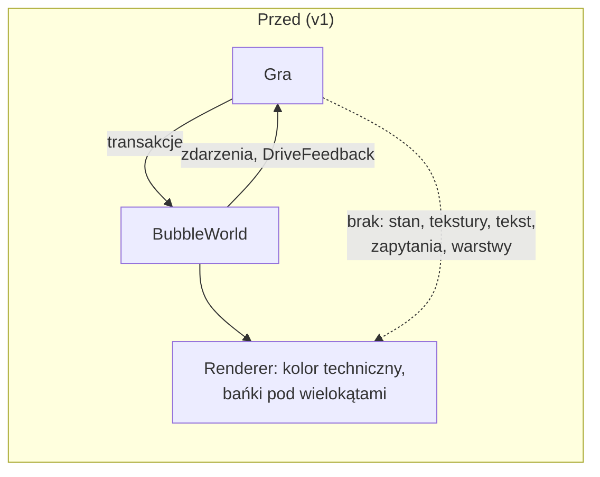
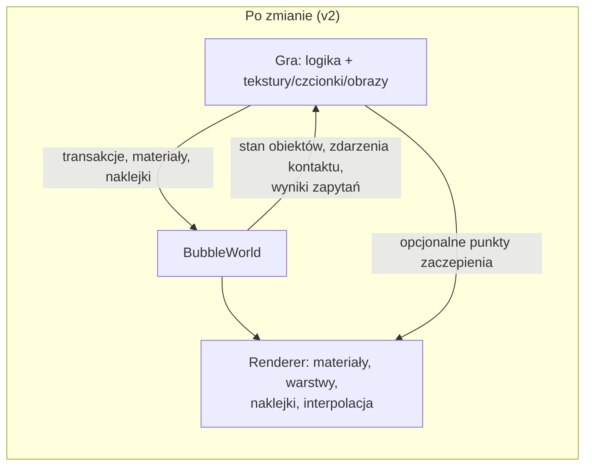
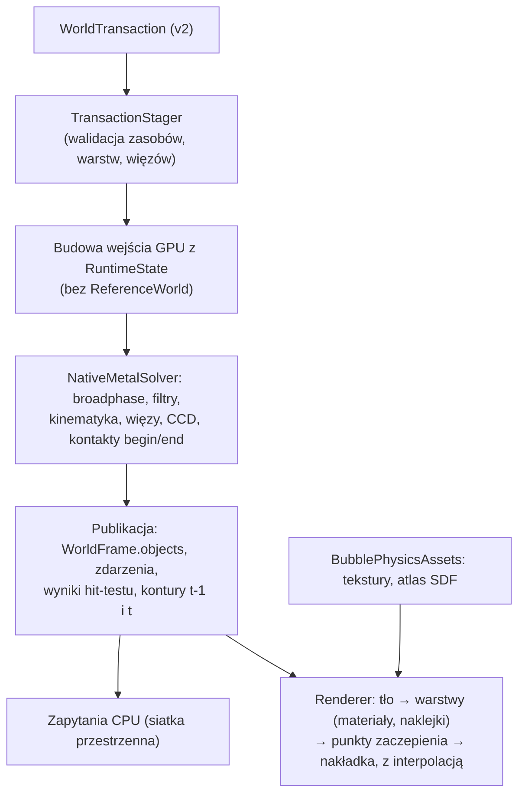

# Change Design: Fundamenty silnika BubblePhysics v2 pod wiele gier

**Date:** 2026-11-08
**Artifact:** change-design
**Status:** Draft
**Template version:** default/0.3.2
**References:** analiza braków silnika pod 2KBubbles (sesja 2026-11-08); audyt main@5d2c9a7 i PR #1 (`fix/audit-local-fixes`); zamknięta gałąź `magentic/2026-10-25-2kbubbles-engine-owned` (tag `archive/magentic-2026-10-25-2kbubbles-engine-owned`); `docs/superpowers/specs/2026-10-15-public-api-design.md`

**Plugin version:** 0.7.7
**Agent Sessions:** claude-code: 649434fc-a9e6-4308-b627-6edb14908e5b
**Self-review:** pętla 1: CAP_REACHED — round-2 findings fixed, not re-reviewed; pętla 2 (po uwagach właściciela): CAP_REACHED — round-2 findings fixed, not re-reviewed; patrz „Self-review record”

---

<!-- hint: Keep the `**Artifact:** change-design` line — /plan and /implement use it to recognize this as a change-design artifact (requirements + design in one file) and skip the prd.md requirement. -->

> *Section audience —* 🔍 reviewer (understand the change without implementing it) · 🛠 author (implement the change). Sections without an icon serve both.

## Summary 🔍

BubblePhysics ma być silnikiem dla wielu gier. Pierwszą jest odnowione 2KBubbles, kolejne użyją też sztywnych figur i ruchu kinematycznego. Gra ma dostarczać tylko logikę i dane graficzne (tekstury, czcionki, obrazy), a silnik ma przejąć fizykę i cały rendering. Wersja `v1.0.0` tego nie umożliwia:
- gra nie może odczytać stanu obiektów;
- renderer nie zna tekstur, warstw ani tekstu;
- brakuje kinematyki o nieskończonej masie, filtrów kolizji, zdarzeń kontaktu, zapytań przestrzennych i więzów;
- krok CPU zawiera diagnostyczny solver referencyjny i pętle O(n²).

Zmiana wprowadza wersję `v2.0.0` z celowo łamanym API. Elementy wersji:
- publiczny stan obiektów publikowany z każdą ukończoną klatką;
- model materiału renderu z teksturami rejestrowanymi przez grę, dwoma trybami nakładania na bańkę, warstwami i blendingiem;
- naklejki przypięte do obiektów (tekst SDF z czcionki, tekst z atlasu gry, obraz);
- rola `kinematic`;
- kategorie i maski kolizji oraz zdarzenia kontaktu;
- zapytania przestrzenne: synchroniczne na CPU i dokładny hit-test konturu na GPU;
- punkty zaczepienia dla rysowania gry;
- interpolacja renderu dla 120 Hz, automatyczna pauza w tle i limit backlogu;
- sztywne koło i kapsuła, więzy (dystans, zawias, spaw), automatyczny moment bezwładności, CCD bryła–bryła i limit prędkości;
- usunięcie kodu diagnostycznego i pętli O(n²) z kroku;
- przykładowa aplikacja z dokumentacją integracji.

Wydajność jest warunkiem twardym. Po każdym etapie automatyczny strażnik na Macu porównuje czasy z poprzednim stanem. Na końcu gałęzi wymagane jest 60 FPS na iPhonie X przy 300 obiektach.

## Background & problem 🔍

Analiza z 2026-11-08 porównała mechanikę starego 2KBubbles (ObjC, 2014) z publicznym API silnika:
- gałąź `fix/audit-local-fixes`, czyli main z poprawkami z audytu;
- gałąź `magentic/2026-10-25-2kbubbles-engine-owned`.

Wynik: fizyka baniek, scalanie, chwyt palcem i wzrost promienia już działają. Brakuje natomiast fundamentów, których późniejsza zmiana złamałaby każdą grę.

- **Stan obiektów:** jest niedostępny dla gry (README.md:56). Jednocześnie CPU dostaje go po każdym kroku (`NativePublicWorld.swift:170-177`), więc udostępnienie nic nie kosztuje.
- **Shader bańki:** dostaje tylko `worldPosition` (`NativeRenderKernels.metal-source:4-7`), bez współrzędnych tekstury. Wielokąty zawsze leżą nad bańkami, a blendingu brak.
- **Gałąź `magentic`:** dodawała tylko semantykę 2KBubbles: wartość bańki, cyfry 7-segmentowe, paletę i arenę ze spawnem. To przeczy celowi „gra daje dane”, dlatego gałąź została zamknięta. Przenosimy z niej ogólne elementy:
  - hit-test konturu na GPU;
  - środek i promień bańki w danych wierzchołka;
  - hosta MTKView;
  - benchmark rundy.
- **Ścieżka sterowana:** obiekty `pathDriven` mają skończoną masę i dają się zepchnąć (`NativeRigidPolygonState.swift:139-145`), więc nie ma prawdziwej kinematyki.
- **Krok CPU:** w każdym kroku tworzony jest od nowa `ReferenceWorld` z `BruteForceBroadPhase` (`NativePublicWorld.swift:93-94`), a zdarzenia regionu szuka pętla `objects.first(where:)` (`NativePublicWorld.swift:199`). Produkcyjny moduł `BubblePhysicsNativeMetal` zależy od diagnostycznego `BubblePhysicsReference` (`Package.swift:32`).
- **Ekrany 120 Hz:** gdy w klatce nie wypada krok, nic się nie rysuje (`BubbleWorld.swift:160`), więc obraz szarpie.

## Goals and non-goals

### Goals

**G1: Wersja 2.0.0 z jawną migracją**
- [ ] G1-AC1 — Pakiet jest oznaczony jako `2.0.0`, a `docs/MIGRATION-v2.md` dla każdego usuniętego lub zmienionego publicznego symbolu z `v1` wskazuje jego zamiennik. · `verify: przegląd listy symboli publicznych v1 (swift-api-digester lub grep public) względem dokumentu`
- [ ] G1-AC2 — Testy modułów produkcyjnych (Public, Runtime, NativeMetal, MetalRender, Assets) oraz `PublicWorldStressBenchmark` używają wyłącznie API `v2`. Testy narzędzi diagnostycznych przeniesione do `BubblePhysicsNativeMetalDiagnosticsTests` (CD-D-26) dalej testują ścieżki oparte na `ReferenceWorld`. Cały `swift test` przechodzi z 0 błędów, łącznie z testami modułów diagnostycznych, które dalej testują swoje moduły. · `verify: swift test`
- [ ] G1-AC3 — Diagnostyczny pomiar solvera (`NativeMetalBenchmarkRunner`, scena stress-300 z limitem 4 iteracji, cel 10,4568 ms) nadal da się uruchomić z `BubblePhysicsReferenceBench` na Macu. Aplikacja benchmarku iOS mierzy wyłącznie ścieżkę publiczną. · `verify: uruchomienie runnera na Macu w teście diagnostycznym`
- [ ] G1-AC4 — Moduły produkcyjne (`BubblePhysics`, `BubblePhysicsMetalRender` i ich zależności) nie zależą od `BubblePhysicsReference`, `BubblePhysicsReferenceMetal`, `BubblePhysicsLegacy`, `BubblePhysicsCore` ani `BubblePhysicsMetal`. · `verify: swift package show-dependencies / analiza Package.swift w teście`

**G2: Gra odczytuje stan obiektów**
- [ ] G2-AC1 — Każda opublikowana klatka udostępnia dla każdej istniejącej bańki i bryły: pozycję, prędkość, obrót, prędkość kątową i osiowy prostokąt otaczający. Bańka ma dodatkowo efektywny promień, a bryła typ kształtu. Prostokąt bańki obejmuje jej zdeformowany kontur. · `verify: test publicznego API po N krokach`
- [ ] G2-AC2 — Środek bańki w stanie zgadza się ze środkiem pola (centroidem) wielokąta konturu z `debugContourSnapshot()` z dokładnością do 1% promienia. Prostokąt otaczający zawiera cały kontur. · `verify: test porównawczy na scenie stress-300`
- [ ] G2-AC3 — Obiekt usunięty w danej klatce nie występuje w jej stanie, a odczyt stanu nie zwiększa licznika odczytów konturów (`contourCPUReadbacks` = 0). · `verify: test usunięcia i licznika`

**G3: Materiał renderu z teksturą**
- [ ] G3-AC1 — Gra rejestruje teksturę synchronicznym wywołaniem (poza transakcją) z `CGImage` albo z gotowego `MTLTexture` i dostaje `TextureID`. Materiał wskazuje teksturę przez ten identyfikator i określa też kolor (RGBA), tryb mieszania (nieprzezroczysty, alfa, addytywny) oraz obrys (kolor, szerokość). Render offscreen pokazuje teksturę z tymi parametrami. · `verify: test obrazu Metal (próbkowanie pikseli)`
- [ ] G3-AC2 — Tryb „przyklejony”: tekstura deformuje się i obraca razem z bańką. Punkt tekstury przypisany do punktu konturu zostaje przy nim po deformacji, z błędem najwyżej 1 piksel w renderze 256×256. · `verify: test obrazu z wymuszoną deformacją i obrotem`
- [ ] G3-AC3 — Tryb „pod maską”: tekstura jest kołem wokół środka bańki, obraca się z nią i nie deformuje się, a zdeformowany kontur ją przycina. · `verify: test obrazu z wymuszoną deformacją`
- [ ] G3-AC4 — Bryły (wielokąt, koło, kapsuła) mają współrzędne tekstury liczone ze współrzędnych lokalnych, z przesunięciem i skalą z materiału, więc tekstura obraca się razem z bryłą. · `verify: test obrazu obróconej bryły`
- [ ] G3-AC5 — Rejestracja obrazu w nieobsługiwanym formacie zgłasza błąd od razu, w wywołaniu rejestracji. Transakcja, która wskazuje niezarejestrowany `TextureID`, jest odrzucana jawnym powodem i nie zmienia wyglądu istniejących obiektów. Utworzenie świata albo renderera z rejestrem innego `MTLDevice` zgłasza błąd przy tworzeniu. · `verify: test błędu rejestracji, odrzucenia transakcji i niezgodnego urządzenia`

**G4: Warstwy, kolejność i tło**
- [ ] G4-AC1 — Każdy obiekt ma całkowitą warstwę. Warstwy rysują się rosnąco. W obrębie warstwy najpierw rysują się bańki, potem bryły, a na końcu naklejki obiektów tej warstwy, każda grupa rosnąco według `ObjectID`. · `verify: test obrazu: bańka na warstwie wyższej przykrywa bryłę; w tej samej warstwie bryła przykrywa bańkę`
- [ ] G4-AC2 — Operacja transakcji ustawia albo usuwa teksturę tła (zarejestrowany `TextureID`). Tło jest rozciągnięte na prostokąt regionu symulacji i rysowane pod wszystkimi warstwami. · `verify: test obrazu przed i po zmianie tła`
- [ ] G4-AC3 — Materiał z trybem alfa daje poprawne przenikanie: piksel nakładki o alfie 0,8 ma kolor 0,8·nakładka + 0,2·spód, z tolerancją ±2/255 na kanał. · `verify: test obrazu`

**G5: Naklejki przypięte do obiektów**
- [ ] G5-AC1 — Gra rejestruje czcionkę (nazwę czcionki systemowej albo dołączonej) z zestawem znaków. Rejestracja jest synchroniczna (poza transakcją) i raz generuje atlas SDF. Skala 1× oznacza glif o wysokości 32 pikseli na ekranie. Przy każdej skali od 0,25× do 4× przejście krawędzi glifu, czyli odległość między alfą 10% a 90%, ma najwyżej 1,5 piksela. · `verify: test obrazu w skalach 0,25×, 1× i 4× (pomiar szerokości krawędzi)`
- [ ] G5-AC2 — Gra może zamiast tego zarejestrować synchronicznie gotowy atlas glifów (tekstura i metryki) i użyć go w naklejce tekstowej. · `verify: test obrazu z atlasem testowym`
- [ ] G5-AC3 — Naklejka obrazowa wyświetla wskazany fragment tekstury gry. · `verify: test obrazu`
- [ ] G5-AC4 — Naklejka jest zakotwiczona w środku obiektu i obraca się z nim. Skaluje się względem promienia odniesienia: dla bańki jest to efektywny promień, dla bryły promień okręgu opisanego na jej kształcie. Na bańce zdeformowany kontur przycina naklejkę, ale sama naklejka się nie deformuje. Na bryle naklejka nie jest przycinana. · `verify: test obrazu na bańce z deformacją i obrotem oraz na obróconej bryle`
- [ ] G5-AC5 — Zmiana naklejki (tekst, obraz, kolor) to operacja transakcji, a scalenie i podział baniek przyjmują naklejkę wyniku. Nowa naklejka jest widoczna w pierwszej klatce zawierającej potwierdzenie transakcji, a odrzucona transakcja jej nie zmienia. · `verify: test publikacji klatka/potwierdzenie`
- [ ] G5-AC6 — Znak spoza zarejestrowanego zestawu odrzuca transakcję jawnym powodem. · `verify: test odrzucenia`

**G6: Rola kinematyczna**
- [ ] G6-AC1 — Obiekt w roli `kinematic` porusza się dokładnie według zadanej prędkości, ścieżki albo pozycji docelowej na krok. Kontakt z obiektami dynamicznymi nie zmienia jego toru: odchyłka od toru zadanego wynosi najwyżej 1e-4 jednostki świata. Rola `kinematic` jest dostępna dla brył. Bańka w tej roli jest odrzucana powodem `unsupportedMotionRole`. · `verify: test pchania 20 baniek przez kinematyczną bryłę; test odrzucenia kinematycznej bańki`
- [ ] G6-AC2 — Obiekt dynamiczny spoczywający na poziomej kinematycznej platformie przemieszcza się razem z nią, ze średnią prędkością poziomą w granicach 5% prędkości platformy po ustaleniu się kontaktu. · `verify: test platformy`
- [ ] G6-AC3 — Obiekty kinematyczne nie kolidują ze statycznymi ani z innymi kinematycznymi. Rola `pathDriven` zachowuje dotychczasowe zachowanie blokowalnej ścieżki. Wobec obiektu kinematycznego zachowuje się jak obiekt dynamiczny, więc kinematyczny może ją zepchnąć i zablokować. · `verify: test przejścia kinematycznej przez statyczną; test kinematycznej blokującej pathDriven; istniejące testy pathDriven`

**G7: Filtr kolizji i zdarzenia kontaktu**
- [ ] G7-AC1 — Każdy obiekt fizyczny ma 32-bitową kategorię i maskę. Dwa obiekty kolidują tylko wtedy, gdy kategoria każdego z nich jest w masce drugiego. Domyślne wartości dają kolizję wszystkiego ze wszystkim. · `verify: test par z rozłącznymi maskami (brak kontaktu) i domyślnych (kontakt)`
- [ ] G7-AC2 — Zdarzenia kontaktu obejmują każdą parę, która fizycznie się zderza: bańka–bańka, bańka–bryła i bryła–bryła, także ze statycznymi i kinematycznymi. Para, w której choć jeden obiekt ma zainteresowanie kontaktem, dostaje zdarzenie rozpoczęcia kontaktu, z punktem, normalną i impulsem normalnym, w pierwszym kroku styku. Gdy para styka się w wielu punktach, np. dwa kontury baniek, punkt jest średnią punktów styku ważoną głębokością wnikania, normalna jest znormalizowaną sumą normalnych (od pierwszego obiektu do drugiego), a impuls normalny to suma mnożników normalnych XPBD z ostatniej iteracji podzielona przez długość kroku. Scalenie jest operacją transakcji, wykonywaną na granicy kroku, więc nigdy nie zachodzi w tym samym kroku co pierwszy styk. Zdarzenie końca kontaktu przychodzi w pierwszym kroku po rozłączeniu. Przychodzi też w kroku, w którym jeden z obiektów zostaje usunięty, scalony albo podzielony, i wtedy otrzymuje je pozostały partner. Przy trwającym styku zdarzenia się nie powtarzają. · `verify: test zderzenia i trwałego styku dla każdego rodzaju pary`
- [ ] G7-AC3 — Przepełnienie bufora zdarzeń jest raportowane w `eventOverflow`, a żadne zdarzenie końca nie przychodzi bez wcześniejszego rozpoczęcia. · `verify: test z małym buforem`

**G8: Zapytania przestrzenne**
- [ ] G8-AC1 — Zapytania synchroniczne na opublikowanym stanie: obiekty w punkcie, w prostokącie i w kole oraz promień (raycast), który zwraca pierwsze trafienie z punktem, normalną i ułamkiem. Bryły są sprawdzane dokładnie, a bańki jako koło o efektywnym promieniu. Każde zapytanie można zawęzić filtrem z G7. · `verify: testy dla każdego typu zapytania i każdego kształtu`
- [ ] G8-AC2 — Asynchroniczny dokładny hit-test punktu sprawdza zdeformowane kontury baniek i dokładne kształty brył. Zwraca najwyżej jeden `ObjectID` albo `nil`, policzony na stanie następnego ukończonego kroku, więc obiekt usunięty przed tym krokiem nie jest brany pod uwagę i może wygrać obiekt pod nim. Przy nakładaniu wygrywa obiekt na najwyższej warstwie, a przy tej samej warstwie ten z największym `ObjectID`. W pauzie zapytanie czeka na wznowienie. W stanie „zawiódł” oraz przy anulowaniu zadania wszystkie oczekujące zapytania od razu zwracają `nil`. · `verify: test wnętrza, krawędzi, wgłębienia deformacji, pustego miejsca, nakładania, usunięcia, stanu „zawiódł” i anulowania`
- [ ] G8-AC3 — Żadne zapytanie nie zwiększa licznika odczytów konturów. · `verify: contourCPUReadbacks = 0 w testach zapytań`

**G9: Punkty zaczepienia dla rysowania gry**
- [ ] G9-AC1 — Gra może przekazać do renderu domknięcia wywoływane z encoderem bieżącego passu i macierzą świat→ekran w trzech miejscach: po tle, po wskazanej warstwie i na końcu (nakładka). To, co narysują, pojawia się we właściwej kolejności. · `verify: test obrazu z prostokątem gry w każdym miejscu`
- [ ] G9-AC2 — Błąd zgłoszony przez domknięcie gry albo przez kodowanie renderu odrzuca tę klatkę: krok nie jest publikowany, poprzednia klatka zostaje, kolejka transakcji czeka na następne `advance`, a świat nie przechodzi w stan „zawiódł”. · `verify: test rzucającego domknięcia, a potem udanej klatki`

**G10: Czas, cykl życia i błędy**
- [ ] G10-AC1 — Poza pauzą każde wywołanie `advance` z buforem poleceń rysuje klatkę, także wtedy, gdy nie wypada krok fizyki. Położenie obiektów, konturów i naklejek jest interpolowane między dwoma ostatnimi krokami według ułamka α = zaległy czas / długość kroku, obciętego do przedziału [0, 1]. Jedno wywołanie z buforem poleceń wykonuje nadal najwyżej jeden krok. Gdy urządzenie nie nadąża z 60 krokami na sekundę, symulacja świadomie zwalnia względem czasu rzeczywistego, zamiast nadrabiać kilkoma krokami w klatce, a diagnostyka raportuje zaległość. · `verify: test: przy 120 Hz i kroku 1/60 każda klatka ma render, a pozycja w klatce pośredniej leży między krokami; test: przy zaległości > 1 kroku α = 1 i wykonywany jest jeden krok`
- [ ] G10-AC2 — Zaległy czas (backlog) ma górny limit, domyślnie 0,25 s. Nadmiar jest odrzucany i raportowany w diagnostyce, więc symulacja nie nadrabia długich przerw. · `verify: test advance(by: 10)`
- [ ] G10-AC3 — Na iOS świat sam przechodzi w pauzę przy wejściu aplikacji w tło i nie wysyła wtedy pracy na GPU. W pauzie `advance` zwraca ostatnią klatkę i zostawia bufor poleceń niezatwierdzony, więc gra nie prezentuje drawable. Po powrocie świat wznawia się od tego samego stanu bez skoku czasu: czas przekazany w pierwszym `advance` po wznowieniu jest odrzucany. Wyłączenie tego zachowania jest jawną opcją konfiguracji. · `verify: test na Macu ze wstrzykniętym źródłem zdarzeń cyklu życia`
- [ ] G10-AC4 — Nieudane wykonanie bufora poleceń na GPU albo wartości nieskończone w stanie przełączają świat w jawny stan końcowy „zawiódł”. Diagnostyka podaje powód, kolejka transakcji jest porzucana, a kolejne `advance` i `submit` nic nie robią i zwracają ostatnią klatkę. Jedyną drogą dalej jest utworzenie nowego `BubbleWorld`. · `verify: test z wstrzykniętym błędem kroku`
- [ ] G10-AC5 — Ta sama scena z tymi samymi transakcjami, uruchomiona dwa razy na tym samym urządzeniu, daje identyczny stan obiektów po 300 krokach. Wyjątek: kroki, w których licznik przepełnienia kandydatów kontaktu (G12-AC2) wzrósł, nie muszą być deterministyczne. · `verify: test determinizmu (hash stanu) na Macu na scenach stress-300 i mieszanej`

**G11: Bryły, więzy i ograniczenia ruchu**
- [ ] G11-AC1 — Sztywne koło i kapsuła są pełnoprawnymi kształtami brył: kolidują z bańkami, wielokątami i ze sobą nawzajem, renderują się i odpowiadają na zapytania. · `verify: testy kolizji każdej pary kształtów`
- [ ] G11-AC2 — Moment bezwładności bryły jest liczony z kształtu i masy, gdy gra go nie poda. Dla koła o promieniu r i masie m wynosi m·r²/2, z dokładnością do 0,1%. · `verify: test wzorów dla koła, prostokąta, kapsuły`
- [ ] G11-AC3 — Więzy łączą dwie bryły albo bryłę ze światem:
  - dystans: sztywny albo z wiotkością i tłumieniem;
  - zawias: opcjonalny zakres kąta i silnik;
  - spaw.

  Bańka może uczestniczyć tylko w więzie dystansowym. Jest wtedy zaczepiona w środku masy: korekta więzu przesuwa wszystkie wierzchołki jej konturu o ten sam wektor, więc nie zmienia jej kształtu. Zawias albo spaw z bańką jest odrzucany jawnym powodem. Więzy dodaje się i usuwa transakcją. Usunięcie ciała usuwa też jego więzy, a potwierdzenie transakcji wymienia usunięte więzy. · `verify: testy wahadła (okres w granicach 2% wzoru), zakresu zawiasu, spawu, usunięcia ciała z więzem, bańki na więzie dystansowym (odległość środka w granicach 1%) i odrzucenia zawiasu z bańką`
- [ ] G11-AC4 — Bryła o grubości 4 jednostek, lecąca z prędkością 12 jednostek na krok, nie przenika przez statyczną bryłę o grubości 4 jednostek. Dwie takie bryły lecące naprzeciw siebie, każda z tą prędkością, nie przenikają przez siebie nawzajem. · `verify: test tunelowania bryła–bryła w obu wariantach`
- [ ] G11-AC5 — Materiał może ograniczać maksymalną prędkość liniową i kątową, a żaden obiekt z takim materiałem jej nie przekracza. · `verify: test pod silną siłą globalną`

**G12: Wydajność**
- [ ] G12-AC1 — Praca CPU na krok rośnie liniowo z liczbą obiektów: czas przygotowania i publikacji kroku dla 600 obiektów jest najwyżej 2,5× dłuższy niż dla 300. · `verify: pomiar w strażniku wydajności (osobny cel benchmarkowy, nie swift test)`
- [ ] G12-AC2 — Kontakty par bryła–bryła i bańka–bryła przechodzą przez wstępne filtrowanie przestrzenne, a pamięć kontaktów na GPU jest ograniczona przez O(n·k), gdzie k to stały limit kandydatów na obiekt, a nie przez O(n²). W scenach stress-300, mieszanej i akceptacyjnej (G12-AC4) limit nie jest przekraczany, a k ma co najmniej dwukrotny zapas względem największej zmierzonej liczby kandydatów na obiekt w tych scenach. Wymuszone przekroczenie, np. 300 baniek ściśniętych w małym obszarze, zwiększa licznik przepełnienia kandydatów w diagnostyce i nie daje wartości nieskończonych. · `verify: test pamięci buforów dla 300 i 1200 obiektów oraz test wymuszonego przepełnienia`
- [ ] G12-AC3 — Strażnik wydajności na Macu mierzy p95 klatki (krok i render) scen stress-300 i mieszanej jako medianę z 5 przebiegów po 300 klatek. Kończy się błędem, gdy wynik jest o ponad 10% gorszy od punktu odniesienia zapisanego w repo. Zamierzony wzrost kosztu, np. przez nową funkcję, wymaga jawnej aktualizacji punktu odniesienia w osobnym commicie z uzasadnieniem. · `verify: uruchomienie strażnika; test, że sztuczne spowolnienie o 20% kończy go błędem`
- [ ] G12-AC4 — Na końcu gałęzi, w buildzie Release na iPhonie X, p95 pełnej klatki (fizyka i render, ścieżka `BubbleWorld`) wynosi najwyżej 16,67 ms w scenie akceptacyjnej. Scena zawiera 300 baniek z teksturą w trybie przyklejonym i naklejką tekstową, 4 ściany, kinematyczny trójkąt oraz dwie warstwy z materiałem alfa. Nieudanych klatek, klatek z wartościami nieskończonymi i odczytów konturów jest 0. Pomiar obejmuje 30 klatek rozgrzewki i 300 klatek mierzonych, a wynik jest zapisany w `docs/benchmarks/`. · `verify: aplikacja benchmarku na urządzeniu (uruchamia właściciel)`

**G13: Przykładowa aplikacja i dokumentacja integracji**
- [ ] G13-AC1 — W repo jest przykładowa aplikacja iOS z `MTKView`, która używa wyłącznie publicznego API i ma dwie sceny. Pierwsza: bańki z teksturami, naklejkami, scalaniem i chwytem palcem. Druga: bryły, więzy i platforma kinematyczna. Buduje się poleceniem `xcodebuild` bez podpisu. · `verify: xcodebuild CODE_SIGNING_ALLOWED=NO build`
- [ ] G13-AC2 — Przewodnik integracji opisuje:
  - pętlę `MTKView` z jednym buforem poleceń na fizykę i render;
  - prezentację drawable;
  - cykl życia;
  - rejestrację tekstur, czcionek i naklejek;
  - zapytania;
  - obsługę zdarzeń;
  - wymagane formaty passu renderu (kolor i ewentualny bufor szablonu).

  Każdy fragment kodu w przewodniku jest identyczny z oznaczonym regionem źródeł przykładowej aplikacji, więc kompiluje się razem z nią. · `verify: test porównujący bloki kodu przewodnika z oznaczonymi regionami źródeł + build przykładu`

### Non-goals

- Zapis i odczyt stanu świata (save/load) oraz odtwarzanie zapisanej rozgrywki (replay). Przerwany świat oznacza nową rozgrywkę.
- Odtwarzanie świata po utracie urządzenia GPU.
- System cząstek i efekty pełnoekranowe (wstrząs, rozmycie, poświata). Gra może je rysować przez punkty zaczepienia z G9.
- Więzy poza dystansem, zawiasem i spawem: prowadnica, koło pojazdu, lina, bloczek.
- Wielokąty z dziurami.
- Własne shadery gry: `RenderShader.custom` znika w `v2`. Wygląd opisują wyłącznie materiały i naklejki, a ewentualny własny shader to późniejsze rozszerzenie addytywne.
- Tło powielane (kafelki); tło jest tylko rozciągane.
- Dane gry przy obiekcie (user data). Gra mapuje własne dane po `ObjectID`.
- Logika i zasoby 2KBubbles: spawn, reguła scalania „ta sama liczba”, punktacja, wygląd. Gra powstaje w osobnym repo na publicznym API `v2`.
- Aplikacja hosta na macOS i dostępność (accessibility), która należy do UI gry.

## Architecture

Zmiana zachowuje obecny przepływ: transakcja → walidacja na granicy kroku → krok GPU i render w jednym buforze poleceń → publikacja ukończonej klatki. Wewnątrz tego przepływu dokłada sześć warstw.

1. **Model publiczny (`Sources/BubblePhysicsPublic/Model`)**:
   - Wspólne `PhysicsBodyProperties` dla baniek i brył: warstwa, kategoria i maska kolizji, zainteresowania zdarzeniami. Zastępują pola powielone w deskryptorach.
   - `RigidShape`: wielokąt, koło, kapsuła.
   - `MotionRole.kinematic` ze sterowaniem `KinematicDrive` (prędkość, ścieżka albo cel na krok).
   - `RenderMaterial`, który zastępuje `RenderStyle` i `RenderShader`. Zawiera:
     - teksturę (`TextureID`);
     - kolor;
     - tryb mieszania;
     - obrys;
     - tryb nakładania na bańkę („przyklejony” albo „pod maską”);
     - przesunięcie i skalę współrzędnych tekstury.
   - `Decal`: tekst z czcionką lub atlasem albo fragment obrazu, z kolorem i skalą.
   - `Joint`: dystans, zawias, spaw.
   - Nowe operacje `WorldTransaction`: ustawienie naklejki, warstwy i tła, dodanie i usunięcie więzu, sterowanie kinematyczne. Zasoby graficzne nie są operacjami transakcji, transakcje tylko wskazują ich identyfikatory.
2. **Zasoby graficzne (nowy moduł `BubblePhysicsAssets`)**: rejestr zasobów przypisany do `MTLDevice`, z synchronicznym API wywoływanym poza klatką:
   - tekstury z `CGImage` (dekodowane raz do `MTLTexture`) albo z gotowego `MTLTexture`;
   - generator atlasu SDF z czcionki przez Core Text;
   - import gotowego atlasu glifów.

   Rejestr przechowuje `MTLTexture` i zwraca identyfikatory. Model publiczny i transakcje znają tylko identyfikatory, a renderer czyta tekstury z rejestru. Świat dostaje rejestr przy tworzeniu, więc stager może odrzucić nieznany identyfikator.
3. **Runtime (`Sources/BubblePhysicsRuntime`)**:
   - stan obiektów publikowany jako `WorldFrame.objects` ze słownikiem `ObjectID → ObjectState`, który wypełniają dane już odczytywane po kroku;
   - zapytania synchroniczne na opublikowanym stanie, z siatką przestrzenną budowaną raz na publikację;
   - kolejka asynchronicznych hit-testów;
   - polityka czasu: limit backlogu, ułamek interpolacji, stan końcowy „zawiódł”;
   - obserwator cyklu życia przez wstrzykiwane źródło zdarzeń, domyślnie powiadomienia UIKit na iOS.
4. **Solver (`Sources/BubblePhysicsNativeMetal`)**:
   - Własny, neutralny typ wejścia i wyniku solvera (zamiast `ReferenceWorld` i `ReferenceVector2` w `executeFrame`/`executePublicFrame`, NativeMetalSolver.swift:270-274) budowany bezpośrednio z `RuntimeState`. To usuwa `ReferenceWorld`, `BruteForceBroadPhase` i pętle O(n²) z kroku. Usunięty zostaje też `@_exported import BubblePhysicsReference` (NativeMetalBackend.swift:1), więc NativeMetal przestaje zależeć od `BubblePhysicsReference`.
   - Narzędzia diagnostyczne oparte na `ReferenceWorld` (`NativeMetalBenchmarkRunner`, `NativeMetalWorldRunner`, `VisualSimulationDriver`, `NativeMetalVisualReplay`, `NativeMetalQualityEnvelope`) przechodzą do nowego modułu `BubblePhysicsNativeMetalDiagnostics`, zależnego od NativeMetal i Reference. Moduł zawiera adapter `ReferenceWorld` → wejście solvera, więc pomiar solvera z CD-D-2 zostaje dostępny (G1-AC3).
   - Prostokąt otaczający zdeformowany kontur liczony w istniejącym kernelu po kroku i dopisany do rekordu bańki.
   - Kategorie i maski kolizji sprawdzane w kernelach kandydatów.
   - Kinematyka jako odwrotna masa 0 z narzuconą prędkością.
   - Sztywne koło i kapsuła w kernelach kontaktu.
   - Więzy jako dodatkowe ograniczenia XPBD w tej samej pętli iteracji.
   - CCD bryła–bryła.
   - Limit prędkości w integracji.
   - Siatka przestrzenna dla brył i stały limit kandydatów na obiekt zamiast pamięci O(n²), z licznikiem przepełnienia w diagnostyce.
   - Wykrywanie początku i końca kontaktu przez porównanie z trwałym cache kontaktów.
   - Kernel hit-testu konturu (przeniesiony z `magentic`).
   - Bufor konturów z poprzedniego kroku do interpolacji.
5. **Renderer (`Sources/BubblePhysicsMetalRender`)**:
   - rysowanie warstwami, a w warstwie grupami (bańki, bryły, naklejki), każda grupa jednym wywołaniem z instancjami, tak jak dzisiejsza ścieżka rysowania wszystkich baniek naraz;
   - pipeline'y per tryb mieszania;
   - wewnętrzny shader wierzchołka z współrzędnymi tekstury, współrzędnymi lokalnymi, środkiem, promieniem i współczynnikiem interpolacji (układ sprawdza test ABI);
   - naklejki jako instancjonowane czworokąty przycinane konturem bańki (metodę przycinania wybiera plan, patrz Key facts);
   - tło;
   - punkty zaczepienia gry.

   Wszystko rysowane jest w jednym passie.
6. **Przykład i benchmark (`Examples/BubblePhysicsShowcase`, `Benchmarks/iOS`)**: host `MTKView` i benchmark rundy z `magentic`, uogólnione. Strażnik wydajności zapisuje wyniki Maca w `docs/benchmarks/perf-guard.json`.

Etapy wdrożenia ustala plan. Wymaganie z tego dokumentu: najpierw porządki wydajności i stan obiektów (G12-AC1, G2), bo dają punkt odniesienia strażnikowi. Potem model danych GPU (G7, G6, G11), a na końcu render (G3–G5, G9, G10) i przykład (G13).

## Components

- **`Package.swift`** — wersja 2.0.0, nowy moduł `BubblePhysicsAssets`, usunięcie zależności produkcji od modułów diagnostycznych.
- **`Sources/BubblePhysicsPublic/Model/Objects.swift`** — `PhysicsBodyProperties`, `RigidShape` (wielokąt, koło, kapsuła), opcjonalny moment bezwładności liczony automatycznie.
- **`Sources/BubblePhysicsPublic/Model/Motion.swift`** — `MotionRole.kinematic`, `KinematicDrive`.
- **`Sources/BubblePhysicsPublic/Model/Resources.swift`** — `RenderMaterial` (zastępuje `RenderStyle` i `RenderShader`, bez własnych shaderów), limity prędkości w `PhysicsMaterial`.
- **`Sources/BubblePhysicsPublic/Model/Decals.swift`** (nowy) — `Decal`, `FontID`, `TextureID`, `GlyphAtlasID`.
- **`Sources/BubblePhysicsPublic/Model/Joints.swift`** (nowy) — `Joint` (dystans, zawias, spaw), `JointID`.
- **`Sources/BubblePhysicsPublic/Model/Identifiers.swift`** — `CollisionFilter` (kategoria, maska), nowe `EventInterest` dla kontaktu.
- **`Sources/BubblePhysicsPublic/Model/WorldTransaction.swift`** — nowe operacje (naklejka, warstwa, tło, więzy, kinematyka), `BubbleResult` z naklejką i warstwą, potwierdzenie z usuniętymi więzami.
- **`Sources/BubblePhysicsPublic/Model/WorldFrame.swift`** — `objects: [ObjectID: ObjectState]`, zdarzenia `contactBegan`/`contactEnded`.
- **`Sources/BubblePhysicsPublic/Model/WorldConfiguration.swift`** — limit backlogu, przełącznik automatycznej pauzy.
- **`Sources/BubblePhysicsPublic/Model/Queries.swift`** (nowy) — typy zapytań i wyników.
- **`Sources/BubblePhysicsPublic/BubbleWorld.swift`** — zapytania synchroniczne, asynchroniczny hit-test, stan końcowy „zawiódł”, interpolacja, cykl życia, licznik przepełnienia kandydatów w diagnostyce.
- **`Sources/BubblePhysicsRuntime/*`** — staging nowych operacji, siatka zapytań, polityka czasu, sterowanie kinematyczne, cykl życia.
- **`Sources/BubblePhysicsNativeMetal/NativePublicWorld.swift`, `NativeMetalSolver.swift`, `NativeMetalBackend.swift`** — neutralne typy wejścia i wyniku solvera, liniowa budowa wejścia z `RuntimeState`, bez importu `BubblePhysicsReference`.
- **`Sources/BubblePhysicsNativeMetalDiagnostics/*`** (nowy) — runnery, odtwarzanie wizualne, obwiednia jakości i adapter `ReferenceWorld` → wejście solvera, przeniesione z NativeMetal.
- **`Tests/BubblePhysicsNativeMetalDiagnosticsTests/*`** (nowy) — testy narzędzi diagnostycznych przeniesione z `Tests/BubblePhysicsNativeMetalTests` (WorldRunner, VisualReplay, Benchmark, PerceptualProbe, StageDiagnostics i pokrewne).
- **`Benchmarks/macOS/BubblePhysicsReferenceBench/main.swift`** — import modułu diagnostycznego zamiast NativeMetal.
- **`Sources/BubblePhysicsNativeMetal/NativeMetalSolver.swift`, `NativeMetalBufferLayout.swift`, `NativeRigidPolygonState.swift`, `*.metal-source`** — filtry, kinematyka, kształty, więzy, CCD, broadphase, kontakty begin/end, hit-test, poprzednie kontury.
- **`Sources/BubblePhysicsAssets/*`** (nowy) — rejestr tekstur, generator SDF (Core Text), import atlasu.
- **`Sources/BubblePhysicsMetalRender/BubblePhysicsMetalRender.swift`, shadery renderu** — materiały, warstwy, mieszanie, naklejki, tło, punkty zaczepienia, interpolacja. `RenderStylePipeline.swift` i ścieżka `customPipelines` są usuwane.
- **`Examples/BubblePhysicsShowcase/*`** (nowy) — przykładowa aplikacja iOS jako projekt Xcode generowany z `project.yml` (xcodegen), według wzorca `Benchmarks/iOS/BubblePhysicsBench`, zależny od lokalnego pakietu.
- **`Benchmarks/iOS/BubblePhysicsBench/*`** — host `MTKView` i benchmark rundy z `magentic` w wersji ogólnej, scena mieszana.
- **`docs/MIGRATION-v2.md`, `docs/integration-guide.md`, `README.md`** — migracja i integracja. Fragmenty kodu przewodnika pochodzą z oznaczonych regionów źródeł przykładu.
- **`Tests/*`** — testy dla każdego kryterium akceptacji, testy obrazu Metal, test ABI dla nowych struktur, strażnik wydajności.

## Error handling

- **Odrzucenia transakcji:** niezarejestrowany identyfikator zasobu graficznego, znak spoza atlasu, więz z nieistniejącym ciałem i niepoprawny kształt odrzucają całą transakcję. Każdy taki przypadek ma nowy przypadek `TransactionRejectionReason`. Stan i wygląd zostają bez zmian, zgodnie z obecną atomowością transakcji.
- **Zmiana względem `v1` przy błędzie GPU:** `v1` zachowywała kolejkę i próbowała ponownie w następnym `advance`. `v2` rozróżnia dwa przypadki. Błąd kodowania renderu albo domknięcia gry odrzuca tylko klatkę (G9-AC2). Błąd wykonania na GPU i wartości nieskończone są końcowe (G10-AC4).
- **Wynik hit-testu:** zachowanie przy usunięciu obiektu, pauzie, stanie „zawiódł” i anulowaniu określa G8-AC2.
- **Rejestracja zasobów:** jest synchroniczna i odbywa się poza klatką. Brak czcionki albo nieobsługiwany obraz zgłasza błąd od razu w wywołaniu rejestracji. Generowanie SDF nigdy nie trafia na ścieżkę klatki.
- **Przepełnienie kandydatów kontaktu:** kontakty ponad limit k są pomijane w tym kroku, a licznik w diagnostyce rośnie. Limit dobiera się tak, by sceny akceptacyjne go nie przekraczały (G12-AC2).

## Testing & verification

- **Testy obrazu Metal:** render offscreen 256×256 z próbkowaniem pikseli, z tolerancją ±2/255 na kanał, o ile kryterium nie podaje innej. Wspólna infrastruktura dla G3, G4, G5, G9 i G10.
- **Strażnik wydajności (G12-AC3):** stały zestaw scen (stress-300, mieszana: 200 baniek, 60 brył, 10 więzów, 5 kinematycznych), wyniki zapisane w `docs/benchmarks/perf-guard.json`. Pierwszy punkt odniesienia powstaje przed zmianami, na `feature/engine-foundations` od `fix/audit-local-fixes`, dla sceny stress-300. Scena mieszana dostaje punkt odniesienia w etapie, w którym jej elementy zaczynają istnieć.
- **Pomiar na iPhonie X (G12-AC4):** jedyny krok wymagający właściciela, wykonywany raz na końcu gałęzi.

## Decisions 🔍

| ID | Title | Context | Options | Choice | Rationale | Source | Goal impact | Consequences |
|----|-------|---------|---------|--------|-----------|--------|-------------|--------------|
| CD-D-1 | Zgodność API | Część fundamentów ma kształt łamiący `v1` | pełna zgodność; `v2` łamiąca; mieszanie | `v2.0.0` łamiąca, z dokumentem migracji | Brak konsumentów; zgodność zostawiłaby równoległe ścieżki w fundamentach | user | G1 | Testy i benchmark do przepisania; wydajność nie może ucierpieć |
| CD-D-2 | Bramka wydajności | Brak pomiaru urządzeniowego ścieżki `BubbleWorld` | pomiar `v1` jako punkt odniesienia; próg 10,46 ms; strażnik na Macu + urządzenie na końcu | Strażnik na Macu po każdym etapie, urządzenie na końcu: 60 FPS na iPhonie X przy 300 obiektach | Pomiar `v1` utrwaliłby zbyt niski poziom; cel produktowy to 60 FPS | user | G12-AC3, G12-AC4 | 10,4568 ms zostaje celem solvera, nie sufitem |
| CD-D-3 | Źródło glifów | Tekst na bańkach rysuje silnik | SDF z czcionki; atlas gry; oba | Oba: SDF generowany z czcionki (domyślnie) i gotowy atlas | Czcionka jest daną gry; atlas daje pełną kontrolę | user | G5-AC1, G5-AC2 | Nowy moduł `BubblePhysicsAssets` z Core Text |
| CD-D-4 | Naklejki obrazowe | Gra może chcieć obrazków zamiast liczb | tylko tekst; tekst i obraz | Naklejka: tekst albo fragment tekstury gry | Wymóg właściciela; wspólny mechanizm zakotwiczenia | user | G5-AC3 | Jeden typ `Decal` z wariantami |
| CD-D-5 | Tekstura na bańce | Bańka deformuje się i obraca | przyklejona; pod maską; oba | Oba jako tryb materiału, domyślnie przyklejona; naklejki zawsze pod maską | Galareta dla baniek, czytelność dla obrazów; koszt to jeden przełącznik | user | G3-AC2, G3-AC3, G5-AC4 | Współrzędne tekstury z kształtu spoczynkowego per wierzchołek konturu |
| CD-D-6 | Kinematyka | `pathDriven` ma skończoną masę | nowa rola; zastąpić `pathDriven`; przełącznik | Nowa rola `kinematic`; `pathDriven` zostaje blokowalny | Dwie różne fizyki; standard Box2D/Chipmunk | user | G6 | Nowy wariant w solverze (odwrotna masa 0) |
| CD-D-7 | 120 Hz | Klatki bez kroku są dziś puste | interpolacja; krok = odświeżanie; ekstrapolacja | Interpolacja renderu między dwoma krokami | Koszt fizyki bez zmian; opóźnienie ≤ 1 krok | user | G10-AC1 | Bufor konturów z poprzedniego kroku |
| CD-D-8 | Save/load | Przerwanie gry | pełny stan; bez konturów; brak | Brak w `v2`; przerwany świat = nowa gra; automatyczna pauza w tle, limit backlogu, jawny stan „zawiódł” | Założenie właściciela: silnik nie jest przerywany | user | G10-AC2..AC4, Non-goals | Determinizm na tym samym urządzeniu jest wymagany (G10-AC5) i służy testom; nie jest funkcją replay dla gier |
| CD-D-9 | Więzy | Mechanizmy w kolejnych grach | dystans+sprężyna; trzy podstawowe; pełny zestaw Box2D | Dystans (z wiotkością), zawias (zakres, silnik), spaw; wspólny model rozszerzalny. Bańki tylko w więzie dystansowym, zaczepione w środku masy | Pokrywa większość mechanizmów; fundament otwarty. Kąt i spaw nie mają sensu dla ciała miękkiego, którego obrót wynika z konturu | user (zestaw); auto (ograniczenie dla baniek, uwaga recenzji) | G11-AC3 | Ograniczenia XPBD w pętli solvera |
| CD-D-10 | Zapytania | Kontury baniek są tylko na GPU | wszystko async GPU; sync CPU + async dokładny; sync CPU z kopią konturów | Synchroniczne na CPU (bańki jako koło) + asynchroniczny dokładny hit-test na GPU | Logika gry potrzebuje odpowiedzi od razu; kopia konturów kosztowałaby wydajność | user | G8 | Kernel hit-testu przeniesiony z `magentic` |
| CD-D-11 | Efekty | Cząstki i efekty | punkty zaczepienia; prosty system cząstek; pełny system | Tylko punkty zaczepienia i tło w silniku | Brak gry, która dziś ich potrzebuje; fundament wystarcza do późniejszego dodania | user | G4-AC2, G9, Non-goals | Cząstki to osobna, późniejsza zmiana |
| CD-D-12 | Gałąź `magentic` | Zawiera semantykę 2KBubbles w silniku | scalić; przerobić; zamknąć i przenieść ogólne części | Zamknąć (tag archiwalny), przenieść hit-test GPU, środek/promień w danych wierzchołka, host `MTKView`, benchmark rundy | Semantyka gry w silniku przeczy celowi „gra daje dane” | user | G8-AC2, G13, Non-goals | `BubblePresentation.value`, paleta, `ArenaPreset` nie wchodzą |
| CD-D-13 | Filtr kolizji | Kolejne gry potrzebują selektywnych kolizji | kategoria i maska 32-bit; grupy; reguły par | Kategoria i maska 32-bit, warunek obustronny | Standard (Box2D), tani test w kernelu kandydatów | auto (praktyka silników 2D, koszt w kernelu) | G7-AC1 | `MergeGroupSet` zostaje osobno dla scalania |
| CD-D-14 | Dane gry przy obiekcie | Analiza wskazała brak user data | pole user data; mapowanie po `ObjectID` | Brak pola; gra mapuje po `ObjectID` | `ObjectID` nadaje gra, więc pole byłoby duplikatem (YAGNI) | auto (Identifiers.swift: ID nadaje gra) | Non-goals | Mniejsze rekordy |
| CD-D-15 | Własne shadery | Cel „gra daje dane” vs przyszłe gry | tylko materiały; materiały + własny shader | Tylko materiały i naklejki; `RenderShader.custom` usunięty w `v2` | Publiczne ABI wierzchołka byłoby łamliwym kontraktem bez konsumenta (YAGNI); własny shader da się dodać później addytywnie | auto (cel „gra daje dane”, uwaga recenzji) | G3, Non-goals | ABI wierzchołka zostaje wewnętrzne, test ABI nadal je pilnuje |
| CD-D-16 | Forma tekstur | Skąd silnik bierze tekstury | `CGImage`; `MTLTexture`; nazwa zasobu | `CGImage` (silnik tworzy `MTLTexture`) albo gotowe `MTLTexture` | `CGImage` nie wymaga od gry Metal; `MTLTexture` dla zaawansowanych | auto (cel „gra daje dane”) | G3-AC1 | Rejestr tekstur w `BubblePhysicsAssets` |
| CD-D-17 | Zależności produkcji | NativeMetal zależy od `BubblePhysicsReference` | zostawić; odciąć | Odciąć: wejście GPU budowane bezpośrednio z `RuntimeState` | `ReferenceWorld` + BruteForce w każdym kroku to koszt O(n²) | auto (NativePublicWorld.swift:93-94, Package.swift:32) | G1-AC4, G12-AC1 | Moduły diagnostyczne zostają tylko dla testów i benchmarków |
| CD-D-18 | Przykładowa aplikacja | Gra 2KBubbles powstaje osobno | 2KBubbles w repo; ogólny przykład | Ogólny przykład w `Examples/` z dwiema scenami | Silnik nie może zawierać semantyki jednej gry | auto (CD-D-12) | G13 | 2KBubbles to osobne repo na API `v2` |
| CD-D-19 | Baza gałęzi | PR #1 z poprawkami audytu nie jest scalony | od `main`; od `fix/audit-local-fixes` | `feature/engine-foundations` od `fix/audit-local-fixes` | Poprawki dotykają solvera i renderera, unikamy konfliktów | auto (stan repo) | none | Po scaleniu PR #1 gałąź przebazować na `main` |
| CD-D-20 | Kolejność etapów | Strażnik potrzebuje punktu odniesienia | dowolna; porządki → dane GPU → render | Porządki wydajności i stan → model danych GPU → render → przykład | Najpierw tani zysk i punkt odniesienia; ABI GPU ustalone przed renderem | auto (zależności między celami) | G12-AC3 | Plan tnie zmianę na etapy w tej kolejności |
| CD-D-21 | Zakres jednej zmiany | Recenzja sugerowała wydzielenie G11 (bryły, więzy, CCD) do `v2.x` | jedna zmiana z etapami; wydzielenie G11 | Jedna zmiana, którą plan tnie na etapy | Właściciel polecił zrealizować wszystkie punkty analizy na jednej gałęzi; kolejne gry z bryłami i kinematyką są celem silnika | user | G11, wszystkie | Plan musi mieć niezależnie weryfikowalne etapy; strażnik po każdym |
| CD-D-22 | Rejestracja zasobów | Transakcje wykonują się na granicy kroku | operacja transakcji; synchroniczne API rejestru | Synchroniczne API rejestru per `MTLDevice`; transakcje tylko wskazują identyfikatory | Generowanie SDF i dekodowanie obrazów nie mogą trafić na ścieżkę klatki (G12) | auto (budżet klatki, uwaga recenzji) | G3-AC1, G3-AC5, G5-AC1, G5-AC2 | Świat dostaje rejestr przy tworzeniu |
| CD-D-23 | Skutki błędów | `v1` ponawia po każdym błędzie kroku | wszystko końcowe; wszystko ponawiane; rozróżnienie | Błąd kodowania renderu lub domknięcia gry odrzuca klatkę; błąd wykonania GPU i wartości nieskończone są końcowe | Błąd gry jest przejściowy i naprawialny; uszkodzony stan GPU nie jest, a właściciel przyjął nową grę po przerwaniu (CD-D-8) | auto (CD-D-8, BubbleWorld.swift:236) | G9-AC2, G10-AC4 | Gra musi obsłużyć stan „zawiódł” tworząc nowy świat |
| CD-D-26 | Diagnostyka NativeMetal | 9 z 12 plików NativeMetal importuje `BubblePhysicsReference`, a runnery diagnostyczne leżą w module produkcyjnym | usunąć diagnostykę; zostawić w NativeMetal; przenieść do modułu diagnostycznego | Nowy moduł `BubblePhysicsNativeMetalDiagnostics` z runnerami, testami i adapterem `ReferenceWorld` | Odcina produkcję od Reference (G1-AC4) bez utraty jedynej ścieżki pomiaru solvera (cel 10,46 ms, CD-D-2) | auto (NativeMetalBackend.swift:1, NativeMetalSolver.swift:270-274, uwaga recenzji) | G1-AC2, G1-AC3, G1-AC4, G12-AC1 | Pierwszy etap planu obejmuje zmianę API wejścia solvera, podział modułu i przeniesienie testów |
| CD-D-24 | Przeciążenie czasu | Jeden krok na bufor poleceń nie spłaca zaległości przy < 60 FPS | kilka kroków na bufor; obcięcie α i spowolnienie | Najwyżej jeden krok na bufor, α obcięte do [0,1], świadome spowolnienie symulacji przy przeciążeniu | Kilka kroków w klatce pogłębia przeciążenie (spirala zaległości) i podnosi koszt w G12-AC4; cel to 60 FPS na iPhonie X, więc przeciążenie jest stanem wyjątkowym | auto (BubbleWorld.swift: jeden krok na bufor, uwaga recenzji) | G10-AC1, G10-AC2 | Na wolnym urządzeniu gra zwalnia, zamiast gubić płynność |
| CD-D-25 | Kolejność w warstwie | Pełne sortowanie po `ObjectID` wyklucza rysowanie grupami | sortowanie po ID; grupy w warstwie | W warstwie: bańki, bryły, naklejki, każda grupa jednym wywołaniem | Zachowuje dzisiejszą ścieżkę „wszystkie bańki naraz” i budżet G12-AC4 | auto (renderer: ścieżka drawAll, uwaga recenzji) | G4-AC1 | Gra wybiera kolejność bańka/bryła warstwami |

## Key facts & assumptions

- **Niezmiennik:** świat publikuje wyłącznie ukończone klatki, a krok fizyki i render mieszczą się w jednym buforze poleceń. Żadna nowa funkcja nie wprowadza odczytu konturów na CPU w normalnej ścieżce (`contourCPUReadbacks` = 0).
- **Fakt:** stan obiektów (pozycja, prędkość, obrót, efektywny promień) jest już po każdym kroku na CPU (`NativePublicWorld.swift:170-177`). Publikacja G2 dodaje tylko 16 B prostokąta otaczającego do istniejącego rekordu bańki, bez nowego rodzaju transferu.
- **Zasada, którą trzeba pamiętać:** render jest interpolowany między krokami t−1 i t, więc pokazuje stan opóźniony najwyżej o jeden krok. Zapytania synchroniczne działają na opublikowanym kroku t, więc rozbieżność z obrazem wynosi najwyżej jeden krok (16,7 ms). Asynchroniczny hit-test jest liczony na kroku t+1 (G8-AC2), więc jego rozbieżność z obrazem wynosi najwyżej dwa kroki (33,3 ms). Obie rozbieżności są akceptowane, także dla chwytu palcem.
- **Fakt:** jedyny pomiar urządzeniowy (10,46 ms p95, stress-300) dotyczy ścieżki `NativeMetalBenchmarkRunner`, nie `BubbleWorld` z rendererem.
- **Założenie, niepotwierdzone i blokujące dla G10-AC5:** solver GPU jest dziś deterministyczny na tym samym urządzeniu (benchmark z 2026-10-14 pokazał identyczny hash). Jeśli nowe kernele, np. więzy albo kontakty begin/end, użyją niedeterministycznych redukcji atomowych, trzeba je zastąpić redukcjami o ustalonej kolejności. Plan musi to uwzględnić w etapach tych kerneli.
- **Założenie, niepotwierdzone i nieblokujące:** przycinanie naklejek konturem bańki mieści się w budżecie sceny akceptacyjnej (G12-AC4). Możliwe metody to bufor szablonu (stencil) albo maska w shaderze fragmentu. Wybór należy do planu, na podstawie strażnika. Jeśli wypadnie stencil, przewodnik wymaga formatu szablonu w passie (G13-AC2). 8-bitowy szablon nie da 300 baniom unikalnych wartości odniesienia. Plan awaryjny: bańki zapisują w szablonie jedną wspólną wartość „wnętrze bańki”, a naklejka jest przycinana do sumy wnętrz. Naklejki mieszczą się w promieniu swojej bańki, więc ewentualne wejście w sąsiada jest marginalne i akceptowane.

## Self-review record

Runda 1: lista 23 uwag, wszystkie naniesione. Runda 2: lista 11 uwag plus 2 drobne. Wszystkie naniesione bez ponownej recenzji (CAP_REACHED — round-2 findings fixed, not re-reviewed). Uwagi rundy 2, zwięźle w brzmieniu recenzenta:

1. „G1-AC2 przeczy CD-D-17 i obecnym celom testowym” — testy modułów diagnostycznych nie mogą używać API `v2`.
2. „G10-AC3 – »bez skoku czasu« nie wynika z mechanizmu” — pierwsze `advance` po wznowieniu niesie długi przyrost czasu.
3. „G5-AC4 jest niespójne z G2-AC1 dla brył” — bryły nie mają efektywnego promienia ani konturu przycinającego.
4. „G12-AC4 – nieokreślona scena pomiaru”.
5. „Rola `kinematic` dla baniek jest niezdefiniowana”, podobnie jak interakcja z `pathDriven`.
6. „Asynchroniczny hit-test (G8-AC2) w pauzie i w stanie »zawiódł«”.
7. „Zakres G8-AC2 i opis w Error handling są niejasne” — chodzi o bryły i usunięcie górnego obiektu.
8. „Kryteria sprzężone z implementacją albo niemierzalne” — G2-AC1 (+16 B), G6-AC1 („0 z dokładnością zmiennoprzecinkową”), G5-AC1 (brak definicji szerokości krawędzi i skali bazowej).
9. „Architecture przesądza wybór, który Key facts zostawia planowi” — stencil.
10. „Weryfikacja G10-AC3 przez `swift test` na Macu” — brak powiadomień UIKit.
11. „Brak obsługi rejestru zasobów z innego `MTLDevice`”.

Drobne:
- uszkodzone zdanie w G3-AC1;
- `contactEnded` przy usunięciu, scaleniu lub podziale.

Pętla 2, runda 1: 1 uwaga (diagnostyka w NativeMetal i zależność całego modułu od Reference), naniesiona jako CD-D-26 i G1-AC3.

Pętla 2, po uwagach właściciela z 2026-11-08: interpolacja przy jednym kroku na bufor (CD-D-24), więzy z bańką, definicja kontaktu wielopunktowego, kolejność rysowania (CD-D-25), projekt Xcode przykładu, przepełnienie a determinizm, próg strażnika 10%, centroid konturu, pomiar skalowania w strażniku, kolejność wierszy decyzji.

Pętla 2, runda 2: 2 uwagi naniesione bez ponownej recenzji (CAP_REACHED — round-2 findings fixed, not re-reviewed):
1. „G1-AC3 zakłada coś, czego już nie ma” — aplikacja iOS nie uruchamia `NativeMetalBenchmarkRunner` od commita 6882795, więc kryterium ograniczono do `BubblePhysicsReferenceBench` na Macu.
2. „Sprzeczność między G8-AC2 a Key facts” — hit-test na kroku t+1 daje rozbieżność do dwóch kroków; Key facts ujednolicone.
