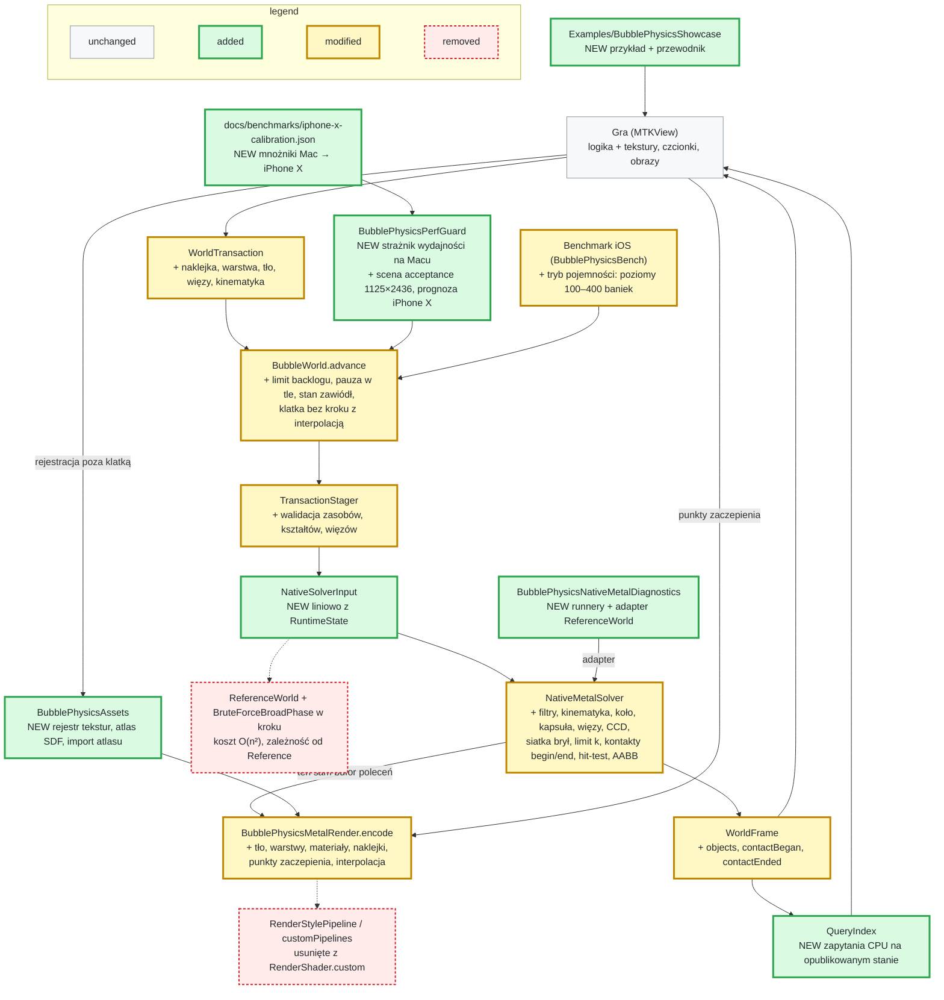
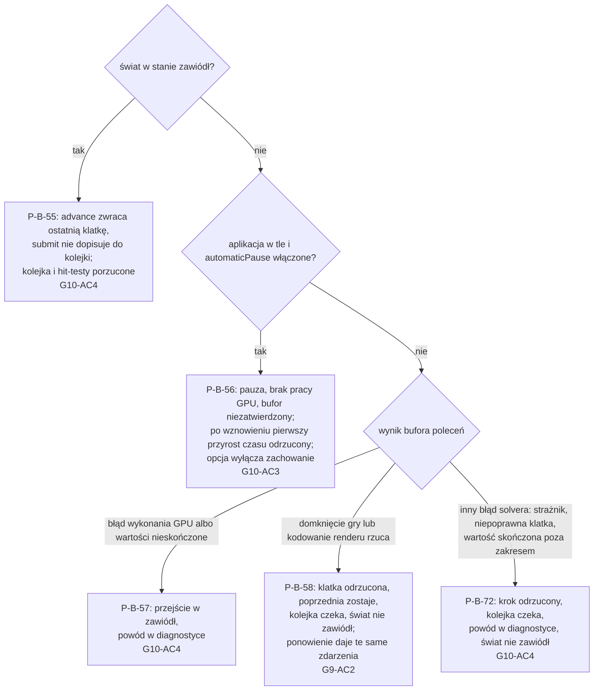

# Plan: Fundamenty silnika BubblePhysics v2 pod wiele gier

> **For agentic workers:** REQUIRED PHASE COMMAND: Run `/tt-agentic-sdlc:implement` with this file's path to execute this plan. It runs one slice per session, and only a slice with tasks. The program design below is binding: build the call trees as drawn, and turn each behaviour into a failing test before you write the code.

**Date:** 2026-11-08
**Artifact:** plan
**Design:** [change-design.md](change-design.md)
**References:** tag `v1.0.0`; tag `archive/magentic-2026-10-25-2kbubbles-engine-owned`; `docs/superpowers/specs/2026-10-15-public-api-design.md`
**Strategy:** slices
**Test command:** `swift test`
**Status:** Approved
**Template version:** default/0.3.3

**Plugin version:** 0.7.7
**Agent Sessions:** claude-code: e8d6c854-cb70-4776-b9ba-d18c56f700bc
**Agent Sessions:** claude-code: aeb2615d-9a85-4c3b-a901-faf3eca8b51d
**Agent Sessions:** claude-code: 2b7e7ccc-107c-4136-b6da-82522abe4a02
**Agent Sessions:** claude-code: 2fea7454-985f-4c59-be17-91c982827ad9
**Agent Sessions:** claude-code: e3fbb109-1820-4cf0-a0ad-a5c05abc81cc
**Agent Sessions:** claude-code: 8417784e-a063-46b8-8229-af06bc7bf049
**Agent Sessions:** claude-code: 844ddf50-d538-427f-8826-239b92c554bd
**Agent Sessions:** claude-code: 6dcb951c-ae2b-4a64-8caf-f2f757ad0e3d
**Agent Sessions:** claude-code: 8da101c0-6471-4b37-a2ba-7d2d0dc0e8e4
**Agent Sessions:** claude-code: 5c0d71ea-6100-4768-9ff7-4d32e31bb715
**Agent Sessions:** claude-code: 1caa01b8-f857-40de-aef5-f7f825e9f409
**Agent Sessions:** claude-code: 3d21f09f-f5e5-4f3b-ad77-3b87bc2d90db
**Agent Sessions:** claude-code: 44f2a1e8-a4d6-443f-b76e-dfb0d9755e73
**Agent Sessions:** claude-code: efdd4fe2-189a-42a3-95c3-d8ec9bd13e8c
**Agent Sessions:** claude-code: f5e1cb1c-7510-48a5-9693-3b61d106c883
**Agent Sessions:** claude-code: b5eaa5be-3565-4b3b-baec-42b84b2de2ba
**Agent Sessions:** claude-code: 3498aa85-24c2-4fa8-8302-8d200a2e2c6f
**Agent Sessions:** claude-code: 367cecbd-09f2-44eb-997f-7189644cc94e
**Agent Sessions:** claude-code: 5f6e7fd2-27bd-4a95-a3e0-4e8d802d3982
**Agent Sessions:** claude-code: ee74dab6-5d01-4bc8-aba7-7006cd7c11c3

---

## Program design

### R0 — Headline

BubblePhysics staje się silnikiem dla wielu gier: gra daje logikę i grafikę, silnik fizykę i rendering. Wersja 2.0.0 daje grze stan obiektów, tekstury, warstwy, naklejki, kinematykę, filtry, kontakty, zapytania, więzy i obraz 120 Hz. Krok traci diagnostykę i pętle O(n²), a pomiar na iPhonie X podaje, ile baniek mieści się w 60 FPS ([CD-D-30](change-design.md#cd-d-30)).

### R1 — The whole flow



Przepływ transakcja → staging → krok GPU i render w jednym buforze → publikacja zostaje. Zmienia się wejście solvera (bez `ReferenceWorld`), wynik kroku (stan obiektów i kontakty) i to, co rysuje renderer. Diagnostyka solvera wychodzi z produkcji do osobnego modułu. Strażnik na Macu prognozuje czas klatki iPhone'a X z mnożników kalibracji, więc optymalizacja nie wymaga pomiaru na urządzeniu po każdej zmianie.

### R2 — Seams — where the change attaches to existing code

Pliki w stanie końcowym całej zmiany. `+` to plik nowy albo zmieniony, `-` usunięty lub przeniesiony.

```diff
+ Package.swift                                  # 2.0.0; + .library BubblePhysicsAssets; NativeMetalDiagnostics w BubblePhysicsBenchmarkSupport; + cel BubblePhysicsPerfGuard z testami; NativeMetal bez Reference; (etap 5) cel i biblioteka BubblePhysicsAssets zależne od BubblePhysicsModel, BubblePhysics, BubblePhysicsMetalRender i BubblePhysicsMetalRenderTests zależą od Assets, + cel BubblePhysicsAssetsTests
  Sources/
    BubblePhysicsPublic/
+     BubbleWorld.swift                          # objects w klatce, zapytania, hitTest async, polityka czasu, pauza, stan „zawiódł”; makeRenderState rysuje koło i kapsułę jako pierścień (etap 3); (etap 5) init(configuration:device:assets:) — nil to pusty rejestr urządzenia świata, rejestr innego urządzenia to błąd; właściwość assets; makeRenderState buduje listę rysowania: tło i warstwy rosnąco z bańkami i bryłami (ObjectID, materiał renderu), bez czujników i pól sił; (etap 6) init(…, lifecycle: LifecycleEventSource?), osobna flaga pauzy automatycznej obok ręcznej pause(); gałąź bez kroku renderuje z α i zatwierdza bufor bez publikacji; pozy t−1 brył zapamiętane przy publikacji; makeRenderState z α, naklejkami i zbiorem snapped; domknięcie glyphLookup do stagera z AssetRegistry; (etap 9, kandydat zadania 100) commitAndWait (:369-374): wznowienie advance po zakończeniu bufora
+     BubbleWorldRenderState.swift               # (etap 8) makeRenderState bez ponownego sortowania wszystkich obiektów i bez nowej tablicy pierścienia bryły co klatkę; (etap 9, kandydat zadania 100) bez sortowania kluczy co klatkę i bez nowych tablic pierścieni koła i kapsuły (odstępstwo 110)
+     Diagnostics.swift                          # (etap 6) didRenderLastAdvance: true tylko wtedy, gdy advance zatwierdziło bufor z renderem, więc gra prezentuje drawable tylko przy true (pauza, „zawiódł” i odrzucona klatka dają false); contactCandidateOverflow i maximumContactCandidatesPerObject (etap 2); (etap 4) suma odrzuconego backlogu, powód „zawiódł”, powód ostatniego odrzuconego kroku lub klatki
+     LifecycleEventSource.swift                 # NEW (etap 6) protokół: willEnterBackground / didBecomeActive; domyślnie powiadomienia UIKit pod canImport(UIKit), na Macu bez zdarzeń; testy wstrzykują fałszywe źródło
      Model/
+       Objects.swift                            # PhysicsBodyProperties z filtrem i zainteresowaniami, MotionRole.kinematic bez wartości powiązanej (etap 2); (etap 3) RigidShape: .polygon(PolygonGeometry), .circle(radius), .capsule(halfLength, radius) z momentOfInertia(mass:) względem środka ciężkości; RigidBodyDescriptor zamiast PolygonDescriptor, momentOfInertia: Float? (nil = liczona); (etap 5) zapisane pole layer: Int32 w BubbleDescriptor i RigidBodyDescriptor (parametr init, domyślnie 0), które obliczane properties (Objects.swift:125, 229) przekazują do PhysicsBodyProperties, renderMaterialID zamiast renderStyleID w deskryptorze bańki i bryły, czujnik i pole sił bez stylu (CD-D-29), pola presentation usunięte ze wszystkich deskryptorów (CD-D-28); (etap 6) pole decal: Decal? w BubbleDescriptor i RigidBodyDescriptor (parametr init, domyślnie nil), jak warstwa
+       Motion.swift                             # (etap 2) KinematicDrive: .velocity(linear, angular), .path(PathDrive), .target(position, rotation) osiągany w jednym kroku
+       Resources.swift                          # RenderMaterial zamiast RenderStyle/RenderShader; (etap 3) PhysicsMaterialKind.rigid zamiast .polygon, maximumLinearSpeed i maximumAngularSpeed w PhysicsMaterial; (etap 5) RenderMaterial: texture TextureID?, color RGBA, blend .opaque/.alpha/.additive, outline (kolor, szerokość w jednostkach świata), bubbleMapping .attached/.masked (domyślnie .attached), uvOffset, uvScale; RenderStyle, RenderShader i PresentationParameters usunięte (CD-D-28)
+       Identifiers.swift                        # CollisionFilter (kategoria, maska); EventInterest.contact; (etap 5) RenderMaterialID zamiast RenderStyleID, ParameterID usunięty (CD-D-28)
+       Decals.swift                             # NEW (etap 5) TextureID; (etap 6) Decal (.text(String, source: .font(FontID) | .atlas(GlyphAtlasID)) | .image(TextureID, rect)), kolor, skala; FontID, GlyphAtlasID z package init jak TextureID
+       Joints.swift                             # NEW (etap 3) Joint: distance (wiotkość, tłumienie), hinge (zakres kąta; silnik: docelowa prędkość kątowa względna i maksymalny moment), weld; kotwice w układzie ciała; collideConnected = false; JointID
+       Queries.swift                            # NEW zapytania i wyniki (point, rect, circle, raycast, hitTest)
+       Transitions.swift                        # (etap 5) bez celów renderStyle i objectPresentation (CD-D-28)
+       WorldTransaction.swift                   # setKinematicDrive(ObjectID, KinematicDrive), dla innej roli incompatibleMotionRole; gra podaje nowy cel transakcją przed krokiem; BubbleResult z filtrem (etap 2); WorldObject.rigidBody, replaceRigidBodies zamiast replacePolygons, addJoint, removeJoint (etap 3); (etap 5) updateRenderMaterial zamiast updateRenderStyle, setLayer(ObjectID, Int32), setBackground(TextureID?), BubbleResult z renderMaterialID i warstwą, bez presentation; (etap 6) setDecal(ObjectID, Decal?), BubbleResult.decal
+       WorldFrame.swift                         # objects (sam ObjectState leży w WorldTransaction.swift); contactBegan/contactEnded; nowe TransactionRejectionReason; (etap 3) ObjectState.Kind .circle(radius:) i .capsule(halfLength:radius:), TransactionReceipt.removedJointIDs, powody jointNotFound, duplicateJointID, unsupportedJointBody; (etap 5) renderMaterialNotFound zamiast renderStyleNotFound, textureNotFound, layerNotSupported; (etap 6) fontNotFound, glyphAtlasNotFound, characterNotInGlyphSet(Character), decalNotSupported
+       WorldConfiguration.swift                 # maximumBacklog (0,25 s, etap 4); automaticPause, domyślnie true (etap 6)
    BubblePhysicsRuntime/
+     TransactionStager.swift                    # RuntimeState: warstwy, naklejki, więzy, tło; staging nowych operacji; filtr w resultDescriptor i odrzucenie kinematycznej bańki (etap 2); (etap 3) RuntimeState.joints, walidacja więzów (role: dynamic, motorDriven, playerDriven; static i kinematic tylko jako jeden koniec; pathDriven odrzucony), usunięcie więzów przy remove, replaceRigidBodies, scaleniu i podziale; (etap 5) RuntimeState.renderMaterials zamiast renderStyles i background, RuntimeObject bez presentation; RuntimeObject.layer startuje z deskryptora, a setLayer zmienia tylko je (deskryptory mają pola let), więc lista rysowania i NativePublicObject czytają RuntimeObject.layer; stageBatch(…, textureExists:) z AssetRegistry.contains, więc Runtime nie zależy od Assets; walidacja tekstur materiału i tła, setLayer tylko dla bańki i bryły, warstwa wyniku scalenia i podziału z BubbleResult; (etap 6) RuntimeObject.decal startuje z deskryptora, setDecal zmienia tylko je; stage i stageBatch(…, glyphLookup:) z domknięciem jak textureExists; naklejka wyniku scalenia i podziału z BubbleResult w resultDescriptor
+     CompleteStep.swift                         # CompletedRuntimeStep + licznik przepełnienia kandydatów (etap 2); (etap 4) protokół CompleteStepper ma jedną metodę kroku completeStep(_:duration:hitTests:commandBuffer:beforeCommit:) (commandBuffer opcjonalny, hitTests puste do zadania 41) i hak didPublish(_:) z pustą implementacją domyślną; wyniki hit-testu w CompletedRuntimeStep.hitTestResults; (etap 6) CompletedRuntimeStep.snappedObjectIDs
+     NativeCompleteStepper.swift                # przekazuje [NativePublicObject] (już liniowo); RuntimeState.publishedObjectStates() dla BubbleWorld (etap 1); historia par kontaktu dla contactEnded (etap 2); (etap 3) więzy do NativePublicWorld, AABB koła i kapsuły; (etap 4) previousContacts zmieniane w didPublish, a nie w completeStep; żądania hit-testu do NativePublicWorld; gdy krok GPU jest pominięty (w świecie nie ma żadnej bańki ani bryły), każdy hit-test daje nil; (etap 5) materiały renderu zamiast styles, warstwa do NativePublicObject; (etap 6) snappedObjectIDs: zawinięcia z NativePublicFrame plus utworzone, zastąpione, scalone i podzielone z operacji partii; (etap 8) krok bez pełnych kopii RuntimeState.objects przy zapisie, scalanie wyniku i publishedObjectStates bez wielokrotnych wyszukiwań w słowniku na obiekt; wynik bit w bit bez zmian; (etap 9, kandydat zadania 100) bez kopii batch.state i renderPreparedState (odstępstwo 110)
+     FixedStepDriver.swift                      # limit backlogu (etap 4); (etap 6) interpolationFraction = min(backlogSeconds / fixedTimeStep, 1), discardNextAdvance() po wznowieniu
+     MotionControllers.swift                    # KinematicDrive → narzucona prędkość na krok; inercja z RigidShape dla momentu silnika, limity przy odbudowie materiału w przejściach (etap 3); (etap 5) bez gałęzi przejść renderStyle i objectPresentation (MotionControllers.swift:181-217); (etap 8) prepare i feedback bez trzech sortowań kluczy na krok
+     EventCompactor.swift                       # (etap 2) sortuje zdarzenia kroku po parze: contactBegan przed mergeContact; contactEnded przy usunięciu, scaleniu, podziale i wyjściu z regionu; przy przepełnieniu żadnego końca bez początku
      StructuralOperations.swift                 # bez zmian: więzy baniek źródłowych usuwa TransactionStager.remove (odstępstwo nr 25), naklejkę wyniku daje resultDescriptor
+     RegionPolicy.swift                         # (etap 3) remove usuwa też więzy obiektów, które opuściły region, bez potwierdzenia
+     QueryIndex.swift                           # NEW (etap 4) siatka z RuntimeState (filtr, kształt, poza; bez czujników i pól sił), budowana przy pierwszym zapytaniu po publikacji, więc najwyżej raz na publikację; point, rect, circle, raycast; dokładny test punktu dla brył
    BubblePhysicsAssets/                         # NEW moduł (etap 5; SDF i atlas w etapie 6)
+     AssetRegistry.swift                        # (etap 6) register(font:characters:) -> FontID, register(glyphAtlas:) -> GlyphAtlasID, glyph(_:in:) dla stagera i renderera, AssetError.fontNotFound i invalidGlyphAtlas; (etap 5) @MainActor, rejestr per MTLDevice: CGImage (dekodowany raz do rgba8Unorm) | MTLTexture 2D → TextureID; błąd w wywołaniu dla nieobsługiwanego formatu i innego urządzenia; contains(_:) dla stagera; urządzenie porównywane po registryID, a package init(device:deviceRegistryID:) to szew testowy innego urządzenia (Mac ma jedno MTLDevice)
+     SDFAtlasGenerator.swift                    # NEW (etap 6) Core Text: raster glifu w wysokiej rozdzielczości → transformata odległości na CPU → atlas r8Unorm z metrykami; 1× = glif 32 px; tylko w wywołaniu rejestracji
+     GlyphAtlas.swift                           # NEW (etap 6) atlas glifów: tekstura, metryki na znak (prostokąt UV, rozmiar, przesunięcie, przesuw), flaga SDF albo zwykła alfa; wspólny dla obu źródeł
    BubblePhysicsNativeMetal/
+     NativeSolverInput.swift                    # NEW (etap 1) neutralne wejście i wynik solvera (NativeSolverInput, NativeSolverFrame); (etap 4) punkty hit-testu w wejściu, wyniki w wyniku
+     NativePublicWorld.swift                    # step(objects:) buduje NativeSolverInput liniowo, bez ReferenceWorld; zdarzenia regionu przez słownik (etap 1); filtr i rola kinematic w rekordach, agregacja przejść kontaktu po parze ObjectID, odcinki po ownerID (etap 2); (etap 3) .rigidBody do brył, odcinki tylko ze statycznego wielokąta, więzy w NativePublicSettings, limity prędkości w rekordach; (etap 4) step(…, hitTests:) i wyniki w NativePublicFrame; (etap 6) wrappedObjectIDs w NativePublicFrame z regionWraps i wrappedPolygons, bez względu na zainteresowanie didWrap; (etap 5) warstwa w NativePublicProperties i rekordach brył, ID materiału renderu w resources.y zamiast ID stylu, bez słownika presentation; (etap 8) wejście i scalanie wyniku bez trzech słowników 300 obiektów na klatkę i bez sortowania już posortowanych baniek; (etap 9, kandydat zadania 100) bez sortowania dopisanych baniek i obiektów oraz bez result, properties i interested budowanych co klatkę (odstępstwo 110)
+     NativeMetalSolver.swift                    # executeFrame(input:) zastępuje executePublicFrame(world:) i executeFrame(world:) (etap 1); wiersze kandydatów i cache n·k, adjacencySlots i fastCandidates usunięte, przepełnienie to licznik (etap 2); (etap 3) dispatch nativeRigidResolveCCD, nativeRigidApplyCCD (odstępstwo nr 28), nativeSolveJoints, nativeApplyJointBodies, nativeApplyJointBubbles i ich wpisy w NativeMetalPipelineCache.stageNames; hasRigidBodies także przy statycznym kole i kapsule; (etap 4) dispatch nativeHitTest przed endEncoding i wpis w stageNames, odczyt wyników po zakończeniu bufora; (etap 6) handoff roboczy i opublikowany niosą też stronę konturów t−1 (druga połowa ping-pong) i bubbleIDs kroku t−1, bez kopii w zwykłym kroku; ponowne przydzielenie stanu kopiuje też opublikowane punkty konturów bańka po bańce z przeliczeniem contourStride, jak deformację (:363-366); flaga previousContoursValid gaśnie przy kroku bez publikacji; (etap 8) profil dostaje znaczniki początku kodowania i końca oczekiwania; jeden słownik poprzedniego kroku zamiast dwóch (:406-407); odczyt po GPU bez kopii, których klatka nie używa (klucze kandydatów :1016); (etap 9) kontynuacja po addCompletedHandler w NativeMetalCommandExecutor.complete (:28-41) jako kandydat zadania 100; bariery tylko między zależnymi dispatchami, puste przebiegi naprawy zawierania i reszty solvera, sortowanie, skany i walidacja N×N krótsze, bez zmiany bitów wyniku
+     NativeMetalBackend.swift                   # bez @_exported import BubblePhysicsReference
+     NativeMetalBufferLayout.swift              # NativeMetalSnapshot(input:); AABB w NativeMetalBubble; filtr, rola (etap 2); limity prędkości bańki w deformation.zw (etap 3); (etap 5) warstwa w filter.w rekordu bańki jako Int32 z odwróconym bitem znaku, więc porządek uint zgadza się z Int32; rozmiar rekordu bez zmian; nativeHitTest zwraca bestLayer w tym zapisie, publiczny wynik nie ma warstwy, a test kernela, który ją sprawdza, odwraca bit z powrotem; (etap 8) NativeMetalFrameProfile + encodingStartNanoseconds i waitingEndNanoseconds w zegarze DispatchTime.uptimeNanoseconds, jak benchmark; NativeMetalSnapshot.init bez słownika previousByID budowanego co klatkę; (etap 9, kandydat zadania 100) previousByID i previousSegmentsByID nadal co klatkę (odstępstwo 107)
+     NativeRigidPolygonState.swift              # prepare O(k) (etap 1); kontakty brył z listy kandydatów z kluczem pary zamiast slotów P·n+P², kinematyka z odwrotną masą 0 (etap 2); (etap 3) NativeRigidBody 128 → 160 B: pole shape (rodzaj rdzenia, promień, półdługość) i limits (prędkość liniowa, kątowa); rdzeń: punkt, odcinek albo trójkąty; inercja z RigidShape; ścieżka brył włączona także przez statyczne koło i kapsułę; (etap 5) warstwa w filter.w, jak w rekordzie bańki
+     NativeJointState.swift                     # NEW (etap 3) rekordy więzów posortowane po JointID (z sondą ABI), listy więzów na bryłę i na bańkę, posortowane listy partnerów bez collideConnected, bufory korekt
+     NativeMetalRenderHandoff.swift             # (etap 5) package struct NativeRenderMaterial (rekord materiału na obiekt, lustro w NativeRenderKernels, sonda ABI w NativeMetalShaderABITests); bufory punktów, liczników i rekordów dla rysowania warstwami; drawAll zastąpione rysowaniem przez bufor indeksów instancji; (etap 6) bufory punktów i rekordów t−1 obok bieżących, previousBubbleIndexByID; NativeRenderInstance 8 → 16 B (indeks t−1 albo 0xFFFFFFFF = bez interpolacji, α) z sondą ABI; rekord instancji naklejki z sondą ABI
+     Shaders/NativeGeometryKernels.metal-source # filtr w kandydatach, wiersz k posortowany po kluczu, nativeRigidEmitCandidates w wierszach brył (etap 2); (etap 3) odległość rdzeni z promieniem, statyczne koło i kapsuła dostają kandydatów baniek, pomijanie par połączonych więzem bez collideConnected w nativeEmitCandidates i nativeRigidEmitCandidates; (etap 4) nativeHitTest: wątek na punkt, kontury baniek (parzystość przecięć jak nativeSelectDeformedContour z tagu magentic) i dokładne bryły (trójkąty, koło, kapsuła), wygrywa największa para (warstwa, ObjectID), warstwa 0 do etapu 5; (etap 5) warstwa z filter.w zamiast 0; (etap 9) jądra łańcucha fizyki skrócone albo połączone bez zmiany bitów wyniku
+     Shaders/NativeXPBDKernels.metal-source     # kontakty brył po liście kandydatów z sumą normalnych Δλ, kinematyka, licznik przepełnienia (etap 2); (etap 3) kontakty koła i kapsuły z rdzeni, nativeSolveJoints i zbieranie korekt (nativeApplyJointBodies, nativeApplyJointBubbles; bańka tylko w positions[]), obcięcie prędkości bańki w nativeUpdateVelocities; (etap 9) jądra łańcucha fizyki skrócone albo połączone bez zmiany bitów wyniku
+     Shaders/NativePostSolveKernels.metal-source# AABB konturu (etap 1); (etap 3) rdzeń w przemiataniu, ścianach, AABB i czujnikach; nativeRigidResolveCCD; obcięcie prędkości w nativeRigidPredict i nativeRigidFinish; (etap 9) jądra łańcucha fizyki skrócone albo połączone bez zmiany bitów wyniku
+     Shaders/NativeRenderKernels.metal-source   # (etap 5) wierzchołek bańki z bufora indeksów instancji: uv z kąta próbki 2π·i/counts[b], środek, promień docelowy; wierzchołek bryły z lokalnymi współrzędnymi; pas obrysu wewnątrz konturu w tym samym wywołaniu; fragment materiału (tekstura × kolor; pod maską koło o promieniu docelowym, poza nim sam kolor) i tła; (etap 6) wierzchołek bańki miesza punkty t−1 i t po indeksie próbki z α; nativeDecalVertex i nativeDecalFragment: czworokąt glifu lub obrazu, SDF albo alfa, maska radialna konturu i koło odniesienia; (etap 9) zmiany według podziału renderu z punktu kontrolnego 9, bez zmiany pikseli; kandydat: materiał z wierzchołka ([[flat]]) zamiast odczytu rekordu materials[in.material] na fragment w nativeBubbleFragment i nativeBodyFragment (odrzucenie pikseli naklejki o pokryciu 0 już jest, :406)
-     NativeMetalBenchmarkRunner.swift          # → NativeMetalDiagnostics
-     NativeMetalWorldRunner.swift              # → NativeMetalDiagnostics
-     VisualSimulationDriver.swift              # → NativeMetalDiagnostics
-     NativeMetalVisualReplay.swift             # → NativeMetalDiagnostics
-     NativeMetalQualityEnvelope.swift          # → NativeMetalDiagnostics
    BubblePhysicsNativeMetalDiagnostics/         # NEW (etap 1) moduł: 5 plików powyżej + adapter
+     ReferenceSolverInputAdapter.swift          # ReferenceWorld → NativeSolverInput, NativeSolverFrame → typy Reference
    BubblePhysicsMetalRender/
+     BubblePhysicsMetalRender.swift             # (etap 5) init(device:assets:); encode: tło → warstwy rosnąco → bańki, potem bryły, jedno wywołanie na ciąg sąsiednich po ObjectID obiektów z tym samym (trybem mieszania, teksturą); (etap 6) encode(…, hooks: RenderHooks = .none); zakres ciągów na warstwę; po bańkach warstwy ich naklejki, po bryłach naklejki brył; haki afterBackground, afterLayer(n), overlay z macierzą świat→clip z Viewport; po haku powiązania buforów od nowa; (etap 9) pula buforów areny zamiast makeBuffer co klatkę (makeArena :308-321): bufor wraca do puli w addCompletedHandler swojego bufora poleceń (wątek Metala, więc pula pod OSAllocatedUnfairLock, bo Mutex wymaga iOS 18), drugie encode w tym samym buforze albo przy klatce w locie dostaje inny bufor, a bufor poleceń bez commit nie oddaje bufora, więc pula bez wolnego bufora przydziela nowy i trzyma najwyżej 3; package var arenaAllocationCount jako szew testu; kodowanie na iPhonie wzrosło między kalibracją a punktem kontrolnym 8 z 2,00 do 2,42 ms
+     MaterialPipelines.swift                    # NEW (etap 5) pipeline per (geometria, tryb mieszania, format) (odstępstwo nr 64); wypełnia NativeRenderMaterial z RenderMaterial; (etap 6) geometria .decal
+     DecalRenderer.swift                        # NEW (etap 6) układa glify tekstu (wyśrodkowane w kotwicy, skala względem promienia odniesienia) i fragment obrazu w instancje naklejek warstwy; (etap 8) układ glifów bez tablicy na naklejkę i na glif; (etap 9, kandydat zadania 100) bez tablicy wierzchołków na naklejkę i tablicy na glif (odstępstwo 110)
+     RenderHooks.swift                          # NEW (etap 6) public struct RenderHooks: afterBackground, afterLayer: [Int32: hak], overlay; hak (MTLRenderCommandEncoder, simd_float4x4) throws
-     RenderStylePipeline.swift                 # (etap 5) usunięty razem z customPipelines i makeContourVertexFunction
+     PublicWorldStressBenchmark.swift           # API v2; Stress300Scene (etap 1); package enum MixedScene i run(scene:) (etap 3); materiał renderu zamiast stylu (etap 5); (etap 6) Scene.decals: stress-300 z teksturą przyklejoną i naklejką tekstową na każdej bańce, render w pomiarze; (etap 7) Scene publiczne z przypadkiem .acceptance (decals + trójkąt w roli kinematic z KinematicDrive + połowa baniek na warstwie 1 z materiałem alfa), metody sceny zostają package; public measure(device:scene:renderSize:progress:) renderuje poza ekranem w zadanym rozmiarze w pikselach; renderSize nil (domyślnie, także w run dla PerfGuard i testów) daje dzisiejsze 375 × wysokość regionu; raport z publicznymi renderWidth i renderHeight (linia render_px=WxH, szew testu), linią contact_candidate_overflow=…; max_candidates_per_object=…; candidate_limit=128 i bramką sceny (akceptacyjna 16,67 ms, pozostałe 10,4568 ms); sceny stress-300, mixed i decals bez zmian, więc punkty odniesienia strażnika obowiązują; (etap 8) raport + host_preparation_p95_ms (początek advance → początek kodowania) i host_publication_p95_ms (koniec oczekiwania → powrót advance); druga seria na świeżym świecie tej samej sceny (ta sama rozgrzewka i te same indeksy kroków stepTransaction(step:)) z pustym encodeRender daje gpu_physics_p95_ms, a gpu_render_estimate_ms = gpu_p95_ms − gpu_physics_p95_ms; (etap 9) dwie serie podziału renderu na świeżym świecie tej samej sceny: pass z samym czyszczeniem celu (gpu_render_clear_estimate_ms) i render bez naklejek (gpu_render_decals_estimate_ms = gpu_p95_ms − p95 tej serii); (etap 9) tryb pojemności: public measureCapacity(device:progress:) i PublicWorldCapacityReport, scena akceptacyjna z n bańkami i torem trójkąta odwzorowanym w osi y, cel renderu 1125 × ⌊2436·H/700⌋, run bez serii podziału renderu, ThermalCooldown i CapacityRule; Scene.acceptance i strażnik bez zmian (n = 300)
  Benchmarks/
+   macOS/BubblePhysicsPerfGuard/main.swift      # NEW (etap 1) strażnik: swift run -c release BubblePhysicsPerfGuard
+   macOS/BubblePhysicsPerfGuard/PerfGuard.swift # NEW (etap 1) p95, mediana z 5, porównanie z punktem odniesienia, skalowanie 600/300, --record; scena "mixed" (etap 3); scena "decals" (etap 6); (etap 8) scena "acceptance" w 1125×2436 (renderSize w measureScene), --scene <nazwa>, linia STAGES ze składowymi (mediany z przebiegów), --calibrate <raport iPhone'a> i --check-prediction <raport iPhone'a>; linia PREDICT zawsze, gdy jest plik kalibracji; prognoza nie zmienia kodu wyjścia poza --check-prediction
+   macOS/BubblePhysicsPerfGuard/DevicePrediction.swift # NEW (etap 8) parser raportu iPhone'a (linie klucz=wartość), kalibracja mnożników, prognoza p95 iPhone'a X i jej błąd względem raportu; (etap 9) składowa CPU prognozy jako suma składowych z własnymi mnożnikami z pól iphone i mac, linia PREDICT_CPU
+   macOS/BubblePhysicsReferenceBench/main.swift # import NativeMetalDiagnostics zamiast NativeMetal
+   iOS/BubblePhysicsBench/App/PublicWorldStressView.swift # (etap 7) wybór sceny (stress-300, mixed, decals, acceptance), rozmiar renderu z UIScreen.main.nativeBounds; (etap 9) wybór „capacity” z measureCapacity, postęp poziomu i czekania na schłodzenie z wywołania zwrotnego zamiast stałej 660, raport przez „Kopiuj raport”
+   iOS/BubblePhysicsBench/project.yml           # (etap 7) + BubblePhysicsAssets; .xcodeproj regenerowany przez xcodegen
+ Examples/BubblePhysicsShowcase/                # NEW (etap 7) wzorem Benchmarks/iOS/BubblePhysicsBench: project.yml, Signing.xcconfig z #include? "Signing.local.xcconfig", Signing.local.xcconfig.example, wpis Signing.local.xcconfig w .gitignore, .xcodeproj z xcodegen; produkty BubblePhysics, BubblePhysicsMetalRender, BubblePhysicsAssets
+   App/ShowcaseApp.swift                        # NEW @main, przełącznik dwóch scen
+   App/MetalHostView.swift                      # NEW UIViewRepresentable z MTKView (wzór StressDrawableView z tagu magentic), delegat draw(in:), dotyk → chwyt palcem
+   App/ShowcaseScene.swift                      # NEW protokół sceny: konfiguracja, rejestracja zasobów, transakcja startowa, reakcja na zdarzenia
+   App/BubbleScene.swift                        # NEW bańki z teksturami (CGImage generowany w kodzie) i naklejkami, scalanie po mergeContact, chwyt palcem
+   App/RigidScene.swift                         # NEW koło, kapsuła, wielokąty, więzy (dystans, zawias, spaw), platforma kinematyczna
  Tests/
+   BubblePhysicsNativeMetalDiagnosticsTests/    # NEW (etap 1) 17 plików przeniesionych z BubblePhysicsNativeMetalTests (lista pod drzewem); zależy od Diagnostics, NativeMetal, Reference; w etapie 2 test przepełnienia w NativeMetalBroadPhaseTests sprawdza licznik zamiast odrzucenia klatki
+   BubblePhysicsAssetsTests/                    # NEW rejestr (etap 5), SDF i atlas (etap 6)
+   BubblePhysicsPerfGuardTests/                 # NEW (etap 1) logika porównania strażnika, @testable import celu wykonywalnego; (etap 8) parser raportu, kalibracja, prognoza i --check-prediction na wstrzykniętych liczbach; (etap 9) prognoza CPU ze składowych: na commicie kalibracji równa host_non_gpu raportu, składowe w różnych kierunkach, mnożnik łączny dla reszty Maca ≤ 0,1 ms
+   BubblePhysicsMetalRenderTests/Support/OffscreenRenderHarness.swift # NEW (etap 5) wspólny render 256×256 i próbkowanie pikseli; zastępuje prywatne pomocniki 64×64 z MetalRenderIntegrationTests.swift:416-433
+   BubblePhysicsPublicTests/, BubblePhysicsRuntimeTests/, BubblePhysicsNativeMetalTests/, BubblePhysicsMetalRenderTests/ # API v2 i nowe testy
+   BubblePhysicsPublicTests/MigrationGuideTests.swift   # NEW (etap 7) każdy symbol z docs/migration/v1-api-diff.txt ma wpis w MIGRATION-v2.md; README podaje 2.0.0 i odsyła do obu dokumentów; korzeń repo przez #filePath jak PackageGraphTests
+   BubblePhysicsPublicTests/IntegrationGuideTests.swift # NEW (etap 7) każdy blok swift przewodnika ma znacznik <!-- guide-region: nazwa --> (blok bez znacznika to błąd) i jest równy regionowi // guide-region: nazwa … // guide-region-end w Examples/BubblePhysicsShowcase/App; każdy region użyty; siedem tematów z G13-AC2
+   BubblePhysicsMetalRenderTests/AcceptanceSceneTests.swift # NEW (etap 7) skład sceny akceptacyjnej, render w zadanym rozmiarze, pola raportu i bramka sceny; (etap 8) linie składowych raportu i druga seria bez renderu
+   BubblePhysicsMetalRenderTests/CapacityMeasurementTests.swift # NEW (etap 9) wymiary celu i obszaru poziomów, odstępy obwiedni trójkąta, poziom 300 równy scenie akceptacyjnej, krótki przebieg każdego poziomu, termika na wstrzykniętym stanie i zegarze, reguła pojemności na wstrzykniętych poziomach, format raportu
+   BubblePhysicsMetalRenderTests/AcceptanceEquivalenceTests.swift # NEW (etap 8) hash frame.objects i konturów sceny akceptacyjnej po 120 krokach równy wzorcowi zapisanemu w teście przed optymalizacją (urządzenie, kroki, oba hashe, commit); na innym urządzeniu XCTSkip
+   BubblePhysicsMetalRenderTests/Support/PublishedStateHash.swift # NEW (etap 8) hash bitów stanu obiektów i konturów wydzielony z PublishedStateDeterminismTests
+   BubblePhysicsMetalRenderTests/AcceptanceRenderEquivalenceTests.swift # NEW (etap 9) hash pikseli renderu sceny akceptacyjnej po 120 krokach w 1125×2436 równy wzorcowi zapisanemu przed zmianą renderu (Apple M1 Pro, inaczej pominięty)
+   BubblePhysicsMetalRenderTests/RenderArenaTests.swift # NEW (etap 9) dwie kolejne klatki z tego samego bufora areny; dwa encode w jednym buforze poleceń z różnych buforów; bufor poleceń bez commit nie blokuje kolejnych klatek; pula ≤ 3 bufory
  docs/
+   MIGRATION-v2.md                              # NEW (etap 7) zamiennik każdego symbolu v1
+   integration-guide.md                         # NEW (etap 7) fragmenty z oznaczonych regionów przykładu
+   migration/v1-api-diff.txt                    # NEW (etap 7) wynik swift-api-digester -diagnose-sdk v1.0.0 → HEAD dla modułów BubblePhysics, BubblePhysicsModel i BubblePhysicsMetalRender, powtarzalny: worktree v1 w .build/v1-worktree, w nagłówku polecenia ze ścieżkami względnymi; dane testu MigrationGuideTests
+   benchmarks/v2-iphone-x-<data>.md             # NEW (etap 7, właściciel) raport sceny akceptacyjnej z urządzenia; (etap 8) v2-iphone-x-calibration.md i v2-iphone-x-checkpoint-8.md z liniami składowych, (etap 9) v2-iphone-x-checkpoint-9.md w połowie etapu i raport pomiaru pojemności v2-iphone-x-capacity.md (zamiast v2-iphone-x-final.md)
+   benchmarks/iphone-x-calibration.json         # NEW (etap 8) commit, składowe iPhone'a z raportu i Maca (mediany z 5 przebiegów) z tego samego commitu, mnożniki r_cpu i r_fiz, render iPhone'a; (etap 9) ponownie z raportu punktu kontrolnego 8 (commit 2c22f84), potem z punktu kontrolnego 9
+   benchmarks/perf-guard.json                   # NEW (etap 1) punkty odniesienia strażnika; nowy punkt po każdym etapie, który poprawił wynik; (etap 8) punkt sceny acceptance
+ README.md                                      # v2; (etap 4) akapit o błędzie kroku (README.md:55) opisuje stan „zawiódł” i odrzucenie klatki; (etap 5) szybki start (README.md:28-35) na RenderMaterial i rejestrze, BubblePhysicsAssets w tabeli produktów; (etap 6) reguła prezentacji drawable według didRenderLastAdvance zamiast lastAdvanceIssue == nil, pauza w tle, naklejki w tabeli produktów; komentarz advance w BubbleWorld.swift:311 opisuje render bez kroku; (etap 7) wersja 2.0.0, odnośniki do MIGRATION-v2.md i integration-guide.md, sekcja benchmarku: wybór sceny, bramka 16,67 ms sceny akceptacyjnej, wynik z iPhone'a X; (etap 8) sekcja benchmarku: pomiar zastępczy na Macu, kalibracja i prognoza
```

Krok i render po zmianie. Gra woła `advance` raz na klatkę `MTKView`, a w domknięciu `encodeRender` woła renderer.

```text
BubbleWorld.advance(by:commandBuffer:encodeRender:)
├── stan „zawiódł” / pauza (ręczna lub automatyczna) # zwraca ostatnią klatkę; w pauzie bufor zostaje niezatwierdzony
├── pierwsze advance po wznowieniu z tła             # (etap 6) przyrost czasu odrzucony
├── FixedStepDriver.accumulate(_:) -> Bool         # false nadal daje .timeAccumulatorOverflow; + obcięcie do maximumBacklog, nadmiar do diagnostyki; α = zaległość / krok
├── [krok wypada, najwyżej jeden na bufor]
│   ├── TransactionStager.stageBatch(pending, against: state, validate:, textureExists:)   # + zasoby, kształty, więzy, kinematyka; textureExists z AssetRegistry.contains
│   └── NativeCompleteStepper.completeStep(batch, …)
│       ├── MotionControllers.prepare(&state)       # + KinematicDrive
│       ├── NativePublicWorld.step(objects:…)       # buduje NativeSolverInput liniowo, bez ReferenceWorld (etap 1)
│       │   └── NativeMetalSolver.executeFrame(input:)
│       │       ├── predict → siatka baniek i brył → kandydaci (filtr, limit k) → kontakty
│       │       ├── pętla XPBD: kontakty + więzy + kinematyka → CCD → limit prędkości
│       │       ├── kontury (+ AABB, kopia t−1) → hit-testy z kolejki → begin/end kontaktu
│       │       └── beforeCommit(handoff) → encodeRender()   # gra: BubblePhysicsMetalRender.encode(..., hooks:)
│       └── EventCompactor.finish                   # contactBegan → mergeContact; contactEnded
├── [krok nie wypada, jest bufor] (etap 6)        # dziś: nic nie rysuje, bufor niezatwierdzony (BubbleWorld.swift:350, :421)
│   ├── makeRenderState(publishedRenderHandoff, α)  # kontury t−1 → t, pozy brył t−1 → t, snapped bez interpolacji
│   ├── encodeRender()                              # błąd → .frameRejected, nic nie publikowane
│   └── commit i oczekiwanie na ukończenie          # jak dzisiejsza gałąź .notEnqueued (BubbleWorld.swift:372-383): status ≠ completed → „zawiódł”
│                                                   # (WorldRenderCommandError.failed); bez publikacji, lastFrame bez zmian
└── publikacja WorldFrame(objects: state.publishedObjectStates()) → pozy t−1 zapamiętane → QueryIndex unieważniony → wyniki hitTest wznawiają oczekujących
```

Błąd z `completeStep` trafia do jednego `catch` w `BubbleWorld.advanceImpl`, który po zmianie wybiera skutek według rodzaju błędu (etap 4). `BubbleWorld` opakowuje domknięcie `encodeRender` gry raz, na wejściu do `advanceImpl`: każdy błąd z niego wychodzi jako prywatny typ, zarówno w `beforeCommit`, jak i w gałęzi bez kroku GPU (`commandBuffer.status == .notEnqueued`), więc da się go odróżnić od błędu solvera.

```text
BubbleWorld.advanceImpl  catch
├── NativeMetalSolverError.commandFailed, WorldRenderCommandError.failed   # status bufora ≠ completed → „zawiódł”
├── NativeMetalSafetyFailure z .nonFinite (tylko NaN i ±∞)                 # → „zawiódł”
├── opakowany błąd encodeRender / domknięcia gry                           # → klatka odrzucona, kolejka czeka
├── pozostałe: guardFailure, invalidFrame (także skończone wartości poza zakresem), invalidSnapshot, frameInFlight
│                                                                          # → krok odrzucony, kolejka czeka, powód w diagnostyce
└── CancellationError                                                      # → .advanceCancelled, bez zmian
„zawiódł”: kolejka i oczekujące hitTest porzucone (nil); advance zwraca ostatnią klatkę;
           submit nie dopisuje do kolejki i zwraca token, którego żadna klatka nie potwierdzi
```

Gałęzie drzewa to kolejno [P-B-57](#p-b-57) (dwie pierwsze), [P-B-58](#p-b-58) i [P-B-72](#p-b-72), a stan „zawiódł” to [P-B-55](#p-b-55). Stepper zmienia swój stan między krokami (`previousContacts`) dopiero w `didPublish`, które `BubbleWorld` woła po publikacji klatki. Odrzucony krok lub klatka zostawiają więc stepper bez zmian.

Solver zgłasza dziś `.nonFinite` także dla skończonych wartości poza zakresem: deformacja spoza [0, 1] (`NativeMetalSolver.swift:1030`), promień efektywny większy od docelowego (`:1033`), odwrócony AABB (`:1039`) i na GPU ujemny mnożnik w cache kontaktów, który ustawia bit 1 w `safetyResult.counts.w` (`NativePostSolveKernels.metal-source:337`). Po zmianie zgłaszają one `.invalidFrame` (na GPU bit 4), więc błąd zaokrąglenia odrzuca tylko krok, a „zawiódł” dają wyłącznie NaN i ±∞, jak wymaga [G10-AC4](change-design.md#g10-ac4).

Kontakty po zbudowaniu etapu 2 (odstępstwa nr 13, 14 i 17). Pary baniek idą przez siatkę i cache, a pary z bryłą przez osobne wiersze brył z tym samym k i kluczem pary (k = 128 od etapu 3, odstępstwo nr 31). Przejścia kontaktu liczy CPU z obu źródeł. Przepełnienie zwiększa licznik zamiast kończyć klatkę błędem.

```text
NativeMetalSolver.executeSnapshot
├── nativePrepareGrid / nativeBuildGrid / nativeSortGrid   # tylko bańki i odcinki
├── nativeEmitCandidates                                   # bańka–bańka, bańka–odcinek; filtr obustronny;
│                                                          # wiersz k posortowany po kluczu, nadmiar → licznik
├── scan → nativeCompactCandidates → nativeBuildContacts
├── nativeMatchContactCache / Retain / Compact             # pary baniek i bańka–odcinek
├── nativeEmitAdjacency → nativeBuildAdjacency             # wiersz k zamiast adjacencySlots
├── nativeRigidEmitCandidates                              # wątek na bryłę, raz na krok: bańka–bryła (rodzaj 2), bryła–bryła (rodzaj 3)
│                                                          # w wierszach brył; para brył w wierszach obu, bez atomików
├── pętla iteracji
│   ├── nativeUpdateContactMultipliers / nativeSolveJacobi # pary baniek
│   └── nativeRigidContacts                                # po wierszach brył; suma normalnych Δλ w metadata.w
├── nativeResolveCCD                                       # flaga szybkiego kandydata liczona tu (bez fastCandidates)
├── nativeFinalizeSolverContacts
└── nativeCompactMergeEvents
NativePublicWorld.contactTransitions                       # CPU: cache baniek + NativeRigidPolygonState.contactRecords();
                                                           # początek i koniec z contactHistory, pary posortowane; odcinki po ownerID
EventCompactor.finish                                      # porządek po parze, contactBegan przed mergeContact; contactEnded z usunięć
```

Bryły i więzy po zmianie (etap 3). Każda bryła to rdzeń z promieniem: koło to punkt, kapsuła odcinek, a wielokąt trójkąty z promieniem 0. Para wielokąt–wielokąt zostaje na obecnym SAT trójkątów, a pozostałe pary liczą odległość rdzeni minus promienie. Gdy rdzenie się przecinają (punkt koła albo odcinek kapsuły we wnętrzu trójkąta, odległość 0), kontakt bierze oś najmniejszego wnikania z SAT trójkąta wobec rdzenia, powiększoną o promień; dla dwóch punktów w tym samym miejscu normalna to stała oś (1, 0) skierowana od mniejszego `ObjectID`, więc wynik jest skończony i deterministyczny. Bryły nie są ciałami XPBD: kontakt i więz dodają przesunięcie pozy i impuls prędkości. Bańka na więzie dostaje korektę tylko w `positions[]`, więc ta zmienia się w prędkość, a kontur odtwarza się po pętli bez zmiany kształtu. Każde ciało zbiera korekty ze swojej listy, więc nie ma atomików i kolejność jest stała.

```text
NativeMetalSolver.executeSnapshot
├── NativeRigidPolygonState.prepare            # + pole shape i limits; inercja z RigidShape
├── NativeJointState.prepare                   # NEW rekordy więzów po JointID, listy na bryłę i bańkę
├── nativePredict                              # + obcięcie prędkości bańki do limitów materiału
├── nativeRigidPredict                         # + obcięcie prędkości; przemiatanie rdzenia względem odcinków
├── … siatka, cache, warm start (bez zmian)
├── nativeEmitCandidates                       # + pomija pary baniek połączone więzem bez collideConnected
├── nativeRigidEmitCandidates                  # + rdzeń w zasięgu; statyczne koło i kapsuła też; pomija pary połączone więzem bez collideConnected
├── nativeRigidResolveCCD → nativeRigidApplyCCD  # NEW TOI po wierszach bryła–bryła (zapis w limits.z); bryła dynamiczna cofa się do ostatniej pozy bez przecięcia
│                                              # (bisekcja jak nativeRigidSweepCrossing, tuż przy styku, żeby nie migał kontakt),
│                                              # bryła nieruchoma i kinematyczna (nativeRigidImmovable) nie cofa się, jest przeszkodą
├── pętla iteracji
│   ├── nativeUpdateContactMultipliers / nativeSolveJacobi
│   ├── nativeRigidContacts                    # + koło i kapsuła z odległości rdzeni
│   ├── nativeRigidApplyBodies
│   ├── nativeSolveJoints                      # NEW wątek na więz: korekty obu końców (dystans, zawias z zakresem i silnikiem, spaw)
│   ├── nativeApplyJointBodies                 # NEW bryła sumuje korekty swoich więzów: poza i prędkość
│   ├── nativeApplyJointBubbles                # NEW bańka sumuje korekty tylko w positions[]
│   ├── nativeRigidGuardWalls
│   └── nativeRigidApplyBubbles
├── nativeUpdateVelocities                     # + obcięcie prędkości bańki
└── nativeRigidFinish                          # + obcięcie prędkości bryły; AABB z rdzenia
NativeCompleteStepper.performStep
└── RegionPolicy.remove (RegionPolicy.swift)   # + usuwa więzy obiektów, które opuściły region, bez potwierdzenia
```

Kernele, które indeksują wiersze kandydatów i zmieniają się razem z nimi: `nativeEmitCandidates`, `nativeCompactCandidates`, `nativeClearAdjacency`, `nativeBuildAdjacency`, `nativeFindFastCandidates`. Bufor `invalidations` ma `rowStride` elementów, czyli już O(n), i zostaje.

Limit kandydatów k = 128 (etap 3, odstępstwo nr 31; wcześniej 48 z pomiaru zadania 14 niżej). Jedno k obowiązuje wszystkie obiekty, bo wiersz kandydatów obiektu trzyma pary każdego rodzaju. Scena mieszana podniosła k: wiersz statycznej ściany zbiera wszystkie bryły w zasięgu, zmierzone maksimum to ok. 55 ([P-B-63](#p-b-63)).

Pomiar zadania 14 (300 kroków `Stress300Scene`, sonda `CandidateCountProbe` wycofana): największa liczba kandydatów na obiekt w wierszu (bańki i odcinki, z `candidateRowCounts`) to 9, a największy stopień obiektu w cache kontaktów, z kontaktami przychodzącymi i zachowanymi, to 18. Wiersz kandydatów i wiersz sąsiedztwa solvera mają ten sam stały rozmiar, więc k musi pokryć z zapasem większą z tych liczb: limit kandydatów k = 48 (co najmniej dwukrotny zapas nad 18).

Do `BubblePhysicsNativeMetalDiagnosticsTests` przechodzi 17 plików, które budują wejście przez `ReferenceWorld`. Testy narzędzi: `NativeMetalBenchmarkTests`, `NativeMetalQualityEnvelopeTests`, `NativeMetalVisualReplayTests`, `VisualSimulationDriverTests`, `NativeMetalWorldRunnerTests`, `NativeMetalPerceptualProbeTests`, `NativeMetalRestDampingTests`, `NativeMetalStageDiagnosticsTests`. Testy solvera przez adapter: `NativeMetalBroadPhaseTests`, `NativeMetalContactCacheTests`, `NativeMetalContactPipelineTests`, `NativeMetalContainmentParallelTests`, `NativeMetalContourTests`, `NativeMetalParallelCacheProfileTests`, `NativeMetalSafetyTests`, `NativeMetalSolverLifecycleTests`, `NativeMetalXPBDTests`. Pozostałe 8 plików testuje ścieżkę `NativePublicWorld` i zostaje. Przeniesione testy solvera dalej sprawdzają produkcyjne kernele, tylko przez adapter `ReferenceWorld`. Każda późniejsza zmiana kerneli musi je utrzymać na zielono, więc kryterium ukończenia etapu to pełne `swift test`, nie tylko testy produkcyjne.

API solvera, którego używa diagnostyka, ma poziom `package`: runnery w osobnym module nie mogą używać `@testable import`, a `public` poszerzyłoby API dla gier. Stan przejściowy: zadanie 5 dodaje `executeFrame(input:)` obok starych wejść, które do zadania 7 tłumaczą `ReferenceWorld` na `NativeSolverInput` wewnątrz NativeMetal. Zadanie 6 przenosi to tłumaczenie do adaptera diagnostycznego, a zadanie 7 usuwa stare wejścia.

Typy, które czytelnik musi znać: `ObjectState`, `NativeSolverInput`, `RigidShape`, `RenderMaterial`, `Decal`, `Joint`, `CollisionFilter`. Seamy testowe: `CompleteStepper` (fałszywe steppery w `BubbleWorldCompletionTests`; od etapu 4 także z wariantem bufora poleceń, więc fałszywy stepper zgłasza błąd GPU, wartości nieskończone i woła rzucające domknięcie), wstrzykiwane `LifecycleEventSource` i nowy `OffscreenRenderHarness`.

Hit-test po zmianie (etap 4). `BubbleWorld.hitTest(_:)` dopisuje punkt do kolejki z kontynuacją. Następny krok przekazuje kolejkę solverowi, który liczy wynik na stanie tego kroku. Wynik wraca dopiero przy publikacji, więc obiekt usunięty przed krokiem nie bierze udziału. Kolejka jest przeniesiona z `selectBubble(at:)` z tagu `magentic` (`BubbleWorld.swift:139-155` na tagu).

```text
BubbleWorld.hitTest(_:) async -> ObjectID?
├── punkt nieskończony albo stan „zawiódł”        # od razu nil
└── withTaskCancellationHandler                   # anulowanie przechodzi na MainActor, usuwa żądanie i zwraca nil;
                                                  # zawieszone wywołanie trzyma świat, więc gra porzucająca świat anuluje swoje zadanie
    └── pendingHitTests.append(punkt, kontynuacja)   # w pauzie czeka, bo krok nie wypada
BubbleWorld.advanceImpl → completeStep(batch, duration:, hitTests:, commandBuffer:, beforeCommit:)
├── [krok GPU] NativePublicWorld.step(…, hitTests:) → executeSnapshot
│   └── nativeHitTest przed endEncoding           # na buforach roboczych tego kroku, po nativeRigidFinish
│       → wyniki w NativeSolverFrame po zakończeniu bufora
├── [krok GPU pominięty: w świecie nie ma bańki ani bryły] wynik nil dla każdego punktu
└── publikacja → kontynuacje wznowione wynikiem; przy odrzuconym kroku lub klatce żądania czekają dalej
```

Render po zmianie (etapy 5 i 6). `makeRenderState` buduje listę rysowania raz na klatkę, a renderer rysuje ją w jednym passie, bez bufora szablonu. Wszystkie dane klatki leżą w jednej arenie (`makeArena`, odstępstwo nr 65), a tło idzie potokiem brył z syntetycznym materiałem (odstępstwo nr 72).

```text
BubblePhysicsMetalRender.encode(world:viewport:commandBuffer:renderPassDescriptor:hooks:)
├── world.assets === assets i to samo urządzenie                 # inaczej deviceMismatch
├── makeRenderCommandEncoder                                     # (etap 6) haki wołane także bez renderState i bez ciągów
├── world.renderState → buildFrame → arena klatki               # tło: TextureID?; warstwy rosnąco: bańki i bryły po ObjectID;
│                                                                # (etap 6) zakres ciągów na warstwę
├── tło → potok brył (.body), syntetyczny RenderMaterial(texture:), czworokąt regionu   # gdy ustawione
├── (etap 6) hooks.afterBackground?(encoder, macierz)
├── każda warstwa z sumy: warstwy listy rysowania ∪ klucze hooks.afterLayer   # (etap 6) pusta warstwa ma tylko hak
│   ├── bańki: ciągi o tym samym (trybie mieszania, teksturze)
│   │   └── handoff.drawBubbles(first:count:)                   # indeks bańki z instancji areny; wypełnienie + pas obrysu
│   ├── (etap 6) naklejki baniek: ciągi po (atlasie lub teksturze, trybie)  # geometria .decal, maska radialna w fragmencie
│   ├── bryły: ciągi jak wyżej, wspólny bufor wierzchołków areny
│   │   └── drawPrimitives(vertexStart: zakres ciągu)
│   ├── (etap 6) naklejki brył: jak naklejki baniek, tylko koło odniesienia
│   └── (etap 6) hooks.afterLayer[n]?(encoder, macierz)
└── (etap 6) hooks.overlay?(encoder, macierz)
(etap 6) po każdym haku boundGeometry = nil, więc następny ciąg wiąże arenę i bufory handoffu od nowa
```

Ciąg kończy się przy zmianie trybu mieszania albo tekstury, więc kolejność po `ObjectID` w grupie zostaje dokładna ([P-B-74](#p-b-74)). Scena z jedną teksturą i jednym trybem rysuje każdą grupę jednym wywołaniem, jak dzisiejsze `drawAll`, a bańki idą instancjami, bryły zakresem wierzchołków wspólnego bufora. To doprecyzowanie [CD-D-25](change-design.md#cd-d-25), wiersz w Deviations from Design. Współrzędne tekstury trybu przyklejonego wynikają z kąta próbki konturu, bo bańka nie ma własnego obrotu ([CD-D-27](change-design.md#cd-d-27)), więc nie potrzeba nowych buforów.

Miejsca do przeczytania dwa razy: granica `NativeSolverInput` w `NativeMetalSolver.executeFrame` (od niej zależy wydajność kroku, adapter diagnostyczny i każdy późniejszy kernel) oraz przejście kontaktów brył ze slotów par na listę kandydatów w etapie 2, bo to zmienia indeksowanie ścieżki brył, która dziś działa.

Dwa fakty o narzędziach i wyborach:
- **Przycinanie naklejek: maska radialna w shaderze fragmentu, bez stencila** (wybór przy replanie etapu 6, zatwierdzony przez właściciela 2026-11-09). Kontur bańki to pole radialne o stałych kątach próbek ([CD-D-27](change-design.md#cd-d-27)), więc fragment naklejki liczy swój kąt względem środka, interpoluje promień konturu między dwiema sąsiednimi próbkami i odrzuca piksel poza nim albo poza kołem odniesienia. Koszt jest stały na piksel, każda bańka przycina tylko własną naklejkę, a pass gry dalej ma tylko kolor, więc przewodnik nie wymaga formatu szablonu. Koszt mierzy nowa scena strażnika `decals` ([P-B-76](#p-b-76)).
- **Kontury t−1 bez kopii.** Solver trzyma kontury w buforach ping-pong (`NativeMetalSolver.swift:99-100`, przełączane w `publish()`, `:216`). Po udanej publikacji strona t−1 jest nietknięta do następnego kroku, a kolejne bufory poleceń w tej samej kolejce wykonują się po sobie, więc renderer czyta obie strony. Są dwa wyjątki. Pierwszy to krok wykonany na GPU bez publikacji (błąd solvera po wykonaniu bufora): zapisuje on stronę roboczą, czyli t−1, a strony się nie przełączają (`:855-864`, `:1136`). Dlatego handoff niesie flagę `previousContoursValid`. Gaśnie ona przy każdym kroku bez publikacji, a zapala się przy następnej udanej publikacji: ten krok nadpisuje zepsutą stronę roboczą, a w roli t−1 ląduje dawna strona opublikowana. Przy zgaszonej fladze każda bańka dostaje indeks t−1 0xFFFFFFFF i rysuje się bez interpolacji. Drugi wyjątek to ponowne przydzielenie stanu przy wzroście pojemności, na początku kroku, który zaraz się publikuje. Dziś kopiuje ono bańki, liczniki i deformację, ale nie punkty konturów (`:352-367`), więc w roli t−1 wylądowałaby pusta strona. Po zmianie kopiuje też opublikowane punkty bańka po bańce, z przeliczeniem `contourStride`, jak deformację (`:363-366`). Koszt to jedno `memcpy` na bańkę, tylko przy wzroście pojemności, a klatki po dodaniu baniek dalej się interpolują. Pozy brył t−1 tego nie potrzebują, bo `BubbleWorld` zapamiętuje je na CPU przy publikacji. Pierwsze zadanie etapu 6 potwierdza oba przypadki.
Przykład i pomiar po zmianie (etap 7). Host przykładu działa w pętli `MTKView` z jednym buforem na fizykę i render. Drawable prezentuje dopiero po `advance`, gdy `didRenderLastAdvance` jest prawdą, zgodnie z regułą z README. Benchmark mierzy tę samą ścieżkę poza ekranem, w rozdzielczości ekranu w pikselach.

```text
MetalHostView.Coordinator.draw(in:)                       # MTKView, preferredFramesPerSecond = maksimum ekranu
├── advance w toku → pomiń klatkę                         # pobrany drawable po prostu nie zostaje użyty
├── synchronicznie: view.currentRenderPassDescriptor, view.currentDrawable, commandQueue.makeCommandBuffer()
└── Task @MainActor z gotowymi wartościami
    ├── scene.update(frame poprzedni)                     # zdarzenia → transakcje sceny (np. mergeBubbles)
    ├── world.advance(by: dt, commandBuffer:) { renderer.encode(world:viewport:commandBuffer:renderPassDescriptor: pobrany deskryptor) }
    └── didRenderLastAdvance → drawable.present()
dotyk began → Viewport.worldPoint(for:in:) → await world.hitTest → submit(beginPlayerDrive)
dotyk moved/ended → submit(updatePlayerDrive / endPlayerDrive)

PublicWorldStressView.start()                             # aplikacja benchmarku
└── PublicWorldStressBenchmark.measure(device:scene: wybrana, renderSize: nativeBounds)
    └── run(device:scene:renderSize:warmupFrames: 30, measuredFrames: 300)   # pętla jak dziś; render target w renderSize, nil = 375 × wysokość regionu
        └── PublicWorldStressReport.text                  # + scene, liczniki kandydatów, bramka sceny → „Kopiuj raport”
```

- **Hit-test a obraz.** Hit-test działa na konturach kroku t+1, a obraz leży między t−1 i t, więc rozbieżność wynosi do dwóch kroków, jak zapisano w Key facts projektu. Przy szybkim obiekcie to kilka jednostek świata. Przewodnik w etapie 7 wspomina o tym jednym zdaniem.
- **Znane ograniczenie: oczekiwanie na GPU w klatce bez kroku.** Gałąź bez kroku czeka na ukończenie bufora, tak jak gałąź z krokiem, więc przy 120 Hz CPU i GPU nie pracują równolegle w żadnej klatce. Na iPhonie X (60 Hz) to bez znaczenia. Pomiar z etapu 7 pokazał, że klatka z krokiem też jest szeregowa; potokowanie wymagałoby zmiany projektu (niżej, etapy 8 i 9).
- **xcodegen.** `xcodegen` 2.46.0 jest zainstalowany (`/opt/homebrew/bin/xcodegen`). Próbna regeneracja `Benchmarks/iOS/BubblePhysicsBench` z `project.yml` dała tylko kosmetyczne różnice w `project.pbxproj`: nazwę folderu pakietu i grupę `Signing.xcconfig`. Oba projekty Xcode, benchmark i przykład, powstają z `project.yml`, a wygenerowany `.xcodeproj` trafia do repo. Projekt Xcode ma jawną listę plików, więc każdy nowy plik w `App/` wymaga regeneracji.

Pomiar zastępczy i optymalizacja klatki (etapy 8 i 9). Klatka benchmarku jest szeregowa: CPU przygotowuje wejście, koduje fizykę i render, czeka na GPU, potem scala wynik i publikuje. Na iPhonie X (`v2-iphone-x-2026-11-10-retest.md`) daje to 24,27 ms: GPU 14,80 ms, CPU poza GPU 9,60 ms, w tym kodowanie 1,99 ms. Na Macu M1 Pro ta sama scena daje 4,26–4,34 ms (GPU 1,90 ms, CPU poza GPU 2,50–2,59 ms). Między rozdzielczościami 960×1440 i 1125×2436 iPhone dokłada 2,56 ms GPU, a Mac 0,08 ms. Jeden mnożnik więc nie wystarcza, a każda składowa ma własny:

```text
prognoza_iPhone = r_cpu · cpu_Mac + r_fiz · fizyka_GPU_Mac + render_GPU_iPhone
  cpu        = host_non_gpu_p95_ms                       # przygotowanie + kodowanie + oczekiwanie ponad GPU + publikacja
  fizyka_GPU = gpu_physics_p95_ms                        # seria bez renderu
  render_GPU_iPhone = gpu_p95_ms − gpu_physics_p95_ms    # z raportu kalibracyjnego; Mac nie widzi kosztu pikseli
  r_cpu = cpu_iPhone / cpu_Mac,  r_fiz = fizyka_iPhone / fizyka_Mac   # oba z jednego commitu
```

Od etapu 9 składowa CPU to suma składowych, każda z własnym mnożnikiem wyliczanym z pól `iphone` i `mac` pliku kalibracji ([P-B-91](#p-b-91)). Etap 8 pokazał, że jeden mnożnik ukrywa składowe, które zmieniają się w różnych kierunkach: między kalibracją a punktem kontrolnym 8 publikacja na iPhonie spadła z 5,04 do 2,17 ms, przygotowanie z 1,63 do 1,35 ms, a kodowanie wzrosło z 2,00 do 2,42 ms, gdy na Macu spadło. Stosunek CPU iPhone/Mac wzrósł przez to z 3,93 do 5,66.

```text
cpu_iPhone = Σ (iphone_i / mac_i) · mac_teraz_i   dla i ∈ {przygotowanie, kodowanie, publikacja, oczekiwanie ponad GPU}
  oczekiwanie ponad GPU = host_non_gpu − przygotowanie − kodowanie − publikacja   # reszta: w kalibracji 4adf612 iPhone 1,056 ms, Mac 0,502 ms (mediana z 5), stosunek ok. 2,1
  reszta Maca w kalibracji ≤ 0,1 ms → dla niej mnożnik łączny ratios.cpu         # zabezpieczenie przed zbyt małym mianownikiem
  format pliku bez zmian; na commicie kalibracji suma równa host_non_gpu_p95_ms raportu
```

```text
swift run -c release BubblePhysicsPerfGuard [--scene acceptance] [--calibrate R | --check-prediction R]
└── PerfGuard.run(arguments:)
    ├── measureScene(.acceptance, renderSize: 1125×2436) ×5   # (etap 8)
    │   └── PublicWorldStressBenchmark.run(…)
    │       ├── seria z renderem: 30 + 300 klatek             # p95, gpu, kodowanie, oczekiwanie, + przygotowanie, publikacja
    │       └── seria bez renderu: świeży świat tej samej sceny, 30 + 300 klatek, te same indeksy kroków   # encodeRender pusty → gpu_physics_p95_ms
    ├── evaluate(scene: "acceptance", …)                      # +10% względem perf-guard.json, jak pozostałe sceny
    ├── STAGES acceptance: host_preparation=… host_encoding=… host_waiting=… host_publication=… host_non_gpu=… gpu=… gpu_physics=…   # mediany z przebiegów, ms
    ├── --calibrate R: DevicePrediction.calibrate(iPhone: parse(R), mac: mediany) → iphone-x-calibration.json
    ├── PREDICT iphone-x acceptance: p95=… cpu=… physics=… render=… target=15.00 gate=16.67   # DevicePrediction.predict; nie zmienia kodu wyjścia; (etap 9) cpu ze składowych
    ├── PREDICT_CPU iphone-x acceptance: preparation=… encoding=… publication=… waiting=…        # (etap 9) składowe CPU prognozy
    └── --check-prediction R: PREDICTION_ERROR p95=… predicted=… error=…%; |prognoza − p95 z R| / p95 z R ≤ 10% → 0, inaczej 1
```

Plik kalibracji to JSON: `commit`, `iphone` (składowe z raportu), `mac` (`hostPreparationMilliseconds`, `hostEncodingMilliseconds`, `hostWaitingMilliseconds`, `hostPublicationMilliseconds`, `hostNonGPUMilliseconds`, `gpuMilliseconds`, `gpuPhysicsMilliseconds`), `ratios` (`cpu`, `physics`) i `iphoneRenderMilliseconds`. Kalibracja nie zmienia się przy optymalizacji CPU i fizyki. W etapie 9 powtarza się ją dwa razy, zawsze pełnym `--calibrate` na zmierzonym commicie w tymczasowym worktree (odstępstwa 102 i 106). Pierwszy raz na raporcie punktu kontrolnego 8, bo składowa CPU rozjechała się o −30,6% (odstępstwo 115) ([P-B-84](#p-b-84)). Drugi raz na raporcie punktu kontrolnego 9 ([P-B-87](#p-b-87)), po zmianach fizyki i z podziałem renderu. Składowa renderu prognozy to stała z kalibracji: Mac widzi render jako ok. 0,24 ms, iPhone jako 6,33 ms, więc poprawki renderu rozstrzyga dopiero pomiar końcowy ([P-B-61](#p-b-61)). Kod strażnika zmienia się tylko w prognozie CPU ([P-B-91](#p-b-91)), a format pliku kalibracji zostaje. Zadania 90–98 etapu 9 miały budżety składowych (CPU ≤ 6,0 ms, fizyka ≤ 6,0 ms, render ≤ 4,0 ms na iPhonie). Od 2026-11-11 budżetów nie ma ([CD-D-31](change-design.md#cd-d-31)): prognoza służy tylko do oceny zmian na Macu, a cel `target=15.00` w linii `PREDICT` nie jest kryterium.

Optymalizacje etapów 8 i 9 nie zmieniają zachowania: test równoważności porównuje bity stanu i konturów sceny akceptacyjnej po 120 krokach ze wzorcem zapisanym przed pierwszą optymalizacją ([P-B-80](#p-b-80)). Etap 8 zmienia tylko ścieżkę CPU: przygotowanie przed `NativeMetalSolver.swift:312` (`MotionControllers.prepare`, wejście w `NativeCompleteStepper` i `NativePublicWorld.step`, `NativeMetalSnapshot.init`), publikację od `:969` (odczyt w `NativeMetalSolver`, scalanie w `NativePublicWorld.step` `:197-296` i `NativeCompleteStepper.performStep` `:136-157`, `publishedObjectStates`) i kodowanie w oknie `:312-966`. To okno obejmuje też przygotowanie solvera w `executeSnapshot` (słowniki poprzedniego kroku `:406-407`, `rigidState.prepare`) i render z `beforeCommit` (`makeRenderState`, `DecalRenderer.layout`), więc definicja `host_encoding_p95_ms` i liczby z raportu z 2026-11-10 się nie zmieniają. Etap 9 skraca łańcuch fizyki bez zmiany ani jednego bitu wyniku, render bez zmiany ani jednego piksela i resztę ścieżki CPU. Punkt kontrolny 8 rozkłada klatkę na CPU 7,05 ms, fizykę GPU 8,47 ms i render 6,33 ms, a do bramki brakuje 5,07 ms, więc żadna składowa nie domknie luki sama.

```text
NativeMetalSolver.executeSnapshot                     # NativeMetalSolver.swift:313
├── blit "native.inputs"                              # :573-605
├── compute: 150 dispatchy, 149 barier .buffers       # :606-973; 118 + 8·iteracje przy bryłach bez więzów
│   ├── nativeSortGrid ×36                            # sortowanie bitoniczne siatki :709-724
│   ├── skany ×12 (tryby 0, 1, 2), nativePrepareIndirectArguments ×3
│   ├── nativeMeasureResidual + nativeReduceSolverResidual ×(1+I)   # po zbieżności no-op na GPU, ale kodowane
│   ├── nativeSeparateContainedBubbles + nativeReapplyCenterGuards ×8   # po przebiegu 0 kończą się na GPU od razu
│   ├── nativeValidateBubbleContainment               # N×N = 90 000 wątków, :842
│   └── nativeGenerateContours ×13                    # 19 200 wątków każdy, :885-889
└── beforeCommit → BubblePhysicsMetalRender.encode    # jeden enkoder renderu, 5 wywołań rysowania w scenie akceptacyjnej
    ├── makeArena: nowy MTLBuffer co klatkę           # BubblePhysicsMetalRender.swift:308-321 (etap 9: pula)
    ├── baniek 2 × 150 instancji × contourStride·3 wierzchołków   # NativeMetalRenderHandoff.swift:118
    └── naklejki: nativeDecalFragment, piksele o pokryciu 0 już odrzucane (discard_fragment)   # NativeRenderKernels.metal-source:378-420, :406; bańki i bryły czytają materials[in.material] na fragment (:257, :274)
NativeMetalCommandExecutor.complete → BubbleWorld.commitAndWait   # :28-41, BubbleWorld.swift:369-374; na iPhonie host_waiting 16,01 ms przy GPU 14,80 ms
```

Bariery stoją dziś przed każdym dispatchem (helper `dispatch()`, `:615`). Etap 9 zostawia je tylko tam, gdzie dispatch czyta bufor zapisany przez poprzedni. Puste przebiegi naprawy i reszty solvera, sortowanie, skany i walidacja N×N to kolejne cele, każdy chroniony testem równoważności stanu ([P-B-80](#p-b-80)). Render chroni test równoważności pikseli sceny akceptacyjnej ([P-B-86](#p-b-86)). Mac nie widzi kosztu renderu, więc benchmark dostaje podział renderu ([P-B-90](#p-b-90)), punkt kontrolny 9 go mierzy, a zmiany renderu idą dopiero według tych liczb. Benchmark nie zmienia `storeAction` ani formatu celu renderu, bo prawdziwy drawable też musi być zapisany. Nakładanie CPU klatki N+1 na GPU klatki N łamie niezmiennik „publikuje wyłącznie ukończone klatki” i wymaga zmiany projektu, więc nie należy do tego planu.

Odstępstwo 119: bariery zostały, a naprawa zawierania nadal koduje 8 przebiegów. Zadanie 93 zamiast tego sortuje siatkę w pamięci grupy i wygładza kontur w jednym przejściu (`NativeMetalChainKernels.swift`, odstępstwo 120).

Tryb pojemności (etap 9, [G12-AC4](change-design.md#g12-ac4), [CD-D-32](change-design.md#cd-d-32), [CD-D-33](change-design.md#cd-d-33)). Aplikacja benchmarku widzi tylko publiczne API, a scena `acceptance` ma dziś 300 baniek na stałe (`PublicWorldStressBenchmark.swift:167,175,187`), tor trójkąta jest stały (`:529`), a serie podziału renderu włącza `scene == .acceptance` (`:268`). Tryb pojemności dostaje więc własne publiczne wejście, a publiczne `Scene.acceptance`, strażnik i prognoza zostają przy 300 bańkach. Publiczne `enum Scene` nie dostaje nowego przypadku, bo to zmieniłoby publiczne API i wyczerpujące `switch` w aplikacji. Szwem jest `package struct BenchmarkSceneSpec`: `run(device:scene:…)` buduje go z `Scene` i woła nowe `run(device:spec:…)`, a poziom pojemności buduje go z n.

```text
PublicWorldStressView (wybór „capacity”)                      # aplikacja iOS; raport przez „Kopiuj raport”
└── PublicWorldStressBenchmark.measureCapacity(device:progress:)   # NEW public; woła wariant package z wartościami domyślnymi
    └── measureCapacity(device:levels:warmupFrames:measuredFrames:thermalState:clock:cooldownLimit:progress:)   # NEW package, szew testów:
        │                                                      #   domyślnie 100…400 co 50, 30 + 300, ProcessInfo.thermalState, zegar systemu, 600 s
        ├── dla każdego n:
        │   ├── ThermalCooldown.wait(thermalState:clock:limit:)   # NEW; czeka na .nominal, zwraca czas czekania i przekroczenie
        │   ├── BenchmarkSceneSpec.capacity(bubbleCount: n)    # NEW package; obszar 375 × H, H = ⌈n/15⌉·33,5 + 30; StressLCG 0x2B_60_F5, więc pierwsze n baniek jak na każdym poziomie
        │   │   ├── triangle(step: 0, kinematic: true, regionHeight: H)   # pozycja startowa = odwzorowany triangleWaypoints[0]
        │   │   ├── trianglePath(regionHeight: H)              # y′ = 105 + (y − 105)·(H − 210)/490 dla każdego punktu; przy H = 700 tor i start bez zmian
        │   │   └── renderSize: 1125 × ⌊2436·H/700⌋            # od 920 px (n = 100) do 3252 px (n = 400)
        │   ├── run(device:spec:renderSplit: false, thermalState:, …)   # NEW package; seria z renderem i seria bez renderu; bez clearOnly i withoutDecals
        │   │   └── runSeries                                  # + najgorszy thermalState(…) w klatkach mierzonych, liczba baniek w frame.objects w każdej klatce
        │   └── PublicWorldCapacityReport.Level                # NEW public
        └── CapacityRule.evaluate(levels)                      # NEW; liczba, ">=400", "<100" albo "undecided_thermal"
```

Raport (`PublicWorldCapacityReport.text`) ma nagłówek jak raport sceny (`path=`, `device=`, `scene=capacity`, `warmup=30; measured=300`, `p95_gate_ms=16.6700`), potem jedną linię na poziom i linię pojemności:

```text
level=<n>; cooldown_s=<s>; cooldown_timeout=<0|1>; thermal_worst=<nominal|fair|serious|critical>; valid=<0|1>; p95_ms=…; host_non_gpu_p95_ms=…; gpu_physics_p95_ms=…; gpu_render_estimate_ms=…; max_candidates_per_object=<k>; candidate_limit=128; failed_frames=<N>; non_finite_frames=<N>; contour_cpu_readbacks=<N>; contact_candidate_overflow=<N>; bubbles=<n|mismatch>
capacity=<n|>=400|<100|undecided_thermal>
```

Liczniki poziomu sumują obie serie. `bubbles` podaje n tylko wtedy, gdy każda klatka obu serii miała n baniek.

### R3 — Behaviour

**Fundament, stan obiektów i strażnik**

| P-B-ID | Situation | Result | Proves |
|---|---|---|---|
| <a id="p-b-1"></a>P-B-1 | Graf zależności z `swift package dump-package` | Cele `BubblePhysics`, `BubblePhysicsMetalRender`, `BubblePhysicsAssets` i ich zależności nie zawierają Reference, ReferenceMetal, Legacy, Core ani Metal | [G1-AC4](change-design.md#g1-ac4) |
| <a id="p-b-2"></a>P-B-2 | `swift test` po podziale modułu | Testy diagnostyczne przechodzą w `BubblePhysicsNativeMetalDiagnosticsTests` przez adapter; testy produkcyjne i `PublicWorldStressBenchmark` używają tylko API v2 | [G1-AC2](change-design.md#g1-ac2) |
| <a id="p-b-3"></a>P-B-3 | `BubblePhysicsReferenceBench` na Macu, scena stress-300, limit 4 iteracji | `NativeMetalBenchmarkRunner` z modułu diagnostycznego zwraca raport z p95 czasu GPU solvera | [G1-AC3](change-design.md#g1-ac3) |
| <a id="p-b-4"></a>P-B-4 | N kroków świata z bańkami i bryłami | `frame.objects` ma dla każdego obiektu pozycję, prędkość, obrót, prędkość kątową i AABB; bańka efektywny promień, bryła rodzaj kształtu | [G2-AC1](change-design.md#g2-ac1) |
| <a id="p-b-5"></a>P-B-5 | Stress-300, stan porównany z `debugContourSnapshot()` | Środek bańki w granicach 1% promienia od centroidu konturu; AABB zawiera cały kontur | [G2-AC2](change-design.md#g2-ac2) |
| <a id="p-b-6"></a>P-B-6 | Obiekt usunięty transakcją; odczyt `frame.objects` | Obiektu nie ma w stanie tej klatki; `contourCPUReadbacks` = 0 | [G2-AC3](change-design.md#g2-ac3) |
| <a id="p-b-7"></a>P-B-7 | Strażnik mierzy przygotowanie i publikację kroku dla 300 i 600 obiektów | Stosunek ≤ 2,5, inaczej strażnik kończy się błędem | [G12-AC1](change-design.md#g12-ac1) |
| <a id="p-b-8"></a>P-B-8 | Strażnik: mediana z 5 przebiegów po 300 klatek, p95 kroku i renderu | Wynik > punkt odniesienia z `perf-guard.json` + 10% kończy się błędem; wstrzyknięte spowolnienie o 20% kończy się błędem; punkt odniesienia odpowiada stanowi po ostatnim ukończonym etapie | [G12-AC3](change-design.md#g12-ac3) |
| <a id="p-b-9"></a>P-B-9 | Ta sama scena (stress-300, a od etapu brył mieszana) dwa razy po 300 kroków | Identyczny hash stanu obiektów; przebieg ze wzrostem licznika przepełnienia jest zwolniony z porównania od tego kroku | [G10-AC5](change-design.md#g10-ac5) |
| <a id="p-b-10"></a>P-B-10 | Diff publicznych symboli z `swift-api-digester -diagnose-sdk` między `v1.0.0` a HEAD, zapisany w `docs/migration/v1-api-diff.txt` | Każdy usunięty lub zmieniony symbol ma zamiennik w `docs/MIGRATION-v2.md`; README podaje 2.0.0 (tag `v2.0.0` zakłada właściciel w etapie 10) | [G1-AC1](change-design.md#g1-ac1) |

**Kolizje, kontakty, kinematyka i pamięć kontaktów**

| P-B-ID | Situation | Result | Proves |
|---|---|---|---|
| <a id="p-b-11"></a>P-B-11 | Dwa obiekty z rozłącznymi maskami; dwa z domyślnymi | Pierwsza para nie ma kontaktu, druga ma | [G7-AC1](change-design.md#g7-ac1) |
| <a id="p-b-12"></a>P-B-12 | Pierwszy krok styku pary bańka–bańka, bańka–bryła, bryła–bryła (także statyczna i kinematyczna), choć jedno z zainteresowaniem kontaktem | `contactBegan` z punktem ważonym wnikaniem, znormalizowaną normalną i impulsem = skumulowany mnożnik / krok (dla par z bryłą suma normalnych Δλ z iteracji); przy trwałym styku bez powtórzeń | [G7-AC2](change-design.md#g7-ac2) |
| <a id="p-b-13"></a>P-B-13 | Para z zainteresowaniem kontaktem i scalaniem, pierwszy krok styku | `contactBegan`, a po nim `mergeContact` w tym samym kroku | [G7-AC2](change-design.md#g7-ac2) |
| <a id="p-b-14"></a>P-B-14 | Para się rozłącza albo jeden obiekt zostaje usunięty, scalony lub podzielony | `contactEnded` w pierwszym kroku po rozłączeniu albo w kroku usunięcia, dla pozostałego partnera | [G7-AC2](change-design.md#g7-ac2) |
| <a id="p-b-15"></a>P-B-15 | Mały bufor zdarzeń, wiele styków | `eventOverflow` rośnie; żadne `contactEnded` bez wcześniejszego `contactBegan` | [G7-AC3](change-design.md#g7-ac3) |
| <a id="p-b-16"></a>P-B-16 | Kinematyczna bryła pcha 20 baniek | Odchyłka od toru zadanego ≤ 1e-4 | [G6-AC1](change-design.md#g6-ac1) |
| <a id="p-b-17"></a>P-B-17 | Transakcja z bańką w roli `kinematic` | Odrzucenie `unsupportedMotionRole` | [G6-AC1](change-design.md#g6-ac1) |
| <a id="p-b-18"></a>P-B-18 | Dynamiczna bryła na poziomej kinematycznej platformie | Po ustaleniu kontaktu średnia prędkość pozioma w granicach 5% prędkości platformy | [G6-AC2](change-design.md#g6-ac2) |
| <a id="p-b-19"></a>P-B-19 | Kinematyczna przez statyczną i kinematyczną; kinematyczna na drodze `pathDriven` | Brak kolizji w pierwszym przypadku; `pathDriven` zostaje zepchnięta i zablokowana; istniejące testy `pathDriven` przechodzą | [G6-AC3](change-design.md#g6-ac3) |
| <a id="p-b-20"></a>P-B-20 | Bufory kontaktów dla 300 i 1200 obiektów; scena stress-300 | Pamięć rośnie liniowo (O(n·k)); limit k nieprzekroczony, z co najmniej dwukrotnym zapasem nad zmierzonym maksimum | [G12-AC2](change-design.md#g12-ac2) |
| <a id="p-b-64"></a>P-B-64 | Test determinizmu, w którym licznik przepełnienia kandydatów wzrósł w kroku s | Porównanie stanu od kroku s pominięte, wcześniejsze kroki porównane | [G10-AC5](change-design.md#g10-ac5) |
| <a id="p-b-65"></a>P-B-65 | Scena mieszana (200 baniek, 60 brył, 10 więzów, 5 kinematycznych) w strażniku i teście determinizmu | Strażnik ma dla niej punkt odniesienia i porównuje +10%; dwa przebiegi po 300 kroków dają identyczny hash | [G12-AC3](change-design.md#g12-ac3), [G10-AC5](change-design.md#g10-ac5) |
| <a id="p-b-63"></a>P-B-63 | Scena mieszana (powstaje w etapie brył) | Limit k nieprzekroczony, z co najmniej dwukrotnym zapasem nad zmierzonym maksimum | [G12-AC2](change-design.md#g12-ac2) |
| <a id="p-b-21"></a>P-B-21 | 300 baniek ściśniętych w małym obszarze | Licznik przepełnienia kandydatów w diagnostyce rośnie; klatka jest opublikowana (dziś `capacityOverflow` ją odrzuca); brak wartości nieskończonych | [G12-AC2](change-design.md#g12-ac2) |

Zachowania zastępowanej ścieżki kontaktów, które muszą przetrwać etap 2: testy brył i `pathDriven` (`NativeMetalRigidPolygonTests`, `NativeMetalMotionRoleTests`, `RigidPolygonRuntimeTests`), `mergeContact` i przepełnienie zdarzeń (`NativeMetalEventCompactionTests`), cache kontaktów (`NativeMetalContactCacheTests`) i determinizm stanu ([P-B-9](#p-b-9)). Zdarzenia `mergeContact` i czujników zostają na atomikach; ich kolejność ustala `EventCompactor`.

**Bryły, więzy i ograniczenia ruchu**

| P-B-ID | Situation | Result | Proves |
|---|---|---|---|
| <a id="p-b-22"></a>P-B-22 | Każda para kształtów: bańka, wielokąt, koło, kapsuła, także statyczne koło i kapsuła wobec bańki | Kontakt i rozdzielenie dla każdej pary; `contactBegan` dla par z kołem i kapsułą z impulsem > 0; `frame.objects` podaje rodzaj koła i kapsuły z AABB | [G11-AC1](change-design.md#g11-ac1), [G7-AC2](change-design.md#g7-ac2), [G2-AC1](change-design.md#g2-ac1) |
| <a id="p-b-23"></a>P-B-23 | Bryła bez podanego momentu bezwładności | Koło m·r²/2 z dokładnością 0,1%; prostokąt i kapsuła według wzorów | [G11-AC2](change-design.md#g11-ac2) |
| <a id="p-b-24"></a>P-B-24 | Wahadło na więzie dystansowym; zawias z zakresem i silnikiem; spaw | Okres w granicach 2% wzoru; kąt w zakresie; silnik bez obciążenia osiąga prędkość względną w granicach 5% celu, a z obciążeniem ponad maksymalny moment jej nie osiąga; spaw trzyma względną pozę | [G11-AC3](change-design.md#g11-ac3) |
| <a id="p-b-25"></a>P-B-25 | Bańka na więzie dystansowym ze światem, z bryłą i z inną bańką | Odległość środka w granicach 1%; kształt konturu bez zmiany od korekty więzu | [G11-AC3](change-design.md#g11-ac3) |
| <a id="p-b-69"></a>P-B-69 | Koło albo kapsuła dodane z rdzeniem we wnętrzu wielokąta; dwa koła o tym samym środku; ściśnięty stos | Ciała się rozdzielają, bez wartości nieskończonych i bez błędu klatki | [G11-AC1](change-design.md#g11-ac1) |
| <a id="p-b-70"></a>P-B-70 | Więz między dwoma ciałami nieruchomymi (statyczne, kinematyczne); więz z ciałem `pathDriven`; `setMotion`, które do tego prowadzi; więz z ciałem dynamicznym, `motorDriven` albo `playerDriven` | Pierwsze trzy odrzucone `unsupportedJointBody`; ostatni przyjęty | [G11-AC3](change-design.md#g11-ac3) |
| <a id="p-b-26"></a>P-B-26 | Zawias lub spaw z bańką; usunięcie ciała z więzem; scalenie lub podział baniek z więzami | Odrzucenie jawnym powodem; więzy usunięte i wymienione w potwierdzeniu; wynik scalenia ich nie dziedziczy | [G11-AC3](change-design.md#g11-ac3) |
| <a id="p-b-68"></a>P-B-68 | Więz dystansowy sztywny; ten sam więz z wiotkością i tłumieniem, rozciągnięty i puszczony | Sztywny trzyma długość w granicach 1%; wiotki oscyluje wokół długości spoczynkowej, a amplituda maleje | [G11-AC3](change-design.md#g11-ac3) |
| <a id="p-b-66"></a>P-B-66 | Nakładające się ciała połączone więzem: dwie bryły na zawiasie, bańka z bryłą i dwie bańki na więzie dystansowym; te same pary z `collideConnected = true` | Domyślnie nie kolidują; z przełącznikiem się rozpychają | [G11-AC3](change-design.md#g11-ac3) |
| <a id="p-b-67"></a>P-B-67 | Bryła z więzem opuszcza region z polityką `remove` | Więz znika ze stanu bez potwierdzenia transakcji; partner porusza się swobodnie | [G11-AC3](change-design.md#g11-ac3) |
| <a id="p-b-27"></a>P-B-27 | Bryła grubości 4 z prędkością 12 na krok wobec statycznej grubości 4; dwie takie naprzeciw siebie | Brak przenikania w obu wariantach, bez błędu klatki (dziś para dynamiczna kończy klatkę `guardFailure`); przy trwałym styku po zderzeniu jedno `contactBegan` i żadnego `contactEnded`, jak w [P-B-12](#p-b-12) (odstępstwo nr 20) | [G11-AC4](change-design.md#g11-ac4) |
| <a id="p-b-28"></a>P-B-28 | Materiał z limitem prędkości liniowej i kątowej, silna siła globalna | Żaden obiekt nie przekracza limitów | [G11-AC5](change-design.md#g11-ac5) |

Zachowania ścieżki brył, które muszą przetrwać etap 3: testy wielokątów i kinematyki (`NativeMetalRigidPolygonTests`, `NativeMetalMotionRoleTests`, `KinematicMotionTests`, `RigidContactMemoryTests`), zdarzenia kontaktu brył (`ContactEventTests`) i determinizm stanu ([P-B-9](#p-b-9)). `testFastDynamicPolygonsCannotSwapPositionsWithoutContact` dziś uznaje błąd `guardFailure` za sukces, a po etapie 3 wymaga braku przenikania bez błędu klatki.

**Zapytania**

| P-B-ID | Situation | Result | Proves |
|---|---|---|---|
| <a id="p-b-29"></a>P-B-29 | Zapytania punkt, prostokąt, koło na każdym kształcie, z filtrem i bez | Bryły dokładnie, bańki jako koło o efektywnym promieniu; filtr zawęża wynik | [G8-AC1](change-design.md#g8-ac1), [G11-AC1](change-design.md#g11-ac1) |
| <a id="p-b-30"></a>P-B-30 | Raycast przez kilka obiektów | Pierwsze trafienie z punktem, normalną i ułamkiem | [G8-AC1](change-design.md#g8-ac1) |
| <a id="p-b-31"></a>P-B-31 | Asynchroniczny hit-test: wnętrze, krawędź, wgłębienie deformacji, puste miejsce, wnętrze wielokąta, koła i kapsuły; świat bez baniek i brył (krok GPU pominięty) | `ObjectID` albo `nil` zgodnie z konturem i kształtem z kroku t+1 | [G8-AC2](change-design.md#g8-ac2) |
| <a id="p-b-32"></a>P-B-32 | Hit-test na nakładających się obiektach tej samej warstwy; górny usunięty przed krokiem | Wygrywa największy `ObjectID`; usunięty nie bierze udziału | [G8-AC2](change-design.md#g8-ac2) |
| <a id="p-b-71"></a>P-B-71 | Hit-test na nakładających się obiektach w różnych warstwach, wyższa warstwa z mniejszym `ObjectID` | Wygrywa obiekt z wyższej warstwy (buduje etap 5, gdy powstają warstwy) | [G8-AC2](change-design.md#g8-ac2) |
| <a id="p-b-33"></a>P-B-33 | Hit-test w pauzie; w stanie „zawiódł”; przy anulowaniu zadania, także gdy gra porzuca świat w pauzie albo bez kolejnych `advance` | Czeka na wznowienie; w pozostałych przypadkach od razu `nil`. Oczekujące żądanie trzyma świat przy życiu do publikacji kroku albo anulowania zadania | [G8-AC2](change-design.md#g8-ac2) |
| <a id="p-b-34"></a>P-B-34 | Dowolne zapytanie | `contourCPUReadbacks` = 0 | [G8-AC3](change-design.md#g8-ac3) |

**Materiały, warstwy i tło** (testy obrazu 256×256, ±2/255)

| P-B-ID | Situation | Result | Proves |
|---|---|---|---|
| <a id="p-b-35"></a>P-B-35 | Tekstura z `CGImage` i z `MTLTexture`, materiał z kolorem, trybem mieszania (nieprzezroczysty, alfa, addytywny) i obrysem | Render pokazuje teksturę pomnożoną przez kolor, z tym trybem mieszania i obrysem o zadanej szerokości w jednostkach świata | [G3-AC1](change-design.md#g3-ac1) |
| <a id="p-b-36"></a>P-B-36 | Tryb przyklejony, wymuszona deformacja i przesunięcie | Punkt tekstury zostaje przy punkcie konturu, błąd ≤ 1 px; orientacja tekstury stała | [G3-AC2](change-design.md#g3-ac2) |
| <a id="p-b-37"></a>P-B-37 | Tryb pod maską, deformacja | Tekstura jest kołem o promieniu docelowym wokół środka, o stałej orientacji, nie deformuje się, przycina ją kontur | [G3-AC3](change-design.md#g3-ac3) |
| <a id="p-b-38"></a>P-B-38 | Obrócony wielokąt, koło i kapsuła z przesunięciem i skalą UV | Tekstura obraca się z bryłą | [G3-AC4](change-design.md#g3-ac4), [G11-AC1](change-design.md#g11-ac1) |
| <a id="p-b-39"></a>P-B-39 | Nieobsługiwany format obrazu; transakcja z niezarejestrowanym `TextureID` w materiale lub tle albo z nieznanym `RenderMaterialID`; rejestr innego `MTLDevice` | Błąd w wywołaniu rejestracji; odrzucenie transakcji bez zmiany wyglądu; błąd przy tworzeniu świata lub renderera; świat i renderer z dwoma rejestrami: klatka odrzucona z powodem w diagnostyce | [G3-AC5](change-design.md#g3-ac5) |
| <a id="p-b-40"></a>P-B-40 | Bańka na warstwie wyższej nad bryłą; bańka i bryła w tej samej warstwie | Wyższa warstwa przykrywa; w tej samej warstwie bryła przykrywa bańkę | [G4-AC1](change-design.md#g4-ac1) |
| <a id="p-b-41"></a>P-B-41 | Ustawienie, a potem usunięcie tła | Tło rozciągnięte na region, pod wszystkimi warstwami; po usunięciu znika | [G4-AC2](change-design.md#g4-ac2) |
| <a id="p-b-62"></a>P-B-62 | Transakcja `setLayer` zmienia warstwę istniejącego obiektu | Nowa kolejność rysowania w pierwszej klatce z potwierdzeniem; odrzucona transakcja jej nie zmienia | [G4-AC1](change-design.md#g4-ac1) |
| <a id="p-b-42"></a>P-B-42 | Nakładka z alfą 0,8 | Piksel = 0,8·nakładka + 0,2·spód, ±2/255 | [G4-AC3](change-design.md#g4-ac3) |
| <a id="p-b-73"></a>P-B-73 | Czujnik i pole sił w scenie z bańką | Render nie ma ich pikseli; ich deskryptory nie mają materiału renderu | [G4-AC1](change-design.md#g4-ac1) |
| <a id="p-b-74"></a>P-B-74 | Jedna warstwa: bańki o rosnących `ObjectID` na przemian w trybie nieprzezroczystym i alfa oraz z dwiema teksturami; to samo dla brył | Nakładanie zgodne z `ObjectID` w każdej grupie | [G4-AC1](change-design.md#g4-ac1) |
| <a id="p-b-75"></a>P-B-75 | Scalenie i podział z `BubbleResult` o warstwie n; `setLayer` na czujniku lub polu sił | Wynik ma warstwę n; `setLayer` odrzucony `layerNotSupported` | [G4-AC1](change-design.md#g4-ac1) |

**Naklejki**

| P-B-ID | Situation | Result | Proves |
|---|---|---|---|
| <a id="p-b-43"></a>P-B-43 | Czcionka zarejestrowana z zestawem znaków, render w skali 0,25×, 1×, 4× | Glif 1× ma 32 px; krawędź (alfa 10%→90%) ≤ 1,5 px w każdej skali | [G5-AC1](change-design.md#g5-ac1) |
| <a id="p-b-44"></a>P-B-44 | Gotowy atlas testowy w naklejce tekstowej | Glify z atlasu w renderze | [G5-AC2](change-design.md#g5-ac2) |
| <a id="p-b-45"></a>P-B-45 | Naklejka obrazowa z fragmentem tekstury | Render pokazuje ten fragment | [G5-AC3](change-design.md#g5-ac3) |
| <a id="p-b-46"></a>P-B-46 | Naklejka na zdeformowanej i przesuniętej bańce; na obróconej bryle; skala większa niż promień odniesienia | Kotwica w środku; na bryle obrót razem z nią, na bańce stała orientacja ([CD-D-27](change-design.md#cd-d-27)); przycięcie do koła odniesienia; na bańce także do konturu, bez deformacji naklejki | [G5-AC4](change-design.md#g5-ac4) |
| <a id="p-b-47"></a>P-B-47 | Bańka z naklejką i bryła w tej samej warstwie | Bryła przykrywa bańkę razem z jej naklejką | [G4-AC1](change-design.md#g4-ac1) |
| <a id="p-b-48"></a>P-B-48 | Zmiana naklejki transakcją; transakcja odrzucona; scalenie i podział z naklejką wyniku | Nowa naklejka w pierwszej klatce z potwierdzeniem; odrzucona nic nie zmienia; wynik ma naklejkę z operacji | [G5-AC5](change-design.md#g5-ac5) |
| <a id="p-b-49"></a>P-B-49 | Tekst ze znakiem spoza zestawu | Odrzucenie transakcji jawnym powodem | [G5-AC6](change-design.md#g5-ac6) |
| <a id="p-b-76"></a>P-B-76 | Strażnik mierzy scenę `decals`: stress-300 z teksturą przyklejoną i naklejką tekstową na każdej bańce | Scena ma punkt odniesienia w `perf-guard.json` i jest porównywana z limitem +10% jak pozostałe | [G12-AC3](change-design.md#g12-ac3) |

**Czas, interpolacja i punkty zaczepienia**

| P-B-ID | Situation | Result | Proves |
|---|---|---|---|
| <a id="p-b-50"></a>P-B-50 | 120 Hz, krok 1/60, `advance` z buforem poleceń | Każda klatka ma render; pozycja w klatce pośredniej leży między krokami | [G10-AC1](change-design.md#g10-ac1) |
| <a id="p-b-51"></a>P-B-51 | Zaległość > 1 krok | α = 1, wykonany jeden krok, diagnostyka raportuje zaległość | [G10-AC1](change-design.md#g10-ac1) |
| <a id="p-b-52"></a>P-B-52 | Obiekt utworzony, zawinięty, scalony, podzielony albo zastąpiony w ostatnim kroku | Rysuje się bez interpolacji, w stanie bieżącego kroku (zawinięty przy krawędzi docelowej) | [G10-AC1](change-design.md#g10-ac1) |
| <a id="p-b-53"></a>P-B-53 | `advance(by: 10)` | Backlog obcięty do 0,25 s; nadmiar raportowany w diagnostyce | [G10-AC2](change-design.md#g10-ac2) |
| <a id="p-b-54"></a>P-B-54 | Domknięcia po tle, po warstwie n i na końcu rysują prostokąty | Prostokąty we właściwej kolejności względem warstw | [G9-AC1](change-design.md#g9-ac1) |
| <a id="p-b-77"></a>P-B-77 | Gra wywołała `pause()`, aplikacja przechodzi w tło i wraca | Świat zostaje w pauzie do `resume()` gry; pauza automatyczna i ręczna nie znoszą się nawzajem | [G10-AC3](change-design.md#g10-ac3) |

**Co zwraca `advance` poza zwykłą klatką.** Liście to [P-B-55](#p-b-55)–[P-B-58](#p-b-58) i [P-B-72](#p-b-72): <a id="p-b-55"></a><a id="p-b-56"></a><a id="p-b-57"></a><a id="p-b-58"></a><a id="p-b-72"></a>stan końcowy wygrywa z pauzą, pauza z krokiem, a błąd po stronie gry lub kodowania odrzuca tylko klatkę. Inny błąd solvera odrzuca krok bez stanu końcowego, jak w `v1`. Dowodzą [G10-AC3](change-design.md#g10-ac3), [G10-AC4](change-design.md#g10-ac4) i [G9-AC2](change-design.md#g9-ac2).



**Przykład, dokumentacja i pomiar końcowy**

| P-B-ID | Situation | Result | Proves |
|---|---|---|---|
| <a id="p-b-59"></a>P-B-59 | `xcodebuild ... CODE_SIGNING_ALLOWED=NO build` dla `Examples/BubblePhysicsShowcase` | Build przechodzi; dwie sceny używają tylko publicznego API | [G13-AC1](change-design.md#g13-ac1) |
| <a id="p-b-60"></a>P-B-60 | Bloki kodu w `docs/integration-guide.md` | Każdy jest identyczny z oznaczonym regionem źródeł przykładu; przewodnik opisuje wszystkie tematy z kryterium | [G13-AC2](change-design.md#g13-ac2) |
| <a id="p-b-61"></a>P-B-61 | (etap 9) Release na iPhonie X, tryb pojemności na poziomach 100–400 (uruchamia właściciel; krótki przebieg poziomów sprawdza też `CapacityMeasurementTests` na Macu) | Raport w `docs/benchmarks/v2-iphone-x-capacity.md` ma linię `level=` dla każdego z 7 poziomów z czasem schładzania, stanem termicznym, czterema czasami i liczbą kandydatów; na każdym poziomie 0 nieudanych klatek, wartości nieskończonych, odczytów konturów i przepełnień kandydatów, `bubbles=n`, a największa liczba kandydatów na obiekt ≤ k/2; linia `capacity=` rozstrzygnięta (nie `undecided_thermal`) | [G12-AC4](change-design.md#g12-ac4), [G12-AC2](change-design.md#g12-ac2) |

**Pomiar zastępczy na Macu i optymalizacja klatki**

| P-B-ID | Situation | Result | Proves |
|---|---|---|---|
| <a id="p-b-78"></a>P-B-78 | Benchmark dowolnej sceny | Raport ma też `host_preparation_p95_ms`, `host_publication_p95_ms`, `gpu_physics_p95_ms` (druga seria na świeżym świecie tej samej sceny, z tą samą rozgrzewką i tymi samymi indeksami kroków `stepTransaction(step:)`, z pustym `encodeRender`, więc fizyka obu serii jest identyczna) i `gpu_render_estimate_ms`; w każdej klatce przygotowanie + kodowanie + oczekiwanie + publikacja ≤ czas klatki | [G12-AC4](change-design.md#g12-ac4) |
| <a id="p-b-79"></a>P-B-79 | Strażnik mierzy scenę `acceptance` w 1125×2436 | Scena ma punkt odniesienia w `perf-guard.json` i limit +10% jak pozostałe; `--scene acceptance` mierzy tylko ją | [G12-AC3](change-design.md#g12-ac3) |
| <a id="p-b-80"></a>P-B-80 | Scena akceptacyjna, 120 kroków, na urządzeniu wzorca (Apple M1 Pro) | Hash bitów `frame.objects` i konturów równy wzorcowi sprzed optymalizacji; na innym urządzeniu test pominięty z powodem | [G10-AC5](change-design.md#g10-ac5) |
| <a id="p-b-81"></a>P-B-81 | Raport iPhone'a z liniami składowych i `--calibrate`, potem strażnik z plikiem kalibracji; raport bez linii składowych | Kalibracja zapisuje commit, składowe i mnożniki; prognoza na commicie kalibracji równa `host_non_gpu_p95_ms + gpu_p95_ms` raportu; `--check-prediction` kończy się kodem 1 przy błędzie > 10%; raport bez linii składowych to błąd z nazwą brakującej linii | [G12-AC4](change-design.md#g12-ac4) |
| <a id="p-b-82"></a>P-B-82 | Strażnik po optymalizacji CPU etapu 8 | Składowa CPU prognozy (`r_cpu · cpu_Mac`) ≤ 5,0 ms przy 9,60 ms w raporcie z 2026-11-10; skalowanie 600/300 nadal ≤ 2,5 | [G12-AC4](change-design.md#g12-ac4), [G12-AC1](change-design.md#g12-ac1) |
| <a id="p-b-83"></a>P-B-83 | Punkt kontrolny na iPhonie X po etapie 8, ten sam commit na Macu | Strażnik wypisuje błąd prognozy (`PREDICTION_ERROR`) i kończy się kodem 0 przy błędzie ≤ 10%; przy większym kodem 1, rozbieżność trafia do Implementation deviations, a etap 9 zaczyna od ponownej kalibracji | [G12-AC4](change-design.md#g12-ac4) |
| <a id="p-b-84"></a>P-B-84 | (etap 9) Ponowna kalibracja na raporcie punktu kontrolnego 8, na zmierzonym commicie 2c22f84 | `iphone-x-calibration.json` ma commit 2c22f84 i `ratios.cpu` ok. 5,66 (informacyjnie); `--check-prediction` z tym raportem daje składową CPU prognozy w granicach 10% od 7,05 ms i błąd łączny ≤ 10% | [G12-AC4](change-design.md#g12-ac4) |
| <a id="p-b-85"></a>P-B-85 | (etap 9) Strażnik po optymalizacji łańcucha fizyki | Hash stanu sceny akceptacyjnej równy wzorcowi ([P-B-80](#p-b-80)), determinizm stress-300 i sceny mieszanej bez zmian; składowa fizyki prognozy (`r_fiz · gpu_physics_Mac`) ≤ 6,0 ms | [G12-AC4](change-design.md#g12-ac4), [G10-AC5](change-design.md#g10-ac5) |
| <a id="p-b-86"></a>P-B-86 | (etap 9) Render sceny akceptacyjnej po 120 krokach w 1125×2436 na urządzeniu wzorca (Apple M1 Pro) | Hash pikseli celu renderu równy wzorcowi zapisanemu przed pierwszą zmianą renderu; na innym urządzeniu test pominięty z powodem | [G12-AC4](change-design.md#g12-ac4) |
| <a id="p-b-87"></a>P-B-87 | (etap 9) Punkt kontrolny 9 na iPhonie X po zmianach fizyki, z pulą areny i z podziałem renderu | `gpu_physics_p95_ms` ≤ 6,0 ms i `host_encoding_p95_ms` < 2,42 ms; raport ma linie podziału renderu i staje się nową kalibracją (`--calibrate` na zmierzonym commicie). Decyzja wykonalności renderu: stop i decyzja właściciela (`storeAction`, format celu albo budżet), gdy `gpu_render_clear_estimate_ms` ≥ 4,0 ms albo gdy wymagane cięcie `gpu_render_estimate_ms − 4,0` przekracza połowę części, której dotykają kandydaci renderu (`gpu_render_estimate_ms − gpu_render_clear_estimate_ms`); fizyka > 6,0 ms i kodowanie ≥ 2,42 ms (pula areny nie pomogła) też są stopem i decyzją właściciela | [G12-AC4](change-design.md#g12-ac4) |
| <a id="p-b-88"></a>P-B-88 | (etap 9) Strażnik po zmianach CPU klatki z kandydatów oczekiwania ponad GPU, publikacji, kodowania i odstępstw 107 i 110, z kalibracją z punktu kontrolnego 9 | Najlepsze starania bez progu ([CD-D-31](change-design.md#cd-d-31)): kod ścieżki CPU się zmienił, kandydat bez zysku w linii `STAGES` jest cofnięty, hash stanu i pikseli sceny akceptacyjnej równy wzorcom, strażnik wszystkich scen bez regresji > 10%, skalowanie 600/300 nadal ≤ 2,5 | [G12-AC4](change-design.md#g12-ac4), [G12-AC1](change-design.md#g12-ac1) |
| <a id="p-b-89"></a>P-B-89 | (etap 9) Dwie kolejne klatki renderu o tej samej liczbie obiektów; dwa `encode` w jednym buforze poleceń | Kolejne klatki biorą ten sam bufor areny z puli, bez nowego przydziału; dwa `encode` przed ukończeniem bufora poleceń dostają różne bufory; bufor poleceń bez commit nie blokuje kolejnych klatek, a pula trzyma najwyżej 3 bufory | [G12-AC4](change-design.md#g12-ac4) |
| <a id="p-b-90"></a>P-B-90 | (etap 9) Benchmark sceny akceptacyjnej | Raport ma `gpu_render_clear_estimate_ms` (pass z samym czyszczeniem celu minus fizyka) i `gpu_render_decals_estimate_ms` (pełny render minus render bez naklejek), obie serie na świeżym świecie tej samej sceny z tymi samymi indeksami kroków; fizyka wszystkich serii identyczna | [G12-AC4](change-design.md#g12-ac4) |
| <a id="p-b-91"></a>P-B-91 | (etap 9) Plik kalibracji z obu urządzeń i strażnik na dowolnym commicie | Składowa CPU prognozy to suma przygotowania, kodowania, publikacji i oczekiwania ponad GPU (reszta), każda z mnożnikiem `iphone_i / mac_i`; gdy reszta Maca w kalibracji jest ≤ 0,1 ms, reszta dostaje mnożnik łączny `ratios.cpu`; na commicie kalibracji suma równa `host_non_gpu_p95_ms` raportu; linia `PREDICT_CPU` podaje składowe; zmiana jednej składowej na Macu przesuwa prognozę tylko o jej mnożnik | [G12-AC4](change-design.md#g12-ac4) |

**Pomiar pojemności (etap 9)**

| P-B-ID | Situation | Result | Proves |
|---|---|---|---|
| <a id="p-b-92"></a>P-B-92 | Poziomy 100, 150, …, 400 trybu pojemności, na Macu | Obszar 375 × (⌈n/15⌉·33,5 + 30), cel renderu 1125 × ⌊2436·H/700⌋ (od 920 do 3252 px); pierwsze n baniek identyczne z pierwszymi n baniek poziomu 400; poziom 300 daje te same operacje sceny i ten sam cel 1125×2436 co `Scene.acceptance` | [G12-AC4](change-design.md#g12-ac4), [CD-D-32](change-design.md#cd-d-32) |
| <a id="p-b-93"></a>P-B-93 | Pozycja startowa i tor kinematycznego trójkąta na każdym poziomie | Trójkąt startuje w odwzorowanym `triangleWaypoints[0]`, cały w obszarze; najmniejszy odstęp obwiedni trójkąta w pozycji startowej i na całym torze wynosi 53 od dolnej i 71 od górnej krawędzi obszaru (z tolerancją zmiennoprzecinkową); przy H = 700 start i tor równe dzisiejszym | [G12-AC4](change-design.md#g12-ac4) |
| <a id="p-b-94"></a>P-B-94 | Krótki przebieg każdego poziomu na Macu | Biegną seria z renderem i seria bez renderu, a serie podziału renderu nie; w każdej klatce obu serii świat ma n baniek; raport ma linię `level=` w formacie z R2 z licznikami obu serii | [G12-AC4](change-design.md#g12-ac4), [G12-AC2](change-design.md#g12-ac2) |
| <a id="p-b-95"></a>P-B-95 | Wstrzyknięty stan termiczny i zegar: `serious`, potem `nominal`; stan, który nie wraca do `nominal` przez 600 s; `serious` w klatce mierzonej serii bez renderu | Pomiar poziomu zaczyna się po powrocie do `nominal` i raport podaje czas czekania; po 600 s poziom jest mierzony mimo to z `cooldown_timeout=1`; najgorszy stan z obu serii trafia do `thermal_worst`, a `serious` lub `critical` daje `valid=0` | [G12-AC4](change-design.md#g12-ac4), [CD-D-33](change-design.md#cd-d-33) |
| <a id="p-b-96"></a>P-B-96 | Reguła pojemności na wstrzykniętych poziomach: zdają 100–250, 300 nie; wyniki niemonotoniczne (250 nie, 300 tak); zdają wszystkie; nie zdaje 100; nieważny poziom poniżej albo równy pierwszemu niezdającemu; nieważny poziom powyżej pierwszego niezdającego | Kolejno `capacity=250`, `capacity=200`, `capacity=>=400`, `capacity=<100`, `capacity=undecided_thermal`, a nieważny poziom powyżej pierwszego niezdającego nie zmienia wyniku | [G12-AC4](change-design.md#g12-ac4), [CD-D-30](change-design.md#cd-d-30) |
| <a id="p-b-97"></a>P-B-97 | Aplikacja benchmarku z wyborem „capacity” | Build Release dla `generic/platform=iOS` przechodzi; widok woła `measureCapacity` i pokazuje poziom, czekanie na schłodzenie i postęp z wywołania zwrotnego; raport kopiuje „Kopiuj raport” | [G12-AC4](change-design.md#g12-ac4) |

### Test strategy

| Level | What it proves | Behaviours |
|---|---|---|
| Unit (CPU: model, stager, `EventCompactor`, `FixedStepDriver`, fałszywy `CompleteStepper`, `LifecycleEventSource`) | Walidacja, odrzucenia, porządek zdarzeń, polityka czasu i stany `advance` bez GPU | [P-B-13](#p-b-13)–[P-B-15](#p-b-15), [P-B-17](#p-b-17), [P-B-21](#p-b-21), [P-B-26](#p-b-26), [P-B-70](#p-b-70), [P-B-49](#p-b-49), [P-B-53](#p-b-53), [P-B-55](#p-b-55)–[P-B-58](#p-b-58), [P-B-72](#p-b-72), [P-B-77](#p-b-77) (fałszywe `LifecycleEventSource`), [P-B-95](#p-b-95) i [P-B-96](#p-b-96) (`CapacityMeasurementTests`: wstrzyknięty stan termiczny i zegar, reguła pojemności na wstrzykniętych poziomach), [P-B-29](#p-b-29), [P-B-30](#p-b-30) (`QueryIndex` na zbudowanym `RuntimeState`), [P-B-39](#p-b-39) i [P-B-62](#p-b-62) (staging), [P-B-75](#p-b-75), rejestr zasobów w `BubblePhysicsAssetsTests` |
| Integracja GPU (Mac, `BubbleWorld` lub `NativePublicWorld`) | Krok solvera daje właściwy stan, kontakty, kolizje, więzy i wyniki zapytań | [P-B-4](#p-b-4)–[P-B-6](#p-b-6), [P-B-9](#p-b-9), [P-B-11](#p-b-11)–[P-B-16](#p-b-16), [P-B-18](#p-b-18)–[P-B-25](#p-b-25), [P-B-27](#p-b-27)–[P-B-34](#p-b-34), [P-B-63](#p-b-63)–[P-B-71](#p-b-71), [P-B-61](#p-b-61) (scena akceptacyjna na Macu: skład, rozmiar renderu, liczniki kandydatów i bramka w `AcceptanceSceneTests`), [P-B-78](#p-b-78) (składowe raportu w `AcceptanceSceneTests`), [P-B-90](#p-b-90) (podział renderu w `AcceptanceSceneTests`), [P-B-80](#p-b-80) (równoważność w `AcceptanceEquivalenceTests`), [P-B-92](#p-b-92)–[P-B-94](#p-b-94) (poziomy pojemności w `CapacityMeasurementTests`) |
| Test obrazu Metal (`OffscreenRenderHarness`, 256×256) | Piksele renderu odpowiadają materiałom, warstwom, naklejkom, interpolacji i punktom zaczepienia | [P-B-35](#p-b-35)–[P-B-48](#p-b-48), [P-B-62](#p-b-62), [P-B-73](#p-b-73), [P-B-74](#p-b-74), [P-B-50](#p-b-50)–[P-B-52](#p-b-52), [P-B-54](#p-b-54), [P-B-89](#p-b-89) (`RenderArenaTests`) |
| Równoważność pikseli (`AcceptanceRenderEquivalenceTests`, 1125×2436, Apple M1 Pro) | Optymalizacja renderu nie zmienia ani jednego piksela sceny akceptacyjnej | [P-B-86](#p-b-86) |
| Static check (test w `swift test`) | Graf zależności, migracja, zgodność przewodnika ze źródłami | [P-B-1](#p-b-1), [P-B-10](#p-b-10), [P-B-60](#p-b-60) |
| Diagnostyka (moduł diagnostyczny, `BubblePhysicsReferenceBench`) | Ścieżka pomiaru solvera działa po podziale modułu | [P-B-2](#p-b-2), [P-B-3](#p-b-3) |
| Strażnik wydajności (`swift run -c release BubblePhysicsPerfGuard`, nie `swift test`) | Brak regresji > 10%, liniowe skalowanie CPU i składowe prognozy (od 2026-11-11 bez budżetów, [CD-D-31](change-design.md#cd-d-31)) | [P-B-7](#p-b-7), [P-B-8](#p-b-8), [P-B-65](#p-b-65), [P-B-76](#p-b-76), [P-B-79](#p-b-79), [P-B-82](#p-b-82), [P-B-84](#p-b-84), [P-B-85](#p-b-85), [P-B-88](#p-b-88) |
| Build Xcode (`xcodebuild … CODE_SIGNING_ALLOWED=NO build`, przykład dla symulatora iOS, benchmark dla `generic/platform=iOS`) | Przykład i aplikacja benchmarku kompilują się bez podpisu, wyłącznie na publicznym API | [P-B-59](#p-b-59), [P-B-97](#p-b-97) |
| Unit strażnika (`PerfGuardTests`, wstrzyknięte liczby) | Parser raportu iPhone'a, kalibracja, prognoza (od etapu 9 CPU ze składowych) i jej błąd | [P-B-81](#p-b-81), [P-B-91](#p-b-91) |
| Urządzenie (właściciel: kalibracja i punkt kontrolny w etapie 8, punkt kontrolny 9 i pomiar pojemności w etapie 9) | Prognoza z Maca zgadza się z iPhone'em; pojemność przy 60 FPS na poziomach 100–400 i zera poprawności na każdym poziomie | [P-B-83](#p-b-83), [P-B-87](#p-b-87), [P-B-61](#p-b-61) |

Każdy etap kończy się pełnym `swift test`, strażnikiem i testem determinizmu ([P-B-9](#p-b-9)). Strażnik ([P-B-8](#p-b-8)) porównuje z poprzednim stanem: gdy etap poprawił wynik, nowy punkt odniesienia trafia do `perf-guard.json` w osobnym commicie z uzasadnieniem. Tak samo trafia tam zamierzony wzrost kosztu ([G12-AC3](change-design.md#g12-ac3)). Projekt zakłada determinizm solvera bez potwierdzenia, więc nowe kernele (więzy, begin/end kontaktu) nie mogą używać redukcji atomowych o niedeterministycznej kolejności, a test determinizmu to wychwyci.

Od etapu 8 optymalizację prowadzi pomiar zastępczy: strażnik na Macu mierzy scenę akceptacyjną w 1125×2436 i prognozuje p95 iPhone'a X z mnożników kalibracji ([P-B-81](#p-b-81)). Właściciel mierzy na iPhonie tylko kalibrację, punkty kontrolne po etapie 8 i w połowie etapu 9 oraz pomiar pojemności w etapie 9. Każda optymalizacja przechodzi test równoważności stanu ([P-B-80](#p-b-80)), a optymalizacja renderu także test równoważności pikseli ([P-B-86](#p-b-86)). Mac nie widzi kosztu renderu, więc podział renderu zmierzył punkt kontrolny 9 ([P-B-87](#p-b-87)), a efekt zmian renderu pokaże dopiero pomiar pojemności ([P-B-61](#p-b-61)). Od 2026-11-11 składowe nie mają budżetów ([CD-D-31](change-design.md#cd-d-31)).

**Where:** `Tests/BubblePhysicsPublicTests`, `Tests/BubblePhysicsRuntimeTests`, `Tests/BubblePhysicsNativeMetalTests`, `Tests/BubblePhysicsNativeMetalDiagnosticsTests` (nowy), `Tests/BubblePhysicsMetalRenderTests` (ze wspólnym `Support/OffscreenRenderHarness.swift`), `Tests/BubblePhysicsAssetsTests` (nowy); strażnik w `Benchmarks/macOS/BubblePhysicsPerfGuard`, jego testy w `Tests/BubblePhysicsPerfGuardTests` (nowy). Testy GPU wymagają Maca z Metal (`XCTUnwrap(MTLCreateSystemDefaultDevice())`, jak dziś).

**Test command:** `swift test`

## Slice Status

| Slice | Name | Delivers | Seams | Behaviours | Status |
|-------|------|----------|-------|------------|--------|
| 1 | Fundament, stan obiektów, strażnik | Krok bez `ReferenceWorld` i pętli O(n²); gra odczytuje `frame.objects`; strażnik i test determinizmu działają ([G1-AC2](change-design.md#g1-ac2)–[G1-AC4](change-design.md#g1-ac4), [G2](change-design.md#g2-ac1), [G12-AC1](change-design.md#g12-ac1), [G12-AC3](change-design.md#g12-ac3), [G10-AC5](change-design.md#g10-ac5)) | `NativeSolverInput.swift`, `NativePublicWorld.swift`, `NativeMetalSolver.swift`, `NativeMetalBackend.swift`, `NativeMetalBufferLayout.swift`, `NativeRigidPolygonState.swift`, `NativeCompleteStepper.swift`, `WorldFrame.swift`, moduł `BubblePhysicsNativeMetalDiagnostics(Tests)`, `BubblePhysicsPerfGuard(Tests)`, `perf-guard.json`, `Package.swift` | [P-B-1](#p-b-1)–[P-B-9](#p-b-9) | done |
| 2 | Filtry, kontakty, kinematyka, pamięć kontaktów | Gra filtruje kolizje, dostaje `contactBegan`/`contactEnded` i ma rolę `kinematic`; pamięć kontaktów O(n·k) ([G7](change-design.md#g7-ac1), [G6](change-design.md#g6-ac1), [G12-AC2](change-design.md#g12-ac2)) | `Objects.swift`, `Identifiers.swift`, `Motion.swift`, `WorldTransaction.swift`, `WorldFrame.swift`, `Diagnostics.swift`, `BubbleWorld.swift`, `TransactionStager.swift`, `CompleteStep.swift`, `NativeCompleteStepper.swift`, `MotionControllers.swift`, `EventCompactor.swift`, `NativePublicWorld.swift`, `NativeMetalSolver.swift`, `NativeMetalBufferLayout.swift`, `NativeRigidPolygonState.swift`, kernele kandydatów, XPBD i przejść kontaktu | [P-B-11](#p-b-11)–[P-B-21](#p-b-21), [P-B-64](#p-b-64) | done |
| 3 | Bryły, więzy, scena mieszana | Koło, kapsuła, więzy, CCD bryła–bryła, limity prędkości, automatyczna inercja; scena mieszana w strażniku i teście determinizmu ([G11](change-design.md#g11-ac1)) | `Objects.swift`, `Resources.swift`, `Joints.swift`, `WorldTransaction.swift`, `WorldFrame.swift`, `BubbleWorld.swift`, `TransactionStager.swift`, `NativeCompleteStepper.swift`, `MotionControllers.swift`, `StructuralOperations.swift`, `RegionPolicy.swift`, `NativePublicWorld.swift`, `NativeMetalSolver.swift`, `NativeMetalBufferLayout.swift`, `NativeRigidPolygonState.swift`, `NativeJointState.swift`, kernele geometrii, XPBD i post-solve, `MixedScene` w `PublicWorldStressBenchmark.swift`, `PerfGuard.swift`, `perf-guard.json` | [P-B-22](#p-b-22)–[P-B-28](#p-b-28), [P-B-63](#p-b-63), [P-B-65](#p-b-65)–[P-B-70](#p-b-70) | done |
| 4 | Czas, zapytania, hit-test | Limit backlogu, stan „zawiódł”, klatka odrzucana po błędzie gry; zapytania CPU i asynchroniczny hit-test ([G10-AC2](change-design.md#g10-ac2), [G10-AC4](change-design.md#g10-ac4), [G9-AC2](change-design.md#g9-ac2), [G8](change-design.md#g8-ac1)) | `FixedStepDriver.swift`, `WorldConfiguration.swift`, `BubbleWorld.swift`, `Diagnostics.swift`, `CompleteStep.swift`, `NativeCompleteStepper.swift`, `Queries.swift`, `QueryIndex.swift`, `NativeSolverInput.swift`, `NativePublicWorld.swift`, `NativeMetalSolver.swift`, kernel `nativeHitTest`, `README.md` | [P-B-29](#p-b-29)–[P-B-34](#p-b-34), [P-B-53](#p-b-53), [P-B-55](#p-b-55), [P-B-57](#p-b-57), [P-B-58](#p-b-58), [P-B-72](#p-b-72) | done |
| 5 | Materiały, warstwy, tło | Tekstury gry w materiałach, dwa tryby na bańce, warstwy z `setLayer` (także w hit-teście), tło, mieszanie; czujniki i pola sił bez rysowania ([G3](change-design.md#g3-ac1), [G4](change-design.md#g4-ac1)) | `Package.swift` (`.library BubblePhysicsAssets`), `AssetRegistry.swift`, `Resources.swift`, `Identifiers.swift`, `Decals.swift` (`TextureID`), `Objects.swift` (warstwa), `Transitions.swift`, `WorldTransaction.swift` (`updateRenderMaterial`, `setLayer`, `setBackground`), `WorldFrame.swift`, `BubbleWorld.swift` (rejestr, lista rysowania), `TransactionStager.swift`, `MotionControllers.swift`, `NativeCompleteStepper.swift`, `NativePublicWorld.swift`, `NativeMetalBufferLayout.swift` i `NativeRigidPolygonState.swift` (warstwa w `filter.w`), `NativeGeometryKernels.metal-source` (`nativeHitTest`), `NativeMetalRenderHandoff.swift`, `NativeRenderKernels.metal-source`, `BubblePhysicsMetalRender.swift`, `MaterialPipelines.swift`, `PublicWorldStressBenchmark.swift`, `OffscreenRenderHarness.swift`, `README.md`; usunięcie `RenderStylePipeline.swift` | [P-B-35](#p-b-35)–[P-B-42](#p-b-42), [P-B-62](#p-b-62), [P-B-71](#p-b-71), [P-B-73](#p-b-73)–[P-B-75](#p-b-75) | done |
| 6 | Naklejki, interpolacja, cykl życia, punkty zaczepienia | Tekst SDF, atlas i obraz na obiektach; płynny obraz 120 Hz; pauza w tle; rysowanie gry w passie; scena `decals` w strażniku ([G5](change-design.md#g5-ac1), [G10-AC1](change-design.md#g10-ac1), [G10-AC3](change-design.md#g10-ac3), [G9-AC1](change-design.md#g9-ac1)) | `Decals.swift`, `Objects.swift`, `WorldTransaction.swift`, `WorldFrame.swift`, `WorldConfiguration.swift` (`automaticPause`), `AssetRegistry.swift`, `SDFAtlasGenerator.swift`, `GlyphAtlas.swift`, `TransactionStager.swift` (naklejki, `glyphLookup`), `CompleteStep.swift` i `NativeCompleteStepper.swift` (`snappedObjectIDs`), `FixedStepDriver.swift` (α, wznowienie), `LifecycleEventSource.swift`, `BubbleWorld.swift` (pauza, gałąź bez kroku, interpolacja), `Diagnostics.swift` (`didRenderLastAdvance`), `README.md`, `NativePublicWorld.swift` (zawinięcia), `NativeMetalSolver.swift` i `NativeMetalRenderHandoff.swift` (strona t−1), `NativeRenderKernels.metal-source`, `BubblePhysicsMetalRender.swift`, `MaterialPipelines.swift`, `DecalRenderer.swift`, `RenderHooks.swift`, `PublicWorldStressBenchmark.swift` i `PerfGuard.swift` (scena `decals`), `perf-guard.json` | [P-B-43](#p-b-43)–[P-B-52](#p-b-52), [P-B-54](#p-b-54), [P-B-56](#p-b-56), [P-B-76](#p-b-76), [P-B-77](#p-b-77) | done |
| 7 | Przykład, dokumentacja, wydanie 2.0.0 | Przykładowa aplikacja, przewodnik, migracja i scena akceptacyjna w benchmarku iOS w natywnej rozdzielczości ([G13](change-design.md#g13-ac1), [G1-AC1](change-design.md#g1-ac1)); pierwszy pomiar na iPhonie X nie przeszedł bramki, więc pomiar końcowy i wydanie przeszły do etapów 9 i 10 | `Examples/BubblePhysicsShowcase`, `Benchmarks/iOS/BubblePhysicsBench`, `PublicWorldStressBenchmark.swift` (publiczna scena akceptacyjna), `MigrationGuideTests.swift`, `IntegrationGuideTests.swift`, `AcceptanceSceneTests.swift`, `docs/integration-guide.md`, `docs/MIGRATION-v2.md`, `docs/migration/v1-api-diff.txt`, `README.md` | [P-B-10](#p-b-10), [P-B-59](#p-b-59), [P-B-60](#p-b-60) | done |
| 8 | Pomiar zastępczy i ścieżka CPU klatki | Prognoza p95 iPhone'a X ze strażnika na Macu; ścieżka CPU klatki bez zmiany wyniku, składowa CPU prognozy ≤ 5,0 ms; punkt kontrolny na iPhonie ([G12-AC4](change-design.md#g12-ac4), [G12-AC3](change-design.md#g12-ac3)) | `PublicWorldStressBenchmark.swift` (składowe raportu), `NativeMetalBufferLayout.swift`, `NativeMetalSolver.swift`, `NativePublicWorld.swift`, `NativeCompleteStepper.swift`, `MotionControllers.swift`, `BubbleWorldRenderState.swift`, `DecalRenderer.swift`, `PerfGuard.swift`, `DevicePrediction.swift`, `AcceptanceEquivalenceTests.swift`, `Support/PublishedStateHash.swift`, `iphone-x-calibration.json`, `perf-guard.json`, `README.md` | [P-B-78](#p-b-78)–[P-B-83](#p-b-83) | done |
| 9 | Fizyka, render, CPU i pomiar pojemności | Ponowna kalibracja na raporcie punktu kontrolnego 8; łańcuch fizyki krótszy bez zmiany bitów wyniku; podział renderu w raporcie; punkt kontrolny 9 na iPhonie jako nowa kalibracja; render i CPU klatki tańsze bez zmiany bitów i pikseli jako najlepsze starania; tryb pojemności w benchmarku i aplikacji iOS; pomiar pojemności właściciela na iPhonie X ([G12-AC4](change-design.md#g12-ac4), [G12-AC2](change-design.md#g12-ac2)) | `NativeMetalSolver.swift`, `NativeMetalChainKernels.swift`, kernele `Shaders/*.metal-source`, `NativeRenderKernels.metal-source`, `BubblePhysicsMetalRender.swift`, `PublicWorldStressBenchmark.swift`, `PublicWorldStressView.swift`, `DevicePrediction.swift`, `PerfGuardTests.swift`, `BubbleWorld.swift`, `BubbleWorldRenderState.swift`, `NativeCompleteStepper.swift`, `NativePublicWorld.swift`, `NativeMetalBufferLayout.swift`, `DecalRenderer.swift`, `AcceptanceRenderEquivalenceTests.swift`, `RenderArenaTests.swift`, `AcceptanceSceneTests.swift`, `CapacityMeasurementTests.swift`, `iphone-x-calibration.json`, `perf-guard.json`, `docs/benchmarks/v2-iphone-x-checkpoint-9.md`, `docs/benchmarks/v2-iphone-x-capacity.md`, `README.md` | [P-B-61](#p-b-61), [P-B-84](#p-b-84)–[P-B-97](#p-b-97) | wip |
| 10 | Wydanie 2.0.0 | PR gałęzi do `main` scalony commitem scalającym i tag `v2.0.0` (dawne zadanie 78) ([G1-AC1](change-design.md#g1-ac1)) | brak plików kodu; `plan.md` | brak nowych; tag zamyka [P-B-10](#p-b-10) z etapu 7 | unplanned |

Każdy etap kończy się zielonym pełnym `swift test`, strażnikiem i testem determinizmu. Gdy wynik się poprawił, etap zapisuje też nowy punkt odniesienia w osobnym commicie. Dzięki temu każdy etap można scalić osobno, a następny zaczyna od zmierzonego stanu.
- **Etap 1** daje szybszy krok i stan obiektów. Gra nie ma jeszcze nowych funkcji fizyki ani renderu.
- **Etapy 2 i 3** kończą model danych GPU, więc render z etapów 5 i 6 opiera się na stałym ABI. Do tego czasu obraz wygląda jak w `v1`.
- **Etap 4** daje grze zapytania i jawne stany błędu. Brakuje jeszcze interpolacji i pauzy w tle z etapu 6.
- **Etap 5** daje grze wygląd: tekstury, materiały, warstwy i tło. Brakuje jeszcze naklejek, płynnego obrazu 120 Hz i rysowania gry w passie z etapu 6.
- **Etap 6** daje grze naklejki, płynny obraz 120 Hz, pauzę w tle i własne rysowanie w passie, czyli pełny fundament renderu. Brakuje jeszcze przykładowej aplikacji, przewodnika, migracji i pomiaru na iPhonie X z etapu 7.
- **Etap 7** daje przykładową aplikację, przewodnik, migrację i scenę akceptacyjną w benchmarku iOS. Pierwszy pomiar na iPhonie X (24,27 ms) nie przeszedł bramki 16,67 ms.
- **Etap 8** daje prognozę iPhone'a z Maca i szybszą ścieżkę CPU bez zmiany wyniku. Punkt kontrolny na iPhonie X (raport z 2c22f84) dał p95 21,74 ms: CPU 7,05 ms zamiast prognozowanych 4,89 ms (współczynnik CPU iPhone/Mac ok. 5,66 zamiast skalibrowanych 3,93) i GPU 14,80 ms. Do bramki 16,67 ms brakuje więc około 5,07 ms; przy CPU 7,05 ms GPU musi spaść do około 9,6 ms (−5,2 ms), a do celu prognozy 15,0 ms do około 7,95 ms (−6,85 ms). Etap 9 planuje pod te liczby, po ponownej kalibracji współczynnika CPU (wiersz odchyleń 115).
- **Etap 9** zbija fizykę bez zmiany bitów wyniku i mierzy podział renderu w punkcie kontrolnym 9. Po zmianie kryterium wydajności ([CD-D-30](change-design.md#cd-d-30), [CD-D-31](change-design.md#cd-d-31)) render i CPU klatki tanieją jako najlepsze starania, bez budżetów, a benchmark i aplikacja iOS dostają tryb pojemności. Etap kończy pomiar pojemności właściciela na iPhonie X, a jego wynik nie blokuje wydania. Brakuje tylko wydania.
- **Etap 10** to wydanie: PR i tag `v2.0.0`, które wykonuje właściciel.

## Slice 1: Fundament, stan obiektów, strażnik

**Delivers:** Krok fizyki nie zależy od `BubblePhysicsReference` i nie ma pętli O(n²). Gra odczytuje stan obiektów w każdej klatce, a strażnik wydajności i test determinizmu pilnują kolejnych etapów.

Każde `verify` uruchamia się z katalogu głównego repozytorium. Zadanie „testy” dodaje testy, które kompilują się na zaślepkach nowego API i jeszcze nie przechodzą. Później zadanie sprawia, że przechodzą.

1. Dodaj cel wykonywalny `BubblePhysicsPerfGuard` z `PerfGuard.swift` (p95 kroku i renderu na scenie `PublicWorldStressBenchmark`, mediana z 5 przebiegów po 300 klatek, porównanie z punktem odniesienia +10%, tryb `--record`) i `BubblePhysicsPerfGuardTests` ze wstrzykniętym spowolnieniem o 20%, covering [P-B-8](#p-b-8) · verify: `swift test --list-tests | grep -q PerfGuardTests && swift test --filter PerfGuardTests`

   ```text
   swift test --list-tests | grep -q PerfGuardTests && swift test --filter PerfGuardTests
   Executed 18 tests, with 0 failures (0 unexpected) in 0.302 seconds
   ```
2. Zapisz punkt odniesienia stress-300 na niezmienionym kroku w `docs/benchmarks/perf-guard.json`, covering [P-B-8](#p-b-8) · verify: `swift run -c release BubblePhysicsPerfGuard --record stress-300 && grep -q stress-300 docs/benchmarks/perf-guard.json`

   ```text
   grep -q stress-300 docs/benchmarks/perf-guard.json   # --record nie powtórzone: nadpisałoby punkt z zadania 10
   stress-300 present
   ```
3. Sonda: dodaj `PublishedStateDeterminismTests` (hash stanu po 300 krokach stress-300, dwa przebiegi). Gdy hashe się różnią, zatrzymaj etap i dopisz wiersz `gap` w `## Implementation deviations` do decyzji właściciela, covering [P-B-9](#p-b-9) · verify: `swift test --list-tests | grep -q PublishedStateDeterminismTests && swift test --filter PublishedStateDeterminismTests`

   ```text
   swift test --filter PublishedStateDeterminismTests
   Executed 2 tests, with 0 failures (0 unexpected) in 8.348 seconds   # hashe identyczne, brak wiersza gap
   ```
4. Testy: `PackageGraphTests` (graf z `swift package dump-package --scratch-path` w katalogu tymczasowym, żeby nie czekać na blokadę `.build` trwającego `swift test`; najpierw potwierdź, że wywołanie nie wisi) i `ObjectStateTests` (stan, centroid, AABB, usunięcie, licznik odczytów), covering [P-B-1](#p-b-1), [P-B-4](#p-b-4)–[P-B-6](#p-b-6) · verify: `swift build --build-tests && ! swift test --filter 'PackageGraphTests|ObjectStateTests'`

   ```text
   swift build --build-tests && swift test --filter 'PackageGraphTests|ObjectStateTests'
   Build complete!
   Executed 8 tests, with 0 failures   # czerwone w 92bd165 zgodnie z zadaniem; zielone po zadaniach 7 i 9, więc negacja `!` już nie dotyczy
   ```
5. Dodaj `NativeSolverInput` i `NativeSolverFrame` oraz `executeFrame(input:)` i `NativeMetalSnapshot(input:)`; stare wejścia `executePublicFrame(world:)` i `executeFrame(world:)` tymczasowo tłumaczą `ReferenceWorld` na nowe wejście · verify: `swift build && grep -q "func executeFrame(input" Sources/BubblePhysicsNativeMetal/NativeMetalSolver.swift`

   ```text
   swift build && grep -n "func executeFrame(input" Sources/BubblePhysicsNativeMetal/NativeMetalSolver.swift
   Build complete!
   271:    package func executeFrame(input: NativeSolverInput, scenarioStep: Int) async throws -> NativeSolverFrame {
   ```
6. Przenieś 5 narzędzi i 17 plików testów z listy w R2 do `BubblePhysicsNativeMetalDiagnostics(Tests)` z `ReferenceSolverInputAdapter`; API solvera, którego używa diagnostyka (`NativeMetalSolver`, `executeFrame`, `NativeMetalFrameExecuting` i ich typy), podnieś do `package`, nie do `public`; cel testowy zależy od Diagnostics, NativeMetal i Reference; dodaj moduł do `BubblePhysicsBenchmarkSupport`, a `BubblePhysicsReferenceBench` importuje nowy moduł, covering [P-B-2](#p-b-2), [P-B-3](#p-b-3) · verify: `test -d Sources/BubblePhysicsNativeMetalDiagnostics && ! test -e Sources/BubblePhysicsNativeMetal/NativeMetalBenchmarkRunner.swift && swift test --filter BubblePhysicsNativeMetalDiagnosticsTests && swift build --product BubblePhysicsReferenceBench`

   ```text
   test -d Sources/BubblePhysicsNativeMetalDiagnostics && ! test -e .../NativeMetalBenchmarkRunner.swift && swift test --filter BubblePhysicsNativeMetalDiagnosticsTests && swift build --product BubblePhysicsReferenceBench
   dirs OK
   Executed 112 tests, with 0 failures (0 unexpected) in 22.581 seconds
   Build of product 'BubblePhysicsReferenceBench' complete!
   ```
7. Buduj `NativeSolverInput` liniowo w `NativeCompleteStepper`; usuń z NativeMetal `ReferenceWorld`, `BruteForceBroadPhase`, `first(where:)`, stare wejścia i `@_exported import BubblePhysicsReference` oraz zależność w `Package.swift`, covering [P-B-1](#p-b-1) · verify: `swift test --filter PackageGraphTests && ! grep -rq "BubblePhysicsReference\|executePublicFrame" Sources/BubblePhysicsNativeMetal`

   ```text
   swift test --filter PackageGraphTests && ! grep -rq "BubblePhysicsReference\|executePublicFrame" Sources/BubblePhysicsNativeMetal
   Executed 2 tests, with 0 failures (0 unexpected)
   no Reference/executePublicFrame in NativeMetal
   ```
8. Usuń porównania O(k²) w `NativeRigidPolygonState.prepare` i O(s²) w strukturach; dodaj do strażnika pomiar skalowania 600/300 (linia `scaling 600/300:` w wyjściu), covering [P-B-7](#p-b-7) · verify: `out=$(swift run -c release BubblePhysicsPerfGuard) && grep -q "scaling 600/300" <<<"$out"`

   ```text
   swift run -c release BubblePhysicsPerfGuard
   scaling 600/300: 1.96 (limit 2.50) PASS; CPU poza GPU p95 300: 2.0054 ms, 600: 3.9222 ms
   ```
9. Dodaj AABB zdeformowanego konturu do `NativeMetalBubble` w kernelu konturów, z sondą ABI, i publikuj `WorldFrame.objects: [ObjectID: ObjectState]`, covering [P-B-4](#p-b-4)–[P-B-6](#p-b-6) · verify: `swift test --filter 'ObjectStateTests|NativeMetalShaderABITests'`

   ```text
   swift test --filter 'ObjectStateTests|NativeMetalShaderABITests'
   Executed 8 tests, with 0 failures (0 unexpected) in 0.817 seconds
   ```
10. Zapisz nowy punkt odniesienia stress-300 po usunięciu O(n²) w osobnym commicie „perf-guard: punkt odniesienia po etapie 1” z uzasadnieniem w treści, covering [P-B-8](#p-b-8) · verify: `git log --format=%s -- docs/benchmarks/perf-guard.json | grep -q "po etapie 1"`

   ```text
   git log --format=%s -- docs/benchmarks/perf-guard.json | grep "po etapie 1"
   perf-guard: punkt odniesienia po etapie 1
   ```
11. Sprawdź etap: pełne `swift test` (z determinizmem i testami diagnostycznymi) i strażnik, covering [P-B-1](#p-b-1)–[P-B-9](#p-b-9) · verify: `swift test && swift run -c release BubblePhysicsPerfGuard`

   ```text
   swift test && swift run -c release BubblePhysicsPerfGuard
   Executed 784 tests, with 1 test skipped and 0 failures (0 unexpected) in 360.165 seconds
   PASS stress-300: p95 3.6647 ms, punkt odniesienia 3.3885 ms, limit 3.7274 ms (+8.2%)
   scaling 600/300: 1.96 (limit 2.50) PASS
   ```

## Slice 2: Filtry, kontakty, kinematyka, pamięć kontaktów

**Delivers:** Gra filtruje kolizje kategorią i maską, dostaje `contactBegan` i `contactEnded` dla każdego rodzaju pary i porusza bryły w roli `kinematic`. Pamięć kontaktów rośnie liniowo, a przepełnienie kandydatów zwiększa licznik zamiast odrzucać klatkę.

Każde `verify` uruchamia się z katalogu głównego repozytorium. Testy GPU zdarzeń, filtrów, kinematyki i zapasu k idą przez publiczne `BubbleWorld` w `Tests/BubblePhysicsMetalRenderTests`, jak `ObjectStateTests`, bo tylko ten cel widzi `Stress300Scene`. Testy rozmiaru buforów idą przez `NativePublicWorld` na scenach syntetycznych w `Tests/BubblePhysicsNativeMetalTests`. Porządek zdarzeń i licznik na fałszywym stepperze są w `Tests/BubblePhysicsRuntimeTests`. Etap ma około 2500 linii; gdy sesji implementacji zabraknie kontekstu, naturalny punkt podziału to koniec zadania 17.

12. Testy CPU (czerwone, na zaślepkach modelu): `CollisionFilterTests` (domyślny filtr, warunek obustronny, filtr w `BubbleResult`) i `KinematicStagingTests` (kinematyczna bańka odrzucona w add, replace i setMotion; `setKinematicDrive` dla innej roli odrzucone) oraz przypadek kinematycznego wyniku scalenia i podziału w `RegionPolicyTests` obok przypadków `pathDriven` (odrzuca go już `NativeCompleteStepper.validate`, `NativeCompleteStepper.swift:33-40`, bez zmian w kodzie), covering [P-B-17](#p-b-17) · verify: `swift build --build-tests && ! swift test --filter 'CollisionFilterTests|KinematicStagingTests'`

    ```text
    swift build --build-tests && swift test --filter 'CollisionFilterTests|KinematicStagingTests'
    Executed 8 tests, with 0 failures (0 unexpected)   # czerwone w eb1d974 zgodnie z zadaniem; zielone po zadaniu 13, więc negacja `!` już nie dotyczy
    ```
13. Model i stager: `CollisionFilter`, `PhysicsBodyProperties`, `EventInterest.contact`, `WorldEvent.contactBegan`/`contactEnded`, `MotionRole.kinematic`, `KinematicDrive` i `setKinematicDrive` jak w R2, odrzucenia w `TransactionStager`, covering [P-B-17](#p-b-17) · verify: `swift test --list-tests | grep -q KinematicStagingTests && swift test --filter 'CollisionFilterTests|KinematicStagingTests|BubblePhysicsPublicTests|TransactionStagerTests|RegionPolicyTests'`

    ```text
    swift test --list-tests | grep -q KinematicStagingTests && swift test --filter 'CollisionFilterTests|KinematicStagingTests|BubblePhysicsPublicTests|TransactionStagerTests|RegionPolicyTests'
    Executed 68 tests, with 0 failures (0 unexpected) in 1.254 seconds
    ```
14. Sonda: tymczasowo odczytaj `candidateRowCounts` po każdym kroku w `NativeMetalSolver` i uruchom 300 kroków `Stress300Scene` tymczasowym testem `CandidateCountProbeTests` (odczyt oznaczony `CandidateCountProbe`); dopisz w R2 największą liczbę kandydatów na obiekt i `limit kandydatów k = …` (co najmniej dwukrotny zapas), a kod sondy wycofaj · verify: `grep -q "limit kandydatów k = [0-9]" docs/sdlc/changes/2026-11-08-engine-foundations/plan.md && ! grep -rq CandidateCountProbe Sources Tests && git diff --exit-code -- Sources Tests`

    ```text
    grep -q "limit kandydatów k = [0-9]" plan.md && ! grep -rq CandidateCountProbe Sources Tests && git diff --exit-code -- Sources Tests
    limit kandydatów k = 48
    no CandidateCountProbe
    diff clean
    ```
15. Testy GPU (czerwone): w `BubblePhysicsNativeMetalTests` `NativeMetalContactMemoryTests` (bańki i odcinki, 300 i 1200, wymuszone przepełnienie) i `RigidContactMemoryTests` (bryły, 30 i 120 brył przy 300 bańkach); w `BubblePhysicsMetalRenderTests` `ContactCandidateMarginTests` (zapas k na `Stress300Scene` z `WorldDiagnostics`), `CollisionFilterWorldTests`, `KinematicMotionTests`, `ContactEventTests` (metody dla [P-B-12](#p-b-12) z prefiksem `testBegan`) i zwolnienie po przepełnieniu w `PublishedStateDeterminismTests` na scenie 300 ściśniętych baniek z [P-B-21](#p-b-21), gdzie przepełnienie występuje; nowe przypadki w `EventCompactorTests` i `BubbleWorldCompletionTests`; w `NativeMetalBroadPhaseTests` test przepełnienia sprawdza licznik, a wariant gęsty porównuje z brute force obciętym do k najmniejszych kluczy na obiekt, covering [P-B-11](#p-b-11)–[P-B-16](#p-b-16), [P-B-18](#p-b-18)–[P-B-21](#p-b-21), [P-B-64](#p-b-64) · verify: `swift build --build-tests && ! swift test --filter 'NativeMetalContactMemoryTests|RigidContactMemoryTests|ContactCandidateMarginTests|CollisionFilterWorldTests|KinematicMotionTests|ContactEventTests'`

    ```text
    swift build --build-tests && swift test --filter 'NativeMetalContactMemoryTests|RigidContactMemoryTests|ContactCandidateMarginTests|CollisionFilterWorldTests|KinematicMotionTests|ContactEventTests'
    Executed 48 tests, with 0 failures (0 unexpected) in 9.768 seconds   # czerwone w 7047f00 zgodnie z zadaniem; zielone po zadaniach 16–21, więc negacja `!` już nie dotyczy
    ```
16. Wiersze kandydatów o stałym k dla baniek i odcinków: bufory i kernele z R2 przechodzą na n·k, nadmiar odpada po kluczu, licznik i maksimum na obiekt idą przez `NativeSolverFrame` i `CompletedRuntimeStep` do `WorldDiagnostics`, a test determinizmu z nich korzysta, covering [P-B-20](#p-b-20), [P-B-21](#p-b-21), [P-B-64](#p-b-64) · verify: `swift test --filter 'NativeMetalContactMemoryTests|ContactCandidateMarginTests|NativeMetalBroadPhaseTests|NativeMetalContactCacheTests|BubbleWorldCompletionTests|PublishedStateDeterminismTests'`

    ```text
    swift test --filter 'NativeMetalContactMemoryTests|ContactCandidateMarginTests|NativeMetalBroadPhaseTests|NativeMetalContactCacheTests|BubbleWorldCompletionTests|PublishedStateDeterminismTests'
    Executed 29 tests, with 0 failures (0 unexpected) in 13.469 seconds
    ```
17. Bryły w siatce i w cache z kluczem pary zamiast slotów P·n+P²; `nativeRigidContacts` i `driveContacts` idą po liście kandydatów, wzory korekty bez zmian, covering [P-B-20](#p-b-20) · verify: `swift test --filter 'RigidContactMemoryTests|NativeMetalRigidPolygonTests|NativeMetalMotionRoleTests|RigidPolygonRuntimeTests|PublishedStateDeterminismTests'`

    ```text
    swift test --filter 'RigidContactMemoryTests|NativeMetalRigidPolygonTests|NativeMetalMotionRoleTests|RigidPolygonRuntimeTests|PublishedStateDeterminismTests'
    Executed 30 tests, with 0 failures (0 unexpected) in 11.461 seconds
    ```
18. Filtr w rekordach bańki, odcinka i bryły oraz test obustronny w `nativeEmitCandidates`, z sondą ABI, covering [P-B-11](#p-b-11) · verify: `swift test --filter 'CollisionFilterWorldTests|NativeMetalShaderABITests'`

    ```text
    swift test --filter 'CollisionFilterWorldTests|NativeMetalShaderABITests'
    Executed 8 tests, with 0 failures (0 unexpected) in 1.331 seconds
    ```
19. Rola `kinematic`: `KinematicDrive` w `MotionControllers`, odwrotna masa i bezwładność 0 z narzuconą prędkością, pominięcie par kinematyczna–statyczna i kinematyczna–kinematyczna, covering [P-B-16](#p-b-16), [P-B-18](#p-b-18), [P-B-19](#p-b-19) · verify: `swift test --filter 'KinematicMotionTests|NativeMetalMotionRoleTests'`

    ```text
    swift test --filter 'KinematicMotionTests|NativeMetalMotionRoleTests'
    Executed 15 tests, with 0 failures (0 unexpected) in 2.841 seconds
    ```
20. Dodaj `nativeEmitContactTransitions` (bez atomików), sumę normalnych Δλ dla par z bryłą i agregację po parze `ObjectID` w `NativePublicWorld`, covering [P-B-12](#p-b-12) · verify: `swift test --filter 'ContactEventTests/testBegan|PublishedStateDeterminismTests'`

    ```text
    swift test --filter 'ContactEventTests/testBegan|PublishedStateDeterminismTests'
    Executed 15 tests, with 0 failures (0 unexpected) in 11.585 seconds
    ```
21. W `EventCompactor` ustaw `contactBegan` przed `mergeContact` i dodaj `contactEnded` z usunięć partii, regionu i historii par w `NativeCompleteStepper`, bez końca bez początku przy przepełnieniu; początek dla pary, która już jest w historii (jej koniec przepadł w przepełnieniu), jest pomijany, covering [P-B-13](#p-b-13)–[P-B-15](#p-b-15) · verify: `swift test --filter 'ContactEventTests|EventCompactorTests|NativeMetalEventCompactionTests'`

    ```text
    swift test --filter 'ContactEventTests|EventCompactorTests|NativeMetalEventCompactionTests'
    Executed 45 tests, with 0 failures (0 unexpected) in 3.308 seconds
    ```
22. Sprawdź etap: pełne `swift test` i strażnik; gdy wynik stress-300 się poprawił albo koszt wzrósł zamierzenie, zapisz punkt odniesienia w osobnym commicie „perf-guard: punkt odniesienia po etapie 2” z uzasadnieniem, covering [P-B-11](#p-b-11)–[P-B-21](#p-b-21), [P-B-64](#p-b-64) · verify: `swift test && swift run -c release BubblePhysicsPerfGuard`

    ```text
    swift test && swift run -c release BubblePhysicsPerfGuard
    Executed 853 tests, with 1 test skipped and 0 failures (0 unexpected) in 371.529 seconds   # po poprawce f14e95f
    PASS stress-300: p95 3.4137 ms, punkt odniesienia 3.3516 ms, limit 3.6867 ms (+1.9%)
    scaling 600/300: 1.94 (limit 2.50) PASS
    git log -- docs/benchmarks/perf-guard.json: perf-guard: punkt odniesienia po etapie 2   # 5936eeb, p95 3.3885 → 3.3516 ms
    ```

## Slice 3: Bryły, więzy, scena mieszana

**Delivers:** Gra tworzy sztywne koło i kapsułę, łączy ciała więzami dystansowymi, zawiasami i spawami, a bańki więzem dystansowym. Inercja liczy się sama, bryły nie przenikają się przy dużej prędkości, a materiał ogranicza prędkość. Scena mieszana jest w strażniku i w teście determinizmu.

Każde `verify` uruchamia się z katalogu głównego repozytorium. Testy CPU modelu i stagera są w `Tests/BubblePhysicsPublicTests` i `Tests/BubblePhysicsRuntimeTests`. Testy GPU idą przez publiczne `BubbleWorld` w `Tests/BubblePhysicsMetalRenderTests`, z nowymi budowniczymi koła, kapsuły i więzu w `Support/PhysicsSceneBuilders.swift`. Testy rekordów i sondy ABI są w `Tests/BubblePhysicsNativeMetalTests`. Etap ma szacunkowo 3500–4500 linii. Gdy sesji implementacji zabraknie kontekstu, naturalne punkty podziału to koniec zadania 28 i koniec zadania 30.

23. Testy CPU (czerwone, na zaślepkach modelu): `RigidShapeTests` (inercja koła m·r²/2 z dokładnością 0,1%, prostokąta i kapsuły według wzorów, podana inercja wygrywa, niepoprawny kształt odrzucony), `JointStagingTests` (zawias i spaw z bańką odrzucone `unsupportedJointBody`, role ciał z [P-B-70](#p-b-70), więz z nieistniejącym ciałem, powtórzony `JointID`, `removeJoint`, usunięcie ciała, `replaceRigidBodies`, scalenie i podział usuwają więzy i wymieniają je w `removedJointIDs`) i walidacja limitów prędkości w `ModelValidationTests`, covering [P-B-23](#p-b-23), [P-B-26](#p-b-26), [P-B-70](#p-b-70) · verify: `swift build --build-tests && ! swift test --filter 'RigidShapeTests|JointStagingTests'`

    ```text
    (faza czerwona z `!` obserwowana przy zadaniu; po zbudowaniu etapu uruchomione w postaci pozytywnej)
    $ swift build --build-tests
    Build complete!
    $ swift test --filter 'RigidShapeTests|JointStagingTests'
    Executed 19 tests, with 0 failures (0 unexpected)
    ```

24. Model: `RigidShape`, `RigidBodyDescriptor` zamiast `PolygonDescriptor`, `WorldObject.rigidBody`, `replaceRigidBodies`, `PhysicsMaterialKind.rigid`, limity w `PhysicsMaterial`, `ObjectState.Kind` z kołem i kapsułą, `Joint`, `JointID`, `addJoint`, `removeJoint`, `removedJointIDs` i nowe powody odrzucenia jak w R2; przepisz wywołania w źródłach, testach i benchmarku, a solver i `MotionControllers` biorą inercję z `RigidShape`, covering [P-B-23](#p-b-23) · verify: `! grep -rq PolygonDescriptor Sources/BubblePhysicsPublic Sources/BubblePhysicsRuntime Sources/BubblePhysicsNativeMetal Sources/BubblePhysicsMetalRender Tests Benchmarks/macOS/BubblePhysicsPerfGuard && swift test --filter 'RigidShapeTests|BubblePhysicsPublicTests|TransactionStagerTests|RegionPolicyTests'`

    ```text
    $ ! grep -rq PolygonDescriptor Sources/BubblePhysicsPublic … Benchmarks/macOS/BubblePhysicsPerfGuard
    rc=0
    $ swift test --filter 'RigidShapeTests|BubblePhysicsPublicTests|TransactionStagerTests|RegionPolicyTests'
    Executed 75 tests, with 0 failures (0 unexpected)
    ```

25. Stager: `RuntimeState.joints`, walidacja więzów i usuwanie więzów przy `remove`, `replaceRigidBodies`, scaleniu i podziale z `removedJointIDs` w potwierdzeniu, role ciał w więzach także przy `setMotion`, covering [P-B-26](#p-b-26), [P-B-70](#p-b-70) · verify: `swift test --filter 'JointStagingTests|TransactionStagerTests|RegionPolicyTests'`

    ```text
    $ swift test --filter 'JointStagingTests|TransactionStagerTests|RegionPolicyTests'
    Executed 45 tests, with 0 failures (0 unexpected)
    ```

26. Testy GPU (czerwone): `RigidShapeContactTests` (każda para kształtów, statyczne koło i kapsuła wobec bańki, `contactBegan` z impulsem > 0 dla par z kołem i kapsułą, rodzaj i AABB w `frame.objects`, start z rdzeniem we wnętrzu wielokąta i z kołami o tym samym środku), `RigidCCDTests` (oba warianty, z jednym `contactBegan` i bez `contactEnded` przy trwałym styku) i zaostrzony `testFastDynamicPolygonsCannotSwapPositionsWithoutContact`, `VelocityLimitTests`, `JointWorldTests` (wahadło, dystans sztywny i wiotki z tłumieniem, zawias z zakresem, silnik zawiasu z obciążeniem i bez, spaw, bańka na więzie ze światem, bryłą i bańką, usunięcie więzów przy scaleniu, `collideConnected` dla par brył i baniek, wyjście z regionu), covering [P-B-22](#p-b-22), [P-B-24](#p-b-24)–[P-B-28](#p-b-28), [P-B-66](#p-b-66)–[P-B-69](#p-b-69) · verify: `swift build --build-tests && ! swift test --filter 'RigidShapeContactTests|RigidCCDTests|VelocityLimitTests|JointWorldTests'`

    ```text
    (faza czerwona z `!` obserwowana przy zadaniu; po zbudowaniu etapu uruchomione w postaci pozytywnej)
    $ swift build --build-tests && swift test --filter 'RigidShapeContactTests|RigidCCDTests|VelocityLimitTests|JointWorldTests'
    Executed 31 tests, with 0 failures (0 unexpected)
    ```

27. Kształty w solverze: pola `shape` i `limits` w `NativeRigidBody` (160 B, z sondą ABI), rdzeń z promieniem w przemiataniu, ścianach, AABB, kontaktach (z sumą Δλ w `metadata.w` i osią SAT przy przeciętych rdzeniach), czujnikach i `nativeRigidInside`; `hasRigidBodies` i kandydaci baniek także dla statycznego koła i kapsuły; AABB w `publishedObjectStates` i pierścień w `makeRenderState`, covering [P-B-22](#p-b-22), [P-B-69](#p-b-69) · verify: `swift test --filter 'RigidShapeContactTests|NativeMetalShaderABITests|NativeMetalRigidPolygonTests|ObjectStateTests|ContactEventTests|PublishedStateDeterminismTests'`

    ```text
    $ swift test --filter 'RigidShapeContactTests|NativeMetalShaderABITests|NativeMetalRigidPolygonTests|ObjectStateTests|ContactEventTests|PublishedStateDeterminismTests'
    Executed 64 tests, with 0 failures (0 unexpected)
    ```

28. CCD bryła–bryła: `nativeRigidResolveCCD` po wierszach bryła–bryła, bryła dynamiczna cofa się do ostatniej pozy bez przecięcia przed najmniejszym TOI ze swojego wiersza (bisekcja, tuż przy styku), a nieruchoma i kinematyczna nie, covering [P-B-27](#p-b-27) · verify: `swift test --filter 'RigidCCDTests|ContactEventTests|NativeMetalRigidPolygonTests|KinematicMotionTests|PublishedStateDeterminismTests'`

    ```text
    $ swift test --filter 'RigidCCDTests|ContactEventTests|NativeMetalRigidPolygonTests|KinematicMotionTests|PublishedStateDeterminismTests'
    Executed 58 tests, with 0 failures (0 unexpected)
    ```

29. Limity prędkości: limity bańki w `deformation.zw`, bryły w `limits`; obcięcie w `nativePredict`, `nativeRigidPredict`, `nativeUpdateVelocities` i `nativeRigidFinish`, covering [P-B-28](#p-b-28) · verify: `swift test --filter 'VelocityLimitTests|NativeMetalShaderABITests|NativeMetalSolverLifecycleTests'`

    ```text
    $ swift test --filter 'VelocityLimitTests|NativeMetalShaderABITests|NativeMetalSolverLifecycleTests'
    Executed 19 tests, with 0 failures (0 unexpected)
    ```

30. Więzy: `NativeJointState` z sondą ABI rekordu więzu, więzy w `NativePublicSettings`, `nativeSolveJoints`, `nativeApplyJointBodies` i `nativeApplyJointBubbles` (bańka tylko w `positions[]`) w pętli po `nativeRigidApplyBodies`, pomijanie par połączonych bez `collideConnected` w `nativeEmitCandidates` i `nativeRigidEmitCandidates`, usuwanie więzów w `RegionPolicy.remove`, covering [P-B-24](#p-b-24)–[P-B-26](#p-b-26), [P-B-66](#p-b-66)–[P-B-68](#p-b-68) · verify: `swift test --filter 'JointWorldTests|JointStagingTests|NativeMetalShaderABITests|PublishedStateDeterminismTests'`

    ```text
    $ swift test --filter 'JointWorldTests|JointStagingTests|NativeMetalShaderABITests|PublishedStateDeterminismTests'
    Executed 31 tests, with 0 failures (0 unexpected)
    ```

31. Testy sceny mieszanej (czerwone, na zaślepce `MixedScene`): `testMixedScene…` w `ContactCandidateMarginTests` (zapas k z wierszami brył) i w `PublishedStateDeterminismTests` (dwa przebiegi po 300 kroków, zwolnienie od kroku przepełnienia), covering [P-B-63](#p-b-63), [P-B-65](#p-b-65) · verify: `swift build --build-tests && ! swift test --filter 'ContactCandidateMarginTests/testMixed|PublishedStateDeterminismTests/testMixed'`

    ```text
    (faza czerwona z `!` obserwowana przy zadaniu; po zbudowaniu etapu uruchomione w postaci pozytywnej)
    $ swift build --build-tests && swift test --filter 'ContactCandidateMarginTests/testMixed|PublishedStateDeterminismTests/testMixed'
    Executed 2 tests, with 0 failures (0 unexpected)
    ```

32. Scena mieszana: `package enum MixedScene` (200 baniek, 60 brył: wielokąty, koła i kapsuły, 10 więzów, 5 kinematycznych), `PublicWorldStressBenchmark.run(scene:)`, scena w raporcie i `"mixed"` w `PerfGuard.scenes`; maksimum kandydatów na obiekt obejmuje wiersze brył, a gdy zapas k nie wystarcza, podnieś k, covering [P-B-63](#p-b-63), [P-B-65](#p-b-65) · verify: `swift test --filter 'ContactCandidateMarginTests|PublishedStateDeterminismTests|PerfGuardTests'`

    ```text
    $ swift test --filter 'ContactCandidateMarginTests|PublishedStateDeterminismTests|PerfGuardTests'
    Executed 25 tests, with 0 failures (0 unexpected)
    ```

33. Zapisz punkt odniesienia sceny mieszanej (`swift run -c release BubblePhysicsPerfGuard --record mixed`) w osobnym commicie „perf-guard: punkt odniesienia sceny mieszanej” z uzasadnieniem w treści, covering [P-B-65](#p-b-65) · verify: `grep -q '"mixed"' docs/benchmarks/perf-guard.json && git log --format=%s -- docs/benchmarks/perf-guard.json | grep -q "sceny mieszanej" && git diff --exit-code -- docs/benchmarks/perf-guard.json`

    ```text
    $ grep -q '"mixed"' docs/benchmarks/perf-guard.json && git log --format=%s -- docs/benchmarks/perf-guard.json | grep -q "sceny mieszanej" && git diff --exit-code -- docs/benchmarks/perf-guard.json
    rc=0
    ```

34. Sprawdź etap: pełne `swift test` i strażnik; gdy wynik stress-300 się poprawił albo koszt wzrósł zamierzenie, zapisz punkt odniesienia w osobnym commicie „perf-guard: punkt odniesienia po etapie 3” z uzasadnieniem, covering [P-B-22](#p-b-22)–[P-B-28](#p-b-28), [P-B-63](#p-b-63), [P-B-65](#p-b-65)–[P-B-70](#p-b-70) · verify: `swift test && swift run -c release BubblePhysicsPerfGuard`

    ```text
    $ swift test
    Executed 915 tests, with 1 test skipped and 0 failures (0 unexpected) in 394.686 (394.772) seconds
    $ swift run -c release BubblePhysicsPerfGuard
    PASS stress-300: p95 3.3236 ms, punkt odniesienia 3.3516 ms, limit 3.6867 ms (-0.8%)
    PASS mixed: p95 5.0630 ms, punkt odniesienia 4.9506 ms, limit 5.4456 ms (+2.3%)
    scaling 600/300: 1.94 (limit 2.50) PASS
    ```

## Slice 4: Czas, zapytania, hit-test

**Delivers:** Backlog ma limit 0,25 s. Błąd wykonania GPU albo wartości nieskończone przełączają świat w stan „zawiódł”, błąd gry odrzuca tylko klatkę, a inne błędy solvera odrzucają krok jak w `v1`. Gra pyta synchronicznie o obiekty w punkcie, prostokącie i kole, robi raycast i dokładny asynchroniczny hit-test.

Każde `verify` uruchamia się z katalogu głównego repozytorium. Testy polityki czasu i stanów `advance` są w `Tests/BubblePhysicsRuntimeTests` (`FixedStepDriverTests`, `BubbleWorldCompletionTests` z fałszywymi stepperami) i `Tests/BubblePhysicsPublicTests/BubbleWorldTimeTests.swift`. `QueryIndexTests` są w `Tests/BubblePhysicsRuntimeTests`. Testy GPU zapytań i hit-testu idą przez publiczne `BubbleWorld` w `Tests/BubblePhysicsMetalRenderTests`, z budowniczymi z `Support/PhysicsSceneBuilders.swift`. Test kernela przez `NativePublicWorld` jest w `Tests/BubblePhysicsNativeMetalTests`. Wzorcem dla testów hit-testu są `DeformedContourSelectionTests` z tagu `magentic`.

35. Testy CPU (czerwone): limit backlogu i suma odrzuconego czasu w `FixedStepDriverTests` i `BubbleWorldTimeTests` (`advance(by: 10)`), walidacja `maximumBacklog` w `ModelValidationTests`; w `BubbleWorldCompletionTests` fałszywe steppery z wariantem bufora poleceń: błąd wykonania i wartości nieskończone dają „zawiódł” (kolejka porzucona, `advance` i `submit` nic nie robią), rzucające domknięcie odrzuca klatkę, `guardFailure` i `invalidFrame` odrzucają krok bez „zawiódł”; `didPublish` tylko po publikacji; w `NativeMetalSafetyTests` (`Tests/BubblePhysicsNativeMetalDiagnosticsTests`) skończony promień efektywny większy od docelowego daje `.invalidFrame`, a NaN `.nonFinite`; w `MetalRenderIntegrationTests` `testRejectedFrameRetryGivesSameEvents` na prawdziwym świecie, z rzucającym domknięciem w gałęzi bez kroku GPU i z krokiem, covering [P-B-53](#p-b-53), [P-B-55](#p-b-55), [P-B-57](#p-b-57), [P-B-58](#p-b-58), [P-B-72](#p-b-72) · verify: `swift build --build-tests && ! swift test --filter 'FixedStepDriverTests|BubbleWorldTimeTests|BubbleWorldCompletionTests|ModelValidationTests|NativeMetalSafetyTests|MetalRenderIntegrationTests/testRejectedFrameRetryGivesSameEvents'`

    ```text
    swift build --build-tests && swift test --filter 'FixedStepDriverTests|BubbleWorldTimeTests|BubbleWorldCompletionTests|ModelValidationTests|NativeMetalSafetyTests|MetalRenderIntegrationTests/testRejectedFrameRetryGivesSameEvents'
    Build complete!
    Executed 84 tests, with 0 failures (0 unexpected)   # testy czerwone weszły razem z kodem zadań 36 i 37 (odstępstwo nr 33), więc negacja `!` nie dotyczy
    ```
36. Limit backlogu: `WorldConfiguration.maximumBacklog` (domyślnie 0,25 s, z walidacją), obcięcie w `FixedStepDriver.accumulate`, suma odrzuconego czasu w `WorldDiagnostics`, covering [P-B-53](#p-b-53) · verify: `swift test --filter 'FixedStepDriverTests|BubbleWorldTimeTests|ModelValidationTests'`

    ```text
    swift test --filter 'FixedStepDriverTests|BubbleWorldTimeTests|ModelValidationTests'
    Executed 34 tests, with 0 failures (0 unexpected)
    ```
37. Stany `advance`: docelowa metoda kroku i `didPublish` w protokole `CompleteStepper` jak w R2 (fałszywe steppery na nią przepisane), opakowanie `encodeRender` na wejściu do `advanceImpl`, wybór skutku w `catch` według drzewa w R2, stan „zawiódł” z powodem w diagnostyce, `previousContacts` w `didPublish`, skończone wartości poza zakresem jako `.invalidFrame` (CPU `:1030`, `:1033`, `:1039`, GPU `:337` na bit 4); przepisz `testFailedStepPreservesFrameTimeStateAndQueuedTransactionForRetry` i linie `README.md:55-56` (stan obiektów ma publiczny odczyt od etapu 1), covering [P-B-55](#p-b-55), [P-B-57](#p-b-57), [P-B-58](#p-b-58), [P-B-72](#p-b-72) · verify: `swift test --filter 'BubbleWorldCompletionTests|MetalRenderIntegrationTests|NativeMetalRenderHandoffTests|ContactEventTests|NativeMetalSafetyTests' && ! grep -q "testFailedStepPreservesFrameTimeStateAndQueuedTransactionForRetry" Tests/BubblePhysicsRuntimeTests/BubbleWorldCompletionTests.swift`

    ```text
    swift test --filter 'BubbleWorldCompletionTests|MetalRenderIntegrationTests|NativeMetalRenderHandoffTests|ContactEventTests|NativeMetalSafetyTests' && ! grep -q "testFailedStepPreservesFrameTimeStateAndQueuedTransactionForRetry" Tests/BubblePhysicsRuntimeTests/BubbleWorldCompletionTests.swift
    Executed 94 tests, with 0 failures (0 unexpected)
    37 grep: old test removed
    ```
38. Testy zapytań i hit-testu (czerwone): `QueryIndexTests` (punkt, prostokąt, koło i raycast na każdym kształcie, bańka jako koło, filtr), `QueryWorldTests` (zapytania na opublikowanym stanie, `contourCPUReadbacks` = 0), `HitTestTests` (wnętrze, krawędź, wgłębienie deformacji, puste miejsce, wielokąt, koło, kapsuła, nakładanie w tej samej warstwie, usunięcie przed krokiem, pauza, „zawiódł”, anulowanie, anulowanie zadania przy porzucaniu świata w pauzie (po zakończeniu zadania słaba referencja do świata jest nil), świat bez baniek i brył, `contourCPUReadbacks` = 0) i `NativeMetalHitTestTests` (wynik kernela przez `NativePublicWorld`), covering [P-B-29](#p-b-29)–[P-B-34](#p-b-34) · verify: `swift build --build-tests && ! swift test --filter 'QueryIndexTests|QueryWorldTests|HitTestTests|NativeMetalHitTestTests'`

    ```text
    swift build --build-tests && swift test --filter 'QueryIndexTests|QueryWorldTests|HitTestTests|NativeMetalHitTestTests'
    Executed 40 tests, with 0 failures (0 unexpected)   # czerwone w b6dbcdf zgodnie z zadaniem; zielone po zadaniach 39–41, więc negacja `!` już nie dotyczy
    ```
39. Zapytania: `Queries.swift`, `QueryIndex` z `RuntimeState` budowany przy pierwszym zapytaniu po publikacji, metody zapytań w `BubbleWorld`, covering [P-B-29](#p-b-29), [P-B-30](#p-b-30), [P-B-34](#p-b-34) · verify: `swift test --filter 'QueryIndexTests|QueryWorldTests'`

    ```text
    swift test --filter 'QueryIndexTests|QueryWorldTests'
    Executed 21 tests, with 0 failures (0 unexpected)
    ```
40. Kernel `nativeHitTest` (kontury baniek z tagu `magentic` i dokładne bryły, rekord z polem warstwy równym 0, wpis w `stageNames`), punkty w `NativeSolverInput`, wyniki w `NativeSolverFrame` i `NativePublicWorld.step(…, hitTests:)`, z sondą ABI, covering [P-B-31](#p-b-31), [P-B-32](#p-b-32) · verify: `swift test --filter 'NativeMetalHitTestTests|NativeMetalShaderABITests'`

    ```text
    swift test --filter 'NativeMetalHitTestTests|NativeMetalShaderABITests'
    Executed 10 tests, with 0 failures (0 unexpected)
    ```
41. `BubbleWorld.hitTest(_:)`: kolejka z kontynuacjami, przekazanie w `hitTests:` metody kroku, wznowienie przy publikacji, `nil` w stanie „zawiódł”, przy anulowaniu (`Task.isCancelled` sprawdzone na wejściu; usunięcie z kolejki przez `Task { @MainActor [weak self] in … }` z obsługi anulowania, bo ta działa poza MainActor) i gdy krok GPU jest pominięty, czekanie w pauzie, covering [P-B-31](#p-b-31)–[P-B-34](#p-b-34) · verify: `swift test --filter 'HitTestTests|BubbleWorldCompletionTests'`

    ```text
    swift test --filter 'HitTestTests|BubbleWorldCompletionTests'
    Executed 40 tests, with 0 failures (0 unexpected)
    ```
42. Sprawdź etap: pełne `swift test` (z determinizmem) i strażnik; gdy wynik się poprawił albo koszt wzrósł zamierzenie, zapisz punkt odniesienia w osobnym commicie „perf-guard: punkt odniesienia po etapie 4” z uzasadnieniem, covering [P-B-29](#p-b-29)–[P-B-34](#p-b-34), [P-B-53](#p-b-53), [P-B-55](#p-b-55), [P-B-57](#p-b-57), [P-B-58](#p-b-58), [P-B-72](#p-b-72) · verify: `swift test && swift run -c release BubblePhysicsPerfGuard`

    ```text
    swift test && swift run -c release BubblePhysicsPerfGuard
    Executed 988 tests, with 1 test skipped and 0 failures (0 unexpected) in 400.250 seconds
    # strażnik na HEAD 4496920, wolna maszyna, dwa przebiegi:
    PASS stress-300: p95 3.4384 ms, punkt odniesienia 3.3516 ms, limit 3.6867 ms (+2.6%)
    PASS mixed: p95 5.3069 ms, punkt odniesienia 4.9506 ms, limit 5.4456 ms (+7.2%)
    PASS stress-300: p95 3.5186 ms, punkt odniesienia 3.3516 ms, limit 3.6867 ms (+5.0%)
    FAIL mixed: p95 5.5030 ms, punkt odniesienia 4.9506 ms, limit 5.4456 ms (+11.2%)
    scaling 600/300: 1.94 (limit 2.50) PASS
    # baza etapu 3bb7189 w tej samej sesji: FAIL mixed: p95 5.7452 ms (+16.1%) — odstępstwo nr 43
    # wariant (b) z odstępstwa nr 43: 5 przebiegów pracownika na wolnej maszynie, wszystkie PASS (mixed +4,1…+4,6%); przebieg kontrolny orkiestratora:
    PASS stress-300: p95 3.4304 ms, punkt odniesienia 3.3516 ms, limit 3.6867 ms (+2.4%)
    PASS mixed: p95 5.1893 ms, punkt odniesienia 4.9506 ms, limit 5.4456 ms (+4.8%)
    scaling 600/300: 1.92 (limit 2.50) PASS
    ```

## Slice 5: Materiały, warstwy, tło

**Delivers:** Gra rejestruje tekstury z `CGImage` albo `MTLTexture` i opisuje wygląd bańki i bryły materiałem renderu (kolor, tekstura, tryb mieszania, obrys, tryb na bańce, przesunięcie i skala UV). Obiekty leżą w warstwach (`setLayer`, także w hit-teście), a pod nimi jest rozciągnięte tło. `RenderStyle`, własne pipeline'y i rysowanie czujników znikają.

Każde `verify` uruchamia się z katalogu głównego repozytorium. Testy CPU modelu i stagera są w `Tests/BubblePhysicsPublicTests` i `Tests/BubblePhysicsRuntimeTests`, a testy rejestru w nowym `Tests/BubblePhysicsAssetsTests`. Testy obrazu idą przez publiczne `BubbleWorld` i renderer w `Tests/BubblePhysicsMetalRenderTests`, ze wspólnym `Support/OffscreenRenderHarness.swift` i budowniczymi z `Support/PhysicsSceneBuilders.swift`. Deformację bańki wymusza dociśnięcie do statycznej ściany materiałem z deformowalnością, a punkty konturu daje `debugContourSnapshot()`. Testy rekordów, sond ABI i kernela hit-testu są w `Tests/BubblePhysicsNativeMetalTests`. Czerwone testy kompilują się na zaślepkach API (wniosek z odstępstwa nr 33). Etap ma szacunkowo 3000–4000 linii, z czego około jednej trzeciej to migracja wywołań w zadaniu 43. Gdy sesji implementacji zabraknie kontekstu, naturalne punkty podziału to koniec zadania 43 i koniec zadania 48.

43. Model renderu v2 i migracja: `RenderMaterial`, `RenderMaterialID`, `TextureID` w `Decals.swift`, `updateRenderMaterial`, warstwa w `PhysicsBodyProperties`, `setLayer`, `setBackground` i nowe powody odrzucenia jako zaślepki stagera (operacje przyjęte bez skutku); usuń `RenderStyle`, `RenderShader`, `PresentationParameters`, `ParameterID`, pola `presentation`, cele przejścia `renderStyle` i `objectPresentation`, styl czujnika i pola sił, `RenderStylePipeline`, `customPipelines`, trzy testy własnych pipeline'ów i `testSensorAndForceFieldStylesAreRenderedWithoutBodies` (czujniki przestają się rysować, odwrotność sprawdzi [P-B-73](#p-b-73)); przepisz wywołania w `Sources`, `Tests`, `Benchmarks` i szybki start w `README.md`, renderer rysuje bańki i bryły bez zmian · verify: `swift build --build-tests && swift test --filter 'BubblePhysicsPublicTests|BubblePhysicsRuntimeTests|MetalRenderIntegrationTests|NativeMetalRenderHandoffTests|NativeMetalPublicObjectTests' && ! grep -rqE 'RenderStyle|RenderShader|customPipelines|renderStyle|PresentationParameters|ParameterID|objectPresentation' Sources Tests Benchmarks README.md`

    ```text
    $ swift build --build-tests && swift test --filter 'BubblePhysicsPublicTests|BubblePhysicsRuntimeTests|MetalRenderIntegrationTests|NativeMetalRenderHandoffTests|NativeMetalPublicObjectTests' && ! grep -rqE '…' Sources Tests Benchmarks README.md
    Executed 211 tests, with 0 failures (0 unexpected) in 5.690 (5.708) seconds
    exit=0 (grep bez trafień)
    ```

44. Testy CPU i rejestru (czerwone, na zaślepkach: moduł `BubblePhysicsAssets` z celem testów w `Package.swift`, `AssetRegistry` z szwem `init(device:deviceRegistryID:)` i `BubbleWorld(configuration:device:assets:)`, które ignorują rejestr, żeby testy się kompilowały): `AssetRegistryTests` (`CGImage` i `MTLTexture` dają `TextureID`, nieobsługiwany format i tekstura innego urządzenia to błąd w wywołaniu; inne urządzenie przez szew `init(device:deviceRegistryID:)` z R2), `RenderMaterialStagingTests` (niezarejestrowana tekstura materiału i tła → `textureNotFound`, nieznany materiał → `renderMaterialNotFound`, odrzucona transakcja nie zmienia materiału, warstwy ani tła, `setLayer` na czujniku i polu sił odrzucony, warstwa wyniku scalenia i podziału), walidacja materiału w `ModelValidationTests` (kolor w [0, 1], szerokość obrysu ≥ 0, skala UV skończona i ≠ 0) i `AssetWorldCreationTests` (świat z rejestrem innego urządzenia, przez ten sam szew, to błąd), covering [P-B-39](#p-b-39), [P-B-62](#p-b-62), [P-B-75](#p-b-75) · verify: `swift build --build-tests && ! swift test --filter 'AssetRegistryTests|RenderMaterialStagingTests|ModelValidationTests|AssetWorldCreationTests'`

    ```text
    $ swift build --build-tests && ! swift test --filter 'AssetRegistryTests|RenderMaterialStagingTests|ModelValidationTests|AssetWorldCreationTests'
    faza czerwona: c5a3f9d; po zadaniu 45 ten sam filtr na HEAD 6b70b2a:
    Executed 40 tests, with 0 failures (0 unexpected) in 0.071 (0.074) seconds
    ```

45. Rejestr i walidacja: `AssetRegistry` jak w R2, `BubbleWorld(configuration:device:assets:)`, `stageBatch(…, textureExists:)`, materiały renderu, warstwa i tło w `RuntimeState`, warstwa wyniku z `BubbleResult`, covering [P-B-39](#p-b-39), [P-B-62](#p-b-62), [P-B-75](#p-b-75) · verify: `swift test --filter 'AssetRegistryTests|RenderMaterialStagingTests|ModelValidationTests|AssetWorldCreationTests|TransactionStagerTests'`

    ```text
    $ swift test --filter 'AssetRegistryTests|RenderMaterialStagingTests|ModelValidationTests|AssetWorldCreationTests|TransactionStagerTests'
    Executed 59 tests, with 0 failures (0 unexpected) in 0.072 (0.077) seconds
    ```

46. Testy obrazu i warstw (czerwone): `OffscreenRenderHarness` (256×256, `rgba8Unorm`, próbka piksela, tolerancja ±2/255) z pomocnikami przeniesionymi z `MetalRenderIntegrationTests`; `LayerRenderTests` ([P-B-40](#p-b-40), [P-B-62](#p-b-62), [P-B-73](#p-b-73), [P-B-74](#p-b-74); obiekty rozróżnia kolor materiału, a dwie białe tekstury 1×1 tylko łamią ciągi, więc test przechodzi bez próbkowania tekstur), `MaterialColorRenderTests` (kolor, trzy tryby mieszania i obrys z [P-B-35](#p-b-35), [P-B-42](#p-b-42), renderer z rejestrem innego urządzenia z [P-B-39](#p-b-39), przez szew rejestru, oraz świat i renderer z dwoma rejestrami tego samego urządzenia: klatka odrzucona `.frameRejected` z powodem `frameEncoding` w diagnostyce), `MaterialTextureRenderTests` (tekstura z [P-B-35](#p-b-35), [P-B-36](#p-b-36)–[P-B-38](#p-b-38), [P-B-41](#p-b-41)) oraz warstwy w `HitTestTests` i `NativeMetalHitTestTests` ([P-B-71](#p-b-71)) · verify: `swift build --build-tests && ! swift test --filter 'LayerRenderTests|MaterialColorRenderTests|MaterialTextureRenderTests|HitTestTests|NativeMetalHitTestTests'`

    ```text
    $ swift build --build-tests && ! swift test --filter 'LayerRenderTests|MaterialColorRenderTests|MaterialTextureRenderTests|HitTestTests|NativeMetalHitTestTests'
    faza czerwona: d5aa4eb; po zadaniach 47–49 ten sam filtr na HEAD 6b70b2a:
    Executed 61 tests, with 0 failures (0 unexpected) in 1.573 (1.581) seconds
    ```

47. Warstwa na GPU: `filter.w` w rekordach bańki i bryły (Int32 z odwróconym bitem znaku), przekazanie z `RuntimeObject` przez `NativePublicObject`, odczyt w `nativeHitTest`, pola w sondach ABI, covering [P-B-71](#p-b-71) · verify: `swift test --filter 'HitTestTests|NativeMetalHitTestTests|NativeMetalShaderABITests'`

    ```text
    $ swift test --filter 'HitTestTests|NativeMetalHitTestTests|NativeMetalShaderABITests'
    Executed 29 tests, with 0 failures (0 unexpected) in 0.594 (0.598) seconds
    ```

48. Renderer bez tekstur: lista rysowania z `makeRenderState` (bez czujników i pól sił), bufor indeksów instancji baniek, bufor trójkątów brył na warstwę z lokalnymi współrzędnymi, `MaterialPipelines`, `NativeRenderMaterial` z sondą ABI w `NativeMetalShaderABITests`, kolor, obrys, ciągi po (trybie mieszania, teksturze), `init(device:assets:)`, drzewo rysowania jak w R2, covering [P-B-35](#p-b-35) (kolor, mieszanie, obrys), [P-B-39](#p-b-39) (renderer), [P-B-40](#p-b-40), [P-B-42](#p-b-42), [P-B-62](#p-b-62), [P-B-73](#p-b-73), [P-B-74](#p-b-74) · verify: `swift test --filter 'LayerRenderTests|MaterialColorRenderTests|MetalRenderIntegrationTests|NativeMetalRenderHandoffTests|NativeMetalShaderABITests'`

    ```text
    $ swift test --filter 'LayerRenderTests|MaterialColorRenderTests|MetalRenderIntegrationTests|NativeMetalRenderHandoffTests|NativeMetalShaderABITests'
    Executed 43 tests, with 0 failures (0 unexpected) in 3.298 (3.304) seconds
    ```

49. Tekstury: tekstura z rejestru w ciągu, UV bańki z kąta próbki (przyklejony), koło o promieniu docelowym (pod maską), UV brył z lokalnych współrzędnych z przesunięciem i skalą, tło rozciągnięte na region pod warstwami, covering [P-B-35](#p-b-35)–[P-B-38](#p-b-38), [P-B-41](#p-b-41) · verify: `swift test --filter 'MaterialTextureRenderTests|LayerRenderTests'`

    ```text
    $ swift test --filter 'MaterialTextureRenderTests|LayerRenderTests'
    Executed 26 tests, with 0 failures (0 unexpected) in 0.793 (0.797) seconds
    ```

50. Sprawdź etap: pełne `swift test` (z determinizmem) i strażnik uruchomiony na bezczynnej maszynie (wniosek z odstępstwa nr 43); gdy wynik się poprawił albo koszt materiałów zamierzenie go podniósł, zapisz punkt odniesienia w osobnym commicie „perf-guard: punkt odniesienia po etapie 5” z uzasadnieniem, covering [P-B-35](#p-b-35)–[P-B-42](#p-b-42), [P-B-62](#p-b-62), [P-B-71](#p-b-71), [P-B-73](#p-b-73)–[P-B-75](#p-b-75) · verify: `swift test && swift run -c release BubblePhysicsPerfGuard`

    ```text
    $ swift test && swift run -c release BubblePhysicsPerfGuard
    Executed 1061 tests, with 1 test skipped and 0 failures (0 unexpected) in 399.407 (399.508) seconds
    …testMixedScenePublishedStateIsIdenticalAcrossTwoRunsOf300Steps]' passed
    …testStress300PublishedStateIsIdenticalAcrossTwoRunsOf300Steps]' passed
    PASS stress-300: p95 3.3360 ms, punkt odniesienia 3.3516 ms, limit 3.6867 ms (-0.5%)
    PASS mixed: p95 5.0908 ms, punkt odniesienia 4.9506 ms, limit 5.4456 ms (+2.8%)
    scaling 600/300: 1.95 (limit 2.50) PASS; CPU poza GPU p95 300: 1.8928 ms, 600: 3.6955 ms
    (load average 2,51; wynik bez wyraźnej poprawy, punktu odniesienia nie zapisano)
    ```


## Slice 6: Naklejki, interpolacja, cykl życia, punkty zaczepienia

**Delivers:** Gra rejestruje czcionkę (atlas SDF) albo gotowy atlas glifów i przypina do bańki lub bryły naklejkę tekstową albo obrazową, przyciętą maską radialną konturu i kołem odniesienia. Każde `advance` z buforem rysuje klatkę z interpolacją t−1 → t, świat sam pauzuje w tle, a gra rysuje w passie przez trzy punkty zaczepienia. Strażnik mierzy scenę `decals`.

Każde `verify` uruchamia się z katalogu głównego repozytorium. Testy CPU są w `Tests/BubblePhysicsRuntimeTests` i `Tests/BubblePhysicsPublicTests`, testy rejestru w `Tests/BubblePhysicsAssetsTests`, a testy obrazu w `Tests/BubblePhysicsMetalRenderTests` z `Support/OffscreenRenderHarness.swift` i `RenderTestScene`. Każdy nowy test obrazu trafia też na listę `testMaterialRenderPassesMetalValidation` (`MetalRenderIntegrationTests.swift:41`). Czerwone testy kompilują się na zaślepkach API (odstępstwo nr 33). Gałąź UIKit w `LifecycleEventSource` sprawdza build dla iOS przez `swift build --triple arm64-apple-ios16.0 --sdk …` (przechodzi na obecnym HEAD, sprawdzone w przeglądzie planu), bo `xcodebuild` na tej maszynie dziś nie startuje (nie ładuje wtyczki `IDESimulatorFoundation`, wymaga `xcodebuild -runFirstLaunch`). Build przykładu w etapie 7 tego wymaga, więc właściciel uruchamia `xcodebuild -runFirstLaunch` przed etapem 7. Etap ma szacunkowo 3500–4500 linii. Naturalne punkty podziału sesji to koniec zadania 56 (naklejki) i koniec zadania 60 (interpolacja).

51. Sonda faktu z R2: po kroku t+1 strona konturów t (opublikowana przed krokiem) jest nietknięta i równa konturom z poprzedniej publikacji, także w klatce pośredniej bez kroku; po kroku odrzuconym po wykonaniu na GPU (wymuszony `guardFailure`) strona t−1 jest nadpisana; po dodaniu baniek ponad pojemność strona t−1 ma punkty z poprzedniej publikacji (czerwone do zadania 59, które dodaje kopiowanie, więc sonda sprawdza ten przypadek osobnym testem `testReallocationKeepsPreviousContours`, wyłączonym z `verify` zadania 51 przez `--skip`); test `NativeMetalPreviousContourTests` czyta oba bufory przez szew testowy handoffu · verify: `swift test --filter NativeMetalPreviousContourTests --skip testReallocationKeepsPreviousContours 2>&1 | grep -q 'Executed [1-9][0-9]* tests\?, with 0 failures'`

    ```text
    $ swift test --filter NativeMetalPreviousContourTests --skip testReallocationKeepsPreviousContours 2>&1 | grep -q 'Executed [1-9][0-9]* tests\?, with 0 failures'
    Executed 6 tests, with 0 failures (0 unexpected) in 0.237 (0.238) seconds
    exit=0
    ```
52. Testy CPU i rejestru naklejek (czerwone, na zaślepkach `Decal`, `FontID`, `GlyphAtlasID`, `setDecal`, pola `decal` w deskryptorach i `BubbleResult`, nowych powodów odrzucenia i metod rejestru): `GlyphRegistryTests` (czcionka systemowa z zestawem znaków daje `FontID` i atlas z metrykami, nieznana nazwa to `fontNotFound`, gotowy atlas daje `GlyphAtlasID`, atlas z metryką spoza tekstury to `invalidGlyphAtlas`) i `DecalStagingTests` (znak spoza zestawu → `characterNotInGlyphSet`, nieznana czcionka, atlas i tekstura obrazu, `setDecal` na czujniku i polu sił → `decalNotSupported`, odrzucona transakcja nie zmienia naklejki, scalenie i podział biorą naklejkę z `BubbleResult`), covering [P-B-48](#p-b-48), [P-B-49](#p-b-49) · verify: `swift build --build-tests && ! swift test --filter 'GlyphRegistryTests|DecalStagingTests'`

    ```text
    $ swift build --build-tests && ! swift test --filter 'GlyphRegistryTests|DecalStagingTests'
    Executed 23 tests, with 0 failures (0 unexpected) in 0.723 (0.725) seconds
    exit=1
    ```

    Odwrócony `verify` czerwonych testów kończy się dziś kodem 1, bo późniejsze zadania etapu zazieleniły te testy. Testy były czerwone w commicie 4116acf (według raportu workera) i przechodzą w `verify` zadań budujących i w pełnym `swift test`.
53. Model, rejestr glifów i walidacja: `SDFAtlasGenerator` i `GlyphAtlas` jak w R2, `AssetRegistry.register(font:characters:)` i `register(glyphAtlas:)`, `glyphLookup` w `stage` i `stageBatch` z domknięciem z `BubbleWorld`, `RuntimeObject.decal`, `setDecal`, naklejka wyniku w `resultDescriptor`, covering [P-B-48](#p-b-48), [P-B-49](#p-b-49) · verify: `swift test --filter 'GlyphRegistryTests|DecalStagingTests|TransactionStagerTests|RenderMaterialStagingTests|AssetRegistryTests'`

    ```text
    $ swift test --filter 'GlyphRegistryTests|DecalStagingTests|TransactionStagerTests|RenderMaterialStagingTests|AssetRegistryTests'
    Executed 60 tests, with 0 failures (0 unexpected) in 0.745 (0.749) seconds
    exit=0
    ```
54. Testy obrazu naklejek (czerwone): `DecalRenderTests` — glif 1× ma 32 px, a krawędź (alfa 10%→90%) ≤ 1,5 px w skalach 0,25×, 1× i 4× ([P-B-43](#p-b-43)); glify z atlasu testowego ([P-B-44](#p-b-44)); fragment obrazu ([P-B-45](#p-b-45)); naklejka na zdeformowanej bańce przycięta konturem bez deformacji, na obróconej bryle obrócona, ze skalą ponad promień odniesienia przycięta do koła ([P-B-46](#p-b-46)); bryła w tej samej warstwie przykrywa bańkę z naklejką ([P-B-47](#p-b-47)); nowa naklejka w klatce z potwierdzeniem, odrzucona bez zmian ([P-B-48](#p-b-48)) · verify: `swift build --build-tests && ! swift test --filter DecalRenderTests`

    ```text
    $ swift build --build-tests && ! swift test --filter DecalRenderTests
    Executed 14 tests, with 0 failures (0 unexpected) in 0.630 (0.632) seconds
    exit=1
    ```

    Odwrócony `verify` czerwonych testów kończy się dziś kodem 1, bo późniejsze zadania etapu zazieleniły te testy. Testy były czerwone w commicie 2bd0779 (według raportu workera) i przechodzą w `verify` zadań budujących i w pełnym `swift test`.
55. Renderer naklejek: `DecalRenderer`, geometria `.decal` w `MaterialPipelines`, rekord instancji naklejki z sondą ABI w `NativeMetalShaderABITests`, `nativeDecalVertex` i `nativeDecalFragment` (SDF albo alfa, maska radialna, koło odniesienia), naklejki po bańkach i po bryłach każdej warstwy jak w drzewie renderu R2, nowe testy na liście walidacji Metal, covering [P-B-43](#p-b-43)–[P-B-48](#p-b-48) · verify: `swift test --filter 'DecalRenderTests|LayerRenderTests|NativeMetalShaderABITests|MetalRenderIntegrationTests'`

    ```text
    $ swift test --filter 'DecalRenderTests|LayerRenderTests|NativeMetalShaderABITests|MetalRenderIntegrationTests'
    Executed 50 tests, with 0 failures (0 unexpected) in 17.015 (17.021) seconds
    exit=0
    ```

    Po poprawce promienia odniesienia (7394161):

    ```text
    $ swift test --filter 'DecalRenderTests|LayerRenderTests|NativeMetalShaderABITests|MetalRenderIntegrationTests'
    Executed 51 tests, with 0 failures (0 unexpected)
    exit=0
    ```

56. Scena strażnika `decals`: `PublicWorldStressBenchmark.Scene.decals`, `"decals"` w `PerfGuard.scenes`, test wyboru sceny w `BubblePhysicsPerfGuardTests`, punkt odniesienia z bezczynnej maszyny w osobnym commicie „perf-guard: punkt odniesienia sceny decals” z uzasadnieniem, covering [P-B-76](#p-b-76) · verify: `swift test --filter BubblePhysicsPerfGuardTests && swift run -c release BubblePhysicsPerfGuard | grep -q 'PASS decals'`

    ```text
    $ swift test --filter BubblePhysicsPerfGuardTests && swift run -c release BubblePhysicsPerfGuard | grep -q 'PASS decals'
    Executed 22 tests, with 0 failures (0 unexpected) in 0.959 (0.961) seconds
    FAIL stress-300: p95 3.8318 ms, punkt odniesienia 3.3516 ms, limit 3.6867 ms (+14.3%)
    PASS mixed: p95 5.3604 ms, punkt odniesienia 4.9506 ms, limit 5.4456 ms (+8.3%)
    PASS decals: p95 4.1648 ms, punkt odniesienia 4.3001 ms, limit 4.7301 ms (-3.1%)
    exit=0
    ```

    `PASS decals` jest. FAIL stress-300 w tym samym przebiegu wynika z obciążenia maszyny (odstępstwo nr 88).

    Po poprawce promienia odniesienia (7394161):

    ```text
    $ swift test --filter BubblePhysicsPerfGuardTests && swift run -c release BubblePhysicsPerfGuard | grep -q 'PASS decals'
    Executed 22 tests, with 0 failures (0 unexpected)
    FAIL stress-300: p95 3.8258 ms, punkt odniesienia 3.3516 ms, limit 3.6867 ms (+14.1%)
    PASS mixed: p95 5.3759 ms, punkt odniesienia 4.9506 ms, limit 5.4456 ms (+8.6%)
    PASS decals: p95 4.1268 ms, punkt odniesienia 4.3001 ms, limit 4.7301 ms (-4.0%)
    exit=0
    ```

57. Testy interpolacji (czerwone), w trzech klasach, żeby każde następne zadanie miało własny filtr: `InterpolationFractionTests` (α = zaległość / krok, obcięte do [0, 1]; `didRenderLastAdvance`) w `BubblePhysicsRuntimeTests`; w MetalRender `BodyInterpolationTests` i `BubbleInterpolationTests` — przy 120 Hz i kroku 1/60 każde `advance` z buforem zatwierdza bufor i rysuje, a bryła i bańka w klatce pośredniej leżą między krokami ([P-B-50](#p-b-50)), przy zaległości ponad krok α = 1 i jeden krok ([P-B-51](#p-b-51)); `SnapRenderTests` — obiekt utworzony, zawinięty (przy krawędzi docelowej), scalony z istniejącym ID, podzielony i zastąpiony rysuje się w stanie bieżącego kroku ([P-B-52](#p-b-52)); klatka pośrednia po odrzuconym kroku rysuje opublikowane t, a nie stan odrzucony; klatka pośrednia po dodaniu baniek ponad pojemność rysuje istniejące bańki w miejscu, a nie przesunięte od początku układu · verify: `swift build --build-tests && ! swift test --filter 'InterpolationFractionTests|BodyInterpolationTests|BubbleInterpolationTests|SnapRenderTests'`

    ```text
    $ swift build --build-tests && ! swift test --filter 'InterpolationFractionTests|BodyInterpolationTests|BubbleInterpolationTests|SnapRenderTests'
    Executed 36 tests, with 0 failures (0 unexpected) in 1.254 (1.259) seconds
    exit=1
    ```

    Odwrócony `verify` czerwonych testów kończy się dziś kodem 1, bo późniejsze zadania etapu zazieleniły te testy. Testy były czerwone w commicie 7360bb2 (według raportu workera) i przechodzą w `verify` zadań budujących i w pełnym `swift test`.
58. Klatka bez kroku i interpolacja brył: `FixedStepDriver.interpolationFraction`, gałąź bez kroku w `advanceImpl` jak w drzewie kroku R2 (render, zatwierdzenie z oczekiwaniem, status ≠ `completed` → „zawiódł”, błąd gry → `.frameRejected`, bez publikacji), `didRenderLastAdvance`, pozy t−1 zapamiętane przy publikacji, `makeRenderState` z α dla wierzchołków brył i kotwic naklejek, README i komentarz `advance` jak w R2, covering [P-B-50](#p-b-50), [P-B-51](#p-b-51) (bryły) · verify: `swift test --filter 'InterpolationFractionTests|FixedStepDriverTests|BubbleWorldTimeTests|BubbleWorldCompletionTests|BodyInterpolationTests'`

    ```text
    $ swift test --filter 'InterpolationFractionTests|FixedStepDriverTests|BubbleWorldTimeTests|BubbleWorldCompletionTests|BodyInterpolationTests'
    Executed 63 tests, with 0 failures (0 unexpected) in 0.633 (0.638) seconds
    exit=0
    ```
59. Interpolacja konturów: strona t−1, `bubbleIDs` t−1 i flaga `previousContoursValid` w handoffie, kopiowanie opublikowanych punktów konturów przy ponownym przydzieleniu stanu, `previousBubbleIndexByID`, `NativeRenderInstance` 16 B z sondą ABI, mieszanie punktów w `nativeBubbleVertex`, covering [P-B-50](#p-b-50), [P-B-51](#p-b-51) (bańki) · verify: `swift test --filter 'BubbleInterpolationTests|NativeMetalPreviousContourTests|NativeMetalShaderABITests|NativeMetalRenderHandoffTests|MaterialTextureRenderTests'`

    ```text
    $ swift test --filter 'BubbleInterpolationTests|NativeMetalPreviousContourTests|NativeMetalShaderABITests|NativeMetalRenderHandoffTests|MaterialTextureRenderTests'
    Executed 38 tests, with 0 failures (0 unexpected) in 1.200 (1.204) seconds
    exit=0
    ```
60. Obiekty bez interpolacji: `wrappedObjectIDs` w `NativePublicFrame` niezależnie od `didWrap`, `CompletedRuntimeStep.snappedObjectIDs` z zawinięć i z operacji partii, indeks t−1 0xFFFFFFFF i poza t−1 brył dla tych ID, a dla wszystkich baniek przy zgaszonej `previousContoursValid` (krok bez publikacji), covering [P-B-52](#p-b-52) · verify: `swift test --filter 'SnapRenderTests|BodyInterpolationTests|BubbleInterpolationTests|RegionPolicyTests|NativeMetalPublicObjectTests'`

    ```text
    $ swift test --filter 'SnapRenderTests|BodyInterpolationTests|BubbleInterpolationTests|RegionPolicyTests|NativeMetalPublicObjectTests'
    Executed 55 tests, with 0 failures (0 unexpected) in 1.998 (2.004) seconds
    exit=0
    ```
61. Testy cyklu życia (czerwone, na zaślepce `LifecycleEventSource` i `automaticPause`): `LifecycleTests` w `BubblePhysicsRuntimeTests` z fałszywym źródłem i fałszywym stepperem — po przejściu w tło `advance` zwraca ostatnią klatkę, nie woła steppera i zostawia bufor niezatwierdzony; po powrocie pierwszy przyrost czasu jest odrzucony, a stan ten sam; `automaticPause = false` wyłącza zachowanie ([P-B-56](#p-b-56)); ręczna `pause()` przetrwa powrót z tła ([P-B-77](#p-b-77)) · verify: `swift build --build-tests && ! swift test --filter LifecycleTests`

    ```text
    $ swift build --build-tests && ! swift test --filter LifecycleTests
    Executed 23 tests, with 0 failures (0 unexpected) in 0.456 (0.458) seconds
    exit=1
    ```

    Odwrócony `verify` czerwonych testów kończy się dziś kodem 1, bo późniejsze zadania etapu zazieleniły te testy. Testy były czerwone w commicie 8a917f6 (według raportu workera) i przechodzą w `verify` zadań budujących i w pełnym `swift test`.
62. Cykl życia: `LifecycleEventSource` z domyślnym źródłem UIKit pod `canImport(UIKit)`, `WorldConfiguration.automaticPause`, parametr `lifecycle:` w obu `init` `BubbleWorld`, osobna flaga pauzy automatycznej i `discardNextAdvance()`, `isPaused` w diagnostyce jako suma obu pauz, covering [P-B-56](#p-b-56), [P-B-77](#p-b-77) · verify: `swift test --filter 'LifecycleTests|BubbleWorldTimeTests|BubbleWorldCompletionTests|HitTestTests' && swift build --triple arm64-apple-ios16.0 --sdk "$(xcrun --sdk iphoneos --show-sdk-path)" --target BubblePhysics --scratch-path .build-ios`

    ```text
    $ swift test --filter 'LifecycleTests|BubbleWorldTimeTests|BubbleWorldCompletionTests|HitTestTests' && swift build --triple arm64-apple-ios16.0 --sdk "$(xcrun --sdk iphoneos --show-sdk-path)" --target BubblePhysics --scratch-path .build-ios
    Executed 78 tests, with 0 failures (0 unexpected) in 1.124 (1.131) seconds
    exit=0
    ```
63. Testy punktów zaczepienia (czerwone): `RenderHookTests` — prostokąt gry z haka `afterBackground` leży pod warstwą 0, z `afterLayer(0)` nad warstwą 0 i pod warstwą 1, z `overlay` nad wszystkim, a macierz przenosi punkt świata na właściwy piksel ([P-B-54](#p-b-54)); hak `afterLayer(5)` dla warstwy bez obiektów oraz `afterBackground` i `overlay` w świecie bez obiektów i przed pierwszym krokiem też rysują; hak rzucający błąd odrzuca klatkę `.frameRejected`, a następna klatka się udaje · verify: `swift build --build-tests && ! swift test --filter RenderHookTests`

    ```text
    $ swift build --build-tests && ! swift test --filter RenderHookTests
    Executed 5 tests, with 0 failures (0 unexpected) in 0.141 (0.141) seconds
    exit=1
    ```

    Odwrócony `verify` czerwonych testów kończy się dziś kodem 1, bo późniejsze zadania etapu zazieleniły te testy. Testy były czerwone w commicie 7c05411 (według raportu workera) i przechodzą w `verify` zadań budujących i w pełnym `swift test`.
64. Punkty zaczepienia: `RenderHooks`, `encode(…, hooks:)` bez wczesnych wyjść przed hakami (`BubblePhysicsMetalRender.swift:97-99`), warstwy z sumy listy rysowania i kluczy haków, zakres ciągów na warstwę w `buildFrame`, macierz świat→clip z `Viewport` zgodna z `nativeClip`, ponowne wiązanie buforów po haku, nowe testy na liście walidacji Metal, covering [P-B-54](#p-b-54) · verify: `swift test --filter 'RenderHookTests|LayerRenderTests|DecalRenderTests|MetalRenderIntegrationTests'`

    ```text
    $ swift test --filter 'RenderHookTests|LayerRenderTests|DecalRenderTests|MetalRenderIntegrationTests'
    Executed 48 tests, with 0 failures (0 unexpected) in 17.130 (17.136) seconds
    exit=0
    ```

    Po poprawce promienia odniesienia (7394161):

    ```text
    $ swift test --filter 'RenderHookTests|LayerRenderTests|DecalRenderTests|MetalRenderIntegrationTests'
    Executed 49 tests, with 0 failures (0 unexpected)
    exit=0
    ```

65. Sprawdź etap: pełne `swift test` (z determinizmem) i strażnik na bezczynnej maszynie; gdy wynik stress-300 albo sceny mieszanej się poprawił albo interpolacja zamierzenie podniosła koszt, zapisz punkt odniesienia w osobnym commicie „perf-guard: punkt odniesienia po etapie 6” z uzasadnieniem, covering [P-B-43](#p-b-43)–[P-B-52](#p-b-52), [P-B-54](#p-b-54), [P-B-56](#p-b-56), [P-B-76](#p-b-76), [P-B-77](#p-b-77) · verify: `swift test && swift run -c release BubblePhysicsPerfGuard`

    ```text
    $ swift test && swift run -c release BubblePhysicsPerfGuard
    Executed 1184 tests, with 1 test skipped and 0 failures (0 unexpected) in 425.042 (425.158) seconds
    FAIL stress-300: p95 3.7853 ms, punkt odniesienia 3.3516 ms, limit 3.6867 ms (+12.9%)
    PASS mixed: p95 5.4217 ms, punkt odniesienia 4.9506 ms, limit 5.4456 ms (+9.5%)
    PASS decals: p95 4.2066 ms, punkt odniesienia 4.3001 ms, limit 4.7301 ms (-2.2%)
    scaling 600/300: 1.76 (limit 2.50) PASS; CPU poza GPU p95 300: 2.4625 ms, 600: 4.3330 ms
    load averages: 3,95 3,42 2,82
    exit=1
    ```

    `swift test` przechodzi: 1184 testy, 1 pominięty, 0 porażek. Strażnik daje FAIL stress-300 (+12,9%) na maszynie pod obciążeniem (średnia 3,95); mixed, decals i skalowanie mają PASS. Punktu odniesienia nie zapisano, bo wymaga przebiegu na bezczynnej maszynie (odstępstwo nr 88).

    Po poprawce promienia odniesienia (7394161):

    ```text
    $ swift test && swift run -c release BubblePhysicsPerfGuard
    Executed 1185 tests, with 1 test skipped and 0 failures (0 unexpected)
    FAIL stress-300: p95 3.8729 ms, punkt odniesienia 3.3516 ms, limit 3.6867 ms (+15.6%)
    PASS mixed: p95 5.3034 ms, punkt odniesienia 4.9506 ms, limit 5.4456 ms (+7.1%)
    PASS decals: p95 4.1883 ms, punkt odniesienia 4.3001 ms, limit 4.7301 ms (-2.6%)
    scaling 600/300: 1.83 (limit 2.50) PASS
    load averages: 4,16 4,17 3,34
    exit=1
    ```

    Strażnik powtórzony po zamknięciu obciążających aplikacji (5 przebiegów, średnie obciążenie 3,13 → 1,48; przebiegi 3–5 przy opadającym obciążeniu):

    ```text
    $ swift run -c release BubblePhysicsPerfGuard
    run 2: FAIL mixed: p95 5.6366 ms, punkt odniesienia 4.9506 ms, limit 5.4456 ms (+13.9%)
    run 4: PASS stress-300: p95 3.4251 ms, punkt odniesienia 3.3516 ms, limit 3.6867 ms (+2.2%)
    run 4: PASS mixed: p95 5.2541 ms, punkt odniesienia 4.9506 ms, limit 5.4456 ms (+6.1%)
    run 4: PASS decals: p95 3.9493 ms, punkt odniesienia 4.3001 ms, limit 4.7301 ms (-8.2%)
    run 4: scaling 600/300: 1.90 (limit 2.50) PASS
    run 5: PASS stress-300: p95 3.4316 ms, punkt odniesienia 3.3516 ms, limit 3.6867 ms (+2.4%)
    run 5: PASS mixed: p95 5.2308 ms, punkt odniesienia 4.9506 ms, limit 5.4456 ms (+5.7%)
    run 5: PASS decals: p95 3.8805 ms, punkt odniesienia 4.3001 ms, limit 4.7301 ms (-9.8%)
    run 5: scaling 600/300: 1.93 (limit 2.50) PASS
    exit=0 (przebiegi 1, 3, 4, 5); exit=1 (przebieg 2)
    load averages: 1,48 2,66 2,91
    ```

    Strażnik przechodzi stabilnie przy niskim obciążeniu: stress-300 od +2,2 do +3,8%, mixed od +5,7 do +8,9% (przebiegi 3–5). Punktu odniesienia nie zapisano, bo ani stress-300, ani scena mieszana się nie poprawiły, a interpolacja nie podniosła kosztu celowo (warunek zadania 65).

## Slice 7: Przykład, dokumentacja, wydanie 2.0.0

**Delivers:** Przykładowa aplikacja iOS z dwiema scenami buduje się bez podpisu. Przewodnik integracji ma bloki kodu identyczne z regionami jej źródeł, dokument migracji pokrywa diff API `v1.0.0` → HEAD, a README podaje 2.0.0. Benchmark iOS mierzy scenę akceptacyjną w natywnej rozdzielczości. Pomiar z iPhone'a X (zadanie 77) nie przeszedł bramki, więc pomiar końcowy przechodzi do etapu 9, a wydanie (zadanie 78) do etapu 10 (replan etapu 8, 2026-11-10).

Każde `verify` uruchamia się z katalogu głównego repozytorium. Testy statyczne leżą w `Tests/BubblePhysicsPublicTests` i znajdują korzeń repo przez `#filePath` jak `PackageGraphTests`. Test sceny akceptacyjnej leży w `Tests/BubblePhysicsMetalRenderTests`. Czerwone testy kompilują się na zaślepkach API (odstępstwo nr 33). Każdy nowy plik w `App/` wymaga regeneracji `.xcodeproj` przez `xcodegen generate`. Zadania 77 i 78 wykonuje właściciel: pierwsze wymaga iPhone'a X z jego podpisem, drugie zakłada tag w zdalnym repozytorium.

66. Scal `origin/main` (commit scalający PR #1, zawartość identyczna z bazą gałęzi) do `feature/engine-foundations` bez zmiany plików, zamiast przebazowania z [CD-D-19](change-design.md#cd-d-19) (wiersz w Deviations from Design) · verify: `git merge-base --is-ancestor origin/main HEAD && git diff --quiet HEAD^1 HEAD`
   ```text
   $ git merge-base --is-ancestor origin/main HEAD && git diff --quiet 8c5bb09^1 8c5bb09
   66 OK (8c5bb09) — commit scalający bez zmian plików
   ```
67. Testy sceny akceptacyjnej (czerwone, na zaślepce publicznego `Scene.acceptance`, `measure(device:scene:renderSize:progress:)` i pól raportu): `AcceptanceSceneTests` — 300 baniek z teksturą przyklejoną i naklejką tekstową, 4 ściany, trójkąt w roli `kinematic` z `KinematicDrive`, dwie warstwy z materiałem alfa; `renderWidth` i `renderHeight` raportu równe zadanemu `renderSize`, a przy `nil` 375 × wysokość regionu; 5 klatek z `contact_candidate_overflow=0`, `max_candidates_per_object` ≤ `candidate_limit`/2 i bez odczytów konturów; raport ma `scene=acceptance` i bramkę 16,67 ms, covering [P-B-61](#p-b-61) · verify: `swift build --build-tests && ! swift test --filter AcceptanceSceneTests`
   ```text
   $ swift build --build-tests && ! swift test --filter AcceptanceSceneTests
   faza czerwona w ed5701d; po zadaniu 68 i poprawkach przeglądu (dc64172) zielone:
   $ swift test --filter 'AcceptanceSceneTests|BubblePhysicsPerfGuardTests|DecalsSceneTests|MetalRenderIntegrationTests|MigrationGuideTests|IntegrationGuideTests'
   Executed 55 tests, with 0 failures (0 unexpected)
   ```
68. Scena akceptacyjna: publiczne `PublicWorldStressBenchmark.Scene` z przypadkiem `.acceptance` (metody sceny zostają `package`), `measure(device:scene:renderSize:progress:)` w miejsce `measure(device:progress:)`, `renderSize` w `run` z domyślnym `nil`, pola i linie raportu oraz bramka sceny jak w R2; sceny stress-300, mixed i decals bez zmian, covering [P-B-61](#p-b-61) · verify: `swift test --filter 'AcceptanceSceneTests|BubblePhysicsPerfGuardTests|DecalsSceneTests|MetalRenderIntegrationTests'`
   ```text
   $ swift test --filter 'AcceptanceSceneTests|BubblePhysicsPerfGuardTests|DecalsSceneTests|MetalRenderIntegrationTests|MigrationGuideTests|IntegrationGuideTests'
   Executed 55 tests, with 0 failures (0 unexpected)
   ```
69. Aplikacja benchmarku: wybór sceny w `PublicWorldStressView`, `renderSize` z `UIScreen.main.nativeBounds`, `BubblePhysicsAssets` w `project.yml`, regeneracja `.xcodeproj`, sekcja benchmarku w README (sceny, bramka 16,67 ms sceny akceptacyjnej), covering [P-B-61](#p-b-61) · verify: `grep -q BubblePhysicsAssets Benchmarks/iOS/BubblePhysicsBench/project.yml && grep -q nativeBounds Benchmarks/iOS/BubblePhysicsBench/App/PublicWorldStressView.swift && grep -q '\.acceptance' Benchmarks/iOS/BubblePhysicsBench/App/PublicWorldStressView.swift && grep -q '16,67 ms' README.md && xcodebuild -project Benchmarks/iOS/BubblePhysicsBench/BubblePhysicsBench.xcodeproj -scheme BubblePhysicsBench -configuration Release -destination 'generic/platform=iOS' CODE_SIGNING_ALLOWED=NO build`
   ```text
   $ grep -q BubblePhysicsAssets …/project.yml && grep -q nativeBounds …/PublicWorldStressView.swift && grep -q '\.acceptance' … && grep -q '16,67 ms' README.md
   69 grep OK
   $ xcodebuild -project Benchmarks/iOS/BubblePhysicsBench/BubblePhysicsBench.xcodeproj -scheme BubblePhysicsBench -configuration Release -destination 'generic/platform=iOS' CODE_SIGNING_ALLOWED=NO build
   ** BUILD SUCCEEDED **
   ```
70. Testy statyczne (czerwone): `MigrationGuideTests` — każdy symbol z `docs/migration/v1-api-diff.txt` ma wpis w `docs/MIGRATION-v2.md`, a README podaje 2.0.0 i odsyła do obu dokumentów; `IntegrationGuideTests` — każdy blok `swift` przewodnika ma znacznik `<!-- guide-region: nazwa -->` (blok bez znacznika to błąd) i jest równy regionowi `// guide-region: nazwa` … `// guide-region-end` w `Examples/BubblePhysicsShowcase/App`, każdy region jest użyty, a przewodnik ma nagłówki siedmiu tematów z [G13-AC2](change-design.md#g13-ac2), covering [P-B-10](#p-b-10), [P-B-60](#p-b-60) · verify: `swift build --build-tests && ! swift test --filter 'MigrationGuideTests|IntegrationGuideTests'`
   ```text
   $ swift build --build-tests && ! swift test --filter 'MigrationGuideTests|IntegrationGuideTests'
   faza czerwona w 8459204; po zadaniach 72 i 75 zielone (wynik pod zadaniem 75)
   ```
71. Diff API po ostatniej zmianie publicznego API etapu (zadanie 68): `swift-api-digester -dump-sdk` modułów `BubblePhysics`, `BubblePhysicsModel` i `BubblePhysicsMetalRender` (zrzut nie obejmuje re-eksportów, a typy modelu leżą w `BubblePhysicsModel`) z worktree tagu `v1.0.0` pod stałą ścieżką `.build/v1-worktree` i z HEAD, potem `-diagnose-sdk`; wynik w `docs/migration/v1-api-diff.txt` z nagłówkiem, który podaje polecenia ze ścieżkami względnymi i nie zawiera niczego zmiennego między przebiegami (daty, ścieżek bezwzględnych), covering [P-B-10](#p-b-10) · verify: `grep -q 'RenderStyle' docs/migration/v1-api-diff.txt && grep -q 'PolygonDescriptor' docs/migration/v1-api-diff.txt && grep -q 'measure' docs/migration/v1-api-diff.txt`
   ```text
   $ grep -q 'RenderStyle' … && grep -q 'PolygonDescriptor' … && grep -q 'measure' docs/migration/v1-api-diff.txt
   71 OK
   ```
72. `docs/MIGRATION-v2.md`: zamiennik każdego symbolu z diffu (materiały zamiast stylów, `RigidBodyDescriptor`, usunięte kanały prezentacji z [CD-D-28](change-design.md#cd-d-28), czujniki bez stylu z [CD-D-29](change-design.md#cd-d-29), nowe skutki błędów z [CD-D-23](change-design.md#cd-d-23), `measure(device:scene:renderSize:progress:)`) i sekcja o przeniesieniu narzędzi diagnostycznych do `BubblePhysicsNativeMetalDiagnostics`; README z wersją 2.0.0 i odnośnikami, covering [P-B-10](#p-b-10) · verify: `swift test --filter MigrationGuideTests`
   ```text
   $ swift test --filter MigrationGuideTests
   w przebiegu z filtrem zadania 75: Executed 55 tests, with 0 failures (0 unexpected)
   ```
73. Przykład, część 1: `project.yml`, `Signing.xcconfig`, `Signing.local.xcconfig.example` i wpis w `.gitignore` wzorem benchmarku, `ShowcaseApp`, `MetalHostView` z pętlą i chwytem palcem jak w drzewie R2 (deskryptor passu i drawable pobierane synchronicznie w `draw(in:)`), `ShowcaseScene` i `BubbleScene` (tekstury z `CGImage` generowanego w kodzie, naklejki SDF, scalanie po `mergeContact`) z regionami przewodnika, wygenerowany `.xcodeproj`, covering [P-B-59](#p-b-59) · verify: `grep -q 'Examples/BubblePhysicsShowcase/Signing.local.xcconfig' .gitignore && xcodebuild -project Examples/BubblePhysicsShowcase/BubblePhysicsShowcase.xcodeproj -scheme BubblePhysicsShowcase -sdk iphonesimulator -destination 'generic/platform=iOS Simulator' CODE_SIGNING_ALLOWED=NO build`
   ```text
   $ grep -q 'Examples/BubblePhysicsShowcase/Signing.local.xcconfig' .gitignore
   73 gitignore OK
   $ xcodebuild -project Examples/BubblePhysicsShowcase/BubblePhysicsShowcase.xcodeproj -scheme BubblePhysicsShowcase -sdk iphonesimulator -destination 'generic/platform=iOS Simulator' CODE_SIGNING_ALLOWED=NO build
   ** BUILD SUCCEEDED **
   ```
74. Przykład, część 2: `RigidScene` (koło, kapsuła, wielokąty, więzy dystansowy, zawias i spaw, platforma kinematyczna z dynamiczną bryłą) i przełącznik scen w `ShowcaseApp`, regeneracja `.xcodeproj`, covering [P-B-59](#p-b-59) · verify: `grep -q 'RigidScene' Examples/BubblePhysicsShowcase/BubblePhysicsShowcase.xcodeproj/project.pbxproj && xcodebuild -project Examples/BubblePhysicsShowcase/BubblePhysicsShowcase.xcodeproj -scheme BubblePhysicsShowcase -sdk iphonesimulator -destination 'generic/platform=iOS Simulator' CODE_SIGNING_ALLOWED=NO build`
   ```text
   $ grep -q 'RigidScene' Examples/BubblePhysicsShowcase/BubblePhysicsShowcase.xcodeproj/project.pbxproj
   74 pbxproj OK
   $ xcodebuild … BubblePhysicsShowcase … CODE_SIGNING_ALLOWED=NO build
   ** BUILD SUCCEEDED **
   ```
75. `docs/integration-guide.md`: siedem tematów z [G13-AC2](change-design.md#g13-ac2) z blokami z regionów przykładu, jedno zdanie o rozbieżności hit-testu z obrazem do dwóch kroków i o oczekiwaniu na GPU w klatce bez kroku (notatki w R2), pass tylko z kolorem, bez bufora szablonu; odnośnik w README, covering [P-B-60](#p-b-60) · verify: `swift test --filter 'IntegrationGuideTests|MigrationGuideTests'`
   ```text
   $ swift test --filter 'AcceptanceSceneTests|BubblePhysicsPerfGuardTests|DecalsSceneTests|MetalRenderIntegrationTests|MigrationGuideTests|IntegrationGuideTests'
   Executed 55 tests, with 0 failures (0 unexpected)
   ```
76. Sprawdź etap: ponownie wygeneruj diff API jak w zadaniu 71 (musi być bez zmian), pełne `swift test`, strażnik na bezczynnej maszynie i oba buildy `xcodebuild`, covering [P-B-10](#p-b-10), [P-B-59](#p-b-59), [P-B-60](#p-b-60) · verify: `git diff --exit-code docs/migration/v1-api-diff.txt && swift test && swift run -c release BubblePhysicsPerfGuard && xcodebuild -project Benchmarks/iOS/BubblePhysicsBench/BubblePhysicsBench.xcodeproj -scheme BubblePhysicsBench -configuration Release -destination 'generic/platform=iOS' CODE_SIGNING_ALLOWED=NO build && xcodebuild -project Examples/BubblePhysicsShowcase/BubblePhysicsShowcase.xcodeproj -scheme BubblePhysicsShowcase -sdk iphonesimulator -destination 'generic/platform=iOS Simulator' CODE_SIGNING_ALLOWED=NO build`
   ```text
   $ (polecenie -diagnose-sdk z nagłówka diffu) | cmp - <(sed -n '15,$p' docs/migration/v1-api-diff.txt); git diff --exit-code docs/migration/v1-api-diff.txt
   diff API: identyczny (147 wierszy); git diff: bez zmian
   $ swift test
   Executed 1199 tests, with 1 test skipped and 0 failures (0 unexpected)
   $ uptime; swift run -c release BubblePhysicsPerfGuard
   load averages: 1,27 1,40 1,83
   PASS stress-300: p95 3.3909 ms, punkt odniesienia 3.3516 ms, limit 3.6867 ms (+1.2%)
   PASS mixed: p95 5.2001 ms, punkt odniesienia 4.9506 ms, limit 5.4456 ms (+5.0%)
   PASS decals: p95 3.7814 ms, punkt odniesienia 4.3001 ms, limit 4.7301 ms (-12.1%)
   scaling 600/300: 1.94 (limit 2.50) PASS
   $ xcodebuild … BubblePhysicsBench … build && xcodebuild … BubblePhysicsShowcase … build
   ** BUILD SUCCEEDED ** (oba)
   ```
77. (przeniesione do etapu 9 przy replanie etapu 8, z plikiem `docs/benchmarks/v2-iphone-x-final.md` zamiast wzorca `ls`; wpis zostaje jako dowód pierwszego pomiaru) (właściciel: iPhone X i jego podpis w `Signing.local.xcconfig`) Pomiar: Release, scena akceptacyjna, „Kopiuj raport” do `docs/benchmarks/v2-iphone-x-<data>.md`; agent dopisuje wynik i odnośnik do pliku w sekcji benchmarku w README, covering [P-B-61](#p-b-61) · verify: `f=$(ls docs/benchmarks/v2-iphone-x-*.md) && grep -q 'scene=acceptance' $f && grep -q 'p95_gate=pass' $f && grep -q 'failed_frames=0' $f && grep -q 'non_finite_frames=0' $f && grep -q 'contour_cpu_readbacks=0' $f && grep -q 'contact_candidate_overflow=0' $f && awk -F'max_candidates_per_object=' 'NF>1{split($2,a,";"); split($0,b,"candidate_limit="); ok=(a[1]*2<=b[2]+0)} END{exit !ok}' $f && grep -q "$(basename $f)" README.md`
   ```text
   $ (verify zadania 77) na docs/benchmarks/v2-iphone-x-2026-11-10-retest.md — FAIL
   render_px=1125x2436
   p95_ms=24.2744; max_ms=25.4957
   gpu_p95_ms=14.7964; host_non_gpu_p95_ms=9.6007; host_waiting_p95_ms=15.8875
   failed_frames=0; non_finite_frames=0; contour_cpu_readbacks=0
   contact_candidate_overflow=0; max_candidates_per_object=32; candidate_limit=128
   p95_gate_ms=16.6700; p95_gate=fail
   (pierwszy pomiar v2-iphone-x-2026-11-10.md: render_px=960x1440 w trybie zgodności, p95 19.9473 ms, fail — wiersz 98)
   ```
78. (przeniesione do etapu 10 przy replanie etapu 8; zaplanuje je replan etapu 10) (właściciel: dostęp do zdalnego repozytorium) Wydanie: PR gałęzi do `main` scalony commitem scalającym, jak PR #1 (nie squash ani rebase); po scaleniu tag `v2.0.0` na tym commicie scalającym na `main`, wypchnięty do `origin`. Etap dostaje status `done` i dowody zadań 66–77 w `plan.md` przed otwarciem PR. Dowód zadania 78 to osobny mały commit dokumentacji bezpośrednio na `main`, już po tagu, albo zostaje tylko w wiadomości końcowej sesji; na gałęzi po scaleniu nie powstaje żaden commit, covering [P-B-10](#p-b-10) · verify: `git fetch origin --tags && git ls-remote --tags origin v2.0.0 | grep -q v2.0.0 && git merge-base --is-ancestor v2.0.0 origin/main && test "$(git rev-list --parents -n 1 'v2.0.0^{commit}' | wc -w)" -ge 3 && git log -1 --format=%s 'v2.0.0^{commit}' | grep -q 'feature/engine-foundations'`

## Slice 8: Pomiar zastępczy i ścieżka CPU klatki

**Delivers:** Strażnik na Macu mierzy scenę akceptacyjną w 1125×2436 ze składowymi CPU i GPU i prognozuje p95 iPhone'a X z kalibracji. Optymalizacja ścieżki CPU nie zmienia ani jednego bitu wyniku i zbija składową CPU prognozy do ≤ 5,0 ms. Punkt kontrolny na iPhonie potwierdza prognozę.

Każde `verify` uruchamia się z katalogu głównego repozytorium. Pomiary strażnika (`swift run -c release BubblePhysicsPerfGuard`) idą na bezczynnej maszynie, ze średnim obciążeniem ≤ 2 (`uptime`). Zadania 84–87 zmieniają tylko ścieżkę CPU, a każde z nich musi przejść test równoważności i zbić swoją składową względem wartości Maca w pliku kalibracji. Zadania 84–86 wymagają spadku swojej składowej o co najmniej 10%. Cel etapu, składowa CPU prognozy ≤ 5,0 ms (około −48% CPU Maca), domyka zadanie 87. Raport iPhone'a i kalibracja na Macu pochodzą z jednego commitu, zapisanego w nagłówku raportu i w pliku kalibracji. Raporty z urządzenia przychodzą commitem właściciela, więc przed weryfikacją `git pull` (z tym samym `credential.helper` co push). Właściciel buduje na innym komputerze dokładnie z wypchniętego commitu, więc sesja zatrzymuje się po zadaniu 82 i po zadaniu 88. Czerwone testy kompilują się na zaślepkach API (odstępstwo nr 33): nowe pola raportu z wartością 0, `DevicePrediction` z funkcjami rzucającymi błąd, opcje `--scene`, `--calibrate` i `--check-prediction` przyjmowane przez parser bez działania. Każdy pomiar strażnika w verify zapisuje wyjście do pliku w `.build/` i przerywa się na kodzie błędu strażnika, a wartość wyciętą z wyjścia sprawdza `test -n`, zanim ją porówna.

79. Testy (czerwone): `AcceptanceSceneTests` — linie i pola składowych raportu, druga seria bez renderu, suma składowych w klatce ≤ czas klatki; `PerfGuardTests` — `acceptance` na liście scen, `--scene`, parser raportu (raport z 2026-11-10 bez linii składowych daje błąd z nazwą linii), kalibracja, prognoza na commicie kalibracji i `--check-prediction` przy błędzie 9% i 11%, covering [P-B-78](#p-b-78), [P-B-79](#p-b-79), [P-B-81](#p-b-81) · verify: `swift build --build-tests && ! swift test --filter 'AcceptanceSceneTests|PerfGuardTests'`

    ```text
    $ swift build --build-tests && ! swift test --filter 'AcceptanceSceneTests|PerfGuardTests'   # na c874330 (czerwone testy)
    BUILD_OK
    Executed 49 tests, with 54 failures (13 unexpected) in 5.041 (5.044) seconds
    test exit=1  → verify przechodzi
    ```

80. Składowe raportu: znaczniki w `NativeMetalFrameProfile`, przygotowanie i publikacja w `run`, druga seria z pustym `encodeRender` na świeżym świecie tej samej sceny (ta sama rozgrzewka, te same indeksy kroków), linie raportu, covering [P-B-78](#p-b-78) · verify: `swift test --filter AcceptanceSceneTests`

    ```text
    $ swift test --filter AcceptanceSceneTests   # HEAD 21a0a43
    Executed 12 tests, with 0 failures (0 unexpected) in 8.483 (8.485) seconds
    ```

81. Strażnik: scena `acceptance` w 1125×2436, `--scene`, linia `STAGES`, `DevicePrediction.swift` z `--calibrate`, `PREDICT` i `--check-prediction`; punkt odniesienia `acceptance` w `perf-guard.json` w osobnym commicie; sekcja benchmarku w README, covering [P-B-79](#p-b-79), [P-B-81](#p-b-81) · verify: `swift test --filter PerfGuardTests && swift run -c release BubblePhysicsPerfGuard --scene acceptance > .build/guard-acceptance.txt && grep -q '^PASS acceptance' .build/guard-acceptance.txt`

    ```text
    $ swift test --filter PerfGuardTests && swift run -c release BubblePhysicsPerfGuard --scene acceptance > .build/guard-acceptance.txt && grep -q '^PASS acceptance' .build/guard-acceptance.txt   # HEAD 21a0a43, load 1,40
    Executed 45 tests, with 0 failures (0 unexpected) in 2.029 (2.033) seconds
    PASS acceptance: p95 4.3979 ms, punkt odniesienia 4.1286 ms, limit 4.5414 ms (+6.5%)
    STAGES acceptance: host_preparation=0.4404 host_encoding=0.5968 host_waiting=2.3397 host_publication=1.0359 host_non_gpu=2.6150 gpu=1.9196 gpu_physics=1.6312
    guard exit=0, GREP_OK
    ```

82. Test równoważności: `Support/PublishedStateHash.swift` wydzielony z `PublishedStateDeterminismTests`, `AcceptanceEquivalenceTests` ze wzorcem zapisanym na commicie przed zadaniem 84; potem, za zgodą właściciela, wypchnięcie gałęzi (`git -c credential.helper= -c 'credential.helper=!gh auth git-credential' push origin feature/engine-foundations`, bo helper z keychaina daje 403), a sesja implement kończy się statusem `wip` i następna wznawia od zadania 83, covering [P-B-80](#p-b-80) · verify: `swift test --filter PublishedStateDeterminismTests && swift test --filter AcceptanceEquivalenceTests 2>&1 | grep -Eq 'Executed [1-9][0-9]* tests?, with 0 failures'`

    ```text
    $ swift test --filter PublishedStateDeterminismTests && swift test --filter AcceptanceEquivalenceTests 2>&1 | grep -Eq 'Executed [1-9][0-9]* tests?, with 0 failures'   # HEAD 21a0a43
    Executed 4 tests, with 0 failures (0 unexpected) in 17.074 (17.076) seconds
    Executed 3 tests, with 0 failures (0 unexpected) in 6.370 (6.372) seconds
    grep exit=0
    $ swift test   # Test command
    Executed 1231 tests, with 1 test skipped and 0 failures (0 unexpected) in 436.784 (436.898) seconds
    ```

83. (właściciel: iPhone X) Kalibracja: build Release z commitu po zadaniu 82, raport „Kopiuj raport” w `docs/benchmarks/v2-iphone-x-calibration.md` z commitem w nagłówku; agent na tym samym commicie uruchamia `--calibrate` i zapisuje `docs/benchmarks/iphone-x-calibration.json`, covering [P-B-81](#p-b-81) · verify: `grep -q 'gpu_physics_p95_ms=' docs/benchmarks/v2-iphone-x-calibration.md && jq -e '.ratios.cpu > 0 and .ratios.physics > 0' docs/benchmarks/iphone-x-calibration.json && swift run -c release BubblePhysicsPerfGuard --scene acceptance > .build/guard-acceptance.txt && grep -q '^PREDICT' .build/guard-acceptance.txt`

    ```text
    $ grep -q 'gpu_physics_p95_ms=' docs/benchmarks/v2-iphone-x-calibration.md && jq -e '.ratios.cpu > 0 and .ratios.physics > 0' docs/benchmarks/iphone-x-calibration.json && swift run -c release BubblePhysicsPerfGuard --scene acceptance > .build/guard-acceptance.txt && grep -q '^PREDICT' .build/guard-acceptance.txt   # HEAD 3a97c1f; kalibracja z 36151c2 na mierzonym commicie 4adf612
    true
    {"commit":"4adf6122cd83e37b9f506ea167eca64c993d39a6","ratios":{"cpu":3.9271877560478488,"physics":5.279584220570527}}
    pierwszy przebieg (maszyna zakłócona, średnia 15 min 2,29): guard exit=1, FAIL acceptance +100.9% (gpu=4.5591), więc łańcuch verify nie przeszedł
    powtórzenie po uspokojeniu maszyny, load { 1,33 2,25 2,37 }: guard exit=0
    PASS acceptance: p95 2.9856 ms, punkt odniesienia 3.0080 ms, limit 3.3088 ms (-0.7%)
    PREDICT iphone-x acceptance: p95=19.7321 cpu=4.5837 physics=8.7291 render=6.4193 target=15.00 gate=16.67
    grep exit=0
    ```

84. CPU przed kodowaniem: `MotionControllers.prepare` (sortowania, kopia słownika przy zapisie), wejście w `NativeCompleteStepper` i `NativePublicWorld.step` (słowniki, ponowne sortowanie), `NativeMetalSnapshot.init` (przed `NativeMetalSolver.swift:312`), covering [P-B-80](#p-b-80), [P-B-82](#p-b-82) · verify: `swift test --filter 'AcceptanceEquivalenceTests|PublishedStateDeterminismTests|KinematicMotionTests' && swift run -c release BubblePhysicsPerfGuard --scene acceptance > .build/guard-acceptance.txt && m=$(sed -n 's/^STAGES.* host_preparation=\([0-9.]*\).*/\1/p' .build/guard-acceptance.txt) && test -n "$m" && awk -v m="$m" -v c="$(jq .mac.hostPreparationMilliseconds docs/benchmarks/iphone-x-calibration.json)" 'BEGIN{exit !(m < 0.9*c)}'`

    ```text
    $ swift test --filter 'AcceptanceEquivalenceTests|PublishedStateDeterminismTests|KinematicMotionTests' && swift run -c release BubblePhysicsPerfGuard --scene acceptance > .build/guard-acceptance.txt && … host_preparation < 0.9 × mac   # HEAD 3a97c1f, load { 1,33 2,25 2,37 }
    Executed 14 tests, with 0 failures (0 unexpected) in 17.777 (17.779) seconds
    PASS acceptance: p95 2.9856 ms, punkt odniesienia 3.0080 ms, limit 3.3088 ms (-0.7%)
    STAGES acceptance: host_preparation=0.1718 host_encoding=0.4229 host_waiting=2.1779 host_publication=0.3034 host_non_gpu=1.1672 gpu=1.8891 gpu_physics=1.6534
    host_preparation 0.1718 < 0.9 * 0.426583 → VERIFY_OK
    ```

85. CPU po GPU: odczyt w `NativeMetalSolver` (kopie kandydatów i cache kontaktów bez odbiorcy w klatce), scalanie w `NativePublicWorld.step` i `NativeCompleteStepper.performStep` (wyszukiwania na obiekt, zbiory kluczy), `MotionControllers.feedback`, `publishedObjectStates` bez zmiany publicznego API, covering [P-B-80](#p-b-80), [P-B-82](#p-b-82) · verify: `swift test --filter 'AcceptanceEquivalenceTests|PublishedStateDeterminismTests|ContactEventTests|ObjectStateTests' && swift run -c release BubblePhysicsPerfGuard --scene acceptance > .build/guard-acceptance.txt && m=$(sed -n 's/^STAGES.* host_publication=\([0-9.]*\).*/\1/p' .build/guard-acceptance.txt) && test -n "$m" && awk -v m="$m" -v c="$(jq .mac.hostPublicationMilliseconds docs/benchmarks/iphone-x-calibration.json)" 'BEGIN{exit !(m < 0.9*c)}'`

    ```text
    $ swift test --filter 'AcceptanceEquivalenceTests|PublishedStateDeterminismTests|ContactEventTests|ObjectStateTests' && swift run -c release BubblePhysicsPerfGuard --scene acceptance > .build/guard-acceptance.txt && … host_publication < 0.9 × mac   # HEAD 3a97c1f, load { 1,38 2,14 2,33 }
    Executed 41 tests, with 0 failures (0 unexpected) in 19.234 (19.241) seconds
    PASS acceptance: p95 2.9862 ms, punkt odniesienia 3.0080 ms, limit 3.3088 ms (-0.7%)
    host_publication 0.2953 < 0.9 * 0.997875 → VERIFY_OK
    ```

86. Kodowanie (okno `NativeMetalSolver.swift:312-966`: przygotowanie solvera w `executeSnapshot` i render z `beforeCommit`): słowniki poprzedniego kroku (`:406-407`), `makeRenderState` bez ponownego sortowania i tablic pierścieni, `DecalRenderer.layout` bez tablic na naklejkę i glif, covering [P-B-80](#p-b-80), [P-B-82](#p-b-82) · verify: `swift test --filter 'AcceptanceEquivalenceTests|DecalRenderTests|LayerRenderTests' && swift run -c release BubblePhysicsPerfGuard --scene acceptance > .build/guard-acceptance.txt && m=$(sed -n 's/^STAGES.* host_encoding=\([0-9.]*\).*/\1/p' .build/guard-acceptance.txt) && test -n "$m" && awk -v m="$m" -v c="$(jq .mac.hostEncodingMilliseconds docs/benchmarks/iphone-x-calibration.json)" 'BEGIN{exit !(m < 0.9*c)}'`

    ```text
    $ swift test --filter 'AcceptanceEquivalenceTests|DecalRenderTests|LayerRenderTests' && swift run -c release BubblePhysicsPerfGuard --scene acceptance > .build/guard-acceptance.txt && … host_encoding < 0.9 × mac   # HEAD 3a97c1f, load { 1,34 2,08 2,30 }
    Executed 30 tests, with 0 failures (0 unexpected) in 5.326 (5.330) seconds
    PASS acceptance: p95 2.9735 ms, punkt odniesienia 3.0080 ms, limit 3.3088 ms (-1.1%)
    host_encoding 0.3757 < 0.9 * 0.549833 → VERIFY_OK
    ```

87. Domknięcie celu CPU: kolejne zmiany w składowej o największym udziale według linii `STAGES`, aż składowa CPU prognozy spadnie do ≤ 5,0 ms; gdy cel wymaga zmiany zachowania albo publicznego API, stop i decyzja właściciela zamiast słabszego progu, covering [P-B-80](#p-b-80), [P-B-82](#p-b-82) · verify: `swift test --filter 'AcceptanceEquivalenceTests|PublishedStateDeterminismTests' && swift run -c release BubblePhysicsPerfGuard --scene acceptance > .build/guard-acceptance.txt && m=$(sed -n 's/^PREDICT.* cpu=\([0-9.]*\).*/\1/p' .build/guard-acceptance.txt) && test -n "$m" && awk -v m="$m" 'BEGIN{exit !(m <= 5.0)}'`

    ```text
    $ swift test --filter 'AcceptanceEquivalenceTests|PublishedStateDeterminismTests' && swift run -c release BubblePhysicsPerfGuard --scene acceptance > .build/guard-acceptance.txt && … PREDICT cpu <= 5.0   # HEAD 3a97c1f, load { 1,25 2,13 2,31 }
    Executed 7 tests, with 0 failures (0 unexpected) in 15.797 (15.799) seconds
    PASS acceptance: p95 2.9768 ms, punkt odniesienia 3.0080 ms, limit 3.3088 ms (-1.0%)
    PREDICT iphone-x acceptance: p95=19.6255 cpu=4.3464 physics=8.8598 render=6.4193 target=15.00 gate=16.67 → VERIFY_OK
    kolejne 3 przebiegi: cpu=4.3628, 4.3742, 4.3117 (wszystkie PASS)
    ```

88. Sprawdź etap: pełne `swift test`, strażnik wszystkich scen na bezczynnej maszynie (poprawione sceny dostają nowe punkty odniesienia w osobnym commicie), ponownie wygenerowany diff API identyczny z plikiem jak w zadaniu 76, build aplikacji benchmarku; potem, za zgodą właściciela, wypchnięcie gałęzi (`git -c credential.helper= -c 'credential.helper=!gh auth git-credential' push origin feature/engine-foundations`), a sesja implement kończy się statusem `wip` i następna wznawia od zadania 89, covering [P-B-79](#p-b-79), [P-B-82](#p-b-82) · verify: `swift test && swift run -c release BubblePhysicsPerfGuard > .build/guard-all.txt && m=$(sed -n 's/^PREDICT.* cpu=\([0-9.]*\).*/\1/p' .build/guard-all.txt) && test -n "$m" && awk -v m="$m" 'BEGIN{exit !(m <= 5.0)}'` i polecenie `-diagnose-sdk` z nagłówka `docs/migration/v1-api-diff.txt` porównane `cmp` z treścią pliku jak w zadaniu 76, potem `git diff --exit-code docs/migration/v1-api-diff.txt && xcodebuild -project Benchmarks/iOS/BubblePhysicsBench/BubblePhysicsBench.xcodeproj -scheme BubblePhysicsBench -configuration Release -destination 'generic/platform=iOS' CODE_SIGNING_ALLOWED=NO build`

    ```text
    $ swift test && swift run -c release BubblePhysicsPerfGuard > .build/guard-all.txt && … PREDICT cpu <= 5.0   # HEAD 3a97c1f, load { 1,30 2,27 2,37 }
    Executed 1240 tests, with 1 test skipped and 0 failures (0 unexpected) in 420.125 (420.237) seconds
    PASS stress-300: p95 2.3565 ms, punkt odniesienia 2.3449 ms, limit 2.5794 ms (+0.5%)
    PASS mixed: p95 4.4634 ms, punkt odniesienia 4.4348 ms, limit 4.8783 ms (+0.6%)
    PASS decals: p95 2.5526 ms, punkt odniesienia 2.5761 ms, limit 2.8337 ms (-0.9%)
    PASS acceptance: p95 2.9795 ms, punkt odniesienia 3.0080 ms, limit 3.3088 ms (-0.9%)
    scaling 600/300: 1.57 (limit 2.50) PASS
    PREDICT iphone-x acceptance: p95=19.6750 cpu=4.4595 physics=8.7962 render=6.4193 target=15.00 gate=16.67
    guard exit=0, PREDICT_OK
    $ (polecenia -diagnose-sdk z nagłówka docs/migration/v1-api-diff.txt, 2>&1) ; cmp z treścią pliku od wiersza 15
    CMP_OK
    $ git diff --exit-code docs/migration/v1-api-diff.txt && xcodebuild … -configuration Release -destination 'generic/platform=iOS' CODE_SIGNING_ALLOWED=NO build
    ** BUILD SUCCEEDED **
    wypchnięcie gałęzi za zgodą właściciela 2026-11-10 (gh credential helper); etap zostaje wip, następna sesja od zadania 89
    ```

89. (właściciel: iPhone X) Punkt kontrolny: build Release z commitu po zadaniu 88, raport w `docs/benchmarks/v2-iphone-x-checkpoint-8.md` z commitem w nagłówku; agent na tym samym commicie uruchamia `--check-prediction`, dopisuje linię `PREDICTION_ERROR` pod raportem i wynik w sekcji benchmarku w README; błąd > 10% to wiersz w Implementation deviations, a etap 9 zaczyna od ponownej kalibracji, covering [P-B-83](#p-b-83) · verify: `{ swift run -c release BubblePhysicsPerfGuard --scene acceptance --check-prediction docs/benchmarks/v2-iphone-x-checkpoint-8.md || true; } > .build/guard-check.txt && grep -q '^PREDICTION_ERROR' .build/guard-check.txt && grep -q '^PREDICTION_ERROR' docs/benchmarks/v2-iphone-x-checkpoint-8.md && grep -q 'v2-iphone-x-checkpoint-8.md' README.md`

    ```text
    $ { swift run -c release BubblePhysicsPerfGuard --scene acceptance --check-prediction docs/benchmarks/v2-iphone-x-checkpoint-8.md || true; } > .build/guard-check.txt && grep -q '^PREDICTION_ERROR' … && grep -q 'v2-iphone-x-checkpoint-8.md' README.md   # HEAD e842f5c (kod jak na mierzonym 2c22f84), load { 1,19 2,01 2,33 }
    PASS acceptance: p95 3.0833 ms, punkt odniesienia 3.0080 ms, limit 3.3088 ms (+2.5%)
    PREDICT iphone-x acceptance: p95=20.9592 cpu=4.9267 physics=9.6132 render=6.4193 target=15.00 gate=16.67
    PREDICTION_ERROR p95=21.7425 predicted=20.9592 error=-3.6% limit=10.0% PASS
    VERIFY_OK (wcześniejsze przebiegi w raporcie: −8,6%, −7,5%, −8,9%)
    $ swift test   # Test command, HEAD e842f5c
    Executed 1240 tests, with 1 test skipped and 0 failures (0 unexpected) in 427.656 (427.771) seconds
    exit=0
    ```

## Slice 9: Fizyka, render, CPU i pomiar pojemności

**Delivers:** Raport pomiaru pojemności z iPhone'a X podaje, ile baniek scena akceptacyjna mieści w 60 FPS, z zerami poprawności na każdym poziomie, a fizyka nie zmienia ani jednego bitu wyniku i render ani jednego piksela.

Każde `verify` uruchamia się z katalogu głównego repozytorium w `zsh` albo `bash`. Pomiary strażnika idą na bezczynnej maszynie, ze średnim obciążeniem ≤ 2 (`uptime`), a wyjście trafia do pliku w `.build/`. Wartość wyciętą z wyjścia sprawdza `test -n`, zanim ją porówna. Test pominięty na innym urządzeniu niż Apple M1 Pro nie zalicza `verify`, bo wzorzec `Executed … with 0 failures` nie pasuje do wyniku z pominięciem. Zadania 99–104 sprawdzają testy przez kod wyjścia `swift test` z wyjściem w pliku i brak słowa `skipped` w nim, bo XCTest wypisuje linię `Executed …` dla każdej klasy osobno. Commit kodu zadania kończy się na `zadanie N)`, z `(etap 9, ` albo bez. Zadanie 100 porównuje kod z najnowszym commitem zadania 99, który zmienia `Sources`, więc commity dokumentacji z tym samym numerem nie przesuwają bazy. Zadania 90–98 miały budżety na iPhonie: CPU ≤ 6,0 ms, fizyka ≤ 6,0 ms i render ≤ 4,0 ms. Od 2026-11-11 budżetów nie ma ([CD-D-31](change-design.md#cd-d-31)), a zadania 99–100 to najlepsze starania: każdy wymieniony kandydat dostaje jedną próbę, a kandydat bez zysku w linii `STAGES` strażnika wraca do poprzedniego stanu i trafia do odstępstw. Gdy kandydat wymaga zmiany zachowania, obrazu, publicznego API gry, `storeAction` albo formatu celu renderu, zadanie się zatrzymuje i decyduje właściciel. Zadania 99–102 z planu z 2026-11-10 nie zostały zbudowane i zastępują je zadania 99–105. Raporty z urządzenia przychodzą commitem właściciela, więc przed ich weryfikacją trzeba zrobić `git pull` (z `credential.helper` z `gh`, jak przy push). Właściciel buduje dokładnie z wypchniętego commitu, więc sesja zatrzymuje się po zadaniach 97 i 104. Kalibrację uruchamia się w tymczasowym detached worktree na zmierzonym commicie, z kopią raportu spoza drzewa (odstępstwa 102 i 106).

90. Testy (czerwone): prognoza CPU ze składowych w `PerfGuardTests` (z przejściem na mnożnik łączny dla reszty Maca ≤ 0,1 ms), `AcceptanceRenderEquivalenceTests` ze wzorcem pikseli zapisanym na tym commicie, `RenderArenaTests` (szew `arenaAllocationCount`) i linie podziału renderu w `AcceptanceSceneTests`, covering [P-B-86](#p-b-86), [P-B-89](#p-b-89), [P-B-90](#p-b-90), [P-B-91](#p-b-91) · verify: `swift build --build-tests && swift test --filter AcceptanceRenderEquivalenceTests 2>&1 | grep -Eq 'Executed [1-9][0-9]* tests?, with 0 failures' && ! swift test --filter PerfGuardTests && ! swift test --filter RenderArenaTests && ! swift test --filter AcceptanceSceneTests`

    ```text
    $ swift build --build-tests && swift test --filter AcceptanceRenderEquivalenceTests
    Executed 2 tests, with 0 failures (0 unexpected) in 6.677 (6.678) seconds
    # części `! swift test --filter …` sprawdzone na 16302e5 (testy czerwone); po zadaniach 91–96 te filtry są zielone
    ```

91. Prognoza CPU ze składowych w `DevicePrediction` z mnożnikami z pól `iphone` i `mac` pliku kalibracji i linią `PREDICT_CPU`, covering [P-B-91](#p-b-91) · verify: `swift test --filter PerfGuardTests && swift run -c release BubblePhysicsPerfGuard --scene acceptance > .build/guard-acceptance.txt && grep -q '^PREDICT_CPU iphone-x acceptance: preparation=' .build/guard-acceptance.txt`

    ```text
    $ swift test --filter PerfGuardTests && swift run -c release BubblePhysicsPerfGuard --scene acceptance
    Executed 51 tests, with 0 failures (0 unexpected) in 2.455 (2.460) seconds
    PREDICT_CPU iphone-x acceptance: preparation=1.4218 encoding=2.1738 publication=2.2516 waiting=1.0974
    ```

92. Ponowna kalibracja `--calibrate` na raporcie `v2-iphone-x-checkpoint-8.md` w worktree na 2c22f84, z nowym `iphone-x-calibration.json` na gałęzi w osobnym commicie, covering [P-B-84](#p-b-84) · verify: `jq -e '(.commit|startswith("2c22f84")) and .ratios.cpu > 5' docs/benchmarks/iphone-x-calibration.json && swift run -c release BubblePhysicsPerfGuard --scene acceptance --check-prediction docs/benchmarks/v2-iphone-x-checkpoint-8.md > .build/guard-check.txt && m=$(sed -n 's/^PREDICT.* cpu=\([0-9.]*\).*/\1/p' .build/guard-check.txt) && test -n "$m" && awk -v m="$m" 'BEGIN{exit !(m >= 0.9*7.052 && m <= 1.1*7.052)}'`

    ```text
    $ jq -e '(.commit|startswith("2c22f84")) and .ratios.cpu > 5' docs/benchmarks/iphone-x-calibration.json && swift run -c release BubblePhysicsPerfGuard --scene acceptance --check-prediction docs/benchmarks/v2-iphone-x-checkpoint-8.md
    true
    PREDICT iphone-x acceptance: p95=18.5665 cpu=6.3810 physics=5.8549 render=6.3307 target=15.00 gate=16.67
    PREDICTION_ERROR p95=21.7425 predicted=18.5665 error=-14.6% limit=10.0% FAIL
    cpu=6.3810 ∈ [6.347, 7.757] → verify exit=0 (na kodzie z HEAD 3c51d19; błąd łączny dotyczy kodu sprzed etapu 9)
    ```

93. Fizyka, struktura łańcucha: bariera tylko przed dispatchem, który czyta bufor zapisany przez poprzedni, i bez kodowania pustych przebiegów naprawy zawierania i pomiaru reszty solvera tam, gdzie nie wymaga to odczytu na CPU, covering [P-B-80](#p-b-80), [P-B-85](#p-b-85) · verify: `swift test --filter 'AcceptanceEquivalenceTests|PublishedStateDeterminismTests|BubblePhysicsNativeMetalTests|BubblePhysicsNativeMetalDiagnosticsTests' 2>&1 | grep -Eq 'Executed [1-9][0-9]* tests?, with 0 failures' && swift run -c release BubblePhysicsPerfGuard --scene acceptance > .build/guard-acceptance.txt && m=$(sed -n 's/^STAGES.* gpu_physics=\([0-9.]*\).*/\1/p' .build/guard-acceptance.txt) && test -n "$m" && awk -v m="$m" -v c="$(jq .mac.gpuPhysicsMilliseconds docs/benchmarks/iphone-x-calibration.json)" 'BEGIN{exit !(m < 0.9*c)}'`

    ```text
    $ swift test --filter 'AcceptanceEquivalenceTests|PublishedStateDeterminismTests|BubblePhysicsNativeMetalTests|BubblePhysicsNativeMetalDiagnosticsTests' && swift run -c release BubblePhysicsPerfGuard --scene acceptance
    Executed 232 tests, with 0 failures (0 unexpected) in 38.981 (39.006) seconds
    STAGES acceptance: host_preparation=0.1696 host_encoding=0.3520 host_waiting=1.6922 host_publication=0.2994 host_non_gpu=1.0947 gpu=1.4215 gpu_physics=1.1417
    gpu_physics=1.1417 < 0.9*1.6434 → verify exit=0
    ```

94. Fizyka, domknięcie budżetu: sortowanie siatki, skany, walidacja zawierania N×N i przebiegi konturu w kolejności udziału, aż składowa fizyki prognozy spadnie do ≤ 6,0 ms, covering [P-B-80](#p-b-80), [P-B-85](#p-b-85) · verify: `swift test --filter 'AcceptanceEquivalenceTests|PublishedStateDeterminismTests|BubblePhysicsNativeMetalTests|BubblePhysicsNativeMetalDiagnosticsTests' 2>&1 | grep -Eq 'Executed [1-9][0-9]* tests?, with 0 failures' && swift run -c release BubblePhysicsPerfGuard --scene acceptance > .build/guard-acceptance.txt && m=$(sed -n 's/^PREDICT.* physics=\([0-9.]*\).*/\1/p' .build/guard-acceptance.txt) && test -n "$m" && awk -v m="$m" 'BEGIN{exit !(m <= 6.0)}'`

    ```text
    $ (te same testy co w 93, 232/0) && swift run -c release BubblePhysicsPerfGuard --scene acceptance
    PREDICT iphone-x acceptance: p95=18.6464 cpu=6.4303 physics=5.8854 render=6.3307 target=15.00 gate=16.67
    physics=5.8854 ≤ 6.0 → verify exit=0
    ```

95. Podział renderu w benchmarku: serie z passem z samym czyszczeniem celu i z renderem bez naklejek, na świeżym świecie tej samej sceny, z liniami `gpu_render_clear_estimate_ms` i `gpu_render_decals_estimate_ms` w raporcie, covering [P-B-90](#p-b-90) · verify: `swift test --filter AcceptanceSceneTests`

    ```text
    $ swift test --filter AcceptanceSceneTests
    Executed 16 tests, with 0 failures (0 unexpected) in 18.814 (18.816) seconds
    ```

96. Pula buforów areny w `BubblePhysicsMetalRender` pod `OSAllocatedUnfairLock`, z oddaniem bufora w `addCompletedHandler`, nowym przydziałem, gdy żaden nie jest wolny, i najwyżej 3 buforami, covering [P-B-89](#p-b-89), [P-B-86](#p-b-86) · verify: `swift test --filter BubblePhysicsMetalRenderTests && swift test --filter AcceptanceRenderEquivalenceTests 2>&1 | grep -Eq 'Executed [1-9][0-9]* tests?, with 0 failures' && swift run -c release BubblePhysicsPerfGuard --scene acceptance > .build/guard-acceptance.txt && m=$(sed -n 's/^STAGES.* host_encoding=\([0-9.]*\).*/\1/p' .build/guard-acceptance.txt) && test -n "$m" && awk -v m="$m" -v c="$(jq .mac.hostEncodingMilliseconds docs/benchmarks/iphone-x-calibration.json)" 'BEGIN{exit !(m < 0.95*c)}'`

    ```text
    $ swift test --filter BubblePhysicsMetalRenderTests && swift test --filter AcceptanceRenderEquivalenceTests && swift run -c release BubblePhysicsPerfGuard --scene acceptance
    Executed 243 tests, with 0 failures (0 unexpected) in 81.375 (81.402) seconds
    Executed 2 tests, with 0 failures (0 unexpected) in 6.455 (6.456) seconds
    host_encoding=0.3355 < 0.95*0.433167 → verify exit=0
    ```

97. Sprawdzenie połowy etapu (pełne `swift test`, strażnik wszystkich scen z nowymi punktami odniesienia w osobnym commicie, diff API, build aplikacji benchmarku), a potem, za zgodą właściciela, wypchnięcie gałęzi poleceniem `git -c credential.helper= -c 'credential.helper=!gh auth git-credential' push origin feature/engine-foundations` i koniec sesji ze statusem `wip`, covering [P-B-85](#p-b-85) · verify: `swift test && swift run -c release BubblePhysicsPerfGuard > .build/guard-all.txt && m=$(sed -n 's/^PREDICT.* physics=\([0-9.]*\).*/\1/p' .build/guard-all.txt) && test -n "$m" && awk -v m="$m" 'BEGIN{exit !(m <= 6.0)}'` i `(sed -n 's/^# \$ //p' docs/migration/v1-api-diff.txt | sed '$d' | sh) > .build/api-build.txt 2>&1 && sed -n 's/^# \$ //p' docs/migration/v1-api-diff.txt | tail -1 | sh 2>&1 | cmp - <(sed '1,/^# Wiersze poniżej/d' docs/migration/v1-api-diff.txt) && git diff --exit-code docs/migration/v1-api-diff.txt && xcodebuild -project Benchmarks/iOS/BubblePhysicsBench/BubblePhysicsBench.xcodeproj -scheme BubblePhysicsBench -configuration Release -destination 'generic/platform=iOS' CODE_SIGNING_ALLOWED=NO build`

    ```text
    $ swift test && swift run -c release BubblePhysicsPerfGuard
    Executed 1268 tests, with 1 test skipped and 0 failures (0 unexpected) in 434.977 (435.091) seconds
    PASS stress-300: p95 1.9562 ms, punkt odniesienia 1.9634 ms, limit 2.1598 ms (-0.4%)
    PASS mixed: p95 3.7671 ms, punkt odniesienia 3.7942 ms, limit 4.1736 ms (-0.7%)
    PASS decals: p95 2.2654 ms, punkt odniesienia 2.1770 ms, limit 2.3947 ms (+4.1%)
    PASS acceptance: p95 2.4904 ms, punkt odniesienia 2.4590 ms, limit 2.7049 ms (+1.3%)
    scaling 600/300: 1.59 (limit 2.50) PASS
    PREDICT iphone-x acceptance: p95=19.1146 cpu=7.1224 physics=5.6615 render=6.3307 target=15.00 gate=16.67
    physics=5.6615 ≤ 6.0 → exit=0
    $ (diff API z docs/migration/v1-api-diff.txt) && xcodebuild … BubblePhysicsBench … build
    API_OK
    ** BUILD SUCCEEDED **
    # load average 1,59 → 2,59 (1 min) podczas pomiarów; push czeka na zgodę właściciela
    ```

98. (właściciel: iPhone X) Punkt kontrolny 9 z raportem `docs/benchmarks/v2-iphone-x-checkpoint-9.md` z commitu po zadaniu 97, do którego agent dopisuje linię `PREDICTION_ERROR` i decyzję wykonalności renderu, a potem zapisuje nową kalibrację z tego raportu i wynik w README, przy czym niewykonalny budżet renderu, fizyka > 6,0 ms albo kodowanie ≥ 2,42 ms to stop i decyzja właściciela, covering [P-B-87](#p-b-87) · verify: `f=docs/benchmarks/v2-iphone-x-checkpoint-9.md && grep -q '^PREDICTION_ERROR' $f && c=$(grep -m1 'Mierzony commit' $f | grep -oE '[0-9a-f]{7,40}' | head -1) && test -n "$c" && jq -e --arg c "$c" '.commit|startswith($c)' docs/benchmarks/iphone-x-calibration.json && p=$(sed -n 's/.*gpu_physics_p95_ms=\([0-9.]*\).*/\1/p' $f) && e=$(sed -n 's/.*host_encoding_p95_ms=\([0-9.]*\).*/\1/p' $f) && r=$(sed -n 's/.*gpu_render_estimate_ms=\([0-9.]*\).*/\1/p' $f) && k=$(sed -n 's/.*gpu_render_clear_estimate_ms=\([0-9.]*\).*/\1/p' $f) && test -n "$p" && test -n "$e" && test -n "$r" && test -n "$k" && awk -v p="$p" -v e="$e" -v r="$r" -v k="$k" 'BEGIN{exit !(p <= 6.0 && e < 2.42 && k < 4.0 && (r - 4.0) <= 0.5*(r - k))}' && grep -q 'v2-iphone-x-checkpoint-9.md' README.md`

    ```text
    $ f=docs/benchmarks/v2-iphone-x-checkpoint-9.md; (warunki verify zadania 98)
    PREDICTION_ERROR p95=20.5663 predicted=18.7811 error=-8.7% limit=10.0% PASS
    c=c02571a82044b2e5fcc61be8b722257670ecfa63 → jq .commit startswith: true
    p=8.0262 e=2.0140 r=6.3735 k=0.9313
    p<=6: 0  e<2.42: 1  k<4: 1  render: 1 → awk exit=1 (verify FAIL tylko na fizyce, stop P-B-87; decyzja właściciela: zapisać dane, zmiana G12-AC4 w fazie projektu)
    README.md linkuje v2-iphone-x-checkpoint-9.md
    $ swift test (HEAD fbe3f83)
    Executed 1268 tests, with 1 test skipped and 0 failures (0 unexpected) in 435.001 (435.116) seconds
    ```

99. Render, najlepsze starania: materiał z wierzchołka (`[[flat]]` w wyjściu `nativeBubbleVertex` i `nativeBodyVertex`) zamiast odczytu `materials[in.material]` na fragment w `nativeBubbleFragment` i `nativeBodyFragment`, bez zmiany pikseli, covering [P-B-86](#p-b-86) · verify: `swift test --filter 'BubblePhysicsMetalRenderTests' > .build/t99.txt 2>&1 && ! grep -q skipped .build/t99.txt && ! grep -q 'materials\[in.material\]' Sources/BubblePhysicsNativeMetal/Shaders/NativeRenderKernels.metal-source` (reguły „kandydat bez zysku wraca” nie da się tu zastosować, bo Mac nie widzi kosztu renderu: koszt pokaże dopiero pomiar pojemności, a gdy poziom 300 wyjdzie w nim gorzej niż 20,57 ms z punktu kontrolnego 9, ta zmiana jest pierwszym podejrzanym)

    ```text
    $ swift test --filter 'BubblePhysicsMetalRenderTests' > .build/t99.txt; ! grep -q skipped; ! grep -q 'materials\[in.material\]' …metal-source
    Executed 270 tests, with 0 failures (0 unexpected) in 104.686 (104.716) seconds
    exit=0, bez 'skipped', brak materials[in.material] (HEAD c68afd0)
    ```

100. CPU klatki, najlepsze starania z kalibracją z punktu kontrolnego 9: oczekiwanie ponad GPU (`NativeMetalCommandExecutor.complete`, `NativeMetalSolver.swift:922`), publikacja (`publishedObjectStates`, `NativeCompleteStepper.swift:171-203`), kodowanie i kandydaci z odstępstw 107 i 110, w kolejności udziału według linii `PREDICT_CPU`, linie `STAGES` i `PREDICT_CPU` przed i po w dowodzie, covering [P-B-80](#p-b-80), [P-B-88](#p-b-88) · verify: `swift test --filter 'AcceptanceEquivalenceTests|AcceptanceRenderEquivalenceTests|PublishedStateDeterminismTests' > .build/t100.txt 2>&1 && ! grep -q skipped .build/t100.txt && swift run -c release BubblePhysicsPerfGuard > .build/guard-all.txt && grep -q '^scaling 600/300: .* PASS' .build/guard-all.txt && b=$(git log -1 --format=%H --grep='zadanie 99)' -- Sources) && test -n "$b" && ! git diff --quiet "$b" HEAD -- Sources/BubblePhysicsPublic Sources/BubblePhysicsRuntime Sources/BubblePhysicsNativeMetal/NativeMetalSolver.swift Sources/BubblePhysicsNativeMetal/NativePublicWorld.swift Sources/BubblePhysicsMetalRender/DecalRenderer.swift` (gdy żaden kandydat nie daje zysku, verify nie przechodzi i decyduje właściciel)

    ```text
    $ swift test --filter 'AcceptanceEquivalenceTests|AcceptanceRenderEquivalenceTests|PublishedStateDeterminismTests'
    Executed 9 tests, with 0 failures (0 unexpected) in 20.825 (20.827) seconds
    # przed (a990183, obciążenie 2,31): swift run -c release BubblePhysicsPerfGuard --scene acceptance
    STAGES acceptance: host_preparation=0.1734 host_encoding=0.3723 host_waiting=1.8429 host_publication=0.3134 host_non_gpu=1.1593 gpu=1.5695 gpu_physics=1.1309
    PREDICT_CPU iphone-x acceptance: preparation=1.4106 encoding=2.1296 publication=2.3765 waiting=0.9077
    # po (7a832bc, obciążenie 3,45)
    STAGES acceptance: host_preparation=0.1467 host_encoding=0.3649 host_waiting=1.8348 host_publication=0.2622 host_non_gpu=1.0442 gpu=1.5630 gpu_physics=1.1266
    PREDICT_CPU iphone-x acceptance: preparation=1.1937 encoding=2.0869 publication=1.9879 waiting=0.8177
    PREDICT iphone-x acceptance: p95=20.4593 cpu=6.0862 physics=7.9996 render=6.3735
    $ swift run -c release BubblePhysicsPerfGuard (HEAD c68afd0, 15:05, obciążenie 2,07)
    FAIL stress-300 +23.5%, FAIL mixed +22.9%, FAIL decals +11.6%, FAIL acceptance +13.9% → guard exit=1, verify FAIL
    scaling 600/300: 1.36 (limit 2.50) PASS
    # kontrola: ten sam strażnik na 7a832bc o 15:07 (na nim zadanie 104 o ok. 14:30 dało PASS +0,1…+3,4%): FAIL +14,4…+68,5%
    # → spowolnienie maszyny po softwareupdated (ok. 150% CPU o 14:53), nie kodu; strażnik do powtórzenia na bezczynnej maszynie
    base=a9901838 (zadanie 99), git diff base..HEAD na wymienionych plikach niepusty
    ```

101. Testy (czerwone, na zaślepce publicznego `measureCapacity(device:progress:)`, wariantu `package` z R2 ze wstrzykniętymi poziomami, liczbą klatek, stanem termicznym, zegarem i limitem czekania, `BenchmarkSceneSpec.capacity(bubbleCount:)` i `PublicWorldCapacityReport`): `CapacityMeasurementTests` — wymiary obszaru i celu poziomów, pierwsze n baniek i poziom 300 równy `Scene.acceptance`, odstępy obwiedni trójkąta 53 i 71, krótki przebieg każdego poziomu (dwie serie, bez serii podziału renderu, n baniek w każdej klatce, linia `level=`), termika na wstrzykniętym stanie i zegarze, reguła pojemności na wstrzykniętych poziomach, covering [P-B-92](#p-b-92)–[P-B-96](#p-b-96) · verify: `swift build --build-tests && ! swift test --filter CapacityMeasurementTests`

    ```text
    $ swift build --build-tests && ! swift test --filter CapacityMeasurementTests
    # sprawdzone przez workera na 23d39c1 (testy czerwone na zaślepkach); po zadaniu 102 ten filtr jest zielony
    ```

102. Tryb pojemności w `PublicWorldStressBenchmark.swift`: `BenchmarkSceneSpec` i `run(device:spec:…)` pod dzisiejszym `run(device:scene:…)`, poziom z n bańkami, odwzorowaną pozycją startową trójkąta i `trianglePath(regionHeight:)`, cel renderu 1125 × ⌊2436·H/700⌋, `run` z `renderSplit: false`, liczba baniek i najgorszy stan termiczny w `runSeries`, `ThermalCooldown`, `CapacityRule`, publiczne `measureCapacity` i `PublicWorldCapacityReport.text` w formacie z R2; diff API wygenerowany ponownie jak w zadaniu 71, a gdy się zmienił, nowy plik i wpis w `docs/MIGRATION-v2.md` w tym samym commicie, covering [P-B-92](#p-b-92)–[P-B-96](#p-b-96) · verify: `swift test --filter 'CapacityMeasurementTests|AcceptanceSceneTests|AcceptanceEquivalenceTests|AcceptanceRenderEquivalenceTests|MigrationGuideTests' > .build/t102.txt 2>&1 && ! grep -q skipped .build/t102.txt && grep -q 'CapacityMeasurementTests' .build/t102.txt && swift run -c release BubblePhysicsPerfGuard --scene acceptance > .build/guard-acceptance.txt`

    ```text
    $ swift test --filter 'CapacityMeasurementTests|AcceptanceSceneTests|AcceptanceEquivalenceTests|AcceptanceRenderEquivalenceTests|MigrationGuideTests'
    Executed 50 tests, with 0 failures (0 unexpected) in 50.302 (50.308) seconds
    bez 'skipped', CapacityMeasurementTests w wyjściu (HEAD c68afd0)
    # strażnik --scene acceptance: zob. zadanie 100 (FAIL przez spowolnienie maszyny o 15:05)
    ```

103. Aplikacja benchmarku: wybór „capacity” w `PublicWorldStressView` z `measureCapacity`, poziom, czekanie na schłodzenie i postęp z wywołania zwrotnego zamiast stałej 660, raport przez „Kopiuj raport”; sekcja benchmarku w README opisuje tryb pojemności, czekanie na `nominal`, regułę pojemności i plik `docs/benchmarks/v2-iphone-x-capacity.md`, covering [P-B-97](#p-b-97) · verify: `grep -q 'measureCapacity' Benchmarks/iOS/BubblePhysicsBench/App/PublicWorldStressView.swift && ! grep -Eq 'totalFrames *= *660' Benchmarks/iOS/BubblePhysicsBench/App/PublicWorldStressView.swift && grep -q 'v2-iphone-x-capacity.md' README.md && xcodebuild -project Benchmarks/iOS/BubblePhysicsBench/BubblePhysicsBench.xcodeproj -scheme BubblePhysicsBench -configuration Release -destination 'generic/platform=iOS' CODE_SIGNING_ALLOWED=NO build`

    ```text
    $ grep measureCapacity …PublicWorldStressView.swift; ! grep 'totalFrames = 660'; grep v2-iphone-x-capacity.md README.md; xcodebuild … BubblePhysicsBench … build
    greps OK
    ** BUILD SUCCEEDED **
    ```

104. Sprawdzenie etapu (pełne `swift test`, strażnik wszystkich scen z nowymi punktami odniesienia w osobnym commicie, gdy wynik się poprawił, skalowanie 600/300, diff API, build aplikacji benchmarku), a potem, za zgodą właściciela, wypchnięcie gałęzi tym samym poleceniem co w zadaniu 97 i koniec sesji ze statusem `wip`, covering [P-B-88](#p-b-88) · verify: `swift test && swift run -c release BubblePhysicsPerfGuard > .build/guard-all.txt && grep -q '^scaling 600/300: .* PASS' .build/guard-all.txt` i `(sed -n 's/^# \$ //p' docs/migration/v1-api-diff.txt | sed '$d' | sh) > .build/api-build.txt 2>&1 && sed -n 's/^# \$ //p' docs/migration/v1-api-diff.txt | tail -1 | sh 2>&1 | cmp - <(sed '1,/^# Wiersze poniżej/d' docs/migration/v1-api-diff.txt) && git diff --exit-code docs/migration/v1-api-diff.txt && xcodebuild -project Benchmarks/iOS/BubblePhysicsBench/BubblePhysicsBench.xcodeproj -scheme BubblePhysicsBench -configuration Release -destination 'generic/platform=iOS' CODE_SIGNING_ALLOWED=NO build`

    ```text
    $ swift test (HEAD c68afd0)
    Executed 1295 tests, with 1 test skipped and 0 failures (0 unexpected) in 464.192 (464.315) seconds
    $ swift run -c release BubblePhysicsPerfGuard (HEAD c68afd0) → guard exit=1 (zob. zadanie 100), scaling 600/300: 1.36 PASS
    # na 7a832bc o ok. 14:30 (worker): PASS stress-300 +3.4%, mixed +1.7%, decals +0.1%, acceptance +3.0%, scaling 1.51 PASS; punkty odniesienia bez zmian
    $ (diff API z docs/migration/v1-api-diff.txt) && xcodebuild … BubblePhysicsBench … build
    API_OK
    ** BUILD SUCCEEDED **
    # push czeka na zgodę właściciela
    ```

105. (właściciel: iPhone X) Pomiar pojemności z commitu po zadaniu 104, raport `docs/benchmarks/v2-iphone-x-capacity.md` z linią `Mierzony commit` w nagłówku, do którego agent dopisuje w README wynik w postaci `pojemność <wartość linii capacity=>` przy odnośniku do raportu; `capacity=undecided_thermal` to powtórzenie pomiaru przez właściciela, a niezerowy licznik poprawności albo `bubbles=mismatch` na którymkolwiek poziomie to stop i decyzja właściciela, covering [P-B-61](#p-b-61) · verify: `f=docs/benchmarks/v2-iphone-x-capacity.md && grep -q 'Mierzony commit' $f && grep -q 'warmup=30; measured=300' $f && (for n in 100 150 200 250 300 350 400; do l=$(grep "^level=$n;" $f) && test -n "$l" && echo "$l" | grep -q 'failed_frames=0;' && echo "$l" | grep -q 'non_finite_frames=0;' && echo "$l" | grep -q 'contour_cpu_readbacks=0;' && echo "$l" | grep -q 'contact_candidate_overflow=0;' && echo "$l" | grep -q "bubbles=$n\$" && echo "$l" | grep -q 'cooldown_s=' && echo "$l" | grep -q 'thermal_worst=' && k=$(echo "$l" | sed -n 's/.*max_candidates_per_object=\([0-9]*\).*/\1/p') && test -n "$k" && test "$k" -le 64 || exit 1; done) && c=$(sed -n 's/^capacity=//p' $f) && echo "$c" | grep -Eq '^([0-9]+|>=400|<100)$' && grep 'v2-iphone-x-capacity.md' README.md | grep -qF "pojemność $c"`

## Deviations from Design

| ID | Type | Status | Design updated? | Note |
|----|------|--------|-----------------|------|
| [G12-AC2](change-design.md#g12-ac2) | change | approved | yes, §Components (`BubbleWorld.swift`) edited 2026-11-08 | Publiczne `WorldDiagnostics` dostaje obok licznika przepełnienia kandydatów pole `maximumContactCandidatesPerObject`. Projekt (Components, `BubbleWorld.swift`) wymienia tylko licznik, a zapas k trzeba zmierzyć w `ContactCandidateMarginTests` i na iPhonie X ([P-B-61](#p-b-61)), gdzie aplikacja benchmarku nie ma dostępu `package`. |
| [G11-AC3](change-design.md#g11-ac3) | change | approved | yes, §Components (`Joints.swift`) edited 2026-11-08 | `Joint` dostaje przełącznik `collideConnected`, domyślnie wyłączony: ciała połączone więzem nie kolidują ze sobą, jak w Box2D. Bez niego zawias dwóch stykających się brył walczyłby z kontaktem. Decyzja właściciela przy replanie etapu 3 ([P-B-66](#p-b-66)). |
| [G11-AC3](change-design.md#g11-ac3) | change | approved | yes, §Error handling edited 2026-11-08 | Usunięcie po wyjściu z regionu nie jest transakcją, więc więzy takiego ciała znikają bez potwierdzenia. Gra dostaje `didExitSimulationRegion`. Decyzja właściciela przy replanie etapu 3 ([P-B-67](#p-b-67)). |
| [G10-AC4](change-design.md#g10-ac4) | change | approved | yes, §Error handling edited 2026-11-08 | Projekt nazywa końcowymi tylko błąd wykonania GPU i wartości nieskończone. Pozostałe błędy kroku solvera (`guardFailure`, `invalidFrame`, w tym skończone wartości poza zakresem, które dziś solver zgłasza jako `.nonFinite`, `invalidSnapshot`, `frameInFlight`) nie są końcowe: krok nie jest publikowany, kolejka czeka, powód trafia do diagnostyki, jak w `v1`. Gdyby były końcowe, scena mieszana z grawitacją kończyłaby świat w kroku 146 (odstępstwo nr 32). Decyzja właściciela przy replanie etapu 4 ([P-B-72](#p-b-72)). |
| [G3-AC2](change-design.md#g3-ac2), [G3-AC3](change-design.md#g3-ac3), [G5-AC4](change-design.md#g5-ac4) | change | approved | yes, §Goals [G3-AC2](change-design.md#g3-ac2), [G3-AC3](change-design.md#g3-ac3), [G5-AC4](change-design.md#g5-ac4) i §Decisions [CD-D-27](change-design.md#cd-d-27) edited 2026-11-09 | Bańka nie ma własnego obrotu: kontur to pole radialne o stałych kątach próbek, a `rotation` bańki to zawsze 0. Kryteria mówią o stałej orientacji tekstury i naklejki bańki zamiast obrotu. Decyzja właściciela przy replanie etapu 5 ([P-B-36](#p-b-36), [P-B-37](#p-b-37)). |
| [CD-D-15](change-design.md#cd-d-15) | change | approved | yes, §Decisions [CD-D-28](change-design.md#cd-d-28) i §Components (`Resources.swift`, `Transitions.swift`) edited 2026-11-09 | Kanały parametrów renderu (`PresentationParameters`, `ParameterID`, pola `presentation`) i cele przejścia `renderStyle` i `objectPresentation` są usuwane razem z własnymi shaderami, bo czytały je tylko one. Decyzja właściciela przy replanie etapu 5. |
| [G4-AC1](change-design.md#g4-ac1) | change | approved | yes, §Decisions [CD-D-29](change-design.md#cd-d-29) i §Components (`Objects.swift`) edited 2026-11-09 | Czujniki i pola sił nie są rysowane i tracą identyfikator stylu; w `v1` rysowały się jak kształty. Decyzja właściciela przy replanie etapu 5 ([P-B-73](#p-b-73)). |
| [CD-D-25](change-design.md#cd-d-25) | change | approved | yes, §Decisions [CD-D-25](change-design.md#cd-d-25) i §Architecture 5 edited 2026-11-09 | Wywołanie rysowania wiąże jeden pipeline i jedną teksturę, więc grupa w warstwie z kilkoma trybami mieszania albo teksturami dzieli się na ciągi sąsiednich po `ObjectID` obiektów, jedno wywołanie na ciąg; bryły rysuje zakres wspólnego bufora wierzchołków zamiast instancji. Kolejność z [G4-AC1](change-design.md#g4-ac1) zostaje dokładna ([P-B-74](#p-b-74)). Zatwierdzone przez właściciela 2026-11-09. |
| [G12-AC3](change-design.md#g12-ac3) | change | approved | yes, §Testing & verification (strażnik) edited 2026-11-09 | Zestaw scen strażnika dostaje trzecią scenę `decals` (stress-300 z teksturą przyklejoną i naklejką tekstową na każdej bańce), która mierzy koszt przycinania naklejek maską radialną ([P-B-76](#p-b-76)). Projekt wymieniał tylko stress-300 i scenę mieszaną, a wybór metody przycinania wiązał ze strażnikiem. Decyzja właściciela przy replanie etapu 6. |
| [G5-AC4](change-design.md#g5-ac4) | change | approved | yes, §Goals [G5-AC4](change-design.md#g5-ac4) edited 2026-11-09 | Promieniem odniesienia naklejki bańki jest promień docelowy, a nie efektywny. Efektywny promień to najmniejsza odległość konturu od środka, więc kontur nigdy nie przycinałby naklejki, a naklejka kurczyłaby się przy zgnieceniu. Decyzja właściciela przy bramce odstępstw etapu 6 (odstępstwo nr 79, [P-B-46](#p-b-46)). |
| [CD-D-12](change-design.md#cd-d-12) | change | approved | yes, §Components (`Benchmarks/iOS/BubblePhysicsBench/*`) i §Decisions [CD-D-12](change-design.md#cd-d-12) edited 2026-11-09 | Tag `magentic` nie ma benchmarku rundy ani osobnego hosta `MTKView`, tylko `StressDrawableView` w aplikacji benchmarku. Host przykładu powstaje na jego wzór, a w miejsce benchmarku rundy aplikacja benchmarku dostaje wybór sceny i render poza ekranem w natywnej rozdzielczości urządzenia. Decyzja właściciela przy replanie etapu 7 ([P-B-61](#p-b-61)). |
| [CD-D-19](change-design.md#cd-d-19) | change | approved | yes, §Decisions [CD-D-19](change-design.md#cd-d-19) edited 2026-11-09 | Projekt kazał po scaleniu PR #1 przebazować gałąź na `main`. PR #1 scalono commitem scalającym o zawartości bazy gałęzi, więc gałąź scala `origin/main` bez zmiany plików, zamiast przepisywać około 100 commitów. Decyzja właściciela przy replanie etapu 7 (zadanie 66). |
| [G12-AC3](change-design.md#g12-ac3) | change | approved | yes, §Testing & verification (strażnik i pomiar na iPhonie X) edited 2026-11-10 | Strażnik dostaje czwartą scenę `acceptance` w 1125×2436 ([P-B-79](#p-b-79)) oraz kalibrację i prognozę p95 iPhone'a X ([P-B-81](#p-b-81)). Projekt wymieniał tylko sceny stress-300, mieszaną i `decals` w 375 × wysokość regionu, a pomiar na urządzeniu raz na końcu. Teraz właściciel mierzy też do kalibracji i w punkcie kontrolnym (zadania 83 i 89); kryterium [G12-AC4](change-design.md#g12-ac4) bez zmian. Prośba właściciela przy replanie etapu 8; zatwierdzone przez właściciela 2026-11-10. |
| [G12-AC3](change-design.md#g12-ac3) | change | approved | yes, §Testing & verification (pomiar na iPhonie X) edited 2026-11-10 | Etap 9 dodaje drugi punkt kontrolny na iPhonie X w połowie etapu ([P-B-87](#p-b-87)), który mierzy podział renderu ([P-B-90](#p-b-90)) i którego raport staje się nową kalibracją prognozy, oraz ponowną kalibrację na raporcie punktu kontrolnego 8 ([P-B-84](#p-b-84)). Składowa CPU prognozy dostaje własne mnożniki dla przygotowania, kodowania, publikacji i reszty (oczekiwanie ponad GPU), z mnożnikiem łącznym dla reszty tylko wtedy, gdy reszta Maca w kalibracji jest ≤ 0,1 ms ([P-B-91](#p-b-91)). Projekt wymieniał tylko jedną kalibrację, jeden punkt kontrolny i jeden mnożnik CPU. Powód: składowa renderu prognozy to stała z kalibracji, więc Mac nie pokaże efektu optymalizacji renderu. Kryterium [G12-AC4](change-design.md#g12-ac4) bez zmian. Replan etapu 9; zatwierdzone przez właściciela 2026-11-10. |

## Replan log

| Slice | Assumed | Found | Plan change | Date |
|-------|---------|-------|-------------|------|
| 2 | Stepper buduje `NativeSolverInput(state:)` i woła `step(input:)` | `NativePublicWorld.step(objects:)` buduje wejście (odstępstwo nr 1) | Drzewo wywołań w R2 i komentarze plików | 2026-11-08 |
| 2 | `ObjectState` publikowany w `completeStep` | `publishedObjectStates()` z `BubbleWorld.advance` (odstępstwo nr 3) | Drzewo wywołań w R2 | 2026-11-08 |
| 2 | `EventCompactor` układa zdarzenia kontaktu | Dokłada tylko `driveBlocked`; `mergeContact` z GPU przez `atomic_fetch_add`, kolejność niedeterministyczna (`NativePostSolveKernels:727`) | Przejścia kontaktu na GPU bez atomików; `EventCompactor` porządkuje po parze i dodaje końce z usunięć; drzewo kontaktów w R2 | 2026-11-08 |
| 2 | Początek i koniec kontaktu z trwałego cache | Cache tylko bańka–bańka i bańka–odcinek; bryły w slotach par bez klucza (`NativeRigidPolygonState.swift:127`) | Kontakty brył na liście kandydatów z kluczem w tym samym cache (zadanie 17) | 2026-11-08 |
| 2 | Impuls = skumulowany mnożnik XPBD / krok | Bryły nie mają mnożnika, tylko korektę na iterację | Suma normalnych Δλ w wolnym polu, wzory korekty bez zmian; decyzja właściciela: wariant najmniej ryzykowny | 2026-11-08 |
| 2 | Bryła statyczna to obiekt w kontakcie | Statyczne wielokąty to odcinki z `ownerID` | Agregacja przejść po `ownerID` w `NativePublicWorld` | 2026-11-08 |
| 2 | Pamięć O(n²) to bufory kontaktów | Też `candidateRows`, `adjacency`, `adjacencySlots`, `fastCandidates`, `mergedCache` i sloty brył P·n+P² (`NativeMetalSolver:148-196`) | Zadania 16 i 17 obejmują wszystkie; dispatch `nativeValidateBubbleContainment` zostaje (czas GPU, nie pamięć) | 2026-11-08 |
| 2 | Przepełnienie zwiększa licznik | Dziś `capacityOverflow` odrzuca klatkę (`NativeMetalBroadPhaseTests.testCapacityOverflowRejectsFrameBeforePublication`) | [P-B-21](#p-b-21) mówi o publikacji klatki; test diagnostyczny przepisany w zadaniach 15 i 16 | 2026-11-08 |
| 2 | Zapas k na scenach stress-300, mieszanej i akceptacyjnej | Scena mieszana powstaje w etapie 3, akceptacyjna w etapie 7 | [P-B-20](#p-b-20) tylko stress-300; nowe [P-B-63](#p-b-63) w etapie 3; zapas na scenie akceptacyjnej w [P-B-61](#p-b-61); decyzja planu na prośbę właściciela | 2026-11-08 |
| 2 | Punkty styku etapu 2: model, `MotionControllers`, `EventCompactor`, kernele | Także stager, `CompleteStep`, `NativeCompleteStepper`, `NativePublicWorld`, `NativeMetalSolver`, `NativeMetalBufferLayout`, `NativeRigidPolygonState`, `Diagnostics`, `BubbleWorld` | Wiersz etapu 2 i drzewo plików w R2; odrzucenie kinematycznej bańki w `TransactionStager` (test CPU) | 2026-11-08 |
| 2 | [P-B-9](#p-b-9) obiecuje zwolnienie po przepełnieniu i scenę mieszaną | Licznik powstaje w etapie 2, scena mieszana w etapie 3; żadne zachowanie ich nie niosło (przegląd planu) | Nowe [P-B-64](#p-b-64) (etap 2) i [P-B-65](#p-b-65) (etap 3) | 2026-11-08 |
| 2 | Kształt sterowania kinematycznego otwarty | Projekt wymaga operacji „sterowanie kinematyczne” i celu na krok (przegląd planu) | `MotionRole.kinematic` bez wartości, `setKinematicDrive(ObjectID, KinematicDrive)` w R2 | 2026-11-08 |
| 2 | Podział etapu 2 | Ok. 2500 linii; właściciel wybrał jeden etap | none | 2026-11-08 |
| 3 | `PolygonDescriptor` → `RigidBodyDescriptor(shape: RigidShape)` w `Objects.swift` | `PolygonDescriptor` w 5 plikach źródeł i 15 testów; wyczerpujące `switch` po `WorldObject.polygon` w ok. 10 miejscach produkcyjnych | `WorldObject.rigidBody`, `replaceRigidBodies`, `PhysicsMaterialKind.rigid` w R2; zadanie 24 przepisuje wywołania | 2026-11-08 |
| 3 | Stan obiektu podaje typ kształtu | `ObjectState.Kind` ma tylko `.bubble` i `.polygon` (odstępstwo nr 8); hash determinizmu ma wyczerpujące `switch` | `.circle(radius:)`, `.capsule(halfLength:radius:)`; AABB analitycznie na CPU; [P-B-22](#p-b-22) sprawdza rodzaj | 2026-11-08 |
| 3 | Automatyczna inercja w solverze | Inercję wielokąta zawsze podaje gra; CPU też jej używa (`MotionControllers.swift:43-46`) | `RigidShape.momentOfInertia(mass:)` w modelu, wspólne dla solvera i `MotionControllers` | 2026-11-08 |
| 3 | Korekta więzu przesuwa wszystkie wierzchołki konturu bańki | Bańka w solverze to dysk, kontur odtwarzany po pętli; `nativeRigidApplyBubbles` pisze do obu buforów pozycji i nie zmienia prędkości | Więz pisze tylko do `positions[]` bańki; drzewo brył i więzów w R2 | 2026-11-08 |
| 3 | Więzy jako ograniczenia XPBD | Bryły dostają przesunięcie pozy i impuls prędkości (`nativeRigidApplyBodies`); solver brył bez atomików | Wątek na więz i zbieranie korekt przez ciało (`nativeApplyJointBodies`, `nativeApplyJointBubbles`) | 2026-11-08 |
| 3 | CCD bryła–bryła do dodania | Tylko przemiatanie względem statycznych odcinków; para dynamiczna kończy klatkę `guardFailure`, a test to akceptuje | `nativeRigidResolveCCD` po wierszach bryła–bryła; test zaostrzony | 2026-11-08 |
| 3 | Koło i kapsuła w kernelach kontaktu | Każdy kernel brył zakłada pierścień wierzchołków i trójkąty; `NativeRigidBody` 128 B | Rdzeń z promieniem, pola `shape` i `limits` (160 B); decyzja właściciela: kształty dokładne | 2026-11-08 |
| 3 | Statyczne bryły widzą bańki | `hasRigidBodies` tylko przy niestatycznym wielokącie; statyczny wielokąt dla baniek to odcinki | Statyczne koło i kapsuła włączają ścieżkę brył | 2026-11-08 |
| 3 | Limit prędkości w integracji | Limitu nie ma; siły na CPU; prędkość bańki liczona od nowa po pętli; materiał bańki bez wolnych pól poza `deformation.zw` | Obcięcie przy integracji i na prędkości końcowej; bańka w `deformation.zw` | 2026-11-08 |
| 3 | Usunięcie ciała usuwa więzy | Usunięcie nie ma skutków ubocznych; wyjście z regionu po kroku, poza transakcją | Usuwanie w stagerze i w `RegionPolicy.remove`; wiersz w Deviations from Design, [P-B-67](#p-b-67) | 2026-11-08 |
| 3 | Kolizje ciał połączonych więzem nieokreślone | Projekt milczy | `collideConnected = false`; wiersz w Deviations from Design, [P-B-66](#p-b-66) | 2026-11-08 |
| 3 | Scena mieszana w strażniku i teście determinizmu | Strażnik ma tylko `"stress-300"`; `run` i raport na sztywno stress-300; test determinizmu na sztywno 305 obiektów; scena bez punktu odniesienia oblewa strażnika | `MixedScene`, `run(scene:)`, `"mixed"`, punkt odniesienia w osobnym commicie (zadania 31–32) | 2026-11-08 |
| 3 | Drzewo „Kontakty po zmianie (etap 2)” w R2: bryły w siatce i cache, kernel `nativeEmitContactTransitions` | Odstępstwa nr 13, 14 i 17: osobne wiersze brył, przejścia na CPU, `adjacencySlots` i `fastCandidates` usunięte (przegląd planu) | Drzewo i komentarze plików w R2 opisują stan zbudowany | 2026-11-08 |
| 3 | Kontakt rdzeni, CCD, silnik zawiasu i role ciał w więzach dość opisane | Uwagi właściciela po przeglądzie: przecięte rdzenie bez normalnej, ryzyko migotania kontaktu po cofnięciu CCD (jak odstępstwo nr 20), silnik bez mierzalnego wyniku, role ciał w więzach nieokreślone, nieaktualne zdanie o k | Oś SAT przy przeciętych rdzeniach i nowe [P-B-69](#p-b-69); CCD z bisekcją i warunkiem jednego początku w [P-B-27](#p-b-27); silnik jako prędkość docelowa z maksymalnym momentem w [P-B-24](#p-b-24); nowe [P-B-70](#p-b-70); zdanie o k poprawione | 2026-11-08 |
| 3 | Podział etapu 3 | Szacunkowo 3500–4500 linii; właściciel wybrał jeden etap | none | 2026-11-08 |
| 4 | Błędy `advance` dzielą się na końcowe, odrzucające klatkę i „zawiódł” | Jeden `catch` (`BubbleWorld.swift:270`) traktuje każdy błąd tak samo: `.stepFailed`, kolejka zostaje, krok ponawiany; stanu końcowego nie ma | Drzewo wyboru skutku w R2, zadanie 37 | 2026-11-08 |
| 4 | Projekt klasyfikuje każdy błąd solvera | Są też `guardFailure`, `invalidFrame`, `invalidSnapshot`, `frameInFlight` (`NativeSolverInput.swift:228`); `guardFailure` występuje w scenie mieszanej z grawitacją (odstępstwo nr 32) | Nie są końcowe; nowe [P-B-72](#p-b-72); wiersz w Deviations from Design i edycja §Error handling; decyzja właściciela | 2026-11-08 |
| 4 | Stany `advance` testowane na fałszywym stepperze | `CompleteStepper` nie ma wariantu z buforem poleceń, a `advance` wymaga `as? NativeCompleteStepper` (`BubbleWorld.swift:230`) | Jedna metoda kroku `completeStep(_:duration:hitTests:commandBuffer:beforeCommit:)` i hak `didPublish(_:)` w protokole (przegląd planu) | 2026-11-08 |
| 4 | Odrzucona klatka nic nie zmienia | Przy pominiętym kroku GPU `previousContacts` zmienia się przed renderem (`NativeCompleteStepper.swift:94-101`) | Zmiana w `didPublish`; `encodeRender` opakowany także w gałęzi bez kroku GPU; [P-B-58](#p-b-58) sprawdza te same zdarzenia po ponowieniu na prawdziwym świecie (przegląd planu) | 2026-11-08 |
| 4 | Zapytania na `WorldFrame.objects` | `ObjectState` nie ma filtra ani geometrii wielokąta; są w `RuntimeState.objects[id].descriptor` | `QueryIndex` z `RuntimeState`, budowany przy pierwszym zapytaniu po publikacji | 2026-11-08 |
| 4 | Hit-test przeniesiony z `magentic` | `nativeSelectDeformedContour`: jeden wątek, tylko bańki, wygrywa ostatni indeks, bez pauzy, anulowania i „zawiódł” | `nativeHitTest` z bryłami i największym `ObjectID`; kolejka z `selectBubble(at:)` z obsługą pauzy, anulowania i „zawiódł”; drzewo w R2 | 2026-11-08 |
| 4 | Hit-test wybiera najwyższą warstwę | Warstwy powstają w etapie 5 | [P-B-32](#p-b-32) bez warstwy w etapie 4; nowe [P-B-71](#p-b-71) w etapie 5; decyzja właściciela | 2026-11-08 |
| 4 | Hit-test zawsze na GPU | Krok GPU jest pomijany (`NativeCompleteStepper.swift:94`) tylko w świecie bez baniek i brył, bo każda ma masę (przegląd planu) | W tej ścieżce wynik nil; [P-B-31](#p-b-31) | 2026-11-08 |
| 4 | Limit backlogu do dodania | `backlogSeconds` i `consecutiveBackloggedAdvances` już są w diagnostyce | W diagnostyce dochodzi tylko suma odrzuconego czasu | 2026-11-08 |
| 4 | `ObjectState` w `WorldFrame.swift`; k = 48 | `ObjectState` w `WorldTransaction.swift:71`; k = 128 (odstępstwo nr 31) | Komentarz i zdania o k w R2 | 2026-11-08 |
| 4 | „`submit` zwraca ostatnią klatkę” w stanie „zawiódł”; R2 wiernie pokazuje etap 3 | `submit` zwraca `TransactionToken` (`BubbleWorld.swift:170`); `StructuralOperations.swift` bez zmian (odstępstwo nr 25), jest `nativeRigidApplyCCD` (odstępstwo nr 28) (przegląd planu) | `submit` nie dopisuje do kolejki i zwraca token, którego nic nie potwierdzi; komentarze i drzewo brył w R2; pełniejsze kolumny Seams etapów 5 i 6 | 2026-11-08 |
| 4 | `.nonFinite` oznacza NaN lub ±∞; oczekujące hit-testy kończy publikacja, anulowanie albo „zawiódł” | `.nonFinite` także dla skończonych wartości poza zakresem (`NativeMetalSolver.swift:1030`, `:1033`, `:1039`; GPU `NativePostSolveKernels.metal-source:337`); `BubbleWorld` nie ma `deinit`, a obsługa anulowania działa poza MainActor (uwagi właściciela) | Te przypadki jako `.invalidFrame` ([P-B-72](#p-b-72)); porzucenie świata przez anulowanie zadania gry ([P-B-33](#p-b-33)), bez `deinit`, bo zawieszone `hitTest` trzyma świat (druga uwaga właściciela); anulowanie przez MainActor; zadania 35, 37, 38, 41 | 2026-11-08 |
| 4 | Testy i README zgodne z polityką błędów | `testFailedStepPreservesFrameTimeStateAndQueuedTransactionForRetry` i `README.md:55` opisują ponawianie z `v1`; `README.md:56` twierdzi, że stan obiektów nie ma publicznego odczytu | Zadanie 37 je przepisuje | 2026-11-08 |
| 5 | Tekstura obraca się razem z bańką | Kontur to pole radialne o stałych kątach próbek (`NativePostSolveKernels.metal-source:739-742`), `rotation` bańki to zawsze 0 (`NativePublicWorld.swift:26`) | Edycja [G3-AC2](change-design.md#g3-ac2), [G3-AC3](change-design.md#g3-ac3), [G5-AC4](change-design.md#g5-ac4) i nowa [CD-D-27](change-design.md#cd-d-27); [P-B-36](#p-b-36), [P-B-37](#p-b-37); UV z kąta próbki w R2; decyzja właściciela | 2026-11-09 |
| 5 | `RenderMaterial` po prostu zastępuje `RenderStyle` | Styl rejestruje transakcja `updateRenderStyle`, ma kanały i cel przejścia `renderStyle` (`Transitions.swift:10`, `MotionControllers.swift:181-213`) | `updateRenderMaterial`; kanały, `PresentationParameters`, `ParameterID`, pola `presentation` i przejścia `renderStyle`, `objectPresentation` usunięte ([CD-D-28](change-design.md#cd-d-28)); decyzja właściciela, zakres doprecyzowany po przeglądzie planu | 2026-11-09 |
| 5 | Rysowane są tylko bańki i bryły | Czujniki i pola sił mają styl i rysują się jako kształty (`BubbleWorld.swift:118`) | Nie są rysowane ([CD-D-29](change-design.md#cd-d-29)); nowe [P-B-73](#p-b-73); decyzja właściciela | 2026-11-09 |
| 5 | Każda grupa w warstwie to jedno wywołanie | Bryły rysują się pętlą po kształtach (`BubblePhysicsMetalRender.swift:68-99`), bańki w kolejności indeksów; jedno wywołanie wiąże jedną teksturę i jeden pipeline | Lista rysowania po (warstwa, grupa, `ObjectID`), ciągi po (trybie mieszania, teksturze); drzewo rysowania w R2; nowe [P-B-74](#p-b-74) | 2026-11-09 |
| 5 | Shader dostaje środek, promień i UV | Fragment zwraca stały kolor, brak blendingu; środek i promień w `RenderBubble`, UV nigdzie nie zapisane | UV z kąta próbki, obrys jako pas wewnątrz konturu w tym samym wywołaniu; R2 | 2026-11-09 |
| 5 | Warstwa w rekordzie `nativeHitTest` | Kernel porównuje już (warstwa, `ObjectID`) z warstwą 0 (`NativeGeometryKernels.metal-source:457, 465`); wolne `filter.w` w rekordach bańki i bryły | Warstwa w `filter.w`, bez zmiany rozmiaru rekordów | 2026-11-09 |
| 5 | Style istnieją tylko w renderze | Styl idzie też do solvera (`NativePublicWorld.step(styles:)`, `resources.y`) | ID materiału renderu w `resources.y`; R2 | 2026-11-09 |
| 5 | `OffscreenRenderHarness` od zera | Prywatne pomocniki 64×64 w `MetalRenderIntegrationTests.swift:416-433` | Przeniesione do harnessu w zadaniu 46 | 2026-11-09 |
| 5 | Zakres migracji | Około 330 odwołań do `RenderStyle` w 30 plikach testów, 3 testy własnych pipeline'ów, obie sceny strażnika | Osobne zadanie 43 | 2026-11-09 |
| 5 | Czerwone testy w osobnym zadaniu | Odstępstwo nr 33: testy z nowym API się nie kompilują | Czerwone testy na zaślepkach API (zadania 43, 44) | 2026-11-09 |
| 5 | Strażnik stabilny | Odstępstwo nr 43: na zajętej maszynie rozrzut ±10% | Zadanie 50 uruchamia strażnika na bezczynnej maszynie | 2026-11-09 |
| 5 | Plan bez szwu dla drugiego urządzenia; rekord materiału w MetalRender; test czujników; README | Mac ma jedno `MTLDevice`; sonda ABI działa tylko w NativeMetal; `testSensorAndForceFieldStylesAreRenderedWithoutBodies` (`MetalRenderIntegrationTests.swift:371`); szybki start `README.md:28-35` na `RenderStyle` (przegląd planu) | Szew `init(device:deviceRegistryID:)`; `NativeRenderMaterial` w `NativeMetalRenderHandoff.swift`; zadanie 43 usuwa test i poprawia README | 2026-11-09 |
| 5 | Przegląd właściciela: test dwóch rejestrów, zaślepki zadania 44, zapis warstwy w hit-teście, zakres verify zadania 43, miejsce warstwy w modelu | Drzewo renderu rzuca `deviceMismatch` przy różnych rejestrach, a błąd encodeRender odrzuca klatkę; `properties` liczone z pól `let` (`Objects.swift:125, 229`) | [P-B-39](#p-b-39) z dwoma rejestrami (zadanie 46); zaślepki wprost w zadaniu 44; komentarze w R2 przy `NativeMetalBufferLayout.swift`, `Objects.swift`, `TransactionStager.swift`; filtr zadania 43 | 2026-11-09 |
| 5 | Podział etapu 5 | Szacunkowo 3000–4000 linii; właściciel wybrał jeden etap | none | 2026-11-09 |
| 6 | W klatce bez kroku `advance` woła `encodeRender()` z α | Pętla kroku się nie wykonuje, `encodeRender` nie jest wołane, bufor zostaje niezatwierdzony (`BubbleWorld.swift:350`, `:421`, `:311`) | Gałąź bez kroku w drzewie kroku R2: render z α i zatwierdzenie bez publikacji (zadanie 58) | 2026-11-09 |
| 6 | Solver robi kopię konturów t−1 | Kontury w ping-pong (`NativeMetalSolver.swift:99-100`, `:216`); strona t−1 nietknięta do następnego kroku; handoff niesie jedną stronę (`:944`, `:1149`) | Handoff z obiema stronami i `bubbleIDs` t−1, `NativeRenderInstance` 16 B; sonda w zadaniu 51 | 2026-11-09 |
| 6 | Poza t−1 brył dostępna | `previousPosition` bez potwierdzonego znaczenia, brak `previousRotation`; `makeRenderState` z bieżącej pozy (`BubbleWorld.swift:152-156`) | `BubbleWorld` zapamiętuje pozy przy publikacji (zadanie 58) | 2026-11-09 |
| 6 | Zbiór obiektów bez interpolacji znany | Utworzone i zastąpione w potwierdzeniach, wynik scalenia może mieć istniejące ID; zawinięcia tylko w solverze (`regionWraps`, `wrappedPolygons`), a `didWrap` zależy od zainteresowania | `wrappedObjectIDs` w `NativePublicFrame`, `CompletedRuntimeStep.snappedObjectIDs` (zadanie 60) | 2026-11-09 |
| 6 | Pauza do zbudowania | Ręczne `pause()`/`resume()` już jest (`BubbleWorld.swift:298`), sprawdzane przed `accumulate`; brak UIKit w `Sources` | Osobna flaga pauzy automatycznej, ręczna przetrwa powrót z tła: nowe [P-B-77](#p-b-77); źródło UIKit pod `canImport(UIKit)` | 2026-11-09 |
| 6 | Metodę przycinania naklejek wybiera sonda strażnika | Renderer ma jeden pass bez stencila; kontur to pole radialne o stałych kątach ([CD-D-27](change-design.md#cd-d-27)) | Maska radialna w shaderze fragmentu, bez stencila; scena strażnika `decals` i nowe [P-B-76](#p-b-76); wiersz w Deviations from Design; decyzja właściciela | 2026-11-09 |
| 6 | Haki dostają macierz i są wołane po warstwie n | Brak macierzy, transformacja w `nativeClip` (`NativeRenderKernels:64`); płaska lista ciągów bez granic warstw (`BubblePhysicsMetalRender.swift:103`) | Zakres ciągów na warstwę, macierz z `Viewport`, ponowne wiązanie po haku (zadanie 64) | 2026-11-09 |
| 6 | Naklejka wyniku w `StructuralOperations.swift` | Wynik scalenia i podziału buduje `TransactionStager.resultDescriptor` (`:479`); `StructuralOperations` liczy tylko masę i geometrię | Plik bez zmian w R2; naklejka jak warstwa: pole deskryptora i `RuntimeObject.decal` | 2026-11-09 |
| 6 | Generator SDF w `BubblePhysicsAssets` | Brak kodu SDF; stary atlas cyfr na Core Text tylko w diagnostycznym `BubblePhysicsMetal`; `Runtime` nie zależy od `Assets` | Generator od zera; `glyphLookup` jako domknięcie jak `textureExists`; nowe powody odrzucenia w R2 | 2026-11-09 |
| 6 | Podział etapu 6 | Szacunkowo 3500–4500 linii; właściciel wybrał jeden etap | none | 2026-11-09 |
| 6 | Strona t−1 bufora konturów zawsze trzyma krok t−1 | Krok wykonany na GPU bez publikacji nadpisuje ją (`NativeMetalSolver.swift:855-864`, przełączenie tylko w `:1136`); ponowne przydzielenie stanu nie kopiuje punktów konturów (`:352-367`) (uwagi właściciela) | Flaga `previousContoursValid` w handoffie, przy zgaszonej wszystkie bańki bez interpolacji; przypadki w zadaniach 51, 57 i 60; notatki o hit-teście względem obrazu i o oczekiwaniu na GPU w klatce bez kroku w R2 | 2026-11-09 |
| 6 | Flaga `previousContoursValid` obsługuje też ponowne przydzielenie stanu | Przydzielenie dzieje się na początku publikowanego kroku (`NativeMetalSolver.swift:352`), więc flaga zapaliłaby się nad pustą stroną t−1 (uwaga właściciela) | Wariant (b) właściciela: kopiowanie opublikowanych punktów przy przydzieleniu (zadanie 59), flaga tylko dla kroku bez publikacji; oczekiwanie sondy w zadaniu 51 zmienione | 2026-11-09 |
| 6 | Przegląd planu: build iOS, haki, filtry testów, P-B-46, gałąź bez kroku, README, drzewo renderu | `swift build --triple arm64-apple-ios…` działa bez `xcodebuild`; `encode` wychodzi wcześnie bez `renderState` lub ciągów, a warstwy są tylko z obiektami (`BubblePhysicsMetalRender.swift:97-99`); README każe prezentować przy `lastAdvanceIssue == nil`, co w pauzie daje `nil` (`BubbleWorld.swift:334`); drzewo renderu nie odpowiadało odstępstwom nr 65 i 72 | Build iOS w zadaniu 62; haki bez wczesnych wyjść i dla pustych warstw (zadania 63–64); trzy klasy testów interpolacji; [P-B-46](#p-b-46) ze stałą orientacją bańki; oczekiwanie i „zawiódł” w gałęzi bez kroku; `didRenderLastAdvance` i README; drzewo renderu jak zbudowane | 2026-11-09 |
| 7 | Aplikacja benchmarku wybiera scenę | Aplikacja widzi tylko publiczne `measure(device:)`, które mierzy stress-300; `Scene` i `run(scene:)` są `package` (`PublicWorldStressBenchmark.swift:74`, `:152`) | Publiczne `Scene` z `.acceptance` i `measure(device:scene:renderSize:progress:)` (zadania 67–69) | 2026-11-09 |
| 7 | Scena akceptacyjna ma kinematyczny trójkąt | Trójkąt scen stress przesuwa co krok transakcja `replace` (`PublicWorldStressBenchmark.swift:306`); brak sceny z warstwami i alfą | `.acceptance` = `decals` + trójkąt `kinematic` z `KinematicDrive` + połowa baniek na warstwie 1 z alfą; pozostałe sceny bez zmian | 2026-11-09 |
| 7 | Host `MTKView` i benchmark rundy z tagu `magentic` | Tag ma tylko `StressDrawableView` w aplikacji benchmarku, bez benchmarku rundy i bez obsługi dotyku | Host przykładu od nowa na wzór `StressDrawableView`, chwyt palcem z `hitTest` i `PlayerDrive`; wiersz w Deviations from Design, §Components i [CD-D-12](change-design.md#cd-d-12) projektu poprawione | 2026-11-09 |
| 7 | Benchmark zapisuje wynik w `docs/benchmarks/` | Raport idzie tylko do schowka i nie ma liczb kandydatów | Raport z licznikami kandydatów i bramką sceny; właściciel zapisuje `v2-iphone-x-<data>.md` (zadanie 77) | 2026-11-09 |
| 7 | Render benchmarku w rozmiarze ekranu | Render target 375 px szerokości, a iPhone X ma 1125 px, więc koszt naklejek na piksel wychodzi zaniżony | Render poza ekranem w `nativeBounds`, bez prezentacji; decyzja właściciela | 2026-11-09 |
| 7 | Lista symboli `v1` z `swift-api-digester` | Narzędzie dostępne; po nazwie typu brak 7 typów, zmiany członków tylko w `-diagnose-sdk` | Diff zapisany w `docs/migration/v1-api-diff.txt` jako dane `MigrationGuideTests` (zadania 70–72, diff po ostatniej zmianie API) | 2026-11-09 |
| 7 | Przed etapem 7 `xcodebuild -runFirstLaunch` | `xcodebuild -version` działa (Xcode 26.5), jest SDK symulatora iOS 26.5 | Build przykładu dla symulatora bez podpisu | 2026-11-09 |
| 7 | Gałąź przebazowana na `main` po scaleniu PR #1 ([CD-D-19](change-design.md#cd-d-19)) | PR #1 scalony commitem `3b7cd20` o zawartości bazy gałęzi; `origin/main` nie jest przodkiem HEAD | Scalenie `origin/main` bez zmiany plików (zadanie 66); decyzja właściciela | 2026-11-09 |
| 7 | Podział etapu 7 | Szacunkowo 1200–1600 linii; pomiar i tag wymagają właściciela | none: jeden etap, zadania 77 i 78 wykonuje właściciel | 2026-11-09 |
| 8 | Etap 7 kończy się zaliczonym pomiarem na iPhonie X ([P-B-61](#p-b-61)) | p95 24,27 ms przy bramce 16,67 ms; GPU 14,80 ms, CPU poza GPU 9,60 ms (`docs/benchmarks/v2-iphone-x-2026-11-10-retest.md`) | Etap 7 `done` na zadaniach 66–76; nowe etapy 8 (pomiar zastępczy, CPU), 9 (GPU, pomiar końcowy z [P-B-61](#p-b-61)) i 10 (wydanie, dawne zadanie 78); bramka zostaje; decyzja właściciela | 2026-11-10 |
| 8 | Verify pomiaru wskazuje jeden plik przez `ls docs/benchmarks/v2-iphone-x-*.md` | Pasują dwa pliki (pierwszy pomiar w trybie zgodności i `-retest`) | Pomiary etapów 8 i 9 mają jawne nazwy plików: `v2-iphone-x-calibration.md`, `v2-iphone-x-checkpoint-8.md`, `v2-iphone-x-final.md` | 2026-11-10 |
| 8 | Pomiar na urządzeniu raz, na końcu | Właściciel mierzy na innym komputerze, raport przychodzi commitem; każdy pomiar kosztuje sesję właściciela | Pomiar zastępczy na Macu z kalibracją (prośba właściciela: proporcjonalność czasów Mac ↔ iPhone); iPhone tylko przy kalibracji, punkcie kontrolnym i pomiarze końcowym | 2026-11-10 |
| 8 | Jeden mnożnik Mac → iPhone | Mac M1 Pro, scena akceptacyjna, 3 przebiegi na rozmiar: 960×1440 p95 4,27–4,49 ms, GPU 1,82–1,94; 1125×2436 p95 4,26–4,34, GPU 1,90, CPU poza GPU 2,50–2,59, kodowanie 0,56–0,58. iPhone dokłada 2,56 ms GPU między rozmiarami, Mac 0,08 ms; CPU ~3,8×, GPU ~7,8× | Prognoza ze składowych: osobne mnożniki CPU i fizyki GPU, render GPU z raportu iPhone'a; seria bez renderu w benchmarku | 2026-11-10 |
| 8 | Raport rozkłada czas klatki | Około 6,4 ms CPU poza licznikami raportu: przygotowanie przed `NativeMetalSolver.swift:312` i scalanie po `:969` | Linie `host_preparation_p95_ms` i `host_publication_p95_ms` ([P-B-78](#p-b-78)) | 2026-11-10 |
| 8 | Ewentualne potokowanie CPU i GPU w późniejszej zmianie (R2) | Klatka z krokiem też jest szeregowa: wejście kroku N+1 powstaje z odczytu po kroku N (`NativeMetalSolver.swift:1031-1085`, `NativeCompleteStepper.swift:137-146`) | Poza planem: nakładanie łamie niezmiennik „publikuje wyłącznie ukończone klatki” i wymaga `change-design`; etapy 8 i 9 tylko bez zmiany zachowania | 2026-11-10 |
| 8 | Cel pomiaru zastępczego | Właściciel zatwierdził cel prognozy ≤ 15,0 ms (zapas na błąd modelu) przy bramce 16,67 ms na urządzeniu | Cel w linii `PREDICT`; składowa CPU ≤ 5,0 ms w etapie 8 ([P-B-82](#p-b-82)) | 2026-11-10 |
| 8 | Przegląd właściciela: okno kodowania, druga seria, kalibracja w środku etapu, brak GPU, verify 81 i 83 | Słowniki `NativeMetalSolver.swift:406-407` leżą w oknie kodowania `:312-966`; druga seria kontynuowała symulację (klatki 330–630); zadania 84–89 czekają na commit właściciela; brak GPU 3,1 ms do bramki, ale 4,8 ms do celu 15,0 ms | `:406-407` w zadaniu 86 (wariant a); druga seria na świeżym świecie z tymi samymi indeksami kroków; push po zadaniu 82 i przerwa sesji; obie liczby GPU w opisie etapów; verify 81 i 83 z plikiem w `.build/` | 2026-11-10 |
| 9 | Łańcuch fizyki: ok. 160 dispatchy (45 sortowań, 13 konturu, 8 naprawy) | 150 dispatchy i 149 barier w jednym enkoderze: 36 sortowań, 12 skanów, 13 konturu, 16 naprawy zawierania (no-op na GPU po przebiegu 0), walidacja N×N, 5 par reszty solvera (`NativeMetalSolver.swift:606-973`) | Szwy z rzeczywistym łańcuchem; zadania 93–94 z listą celów i budżetem fizyki ≤ 6,0 ms ([P-B-85](#p-b-85)) | 2026-11-10 |
| 9 | Prognoza pokazuje efekt optymalizacji GPU | Render w prognozie to stała z kalibracji (`DevicePrediction.swift:169-175`); Mac widzi render jako ok. 0,24 ms, iPhone 6,33 ms | Test równoważności pikseli ([P-B-86](#p-b-86)) i punkt kontrolny 9 jako nowa kalibracja ([P-B-87](#p-b-87)); wiersz w Deviations from Design | 2026-11-10 |
| 9 | Etap 9 tnie GPU, render tylko jeśli podział tego wymaga | Punkt kontrolny 8: CPU 7,05, fizyka 8,47, render 6,33 ms, luka 5,07 ms; sama fizyka musiałaby spaść o 61% | Etap 9 obejmuje fizykę, render i CPU; budżety CPU ≤ 6,0, fizyka ≤ 6,0, render ≤ 4,0 ms; cel `target=15.00` przestaje być kryterium | 2026-11-10 |
| 9 | CPU zamknięte w etapie 8 | Rzeczywisty współczynnik CPU ok. 5,66 (odstępstwo 115); `host_waiting` 16,01 ms przy GPU 14,80 ms; `makeBuffer` co klatkę (`BubblePhysicsMetalRender.swift:321`); części z odstępstwa 110 | Zadanie 100 z budżetem CPU ≤ 6,0 ms ([P-B-88](#p-b-88)); pula buforów w zadaniu 96 ([P-B-89](#p-b-89)) | 2026-11-10 |
| 9 | Ponowna kalibracja samego współczynnika CPU | `--calibrate` nadpisuje cały plik i wymaga `HEAD` = zmierzony commit; po 2c22f84 zmieniły się tylko dokumenty | Pełna kalibracja w worktree na 2c22f84 (zadanie 92, [P-B-84](#p-b-84)); prognoza CPU ze składowych w zadaniu 91 | 2026-11-10 |
| 9 | Odpowiedzi właściciela na trzy pytania replanu | Właściciel odpowiedział „dalej” na propozycje: punkt kontrolny w połowie etapu, budżety 6,0 / 6,0 / 4,0 ms, bez zmian `storeAction` i formatu celu | Przyjęte jako zaproponowane; do potwierdzenia przy zatwierdzeniu planu | 2026-11-10 |
| 9 | Zmiany renderu da się sprawdzić na Macu | Mac widzi render jako ok. 0,24 ms, a składowa renderu prognozy jest stała, więc żadne sprawdzenie kosztu renderu na Macu nie pada przed zmianą (recenzja planu) | Benchmark dostaje podział renderu ([P-B-90](#p-b-90)), punkt kontrolny 9 go mierzy, a zmiany renderu (zadanie 99) idą po nim; budżet renderu rozstrzyga pomiar końcowy | 2026-11-10 |
| 9 | Jeden mnożnik CPU wystarczy po ponownej kalibracji | Uwaga właściciela: stosunek CPU iPhone/Mac wzrósł z 3,93 do 5,66, bo publikacja spadła (5,04 → 2,17 ms), przygotowanie spadło (1,63 → 1,35), a kodowanie na iPhonie wzrosło (2,00 → 2,42) przy spadku na Macu | Prognoza CPU ze składowych ([P-B-91](#p-b-91), zadania 90–91); pula areny z pomiarem kodowania na Macu (zadanie 96) i na iPhonie w punkcie kontrolnym 9 | 2026-11-10 |
| 9 | Wykonalność budżetu renderu wychodzi przy pomiarze końcowym | Uwaga właściciela: punkt kontrolny 9 poda już koszt czyszczenia celu i udział naklejek | Decyzja wykonalności w punkcie kontrolnym 9 ([P-B-87](#p-b-87), zadanie 98) | 2026-11-10 |
| 9 | Pula areny bez wątków i bez bufora poleceń bez commit | Uwaga właściciela: `addCompletedHandler` działa na wątku Metala, renderer jest na `MainActor`; bufor bez commit nigdy nie oddaje bufora | `OSAllocatedUnfairLock` (iOS 16), pula ≤ 3, nowe przypadki w [P-B-89](#p-b-89) | 2026-11-10 |
| 9 | Zapas budżetów | Suma 6,0 + 6,0 + 4,0 ms daje 0,67 ms (4%) zapasu, a błąd łączny prognozy w etapie 8 to 7,5–8,9% | Bez zmiany budżetów (decyzja właściciela); zapas zapisany przy etapie 9, rozstrzyga pomiar końcowy | 2026-11-10 |
| 9 | Każda składowa CPU ma własny mnożnik | Uwaga właściciela: reszta „oczekiwanie ponad GPU” może mieć zaszumiony mianownik; po sprawdzeniu pliku kalibracji (4adf612) reszta to iPhone 1,056 ms i Mac 0,502 ms (mediana z 5), czyli własny stosunek ok. 2,1, a mnożnik łączny 3,93 zawyżałby ją o ok. 0,9 ms (na 2c22f84, przy ok. 5,66, o ponad 1 ms, i zadanie 92 by nie przeszło) | Reszta z własnym mnożnikiem, a z mnożnikiem łącznym tylko przy reszcie Maca ≤ 0,1 ms ([P-B-91](#p-b-91)), test w `PerfGuardTests`; kodowanie ≥ 2,42 ms na iPhonie w punkcie kontrolnym 9 to stop i decyzja właściciela ([P-B-87](#p-b-87)) | 2026-11-10 |
| 9 | Źródła dryfu | Brak PR gałęzi (`gh pr list` pusty), brak edycji projektu po replanie etapu 8, brak wierszy odstępstw `pending` | none | 2026-11-10 |
| 9 | Kryterium [G12-AC4](change-design.md#g12-ac4): 300 baniek przy p95 ≤ 16,67 ms na iPhonie X, zadanie 102 sprawdza bramkę | Projekt zmieniony 2026-11-11 (3a4278c…ab130ae): pomiar pojemności na poziomach 100–400 co 50 przy stałej skali, z termiką i twardymi zerami, bez minimum ([CD-D-30](change-design.md#cd-d-30), [CD-D-32](change-design.md#cd-d-32), [CD-D-33](change-design.md#cd-d-33)) | [P-B-61](#p-b-61) jako pomiar pojemności; nowe [P-B-92](#p-b-92)–[P-B-97](#p-b-97); tryb pojemności w R1, R2 i test strategy; zadania 101–103 i 105 | 2026-11-11 |
| 9 | Budżety CPU ≤ 6,0, fizyka ≤ 6,0 i render ≤ 4,0 ms w zadaniach 99–101 | Budżety usunięte ([CD-D-31](change-design.md#cd-d-31)); w kodzie strażnika nigdy ich nie było, tylko w `verify` (`PerfGuard.swift`, `DevicePrediction.swift`) | [P-B-88](#p-b-88) jako najlepsze starania bez progu; zadania 99, 100 i 104 bez budżetów; zbudowane [P-B-85](#p-b-85) i [P-B-87](#p-b-87) bez zmian (historia) | 2026-11-11 |
| 9 | Kandydat renderu: odrzucenie pikseli naklejki o pokryciu 0 | Już jest: `discard_fragment()` w `NativeRenderKernels.metal-source:406` | Zadanie 99 tylko z materiałem z wierzchołka | 2026-11-11 |
| 9 | — | Fragment bryły przechodzi cały pierścień na każdy piksel (`NativeRenderKernels.metal-source:279-287`), czego projekt nie wymienia jako kandydata | Decyzja właściciela: nie dodawać do etapu 9, zostaje jako rezerwa | 2026-11-11 |
| 9 | Aplikacja benchmarku mierzy jedną scenę | Aplikacja widzi tylko publiczne API; `Scene.acceptance` ma 300 baniek na stałe (`PublicWorldStressBenchmark.swift:167,175,187`), tor trójkąta stały (`:529`), podział renderu włącza `scene == .acceptance` (`:268`), widok ma stałą 660 klatek; nikt nie czyta `thermalState` | Publiczne `measureCapacity` i `PublicWorldCapacityReport`; `Scene.acceptance` i strażnik zostają przy 300 (zadania 102–103); raport tylko przez schowek (decyzja właściciela) | 2026-11-11 |
| 9 | Numeracja zadań 99–102 | Zadania 99–102 z 2026-11-10 niezbudowane | Decyzja właściciela: zadania 99–102 przepisane, dopisane 103–105; sesja zatrzymuje się po 97 i 104 | 2026-11-11 |
| 9 | Źródła dryfu (replan reszty etapu 9) | Brak PR gałęzi (`gh pr list` pusty), wszystkie odstępstwa etapu 9 (117–124) zatwierdzone, edycje projektu tylko w zmianie [G12-AC4](change-design.md#g12-ac4) | none | 2026-11-11 |

## Implementation deviations

> *Inline guidance:* Leave the table empty at plan time. `implement` adds one row for each place the code departs from this plan, and reads the rows of earlier slices before it starts the next one. A `change` row is a deliberate departure; a `gap` row is something the plan missed. `Status` starts `pending`. The user decides on each row at the end of the slice's run: `approved` as recorded, or `approved — plan §X / design §Y edited {date}`.

| # | Slice | Task | Type (change/gap) | Description | Status | Date |
|---|-------|------|-------------------|-------------|--------|------|
| 1 | 1 | 7 | change | Wejście solvera: plan — `NativeCompleteStepper` buduje `NativeSolverInput(state:)` i woła `NativePublicWorld.step(input:)`. Zbudowano — stepper bez zmian przekazuje `[NativePublicObject]` (już liniowo), a `NativePublicWorld.step(objects:…)` buduje `NativeSolverInput` liniowo, bez `ReferenceWorld`, `BruteForceBroadPhase` i `first(where:)` (zdarzenia przez słownik); `step(input:)` nie istnieje. Powód: cache segmentów statycznych wielokątów i licznik id żyją w `NativePublicWorld`, `NativePublicSettings` jest wewnętrzny, a 8 zostających testów produkcyjnych woła `step(objects:)`. | approved | 2026-11-08 |
| 2 | 1 | 6, 7 | change | Kolejność: przepisanie `NativePublicWorld` na nowe wejście przeszło z zadania 7 do 6, bo stare `executePublicFrame(world:)` nie może tłumaczyć `ReferenceWorld`, gdy tłumaczenie siedzi już w module diagnostycznym. Zadanie 7 tylko usunęło zależność i import. | approved | 2026-11-08 |
| 3 | 1 | 9 | change | Publikacja `ObjectState`: plan — w `NativeCompleteStepper.completeStep` po `EventCompactor.finish`. Zbudowano — `RuntimeState.publishedObjectStates()` (w `NativeCompleteStepper.swift`) wołane z `BubbleWorld.advance` przy budowie `WorldFrame`, żeby fałszywe steppery w testach też dawały `frame.objects`. AABB bańki z `NativeSolverFrame.bubbleBounds`, zapas z `max(collisionRadius, targetRadius)`; AABB brył liczone na CPU z geometrii i pozy. | approved | 2026-11-08 |
| 4 | 1 | 5, 6, 9 | change | Symbole widoczne poza plikiem, których R2 nie pokazuje: `NativeMetalSolver.executeSnapshot(_:scenarioStep:…)` (`package`, rdzeń kroku dla adaptera); publiczny `NativeMetalFrameBackend` zamiast `ReferenceSimulationBackend` w `NativeMetalFrameTelemetry`; `NativeMetalFrameExecuting`, `NativeMetalSafetyFailure`, `NativeMetalWorldError` jako `package` w `NativeSolverInput.swift`, `NativeMetalWorldFrame` w diagnostyce; pozycje `NativeMetalStageDiagnostics` jako `SIMD2<Float>`; `WorldRectangle.init(uncheckedMin:max:)` (`package`); pola `bounds` w `RuntimeObject` i `NativePublicObject`; `float4 bounds` także w `RenderBubble` (stride 144 → 160). | approved | 2026-11-08 |
| 5 | 1 | 3, 8 | gap | Plan nie nazywa szwu dla sceny stress-300. Wydzielono `package enum Stress300Scene` w `PublicWorldStressBenchmark.swift` (konfiguracja, transakcja startowa, podmiana trójkąta) oraz parametr `bubbleCount` (domyślnie 300) w scenie i `PublicWorldStressBenchmark.run`, wspólne dla benchmarku, strażnika i testów. | approved | 2026-11-08 |
| 6 | 1 | 8 | change | Pomiar skalowania 600/300 to p95 czasu hosta poza GPU (`elapsed − gpu`) na scenie stress przy stałej gęstości, mediana z 5. Obejmuje też kodowanie renderu i oczekiwanie na GPU, więc jest górnym oszacowaniem „przygotowania i publikacji kroku” z kryterium; opisane komentarzem przy `PerfGuard.measureHostCPU`. | approved | 2026-11-08 |
| 7 | 1 | 1 | change | Strażnik ponad plan: brak punktu odniesienia dla sceny albo punkt z innego urządzenia kończy się błędem zamiast cichego przejścia; spowolnienie 20% to flaga `--inject-slowdown` mnożąca zmierzone p95; jawny produkt `.executable` w `Package.swift`. | approved | 2026-11-08 |
| 8 | 1 | 4 | gap | `ObjectState.kind` ma dziś tylko `.bubble(effectiveRadius:)` i `.polygon`; etap 3 musi dodać koło i kapsułę. `PackageGraphTests` leży w `BubblePhysicsPublicTests`, `ObjectStateTests` i `PublishedStateDeterminismTests` w `BubblePhysicsMetalRenderTests` (potrzebują `Stress300Scene`). | approved | 2026-11-08 |
| 9 | 1 | 3, 6, 9 | change | Poprawki wymuszone przeglądem końcowym (a3a5f7b): hash determinizmu obejmuje teraz `frame.objects` (305 obiektów, posortowane po `ObjectID`) obok konturów; nowy test diagnostyczny stress-300 z limitem 4 w `NativeMetalBenchmarkTests`; przekroczenie czasu w `PackageGraphTests` to błąd, nie pominięcie; zapasowy AABB bańki obejmuje kontur. | approved | 2026-11-08 |
| 10 | 2 | 12, 13 | change | `PhysicsBodyProperties`: plan — zamiennik zdublowanych pól w deskryptorach (zmiana łamiąca). Zbudowano — struktura (filtr + zainteresowania) jako obliczane `properties` w `BubbleDescriptor` i `PolygonDescriptor`; inicjalizatory zachowują `eventInterest:` i dostają `filter:` (zmiana addytywna, istniejące testy i wywołania bez zmian); warstwa zostaje na etap 5. Pole `kinematicDrive` w `RuntimeObject` dodane w `TransactionStager.swift`, którego R2 nie wymienia przy `KinematicDrive`. | approved | 2026-11-08 |
| 11 | 2 | 14 | change | Sonda: największa liczba kandydatów na obiekt w wierszu 9, kontaktów na obiekt w cache 18; k = 48 dobrane z dwukrotnym zapasem nad większą liczbą (18), bo ten sam rozmiar mają wiersze kandydatów i sąsiedztwa solvera. | approved | 2026-11-08 |
| 12 | 2 | 15 | change | Szwy spoza R2 potrzebne testom: `NativeMetalSolver.candidateLimitPerObject = 48`, `BubbleWorld.contactCandidateLimit`; pola licznika przepełnienia i maksimum na obiekt w `NativeSolverFrame`, `NativePublicFrame`, `NativeMetalWorldFrame` (z adapterem) i `CompletedRuntimeStep`; `NativePublicWorld.contactMemoryBytes` i `rigidContactMemoryBytes`; `EventCompactor.finish` z `ContactPair`, `previousContacts`, `removedObjects` i czwartym elementem wyniku `contacts`; wspólny `Tests/BubblePhysicsMetalRenderTests/Support/PhysicsSceneBuilders.swift`. Semantyka: `contactCandidateOverflow` narasta, `maximumContactCandidatesPerObject` dotyczy ostatniego kroku, `KinematicDrive.velocity` w jednostkach na sekundę. Test przepełnienia w `NativeMetalBroadPhaseTests` przemianowany na `testCapacityOverflowRaisesCounterAndPublishesFrame`. | approved | 2026-11-08 |
| 13 | 2 | 16 | change | Bufor `fastCandidates` (n × liczba odcinków) usunięty zamiast n·k: flaga szybkiego kandydata CCD liczona na nowo w `nativeResolveCCD`. `adjacencySlots` usunięte: `nativeEmitAdjacency` dopisuje atomowo do wiersza k, `nativeBuildAdjacency` sortuje wiersz po (rodzaj, sąsiad) — kolejność jak dawniej, niedeterministyczna tylko przy przepełnieniu wiersza (P-B-64). Licznik i maksimum w nowym buforze `candidateOverflow` (`NativeMetalContactControl` ma test stride = 80). `nativeFinishScan` obcina listę do `contactCapacity` zamiast `capacityOverflow`. Oczekiwania testów zmienione pod k = 48 (`NativeMetalContactCacheTests` 13 224 zamiast 44 850, `NativeMetalParallelCacheProfileTests` 13 319, stride sąsiedztwa k w `NativeMetalContactPipelineTests`); scena ściśniętych baniek 15×15 zamiast 30×30, bo przy 30×30 przepełnienie nie występuje. | approved | 2026-11-08 |
| 14 | 2 | 17 | change | Kontakty brył: plan — wpisy brył w siatce baniek i klucze par w tym samym cache. Zbudowano — kernel `nativeRigidEmitCandidates` (wątek na bryłę) skanuje liniowo bańki i bryły (czas O(n·P) jak dawniej, pamięć O(P·k)) i pisze do osobnych wierszy brył (`candidates`, `contacts`, `rowCounts`, `walls`) z tym samym k = 48 i kluczem pary (rodzaj 2 bańka–bryła, 3 bryła–bryła); para brył w wierszach obu brył, bez atomików. Wiersze powstają raz na krok przed pętlą iteracji z poszerzonym zasięgiem, więc para wchodząca w zasięg w późnej iteracji jest łapana krok później. Kontakt ze ścianą z sondy `nativeRigidPredict` w osobnym buforze `NativeRigidWall`; `driveContacts()` bez `bubbleIDs`, kolejność wpisów od brył. Przepełnienie wierszy brył zwiększa wspólny licznik. Powód: test zasięgu na przemiatanych AABB nie mieści się w jednej szerokości komórki, a cache baniek rozwiązuje Jacobi z sąsiedztwem. Skutek dla zadania 20: przejścia par z bryłą trzeba czytać z wierszy brył, nie z cache. | approved | 2026-11-08 |
| 15 | 2 | 18 | change | Filtr: plan — rekordy i test obustronny w `nativeEmitCandidates`. Zbudowano — także w `nativeRigidEmitCandidates`, CCD, strażnikach środka, `nativeSeparateContainedBubbles`, `nativeValidateBubbleContainment`, limicie promieni konturu, przemiataniu i `nativeRigidGuardWalls`, bo inaczej odfiltrowana para byłaby rozpychana albo odrzucałaby klatkę. ABI: `NativeMetalBubble` i `RenderBubble` 160 → 176 B, `NativeMetalSegment` 96 → 112 B, `NativeRigidBody` z polem `filter`; asercje stride w `NativeMetalSolverLifecycleTests` zmienione. Filtr idzie przez `NativeSolverSegment.filter` i `NativePublicProperties.filter`. | approved | 2026-11-08 |
| 16 | 2 | 19 | change | Kinematyka: znacznik roli w `NativeRigidBody.filter.z` zamiast osobnego pola. `.velocity` liczone w `Double` (`RuntimeObject.kinematicExactPose`), a `MotionControllers` narzuca prędkość, która trafia pozą `Float` dokładnie w tor — sama całka `Float` dryfowała o ok. 4e-4 na 150 krokach, ponad tolerancję 1e-4; skutkiem publikowana prędkość może różnić się od nominalnej o ok. 1e-4 względnie. `NativeRigidPolygonState.prepare` dostaje `timeStep` (domyślnie 1/60) i przelicza prędkość początku układu na prędkość środka masy. Część kerneli kinematyki weszła w commit zadania 18 (wspólne pliki). Dodano `KinematicDriveControllerTests`. | approved | 2026-11-08 |
| 17 | 2 | 20 | change | Przejścia kontaktu: plan — kernel `nativeEmitContactTransitions` ze skanem prefiksowym. Zbudowano — bez kernela, na CPU w `NativePublicWorld.contactTransitions`: początek to para w kontakcie teraz, a nie w poprzednim kroku; koniec odwrotnie (obejmuje usunięty obiekt); historia `contactHistory` (`Set<ContactPairKey>`); tylko pary z zainteresowaniem `.contact`; pary sortowane przed emisją (deterministycznie, bez atomików). Powód: cache kontaktów baniek i wiersze brył są i tak odczytywane co krok. Suma normalnych Δλ par z bryłą w `metadata.w` wiersza kandydata; dla kontaktów zatrzymanych tylko przemiataniem `nativeRigidPredict` `NativeRigidWall` 32 → 48 B z pędem normalnym·dt w `extra.x`. `NativeRigidPolygonState.contactRecords()`, statyczne `driveContacts`, `publishedRigidContacts` w solverze. Testy `ContactEventTests` z zadania 15 zmienione: opcjonalny `normalHint` (0,−1) dla par z szeroką podłogą, bo normalna nie wskazuje środka obiektu; dynamiczna skrzynka startuje z y = 15,15 zamiast 15,3, bo przy szczelinie 0,3 osiadanie dawało początek–koniec–początek. | approved | 2026-11-08 |
| 18 | 2 | 21 | change | `EventCompactor.finish` sortuje po parze tylko zdarzenia kontaktu (`contactBegan`, `mergeContact`, `contactEnded`), pozostałe zostają na swoich miejscach; w parze kolejność początek, scalenie, koniec. Koniec, który nie zmieścił się w buforze zdarzeń, zostaje w historii i jest ponawiany w następnym kroku (każda nieudana próba zwiększa licznik odrzuconych). `NativeCompleteStepper` wyznacza `removedObjects` z uczestników historii nieobecnych w stanie; gdy krok GPU jest pomijany, kompaktor i tak działa, żeby pozostały partner usuniętego obiektu dostał `contactEnded`. | approved | 2026-11-08 |
| 19 | 2 | 12–21 | change | Poprawki wymuszone przeglądem końcowym (1d7d34d): para bańkowa jest w kontakcie dopiero przy `penetration > 0 \|\| accumulatedCompression > 0` (wcześniej rekord cache ze szczeliną do `separationTolerance` dawał `contactBegan` z impulsem 0); nowe testy filtra bańka–bryła i bryła–statyczny wielokąt; mocniejsze testy początku (krok pierwszego styku — dla bryły „nie później niż”, bo przemiatanie zatrzymuje ją ok. 1,7 nad podłogą; impuls 0,3–1,2× prędkości zbliżania, bo Σλ to korekta pozycji; punkt ważony wnikaniem na wielokącie w kształcie L), scalenia w tym samym kroku, końca po rozłączeniu i scaleniu, niepustego przepełnienia i ponowienia końca w `EventCompactorTests`; `ContactPair` przeniesiony do `Model/Identifiers.swift` (`package`, `Comparable`), `ContactPairKey` usunięty; `PhysicsBodyProperties` przeniesione do `Objects.swift`; martwe strażniki `contacts.counts.w` usunięte (pole zostaje w ABI jako zarezerwowane); `prepare` bez domyślnego `timeStep`. Ścieżka pominiętego kroku GPU nie może dać końca dla pozostałego partnera (każdy partner ma masę i wymusza krok GPU), więc test obejmuje usunięcie jedynej bańki przy statycznej podłodze. Pominięcie par kinematyczna–kinematyczna i kinematyczna–statyczna to tylko optymalizacja (odwrotna masa 0 i tak kończy korektę). `NativeMetalFilter` zostaje `internal` (używa go też `NativeRigidPolygonState.swift`). | approved | 2026-11-08 |
| 20 | 2 | 20 | gap | Bryła dynamiczna spadająca z wysokości na statyczny wielokąt daje `contactBegan` w kroku 20, `contactEnded` w 21 i znów `contactBegan` w 26: przemiatanie `nativeRigidPredict` zeruje prędkość nad podłogą. [P-B-12](#p-b-12) wymaga braku powtórzeń przy trwałym styku; testy przechodzą, bo skrzynka startuje tuż nad podłogą. Naprawione na prośbę właściciela (f14e95f): przyczyna — `nativeRigidPredict` po wykryciu przecięcia cofał bryłę do pozy z początku kroku i zerował prędkość, więc stawała kilka jednostek nad podłogą; teraz bisekcja (12 kroków, funkcja `nativeRigidSweepCrossing`) zatrzymuje ją w ostatniej pozie bez przecięcia, tuż przy ścianie. Testy `testBeganOnceWhenDynamicPolygonSettlesOntoStaticPolygonFromHeight` (skrzynka z y = 60: przed poprawką 3 początki, po niej 1, bez końca) i `testBeganOnceWhenBubbleSettlesOntoDynamicPolygonFromHeight` (zabezpieczenie). Komentarz w `testBeganArrivesInTheFirstStepOfContactForDynamicPolygonAndStaticPolygon` o zatrzymaniu „kilka kroków przed stykiem” jest nieaktualny. | approved | 2026-11-08 |
| 21 | 3 | 23 | change | `RigidShapeTests` powstały po zbudowaniu modelu, więc nie były czerwone; czułość sprawdzona mutacją (wycięcie członu Steinera wielokąta i członu 8hr/(3π) kapsuły — padają cztery testy). `JointStagingTests` były czerwone z właściwego powodu. | approved | 2026-11-08 |
| 22 | 3 | 24 | change | Inercja wielokąta domyślnie liczona z kształtu (`nil`), a nie równa 1; zmienione jedno oczekiwanie: `NativeMetalMotionRoleTests.testPlayerDrivenPolygonReportsWallAndMotorTorqueChangesRotation` (ω = 6/(1/6)/60 zamiast 0,1). Model: kapsuła na lokalnej osi X (`halfLength > 0`, `radius > 0`); `Joint.bodyB: ObjectID?` (nil = świat, `anchorB` w świecie) i `referenceAngle`; `Joint.Kind` = `distance(length:softness:damping:)`, `hinge(limits: HingeLimits?, motor: HingeMotor?)`, `weld`; limity materiału jako `Float?`; `unsupportedJointBody` niesie `JointID`; `removedJointIDs` posortowane, bez duplikatów, z jawnym `removeJoint`. | approved | 2026-11-08 |
| 23 | 3 | 24, 27 | change | Stan obiektu dla koła i kapsuły (rodzaj, AABB na CPU), pierścień w `makeRenderState` i walidacja statycznego koła i kapsuły wobec regionu weszły w commit zadania 24 zamiast 27. | approved | 2026-11-08 |
| 24 | 3 | 23–32 | change | Symbole widoczne poza plikiem, których R2 nie pokazuje: publiczne `RigidBodyDescriptor.resolvedMomentOfInertia`, skrót `RigidBodyDescriptor.init(id:vertices:…)` (ok. 55 wywołań to tylko zmiana nazwy typu), `HingeLimits`, `HingeMotor`, `Joint.isDistance`, `Joint.referenceAngle`, `PublicWorldStressReport.scene`; `package` `PublicWorldStressBenchmark.Scene` (`.stress(bubbleCount:)`, `.stress300`, `.mixed`) i zachowane `run(device:bubbleCount:…)` jako opakowanie, `PerfGuard.measureScene`; wewnętrzne `NativePublicWorld.step(…, joints:)`, `NativePublicSettings.joints`, `NativeJointRecord` (96 B, sonda ABI), bufor `control` w `NativeJointState`, `NativeRigidPolygonInput.hasRoundCore`, `NativeRigidGeometry.init(_: RigidShape)`; w `PhysicsSceneBuilders` parametry `role:` i `materialID:` oraz budowniczowie koła, kapsuły i więzów. | approved | 2026-11-08 |
| 25 | 3 | 25 | change | `StructuralOperations.swift` bez zmian (R2 przewiduje w nim usuwanie więzów baniek źródłowych): scalenie i podział usuwają więzy przez `TransactionStager.remove` → `removeJoints(attachedTo:)`. Ponad plan: stager waliduje więzy ciała ponownie po `setMotion`, `setPathDrive`, `replace` i `endPlayerDrive`; `replace` zachowuje poprawne więzy, a w przeciwnym razie odrzuca transakcję. | approved | 2026-11-08 |
| 26 | 3 | 26 | gap | Geometria testów `RigidShapeContactTests` używa zderzeń centralnych i niecałkowitej szczeliny, bo istniejące zachowanie spoza etapu zawodzi: wyrównane krawędzie prostokątów dają złą normalną przemiatania i impuls 0, a uderzenie poza środkiem obraca skrzynkę aż do `guardFailure` w strażniku obrotu bańka–wielokąt. Para baniek ma tolerancję pozycji 5 zamiast 2 (bańki miękkie). Wady zostają otwarte. | approved | 2026-11-08 |
| 27 | 3 | 27 | change | Kontakt kształtów okrągłych: odległość rdzeni minus promienie; przy przeciętych rdzeniach oś najmniejszego wnikania, dla pokrywających się punktów stała oś (1,0) od mniejszego `ObjectID`; wspólny pomocnik `nativeRigidPairContact` (kontakt i CCD); bryły okrągłe bez przemiatania wobec baniek; szybka bryła okrągła zatrzymywana na ścianie statycznego wielokąta, gdy rdzeń (nie promień) przetnie ścianę. Po przeglądzie końcowym (e76e575): rdzeń przecinający obrys wielokąta — także z jednym końcem w środku — dostaje wnikanie z SAT po normalnych krawędzi obrysu plus promień (wcześniej kierunek do środka wielokąta, styczny przy przecięciu poza środkiem); `nativeRigidGuardWalls` pomija bryłę okrągłą, której rdzeń przecinał wielokąt już na początku kroku (`nativeRoundCoreCrossesPolygon`). `NativeRigidBody.limits.z` służy CCD jako znacznik TOI. | approved | 2026-11-08 |
| 28 | 3 | 28 | change | CCD rozdzielone na dwa kernele: `nativeRigidResolveCCD` liczy TOI i zapisuje je we własnym `limits.z` (1+t), nowy `nativeRigidApplyCCD` cofa ciało — zapis własnej pozy ścigałby się z odczytem sąsiadów. TOI z próbkowania do 64 kroków i 12 kroków bisekcji; para przecięta już na początku kroku jest pomijana. Sprawdzenie `sweptPair` → `guardFailure` w gałęzi bryła–bryła `nativeRigidContacts` usunięte dla wszystkich par (zastępuje je CCD). | approved | 2026-11-08 |
| 29 | 3 | 29 | change | Limity obcinają też `nativeDampContactNormalMotion`; `nativePrepareRenderData` zachowuje `deformation.zw` (pakiet renderu dostaje zw = 0). Poprawiona wada spoza planu: `MotionControllers` przy przejściu parametru materiału gubił limity prędkości (test `testMaterialTransitionKeepsSpeedLimits`). Po przeglądzie końcowym (e76e575): bryła kinematyczna też jest obcinana do limitu materiału — dosłownie według G11-AC5 („żaden obiekt”), kosztem dokładnego toru z G6-AC1, gdy gra zada prędkość ponad limit; publikowana prędkość kinematyczna obcinana na CPU w `NativeRigidPolygonState.completed()`; belki `MixedScene` jadą 80 (limit 90), półokres 150 kroków. Wybór orkiestratora, do decyzji właściciela. | approved | 2026-11-08 |
| 30 | 3 | 30 | change | Zawias z `bodyB == nil`: kąt, zakres i silnik dotyczą ciała A względem świata (`NativeJointState` zamienia końce), dla dwóch ciał B − A; komentarze w `Joints.swift` poprawione. Pomijanie par połączonych także w przemiataniu `nativeRigidPredict` (`nativeRigidSweepCrossing`), `nativeRigidGuardWalls` i kandydatach bańka–odcinek (bez tego zawias ze statyczną ramą dawał ω ≈ 205); CCD baniek i `nativeSeparateContainedBubbles` go nie honorują. `nativeApplyJointBubbles` oprócz `positions[]` dodaje bańce prędkość Δpoza/dt i ustawia `solver.counts.x` (atomowo), bo samo przesunięcie dawało za słabą prędkość. Algorytm: korekta PBD z Δv = Δpoza/dt, XPBD z podatnością dla wiotkiego dystansu, tłumienie rozłożone na iteracje, silnik jako ograniczony impuls (moment · dt), ciało z kilkoma więzami uśrednia korekty. Zmienione dwa scenariusze testów z zadania 26 (szerszy region spawu, wiotki więz przy wyjściu z regionu) i dodane dwa `RegionPolicyTests`. | approved | 2026-11-08 |
| 31 | 3 | 32 | change | k = 128 zamiast 48: w scenie mieszanej wiersz statycznej ściany zbiera wszystkie bryły w zasięgu jej okręgu ograniczającego (zmierzone maksimum ok. 55, przy k = 48 przepełnienie od kroku 1), a test wymaga 2 × maksimum ≤ k. Pamięć wierszy kandydatów, kontaktów i sąsiedztwa rośnie 2,67× na obiekt. Dwa testy przepełnienia ściskają bańki w kwadracie 6×6 zamiast 15×15 (zmiana założeń odstępstwa nr 13). Ryzyko: gra z kilkudziesięcioma bryłami na jednej statycznej podłodze przepełni k; trwałe wyjście to test zasięgu AABB dla par bryła–bryła albo brak par w wierszach brył nieruchomych. R2 nadal podaje k = 48. | approved | 2026-11-08 |
| 32 | 3 | 32 | gap | Skład `MixedScene`: 55 dynamicznych brył (wielokąty, koła, kapsuły), 5 kinematycznych belek, 4 ściany, 200 baniek (264 obiekty), bez grawitacji, z losową prędkością startową; materiał brył z limitami 90 i 8. Przy grawitacji −60 i −100 klatka kończy się `guardFailure` w kroku 146 i 244, gdy bryły osiadają na stosie baniek — otwarta wada spoza etapu. | approved | 2026-11-08 |
| 33 | 4 | 35 | change | Brak osobnego commitu z czerwonymi testami: `verify` zadania 35 wymaga kompilacji testów, a te używają nowego API. Zadanie rozbite na dwa cykle TDD: testy limitu backlogu z zadaniem 36 (2733c25), testy stanów `advance` i `invalidFrame` z zadaniem 37 (9859d84); każde widziane czerwone przed kodem. | approved | 2026-11-09 |
| 34 | 4 | 36 | change | `WorldConfiguration.maximumBacklog` walidowany tylko jako skończony i dodatni; w `FixedStepDriver` efektywny limit to `max(maximumBacklog, fixedTimeStep)`, żeby limit krótszy niż krok nie blokował symulacji; domyślny limit samego sterownika `.infinity` (stare testy bez zmian); suma odrzuconego czasu nasyca się na `greatestFiniteMagnitude`. Symbole `package` `FixedStepDriver.maximumBacklog` i `discardedBacklogSeconds`. Testy wołające `advance` z czasem > 0,25 s dostosowane (`BubbleWorldTimeTests`, `BubbleWorldCompletionTests`, `RegionPolicyTests.testPublicWorldUsesNativeRegionPolicy`). | approved | 2026-11-09 |
| 35 | 4 | 37 | change | Protokół kroku: `completeStep(_:duration:hitTests: [WorldPoint], commandBuffer:beforeCommit:)`, gdzie `beforeCommit` dostaje `(NativeMetalRenderHandoff?, RuntimeState)` — handoff opcjonalny, bo fałszywy stepper go nie zbuduje, a gałąź bez kroku GPU podaje nil. Szwy spoza R2: `package` `CompleteStepper.completePublishedStep(_:duration:)` (krok bez bufora z natychmiastowym `didPublish`, zastępuje stare wywołania w ok. 25 testach steppera bez świata) i `NativeCompleteStepper.publishedContactPairs` (szew testu `didPublish`). Ponad plan `didPublish` zatwierdza też `previousBlockers` (przez prywatne `candidateHistory`), bo inaczej odrzucona klatka zmieniałaby `driveBlocked` przy ponowieniu. | approved | 2026-11-09 |
| 36 | 4 | 37 | change | Publiczne API diagnostyki ponad R2: `WorldAdvanceIssue.frameRejected` i `.worldFailed`, `WorldFailureReason` (`commandExecutionFailed`, `nonFiniteValues`), `WorldRejectionReason` (`frameEncoding`, `solverGuard`, `invalidFrame`, `invalidSnapshot`, `frameInFlight`, `unexpected`), `WorldDiagnostics.failureReason` i `lastRejectionReason` (trwa do następnego odrzucenia). Nieznany błąd kroku to `.stepFailed` z powodem `unexpected`. Ponad wymienione miejsca także CPU-owy warunek `lambda >= 0` w cache kontaktów rozdzielony: ujemne skończone → `invalidFrame`, NaN/∞ → `nonFinite` (odpowiednik GPU bitu 4). `MetalRenderIntegrationTests.testFailedRenderKeepsPreviousPublishedWorldFrame` oczekuje `.frameRejected` zamiast `.stepFailed`. | approved | 2026-11-09 |
| 37 | 4 | 37 | gap | Ścieżka `WorldRenderCommandError.failed` (bufor gry ze statusem ≠ `completed` w gałęzi bez kroku GPU) nie ma testu — nie da się zasymulować nieudanego bufora aplikacji. Test GPU bitu 4 dla ujemnego mnożnika dodany po przeglądzie końcowym (4496920) przez bezpośredni dispatch `nativeCheckFinite`. `testRejectedFrameRetryGivesSameEvents` nie wykrywa błędu historii kontaktów (niewidoczny w zdarzeniach); wykrywa go `testNativeStepperChangesContactHistoryOnlyInDidPublish` (sprawdzone mutacją). | approved | 2026-11-09 |
| 38 | 4 | 38, 39 | change | Kontrakt zapytań, którego R2 nie nazywa: `Queries.swift` ma tylko `RaycastHit` (`objectID`, `point`, `normal`, `fraction`), a zapytania to metody `BubbleWorld` bez typów zapytań: `objects(at:filter:)`, `objects(in:filter:)`, `objects(inCircle:radius:filter:)`, `raycast(from:to:filter:)` (odcinek, ułamek 0…1). Filtr `CollisionFilter?` przez `collides(with:)`, `nil` nie zawęża; wyniki rosnąco po `ObjectID`; remis raycastu — mniejszy `ObjectID`; start we wnętrzu — ułamek 0, normalna −kierunek. | approved | 2026-11-09 |
| 39 | 4 | 38–41 | change | Szwy spoza R2: `package` `BubbleWorld.queryIndexBuildCount`, `BubbleWorld.pendingHitTestCount`, `RaycastHit.init`; `CompletedRuntimeStep.hitTestResults: [ObjectID?]` (pusta = nil dla każdego punktu), `NativePublicFrame.hitTestResults`, `NativeSolverInput.hitTests`, `NativeSolverFrame.hitTestResults`, `NativeMetalSnapshot.hitTests`. `NativeMetalBufferLayout.swift` (poza kolumną Seams etapu 4) dostaje rekord wyniku `NativeHitTestResult { identity, layer, found }` (16 B, sonda ABI) zamiast rekordu wejściowego z polem warstwy; warstwa 0 do etapu 5, wygrywa największa para (warstwa, `ObjectID`). | approved | 2026-11-09 |
| 40 | 4 | 40 | change | `nativeRigidInside` przeniesiony z `NativeXPBDKernels` do `NativeGeometryKernels` (plik geometrii jest wcześniej w jednej jednostce kompilacji), więc `NativeXPBDKernels.metal-source` też się zmienia. Kernel pomija obiekty usunięte przez region (bańka `publicFlags.w == 1`, bryła `flags.z == 1`). Punkty, wyniki i liczniki to bufory alokowane na krok przed buforem poleceń; atrapa buforów brył, gdy brył nie ma. Zmiana bitu 4 w `NativePostSolveKernels.metal-source` jest w prozie R2 i zadaniu 37, ale nie w drzewie plików ani kolumnie Seams etapu 4. | approved | 2026-11-09 |
| 41 | 4 | 41 | change | Hit-test złożony w trakcie kroku czeka na następny krok (przekazane krokowi rozstrzyga publikacja). Anulowanie usuwa żądanie po id przez `Task { @MainActor [weak self] }`. Stan „zawiódł” wznawia wszystkie oczekujące z `nil`. | approved | 2026-11-09 |
| 42 | 4 | 38 | change | Hit-testy na fałszywym stepperze (zawiódł, pauza, anulowanie, żądanie w trakcie kroku, odrzucony krok lub klatka) są w `BubbleWorldCompletionTests`, nie w `HitTestTests` — na GPU nie da się wywołać „zawiódł”. Wgłębienie deformacji ([P-B-31](#p-b-31)): w v2 ściana jest trafiana; po przeglądzie (4496920) test używa materiału bańki z deformowalnością (startowa transakcja budowniczych ma 0, więc stara scena się nie deformowała), punktu (−0,1; 0) i sprawdza warunek wstępny (w kole nominalnym, poza kołem efektywnego promienia). Po przeglądzie dodane: wariant hit-testu z bryłą usuniętą przez region, zapytania dla wielokąta w kształcie L, zmiana nazwy słabego testu na `…AnsweredNoLaterThanTheNextStep`. Kilka asercji „pusto” w `QueryIndexTests` przechodziło już na zaślepkach. | approved | 2026-11-09 |
| 43 | 4 | 42 | gap | Strażnik na scenie mieszanej waha się na granicy limitu +10%: HEAD 4496920 na wolnej maszynie 5,31 ms (+7,2%, PASS) i 5,50 ms (+11,2%, FAIL); baza etapu 3bb7189 w tej samej sesji 5,75 ms (+16,1%, FAIL); przebiegi pod obciążeniem innym procesem +37–40%. Pracownik zmierzył na 3ca8fbb +4,4%. To rozrzut maszyny, nie regresja etapu. Wariant (b) właściciela: 5 przebiegów na wolnej maszynie (bez innych procesów `swift`) — wszystkie PASS, mixed +4,1…+4,6%, stress-300 +0,3…+2,4%; przebieg kontrolny +4,8% PASS. Punkt odniesienia nie zmieniony, bo strażnik przechodzi stabilnie. Wniosek: strażnika uruchamiać tylko na bezczynnej maszynie. | approved | 2026-11-09 |
| 44 | 5 | 43 | change | Typy materiału, których plan nie nazywa: `RGBA`, `RenderBlendMode`, `RenderOutline` (domyślnie `.none`, szerokość 0), `BubbleTextureMapping`. `RenderMaterial.init` deklaruje `throws`, ale walidacja przychodzi w zadaniu 45. `TextureID` ma `package init(rawValue:)` i publiczne `rawValue`, ale nie jest `RawRepresentable`, bo witness `package` nie spełnia publicznego protokołu (d9cc716) | approved | 2026-11-09 |
| 45 | 5 | 43 | change | Stager przyjmuje `.updateRenderMaterial`, `.setLayer` i `.setBackground` bez skutku i nie sprawdza już materiału renderu przy dodaniu obiektu. Test wycofania podziału w `TransactionStagerTests` używa teraz nieznanego `PhysicsMaterialID` (`physicsMaterialNotFound`) zamiast nieznanego stylu (d9cc716) | approved | 2026-11-09 |
| 46 | 5 | 43 | change | `BubbleWorldRenderState` i `BubbleWorldRenderShape` straciły `items` i `item`. Renderer rysuje bańki przez `drawAll` techniczną pipeline, a `shapes` ma tylko bryły. `BubblePhysicsMetalRender.init(device:)` bez `customPipelines`, `makeContourVertexFunction` usunięte. `NativeMetalRenderHandoff.draw(bubbleIndex:)` zostało bez wywołań, przepisze je zadanie 48 (d9cc716) | approved | 2026-11-09 |
| 47 | 5 | 43 | change | Bez parametru `styles:` w `NativePublicWorld.step` i bez pól `presentation` w `NativePublicFrame` i `NativePublicObject`. Usunięte też `RuntimeObject.presentation` i `RuntimeState.renderStyles` (d9cc716) | approved | 2026-11-09 |
| 48 | 5 | 43 | change | `PhysicsBodyProperties` ma `layer` jako pierwszy parametr. `BubbleDescriptor`, `RigidBodyDescriptor` i `BubbleResult` dostały `layer: Int32 = 0`, a `BubbleResult` także `renderMaterialID`. Warstwa z `BubbleResult` przechodzi do deskryptora przy scaleniu i podziale już teraz, przez `resultDescriptor`. `RuntimeObject.layer` i `setLayer` działają dopiero od zadania 45 (d9cc716) | approved | 2026-11-09 |
| 49 | 5 | 43 | change | Testy usunięte: trzy testy własnych pipeline'ów, `testSensorAndForceFieldStylesAreRenderedWithoutBodies`, test lokalnej prezentacji w `NativeMetalStructuralOperationTests`, przejścia `.renderStyle` i `.objectPresentation`. Testy zmienione: nowy `testRigidBodyIsDrawnByTechnicalPipeline` zachowuje pokrycie rysowania bryły, test przejść w `TransitionTests` używa parametru `friction`, a test geometrii nosi teraz nazwę `…RepeatedStepDoesNotRebuildGeometry` (d9cc716) | approved | 2026-11-09 |
| 50 | 5 | 43 | gap | Szybki start w `README.md` używa `RenderMaterialID` i `RenderMaterial()` bez rejestru i koloru, bo rejestru jeszcze nie ma. Zadanie 45 albo 48 musi dopisać rejestr (d9cc716) | approved | 2026-11-09 |
| 51 | 5 | 44, 45 | change | Typ błędu rejestru, którego plan nie nazywa: publiczny `AssetError` (`unsupportedImage`, `unsupportedTexture`, `deviceMismatch`, `textureCreationFailed`). Zgłasza go też `BubbleWorld.init` przy rejestrze innego urządzenia (c5a3f9d, ecfce1d) | approved | 2026-11-09 |
| 52 | 5 | 44, 45 | change | `Package.swift`: `BubblePhysicsAssets` zależy od `BubblePhysicsModel`, a od `Assets` zależą `BubblePhysics` (bo `BubbleWorld` przyjmuje rejestr) i `BubblePhysicsPublicTests`. Nowy produkt `.library BubblePhysicsAssets` i cel `BubblePhysicsAssetsTests`. Zależność `MetalRender(Tests)` od `Assets` zostaje zadaniom 46 i 48 (ecfce1d) | approved | 2026-11-09 |
| 53 | 5 | 45 | change | `BubbleWorld.assets` to `AssetRegistry?`, bo przy `device: nil` (testy bez GPU) rejestru nie ma. Rejestr przy świecie bez urządzenia daje `deviceMismatch`. Zgodność: `registryID` urządzenia świata równe `deviceRegistryID` rejestru, na poziomie `package` (ecfce1d) | approved | 2026-11-09 |
| 54 | 5 | 45 | change | `textureExists` jest też w `TransactionStager.stage`, nie tylko w `stageBatch`, bo `stageBatch` woła `stage`. Parametr `@escaping`, domyślnie zwraca `false` (ecfce1d) | approved | 2026-11-09 |
| 55 | 5 | 45 | change | Odwraca wiersz 45: sprawdzanie materiału renderu wróciło przy `add`, `replace`, wynikach scalenia i podziału oraz `replaceRigidBodies`, z odrzuceniem `renderMaterialNotFound`. Obiektu nie doda nikt, kto wcześniej nie wywołał `updateRenderMaterial` (ecfce1d) | approved | 2026-11-09 |
| 56 | 5 | 45 | change | Walidacja w `RenderMaterial.init`: kolor i kolor obrysu skończone i w [0, 1], szerokość obrysu skończona i ≥ 0, `uvOffset` skończone, `uvScale` skończone i ≠ 0 w obu osiach (ujemna dozwolona, odwraca teksturę). Błędy `valueOutOfRange` i `nonFiniteValue` z polami `renderMaterial.*`. Testy jako `extension ModelValidationTests`, żeby objął je filtr `verify` (ecfce1d) | approved | 2026-11-09 |
| 57 | 5 | 45 | change | Rozszerza wiersz 48: `RuntimeObject.layer` startuje z `descriptor.layer`, a `setLayer` zmienia tylko to pole. Nowe `RuntimeObject.renderMaterialID: RenderMaterialID?`, bo czujnik i pole sił nie mają materiału (ecfce1d) | approved | 2026-11-09 |
| 58 | 5 | 45 | change | `AssetRegistry`: `CGImage` musi mieć przestrzeń kolorów, nie być maską i mieć wymiary 1…16384. Dekodowanie do `rgba8Unorm` z alfą przemnożoną w sRGB. `MTLTexture`: `type2D`, bez multisamplingu, z `shaderRead`, format rgba8 albo bgra8 (także sRGB). `texture(for:)` na poziomie `package` (ecfce1d) | approved | 2026-11-09 |
| 59 | 5 | 45 | change | Zamyka wiersz 50: szybki start w `README.md` rejestruje teksturę przez `world.assets!.register(cgImage)`, a tabela produktów ma wiersz `BubblePhysicsAssets`. Renderer nadal przez `BubblePhysicsMetalRender(device:)`, przejście na `init(device:assets:)` należy do zadania 48. `makeBenchmarkWorld` dostaje `AssetRegistry(device:)` (ecfce1d) | approved | 2026-11-09 |
| 60 | 5 | 45 | change | Test ponad plan: `AssetWorldCreationTests` sprawdza też drogę `submit` → `advance`, czyli że niezarejestrowany `TextureID` w materiale i w tle daje w klatce odrzucenie `textureNotFound` (ecfce1d) | approved | 2026-11-09 |
| 61 | 5 | 46 | change | Dziedzina UV, której plan nie określa, ustalona w testach `MaterialTextureRenderTests`. Bryła: tekstura rozciągnięta na lokalny prostokąt otaczający (wiersz 0 obrazu u góry), potem `uv·uvScale + uvOffset` z adresowaniem powtarzalnym. Bańka przyklejona: punkt konturu o kącie θ ma `uv = 0,5 + 0,5·(cosθ, −sinθ)`. Bańka pod maską: `uv = 0,5 + (p − środek)/(2·promień docelowy)` (d5aa4eb) | approved | 2026-11-09 |
| 62 | 5 | 46 | change | Zamyka wiersz 52: `BubblePhysicsMetalRender` i `BubblePhysicsMetalRenderTests` zależą od `BubblePhysicsAssets`. Budowniczowie `bubble`, `box`, `circle` i `capsule` w `SceneBuilders` dostali parametry `render:` i `layer:` (d5aa4eb) | approved | 2026-11-09 |
| 63 | 5 | 47 | change | `NativeMetalFilter.pack` przyjmuje `layer:`. Warstwa 0 w rekordach domyślnych to 0x80000000. Rozmiar rekordów bez zmian (bb8ec3a) | approved | 2026-11-09 |
| 64 | 5 | 48 | change | Shadery: zamiast jednego `nativeContourVertex` dwie pary, `nativeBubbleVertex`/`nativeBubbleFragment` i `nativeBodyVertex`/`nativeBodyFragment`. `MaterialPipelines` trzyma więc potoki per (geometria, tryb mieszania, format), a nie per (tryb mieszania, format), żeby walidacja Metal nie wymagała wiązania zaślepek (8800532) | approved | 2026-11-09 |
| 65 | 5 | 48 | change | Bufory: zamiast bufora trójkątów brył na warstwę jeden wspólny bufor wierzchołków i jeden bufor pomocniczy (instancje, materiały, wierzchołki, pierścienie) na klatkę. Ciągi rysują zakresami (`baseInstance`/`vertexStart`), a kolejność i liczba wywołań zgadzają się z CD-D-25 (8800532) | approved | 2026-11-09 |
| 66 | 5 | 48 | change | Obrys bańki liczony liniową odległością od krawędzi w wachlarzu trójkątów, obrys bryły w fragmencie jako odległość od krawędzi pierścienia. Oba w tym samym wywołaniu rysowania. Fragment zwraca kolor z alfą przemnożoną: tryb nieprzezroczysty ignoruje alfę, alfa to `one/oneMinusSrcAlpha`, addytywny to `one/one` (8800532) | approved | 2026-11-09 |
| 67 | 5 | 48 | change | Szwy testowe spoza R2: `BubblePhysicsMetalRender.lastDrawCallCount` (grupowanie ciągów) i `NativeMetalRenderHandoff.bubbleIndexByID`. `BubbleWorldRenderState` ma `layers`, `background` i `region`, a `RuntimeObject.renderMaterialID` jest `package`. `init(device:)` renderera usunięte, wszystkie wywołania (testy, `PublicWorldStressBenchmark`, README) używają `init(device:assets:)` (8800532) | approved | 2026-11-09 |
| 68 | 5 | 48 | change | Wada spoza planu: `testPolygonRenderPassesMetalValidation` wskazywał nieistniejący test, więc proces kończył się kodem 0 bez wykonania czegokolwiek. Poprawiony i z asercją `Executed 1 test`. Dodany `testMaterialRenderPassesMetalValidation` (8800532) | approved | 2026-11-09 |
| 69 | 5 | 49 | change | Filtr tekstury, którego plan nie nazywa: powiększanie `nearest`, pomniejszanie `linear`, adresowanie powtarzalne. Czysto liniowy filtr rozmywał krawędzie testowych tekstur 2×2 o 3–4/255, ponad tolerancję ±2/255 (8074adc) | approved | 2026-11-09 |
| 70 | 5 | 49 | change | Pole `local` w `NativeRenderBodyVertex` niesie znormalizowane UV z lokalnego prostokąta otaczającego (wiersz 0 u góry) zamiast surowych współrzędnych lokalnych. Układ i ABI bez zmian, komentarze pól poprawione (8074adc) | approved | 2026-11-09 |
| 71 | 5 | 49 | change | UV bańki dla obu trybów (przyklejony i pod maską) liczone w vertex shaderze dla każdego wierzchołka, a fragment wybiera tryb po `material.parameters.z`. Bez nowych buforów. Tekstura próbkowana z alfą przemnożoną: tryb nieprzezroczysty cofa przemnożenie i pomija alfę, alfa i addytywny dają kolor × teksel z alfą (8074adc) | approved | 2026-11-09 |
| 72 | 5 | 49 | change | Tło używa potoku brył z syntetycznym nieprzezroczystym `RenderMaterial(texture:)` zamiast osobnego `MaterialPipelines.background` z R2. Rysowane jako czworokąt regionu przed wszystkimi warstwami (8074adc) | approved | 2026-11-09 |
| 73 | 5 | 50 | gap | Strażnik na maszynie pod obciążeniem (średnia ok. 4,5) daje raz wynik pozytywny, raz negatywny. HEAD etapu 5, 4 przebiegi: stress-300 od +8,2 do +11,0%, scena mieszana od +9,3 do +11,3%, skalowanie 1,75–1,81 (limit 2,5). Baza etapu 4 (159e441) w tej samej sesji: stress-300 od +18,8 do +19,6%, scena mieszana od +10,4 do +11,6%, obie negatywne. Etap 5 nie jest gorszy od etapu 4. Punktu odniesienia nie zapisano, bo strażnik wymaga powtórki na bezczynnej maszynie, jak w wierszu 43 | approved | 2026-11-09 |
| 74 | 5 | 43–50 | change | Poprawki wymuszone przeglądem końcowym (6b70b2a). Kontrakt alfy przemnożonej dla `register(_ texture: MTLTexture)` zapisany w komentarzu i README, a formaty `_srgb` są odrzucane. `uvOffset` i `uvScale` nie działają na bańkach. Tryb pod maską ma gałąź „poza kołem sam kolor”, bez testu, bo kontur nie wychodzi poza promień docelowy. Nowe testy: tekstura w trybach alfa i addytywnym, cofanie przemnożenia, przyklejona tekstura z błędem ≤ 1 px po przesunięciu bańki, cztery testy pod walidacją Metal. Usunięte trzy testy, które nie mogły zawieść. Nowy błąd `bufferAllocationFailed` (bufor dalej przydzielany co klatkę), zmiany nazw `RetainedFrameBuffer` i `NativeRenderBodyVertex.uv`, prostokąt otaczający trzymany w `ringGeometryCache`. Wada spoza listy: klatka z samym tłem dawała pusty blok pierścieni z przesunięciem równym długości bufora i walidacja Metal ją odrzucała. Teraz blok ma co najmniej jeden element | approved | 2026-11-09 |
| 75 | 5 | 45–49 | change | Symbole widoczne poza plikiem, których R2 nie pokazuje (z przeglądu końcowego): `public let AssetRegistry.device`, `package static AssetRegistry.maximumTextureDimension`, `NativeMetalFilter.encodeLayer`/`decodeLayer`, `package struct NativeRenderFunctions` i `NativeRenderInstance`, `bindBubbles(_:viewport:instances:instanceOffset:)` i `drawBubbles(_:first:count:)` zamiast `bind` i `drawAll`, `package struct BubbleWorldRenderLayer` i `BubbleWorldRenderBubble` | approved | 2026-11-09 |
| 76 | 6 | 51 | gap | Strona t−1 po kroku odrzuconym na GPU: plan — wymuszony `guardFailure` nadpisuje stronę t−1 konturów. Sonda pokazała, że `guardFailure` z kroku XPBD zatrzymuje kernele konturów (`safety[3] != 0`), więc strona t−1 przeżywa; nadpisanie zachodzi tylko przy błędach po etapie konturów (np. `commandFailed`), i tak sprawdza je sonda. Flaga `previousContoursValid` gaśnie mimo to przy każdym kroku bez publikacji, zgodnie z planem. Test `testGuardFailureStopsTheContourKernelsButTheFlagStaysConservative` (e4db749) | approved | 2026-11-09 |
| 77 | 6 | 51 | change | Pola strony t−1 w handoffie (`previousBubbleIDs`, `previousContoursValid`, `debugPreviousContourSnapshot`) powstały już w zadaniu 51, nie w 59, bo sonda musi je czytać. Szew testowy `NativePublicWorld.init(…, commandExecutor:)` do wstrzykiwania błędu po wykonaniu na GPU; po przeglądzie oba na poziomie `internal` (e4db749, 1426fb9) | approved | 2026-11-09 |
| 78 | 6 | 52, 53 | change | Model i rejestr glifów, których R2 nie nazywa: publiczne `GlyphSource`, `TextureRegion` (współrzędne znormalizowane), `Decal.Content`; `Decal` to struktura `content`/`color`/`scale` z inicjalizatorami `.text`/`.image`, trzymana w jednym niezmiennym obiekcie (0f5488c), bo pole `decal` uczyniło deskryptory nietrywialnymi do kopiowania i kosztowało ok. 4% w strażniku. `GlyphAtlas` (`r8Unorm`) i publiczne `GlyphMetrics` w tekselach; `AssetError.fontNotFound` i `.invalidGlyphAtlas`; `package` `atlas(for:)` i `glyphLookup`. `register(font:characters:)` przyjmuje `String`, skala 1× to `ascent + descent = 32` teksele. Domknięcie stagera ma typ `GlyphLookup` (źródło → test przynależności znaku), żeby pusty tekst też sprawdzał źródło. `glyph(_:in:)` i `contains(_:)` usunięte po przeglądzie, bo wołały je tylko testy (4116acf, 5c4ddf8, 1426fb9) | approved | 2026-11-09 |
| 79 | 6 | 55 | change | Promień odniesienia naklejki bańki: [G5-AC4](change-design.md#g5-ac4) mówiło o efektywnym promieniu, a ten jest najmniejszą odległością próbek konturu od środka (`NativePostSolveKernels.metal-source:746-760`), więc kontur nigdy nie przycinał naklejki, a naklejka kurczyła się przy zgnieceniu. Zbudowano najpierw dosłownie (9893571); po decyzji właściciela `nativeDecalVertex` bierze promień docelowy (`physical.z`, mieszany t−1 → t): naklejka ma stały rozmiar, a wgłębienie konturu widocznie ją ucina. Nowe testy `testDecalOnADeformedBubbleIsClippedToTheTargetRadiusCircleAndTheDentedContour` i `testDecalOnADeformedBubbleHasTheSameSizeAsOnTheSameBubbleUndeformed`, na liście walidacji Metal; wydajność A/B bez zmian (7394161) | approved — design §Goals G5-AC4 edited 2026-11-09 | 2026-11-09 |
| 80 | 6 | 55 | change | Renderer naklejek, szczegóły spoza R2: pomiar krawędzi SDF (10%→90%) przez funkcję rozmycia z 16 przesunięć podpikselowych, bo pojedyncze próbki dają do 1,6 px dla ostrej krawędzi; czcionka testowa Menlo-Regular (■ U+25A0); `NativeDecalInstance` 48 B i `package` `NativeDecalVertex` 32 B z sondami ABI, `NativeRenderFunctions.decalVertex`/`decalFragment`; geometria `.decal` zawsze z mieszaniem alfa; klucz ciągu rysowania `DecalTexture` (tekstura albo atlas); obraz zachowuje proporcje fragmentu w kwadracie o boku 2R·skala; naklejki baniek mają stałą orientację (9893571) | approved | 2026-11-09 |
| 81 | 6 | 56 | change | Scena `decals`: `Scene.decals` z `initialTransaction(assets:)` (`@MainActor`, rejestruje teksturę i czcionkę poza pomiarem), nowe `PerfGuard.benchmarkScene(named:)`; `Scene.configuration()` i `initialTransaction(assets:)` poszerzone do `package` dla testów innych modułów, `Stress300Scene.initialTransaction(bubbleCount:)` (`package`). Punkt odniesienia `decals`: p95 4,3001 ms z 5 przebiegów 4,19–4,37 ms (5b9eb7e, 77d68fa) | approved | 2026-11-09 |
| 82 | 6 | 57, 58 | change | Klatka bez kroku: commit czerwonych testów zawiera zaślepki `FixedStepDriver.interpolationFraction` i publiczne `WorldDiagnostics.didRenderLastAdvance`; plik pomocniczy testów `Support/InterpolationHarness.swift`. Prywatne `commitAndWait` i `handleAdvanceError` w `BubbleWorld`; `didRenderLastAdvance` jest true tylko po udanym zatwierdzeniu bufora. Dodane `package` `FixedStepDriver.interpolationFractionAfterNextStep` (α po kroku w klatce z krokiem). README i komentarz `advance` poprawione już w zadaniu 58. Test bufora z błędem w klatce bez kroku używa obiektu zastępczego rzutowanego na `MTLCommandBuffer` przez `unsafeBitCast`, bo prawdziwego bufora nie da się zepsuć na żądanie (7360bb2, a37d887, 1426fb9) | approved | 2026-11-09 |
| 83 | 6 | 58, 59 | change | Interpolacja brył: plan — pozy t−1 zapamiętane przy publikacji, a `makeRenderState` liczy na CPU wierzchołki brył z α. Zbudowano — shader liczy pozę z rekordu GPU `NativeRigidBody` (poza przed krokiem i po kroku) i miesza t−1 → t z α w klatce z krokiem i bez kroku; obrót wokół środka masy z liniowym mieszaniem środka i kąta. Powód: w klatce z krokiem poza po kroku istnieje tylko na GPU; pierwsza wersja ekstrapolowała z prędkości i przy α = 1 rysowała bryłę za ścianą (przegląd końcowy). `NativeRenderBodyVertex` 32 → 48 B (`local`, `weight`, `noBody`), `BubbleWorldRenderShape` bez `vertices`/`position`/`rotation`, nowe `package` `bodyIndexByID` i `bindBodies` w handoffie. Bryła nieobecna w uchwycie GPU nie jest rysowana (bez trybu CPU), a `bindDecalsWithoutBubbles` usunięte; testy `BodiesWithoutBubblesRenderTests` potwierdzają, że świat z samymi bryłami statycznymi albo kinematycznymi rysuje bryły i naklejki. Kod budowy stanu renderu przeniesiony do nowego `BubbleWorldRenderState.swift` (a37d887, 8e68a77, 1426fb9) | approved | 2026-11-09 |
| 84 | 6 | 59 | change | Interpolacja konturów i naklejek baniek: handoff niesie też rekordy baniek t−1 (`previousBubbles`), więc shader miesza środek wachlarza obok punktów; `NativeRenderInstance` 16 B (`bubble`, `material`, `previous`, `alpha`), nowe bufory 5, 6 i 8. Przy zmianie liczby próbek konturu bańka rysuje się w stanie t. `previousBubbleIndexByID` sprawdza `previousContoursValid` przy każdym odczycie (przegląd: zapamiętany słownik przeżywał zgaszenie flagi). Naklejki baniek interpolowane razem z bańką (przegląd): indeks t−1 w `info.z`, α w `placement.w`, mieszanie kotwicy, promienia i próbek konturu (77cf40b, a37875d, 08808ae) | approved | 2026-11-09 |
| 85 | 6 | 60 | change | Obiekty bez interpolacji: `StagedTransactionBatch.appearedObjectIDs` (w `TransactionStager.swift`) daje utworzone, zastąpione, scalone i podzielone już w klatce z krokiem. Zawinięcia w klatce z krokiem są znane dopiero po kroku, więc shader rozpoznaje je po fladze rekordu GPU (`publicFlags.w == 2` bańki, `flags.z == 2` bryły) i rysuje obiekt w pozie po kroku; bryła usunięta w kroku (`flags.z == 1`) nie jest rysowana. `snappedObjectIDs` z zawinięć obsługuje klatkę bez kroku. `SceneBuilders.bubble` dostał `regionExitPolicy` (5458ff2, 08808ae, 8e68a77, 1426fb9) | approved | 2026-11-09 |
| 86 | 6 | 62 | change | Cykl życia: `LifecycleEventSource` jest `@MainActor`, klasowy, z dwoma ustawialnymi domknięciami `willEnterBackground` i `didBecomeActive` (jeden obserwator na źródło, opisane w protokole; obserwatory trzymają świat słabo). Źródło UIKit pauzuje na `didEnterBackgroundNotification` (po przeglądzie; wcześniej `willResignActive`) i wznawia na `didBecomeActive`. `lifecycle: nil` to domyślne źródło platformy; wewnętrzny `init` też je przyjmuje. Pierwszy przyrost czasu jest odrzucany po każdym powrocie z pauzy w tle, także przy równoczesnej pauzie ręcznej; `didBecomeActive` przy starcie nic nie odrzuca. `discardNextAdvance()` z testem komponentu. README: akapit o pauzie w tle, czcionki i atlasy w wierszu `BubblePhysicsAssets`. `.build-ios/` w `.gitignore` (bb89f45, 1426fb9) | approved | 2026-11-09 |
| 87 | 6 | 63, 64 | change | Punkty zaczepienia: `FrameData` ma `backgroundRuns` i `layerRuns: [Int32: Range<Int>]`, a `beginSegment()` nie łączy ciągów przez granicę tła i warstw; wewnętrzne `clipMatrix(_:)` buduje macierz świat→clip. `OffscreenRenderHarness.render` i `RenderTestScene.render` przyjmują `hooks:`. Lista walidacji Metal dostała `testRenderHooksPassMetalValidation`, wszystkie 14 `DecalRenderTests`, `testInterpolationRenderPassesMetalValidation` i `testBodiesWithoutBubblesPassMetalValidation` (7c05411, 7b781c8, 08808ae, 1426fb9) | approved | 2026-11-09 |
| 88 | 6 | 56, 65 | gap | Strażnik na maszynie pod obciążeniem (średnia 2–4) daje FAIL na stress-300 względem punktu odniesienia z etapu 4. Weryfikacja końcowa na 1426fb9: stress-300 +12,9% (FAIL), mixed +9,5%, decals −2,2%, skalowanie 1,76 (PASS). A/B w tej samej sesji: przed interpolacją (77d68fa) stress-300 +17,9…20,3%, po niej +16,5…19,8%; przed etapem (9634973) stress-300 +9%, a pierwsza wersja naklejek +13…18%, czyli naklejki dokładają ok. 3–4% w stress-300 i 2–3% w mixed. Interpolacja brył na GPU (8e68a77) w A/B bez materialnej zmiany. Punktu odniesienia nie zapisano; potrzebny przebieg na bezczynnej maszynie, jak w wierszach 43 i 73 | approved | 2026-11-09 |
| 89 | 6 | 51–65 | change | Poprawki wymuszone przeglądem końcowym (a37875d, 08808ae, 8e68a77, 1426fb9): naklejki baniek interpolowane (wiersz 84), zapamiętana ważność strony t−1 (wiersz 84), zawinięcia w klatce z krokiem (wiersz 85), interpolacja brył na GPU zamiast ekstrapolacji (wiersz 83), pauza na wejściu w tło (wiersz 86), usunięte nieużywane metody rejestru (wiersz 78). Nowe testy: kontur i naklejka bańki w klatce pośredniej i z krokiem, bryła dynamiczna przy ścianie przy α = 1 i α = 0,5, zawinięta bańka, bryła i naklejka w klatce z krokiem, test podziału z tolerancją 0,25, naklejka w klatce z krokiem, bufor z błędem w klatce bez kroku, `BodiesWithoutBubblesRenderTests` (8 testów). `RGBA.validate` zawężone do `internal`, `appearedObjectIDs` przeniesione do `TransactionStager.swift` | approved | 2026-11-09 |
| 90 | 7 | 67, 68 | change | Publiczne API sceny akceptacyjnej szersze niż R2: obok `renderWidth`/`renderHeight` raport ma pola `contactCandidateOverflow`, `maximumCandidatesPerObject`, `candidateLimit` i `gateMilliseconds`, jest stała `acceptanceGateMilliseconds = 16.67`, `renderSize` ma typ `CGSize?`, a `passesP95Gate` czyta bramkę sceny. Poziom `package`: `Scene.gateMilliseconds`, `Scene.stepTransaction`, `Stress300Scene.Decorations.acceptance`, `StressBenchmarkError` (wcześniej `private`) z nowym przypadkiem `invalidRenderSize` (rozmiar nieskończony, < 1 albo > 16384, sprawdzany przed utworzeniem świata) i szew testowy `renderTargetObserver` w `run`, przez który test czyta rozmiar prawdziwej tekstury celu. Czerwone testy zadania 67 weszły w jednym commicie z zaślepką (ed5701d, 3a5604d, dc64172) | approved | 2026-11-09 |
| 91 | 7 | 68 | change | Skład sceny akceptacyjnej, którego R2 nie rozstrzyga: bańki o nieparzystych indeksach leżą na warstwie 1; materiały 1 i 2 mają `blend: .alpha` (kolor (1, 1, 1, 0,9) na warstwie 0 i (0,8; 0,9; 1; 0,7) na warstwie 1); trójkąt `kinematic` z `KinematicDrive.path` (dwa okrążenia po punktach stress-300, prędkość 200); `stepTransaction` zwraca `nil`. Viewport przy zadanym `renderSize` pokrywa cały region w proporcjach celu: szerokość `max(375, wysokość·aspekt)`, wyśrodkowany; przy `nil` bez zmian względem v1 (3a5604d) | approved | 2026-11-09 |
| 92 | 7 | 69 | gap | Regeneracja `xcodegen` (2.46) usuwa ze schematu benchmarku `enableGPUValidationMode = "1"`, bo XcodeGen nie emituje tego atrybutu; schemat przywrócono z gita, ale każda kolejna regeneracja usunie go znowu. `project.pbxproj` zmienił się też kosmetycznie (nazwa folderu pakietu `bubble_phisics`, `DevelopmentTeam = ""`) (91b39a7) | approved | 2026-11-09 |
| 93 | 7 | 70, 71, 72 | change | Diff API: plan — `-dump-sdk` z `v1.0.0` i z HEAD, potem `-diagnose-sdk`. Zbudowano — zrzut tylko z `v1.0.0` (`.build/api-dump/v1`), a HEAD ładuje `-diagnose-sdk -module … -I .build/debug/Modules -baseline-path`, bo `-input-paths` z JSON-em HEAD razem z `-module` zgłaszał każdy symbol jako usunięty; SDK przez `xcrun --sdk macosx` (domyślne wskazuje Command Line Tools). Plik to surowe wiersze digestera pod nagłówkiem `# ` z poleceniami `# $ `. Zrzut obejmuje też deklaracje `package` z obu stron, więc `MIGRATION-v2.md` opisuje je w osobnej sekcji „Symbole `package` widoczne w diffie” (przegląd). Reguła `MigrationGuideTests`: pierwsza komórka wiersza tabeli ma `Owner.member` w backtickach, a sam typ pokrywa członków tylko, gdy diff zgłasza usunięcie typu; zamiennik niepusty. README odsyła do obu dokumentów już od zadania 72. Wersji 2.0.0 w `Package.swift` nie ma, bo SwiftPM nie ma pola wersji (a18c277, 662cbd2, dc64172) | approved | 2026-11-09 |
| 94 | 7 | 73, 74 | change | Przykład powstał w jednym commicie (1b8d2ec) zamiast dwóch. Widoczne poza plikiem symbole, których R2 nie pokazuje: `ShowcaseKind` (z `@MainActor` `makeScene()`) i `ShowcaseRootView` w `ShowcaseApp.swift`, `TouchMTKView` w `MetalHostView.swift`, wolna funkcja `showcaseWalls` i rozszerzenie `ShowcaseScene.viewport(aspect:)`, członkowie protokołu `ShowcaseScene` `clearColor` i `touchBegan`/`touchMoved`/`touchEnded`, prywatne `advanceAndPresent` wydzielone dla regionu przewodnika i `ShowcaseError.metalUnavailable` (przegląd: wcześniej `BubblePhysicsMetalRenderError.deviceMismatch`). Dotyk w `RigidScene` idzie przez `world.objects(at:)` do `applyImpulse`, nie przez `hitTest` (1b8d2ec, dc64172) | approved | 2026-11-09 |
| 95 | 7 | 74 | gap | Platforma kinematyczna w `RigidScene` jeździ w pionie (ścieżka y = 120…300), bo w próbnym przebiegu dynamiczna bryła nie jechała na platformie poruszanej poziomo, nawet przy tarciu 1,0. Możliwy brak przenoszenia tarcia z bryły `kinematic` na dynamiczną w silniku; nie zbadano. Bryły przykładu mają `friction: 0.6`, `restitution: 0.15` (1b8d2ec) | approved | 2026-11-09 |
| 96 | 7 | 75, 76 | change | Przewodnik: nagłówki `##` zawierają słowa kluczowe siedmiu tematów, których wymaga test; bloki wygenerowano z regionów przykładu; sekcja zdarzeń dostała zdanie o `contactBegan`/`contactEnded` (`EventInterest.contact`) (przegląd). README dostało wiersz w „Układ repozytorium” wskazujący `Examples/BubblePhysicsShowcase` (73d06a6, 534dd18, dc64172) | approved | 2026-11-09 |
| 97 | 7 | 67–76 | change | Poprawki wymuszone przeglądem końcowym (dc64172): symbole `package` z v1 przeniesione w `MIGRATION-v2.md` do osobnej sekcji i nagłówek diffu o deklaracjach `package` (wiersz 93), zdanie o zdarzeniach kontaktu (wiersz 96), `invalidRenderSize` i `ShowcaseError` (wiersze 90 i 94), jednorazowe sprawdzenie flagi sceny akceptacyjnej. Nowe i zaostrzone testy: przypadek `.acceptance` w `ContactCandidateMarginTests` przez 330 klatek (przepełnienie 0, maksimum ≤ k/2), rozmiar prawdziwej tekstury celu w `AcceptanceSceneTests`, zaostrzona reguła pokrycia w `MigrationGuideTests` | approved | 2026-11-09 |
| 98 | 7 | 69, 77 | gap | Aplikacja benchmarku nie miała ekranu startowego (`project.yml` tylko z `GENERATE_INFOPLIST_FILE`), więc iOS uruchamiał ją na iPhonie X w trybie zgodności 320 × 480 pt przy skali 3, a `UIScreen.main.nativeBounds` dawał 960 × 1440 zamiast 1125 × 2436; pierwszy pomiar z 2026-11-10 (`render_px=960x1440`, p95 19,9473 ms, bramka niespełniona) nie jest więc pomiarem w natywnej rozdzielczości. Dodano `INFOPLIST_KEY_UILaunchScreen_Generation: YES` w `project.yml` i zregenerowany `project.pbxproj` (schemat z `enableGPUValidationMode` przywrócony). Test `testBenchmarkAppGeneratesALaunchScreenSoThatNativeBoundsIsTheFullDeviceScreen` sprawdza konfigurację projektu, bo SwiftPM nie widzi `UIScreen`; rozmiar celu przy 1125 × 2436 sprawdza istniejący test rozmiaru renderu. Pomiar trzeba powtórzyć (62431f1) | approved | 2026-11-10 |
| 99 | 8 | 79, 81 | change | API prognozy, którego plan nie nazywa (R2 ma tylko `DevicePrediction.parse`, `calibrate`, `predict`): typy `StageComponents`, `DeviceReport`, `DeviceCalibration` (`load`, `write`, `loadIfPresent`), `PredictedFrame`, `PredictionCheck`, `DevicePredictionError` (`missingLine(<klucz>)`, `commitMismatch`, `nonPositiveComponent`, `missingCommit`) oraz funkcje `check`, `checkPrediction`, `stagesLine`, `predictLine`. Liczby w liniach `STAGES`/`PREDICT` jako `%.4f`; linia `PREDICTION_ERROR` ma też pola `limit=` i `PASS`/`FAIL`; błąd równy 10% przechodzi (c874330, a88c4a7) | approved | 2026-11-10 |
| 100 | 8 | 80 | change | Szew testowy spoza R2: `package` parametr `frameObserver:` w `PublicWorldStressBenchmark.run` i `package struct PublicWorldStressFrameSample` (seria `.full`/`.physicsOnly`, indeks, `WorldFrame`, składowe, znaczniki profilu) — bez niego test nie widzi drugiej serii. Postęp liczony po obu seriach (2 × liczba klatek), a `PublicWorldStressView` w aplikacji iOS bierze sumę z wywołania zamiast stałej 330. Liczniki `contourCPUReadbacks`, `nonFiniteFrames`, `fallbackFrames`, `failedFrames` sumują obie serie (80821e7, 21a0a43) | approved | 2026-11-10 |
| 101 | 8 | 81 | change | Strażnik: zamiast `measureScene(.acceptance, renderSize:)` z R2 nowe `measureSceneReport` z `renderSize(for:)` (`measureScene` zostaje opakowaniem). Symbole wewnętrzne spoza R2: `components(of:)`, `scenesToMeasure`, `measuresScaling`, `predictionLines(…)`, `predictionScene`, `calibrationPath`, `acceptanceRenderSize`, `combinedExitCode`, `PerfGuardError.gitFailed`/`.missingCalibration`, pola opcji `scene`, `calibrateReportPath`, `checkPredictionReportPath`. Zakres opcji, którego plan nie rozstrzyga: `--scene`, `--calibrate` i `--check-prediction` pomijają skalowanie 600/300; `--calibrate` i `--check-prediction` wymuszają scenę `acceptance` i wykluczają się wzajemnie; ostrzeżenie `UWAGA:` przy kalibracji na brudnym drzewie (a88c4a7, 21a0a43) | approved | 2026-11-10 |
| 102 | 8 | 81, 83 | gap | Kalibracja wymaga, by commit z nagłówka raportu iPhone'a był bieżącym `HEAD` (pełny lub skrócony SHA), a raport bez commitu odrzuca (`missingCommit`). Raport właściciela przychodzi jednak commitem nowszym niż mierzony kod, więc w zadaniu 83 agent musi uruchomić `--calibrate` na zmierzonym commicie (z plikiem raportu podanym ścieżką spoza drzewa), a nie na `HEAD` z raportem — inaczej `commitMismatch` (a88c4a7, 21a0a43) | approved | 2026-11-10 |
| 103 | 8 | 81 | gap | Punkt odniesienia `acceptance` w `perf-guard.json`: p95 4,1286 ms, mediana z 5 przebiegów (4,04–4,31 ms), Apple M1 Pro. Obciążenie przed pomiarem 1,49 / 1,88 / 2,07 — średnia 15-minutowa minimalnie ponad próg ≤ 2 z planu; w sesji wahała się 1,4–3,5 (c614fe0) | approved | 2026-11-10 |
| 104 | 8 | 82 | change | Wzorzec równoważności: scena akceptacyjna bez renderu, 120 kroków, 305 obiektów i 300 konturów, hashe `0x62aa8c214dcaec24` / `0xbc19bd9b8aa48c7d`, `referenceCommit = c614fe0` (kod biblioteki bez zmian do 177147b); test pomijany na urządzeniu innym niż Apple M1 Pro. Ponad plan: wariant przez `advance(by:commandBuffer:encodeRender:)` z pustym `encodeRender` daje te same hashe. Test nie chroni pikseli, więc zadanie 86 opiera się dodatkowo na `DecalRenderTests` i `LayerRenderTests` (177147b, 21a0a43) | approved | 2026-11-10 |
| 105 | 8 | 79–82 | change | Poprawki wymuszone przeglądem końcowym (21a0a43): przy `--check-prediction` kod wyjścia łączy regresję i prognozę (`max`) — wcześniej trafna prognoza maskowała FAIL regresji +10%; kalibracja odrzuca raport bez commitu (odwrócony test); commit we wzorcu równoważności; `predict` bez `throws`; bramka z `PublicWorldStressBenchmark.acceptanceGateMilliseconds` zamiast zdublowanej stałej; postęp obu serii; test przypinający przygotowanie (start → początek kodowania) i publikację (koniec oczekiwania → koniec); wariant równoważności przez bufor aplikacji | approved | 2026-11-10 |
| 106 | 8 | 83 | change | Raport właściciela ma nagłówek „Mierzony commit: `<sha>`”, a parser znał tylko „Mierzony kod:” i `--calibrate` kończył się `missingCommit`. Parser przyjmuje teraz oba warianty, z testem (0dbcf56). Kalibrację uruchomiono w tymczasowym detached worktree na mierzonym commicie 4adf612 (zgodnie z odstępstwem 102), a ponieważ tam działa jeszcze stary parser, dostał kopię raportu spoza drzewa z nagłówkiem zmienionym na „Mierzony kod:”; raport w repozytorium bez zmian. Współczynniki: cpu 3,927, physics 5,280; składowe Maca: przygotowanie 0,4266, kodowanie 0,5498, publikacja 0,9979 ms (36151c2) | approved | 2026-11-10 |
| 107 | 8 | 84 | change | `MotionControllers.prepare` zapisuje obiekty w miejscu i iteruje w kolejności słownika zamiast po posortowanych kluczach; błąd nadal pochodzi od obiektu o najmniejszym ID, ale po błędzie pozostałe obiekty też są przetworzone (stan i tak jest odrzucany). `NativeMetalSnapshot.init` leży w `NativeMetalBufferLayout.swift`, nie w `NativeMetalSolver.swift`; słownik `previousByID` nadal powstaje co klatkę, tylko z samym indeksem, a `previousSegmentsByID` zostaje — R2 mówiło „bez słownika co klatkę” (e099cf4) | approved | 2026-11-10 |
| 108 | 8 | 85 | change | `NativeCompleteStepper.performStep` woła `RegionPolicy.remove` tylko, gdy liczba obiektów klatki różni się od stanu (solver zwraca podzbiór wejścia), z asercją podzbioru w debugu dodaną po przeglądzie. `NativeMetalSolver.candidateKeys` to teraz właściwość liczona z bufora kandydatów zamiast tablicy kopiowanej co klatkę; po przeglądzie `executeSnapshot` zeruje licznik przed kodowaniem, więc po odrzuconym kroku albo przy klatce w locie zwraca `[]`, a nie klucze innego kroku; czytają ją tylko testy diagnostyczne (73cd7c9, 3a97c1f) | approved | 2026-11-10 |
| 109 | 8 | 86 | change | Słowniki poprzedniego kroku w `NativeMetalSolver` (`:406-407`): plan — jeden słownik zamiast dwóch; zbudowano — parowanie po indeksie bez słowników, gdy zestaw i kolejność obiektów się nie zmieniły; w przeciwnym razie nadal oba słowniki (a0c5b67) | approved | 2026-11-10 |
| 110 | 8 | 84–86 | gap | Części ścieżki CPU z R2, których nie zbudowano, bo cel ≤ 5,0 ms osiągnięto bez nich: `NativePublicWorld.step` nadal sortuje dopisane już po ID bańki (`solverBubbles.sort`) i wszystkie obiekty (`order`) oraz buduje co klatkę `result`, `properties` i zbiór `interested` (warunkowy jest tylko `descriptors`); `NativeCompleteStepper` nadal kopiuje `batch.state` i `renderPreparedState` (możliwa pełna kopia słownika przy zapisie); `BubbleWorldRenderState.makeRenderState` sortuje co klatkę klucze (nie pary) i `rigidRing` tworzy nowe tablice dla koła i kapsuły; `DecalRenderer.layout` nadal ma tablicę wierzchołków na naklejkę i tablicę na glif (zbudowano tylko pamięć podręczną atlasu i glifów napisu). Zapas CPU prognozy na spokojnym Macu ok. 10% (4,31–4,58 ms), przy zakłóconej maszynie pojedyncze przebiegi dawały 5,3–6,2 ms | approved | 2026-11-10 |
| 111 | 8 | 85, 86 | change | Pliki i symbole spoza R2 (wszystkie wewnętrzne): `NativeJointState.prepareWithoutJoints(bubbleCount:bodyCount:iterations:)` wołane z `NativeMetalSolver` i prywatne `prepareBuffers` (plik spoza szwów etapu 8); w `BubblePhysicsMetalRender.buildFrame` słowniki uchwytu raz na warstwę zamiast usuniętej prywatnej `previousIndex(of:)` (plik spoza szwów); `NativePublicObject.adopt` (po przeglądzie `fileprivate`) i `RuntimeObject.adopt` — zapis wyniku kroku jednym dostępem; pamięć podręczna tekstu w `DecalRenderer`. Testy ponad plan: `MotionControllersPrepareTests`, `MotionControllersFeedbackTests`, `NativeJointStateEmptyTests` (po przeglądzie w `BubblePhysicsNativeMetalTests`), `DecalRendererLayoutTests` (73cd7c9, a0c5b67, 3a97c1f) | approved | 2026-11-10 |
| 112 | 8 | 87 | change | Zadanie 87 bez zmian kodu i bez commitu: cel składowej CPU prognozy ≤ 5,0 ms osiągnęły zadania 84–86 (`PREDICT cpu` 4,35–4,61 ms) | approved | 2026-11-10 |
| 113 | 8 | 88 | change | Nowe punkty odniesienia strażnika (mediany z 5 przebiegów, f25ce0a): stress-300 3,3516 → 2,3449 ms, mixed 4,9506 → 4,4348 ms, decals 4,3001 → 2,5761 ms, acceptance 4,1286 → 3,0080 ms; w `perf-guard.json` zmieniono też `note` i `recordedAt` wszystkich czterech scen. Jeden z 5 przebiegów dał `cpu` 5,33 ms (zostaje w `runs`, mediana go pomija). Średnia 15-minutowa obciążenia przy pomiarach 1,9–2,4, czyli momentami ponad próg ≤ 2 z planu (1-minutowa 0,6–1,4). Polecenie diffu API wymaga `2>&1` przed `cmp`, bo `swift-api-digester -diagnose-sdk` pisze na stderr; treść pliku bez zmian | approved | 2026-11-10 |
| 114 | 8 | 83–88 | change | Poprawki wymuszone przeglądem końcowym (3a97c1f): `candidateKeys` zwraca `[]` poza oknem publikacji, asercja podzbioru przed pominięciem `RegionPolicy.remove`, `NativePublicObject.adopt` jako `fileprivate`, `NativeJointStateEmptyTests` przeniesiony do `BubblePhysicsNativeMetalTests`, test „błąd od najmniejszego ID” powtórzony na 48 zbiorach ID (sprawdzony mutacją „pierwszy błąd w kolejności słownika”, która go łamie) | approved | 2026-11-10 |
| 115 | 8 | 89 | gap | Punkt kontrolny iPhone'a X (raport z 2c22f84): łączny błąd prognozy mieści się w limicie (−3,6…−8,9% w czterech przebiegach na Macu), ale składowa CPU rozjeżdża się o −30,6%: prognoza 4,89 ms, urządzenie `host_non_gpu_p95_ms` 7,05 ms; fizyka GPU +1,0%, render +1,4%. Rzeczywisty stosunek CPU iPhone/Mac to ok. 5,66 zamiast skalibrowanych 3,93, więc cel CPU ≤ 5,0 ms jest spełniony w prognozie, a na urządzeniu CPU spadło z 9,72 do 7,05 ms (−27%). Przy CPU 7,05 ms do bramki 16,67 ms brakuje ok. 5,07 ms, czyli GPU musiałoby spaść z 14,80 do ok. 9,6 ms — punkt „Etap 8” pod tabelą Slice Status zakłada 3,1 ms do bramki i 4,8 ms do celu. Plan nie wymaga ponownej kalibracji (błąd łączny ≤ 10%); czy etap 9 zaczyna od ponownej kalibracji samego współczynnika CPU, decyduje właściciel (7502742, e842f5c) | approved — plan §Slice Status (opis etapu 8, wiersz etapu 9) edited 2026-11-10 | 2026-11-10 |
| 116 | 8 | 89 | change | Zadanie 89 bez nowych testów: `--check-prediction` i jego testy powstały w zadaniu 81. Poprawki wymuszone przeglądem końcowym (e842f5c): tabela porównania składowych w `v2-iphone-x-checkpoint-8.md` i zwięzłe porównanie w README, wniosek „kalibracja zostaje” zastąpiony neutralnym (decyzja właściciela), obciążenie maszyny przy powtórzonym przebiegu i dodatkowe przebiegi dopisane obok pierwotnego (pierwotnego obciążenia nie zapisano), README nazywa mierzony commit 2c22f84 | approved | 2026-11-10 |
| 117 | 9 | 90 | change | Szwy testowe spoza R2 (R2 nazywa tylko `arenaAllocationCount`): `package var arenaPoolCount` w `BubblePhysicsMetalRender` (liczba wolnych buforów puli, do testu „bufor wraca, najwyżej 3”); przypadki `PublicWorldStressFrameSample.Series.clearOnly` i `.withoutDecals`; pola `PublicWorldStressReport.gpuRenderClearEstimateMilliseconds` i `gpuRenderDecalsEstimateMilliseconds` (po przeglądzie `public internal(set)`), oba przycinane do ≥ 0, bo verify tnie wartości wzorcem `[0-9.]*`; linia raportu `gpu_render_clear_estimate_ms=…; gpu_render_decals_estimate_ms=…` jako osobna linia po `gpu_physics_p95_ms=…; gpu_render_estimate_ms=…`. Wzorzec pikseli `0x5e37c3629219412c` (1125×2436, 120 kroków, Apple M1 Pro) z `referenceCommit = da550a4` — kod renderu bez zmian względem 16302e5, który dodaje tylko licznik (16302e5) | approved | 2026-11-11 |
| 118 | 9 | 91 | change | Prognoza CPU ze składowych: reszta Maca przycinana do ≥ 0, a składowa Maca równa 0 albo NaN spada na `ratios.cpu`; wspólny fixture testów zmienił `host_non_gpu` Maca z 2,5 na 3,0 (reszta > 0,1, żeby test „suma równa raportowi” był dokładny), przypadek zapasowy ma własny fixture. Akapit o prognozie CPU ze składowych i linii `PREDICT_CPU` dopisany do `README.md`, choć zadanie 91 go nie wymienia. Kalibracja z zadania 92: `ratios.cpu` 5,853, `ratios.physics` 5,155, reszta Maca 0,286 ms (własny mnożnik); `--check-prediction` na raporcie punktu kontrolnego 8 daje cpu 6,81 ms przy 7,05 ms na urządzeniu, błąd łączny −0,6% (5a00c49, 0f04541) | approved | 2026-11-11 |
| 119 | 9 | 93 | change | Treść zadania 93 nie zbudowana: bariery `.buffers` przed każdym dispatchem zostały (eksperyment bez barier w szeregowym enkoderze bez mierzalnej różnicy, a ryzyko wyścigu), naprawa zawierania nadal koduje 8 przebiegów (aktywność przebiegów 1–7 zależy od wyniku GPU, bez odczytu na CPU nie da się ich pominąć), `measureResidual` bez zmian, walidacja zawierania nadal N×N (wiersze zamiast siatki bez zysku). Zamiast tego zadanie 93 zrobiło sortowanie siatki w pamięci grupy (`nativeSortGridChunk`, 36 → 1–3 dispatche) i jedną grupę na bańkę w wygładzaniu konturu (`nativeGenerateContoursFused`, 13 → 1 przejście): `gpu_physics` 1,65 → 1,47 ms, verify zaliczony (1,4692 < 1,479) (5b390de) | approved | 2026-11-11 |
| 120 | 9 | 93, 94 | change | Nowy plik spoza R2 `Sources/BubblePhysicsNativeMetal/NativeMetalChainKernels.swift` z typami wewnętrznymi `NativeMetalGridSort`, `NativeMetalContourSmoothing`, `NativeMetalRigidCandidates`, `NativeMetalRenderPreparation`, `NativeMetalScanBuffers`, `NativeMetalScan`, `NativeMetalContainmentRepair`; kodowanie tych części łańcucha przeszło z `NativeMetalSolver.executeSnapshot` do nich. Nowe kernele: `nativeSortGridChunk`, `nativeGenerateContoursFused`, `nativeRigidEmitCandidates` jako grupa na bryłę, `nativePrepareRenderDataGrouped`, `nativeScanSingleGroup`, naprawa zawierania z guardem w jednym dispatchu, kandydaci baniek z wyszukaniem siatki raz na kolumnę komórek, guard środków z testem wnętrza raz na właściciela. Stare kernele (`nativeSortGrid`, 13 przejść konturu, skan blokowy `nativeScanBlocks`/`nativeAddScanBlockOffsets`/`nativeFinishScan`, `nativeSeparateContainedBubbles`, `nativeReapplyCenterGuards`) i bufory `scanBlockSums`/`scanBlockOffsets` zostają jako wyrocznie bit w bit dla nowego `NativeMetalChainKernelTests` (parametry `singleGroup:`/`fused:`/`grouped:` z komentarzem; produkcja zawsze idzie nową ścieżką; `nativeSortGrid` też dla capacity > 256 i stary kontur, gdy stride > `maxTotalThreadsPerThreadgroup`). Fizyka: `PREDICT physics` 7,57 → 5,81–5,84 ms, `gpu_physics` Maca ok. 1,13–1,15 ms; zapas do 6,0 ms ok. 0,16 ms przy szumie Maca ±0,1 (5b390de, ccf3e33, f1a45f5, 45e71e7, 498602d, 1dca737, 417d6f1, 3c51d19) | approved | 2026-11-11 |
| 121 | 9 | 95, 96 | change | Szwy spoza R2: `package var drawsDecals` w `BubblePhysicsMetalRender` (seria bez naklejek ma własny renderer na świeżym świecie), `PublicWorldStressReport.hasRenderSplit` (po przeglądzie `package`), pomocnik `freshWorld`; serie podziału renderu tylko dla sceny `acceptance`; liczniki bezpieczeństwa i odczyty konturów sumują wszystkie serie (jak w odstępstwie 100), postęp liczony po 4 seriach (akceptacyjna) albo 2. Pula areny to prywatna klasa `ArenaPool` (`OSAllocatedUnfairLock`, `@unchecked Sendable`); nowy bufor zaokrąglany do 64 KiB, pobranie bierze najmniejszy wystarczający bufor, za małe wolne bufory są zwalniane. Testy ponad plan: `DecalRenderTests.testRendererWithoutDecalsDrawsTheObjectsAndSkipsTheirDecals` (plik spoza szwów), `testLargerFrameAllocatesALargerBufferAndDropsTheTooSmallOneFromThePool`. `host_encoding` 0,4332 → 0,3676 ms (1944e60, 9299fcb) | approved | 2026-11-11 |
| 122 | 9 | 97 | change | Nowe punkty odniesienia strażnika (mediany z 5 przebiegów, Apple M1 Pro): stress-300 2,3449 → 1,9634 ms, mixed 4,4348 → 3,7942 ms, decals 2,5761 → 2,1770 ms, acceptance 3,0080 → 2,4590 ms; obciążenie przy pomiarach 1,3–3,4 (1 min), momentami ponad próg ≤ 2, punkty odniesienia zapisane przy 1,3–1,9. Wypchnięcie gałęzi czeka na zgodę właściciela. Prognoza całej klatki na końcu połowy etapu: p95 18,49 ms, cpu 6,38 ms (CPU zamyka zadanie 100) (4527a7f) | approved | 2026-11-11 |
| 123 | 9 | 90–97 | change | Poprawki wymuszone przeglądem końcowym (3c51d19): w `nativeGenerateContoursFused` bit awarii czyta wątek 0 do `threadgroup uint halted` przed barierą (wcześniej każdy wątek czytał sam i mógł wrócić przed `threadgroup_barrier`, gdy inna grupa zapaliła bit — niezdefiniowane zachowanie), z testem przypadku awarii (bit przed dispatchem i NaN; test przechodził też na starym shaderze, bo rozjazd przy barierze nie odtwarza się deterministycznie); `setThreadgroupMemoryLength` zaokrąglony do 16 B; komentarze przy ścieżkach-wyroczniach; `predict` liczone raz dla `PREDICT` i `PREDICT_CPU`; test granicy reszty 0,1 ms z resztą dokładnie 0,1 (sprawdzony mutacją `<=`→`<`); test puli areny przez `advance(by:commandBuffer:encodeRender:)` (30 klatek, ≤ 2 przydziały); README — wzór prognozy CPU ze składowych, `target=15.00` nie jest kryterium (strażnik nadal go wypisuje), kalibracja na punkcie kontrolnym 9 i potem po rozjeździe ponad 10% (to drugie dopowiedział worker), linie `gpu_render_clear_estimate_ms`/`gpu_render_decals_estimate_ms`. Odstępstwo orkiestratora: trzecia próba zadania 94 dostała w briefie zmierzone koszty kerneli z poprzedniej próby jako niezweryfikowane wskazówki | approved | 2026-11-11 |
| 124 | 9 | 98 | change | Warunek stopu zadania 98 spełniony: na iPhonie X fizyka GPU `gpu_physics_p95_ms` 8,03 ms > 6,0 ms (prognoza z Maca 5,82 ms, błąd −27,5%; na Macu fizyka spadła po zadaniach 93–94 o 31%, na iPhonie o 5%). Właściciel zdecydował zapisać mimo to dane zadania 98 i nie robić zadań 99–102: wymóg 300 baniek przy 60 FPS na iPhonie X (G12-AC4) uważa za możliwie zbyt restrykcyjny, chce domknąć bibliotekę, a prawdziwym testem wydajności ma być 2KBubbles w innym repo — zmiana kryterium idzie do fazy projektu. Zapisano: `PREDICTION_ERROR` −8,7% PASS (prognoza 18,78 ms; CPU +2,4%, render −0,7%), wykonalność renderu (cięcie 2,37 ms = 43,6% ≤ 50%), nowa kalibracja z `--calibrate` na c02571a w tymczasowym worktree (`ratios.cpu` 5,968, `ratios.physics` 7,101) i wynik w README. Z nową kalibracją strażnik na HEAD prognozuje fizykę ≈ 8,0 ms i CPU ≈ 6,6 ms, więc oba budżety 6,0 ms nie są spełnione już w prognozie. Verify zadania 98 nie przechodzi tylko na warunku fizyki. Poprawki wymuszone przeglądem końcowym: chronologia i nieaktualne zdanie w README, obciążenie maszyny ponad próg ≤ 2 i mediany Maca przebiegu kalibracji w raporcie (553ab11, fbe3f83) | approved | 2026-11-11 |
