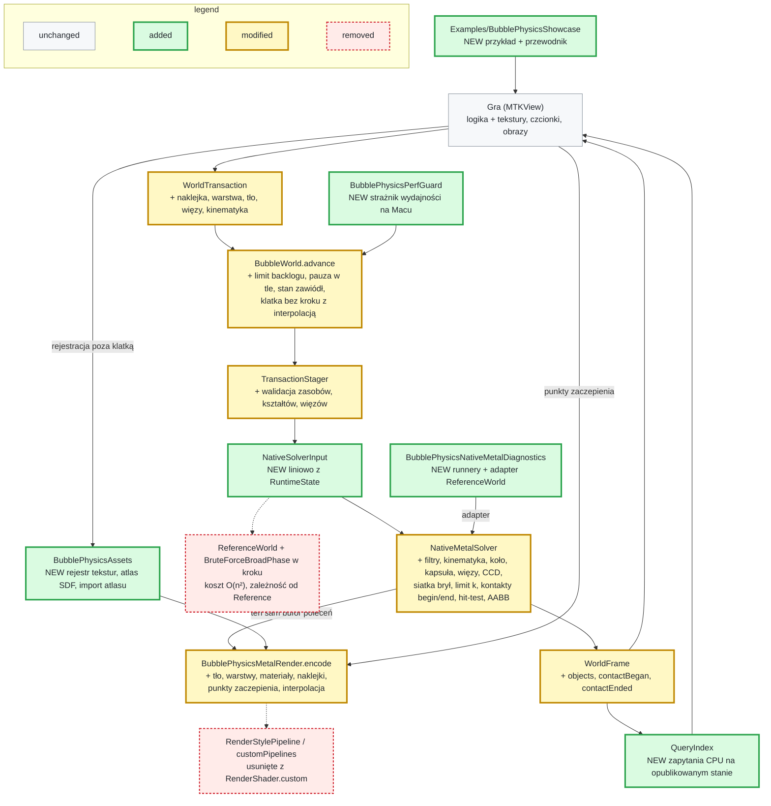
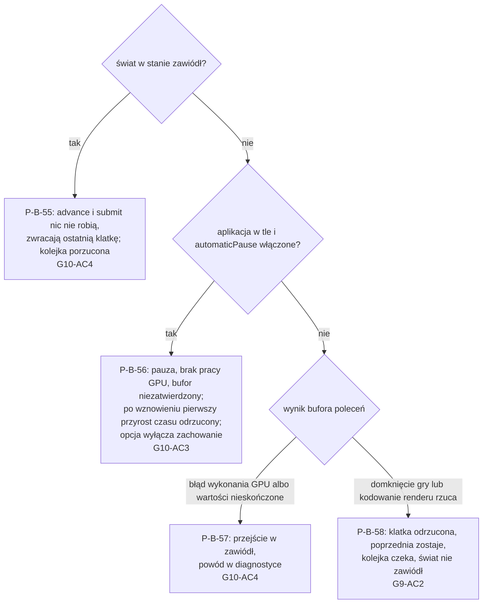

# Plan: Fundamenty silnika BubblePhysics v2 pod wiele gier

> **For agentic workers:** REQUIRED PHASE COMMAND: Run `/tt-agentic-sdlc:implement` with this file's path to execute this plan. It runs one slice per session, and only a slice with tasks. The program design below is binding: build the call trees as drawn, and turn each behaviour into a failing test before you write the code.

**Date:** 2026-11-08
**Artifact:** plan
**Design:** [change-design.md](change-design.md)
**References:** tag `v1.0.0`; tag `archive/magentic-2026-10-25-2kbubbles-engine-owned`; `docs/superpowers/specs/2026-10-15-public-api-design.md`
**Strategy:** slices
**Test command:** `swift test`
**Status:** Approved
**Template version:** default/0.3.3

**Plugin version:** 0.7.7
**Agent Sessions:** claude-code: e8d6c854-cb70-4776-b9ba-d18c56f700bc

---

## Program design

### R0 — Headline

BubblePhysics staje się silnikiem dla wielu gier: gra daje logikę i grafikę, silnik robi fizykę i cały rendering. Wersja 2.0.0 udostępnia grze stan obiektów, tekstury, warstwy, naklejki, kinematykę, filtry i zdarzenia kontaktu, zapytania, więzy i płynny obraz 120 Hz. Krok fizyki traci kod diagnostyczny i pętle O(n²).

### R1 — The whole flow



Przepływ transakcja → staging → krok GPU i render w jednym buforze → publikacja zostaje. Zmienia się wejście solvera (bez `ReferenceWorld`), wynik kroku (stan obiektów i kontakty) i to, co rysuje renderer. Diagnostyka solvera wychodzi z produkcji do osobnego modułu.

### R2 — Seams — where the change attaches to existing code

Pliki w stanie końcowym całej zmiany. `+` to plik nowy albo zmieniony, `-` usunięty lub przeniesiony.

```diff
+ Package.swift                                  # 2.0.0; + .library BubblePhysicsAssets; NativeMetalDiagnostics w BubblePhysicsBenchmarkSupport; + cel BubblePhysicsPerfGuard z testami; NativeMetal bez Reference
  Sources/
    BubblePhysicsPublic/
+     BubbleWorld.swift                          # objects w klatce, zapytania, hitTest async, polityka czasu, pauza, stan „zawiódł”
+     Diagnostics.swift                          # odrzucony backlog, zaległość, przepełnienie kandydatów, powód „zawiódł”
+     LifecycleEventSource.swift                 # NEW (etap 6) wstrzykiwane źródło zdarzeń cyklu życia; domyślnie UIKit na iOS
      Model/
+       Objects.swift                            # PhysicsBodyProperties; PolygonDescriptor → RigidBodyDescriptor(shape: RigidShape); auto inercja
+       Motion.swift                             # MotionRole.kinematic, KinematicDrive (prędkość, ścieżka, cel na krok)
+       Resources.swift                          # RenderMaterial zamiast RenderStyle/RenderShader; limity prędkości w PhysicsMaterial
+       Identifiers.swift                        # CollisionFilter (kategoria, maska); EventInterest.contact
+       Decals.swift                             # NEW Decal, TextureID, FontID, GlyphAtlasID
+       Joints.swift                             # NEW Joint (distance, hinge, weld), JointID
+       Queries.swift                            # NEW zapytania i wyniki (point, rect, circle, raycast, hitTest)
+       WorldTransaction.swift                   # nowe operacje; BubbleResult z naklejką i warstwą; receipt z usuniętymi więzami
+       WorldFrame.swift                         # ObjectState, objects; contactBegan/contactEnded; nowe TransactionRejectionReason
+       WorldConfiguration.swift                 # maximumBacklog (0,25 s), automaticPause
    BubblePhysicsRuntime/
+     TransactionStager.swift                    # RuntimeState: warstwy, naklejki, więzy, tło; staging nowych operacji
+     NativeCompleteStepper.swift                # buduje NativeSolverInput liniowo; publikuje ObjectState
+     FixedStepDriver.swift                      # limit backlogu, α interpolacji, odrzucenie czasu po wznowieniu
+     MotionControllers.swift                    # KinematicDrive → narzucona prędkość na krok
+     EventCompactor.swift                       # contactBegan przed mergeContact; contactEnded przy rozłączeniu i usunięciu
+     StructuralOperations.swift                 # naklejka wyniku; usunięcie więzów baniek źródłowych
+     QueryIndex.swift                           # NEW (etap 4) siatka przestrzenna raz na publikację
    BubblePhysicsAssets/                         # NEW moduł (etap 5; SDF i atlas w etapie 6)
+     AssetRegistry.swift                        # rejestr per MTLDevice: CGImage | MTLTexture → TextureID
+     SDFAtlasGenerator.swift                    # Core Text → atlas SDF, 1× = glif 32 px
+     GlyphAtlas.swift                           # import gotowego atlasu z metrykami
    BubblePhysicsNativeMetal/
+     NativeSolverInput.swift                    # NEW (etap 1) neutralne wejście i wynik solvera (NativeSolverInput, NativeSolverFrame)
+     NativePublicWorld.swift                    # step(input:) bez ReferenceWorld; zdarzenia regionu przez słownik, nie first(where:)
+     NativeMetalSolver.swift                    # executeFrame(input:) zastępuje executePublicFrame(world:) i executeFrame(world:); nowe etapy kerneli; pamięć O(n·k)
+     NativeMetalBackend.swift                   # bez @_exported import BubblePhysicsReference
+     NativeMetalBufferLayout.swift              # NativeMetalSnapshot(input:); AABB w NativeMetalBubble; filtr, rola, kształt
+     NativeRigidPolygonState.swift              # koło, kapsuła, kinematyka (odwrotna masa 0); prepare O(k)
+     NativeJointState.swift                     # NEW (etap 3) rekordy i bufory więzów
+     NativeMetalRenderHandoff.swift             # kontury t−1 i t; dane wierzchołka dla materiałów
+     Shaders/NativeGeometryKernels.metal-source # filtr w kandydatach, siatka brył, limit k, hit-test konturu
+     Shaders/NativeXPBDKernels.metal-source     # więzy XPBD, kinematyka, licznik przepełnienia
+     Shaders/NativePostSolveKernels.metal-source# AABB konturu, CCD bryła–bryła, limit prędkości, begin/end kontaktu
+     Shaders/NativeRenderKernels.metal-source   # wierzchołek z uv, lokalnymi, środkiem, promieniem, α; fragmenty materiałów, naklejek, tła
-     NativeMetalBenchmarkRunner.swift          # → NativeMetalDiagnostics
-     NativeMetalWorldRunner.swift              # → NativeMetalDiagnostics
-     VisualSimulationDriver.swift              # → NativeMetalDiagnostics
-     NativeMetalVisualReplay.swift             # → NativeMetalDiagnostics
-     NativeMetalQualityEnvelope.swift          # → NativeMetalDiagnostics
    BubblePhysicsNativeMetalDiagnostics/         # NEW (etap 1) moduł: 5 plików powyżej + adapter
+     ReferenceSolverInputAdapter.swift          # ReferenceWorld → NativeSolverInput, NativeSolverFrame → typy Reference
    BubblePhysicsMetalRender/
+     BubblePhysicsMetalRender.swift             # encode: tło → warstwy (4 grupy) → punkty zaczepienia → nakładka
+     MaterialPipelines.swift                    # NEW (etap 5) pipeline per tryb mieszania i format
+     DecalRenderer.swift                        # NEW (etap 6) instancjonowane czworokąty naklejek z przycięciem
+     RenderHooks.swift                          # NEW (etap 6) domknięcia gry: afterBackground, afterLayer(n), overlay
-     RenderStylePipeline.swift                 # usunięty razem z customPipelines
+     PublicWorldStressBenchmark.swift           # API v2; sceny stress-300, mieszana, akceptacyjna
  Benchmarks/
+   macOS/BubblePhysicsPerfGuard/main.swift      # NEW (etap 1) strażnik: swift run -c release BubblePhysicsPerfGuard
+   macOS/BubblePhysicsPerfGuard/PerfGuard.swift # NEW (etap 1) p95, mediana z 5, porównanie z punktem odniesienia, skalowanie 600/300, --record
+   macOS/BubblePhysicsReferenceBench/main.swift # import NativeMetalDiagnostics zamiast NativeMetal
+   iOS/BubblePhysicsBench/App/*                 # (etap 7) wybór sceny, scena akceptacyjna
+   iOS/BubblePhysicsBench/project.yml           # (etap 7) + BubblePhysicsAssets; .xcodeproj regenerowany przez xcodegen
  Examples/BubblePhysicsShowcase/                # NEW (etap 7) project.yml + .xcodeproj z xcodegen, sceny baniek i brył, host MTKView
  Tests/
+   BubblePhysicsNativeMetalDiagnosticsTests/    # NEW (etap 1) 17 plików przeniesionych z BubblePhysicsNativeMetalTests (lista pod drzewem); zależy od Diagnostics, NativeMetal, Reference
+   BubblePhysicsAssetsTests/                    # NEW rejestr (etap 5), SDF i atlas (etap 6)
+   BubblePhysicsPerfGuardTests/                 # NEW (etap 1) logika porównania strażnika, @testable import celu wykonywalnego
+   BubblePhysicsMetalRenderTests/Support/OffscreenRenderHarness.swift # NEW (etap 5) wspólny render 256×256 i próbkowanie pikseli
+   BubblePhysicsPublicTests/, BubblePhysicsRuntimeTests/, BubblePhysicsNativeMetalTests/, BubblePhysicsMetalRenderTests/ # API v2 i nowe testy
  docs/
+   MIGRATION-v2.md                              # NEW (etap 7) zamiennik każdego symbolu v1
+   integration-guide.md                         # NEW (etap 7) fragmenty z oznaczonych regionów przykładu
+   benchmarks/perf-guard.json                   # NEW (etap 1) punkty odniesienia strażnika; nowy punkt po każdym etapie, który poprawił wynik
+ README.md                                      # v2
```

Krok i render po zmianie. Gra woła `advance` raz na klatkę `MTKView`, a w domknięciu `encodeRender` woła renderer.

```text
BubbleWorld.advance(by:commandBuffer:encodeRender:)
├── stan „zawiódł” / pauza                         # zwraca ostatnią klatkę; w pauzie bufor zostaje niezatwierdzony
├── FixedStepDriver.accumulate(by:)                 # obcięcie do maximumBacklog, nadmiar do diagnostyki; α = zaległość / krok
├── [krok wypada, najwyżej jeden na bufor]
│   ├── TransactionStager.stageBatch(pending, against: state, assets:)   # + zasoby, kształty, więzy, kinematyka
│   └── NativeCompleteStepper.completeStep(batch, commandBuffer:, beforeCommit:)
│       ├── MotionControllers.prepare(&state)       # + KinematicDrive
│       ├── NativeSolverInput(state:)               # liniowo, zastępuje [NativePublicObject] + ReferenceWorld
│       ├── NativePublicWorld.step(input:)
│       │   └── NativeMetalSolver.executeFrame(input:)
│       │       ├── predict → siatka baniek i brył → kandydaci (filtr, limit k) → kontakty
│       │       ├── pętla XPBD: kontakty + więzy + kinematyka → CCD → limit prędkości
│       │       ├── kontury (+ AABB, kopia t−1) → hit-testy z kolejki → begin/end kontaktu
│       │       └── beforeCommit(handoff) → encodeRender()   # gra: BubblePhysicsMetalRender.encode(..., hooks:)
│       ├── EventCompactor.finish                   # contactBegan → mergeContact; contactEnded
│       └── ObjectState z rekordów po kroku         # bez odczytu konturów
├── [krok nie wypada] encodeRender() z α            # interpolacja konturów t−1 → t
└── publikacja WorldFrame → QueryIndex.rebuild → wyniki hitTest
```

Do `BubblePhysicsNativeMetalDiagnosticsTests` przechodzi 17 plików, które budują wejście przez `ReferenceWorld`. Testy narzędzi: `NativeMetalBenchmarkTests`, `NativeMetalQualityEnvelopeTests`, `NativeMetalVisualReplayTests`, `VisualSimulationDriverTests`, `NativeMetalWorldRunnerTests`, `NativeMetalPerceptualProbeTests`, `NativeMetalRestDampingTests`, `NativeMetalStageDiagnosticsTests`. Testy solvera przez adapter: `NativeMetalBroadPhaseTests`, `NativeMetalContactCacheTests`, `NativeMetalContactPipelineTests`, `NativeMetalContainmentParallelTests`, `NativeMetalContourTests`, `NativeMetalParallelCacheProfileTests`, `NativeMetalSafetyTests`, `NativeMetalSolverLifecycleTests`, `NativeMetalXPBDTests`. Pozostałe 8 plików testuje ścieżkę `NativePublicWorld` i zostaje. Przeniesione testy solvera dalej sprawdzają produkcyjne kernele, tylko przez adapter `ReferenceWorld`. Każda późniejsza zmiana kerneli musi je utrzymać na zielono, więc kryterium ukończenia etapu to pełne `swift test`, nie tylko testy produkcyjne.

API solvera, którego używa diagnostyka, ma poziom `package`: runnery w osobnym module nie mogą używać `@testable import`, a `public` poszerzyłoby API dla gier. Stan przejściowy: zadanie 5 dodaje `executeFrame(input:)` obok starych wejść, które do zadania 7 tłumaczą `ReferenceWorld` na `NativeSolverInput` wewnątrz NativeMetal. Zadanie 6 przenosi to tłumaczenie do adaptera diagnostycznego, a zadanie 7 usuwa stare wejścia.

Typy, które czytelnik musi znać: `ObjectState`, `NativeSolverInput`, `RigidShape`, `RenderMaterial`, `Decal`, `Joint`, `CollisionFilter`. Seamy testowe: istniejący `CompleteStepper` (fałszywe steppery w `BubbleWorldCompletionTests`), wstrzykiwane `LifecycleEventSource` i nowy `OffscreenRenderHarness`.

Miejsce do przeczytania dwa razy: granica `NativeSolverInput` w `NativeMetalSolver.executeFrame`. Od niej zależy wydajność kroku, adapter diagnostyczny i każdy późniejszy kernel.

Dwa fakty o narzędziach i wyborach:
- **Przycinanie naklejek.** Projekt zostawia planowi wybór metody przycinania naklejek konturem bańki: stencil ze wspólną wartością albo maska w shaderze fragmentu. Pierwsze zadanie etapu 6 to sonda mierzona strażnikiem, a jej wynik i wybór dopisuje się tutaj.
- **xcodegen.** `xcodegen` 2.46.0 jest zainstalowany (`/opt/homebrew/bin/xcodegen`). Próbna regeneracja `Benchmarks/iOS/BubblePhysicsBench` z `project.yml` dała tylko kosmetyczne różnice w `project.pbxproj`: nazwę folderu pakietu i grupę `Signing.xcconfig`. Oba projekty Xcode, benchmark i przykład, powstają z `project.yml`, a wygenerowany `.xcodeproj` trafia do repo. Projekt Xcode ma jawną listę plików, więc każdy nowy plik w `App/` wymaga regeneracji.

### R3 — Behaviour

**Fundament, stan obiektów i strażnik**

| P-B-ID | Situation | Result | Proves |
|---|---|---|---|
| <a id="p-b-1"></a>P-B-1 | Graf zależności z `swift package dump-package` | Cele `BubblePhysics`, `BubblePhysicsMetalRender`, `BubblePhysicsAssets` i ich zależności nie zawierają Reference, ReferenceMetal, Legacy, Core ani Metal | [G1-AC4](change-design.md#g1-ac4) |
| <a id="p-b-2"></a>P-B-2 | `swift test` po podziale modułu | Testy diagnostyczne przechodzą w `BubblePhysicsNativeMetalDiagnosticsTests` przez adapter; testy produkcyjne i `PublicWorldStressBenchmark` używają tylko API v2 | [G1-AC2](change-design.md#g1-ac2) |
| <a id="p-b-3"></a>P-B-3 | `BubblePhysicsReferenceBench` na Macu, scena stress-300, limit 4 iteracji | `NativeMetalBenchmarkRunner` z modułu diagnostycznego zwraca raport z p95 czasu GPU solvera | [G1-AC3](change-design.md#g1-ac3) |
| <a id="p-b-4"></a>P-B-4 | N kroków świata z bańkami i bryłami | `frame.objects` ma dla każdego obiektu pozycję, prędkość, obrót, prędkość kątową i AABB; bańka efektywny promień, bryła rodzaj kształtu | [G2-AC1](change-design.md#g2-ac1) |
| <a id="p-b-5"></a>P-B-5 | Stress-300, stan porównany z `debugContourSnapshot()` | Środek bańki w granicach 1% promienia od centroidu konturu; AABB zawiera cały kontur | [G2-AC2](change-design.md#g2-ac2) |
| <a id="p-b-6"></a>P-B-6 | Obiekt usunięty transakcją; odczyt `frame.objects` | Obiektu nie ma w stanie tej klatki; `contourCPUReadbacks` = 0 | [G2-AC3](change-design.md#g2-ac3) |
| <a id="p-b-7"></a>P-B-7 | Strażnik mierzy przygotowanie i publikację kroku dla 300 i 600 obiektów | Stosunek ≤ 2,5, inaczej strażnik kończy się błędem | [G12-AC1](change-design.md#g12-ac1) |
| <a id="p-b-8"></a>P-B-8 | Strażnik: mediana z 5 przebiegów po 300 klatek, p95 kroku i renderu | Wynik > punkt odniesienia z `perf-guard.json` + 10% kończy się błędem; wstrzyknięte spowolnienie o 20% kończy się błędem; punkt odniesienia odpowiada stanowi po ostatnim ukończonym etapie | [G12-AC3](change-design.md#g12-ac3) |
| <a id="p-b-9"></a>P-B-9 | Ta sama scena (stress-300, a od etapu brył mieszana) dwa razy po 300 kroków | Identyczny hash stanu obiektów; przebieg ze wzrostem licznika przepełnienia jest zwolniony z porównania od tego kroku | [G10-AC5](change-design.md#g10-ac5) |
| <a id="p-b-10"></a>P-B-10 | Lista publicznych symboli z `swift-api-digester` dla `v1.0.0` i dla HEAD | Każdy usunięty lub zmieniony symbol ma zamiennik w `docs/MIGRATION-v2.md`; README podaje 2.0.0 (tag `v2.0.0` zakłada właściciel w etapie 7) | [G1-AC1](change-design.md#g1-ac1) |

**Kolizje, kontakty, kinematyka i pamięć kontaktów**

| P-B-ID | Situation | Result | Proves |
|---|---|---|---|
| <a id="p-b-11"></a>P-B-11 | Dwa obiekty z rozłącznymi maskami; dwa z domyślnymi | Pierwsza para nie ma kontaktu, druga ma | [G7-AC1](change-design.md#g7-ac1) |
| <a id="p-b-12"></a>P-B-12 | Pierwszy krok styku pary bańka–bańka, bańka–bryła, bryła–bryła (także statyczna i kinematyczna), choć jedno z zainteresowaniem kontaktem | `contactBegan` z punktem ważonym wnikaniem, znormalizowaną normalną i impulsem = skumulowany mnożnik / krok; przy trwałym styku bez powtórzeń | [G7-AC2](change-design.md#g7-ac2) |
| <a id="p-b-13"></a>P-B-13 | Para z zainteresowaniem kontaktem i scalaniem, pierwszy krok styku | `contactBegan`, a po nim `mergeContact` w tym samym kroku | [G7-AC2](change-design.md#g7-ac2) |
| <a id="p-b-14"></a>P-B-14 | Para się rozłącza albo jeden obiekt zostaje usunięty, scalony lub podzielony | `contactEnded` w pierwszym kroku po rozłączeniu albo w kroku usunięcia, dla pozostałego partnera | [G7-AC2](change-design.md#g7-ac2) |
| <a id="p-b-15"></a>P-B-15 | Mały bufor zdarzeń, wiele styków | `eventOverflow` rośnie; żadne `contactEnded` bez wcześniejszego `contactBegan` | [G7-AC3](change-design.md#g7-ac3) |
| <a id="p-b-16"></a>P-B-16 | Kinematyczna bryła pcha 20 baniek | Odchyłka od toru zadanego ≤ 1e-4 | [G6-AC1](change-design.md#g6-ac1) |
| <a id="p-b-17"></a>P-B-17 | Transakcja z bańką w roli `kinematic` | Odrzucenie `unsupportedMotionRole` | [G6-AC1](change-design.md#g6-ac1) |
| <a id="p-b-18"></a>P-B-18 | Dynamiczna bryła na poziomej kinematycznej platformie | Po ustaleniu kontaktu średnia prędkość pozioma w granicach 5% prędkości platformy | [G6-AC2](change-design.md#g6-ac2) |
| <a id="p-b-19"></a>P-B-19 | Kinematyczna przez statyczną i kinematyczną; kinematyczna na drodze `pathDriven` | Brak kolizji w pierwszym przypadku; `pathDriven` zostaje zepchnięta i zablokowana; istniejące testy `pathDriven` przechodzą | [G6-AC3](change-design.md#g6-ac3) |
| <a id="p-b-20"></a>P-B-20 | Bufory kontaktów dla 300 i 1200 obiektów; sceny stress-300, mieszana, akceptacyjna | Pamięć rośnie liniowo (O(n·k)); limit k nieprzekroczony, z co najmniej dwukrotnym zapasem nad zmierzonym maksimum | [G12-AC2](change-design.md#g12-ac2) |
| <a id="p-b-21"></a>P-B-21 | 300 baniek ściśniętych w małym obszarze | Licznik przepełnienia kandydatów w diagnostyce rośnie; brak wartości nieskończonych | [G12-AC2](change-design.md#g12-ac2) |

**Bryły, więzy i ograniczenia ruchu**

| P-B-ID | Situation | Result | Proves |
|---|---|---|---|
| <a id="p-b-22"></a>P-B-22 | Każda para kształtów: bańka, wielokąt, koło, kapsuła | Kontakt i rozdzielenie dla każdej pary | [G11-AC1](change-design.md#g11-ac1) |
| <a id="p-b-23"></a>P-B-23 | Bryła bez podanego momentu bezwładności | Koło m·r²/2 z dokładnością 0,1%; prostokąt i kapsuła według wzorów | [G11-AC2](change-design.md#g11-ac2) |
| <a id="p-b-24"></a>P-B-24 | Wahadło na więzie dystansowym; zawias z zakresem i silnikiem; spaw | Okres w granicach 2% wzoru; kąt w zakresie; spaw trzyma względną pozę | [G11-AC3](change-design.md#g11-ac3) |
| <a id="p-b-25"></a>P-B-25 | Bańka na więzie dystansowym ze światem, z bryłą i z inną bańką | Odległość środka w granicach 1%; kształt konturu bez zmiany od korekty więzu | [G11-AC3](change-design.md#g11-ac3) |
| <a id="p-b-26"></a>P-B-26 | Zawias lub spaw z bańką; usunięcie ciała z więzem; scalenie lub podział baniek z więzami | Odrzucenie jawnym powodem; więzy usunięte i wymienione w potwierdzeniu; wynik scalenia ich nie dziedziczy | [G11-AC3](change-design.md#g11-ac3) |
| <a id="p-b-27"></a>P-B-27 | Bryła grubości 4 z prędkością 12 na krok wobec statycznej grubości 4; dwie takie naprzeciw siebie | Brak przenikania w obu wariantach | [G11-AC4](change-design.md#g11-ac4) |
| <a id="p-b-28"></a>P-B-28 | Materiał z limitem prędkości liniowej i kątowej, silna siła globalna | Żaden obiekt nie przekracza limitów | [G11-AC5](change-design.md#g11-ac5) |

**Zapytania**

| P-B-ID | Situation | Result | Proves |
|---|---|---|---|
| <a id="p-b-29"></a>P-B-29 | Zapytania punkt, prostokąt, koło na każdym kształcie, z filtrem i bez | Bryły dokładnie, bańki jako koło o efektywnym promieniu; filtr zawęża wynik | [G8-AC1](change-design.md#g8-ac1), [G11-AC1](change-design.md#g11-ac1) |
| <a id="p-b-30"></a>P-B-30 | Raycast przez kilka obiektów | Pierwsze trafienie z punktem, normalną i ułamkiem | [G8-AC1](change-design.md#g8-ac1) |
| <a id="p-b-31"></a>P-B-31 | Asynchroniczny hit-test: wnętrze, krawędź, wgłębienie deformacji, puste miejsce, wnętrze bryły | `ObjectID` albo `nil` zgodnie z konturem z kroku t+1 | [G8-AC2](change-design.md#g8-ac2) |
| <a id="p-b-32"></a>P-B-32 | Hit-test na nakładających się obiektach; górny usunięty przed krokiem | Wygrywa najwyższa warstwa, potem największy `ObjectID`; usunięty nie bierze udziału | [G8-AC2](change-design.md#g8-ac2) |
| <a id="p-b-33"></a>P-B-33 | Hit-test w pauzie; w stanie „zawiódł”; przy anulowaniu zadania | Czeka na wznowienie; w pozostałych przypadkach od razu `nil` | [G8-AC2](change-design.md#g8-ac2) |
| <a id="p-b-34"></a>P-B-34 | Dowolne zapytanie | `contourCPUReadbacks` = 0 | [G8-AC3](change-design.md#g8-ac3) |

**Materiały, warstwy i tło** (testy obrazu 256×256, ±2/255)

| P-B-ID | Situation | Result | Proves |
|---|---|---|---|
| <a id="p-b-35"></a>P-B-35 | Tekstura z `CGImage` i z `MTLTexture`, materiał z kolorem, trybem mieszania i obrysem | Render pokazuje teksturę z tymi parametrami | [G3-AC1](change-design.md#g3-ac1) |
| <a id="p-b-36"></a>P-B-36 | Tryb przyklejony, wymuszona deformacja i obrót | Punkt tekstury zostaje przy punkcie konturu, błąd ≤ 1 px | [G3-AC2](change-design.md#g3-ac2) |
| <a id="p-b-37"></a>P-B-37 | Tryb pod maską, deformacja | Tekstura jest kołem wokół środka, obraca się, nie deformuje, przycina ją kontur | [G3-AC3](change-design.md#g3-ac3) |
| <a id="p-b-38"></a>P-B-38 | Obrócony wielokąt, koło i kapsuła z przesunięciem i skalą UV | Tekstura obraca się z bryłą | [G3-AC4](change-design.md#g3-ac4), [G11-AC1](change-design.md#g11-ac1) |
| <a id="p-b-39"></a>P-B-39 | Nieobsługiwany format obrazu; transakcja z niezarejestrowanym `TextureID`; rejestr innego `MTLDevice` | Błąd w wywołaniu rejestracji; odrzucenie transakcji bez zmiany wyglądu; błąd przy tworzeniu świata lub renderera | [G3-AC5](change-design.md#g3-ac5) |
| <a id="p-b-40"></a>P-B-40 | Bańka na warstwie wyższej nad bryłą; bańka i bryła w tej samej warstwie | Wyższa warstwa przykrywa; w tej samej warstwie bryła przykrywa bańkę | [G4-AC1](change-design.md#g4-ac1) |
| <a id="p-b-41"></a>P-B-41 | Ustawienie, a potem usunięcie tła | Tło rozciągnięte na region, pod wszystkimi warstwami; po usunięciu znika | [G4-AC2](change-design.md#g4-ac2) |
| <a id="p-b-62"></a>P-B-62 | Transakcja `setLayer` zmienia warstwę istniejącego obiektu | Nowa kolejność rysowania w pierwszej klatce z potwierdzeniem; odrzucona transakcja jej nie zmienia | [G4-AC1](change-design.md#g4-ac1) |
| <a id="p-b-42"></a>P-B-42 | Nakładka z alfą 0,8 | Piksel = 0,8·nakładka + 0,2·spód, ±2/255 | [G4-AC3](change-design.md#g4-ac3) |

**Naklejki**

| P-B-ID | Situation | Result | Proves |
|---|---|---|---|
| <a id="p-b-43"></a>P-B-43 | Czcionka zarejestrowana z zestawem znaków, render w skali 0,25×, 1×, 4× | Glif 1× ma 32 px; krawędź (alfa 10%→90%) ≤ 1,5 px w każdej skali | [G5-AC1](change-design.md#g5-ac1) |
| <a id="p-b-44"></a>P-B-44 | Gotowy atlas testowy w naklejce tekstowej | Glify z atlasu w renderze | [G5-AC2](change-design.md#g5-ac2) |
| <a id="p-b-45"></a>P-B-45 | Naklejka obrazowa z fragmentem tekstury | Render pokazuje ten fragment | [G5-AC3](change-design.md#g5-ac3) |
| <a id="p-b-46"></a>P-B-46 | Naklejka na zdeformowanej, obróconej bańce; na obróconej bryle; skala większa niż promień odniesienia | Kotwica w środku, obrót z obiektem, przycięcie do koła odniesienia; na bańce także do konturu, bez deformacji naklejki | [G5-AC4](change-design.md#g5-ac4) |
| <a id="p-b-47"></a>P-B-47 | Bańka z naklejką i bryła w tej samej warstwie | Bryła przykrywa bańkę razem z jej naklejką | [G4-AC1](change-design.md#g4-ac1) |
| <a id="p-b-48"></a>P-B-48 | Zmiana naklejki transakcją; transakcja odrzucona; scalenie i podział z naklejką wyniku | Nowa naklejka w pierwszej klatce z potwierdzeniem; odrzucona nic nie zmienia; wynik ma naklejkę z operacji | [G5-AC5](change-design.md#g5-ac5) |
| <a id="p-b-49"></a>P-B-49 | Tekst ze znakiem spoza zestawu | Odrzucenie transakcji jawnym powodem | [G5-AC6](change-design.md#g5-ac6) |

**Czas, interpolacja i punkty zaczepienia**

| P-B-ID | Situation | Result | Proves |
|---|---|---|---|
| <a id="p-b-50"></a>P-B-50 | 120 Hz, krok 1/60, `advance` z buforem poleceń | Każda klatka ma render; pozycja w klatce pośredniej leży między krokami | [G10-AC1](change-design.md#g10-ac1) |
| <a id="p-b-51"></a>P-B-51 | Zaległość > 1 krok | α = 1, wykonany jeden krok, diagnostyka raportuje zaległość | [G10-AC1](change-design.md#g10-ac1) |
| <a id="p-b-52"></a>P-B-52 | Obiekt utworzony, zawinięty, scalony, podzielony albo zastąpiony w ostatnim kroku | Rysuje się bez interpolacji, w stanie bieżącego kroku (zawinięty przy krawędzi docelowej) | [G10-AC1](change-design.md#g10-ac1) |
| <a id="p-b-53"></a>P-B-53 | `advance(by: 10)` | Backlog obcięty do 0,25 s; nadmiar raportowany w diagnostyce | [G10-AC2](change-design.md#g10-ac2) |
| <a id="p-b-54"></a>P-B-54 | Domknięcia po tle, po warstwie n i na końcu rysują prostokąty | Prostokąty we właściwej kolejności względem warstw | [G9-AC1](change-design.md#g9-ac1) |

**Co zwraca `advance` poza zwykłą klatką.** Liście to [P-B-55](#p-b-55)–[P-B-58](#p-b-58): <a id="p-b-55"></a><a id="p-b-56"></a><a id="p-b-57"></a><a id="p-b-58"></a>stan końcowy wygrywa z pauzą, pauza z krokiem, a błąd po stronie gry lub kodowania odrzuca tylko klatkę. Dowodzą [G10-AC3](change-design.md#g10-ac3), [G10-AC4](change-design.md#g10-ac4) i [G9-AC2](change-design.md#g9-ac2).



**Przykład, dokumentacja i pomiar końcowy**

| P-B-ID | Situation | Result | Proves |
|---|---|---|---|
| <a id="p-b-59"></a>P-B-59 | `xcodebuild ... CODE_SIGNING_ALLOWED=NO build` dla `Examples/BubblePhysicsShowcase` | Build przechodzi; dwie sceny używają tylko publicznego API | [G13-AC1](change-design.md#g13-ac1) |
| <a id="p-b-60"></a>P-B-60 | Bloki kodu w `docs/integration-guide.md` | Każdy jest identyczny z oznaczonym regionem źródeł przykładu; przewodnik opisuje wszystkie tematy z kryterium | [G13-AC2](change-design.md#g13-ac2) |
| <a id="p-b-61"></a>P-B-61 | Release na iPhonie X, scena akceptacyjna, 30 + 300 klatek (uruchamia właściciel) | p95 pełnej klatki ≤ 16,67 ms; 0 nieudanych klatek, wartości nieskończonych i odczytów konturów; wynik w `docs/benchmarks/` | [G12-AC4](change-design.md#g12-ac4) |

### Test strategy

| Level | What it proves | Behaviours |
|---|---|---|
| Unit (CPU: model, stager, `FixedStepDriver`, fałszywy `CompleteStepper`, `LifecycleEventSource`) | Walidacja, odrzucenia, polityka czasu i stany `advance` bez GPU | [P-B-17](#p-b-17), [P-B-26](#p-b-26), [P-B-49](#p-b-49), [P-B-53](#p-b-53), [P-B-55](#p-b-55)–[P-B-58](#p-b-58) |
| Integracja GPU (Mac, `BubbleWorld` lub `NativePublicWorld`) | Krok solvera daje właściwy stan, kontakty, kolizje, więzy i wyniki zapytań | [P-B-4](#p-b-4)–[P-B-6](#p-b-6), [P-B-9](#p-b-9), [P-B-11](#p-b-11)–[P-B-16](#p-b-16), [P-B-18](#p-b-18)–[P-B-25](#p-b-25), [P-B-27](#p-b-27)–[P-B-34](#p-b-34) |
| Test obrazu Metal (`OffscreenRenderHarness`, 256×256) | Piksele renderu odpowiadają materiałom, warstwom, naklejkom, interpolacji i punktom zaczepienia | [P-B-35](#p-b-35)–[P-B-48](#p-b-48), [P-B-62](#p-b-62), [P-B-50](#p-b-50)–[P-B-52](#p-b-52), [P-B-54](#p-b-54) |
| Static check (test w `swift test`) | Graf zależności, migracja, zgodność przewodnika ze źródłami | [P-B-1](#p-b-1), [P-B-10](#p-b-10), [P-B-60](#p-b-60) |
| Diagnostyka (moduł diagnostyczny, `BubblePhysicsReferenceBench`) | Ścieżka pomiaru solvera działa po podziale modułu | [P-B-2](#p-b-2), [P-B-3](#p-b-3) |
| Strażnik wydajności (`swift run -c release BubblePhysicsPerfGuard`, nie `swift test`) | Brak regresji > 10% i liniowe skalowanie CPU | [P-B-7](#p-b-7), [P-B-8](#p-b-8) |
| Build Xcode | Przykład się kompiluje bez podpisu | [P-B-59](#p-b-59) |
| Urządzenie (właściciel, raz na końcu) | 60 FPS na iPhonie X przy 300 obiektach | [P-B-61](#p-b-61) |

Każdy etap kończy się pełnym `swift test`, strażnikiem i testem determinizmu ([P-B-9](#p-b-9)). Strażnik ([P-B-8](#p-b-8)) porównuje z poprzednim stanem: gdy etap poprawił wynik, nowy punkt odniesienia trafia do `perf-guard.json` w osobnym commicie z uzasadnieniem. Tak samo trafia tam zamierzony wzrost kosztu ([G12-AC3](change-design.md#g12-ac3)). Projekt zakłada determinizm solvera bez potwierdzenia, więc nowe kernele (więzy, begin/end kontaktu) nie mogą używać redukcji atomowych o niedeterministycznej kolejności, a test determinizmu to wychwyci.

**Where:** `Tests/BubblePhysicsPublicTests`, `Tests/BubblePhysicsRuntimeTests`, `Tests/BubblePhysicsNativeMetalTests`, `Tests/BubblePhysicsNativeMetalDiagnosticsTests` (nowy), `Tests/BubblePhysicsMetalRenderTests` (ze wspólnym `Support/OffscreenRenderHarness.swift`), `Tests/BubblePhysicsAssetsTests` (nowy); strażnik w `Benchmarks/macOS/BubblePhysicsPerfGuard`, jego testy w `Tests/BubblePhysicsPerfGuardTests` (nowy). Testy GPU wymagają Maca z Metal (`XCTUnwrap(MTLCreateSystemDefaultDevice())`, jak dziś).

**Test command:** `swift test`

## Slice Status

| Slice | Name | Delivers | Seams | Behaviours | Status |
|-------|------|----------|-------|------------|--------|
| 1 | Fundament, stan obiektów, strażnik | Krok bez `ReferenceWorld` i pętli O(n²); gra odczytuje `frame.objects`; strażnik i test determinizmu działają ([G1-AC2](change-design.md#g1-ac2)–[G1-AC4](change-design.md#g1-ac4), [G2](change-design.md#g2-ac1), [G12-AC1](change-design.md#g12-ac1), [G12-AC3](change-design.md#g12-ac3), [G10-AC5](change-design.md#g10-ac5)) | `NativeSolverInput.swift`, `NativePublicWorld.swift`, `NativeMetalSolver.swift`, `NativeMetalBackend.swift`, `NativeMetalBufferLayout.swift`, `NativeRigidPolygonState.swift`, `NativeCompleteStepper.swift`, `WorldFrame.swift`, moduł `BubblePhysicsNativeMetalDiagnostics(Tests)`, `BubblePhysicsPerfGuard(Tests)`, `perf-guard.json`, `Package.swift` | [P-B-1](#p-b-1)–[P-B-9](#p-b-9) | todo |
| 2 | Filtry, kontakty, kinematyka, pamięć kontaktów | Gra filtruje kolizje, dostaje `contactBegan`/`contactEnded` i ma rolę `kinematic`; pamięć kontaktów O(n·k) ([G7](change-design.md#g7-ac1), [G6](change-design.md#g6-ac1), [G12-AC2](change-design.md#g12-ac2)) | `Objects.swift`, `Identifiers.swift`, `Motion.swift`, `WorldFrame.swift`, `MotionControllers.swift`, `EventCompactor.swift`, kernele kandydatów, XPBD i begin/end, `PublicWorldStressBenchmark.swift` | [P-B-11](#p-b-11)–[P-B-21](#p-b-21) | unplanned |
| 3 | Bryły, więzy, scena mieszana | Koło, kapsuła, więzy, CCD bryła–bryła, limity prędkości, automatyczna inercja; scena mieszana w strażniku i teście determinizmu ([G11](change-design.md#g11-ac1)) | `Objects.swift`, `Joints.swift`, `WorldTransaction.swift`, `NativeRigidPolygonState.swift`, `NativeJointState.swift`, `StructuralOperations.swift`, kernele | [P-B-22](#p-b-22)–[P-B-28](#p-b-28) | unplanned |
| 4 | Czas, zapytania, hit-test | Limit backlogu, stan „zawiódł”, klatka odrzucana po błędzie gry; zapytania CPU i asynchroniczny hit-test ([G10-AC2](change-design.md#g10-ac2), [G10-AC4](change-design.md#g10-ac4), [G9-AC2](change-design.md#g9-ac2), [G8](change-design.md#g8-ac1)) | `FixedStepDriver.swift`, `BubbleWorld.swift`, `Diagnostics.swift`, `Queries.swift`, `QueryIndex.swift`, kernel hit-testu | [P-B-29](#p-b-29)–[P-B-34](#p-b-34), [P-B-53](#p-b-53), [P-B-55](#p-b-55), [P-B-57](#p-b-57), [P-B-58](#p-b-58) | unplanned |
| 5 | Materiały, warstwy, tło | Tekstury gry w materiałach, dwa tryby na bańce, warstwy z `setLayer`, tło, mieszanie ([G3](change-design.md#g3-ac1), [G4](change-design.md#g4-ac1)) | moduł `BubblePhysicsAssets` (rejestr), `Resources.swift`, `BubblePhysicsMetalRender.swift`, `MaterialPipelines.swift`, `NativeRenderKernels.metal-source`, `OffscreenRenderHarness.swift`; usunięcie `RenderStylePipeline.swift` | [P-B-35](#p-b-35)–[P-B-42](#p-b-42), [P-B-62](#p-b-62) | unplanned |
| 6 | Naklejki, interpolacja, cykl życia, punkty zaczepienia | Tekst SDF, atlas i obraz na obiektach; płynny obraz 120 Hz; pauza w tle; rysowanie gry w passie ([G5](change-design.md#g5-ac1), [G10-AC1](change-design.md#g10-ac1), [G10-AC3](change-design.md#g10-ac3), [G9-AC1](change-design.md#g9-ac1)) | `SDFAtlasGenerator.swift`, `GlyphAtlas.swift`, `Decals.swift`, `DecalRenderer.swift`, `NativeMetalRenderHandoff.swift`, `LifecycleEventSource.swift`, `RenderHooks.swift` | [P-B-43](#p-b-43)–[P-B-52](#p-b-52), [P-B-54](#p-b-54), [P-B-56](#p-b-56) | unplanned |
| 7 | Przykład, dokumentacja, wydanie 2.0.0 | Przykładowa aplikacja, przewodnik, migracja, scena akceptacyjna w benchmarku iOS i pomiar na iPhonie X ([G13](change-design.md#g13-ac1), [G1-AC1](change-design.md#g1-ac1), [G12-AC4](change-design.md#g12-ac4)) | `Examples/BubblePhysicsShowcase`, `Benchmarks/iOS/BubblePhysicsBench`, `docs/integration-guide.md`, `docs/MIGRATION-v2.md`, `README.md` | [P-B-10](#p-b-10), [P-B-59](#p-b-59)–[P-B-61](#p-b-61) | unplanned |

Każdy etap kończy się zielonym pełnym `swift test`, strażnikiem i testem determinizmu. Gdy wynik się poprawił, etap zapisuje też nowy punkt odniesienia w osobnym commicie. Dzięki temu każdy etap można scalić osobno, a następny zaczyna od zmierzonego stanu.
- **Etap 1** daje szybszy krok i stan obiektów. Gra nie ma jeszcze nowych funkcji fizyki ani renderu.
- **Etapy 2 i 3** kończą model danych GPU, więc render z etapów 5 i 6 opiera się na stałym ABI. Do tego czasu obraz wygląda jak w `v1`.
- **Etap 4** daje grze zapytania i jawne stany błędu. Brakuje jeszcze interpolacji i pauzy w tle z etapu 6.
- **Etap 7** to jedyny etap, który wymaga właściciela: pomiaru na urządzeniu i tagu `v2.0.0`.

## Slice 1: Fundament, stan obiektów, strażnik

**Delivers:** Krok fizyki nie zależy od `BubblePhysicsReference` i nie ma pętli O(n²). Gra odczytuje stan obiektów w każdej klatce, a strażnik wydajności i test determinizmu pilnują kolejnych etapów.

Każde `verify` uruchamia się z katalogu głównego repozytorium. Zadanie „testy” dodaje testy, które kompilują się na zaślepkach nowego API i jeszcze nie przechodzą. Później zadanie sprawia, że przechodzą.

1. Dodaj cel wykonywalny `BubblePhysicsPerfGuard` z `PerfGuard.swift` (p95 kroku i renderu na scenie `PublicWorldStressBenchmark`, mediana z 5 przebiegów po 300 klatek, porównanie z punktem odniesienia +10%, tryb `--record`) i `BubblePhysicsPerfGuardTests` ze wstrzykniętym spowolnieniem o 20%, covering [P-B-8](#p-b-8) · verify: `swift test --list-tests | grep -q PerfGuardTests && swift test --filter PerfGuardTests`
2. Zapisz punkt odniesienia stress-300 na niezmienionym kroku w `docs/benchmarks/perf-guard.json`, covering [P-B-8](#p-b-8) · verify: `swift run -c release BubblePhysicsPerfGuard --record stress-300 && grep -q stress-300 docs/benchmarks/perf-guard.json`
3. Sonda: dodaj `PublishedStateDeterminismTests` (hash stanu po 300 krokach stress-300, dwa przebiegi). Gdy hashe się różnią, zatrzymaj etap i dopisz wiersz `gap` w `## Implementation deviations` do decyzji właściciela, covering [P-B-9](#p-b-9) · verify: `swift test --list-tests | grep -q PublishedStateDeterminismTests && swift test --filter PublishedStateDeterminismTests`
4. Testy: `PackageGraphTests` (graf z `swift package dump-package --scratch-path` w katalogu tymczasowym, żeby nie czekać na blokadę `.build` trwającego `swift test`; najpierw potwierdź, że wywołanie nie wisi) i `ObjectStateTests` (stan, centroid, AABB, usunięcie, licznik odczytów), covering [P-B-1](#p-b-1), [P-B-4](#p-b-4)–[P-B-6](#p-b-6) · verify: `swift build --build-tests && ! swift test --filter 'PackageGraphTests|ObjectStateTests'`
5. Dodaj `NativeSolverInput` i `NativeSolverFrame` oraz `executeFrame(input:)` i `NativeMetalSnapshot(input:)`; stare wejścia `executePublicFrame(world:)` i `executeFrame(world:)` tymczasowo tłumaczą `ReferenceWorld` na nowe wejście · verify: `swift build && grep -q "func executeFrame(input" Sources/BubblePhysicsNativeMetal/NativeMetalSolver.swift`
6. Przenieś 5 narzędzi i 17 plików testów z listy w R2 do `BubblePhysicsNativeMetalDiagnostics(Tests)` z `ReferenceSolverInputAdapter`; API solvera, którego używa diagnostyka (`NativeMetalSolver`, `executeFrame`, `NativeMetalFrameExecuting` i ich typy), podnieś do `package`, nie do `public`; cel testowy zależy od Diagnostics, NativeMetal i Reference; dodaj moduł do `BubblePhysicsBenchmarkSupport`, a `BubblePhysicsReferenceBench` importuje nowy moduł, covering [P-B-2](#p-b-2), [P-B-3](#p-b-3) · verify: `test -d Sources/BubblePhysicsNativeMetalDiagnostics && ! test -e Sources/BubblePhysicsNativeMetal/NativeMetalBenchmarkRunner.swift && swift test --filter BubblePhysicsNativeMetalDiagnosticsTests && swift build --product BubblePhysicsReferenceBench`
7. Buduj `NativeSolverInput` liniowo w `NativeCompleteStepper`; usuń z NativeMetal `ReferenceWorld`, `BruteForceBroadPhase`, `first(where:)`, stare wejścia i `@_exported import BubblePhysicsReference` oraz zależność w `Package.swift`, covering [P-B-1](#p-b-1) · verify: `swift test --filter PackageGraphTests && ! grep -rq "BubblePhysicsReference\|executePublicFrame" Sources/BubblePhysicsNativeMetal`
8. Usuń porównania O(k²) w `NativeRigidPolygonState.prepare` i O(s²) w strukturach; dodaj do strażnika pomiar skalowania 600/300 (linia `scaling 600/300:` w wyjściu), covering [P-B-7](#p-b-7) · verify: `out=$(swift run -c release BubblePhysicsPerfGuard) && grep -q "scaling 600/300" <<<"$out"`
9. Dodaj AABB zdeformowanego konturu do `NativeMetalBubble` w kernelu konturów, z sondą ABI, i publikuj `WorldFrame.objects: [ObjectID: ObjectState]`, covering [P-B-4](#p-b-4)–[P-B-6](#p-b-6) · verify: `swift test --filter 'ObjectStateTests|NativeMetalShaderABITests'`
10. Zapisz nowy punkt odniesienia stress-300 po usunięciu O(n²) w osobnym commicie „perf-guard: punkt odniesienia po etapie 1” z uzasadnieniem w treści, covering [P-B-8](#p-b-8) · verify: `git log --format=%s -- docs/benchmarks/perf-guard.json | grep -q "po etapie 1"`
11. Sprawdź etap: pełne `swift test` (z determinizmem i testami diagnostycznymi) i strażnik, covering [P-B-1](#p-b-1)–[P-B-9](#p-b-9) · verify: `swift test && swift run -c release BubblePhysicsPerfGuard`

## Deviations from Design

None.

## Replan log

| Slice | Assumed | Found | Plan change | Date |
|-------|---------|-------|-------------|------|
|       |         |       |             |      |

## Implementation deviations

> *Inline guidance:* Leave the table empty at plan time. `implement` adds one row for each place the code departs from this plan, and reads the rows of earlier slices before it starts the next one. A `change` row is a deliberate departure; a `gap` row is something the plan missed. `Status` starts `pending`. The user decides on each row at the end of the slice's run: `approved` as recorded, or `approved — plan §X / design §Y edited {date}`.

| # | Slice | Task | Type (change/gap) | Description | Status | Date |
|---|-------|------|-------------------|-------------|--------|------|
|   |       |      |                   |             |        |      |
