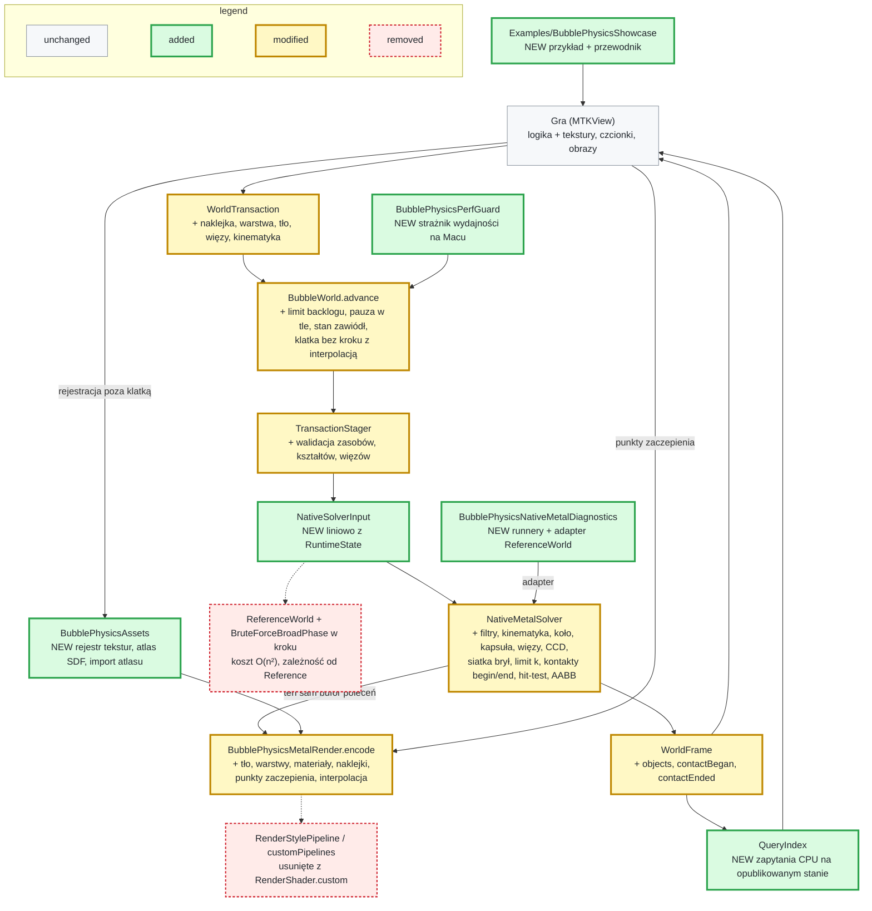
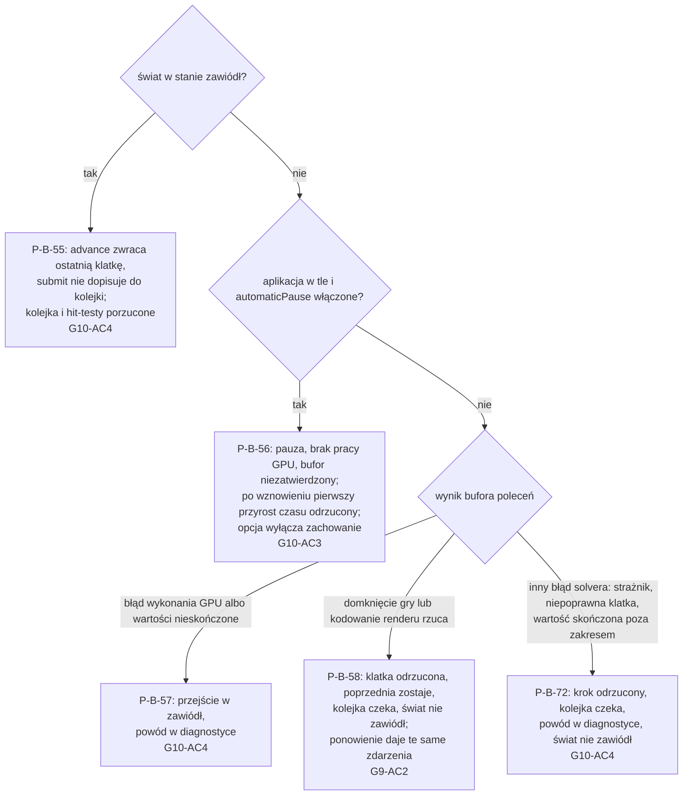

# Plan: Fundamenty silnika BubblePhysics v2 pod wiele gier

> **For agentic workers:** REQUIRED PHASE COMMAND: Run `/tt-agentic-sdlc:implement` with this file's path to execute this plan. It runs one slice per session, and only a slice with tasks. The program design below is binding: build the call trees as drawn, and turn each behaviour into a failing test before you write the code.

**Date:** 2026-11-08
**Artifact:** plan
**Design:** [change-design.md](change-design.md)
**References:** tag `v1.0.0`; tag `archive/magentic-2026-10-25-2kbubbles-engine-owned`; `docs/superpowers/specs/2026-10-15-public-api-design.md`
**Strategy:** slices
**Test command:** `swift test`
**Status:** Approved
**Template version:** default/0.3.3

**Plugin version:** 0.7.7
**Agent Sessions:** claude-code: e8d6c854-cb70-4776-b9ba-d18c56f700bc
**Agent Sessions:** claude-code: aeb2615d-9a85-4c3b-a901-faf3eca8b51d
**Agent Sessions:** claude-code: 2b7e7ccc-107c-4136-b6da-82522abe4a02
**Agent Sessions:** claude-code: 2fea7454-985f-4c59-be17-91c982827ad9
**Agent Sessions:** claude-code: e3fbb109-1820-4cf0-a0ad-a5c05abc81cc
**Agent Sessions:** claude-code: 8417784e-a063-46b8-8229-af06bc7bf049
**Agent Sessions:** claude-code: 844ddf50-d538-427f-8826-239b92c554bd

---

## Program design

### R0 — Headline

BubblePhysics staje się silnikiem dla wielu gier: gra daje logikę i grafikę, silnik robi fizykę i cały rendering. Wersja 2.0.0 udostępnia grze stan obiektów, tekstury, warstwy, naklejki, kinematykę, filtry i zdarzenia kontaktu, zapytania, więzy i płynny obraz 120 Hz. Krok fizyki traci kod diagnostyczny i pętle O(n²).

### R1 — The whole flow



Przepływ transakcja → staging → krok GPU i render w jednym buforze → publikacja zostaje. Zmienia się wejście solvera (bez `ReferenceWorld`), wynik kroku (stan obiektów i kontakty) i to, co rysuje renderer. Diagnostyka solvera wychodzi z produkcji do osobnego modułu.

### R2 — Seams — where the change attaches to existing code

Pliki w stanie końcowym całej zmiany. `+` to plik nowy albo zmieniony, `-` usunięty lub przeniesiony.

```diff
+ Package.swift                                  # 2.0.0; + .library BubblePhysicsAssets; NativeMetalDiagnostics w BubblePhysicsBenchmarkSupport; + cel BubblePhysicsPerfGuard z testami; NativeMetal bez Reference
  Sources/
    BubblePhysicsPublic/
+     BubbleWorld.swift                          # objects w klatce, zapytania, hitTest async, polityka czasu, pauza, stan „zawiódł”; makeRenderState rysuje koło i kapsułę jako pierścień (etap 3)
+     Diagnostics.swift                          # contactCandidateOverflow i maximumContactCandidatesPerObject (etap 2); (etap 4) suma odrzuconego backlogu, powód „zawiódł”, powód ostatniego odrzuconego kroku lub klatki
+     LifecycleEventSource.swift                 # NEW (etap 6) wstrzykiwane źródło zdarzeń cyklu życia; domyślnie UIKit na iOS
      Model/
+       Objects.swift                            # PhysicsBodyProperties z filtrem i zainteresowaniami, MotionRole.kinematic bez wartości powiązanej (etap 2); (etap 3) RigidShape: .polygon(PolygonGeometry), .circle(radius), .capsule(halfLength, radius) z momentOfInertia(mass:) względem środka ciężkości; RigidBodyDescriptor zamiast PolygonDescriptor, momentOfInertia: Float? (nil = liczona)
+       Motion.swift                             # (etap 2) KinematicDrive: .velocity(linear, angular), .path(PathDrive), .target(position, rotation) osiągany w jednym kroku
+       Resources.swift                          # RenderMaterial zamiast RenderStyle/RenderShader; (etap 3) PhysicsMaterialKind.rigid zamiast .polygon, maximumLinearSpeed i maximumAngularSpeed w PhysicsMaterial
+       Identifiers.swift                        # CollisionFilter (kategoria, maska); EventInterest.contact
+       Decals.swift                             # NEW Decal, TextureID, FontID, GlyphAtlasID
+       Joints.swift                             # NEW (etap 3) Joint: distance (wiotkość, tłumienie), hinge (zakres kąta; silnik: docelowa prędkość kątowa względna i maksymalny moment), weld; kotwice w układzie ciała; collideConnected = false; JointID
+       Queries.swift                            # NEW zapytania i wyniki (point, rect, circle, raycast, hitTest)
+       WorldTransaction.swift                   # setKinematicDrive(ObjectID, KinematicDrive), dla innej roli incompatibleMotionRole; gra podaje nowy cel transakcją przed krokiem; BubbleResult z filtrem (etap 2); WorldObject.rigidBody, replaceRigidBodies zamiast replacePolygons, addJoint, removeJoint (etap 3); naklejka, warstwa (później)
+       WorldFrame.swift                         # objects (sam ObjectState leży w WorldTransaction.swift); contactBegan/contactEnded; nowe TransactionRejectionReason; (etap 3) ObjectState.Kind .circle(radius:) i .capsule(halfLength:radius:), TransactionReceipt.removedJointIDs, powody jointNotFound, duplicateJointID, unsupportedJointBody
+       WorldConfiguration.swift                 # maximumBacklog (0,25 s), automaticPause
    BubblePhysicsRuntime/
+     TransactionStager.swift                    # RuntimeState: warstwy, naklejki, więzy, tło; staging nowych operacji; filtr w resultDescriptor i odrzucenie kinematycznej bańki (etap 2); (etap 3) RuntimeState.joints, walidacja więzów (role: dynamic, motorDriven, playerDriven; static i kinematic tylko jako jeden koniec; pathDriven odrzucony), usunięcie więzów przy remove, replaceRigidBodies, scaleniu i podziale
+     CompleteStep.swift                         # CompletedRuntimeStep + licznik przepełnienia kandydatów (etap 2); (etap 4) protokół CompleteStepper ma jedną metodę kroku completeStep(_:duration:hitTests:commandBuffer:beforeCommit:) (commandBuffer opcjonalny, hitTests puste do zadania 41) i hak didPublish(_:) z pustą implementacją domyślną; wyniki hit-testu w CompletedRuntimeStep.hitTestResults
+     NativeCompleteStepper.swift                # przekazuje [NativePublicObject] (już liniowo); RuntimeState.publishedObjectStates() dla BubbleWorld (etap 1); historia par kontaktu dla contactEnded (etap 2); (etap 3) więzy do NativePublicWorld, AABB koła i kapsuły; (etap 4) previousContacts zmieniane w didPublish, a nie w completeStep; żądania hit-testu do NativePublicWorld; gdy krok GPU jest pominięty (w świecie nie ma żadnej bańki ani bryły), każdy hit-test daje nil
+     FixedStepDriver.swift                      # limit backlogu (etap 4); α interpolacji, odrzucenie czasu po wznowieniu (etap 6)
+     MotionControllers.swift                    # KinematicDrive → narzucona prędkość na krok; inercja z RigidShape dla momentu silnika, limity przy odbudowie materiału w przejściach (etap 3)
+     EventCompactor.swift                       # (etap 2) sortuje zdarzenia kroku po parze: contactBegan przed mergeContact; contactEnded przy usunięciu, scaleniu, podziale i wyjściu z regionu; przy przepełnieniu żadnego końca bez początku
+     StructuralOperations.swift                 # naklejka wyniku (etap 6); więzy baniek źródłowych usuwa TransactionStager.remove (odstępstwo nr 25)
+     RegionPolicy.swift                         # (etap 3) remove usuwa też więzy obiektów, które opuściły region, bez potwierdzenia
+     QueryIndex.swift                           # NEW (etap 4) siatka z RuntimeState (filtr, kształt, poza; bez czujników i pól sił), budowana przy pierwszym zapytaniu po publikacji, więc najwyżej raz na publikację; point, rect, circle, raycast; dokładny test punktu dla brył
    BubblePhysicsAssets/                         # NEW moduł (etap 5; SDF i atlas w etapie 6)
+     AssetRegistry.swift                        # rejestr per MTLDevice: CGImage | MTLTexture → TextureID
+     SDFAtlasGenerator.swift                    # Core Text → atlas SDF, 1× = glif 32 px
+     GlyphAtlas.swift                           # import gotowego atlasu z metrykami
    BubblePhysicsNativeMetal/
+     NativeSolverInput.swift                    # NEW (etap 1) neutralne wejście i wynik solvera (NativeSolverInput, NativeSolverFrame); (etap 4) punkty hit-testu w wejściu, wyniki w wyniku
+     NativePublicWorld.swift                    # step(objects:) buduje NativeSolverInput liniowo, bez ReferenceWorld; zdarzenia regionu przez słownik (etap 1); filtr i rola kinematic w rekordach, agregacja przejść kontaktu po parze ObjectID, odcinki po ownerID (etap 2); (etap 3) .rigidBody do brył, odcinki tylko ze statycznego wielokąta, więzy w NativePublicSettings, limity prędkości w rekordach; (etap 4) step(…, hitTests:) i wyniki w NativePublicFrame
+     NativeMetalSolver.swift                    # executeFrame(input:) zastępuje executePublicFrame(world:) i executeFrame(world:) (etap 1); wiersze kandydatów i cache n·k, adjacencySlots i fastCandidates usunięte, przepełnienie to licznik (etap 2); (etap 3) dispatch nativeRigidResolveCCD, nativeRigidApplyCCD (odstępstwo nr 28), nativeSolveJoints, nativeApplyJointBodies, nativeApplyJointBubbles i ich wpisy w NativeMetalPipelineCache.stageNames; hasRigidBodies także przy statycznym kole i kapsule; (etap 4) dispatch nativeHitTest przed endEncoding i wpis w stageNames, odczyt wyników po zakończeniu bufora
+     NativeMetalBackend.swift                   # bez @_exported import BubblePhysicsReference
+     NativeMetalBufferLayout.swift              # NativeMetalSnapshot(input:); AABB w NativeMetalBubble; filtr, rola (etap 2); limity prędkości bańki w deformation.zw (etap 3)
+     NativeRigidPolygonState.swift              # prepare O(k) (etap 1); kontakty brył z listy kandydatów z kluczem pary zamiast slotów P·n+P², kinematyka z odwrotną masą 0 (etap 2); (etap 3) NativeRigidBody 128 → 160 B: pole shape (rodzaj rdzenia, promień, półdługość) i limits (prędkość liniowa, kątowa); rdzeń: punkt, odcinek albo trójkąty; inercja z RigidShape; ścieżka brył włączona także przez statyczne koło i kapsułę
+     NativeJointState.swift                     # NEW (etap 3) rekordy więzów posortowane po JointID (z sondą ABI), listy więzów na bryłę i na bańkę, posortowane listy partnerów bez collideConnected, bufory korekt
+     NativeMetalRenderHandoff.swift             # kontury t−1 i t; dane wierzchołka dla materiałów
+     Shaders/NativeGeometryKernels.metal-source # filtr w kandydatach, wiersz k posortowany po kluczu, nativeRigidEmitCandidates w wierszach brył (etap 2); (etap 3) odległość rdzeni z promieniem, statyczne koło i kapsuła dostają kandydatów baniek, pomijanie par połączonych więzem bez collideConnected w nativeEmitCandidates i nativeRigidEmitCandidates; (etap 4) nativeHitTest: wątek na punkt, kontury baniek (parzystość przecięć jak nativeSelectDeformedContour z tagu magentic) i dokładne bryły (trójkąty, koło, kapsuła), wygrywa największa para (warstwa, ObjectID), warstwa 0 do etapu 5
+     Shaders/NativeXPBDKernels.metal-source     # kontakty brył po liście kandydatów z sumą normalnych Δλ, kinematyka, licznik przepełnienia (etap 2); (etap 3) kontakty koła i kapsuły z rdzeni, nativeSolveJoints i zbieranie korekt (nativeApplyJointBodies, nativeApplyJointBubbles; bańka tylko w positions[]), obcięcie prędkości bańki w nativeUpdateVelocities
+     Shaders/NativePostSolveKernels.metal-source# AABB konturu (etap 1); (etap 3) rdzeń w przemiataniu, ścianach, AABB i czujnikach; nativeRigidResolveCCD; obcięcie prędkości w nativeRigidPredict i nativeRigidFinish
+     Shaders/NativeRenderKernels.metal-source   # wierzchołek z uv, lokalnymi, środkiem, promieniem, α; fragmenty materiałów, naklejek, tła
-     NativeMetalBenchmarkRunner.swift          # → NativeMetalDiagnostics
-     NativeMetalWorldRunner.swift              # → NativeMetalDiagnostics
-     VisualSimulationDriver.swift              # → NativeMetalDiagnostics
-     NativeMetalVisualReplay.swift             # → NativeMetalDiagnostics
-     NativeMetalQualityEnvelope.swift          # → NativeMetalDiagnostics
    BubblePhysicsNativeMetalDiagnostics/         # NEW (etap 1) moduł: 5 plików powyżej + adapter
+     ReferenceSolverInputAdapter.swift          # ReferenceWorld → NativeSolverInput, NativeSolverFrame → typy Reference
    BubblePhysicsMetalRender/
+     BubblePhysicsMetalRender.swift             # encode: tło → warstwy (4 grupy) → punkty zaczepienia → nakładka
+     MaterialPipelines.swift                    # NEW (etap 5) pipeline per tryb mieszania i format
+     DecalRenderer.swift                        # NEW (etap 6) instancjonowane czworokąty naklejek z przycięciem
+     RenderHooks.swift                          # NEW (etap 6) domknięcia gry: afterBackground, afterLayer(n), overlay
-     RenderStylePipeline.swift                 # usunięty razem z customPipelines
+     PublicWorldStressBenchmark.swift           # API v2; Stress300Scene (etap 1); package enum MixedScene i run(scene:) (etap 3); scena akceptacyjna (etap 7)
  Benchmarks/
+   macOS/BubblePhysicsPerfGuard/main.swift      # NEW (etap 1) strażnik: swift run -c release BubblePhysicsPerfGuard
+   macOS/BubblePhysicsPerfGuard/PerfGuard.swift # NEW (etap 1) p95, mediana z 5, porównanie z punktem odniesienia, skalowanie 600/300, --record; scena "mixed" (etap 3)
+   macOS/BubblePhysicsReferenceBench/main.swift # import NativeMetalDiagnostics zamiast NativeMetal
+   iOS/BubblePhysicsBench/App/*                 # (etap 7) wybór sceny, scena akceptacyjna
+   iOS/BubblePhysicsBench/project.yml           # (etap 7) + BubblePhysicsAssets; .xcodeproj regenerowany przez xcodegen
  Examples/BubblePhysicsShowcase/                # NEW (etap 7) project.yml + .xcodeproj z xcodegen, sceny baniek i brył, host MTKView
  Tests/
+   BubblePhysicsNativeMetalDiagnosticsTests/    # NEW (etap 1) 17 plików przeniesionych z BubblePhysicsNativeMetalTests (lista pod drzewem); zależy od Diagnostics, NativeMetal, Reference; w etapie 2 test przepełnienia w NativeMetalBroadPhaseTests sprawdza licznik zamiast odrzucenia klatki
+   BubblePhysicsAssetsTests/                    # NEW rejestr (etap 5), SDF i atlas (etap 6)
+   BubblePhysicsPerfGuardTests/                 # NEW (etap 1) logika porównania strażnika, @testable import celu wykonywalnego
+   BubblePhysicsMetalRenderTests/Support/OffscreenRenderHarness.swift # NEW (etap 5) wspólny render 256×256 i próbkowanie pikseli
+   BubblePhysicsPublicTests/, BubblePhysicsRuntimeTests/, BubblePhysicsNativeMetalTests/, BubblePhysicsMetalRenderTests/ # API v2 i nowe testy
  docs/
+   MIGRATION-v2.md                              # NEW (etap 7) zamiennik każdego symbolu v1
+   integration-guide.md                         # NEW (etap 7) fragmenty z oznaczonych regionów przykładu
+   benchmarks/perf-guard.json                   # NEW (etap 1) punkty odniesienia strażnika; nowy punkt po każdym etapie, który poprawił wynik
+ README.md                                      # v2; (etap 4) akapit o błędzie kroku (README.md:55) opisuje stan „zawiódł” i odrzucenie klatki
```

Krok i render po zmianie. Gra woła `advance` raz na klatkę `MTKView`, a w domknięciu `encodeRender` woła renderer.

```text
BubbleWorld.advance(by:commandBuffer:encodeRender:)
├── stan „zawiódł” / pauza                         # zwraca ostatnią klatkę; w pauzie bufor zostaje niezatwierdzony
├── FixedStepDriver.accumulate(_:) -> Bool         # false nadal daje .timeAccumulatorOverflow; + obcięcie do maximumBacklog, nadmiar do diagnostyki; α = zaległość / krok
├── [krok wypada, najwyżej jeden na bufor]
│   ├── TransactionStager.stageBatch(pending, against: state, assets:)   # + zasoby, kształty, więzy, kinematyka
│   └── NativeCompleteStepper.completeStep(batch, …)
│       ├── MotionControllers.prepare(&state)       # + KinematicDrive
│       ├── NativePublicWorld.step(objects:…)       # buduje NativeSolverInput liniowo, bez ReferenceWorld (etap 1)
│       │   └── NativeMetalSolver.executeFrame(input:)
│       │       ├── predict → siatka baniek i brył → kandydaci (filtr, limit k) → kontakty
│       │       ├── pętla XPBD: kontakty + więzy + kinematyka → CCD → limit prędkości
│       │       ├── kontury (+ AABB, kopia t−1) → hit-testy z kolejki → begin/end kontaktu
│       │       └── beforeCommit(handoff) → encodeRender()   # gra: BubblePhysicsMetalRender.encode(..., hooks:)
│       └── EventCompactor.finish                   # contactBegan → mergeContact; contactEnded
├── [krok nie wypada] encodeRender() z α            # interpolacja konturów t−1 → t
└── publikacja WorldFrame(objects: state.publishedObjectStates()) → QueryIndex unieważniony → wyniki hitTest wznawiają oczekujących
```

Błąd z `completeStep` trafia do jednego `catch` w `BubbleWorld.advanceImpl`, który po zmianie wybiera skutek według rodzaju błędu (etap 4). `BubbleWorld` opakowuje domknięcie `encodeRender` gry raz, na wejściu do `advanceImpl`: każdy błąd z niego wychodzi jako prywatny typ, zarówno w `beforeCommit`, jak i w gałęzi bez kroku GPU (`commandBuffer.status == .notEnqueued`), więc da się go odróżnić od błędu solvera.

```text
BubbleWorld.advanceImpl  catch
├── NativeMetalSolverError.commandFailed, WorldRenderCommandError.failed   # status bufora ≠ completed → „zawiódł”
├── NativeMetalSafetyFailure z .nonFinite (tylko NaN i ±∞)                 # → „zawiódł”
├── opakowany błąd encodeRender / domknięcia gry                           # → klatka odrzucona, kolejka czeka
├── pozostałe: guardFailure, invalidFrame (także skończone wartości poza zakresem), invalidSnapshot, frameInFlight
│                                                                          # → krok odrzucony, kolejka czeka, powód w diagnostyce
└── CancellationError                                                      # → .advanceCancelled, bez zmian
„zawiódł”: kolejka i oczekujące hitTest porzucone (nil); advance zwraca ostatnią klatkę;
           submit nie dopisuje do kolejki i zwraca token, którego żadna klatka nie potwierdzi
```

Gałęzie drzewa to kolejno [P-B-57](#p-b-57) (dwie pierwsze), [P-B-58](#p-b-58) i [P-B-72](#p-b-72), a stan „zawiódł” to [P-B-55](#p-b-55). Stepper zmienia swój stan między krokami (`previousContacts`) dopiero w `didPublish`, które `BubbleWorld` woła po publikacji klatki. Odrzucony krok lub klatka zostawiają więc stepper bez zmian.

Solver zgłasza dziś `.nonFinite` także dla skończonych wartości poza zakresem: deformacja spoza [0, 1] (`NativeMetalSolver.swift:1030`), promień efektywny większy od docelowego (`:1033`), odwrócony AABB (`:1039`) i na GPU ujemny mnożnik w cache kontaktów, który ustawia bit 1 w `safetyResult.counts.w` (`NativePostSolveKernels.metal-source:337`). Po zmianie zgłaszają one `.invalidFrame` (na GPU bit 4), więc błąd zaokrąglenia odrzuca tylko krok, a „zawiódł” dają wyłącznie NaN i ±∞, jak wymaga [G10-AC4](change-design.md#g10-ac4).

Kontakty po zbudowaniu etapu 2 (odstępstwa nr 13, 14 i 17). Pary baniek idą przez siatkę i cache, a pary z bryłą przez osobne wiersze brył z tym samym k i kluczem pary (k = 128 od etapu 3, odstępstwo nr 31). Przejścia kontaktu liczy CPU z obu źródeł. Przepełnienie zwiększa licznik zamiast kończyć klatkę błędem.

```text
NativeMetalSolver.executeSnapshot
├── nativePrepareGrid / nativeBuildGrid / nativeSortGrid   # tylko bańki i odcinki
├── nativeEmitCandidates                                   # bańka–bańka, bańka–odcinek; filtr obustronny;
│                                                          # wiersz k posortowany po kluczu, nadmiar → licznik
├── scan → nativeCompactCandidates → nativeBuildContacts
├── nativeMatchContactCache / Retain / Compact             # pary baniek i bańka–odcinek
├── nativeEmitAdjacency → nativeBuildAdjacency             # wiersz k zamiast adjacencySlots
├── nativeRigidEmitCandidates                              # wątek na bryłę, raz na krok: bańka–bryła (rodzaj 2), bryła–bryła (rodzaj 3)
│                                                          # w wierszach brył; para brył w wierszach obu, bez atomików
├── pętla iteracji
│   ├── nativeUpdateContactMultipliers / nativeSolveJacobi # pary baniek
│   └── nativeRigidContacts                                # po wierszach brył; suma normalnych Δλ w metadata.w
├── nativeResolveCCD                                       # flaga szybkiego kandydata liczona tu (bez fastCandidates)
├── nativeFinalizeSolverContacts
└── nativeCompactMergeEvents
NativePublicWorld.contactTransitions                       # CPU: cache baniek + NativeRigidPolygonState.contactRecords();
                                                           # początek i koniec z contactHistory, pary posortowane; odcinki po ownerID
EventCompactor.finish                                      # porządek po parze, contactBegan przed mergeContact; contactEnded z usunięć
```

Bryły i więzy po zmianie (etap 3). Każda bryła to rdzeń z promieniem: koło to punkt, kapsuła odcinek, a wielokąt trójkąty z promieniem 0. Para wielokąt–wielokąt zostaje na obecnym SAT trójkątów, a pozostałe pary liczą odległość rdzeni minus promienie. Gdy rdzenie się przecinają (punkt koła albo odcinek kapsuły we wnętrzu trójkąta, odległość 0), kontakt bierze oś najmniejszego wnikania z SAT trójkąta wobec rdzenia, powiększoną o promień; dla dwóch punktów w tym samym miejscu normalna to stała oś (1, 0) skierowana od mniejszego `ObjectID`, więc wynik jest skończony i deterministyczny. Bryły nie są ciałami XPBD: kontakt i więz dodają przesunięcie pozy i impuls prędkości. Bańka na więzie dostaje korektę tylko w `positions[]`, więc ta zmienia się w prędkość, a kontur odtwarza się po pętli bez zmiany kształtu. Każde ciało zbiera korekty ze swojej listy, więc nie ma atomików i kolejność jest stała.

```text
NativeMetalSolver.executeSnapshot
├── NativeRigidPolygonState.prepare            # + pole shape i limits; inercja z RigidShape
├── NativeJointState.prepare                   # NEW rekordy więzów po JointID, listy na bryłę i bańkę
├── nativePredict                              # + obcięcie prędkości bańki do limitów materiału
├── nativeRigidPredict                         # + obcięcie prędkości; przemiatanie rdzenia względem odcinków
├── … siatka, cache, warm start (bez zmian)
├── nativeEmitCandidates                       # + pomija pary baniek połączone więzem bez collideConnected
├── nativeRigidEmitCandidates                  # + rdzeń w zasięgu; statyczne koło i kapsuła też; pomija pary połączone więzem bez collideConnected
├── nativeRigidResolveCCD → nativeRigidApplyCCD  # NEW TOI po wierszach bryła–bryła (zapis w limits.z); bryła dynamiczna cofa się do ostatniej pozy bez przecięcia
│                                              # (bisekcja jak nativeRigidSweepCrossing, tuż przy styku, żeby nie migał kontakt),
│                                              # bryła nieruchoma i kinematyczna (nativeRigidImmovable) nie cofa się, jest przeszkodą
├── pętla iteracji
│   ├── nativeUpdateContactMultipliers / nativeSolveJacobi
│   ├── nativeRigidContacts                    # + koło i kapsuła z odległości rdzeni
│   ├── nativeRigidApplyBodies
│   ├── nativeSolveJoints                      # NEW wątek na więz: korekty obu końców (dystans, zawias z zakresem i silnikiem, spaw)
│   ├── nativeApplyJointBodies                 # NEW bryła sumuje korekty swoich więzów: poza i prędkość
│   ├── nativeApplyJointBubbles                # NEW bańka sumuje korekty tylko w positions[]
│   ├── nativeRigidGuardWalls
│   └── nativeRigidApplyBubbles
├── nativeUpdateVelocities                     # + obcięcie prędkości bańki
└── nativeRigidFinish                          # + obcięcie prędkości bryły; AABB z rdzenia
NativeCompleteStepper.performStep
└── RegionPolicy.remove (RegionPolicy.swift)   # + usuwa więzy obiektów, które opuściły region, bez potwierdzenia
```

Kernele, które indeksują wiersze kandydatów i zmieniają się razem z nimi: `nativeEmitCandidates`, `nativeCompactCandidates`, `nativeClearAdjacency`, `nativeBuildAdjacency`, `nativeFindFastCandidates`. Bufor `invalidations` ma `rowStride` elementów, czyli już O(n), i zostaje.

Limit kandydatów k = 128 (etap 3, odstępstwo nr 31; wcześniej 48 z pomiaru zadania 14 niżej). Jedno k obowiązuje wszystkie obiekty, bo wiersz kandydatów obiektu trzyma pary każdego rodzaju. Scena mieszana podniosła k: wiersz statycznej ściany zbiera wszystkie bryły w zasięgu, zmierzone maksimum to ok. 55 ([P-B-63](#p-b-63)).

Pomiar zadania 14 (300 kroków `Stress300Scene`, sonda `CandidateCountProbe` wycofana): największa liczba kandydatów na obiekt w wierszu (bańki i odcinki, z `candidateRowCounts`) to 9, a największy stopień obiektu w cache kontaktów, z kontaktami przychodzącymi i zachowanymi, to 18. Wiersz kandydatów i wiersz sąsiedztwa solvera mają ten sam stały rozmiar, więc k musi pokryć z zapasem większą z tych liczb: limit kandydatów k = 48 (co najmniej dwukrotny zapas nad 18).

Do `BubblePhysicsNativeMetalDiagnosticsTests` przechodzi 17 plików, które budują wejście przez `ReferenceWorld`. Testy narzędzi: `NativeMetalBenchmarkTests`, `NativeMetalQualityEnvelopeTests`, `NativeMetalVisualReplayTests`, `VisualSimulationDriverTests`, `NativeMetalWorldRunnerTests`, `NativeMetalPerceptualProbeTests`, `NativeMetalRestDampingTests`, `NativeMetalStageDiagnosticsTests`. Testy solvera przez adapter: `NativeMetalBroadPhaseTests`, `NativeMetalContactCacheTests`, `NativeMetalContactPipelineTests`, `NativeMetalContainmentParallelTests`, `NativeMetalContourTests`, `NativeMetalParallelCacheProfileTests`, `NativeMetalSafetyTests`, `NativeMetalSolverLifecycleTests`, `NativeMetalXPBDTests`. Pozostałe 8 plików testuje ścieżkę `NativePublicWorld` i zostaje. Przeniesione testy solvera dalej sprawdzają produkcyjne kernele, tylko przez adapter `ReferenceWorld`. Każda późniejsza zmiana kerneli musi je utrzymać na zielono, więc kryterium ukończenia etapu to pełne `swift test`, nie tylko testy produkcyjne.

API solvera, którego używa diagnostyka, ma poziom `package`: runnery w osobnym module nie mogą używać `@testable import`, a `public` poszerzyłoby API dla gier. Stan przejściowy: zadanie 5 dodaje `executeFrame(input:)` obok starych wejść, które do zadania 7 tłumaczą `ReferenceWorld` na `NativeSolverInput` wewnątrz NativeMetal. Zadanie 6 przenosi to tłumaczenie do adaptera diagnostycznego, a zadanie 7 usuwa stare wejścia.

Typy, które czytelnik musi znać: `ObjectState`, `NativeSolverInput`, `RigidShape`, `RenderMaterial`, `Decal`, `Joint`, `CollisionFilter`. Seamy testowe: `CompleteStepper` (fałszywe steppery w `BubbleWorldCompletionTests`; od etapu 4 także z wariantem bufora poleceń, więc fałszywy stepper zgłasza błąd GPU, wartości nieskończone i woła rzucające domknięcie), wstrzykiwane `LifecycleEventSource` i nowy `OffscreenRenderHarness`.

Hit-test po zmianie (etap 4). `BubbleWorld.hitTest(_:)` dopisuje punkt do kolejki z kontynuacją. Następny krok przekazuje kolejkę solverowi, który liczy wynik na stanie tego kroku. Wynik wraca dopiero przy publikacji, więc obiekt usunięty przed krokiem nie bierze udziału. Kolejka jest przeniesiona z `selectBubble(at:)` z tagu `magentic` (`BubbleWorld.swift:139-155` na tagu).

```text
BubbleWorld.hitTest(_:) async -> ObjectID?
├── punkt nieskończony albo stan „zawiódł”        # od razu nil
└── withTaskCancellationHandler                   # anulowanie przechodzi na MainActor, usuwa żądanie i zwraca nil;
                                                  # zawieszone wywołanie trzyma świat, więc gra porzucająca świat anuluje swoje zadanie
    └── pendingHitTests.append(punkt, kontynuacja)   # w pauzie czeka, bo krok nie wypada
BubbleWorld.advanceImpl → completeStep(batch, duration:, hitTests:, commandBuffer:, beforeCommit:)
├── [krok GPU] NativePublicWorld.step(…, hitTests:) → executeSnapshot
│   └── nativeHitTest przed endEncoding           # na buforach roboczych tego kroku, po nativeRigidFinish
│       → wyniki w NativeSolverFrame po zakończeniu bufora
├── [krok GPU pominięty: w świecie nie ma bańki ani bryły] wynik nil dla każdego punktu
└── publikacja → kontynuacje wznowione wynikiem; przy odrzuconym kroku lub klatce żądania czekają dalej
```

Miejsca do przeczytania dwa razy: granica `NativeSolverInput` w `NativeMetalSolver.executeFrame` (od niej zależy wydajność kroku, adapter diagnostyczny i każdy późniejszy kernel) oraz przejście kontaktów brył ze slotów par na listę kandydatów w etapie 2, bo to zmienia indeksowanie ścieżki brył, która dziś działa.

Dwa fakty o narzędziach i wyborach:
- **Przycinanie naklejek.** Projekt zostawia planowi wybór metody przycinania naklejek konturem bańki: stencil ze wspólną wartością albo maska w shaderze fragmentu. Pierwsze zadanie etapu 6 to sonda mierzona strażnikiem, a jej wynik i wybór dopisuje się tutaj.
- **xcodegen.** `xcodegen` 2.46.0 jest zainstalowany (`/opt/homebrew/bin/xcodegen`). Próbna regeneracja `Benchmarks/iOS/BubblePhysicsBench` z `project.yml` dała tylko kosmetyczne różnice w `project.pbxproj`: nazwę folderu pakietu i grupę `Signing.xcconfig`. Oba projekty Xcode, benchmark i przykład, powstają z `project.yml`, a wygenerowany `.xcodeproj` trafia do repo. Projekt Xcode ma jawną listę plików, więc każdy nowy plik w `App/` wymaga regeneracji.

### R3 — Behaviour

**Fundament, stan obiektów i strażnik**

| P-B-ID | Situation | Result | Proves |
|---|---|---|---|
| <a id="p-b-1"></a>P-B-1 | Graf zależności z `swift package dump-package` | Cele `BubblePhysics`, `BubblePhysicsMetalRender`, `BubblePhysicsAssets` i ich zależności nie zawierają Reference, ReferenceMetal, Legacy, Core ani Metal | [G1-AC4](change-design.md#g1-ac4) |
| <a id="p-b-2"></a>P-B-2 | `swift test` po podziale modułu | Testy diagnostyczne przechodzą w `BubblePhysicsNativeMetalDiagnosticsTests` przez adapter; testy produkcyjne i `PublicWorldStressBenchmark` używają tylko API v2 | [G1-AC2](change-design.md#g1-ac2) |
| <a id="p-b-3"></a>P-B-3 | `BubblePhysicsReferenceBench` na Macu, scena stress-300, limit 4 iteracji | `NativeMetalBenchmarkRunner` z modułu diagnostycznego zwraca raport z p95 czasu GPU solvera | [G1-AC3](change-design.md#g1-ac3) |
| <a id="p-b-4"></a>P-B-4 | N kroków świata z bańkami i bryłami | `frame.objects` ma dla każdego obiektu pozycję, prędkość, obrót, prędkość kątową i AABB; bańka efektywny promień, bryła rodzaj kształtu | [G2-AC1](change-design.md#g2-ac1) |
| <a id="p-b-5"></a>P-B-5 | Stress-300, stan porównany z `debugContourSnapshot()` | Środek bańki w granicach 1% promienia od centroidu konturu; AABB zawiera cały kontur | [G2-AC2](change-design.md#g2-ac2) |
| <a id="p-b-6"></a>P-B-6 | Obiekt usunięty transakcją; odczyt `frame.objects` | Obiektu nie ma w stanie tej klatki; `contourCPUReadbacks` = 0 | [G2-AC3](change-design.md#g2-ac3) |
| <a id="p-b-7"></a>P-B-7 | Strażnik mierzy przygotowanie i publikację kroku dla 300 i 600 obiektów | Stosunek ≤ 2,5, inaczej strażnik kończy się błędem | [G12-AC1](change-design.md#g12-ac1) |
| <a id="p-b-8"></a>P-B-8 | Strażnik: mediana z 5 przebiegów po 300 klatek, p95 kroku i renderu | Wynik > punkt odniesienia z `perf-guard.json` + 10% kończy się błędem; wstrzyknięte spowolnienie o 20% kończy się błędem; punkt odniesienia odpowiada stanowi po ostatnim ukończonym etapie | [G12-AC3](change-design.md#g12-ac3) |
| <a id="p-b-9"></a>P-B-9 | Ta sama scena (stress-300, a od etapu brył mieszana) dwa razy po 300 kroków | Identyczny hash stanu obiektów; przebieg ze wzrostem licznika przepełnienia jest zwolniony z porównania od tego kroku | [G10-AC5](change-design.md#g10-ac5) |
| <a id="p-b-10"></a>P-B-10 | Lista publicznych symboli z `swift-api-digester` dla `v1.0.0` i dla HEAD | Każdy usunięty lub zmieniony symbol ma zamiennik w `docs/MIGRATION-v2.md`; README podaje 2.0.0 (tag `v2.0.0` zakłada właściciel w etapie 7) | [G1-AC1](change-design.md#g1-ac1) |

**Kolizje, kontakty, kinematyka i pamięć kontaktów**

| P-B-ID | Situation | Result | Proves |
|---|---|---|---|
| <a id="p-b-11"></a>P-B-11 | Dwa obiekty z rozłącznymi maskami; dwa z domyślnymi | Pierwsza para nie ma kontaktu, druga ma | [G7-AC1](change-design.md#g7-ac1) |
| <a id="p-b-12"></a>P-B-12 | Pierwszy krok styku pary bańka–bańka, bańka–bryła, bryła–bryła (także statyczna i kinematyczna), choć jedno z zainteresowaniem kontaktem | `contactBegan` z punktem ważonym wnikaniem, znormalizowaną normalną i impulsem = skumulowany mnożnik / krok (dla par z bryłą suma normalnych Δλ z iteracji); przy trwałym styku bez powtórzeń | [G7-AC2](change-design.md#g7-ac2) |
| <a id="p-b-13"></a>P-B-13 | Para z zainteresowaniem kontaktem i scalaniem, pierwszy krok styku | `contactBegan`, a po nim `mergeContact` w tym samym kroku | [G7-AC2](change-design.md#g7-ac2) |
| <a id="p-b-14"></a>P-B-14 | Para się rozłącza albo jeden obiekt zostaje usunięty, scalony lub podzielony | `contactEnded` w pierwszym kroku po rozłączeniu albo w kroku usunięcia, dla pozostałego partnera | [G7-AC2](change-design.md#g7-ac2) |
| <a id="p-b-15"></a>P-B-15 | Mały bufor zdarzeń, wiele styków | `eventOverflow` rośnie; żadne `contactEnded` bez wcześniejszego `contactBegan` | [G7-AC3](change-design.md#g7-ac3) |
| <a id="p-b-16"></a>P-B-16 | Kinematyczna bryła pcha 20 baniek | Odchyłka od toru zadanego ≤ 1e-4 | [G6-AC1](change-design.md#g6-ac1) |
| <a id="p-b-17"></a>P-B-17 | Transakcja z bańką w roli `kinematic` | Odrzucenie `unsupportedMotionRole` | [G6-AC1](change-design.md#g6-ac1) |
| <a id="p-b-18"></a>P-B-18 | Dynamiczna bryła na poziomej kinematycznej platformie | Po ustaleniu kontaktu średnia prędkość pozioma w granicach 5% prędkości platformy | [G6-AC2](change-design.md#g6-ac2) |
| <a id="p-b-19"></a>P-B-19 | Kinematyczna przez statyczną i kinematyczną; kinematyczna na drodze `pathDriven` | Brak kolizji w pierwszym przypadku; `pathDriven` zostaje zepchnięta i zablokowana; istniejące testy `pathDriven` przechodzą | [G6-AC3](change-design.md#g6-ac3) |
| <a id="p-b-20"></a>P-B-20 | Bufory kontaktów dla 300 i 1200 obiektów; scena stress-300 | Pamięć rośnie liniowo (O(n·k)); limit k nieprzekroczony, z co najmniej dwukrotnym zapasem nad zmierzonym maksimum | [G12-AC2](change-design.md#g12-ac2) |
| <a id="p-b-64"></a>P-B-64 | Test determinizmu, w którym licznik przepełnienia kandydatów wzrósł w kroku s | Porównanie stanu od kroku s pominięte, wcześniejsze kroki porównane | [G10-AC5](change-design.md#g10-ac5) |
| <a id="p-b-65"></a>P-B-65 | Scena mieszana (200 baniek, 60 brył, 10 więzów, 5 kinematycznych) w strażniku i teście determinizmu | Strażnik ma dla niej punkt odniesienia i porównuje +10%; dwa przebiegi po 300 kroków dają identyczny hash | [G12-AC3](change-design.md#g12-ac3), [G10-AC5](change-design.md#g10-ac5) |
| <a id="p-b-63"></a>P-B-63 | Scena mieszana (powstaje w etapie brył) | Limit k nieprzekroczony, z co najmniej dwukrotnym zapasem nad zmierzonym maksimum | [G12-AC2](change-design.md#g12-ac2) |
| <a id="p-b-21"></a>P-B-21 | 300 baniek ściśniętych w małym obszarze | Licznik przepełnienia kandydatów w diagnostyce rośnie; klatka jest opublikowana (dziś `capacityOverflow` ją odrzuca); brak wartości nieskończonych | [G12-AC2](change-design.md#g12-ac2) |

Zachowania zastępowanej ścieżki kontaktów, które muszą przetrwać etap 2: testy brył i `pathDriven` (`NativeMetalRigidPolygonTests`, `NativeMetalMotionRoleTests`, `RigidPolygonRuntimeTests`), `mergeContact` i przepełnienie zdarzeń (`NativeMetalEventCompactionTests`), cache kontaktów (`NativeMetalContactCacheTests`) i determinizm stanu ([P-B-9](#p-b-9)). Zdarzenia `mergeContact` i czujników zostają na atomikach; ich kolejność ustala `EventCompactor`.

**Bryły, więzy i ograniczenia ruchu**

| P-B-ID | Situation | Result | Proves |
|---|---|---|---|
| <a id="p-b-22"></a>P-B-22 | Każda para kształtów: bańka, wielokąt, koło, kapsuła, także statyczne koło i kapsuła wobec bańki | Kontakt i rozdzielenie dla każdej pary; `contactBegan` dla par z kołem i kapsułą z impulsem > 0; `frame.objects` podaje rodzaj koła i kapsuły z AABB | [G11-AC1](change-design.md#g11-ac1), [G7-AC2](change-design.md#g7-ac2), [G2-AC1](change-design.md#g2-ac1) |
| <a id="p-b-23"></a>P-B-23 | Bryła bez podanego momentu bezwładności | Koło m·r²/2 z dokładnością 0,1%; prostokąt i kapsuła według wzorów | [G11-AC2](change-design.md#g11-ac2) |
| <a id="p-b-24"></a>P-B-24 | Wahadło na więzie dystansowym; zawias z zakresem i silnikiem; spaw | Okres w granicach 2% wzoru; kąt w zakresie; silnik bez obciążenia osiąga prędkość względną w granicach 5% celu, a z obciążeniem ponad maksymalny moment jej nie osiąga; spaw trzyma względną pozę | [G11-AC3](change-design.md#g11-ac3) |
| <a id="p-b-25"></a>P-B-25 | Bańka na więzie dystansowym ze światem, z bryłą i z inną bańką | Odległość środka w granicach 1%; kształt konturu bez zmiany od korekty więzu | [G11-AC3](change-design.md#g11-ac3) |
| <a id="p-b-69"></a>P-B-69 | Koło albo kapsuła dodane z rdzeniem we wnętrzu wielokąta; dwa koła o tym samym środku; ściśnięty stos | Ciała się rozdzielają, bez wartości nieskończonych i bez błędu klatki | [G11-AC1](change-design.md#g11-ac1) |
| <a id="p-b-70"></a>P-B-70 | Więz między dwoma ciałami nieruchomymi (statyczne, kinematyczne); więz z ciałem `pathDriven`; `setMotion`, które do tego prowadzi; więz z ciałem dynamicznym, `motorDriven` albo `playerDriven` | Pierwsze trzy odrzucone `unsupportedJointBody`; ostatni przyjęty | [G11-AC3](change-design.md#g11-ac3) |
| <a id="p-b-26"></a>P-B-26 | Zawias lub spaw z bańką; usunięcie ciała z więzem; scalenie lub podział baniek z więzami | Odrzucenie jawnym powodem; więzy usunięte i wymienione w potwierdzeniu; wynik scalenia ich nie dziedziczy | [G11-AC3](change-design.md#g11-ac3) |
| <a id="p-b-68"></a>P-B-68 | Więz dystansowy sztywny; ten sam więz z wiotkością i tłumieniem, rozciągnięty i puszczony | Sztywny trzyma długość w granicach 1%; wiotki oscyluje wokół długości spoczynkowej, a amplituda maleje | [G11-AC3](change-design.md#g11-ac3) |
| <a id="p-b-66"></a>P-B-66 | Nakładające się ciała połączone więzem: dwie bryły na zawiasie, bańka z bryłą i dwie bańki na więzie dystansowym; te same pary z `collideConnected = true` | Domyślnie nie kolidują; z przełącznikiem się rozpychają | [G11-AC3](change-design.md#g11-ac3) |
| <a id="p-b-67"></a>P-B-67 | Bryła z więzem opuszcza region z polityką `remove` | Więz znika ze stanu bez potwierdzenia transakcji; partner porusza się swobodnie | [G11-AC3](change-design.md#g11-ac3) |
| <a id="p-b-27"></a>P-B-27 | Bryła grubości 4 z prędkością 12 na krok wobec statycznej grubości 4; dwie takie naprzeciw siebie | Brak przenikania w obu wariantach, bez błędu klatki (dziś para dynamiczna kończy klatkę `guardFailure`); przy trwałym styku po zderzeniu jedno `contactBegan` i żadnego `contactEnded`, jak w [P-B-12](#p-b-12) (odstępstwo nr 20) | [G11-AC4](change-design.md#g11-ac4) |
| <a id="p-b-28"></a>P-B-28 | Materiał z limitem prędkości liniowej i kątowej, silna siła globalna | Żaden obiekt nie przekracza limitów | [G11-AC5](change-design.md#g11-ac5) |

Zachowania ścieżki brył, które muszą przetrwać etap 3: testy wielokątów i kinematyki (`NativeMetalRigidPolygonTests`, `NativeMetalMotionRoleTests`, `KinematicMotionTests`, `RigidContactMemoryTests`), zdarzenia kontaktu brył (`ContactEventTests`) i determinizm stanu ([P-B-9](#p-b-9)). `testFastDynamicPolygonsCannotSwapPositionsWithoutContact` dziś uznaje błąd `guardFailure` za sukces, a po etapie 3 wymaga braku przenikania bez błędu klatki.

**Zapytania**

| P-B-ID | Situation | Result | Proves |
|---|---|---|---|
| <a id="p-b-29"></a>P-B-29 | Zapytania punkt, prostokąt, koło na każdym kształcie, z filtrem i bez | Bryły dokładnie, bańki jako koło o efektywnym promieniu; filtr zawęża wynik | [G8-AC1](change-design.md#g8-ac1), [G11-AC1](change-design.md#g11-ac1) |
| <a id="p-b-30"></a>P-B-30 | Raycast przez kilka obiektów | Pierwsze trafienie z punktem, normalną i ułamkiem | [G8-AC1](change-design.md#g8-ac1) |
| <a id="p-b-31"></a>P-B-31 | Asynchroniczny hit-test: wnętrze, krawędź, wgłębienie deformacji, puste miejsce, wnętrze wielokąta, koła i kapsuły; świat bez baniek i brył (krok GPU pominięty) | `ObjectID` albo `nil` zgodnie z konturem i kształtem z kroku t+1 | [G8-AC2](change-design.md#g8-ac2) |
| <a id="p-b-32"></a>P-B-32 | Hit-test na nakładających się obiektach tej samej warstwy; górny usunięty przed krokiem | Wygrywa największy `ObjectID`; usunięty nie bierze udziału | [G8-AC2](change-design.md#g8-ac2) |
| <a id="p-b-71"></a>P-B-71 | Hit-test na nakładających się obiektach w różnych warstwach, wyższa warstwa z mniejszym `ObjectID` | Wygrywa obiekt z wyższej warstwy (buduje etap 5, gdy powstają warstwy) | [G8-AC2](change-design.md#g8-ac2) |
| <a id="p-b-33"></a>P-B-33 | Hit-test w pauzie; w stanie „zawiódł”; przy anulowaniu zadania, także gdy gra porzuca świat w pauzie albo bez kolejnych `advance` | Czeka na wznowienie; w pozostałych przypadkach od razu `nil`. Oczekujące żądanie trzyma świat przy życiu do publikacji kroku albo anulowania zadania | [G8-AC2](change-design.md#g8-ac2) |
| <a id="p-b-34"></a>P-B-34 | Dowolne zapytanie | `contourCPUReadbacks` = 0 | [G8-AC3](change-design.md#g8-ac3) |

**Materiały, warstwy i tło** (testy obrazu 256×256, ±2/255)

| P-B-ID | Situation | Result | Proves |
|---|---|---|---|
| <a id="p-b-35"></a>P-B-35 | Tekstura z `CGImage` i z `MTLTexture`, materiał z kolorem, trybem mieszania i obrysem | Render pokazuje teksturę z tymi parametrami | [G3-AC1](change-design.md#g3-ac1) |
| <a id="p-b-36"></a>P-B-36 | Tryb przyklejony, wymuszona deformacja i obrót | Punkt tekstury zostaje przy punkcie konturu, błąd ≤ 1 px | [G3-AC2](change-design.md#g3-ac2) |
| <a id="p-b-37"></a>P-B-37 | Tryb pod maską, deformacja | Tekstura jest kołem wokół środka, obraca się, nie deformuje, przycina ją kontur | [G3-AC3](change-design.md#g3-ac3) |
| <a id="p-b-38"></a>P-B-38 | Obrócony wielokąt, koło i kapsuła z przesunięciem i skalą UV | Tekstura obraca się z bryłą | [G3-AC4](change-design.md#g3-ac4), [G11-AC1](change-design.md#g11-ac1) |
| <a id="p-b-39"></a>P-B-39 | Nieobsługiwany format obrazu; transakcja z niezarejestrowanym `TextureID`; rejestr innego `MTLDevice` | Błąd w wywołaniu rejestracji; odrzucenie transakcji bez zmiany wyglądu; błąd przy tworzeniu świata lub renderera | [G3-AC5](change-design.md#g3-ac5) |
| <a id="p-b-40"></a>P-B-40 | Bańka na warstwie wyższej nad bryłą; bańka i bryła w tej samej warstwie | Wyższa warstwa przykrywa; w tej samej warstwie bryła przykrywa bańkę | [G4-AC1](change-design.md#g4-ac1) |
| <a id="p-b-41"></a>P-B-41 | Ustawienie, a potem usunięcie tła | Tło rozciągnięte na region, pod wszystkimi warstwami; po usunięciu znika | [G4-AC2](change-design.md#g4-ac2) |
| <a id="p-b-62"></a>P-B-62 | Transakcja `setLayer` zmienia warstwę istniejącego obiektu | Nowa kolejność rysowania w pierwszej klatce z potwierdzeniem; odrzucona transakcja jej nie zmienia | [G4-AC1](change-design.md#g4-ac1) |
| <a id="p-b-42"></a>P-B-42 | Nakładka z alfą 0,8 | Piksel = 0,8·nakładka + 0,2·spód, ±2/255 | [G4-AC3](change-design.md#g4-ac3) |

**Naklejki**

| P-B-ID | Situation | Result | Proves |
|---|---|---|---|
| <a id="p-b-43"></a>P-B-43 | Czcionka zarejestrowana z zestawem znaków, render w skali 0,25×, 1×, 4× | Glif 1× ma 32 px; krawędź (alfa 10%→90%) ≤ 1,5 px w każdej skali | [G5-AC1](change-design.md#g5-ac1) |
| <a id="p-b-44"></a>P-B-44 | Gotowy atlas testowy w naklejce tekstowej | Glify z atlasu w renderze | [G5-AC2](change-design.md#g5-ac2) |
| <a id="p-b-45"></a>P-B-45 | Naklejka obrazowa z fragmentem tekstury | Render pokazuje ten fragment | [G5-AC3](change-design.md#g5-ac3) |
| <a id="p-b-46"></a>P-B-46 | Naklejka na zdeformowanej, obróconej bańce; na obróconej bryle; skala większa niż promień odniesienia | Kotwica w środku, obrót z obiektem, przycięcie do koła odniesienia; na bańce także do konturu, bez deformacji naklejki | [G5-AC4](change-design.md#g5-ac4) |
| <a id="p-b-47"></a>P-B-47 | Bańka z naklejką i bryła w tej samej warstwie | Bryła przykrywa bańkę razem z jej naklejką | [G4-AC1](change-design.md#g4-ac1) |
| <a id="p-b-48"></a>P-B-48 | Zmiana naklejki transakcją; transakcja odrzucona; scalenie i podział z naklejką wyniku | Nowa naklejka w pierwszej klatce z potwierdzeniem; odrzucona nic nie zmienia; wynik ma naklejkę z operacji | [G5-AC5](change-design.md#g5-ac5) |
| <a id="p-b-49"></a>P-B-49 | Tekst ze znakiem spoza zestawu | Odrzucenie transakcji jawnym powodem | [G5-AC6](change-design.md#g5-ac6) |

**Czas, interpolacja i punkty zaczepienia**

| P-B-ID | Situation | Result | Proves |
|---|---|---|---|
| <a id="p-b-50"></a>P-B-50 | 120 Hz, krok 1/60, `advance` z buforem poleceń | Każda klatka ma render; pozycja w klatce pośredniej leży między krokami | [G10-AC1](change-design.md#g10-ac1) |
| <a id="p-b-51"></a>P-B-51 | Zaległość > 1 krok | α = 1, wykonany jeden krok, diagnostyka raportuje zaległość | [G10-AC1](change-design.md#g10-ac1) |
| <a id="p-b-52"></a>P-B-52 | Obiekt utworzony, zawinięty, scalony, podzielony albo zastąpiony w ostatnim kroku | Rysuje się bez interpolacji, w stanie bieżącego kroku (zawinięty przy krawędzi docelowej) | [G10-AC1](change-design.md#g10-ac1) |
| <a id="p-b-53"></a>P-B-53 | `advance(by: 10)` | Backlog obcięty do 0,25 s; nadmiar raportowany w diagnostyce | [G10-AC2](change-design.md#g10-ac2) |
| <a id="p-b-54"></a>P-B-54 | Domknięcia po tle, po warstwie n i na końcu rysują prostokąty | Prostokąty we właściwej kolejności względem warstw | [G9-AC1](change-design.md#g9-ac1) |

**Co zwraca `advance` poza zwykłą klatką.** Liście to [P-B-55](#p-b-55)–[P-B-58](#p-b-58) i [P-B-72](#p-b-72): <a id="p-b-55"></a><a id="p-b-56"></a><a id="p-b-57"></a><a id="p-b-58"></a><a id="p-b-72"></a>stan końcowy wygrywa z pauzą, pauza z krokiem, a błąd po stronie gry lub kodowania odrzuca tylko klatkę. Inny błąd solvera odrzuca krok bez stanu końcowego, jak w `v1`. Dowodzą [G10-AC3](change-design.md#g10-ac3), [G10-AC4](change-design.md#g10-ac4) i [G9-AC2](change-design.md#g9-ac2).



**Przykład, dokumentacja i pomiar końcowy**

| P-B-ID | Situation | Result | Proves |
|---|---|---|---|
| <a id="p-b-59"></a>P-B-59 | `xcodebuild ... CODE_SIGNING_ALLOWED=NO build` dla `Examples/BubblePhysicsShowcase` | Build przechodzi; dwie sceny używają tylko publicznego API | [G13-AC1](change-design.md#g13-ac1) |
| <a id="p-b-60"></a>P-B-60 | Bloki kodu w `docs/integration-guide.md` | Każdy jest identyczny z oznaczonym regionem źródeł przykładu; przewodnik opisuje wszystkie tematy z kryterium | [G13-AC2](change-design.md#g13-ac2) |
| <a id="p-b-61"></a>P-B-61 | Release na iPhonie X, scena akceptacyjna, 30 + 300 klatek (uruchamia właściciel) | p95 pełnej klatki ≤ 16,67 ms; 0 nieudanych klatek, wartości nieskończonych i odczytów konturów; licznik przepełnienia kandydatów 0, a największa liczba kandydatów na obiekt ≤ k/2; wynik w `docs/benchmarks/` | [G12-AC4](change-design.md#g12-ac4), [G12-AC2](change-design.md#g12-ac2) |

### Test strategy

| Level | What it proves | Behaviours |
|---|---|---|
| Unit (CPU: model, stager, `EventCompactor`, `FixedStepDriver`, fałszywy `CompleteStepper`, `LifecycleEventSource`) | Walidacja, odrzucenia, porządek zdarzeń, polityka czasu i stany `advance` bez GPU | [P-B-13](#p-b-13)–[P-B-15](#p-b-15), [P-B-17](#p-b-17), [P-B-21](#p-b-21), [P-B-26](#p-b-26), [P-B-70](#p-b-70), [P-B-49](#p-b-49), [P-B-53](#p-b-53), [P-B-55](#p-b-55)–[P-B-58](#p-b-58), [P-B-72](#p-b-72), [P-B-29](#p-b-29), [P-B-30](#p-b-30) (`QueryIndex` na zbudowanym `RuntimeState`) |
| Integracja GPU (Mac, `BubbleWorld` lub `NativePublicWorld`) | Krok solvera daje właściwy stan, kontakty, kolizje, więzy i wyniki zapytań | [P-B-4](#p-b-4)–[P-B-6](#p-b-6), [P-B-9](#p-b-9), [P-B-11](#p-b-11)–[P-B-16](#p-b-16), [P-B-18](#p-b-18)–[P-B-25](#p-b-25), [P-B-27](#p-b-27)–[P-B-34](#p-b-34), [P-B-63](#p-b-63)–[P-B-71](#p-b-71) |
| Test obrazu Metal (`OffscreenRenderHarness`, 256×256) | Piksele renderu odpowiadają materiałom, warstwom, naklejkom, interpolacji i punktom zaczepienia | [P-B-35](#p-b-35)–[P-B-48](#p-b-48), [P-B-62](#p-b-62), [P-B-50](#p-b-50)–[P-B-52](#p-b-52), [P-B-54](#p-b-54) |
| Static check (test w `swift test`) | Graf zależności, migracja, zgodność przewodnika ze źródłami | [P-B-1](#p-b-1), [P-B-10](#p-b-10), [P-B-60](#p-b-60) |
| Diagnostyka (moduł diagnostyczny, `BubblePhysicsReferenceBench`) | Ścieżka pomiaru solvera działa po podziale modułu | [P-B-2](#p-b-2), [P-B-3](#p-b-3) |
| Strażnik wydajności (`swift run -c release BubblePhysicsPerfGuard`, nie `swift test`) | Brak regresji > 10% i liniowe skalowanie CPU | [P-B-7](#p-b-7), [P-B-8](#p-b-8), [P-B-65](#p-b-65) |
| Build Xcode | Przykład się kompiluje bez podpisu | [P-B-59](#p-b-59) |
| Urządzenie (właściciel, raz na końcu) | 60 FPS na iPhonie X przy 300 obiektach | [P-B-61](#p-b-61) |

Każdy etap kończy się pełnym `swift test`, strażnikiem i testem determinizmu ([P-B-9](#p-b-9)). Strażnik ([P-B-8](#p-b-8)) porównuje z poprzednim stanem: gdy etap poprawił wynik, nowy punkt odniesienia trafia do `perf-guard.json` w osobnym commicie z uzasadnieniem. Tak samo trafia tam zamierzony wzrost kosztu ([G12-AC3](change-design.md#g12-ac3)). Projekt zakłada determinizm solvera bez potwierdzenia, więc nowe kernele (więzy, begin/end kontaktu) nie mogą używać redukcji atomowych o niedeterministycznej kolejności, a test determinizmu to wychwyci.

**Where:** `Tests/BubblePhysicsPublicTests`, `Tests/BubblePhysicsRuntimeTests`, `Tests/BubblePhysicsNativeMetalTests`, `Tests/BubblePhysicsNativeMetalDiagnosticsTests` (nowy), `Tests/BubblePhysicsMetalRenderTests` (ze wspólnym `Support/OffscreenRenderHarness.swift`), `Tests/BubblePhysicsAssetsTests` (nowy); strażnik w `Benchmarks/macOS/BubblePhysicsPerfGuard`, jego testy w `Tests/BubblePhysicsPerfGuardTests` (nowy). Testy GPU wymagają Maca z Metal (`XCTUnwrap(MTLCreateSystemDefaultDevice())`, jak dziś).

**Test command:** `swift test`

## Slice Status

| Slice | Name | Delivers | Seams | Behaviours | Status |
|-------|------|----------|-------|------------|--------|
| 1 | Fundament, stan obiektów, strażnik | Krok bez `ReferenceWorld` i pętli O(n²); gra odczytuje `frame.objects`; strażnik i test determinizmu działają ([G1-AC2](change-design.md#g1-ac2)–[G1-AC4](change-design.md#g1-ac4), [G2](change-design.md#g2-ac1), [G12-AC1](change-design.md#g12-ac1), [G12-AC3](change-design.md#g12-ac3), [G10-AC5](change-design.md#g10-ac5)) | `NativeSolverInput.swift`, `NativePublicWorld.swift`, `NativeMetalSolver.swift`, `NativeMetalBackend.swift`, `NativeMetalBufferLayout.swift`, `NativeRigidPolygonState.swift`, `NativeCompleteStepper.swift`, `WorldFrame.swift`, moduł `BubblePhysicsNativeMetalDiagnostics(Tests)`, `BubblePhysicsPerfGuard(Tests)`, `perf-guard.json`, `Package.swift` | [P-B-1](#p-b-1)–[P-B-9](#p-b-9) | done |
| 2 | Filtry, kontakty, kinematyka, pamięć kontaktów | Gra filtruje kolizje, dostaje `contactBegan`/`contactEnded` i ma rolę `kinematic`; pamięć kontaktów O(n·k) ([G7](change-design.md#g7-ac1), [G6](change-design.md#g6-ac1), [G12-AC2](change-design.md#g12-ac2)) | `Objects.swift`, `Identifiers.swift`, `Motion.swift`, `WorldTransaction.swift`, `WorldFrame.swift`, `Diagnostics.swift`, `BubbleWorld.swift`, `TransactionStager.swift`, `CompleteStep.swift`, `NativeCompleteStepper.swift`, `MotionControllers.swift`, `EventCompactor.swift`, `NativePublicWorld.swift`, `NativeMetalSolver.swift`, `NativeMetalBufferLayout.swift`, `NativeRigidPolygonState.swift`, kernele kandydatów, XPBD i przejść kontaktu | [P-B-11](#p-b-11)–[P-B-21](#p-b-21), [P-B-64](#p-b-64) | done |
| 3 | Bryły, więzy, scena mieszana | Koło, kapsuła, więzy, CCD bryła–bryła, limity prędkości, automatyczna inercja; scena mieszana w strażniku i teście determinizmu ([G11](change-design.md#g11-ac1)) | `Objects.swift`, `Resources.swift`, `Joints.swift`, `WorldTransaction.swift`, `WorldFrame.swift`, `BubbleWorld.swift`, `TransactionStager.swift`, `NativeCompleteStepper.swift`, `MotionControllers.swift`, `StructuralOperations.swift`, `RegionPolicy.swift`, `NativePublicWorld.swift`, `NativeMetalSolver.swift`, `NativeMetalBufferLayout.swift`, `NativeRigidPolygonState.swift`, `NativeJointState.swift`, kernele geometrii, XPBD i post-solve, `MixedScene` w `PublicWorldStressBenchmark.swift`, `PerfGuard.swift`, `perf-guard.json` | [P-B-22](#p-b-22)–[P-B-28](#p-b-28), [P-B-63](#p-b-63), [P-B-65](#p-b-65)–[P-B-70](#p-b-70) | done |
| 4 | Czas, zapytania, hit-test | Limit backlogu, stan „zawiódł”, klatka odrzucana po błędzie gry; zapytania CPU i asynchroniczny hit-test ([G10-AC2](change-design.md#g10-ac2), [G10-AC4](change-design.md#g10-ac4), [G9-AC2](change-design.md#g9-ac2), [G8](change-design.md#g8-ac1)) | `FixedStepDriver.swift`, `WorldConfiguration.swift`, `BubbleWorld.swift`, `Diagnostics.swift`, `CompleteStep.swift`, `NativeCompleteStepper.swift`, `Queries.swift`, `QueryIndex.swift`, `NativeSolverInput.swift`, `NativePublicWorld.swift`, `NativeMetalSolver.swift`, kernel `nativeHitTest`, `README.md` | [P-B-29](#p-b-29)–[P-B-34](#p-b-34), [P-B-53](#p-b-53), [P-B-55](#p-b-55), [P-B-57](#p-b-57), [P-B-58](#p-b-58), [P-B-72](#p-b-72) | unplanned |
| 5 | Materiały, warstwy, tło | Tekstury gry w materiałach, dwa tryby na bańce, warstwy z `setLayer` (także w hit-teście), tło, mieszanie ([G3](change-design.md#g3-ac1), [G4](change-design.md#g4-ac1)) | `Package.swift` (`.library BubblePhysicsAssets`), moduł `BubblePhysicsAssets` (rejestr), `Resources.swift`, `Objects.swift` (warstwa), `WorldTransaction.swift` (`setLayer`, tło), `TransactionStager.swift` (walidacja zasobów, warstwa, tło), `BubblePhysicsMetalRender.swift`, `MaterialPipelines.swift`, `NativeRenderKernels.metal-source`, `OffscreenRenderHarness.swift`; warstwa w rekordzie `nativeHitTest`; usunięcie `RenderStylePipeline.swift` | [P-B-35](#p-b-35)–[P-B-42](#p-b-42), [P-B-62](#p-b-62), [P-B-71](#p-b-71) | unplanned |
| 6 | Naklejki, interpolacja, cykl życia, punkty zaczepienia | Tekst SDF, atlas i obraz na obiektach; płynny obraz 120 Hz; pauza w tle; rysowanie gry w passie ([G5](change-design.md#g5-ac1), [G10-AC1](change-design.md#g10-ac1), [G10-AC3](change-design.md#g10-ac3), [G9-AC1](change-design.md#g9-ac1)) | `SDFAtlasGenerator.swift`, `GlyphAtlas.swift`, `Decals.swift`, `DecalRenderer.swift`, `NativeMetalRenderHandoff.swift`, `NativeRenderKernels.metal-source`, `FixedStepDriver.swift` (α, wznowienie), `WorldConfiguration.swift` (`automaticPause`), `BubbleWorld.swift` (pauza, interpolacja), `WorldTransaction.swift` i `TransactionStager.swift` (naklejki), `StructuralOperations.swift` (naklejka wyniku), `LifecycleEventSource.swift`, `RenderHooks.swift` | [P-B-43](#p-b-43)–[P-B-52](#p-b-52), [P-B-54](#p-b-54), [P-B-56](#p-b-56) | unplanned |
| 7 | Przykład, dokumentacja, wydanie 2.0.0 | Przykładowa aplikacja, przewodnik, migracja, scena akceptacyjna w benchmarku iOS i pomiar na iPhonie X ([G13](change-design.md#g13-ac1), [G1-AC1](change-design.md#g1-ac1), [G12-AC4](change-design.md#g12-ac4)) | `Examples/BubblePhysicsShowcase`, `Benchmarks/iOS/BubblePhysicsBench`, `docs/integration-guide.md`, `docs/MIGRATION-v2.md`, `README.md` | [P-B-10](#p-b-10), [P-B-59](#p-b-59)–[P-B-61](#p-b-61) | unplanned |

Każdy etap kończy się zielonym pełnym `swift test`, strażnikiem i testem determinizmu. Gdy wynik się poprawił, etap zapisuje też nowy punkt odniesienia w osobnym commicie. Dzięki temu każdy etap można scalić osobno, a następny zaczyna od zmierzonego stanu.
- **Etap 1** daje szybszy krok i stan obiektów. Gra nie ma jeszcze nowych funkcji fizyki ani renderu.
- **Etapy 2 i 3** kończą model danych GPU, więc render z etapów 5 i 6 opiera się na stałym ABI. Do tego czasu obraz wygląda jak w `v1`.
- **Etap 4** daje grze zapytania i jawne stany błędu. Brakuje jeszcze interpolacji i pauzy w tle z etapu 6.
- **Etap 7** to jedyny etap, który wymaga właściciela: pomiaru na urządzeniu i tagu `v2.0.0`.

## Slice 1: Fundament, stan obiektów, strażnik

**Delivers:** Krok fizyki nie zależy od `BubblePhysicsReference` i nie ma pętli O(n²). Gra odczytuje stan obiektów w każdej klatce, a strażnik wydajności i test determinizmu pilnują kolejnych etapów.

Każde `verify` uruchamia się z katalogu głównego repozytorium. Zadanie „testy” dodaje testy, które kompilują się na zaślepkach nowego API i jeszcze nie przechodzą. Później zadanie sprawia, że przechodzą.

1. Dodaj cel wykonywalny `BubblePhysicsPerfGuard` z `PerfGuard.swift` (p95 kroku i renderu na scenie `PublicWorldStressBenchmark`, mediana z 5 przebiegów po 300 klatek, porównanie z punktem odniesienia +10%, tryb `--record`) i `BubblePhysicsPerfGuardTests` ze wstrzykniętym spowolnieniem o 20%, covering [P-B-8](#p-b-8) · verify: `swift test --list-tests | grep -q PerfGuardTests && swift test --filter PerfGuardTests`

   ```text
   swift test --list-tests | grep -q PerfGuardTests && swift test --filter PerfGuardTests
   Executed 18 tests, with 0 failures (0 unexpected) in 0.302 seconds
   ```
2. Zapisz punkt odniesienia stress-300 na niezmienionym kroku w `docs/benchmarks/perf-guard.json`, covering [P-B-8](#p-b-8) · verify: `swift run -c release BubblePhysicsPerfGuard --record stress-300 && grep -q stress-300 docs/benchmarks/perf-guard.json`

   ```text
   grep -q stress-300 docs/benchmarks/perf-guard.json   # --record nie powtórzone: nadpisałoby punkt z zadania 10
   stress-300 present
   ```
3. Sonda: dodaj `PublishedStateDeterminismTests` (hash stanu po 300 krokach stress-300, dwa przebiegi). Gdy hashe się różnią, zatrzymaj etap i dopisz wiersz `gap` w `## Implementation deviations` do decyzji właściciela, covering [P-B-9](#p-b-9) · verify: `swift test --list-tests | grep -q PublishedStateDeterminismTests && swift test --filter PublishedStateDeterminismTests`

   ```text
   swift test --filter PublishedStateDeterminismTests
   Executed 2 tests, with 0 failures (0 unexpected) in 8.348 seconds   # hashe identyczne, brak wiersza gap
   ```
4. Testy: `PackageGraphTests` (graf z `swift package dump-package --scratch-path` w katalogu tymczasowym, żeby nie czekać na blokadę `.build` trwającego `swift test`; najpierw potwierdź, że wywołanie nie wisi) i `ObjectStateTests` (stan, centroid, AABB, usunięcie, licznik odczytów), covering [P-B-1](#p-b-1), [P-B-4](#p-b-4)–[P-B-6](#p-b-6) · verify: `swift build --build-tests && ! swift test --filter 'PackageGraphTests|ObjectStateTests'`

   ```text
   swift build --build-tests && swift test --filter 'PackageGraphTests|ObjectStateTests'
   Build complete!
   Executed 8 tests, with 0 failures   # czerwone w 92bd165 zgodnie z zadaniem; zielone po zadaniach 7 i 9, więc negacja `!` już nie dotyczy
   ```
5. Dodaj `NativeSolverInput` i `NativeSolverFrame` oraz `executeFrame(input:)` i `NativeMetalSnapshot(input:)`; stare wejścia `executePublicFrame(world:)` i `executeFrame(world:)` tymczasowo tłumaczą `ReferenceWorld` na nowe wejście · verify: `swift build && grep -q "func executeFrame(input" Sources/BubblePhysicsNativeMetal/NativeMetalSolver.swift`

   ```text
   swift build && grep -n "func executeFrame(input" Sources/BubblePhysicsNativeMetal/NativeMetalSolver.swift
   Build complete!
   271:    package func executeFrame(input: NativeSolverInput, scenarioStep: Int) async throws -> NativeSolverFrame {
   ```
6. Przenieś 5 narzędzi i 17 plików testów z listy w R2 do `BubblePhysicsNativeMetalDiagnostics(Tests)` z `ReferenceSolverInputAdapter`; API solvera, którego używa diagnostyka (`NativeMetalSolver`, `executeFrame`, `NativeMetalFrameExecuting` i ich typy), podnieś do `package`, nie do `public`; cel testowy zależy od Diagnostics, NativeMetal i Reference; dodaj moduł do `BubblePhysicsBenchmarkSupport`, a `BubblePhysicsReferenceBench` importuje nowy moduł, covering [P-B-2](#p-b-2), [P-B-3](#p-b-3) · verify: `test -d Sources/BubblePhysicsNativeMetalDiagnostics && ! test -e Sources/BubblePhysicsNativeMetal/NativeMetalBenchmarkRunner.swift && swift test --filter BubblePhysicsNativeMetalDiagnosticsTests && swift build --product BubblePhysicsReferenceBench`

   ```text
   test -d Sources/BubblePhysicsNativeMetalDiagnostics && ! test -e .../NativeMetalBenchmarkRunner.swift && swift test --filter BubblePhysicsNativeMetalDiagnosticsTests && swift build --product BubblePhysicsReferenceBench
   dirs OK
   Executed 112 tests, with 0 failures (0 unexpected) in 22.581 seconds
   Build of product 'BubblePhysicsReferenceBench' complete!
   ```
7. Buduj `NativeSolverInput` liniowo w `NativeCompleteStepper`; usuń z NativeMetal `ReferenceWorld`, `BruteForceBroadPhase`, `first(where:)`, stare wejścia i `@_exported import BubblePhysicsReference` oraz zależność w `Package.swift`, covering [P-B-1](#p-b-1) · verify: `swift test --filter PackageGraphTests && ! grep -rq "BubblePhysicsReference\|executePublicFrame" Sources/BubblePhysicsNativeMetal`

   ```text
   swift test --filter PackageGraphTests && ! grep -rq "BubblePhysicsReference\|executePublicFrame" Sources/BubblePhysicsNativeMetal
   Executed 2 tests, with 0 failures (0 unexpected)
   no Reference/executePublicFrame in NativeMetal
   ```
8. Usuń porównania O(k²) w `NativeRigidPolygonState.prepare` i O(s²) w strukturach; dodaj do strażnika pomiar skalowania 600/300 (linia `scaling 600/300:` w wyjściu), covering [P-B-7](#p-b-7) · verify: `out=$(swift run -c release BubblePhysicsPerfGuard) && grep -q "scaling 600/300" <<<"$out"`

   ```text
   swift run -c release BubblePhysicsPerfGuard
   scaling 600/300: 1.96 (limit 2.50) PASS; CPU poza GPU p95 300: 2.0054 ms, 600: 3.9222 ms
   ```
9. Dodaj AABB zdeformowanego konturu do `NativeMetalBubble` w kernelu konturów, z sondą ABI, i publikuj `WorldFrame.objects: [ObjectID: ObjectState]`, covering [P-B-4](#p-b-4)–[P-B-6](#p-b-6) · verify: `swift test --filter 'ObjectStateTests|NativeMetalShaderABITests'`

   ```text
   swift test --filter 'ObjectStateTests|NativeMetalShaderABITests'
   Executed 8 tests, with 0 failures (0 unexpected) in 0.817 seconds
   ```
10. Zapisz nowy punkt odniesienia stress-300 po usunięciu O(n²) w osobnym commicie „perf-guard: punkt odniesienia po etapie 1” z uzasadnieniem w treści, covering [P-B-8](#p-b-8) · verify: `git log --format=%s -- docs/benchmarks/perf-guard.json | grep -q "po etapie 1"`

   ```text
   git log --format=%s -- docs/benchmarks/perf-guard.json | grep "po etapie 1"
   perf-guard: punkt odniesienia po etapie 1
   ```
11. Sprawdź etap: pełne `swift test` (z determinizmem i testami diagnostycznymi) i strażnik, covering [P-B-1](#p-b-1)–[P-B-9](#p-b-9) · verify: `swift test && swift run -c release BubblePhysicsPerfGuard`

   ```text
   swift test && swift run -c release BubblePhysicsPerfGuard
   Executed 784 tests, with 1 test skipped and 0 failures (0 unexpected) in 360.165 seconds
   PASS stress-300: p95 3.6647 ms, punkt odniesienia 3.3885 ms, limit 3.7274 ms (+8.2%)
   scaling 600/300: 1.96 (limit 2.50) PASS
   ```

## Slice 2: Filtry, kontakty, kinematyka, pamięć kontaktów

**Delivers:** Gra filtruje kolizje kategorią i maską, dostaje `contactBegan` i `contactEnded` dla każdego rodzaju pary i porusza bryły w roli `kinematic`. Pamięć kontaktów rośnie liniowo, a przepełnienie kandydatów zwiększa licznik zamiast odrzucać klatkę.

Każde `verify` uruchamia się z katalogu głównego repozytorium. Testy GPU zdarzeń, filtrów, kinematyki i zapasu k idą przez publiczne `BubbleWorld` w `Tests/BubblePhysicsMetalRenderTests`, jak `ObjectStateTests`, bo tylko ten cel widzi `Stress300Scene`. Testy rozmiaru buforów idą przez `NativePublicWorld` na scenach syntetycznych w `Tests/BubblePhysicsNativeMetalTests`. Porządek zdarzeń i licznik na fałszywym stepperze są w `Tests/BubblePhysicsRuntimeTests`. Etap ma około 2500 linii; gdy sesji implementacji zabraknie kontekstu, naturalny punkt podziału to koniec zadania 17.

12. Testy CPU (czerwone, na zaślepkach modelu): `CollisionFilterTests` (domyślny filtr, warunek obustronny, filtr w `BubbleResult`) i `KinematicStagingTests` (kinematyczna bańka odrzucona w add, replace i setMotion; `setKinematicDrive` dla innej roli odrzucone) oraz przypadek kinematycznego wyniku scalenia i podziału w `RegionPolicyTests` obok przypadków `pathDriven` (odrzuca go już `NativeCompleteStepper.validate`, `NativeCompleteStepper.swift:33-40`, bez zmian w kodzie), covering [P-B-17](#p-b-17) · verify: `swift build --build-tests && ! swift test --filter 'CollisionFilterTests|KinematicStagingTests'`

    ```text
    swift build --build-tests && swift test --filter 'CollisionFilterTests|KinematicStagingTests'
    Executed 8 tests, with 0 failures (0 unexpected)   # czerwone w eb1d974 zgodnie z zadaniem; zielone po zadaniu 13, więc negacja `!` już nie dotyczy
    ```
13. Model i stager: `CollisionFilter`, `PhysicsBodyProperties`, `EventInterest.contact`, `WorldEvent.contactBegan`/`contactEnded`, `MotionRole.kinematic`, `KinematicDrive` i `setKinematicDrive` jak w R2, odrzucenia w `TransactionStager`, covering [P-B-17](#p-b-17) · verify: `swift test --list-tests | grep -q KinematicStagingTests && swift test --filter 'CollisionFilterTests|KinematicStagingTests|BubblePhysicsPublicTests|TransactionStagerTests|RegionPolicyTests'`

    ```text
    swift test --list-tests | grep -q KinematicStagingTests && swift test --filter 'CollisionFilterTests|KinematicStagingTests|BubblePhysicsPublicTests|TransactionStagerTests|RegionPolicyTests'
    Executed 68 tests, with 0 failures (0 unexpected) in 1.254 seconds
    ```
14. Sonda: tymczasowo odczytaj `candidateRowCounts` po każdym kroku w `NativeMetalSolver` i uruchom 300 kroków `Stress300Scene` tymczasowym testem `CandidateCountProbeTests` (odczyt oznaczony `CandidateCountProbe`); dopisz w R2 największą liczbę kandydatów na obiekt i `limit kandydatów k = …` (co najmniej dwukrotny zapas), a kod sondy wycofaj · verify: `grep -q "limit kandydatów k = [0-9]" docs/sdlc/changes/2026-11-08-engine-foundations/plan.md && ! grep -rq CandidateCountProbe Sources Tests && git diff --exit-code -- Sources Tests`

    ```text
    grep -q "limit kandydatów k = [0-9]" plan.md && ! grep -rq CandidateCountProbe Sources Tests && git diff --exit-code -- Sources Tests
    limit kandydatów k = 48
    no CandidateCountProbe
    diff clean
    ```
15. Testy GPU (czerwone): w `BubblePhysicsNativeMetalTests` `NativeMetalContactMemoryTests` (bańki i odcinki, 300 i 1200, wymuszone przepełnienie) i `RigidContactMemoryTests` (bryły, 30 i 120 brył przy 300 bańkach); w `BubblePhysicsMetalRenderTests` `ContactCandidateMarginTests` (zapas k na `Stress300Scene` z `WorldDiagnostics`), `CollisionFilterWorldTests`, `KinematicMotionTests`, `ContactEventTests` (metody dla [P-B-12](#p-b-12) z prefiksem `testBegan`) i zwolnienie po przepełnieniu w `PublishedStateDeterminismTests` na scenie 300 ściśniętych baniek z [P-B-21](#p-b-21), gdzie przepełnienie występuje; nowe przypadki w `EventCompactorTests` i `BubbleWorldCompletionTests`; w `NativeMetalBroadPhaseTests` test przepełnienia sprawdza licznik, a wariant gęsty porównuje z brute force obciętym do k najmniejszych kluczy na obiekt, covering [P-B-11](#p-b-11)–[P-B-16](#p-b-16), [P-B-18](#p-b-18)–[P-B-21](#p-b-21), [P-B-64](#p-b-64) · verify: `swift build --build-tests && ! swift test --filter 'NativeMetalContactMemoryTests|RigidContactMemoryTests|ContactCandidateMarginTests|CollisionFilterWorldTests|KinematicMotionTests|ContactEventTests'`

    ```text
    swift build --build-tests && swift test --filter 'NativeMetalContactMemoryTests|RigidContactMemoryTests|ContactCandidateMarginTests|CollisionFilterWorldTests|KinematicMotionTests|ContactEventTests'
    Executed 48 tests, with 0 failures (0 unexpected) in 9.768 seconds   # czerwone w 7047f00 zgodnie z zadaniem; zielone po zadaniach 16–21, więc negacja `!` już nie dotyczy
    ```
16. Wiersze kandydatów o stałym k dla baniek i odcinków: bufory i kernele z R2 przechodzą na n·k, nadmiar odpada po kluczu, licznik i maksimum na obiekt idą przez `NativeSolverFrame` i `CompletedRuntimeStep` do `WorldDiagnostics`, a test determinizmu z nich korzysta, covering [P-B-20](#p-b-20), [P-B-21](#p-b-21), [P-B-64](#p-b-64) · verify: `swift test --filter 'NativeMetalContactMemoryTests|ContactCandidateMarginTests|NativeMetalBroadPhaseTests|NativeMetalContactCacheTests|BubbleWorldCompletionTests|PublishedStateDeterminismTests'`

    ```text
    swift test --filter 'NativeMetalContactMemoryTests|ContactCandidateMarginTests|NativeMetalBroadPhaseTests|NativeMetalContactCacheTests|BubbleWorldCompletionTests|PublishedStateDeterminismTests'
    Executed 29 tests, with 0 failures (0 unexpected) in 13.469 seconds
    ```
17. Bryły w siatce i w cache z kluczem pary zamiast slotów P·n+P²; `nativeRigidContacts` i `driveContacts` idą po liście kandydatów, wzory korekty bez zmian, covering [P-B-20](#p-b-20) · verify: `swift test --filter 'RigidContactMemoryTests|NativeMetalRigidPolygonTests|NativeMetalMotionRoleTests|RigidPolygonRuntimeTests|PublishedStateDeterminismTests'`

    ```text
    swift test --filter 'RigidContactMemoryTests|NativeMetalRigidPolygonTests|NativeMetalMotionRoleTests|RigidPolygonRuntimeTests|PublishedStateDeterminismTests'
    Executed 30 tests, with 0 failures (0 unexpected) in 11.461 seconds
    ```
18. Filtr w rekordach bańki, odcinka i bryły oraz test obustronny w `nativeEmitCandidates`, z sondą ABI, covering [P-B-11](#p-b-11) · verify: `swift test --filter 'CollisionFilterWorldTests|NativeMetalShaderABITests'`

    ```text
    swift test --filter 'CollisionFilterWorldTests|NativeMetalShaderABITests'
    Executed 8 tests, with 0 failures (0 unexpected) in 1.331 seconds
    ```
19. Rola `kinematic`: `KinematicDrive` w `MotionControllers`, odwrotna masa i bezwładność 0 z narzuconą prędkością, pominięcie par kinematyczna–statyczna i kinematyczna–kinematyczna, covering [P-B-16](#p-b-16), [P-B-18](#p-b-18), [P-B-19](#p-b-19) · verify: `swift test --filter 'KinematicMotionTests|NativeMetalMotionRoleTests'`

    ```text
    swift test --filter 'KinematicMotionTests|NativeMetalMotionRoleTests'
    Executed 15 tests, with 0 failures (0 unexpected) in 2.841 seconds
    ```
20. Dodaj `nativeEmitContactTransitions` (bez atomików), sumę normalnych Δλ dla par z bryłą i agregację po parze `ObjectID` w `NativePublicWorld`, covering [P-B-12](#p-b-12) · verify: `swift test --filter 'ContactEventTests/testBegan|PublishedStateDeterminismTests'`

    ```text
    swift test --filter 'ContactEventTests/testBegan|PublishedStateDeterminismTests'
    Executed 15 tests, with 0 failures (0 unexpected) in 11.585 seconds
    ```
21. W `EventCompactor` ustaw `contactBegan` przed `mergeContact` i dodaj `contactEnded` z usunięć partii, regionu i historii par w `NativeCompleteStepper`, bez końca bez początku przy przepełnieniu; początek dla pary, która już jest w historii (jej koniec przepadł w przepełnieniu), jest pomijany, covering [P-B-13](#p-b-13)–[P-B-15](#p-b-15) · verify: `swift test --filter 'ContactEventTests|EventCompactorTests|NativeMetalEventCompactionTests'`

    ```text
    swift test --filter 'ContactEventTests|EventCompactorTests|NativeMetalEventCompactionTests'
    Executed 45 tests, with 0 failures (0 unexpected) in 3.308 seconds
    ```
22. Sprawdź etap: pełne `swift test` i strażnik; gdy wynik stress-300 się poprawił albo koszt wzrósł zamierzenie, zapisz punkt odniesienia w osobnym commicie „perf-guard: punkt odniesienia po etapie 2” z uzasadnieniem, covering [P-B-11](#p-b-11)–[P-B-21](#p-b-21), [P-B-64](#p-b-64) · verify: `swift test && swift run -c release BubblePhysicsPerfGuard`

    ```text
    swift test && swift run -c release BubblePhysicsPerfGuard
    Executed 853 tests, with 1 test skipped and 0 failures (0 unexpected) in 371.529 seconds   # po poprawce f14e95f
    PASS stress-300: p95 3.4137 ms, punkt odniesienia 3.3516 ms, limit 3.6867 ms (+1.9%)
    scaling 600/300: 1.94 (limit 2.50) PASS
    git log -- docs/benchmarks/perf-guard.json: perf-guard: punkt odniesienia po etapie 2   # 5936eeb, p95 3.3885 → 3.3516 ms
    ```

## Slice 3: Bryły, więzy, scena mieszana

**Delivers:** Gra tworzy sztywne koło i kapsułę, łączy ciała więzami dystansowymi, zawiasami i spawami, a bańki więzem dystansowym. Inercja liczy się sama, bryły nie przenikają się przy dużej prędkości, a materiał ogranicza prędkość. Scena mieszana jest w strażniku i w teście determinizmu.

Każde `verify` uruchamia się z katalogu głównego repozytorium. Testy CPU modelu i stagera są w `Tests/BubblePhysicsPublicTests` i `Tests/BubblePhysicsRuntimeTests`. Testy GPU idą przez publiczne `BubbleWorld` w `Tests/BubblePhysicsMetalRenderTests`, z nowymi budowniczymi koła, kapsuły i więzu w `Support/PhysicsSceneBuilders.swift`. Testy rekordów i sondy ABI są w `Tests/BubblePhysicsNativeMetalTests`. Etap ma szacunkowo 3500–4500 linii. Gdy sesji implementacji zabraknie kontekstu, naturalne punkty podziału to koniec zadania 28 i koniec zadania 30.

23. Testy CPU (czerwone, na zaślepkach modelu): `RigidShapeTests` (inercja koła m·r²/2 z dokładnością 0,1%, prostokąta i kapsuły według wzorów, podana inercja wygrywa, niepoprawny kształt odrzucony), `JointStagingTests` (zawias i spaw z bańką odrzucone `unsupportedJointBody`, role ciał z [P-B-70](#p-b-70), więz z nieistniejącym ciałem, powtórzony `JointID`, `removeJoint`, usunięcie ciała, `replaceRigidBodies`, scalenie i podział usuwają więzy i wymieniają je w `removedJointIDs`) i walidacja limitów prędkości w `ModelValidationTests`, covering [P-B-23](#p-b-23), [P-B-26](#p-b-26), [P-B-70](#p-b-70) · verify: `swift build --build-tests && ! swift test --filter 'RigidShapeTests|JointStagingTests'`

    ```text
    (faza czerwona z `!` obserwowana przy zadaniu; po zbudowaniu etapu uruchomione w postaci pozytywnej)
    $ swift build --build-tests
    Build complete!
    $ swift test --filter 'RigidShapeTests|JointStagingTests'
    Executed 19 tests, with 0 failures (0 unexpected)
    ```

24. Model: `RigidShape`, `RigidBodyDescriptor` zamiast `PolygonDescriptor`, `WorldObject.rigidBody`, `replaceRigidBodies`, `PhysicsMaterialKind.rigid`, limity w `PhysicsMaterial`, `ObjectState.Kind` z kołem i kapsułą, `Joint`, `JointID`, `addJoint`, `removeJoint`, `removedJointIDs` i nowe powody odrzucenia jak w R2; przepisz wywołania w źródłach, testach i benchmarku, a solver i `MotionControllers` biorą inercję z `RigidShape`, covering [P-B-23](#p-b-23) · verify: `! grep -rq PolygonDescriptor Sources/BubblePhysicsPublic Sources/BubblePhysicsRuntime Sources/BubblePhysicsNativeMetal Sources/BubblePhysicsMetalRender Tests Benchmarks/macOS/BubblePhysicsPerfGuard && swift test --filter 'RigidShapeTests|BubblePhysicsPublicTests|TransactionStagerTests|RegionPolicyTests'`

    ```text
    $ ! grep -rq PolygonDescriptor Sources/BubblePhysicsPublic … Benchmarks/macOS/BubblePhysicsPerfGuard
    rc=0
    $ swift test --filter 'RigidShapeTests|BubblePhysicsPublicTests|TransactionStagerTests|RegionPolicyTests'
    Executed 75 tests, with 0 failures (0 unexpected)
    ```

25. Stager: `RuntimeState.joints`, walidacja więzów i usuwanie więzów przy `remove`, `replaceRigidBodies`, scaleniu i podziale z `removedJointIDs` w potwierdzeniu, role ciał w więzach także przy `setMotion`, covering [P-B-26](#p-b-26), [P-B-70](#p-b-70) · verify: `swift test --filter 'JointStagingTests|TransactionStagerTests|RegionPolicyTests'`

    ```text
    $ swift test --filter 'JointStagingTests|TransactionStagerTests|RegionPolicyTests'
    Executed 45 tests, with 0 failures (0 unexpected)
    ```

26. Testy GPU (czerwone): `RigidShapeContactTests` (każda para kształtów, statyczne koło i kapsuła wobec bańki, `contactBegan` z impulsem > 0 dla par z kołem i kapsułą, rodzaj i AABB w `frame.objects`, start z rdzeniem we wnętrzu wielokąta i z kołami o tym samym środku), `RigidCCDTests` (oba warianty, z jednym `contactBegan` i bez `contactEnded` przy trwałym styku) i zaostrzony `testFastDynamicPolygonsCannotSwapPositionsWithoutContact`, `VelocityLimitTests`, `JointWorldTests` (wahadło, dystans sztywny i wiotki z tłumieniem, zawias z zakresem, silnik zawiasu z obciążeniem i bez, spaw, bańka na więzie ze światem, bryłą i bańką, usunięcie więzów przy scaleniu, `collideConnected` dla par brył i baniek, wyjście z regionu), covering [P-B-22](#p-b-22), [P-B-24](#p-b-24)–[P-B-28](#p-b-28), [P-B-66](#p-b-66)–[P-B-69](#p-b-69) · verify: `swift build --build-tests && ! swift test --filter 'RigidShapeContactTests|RigidCCDTests|VelocityLimitTests|JointWorldTests'`

    ```text
    (faza czerwona z `!` obserwowana przy zadaniu; po zbudowaniu etapu uruchomione w postaci pozytywnej)
    $ swift build --build-tests && swift test --filter 'RigidShapeContactTests|RigidCCDTests|VelocityLimitTests|JointWorldTests'
    Executed 31 tests, with 0 failures (0 unexpected)
    ```

27. Kształty w solverze: pola `shape` i `limits` w `NativeRigidBody` (160 B, z sondą ABI), rdzeń z promieniem w przemiataniu, ścianach, AABB, kontaktach (z sumą Δλ w `metadata.w` i osią SAT przy przeciętych rdzeniach), czujnikach i `nativeRigidInside`; `hasRigidBodies` i kandydaci baniek także dla statycznego koła i kapsuły; AABB w `publishedObjectStates` i pierścień w `makeRenderState`, covering [P-B-22](#p-b-22), [P-B-69](#p-b-69) · verify: `swift test --filter 'RigidShapeContactTests|NativeMetalShaderABITests|NativeMetalRigidPolygonTests|ObjectStateTests|ContactEventTests|PublishedStateDeterminismTests'`

    ```text
    $ swift test --filter 'RigidShapeContactTests|NativeMetalShaderABITests|NativeMetalRigidPolygonTests|ObjectStateTests|ContactEventTests|PublishedStateDeterminismTests'
    Executed 64 tests, with 0 failures (0 unexpected)
    ```

28. CCD bryła–bryła: `nativeRigidResolveCCD` po wierszach bryła–bryła, bryła dynamiczna cofa się do ostatniej pozy bez przecięcia przed najmniejszym TOI ze swojego wiersza (bisekcja, tuż przy styku), a nieruchoma i kinematyczna nie, covering [P-B-27](#p-b-27) · verify: `swift test --filter 'RigidCCDTests|ContactEventTests|NativeMetalRigidPolygonTests|KinematicMotionTests|PublishedStateDeterminismTests'`

    ```text
    $ swift test --filter 'RigidCCDTests|ContactEventTests|NativeMetalRigidPolygonTests|KinematicMotionTests|PublishedStateDeterminismTests'
    Executed 58 tests, with 0 failures (0 unexpected)
    ```

29. Limity prędkości: limity bańki w `deformation.zw`, bryły w `limits`; obcięcie w `nativePredict`, `nativeRigidPredict`, `nativeUpdateVelocities` i `nativeRigidFinish`, covering [P-B-28](#p-b-28) · verify: `swift test --filter 'VelocityLimitTests|NativeMetalShaderABITests|NativeMetalSolverLifecycleTests'`

    ```text
    $ swift test --filter 'VelocityLimitTests|NativeMetalShaderABITests|NativeMetalSolverLifecycleTests'
    Executed 19 tests, with 0 failures (0 unexpected)
    ```

30. Więzy: `NativeJointState` z sondą ABI rekordu więzu, więzy w `NativePublicSettings`, `nativeSolveJoints`, `nativeApplyJointBodies` i `nativeApplyJointBubbles` (bańka tylko w `positions[]`) w pętli po `nativeRigidApplyBodies`, pomijanie par połączonych bez `collideConnected` w `nativeEmitCandidates` i `nativeRigidEmitCandidates`, usuwanie więzów w `RegionPolicy.remove`, covering [P-B-24](#p-b-24)–[P-B-26](#p-b-26), [P-B-66](#p-b-66)–[P-B-68](#p-b-68) · verify: `swift test --filter 'JointWorldTests|JointStagingTests|NativeMetalShaderABITests|PublishedStateDeterminismTests'`

    ```text
    $ swift test --filter 'JointWorldTests|JointStagingTests|NativeMetalShaderABITests|PublishedStateDeterminismTests'
    Executed 31 tests, with 0 failures (0 unexpected)
    ```

31. Testy sceny mieszanej (czerwone, na zaślepce `MixedScene`): `testMixedScene…` w `ContactCandidateMarginTests` (zapas k z wierszami brył) i w `PublishedStateDeterminismTests` (dwa przebiegi po 300 kroków, zwolnienie od kroku przepełnienia), covering [P-B-63](#p-b-63), [P-B-65](#p-b-65) · verify: `swift build --build-tests && ! swift test --filter 'ContactCandidateMarginTests/testMixed|PublishedStateDeterminismTests/testMixed'`

    ```text
    (faza czerwona z `!` obserwowana przy zadaniu; po zbudowaniu etapu uruchomione w postaci pozytywnej)
    $ swift build --build-tests && swift test --filter 'ContactCandidateMarginTests/testMixed|PublishedStateDeterminismTests/testMixed'
    Executed 2 tests, with 0 failures (0 unexpected)
    ```

32. Scena mieszana: `package enum MixedScene` (200 baniek, 60 brył: wielokąty, koła i kapsuły, 10 więzów, 5 kinematycznych), `PublicWorldStressBenchmark.run(scene:)`, scena w raporcie i `"mixed"` w `PerfGuard.scenes`; maksimum kandydatów na obiekt obejmuje wiersze brył, a gdy zapas k nie wystarcza, podnieś k, covering [P-B-63](#p-b-63), [P-B-65](#p-b-65) · verify: `swift test --filter 'ContactCandidateMarginTests|PublishedStateDeterminismTests|PerfGuardTests'`

    ```text
    $ swift test --filter 'ContactCandidateMarginTests|PublishedStateDeterminismTests|PerfGuardTests'
    Executed 25 tests, with 0 failures (0 unexpected)
    ```

33. Zapisz punkt odniesienia sceny mieszanej (`swift run -c release BubblePhysicsPerfGuard --record mixed`) w osobnym commicie „perf-guard: punkt odniesienia sceny mieszanej” z uzasadnieniem w treści, covering [P-B-65](#p-b-65) · verify: `grep -q '"mixed"' docs/benchmarks/perf-guard.json && git log --format=%s -- docs/benchmarks/perf-guard.json | grep -q "sceny mieszanej" && git diff --exit-code -- docs/benchmarks/perf-guard.json`

    ```text
    $ grep -q '"mixed"' docs/benchmarks/perf-guard.json && git log --format=%s -- docs/benchmarks/perf-guard.json | grep -q "sceny mieszanej" && git diff --exit-code -- docs/benchmarks/perf-guard.json
    rc=0
    ```

34. Sprawdź etap: pełne `swift test` i strażnik; gdy wynik stress-300 się poprawił albo koszt wzrósł zamierzenie, zapisz punkt odniesienia w osobnym commicie „perf-guard: punkt odniesienia po etapie 3” z uzasadnieniem, covering [P-B-22](#p-b-22)–[P-B-28](#p-b-28), [P-B-63](#p-b-63), [P-B-65](#p-b-65)–[P-B-70](#p-b-70) · verify: `swift test && swift run -c release BubblePhysicsPerfGuard`

    ```text
    $ swift test
    Executed 915 tests, with 1 test skipped and 0 failures (0 unexpected) in 394.686 (394.772) seconds
    $ swift run -c release BubblePhysicsPerfGuard
    PASS stress-300: p95 3.3236 ms, punkt odniesienia 3.3516 ms, limit 3.6867 ms (-0.8%)
    PASS mixed: p95 5.0630 ms, punkt odniesienia 4.9506 ms, limit 5.4456 ms (+2.3%)
    scaling 600/300: 1.94 (limit 2.50) PASS
    ```

## Slice 4: Czas, zapytania, hit-test

**Delivers:** Backlog ma limit 0,25 s. Błąd wykonania GPU albo wartości nieskończone przełączają świat w stan „zawiódł”, błąd gry odrzuca tylko klatkę, a inne błędy solvera odrzucają krok jak w `v1`. Gra pyta synchronicznie o obiekty w punkcie, prostokącie i kole, robi raycast i dokładny asynchroniczny hit-test.

Każde `verify` uruchamia się z katalogu głównego repozytorium. Testy polityki czasu i stanów `advance` są w `Tests/BubblePhysicsRuntimeTests` (`FixedStepDriverTests`, `BubbleWorldCompletionTests` z fałszywymi stepperami) i `Tests/BubblePhysicsPublicTests/BubbleWorldTimeTests.swift`. `QueryIndexTests` są w `Tests/BubblePhysicsRuntimeTests`. Testy GPU zapytań i hit-testu idą przez publiczne `BubbleWorld` w `Tests/BubblePhysicsMetalRenderTests`, z budowniczymi z `Support/PhysicsSceneBuilders.swift`. Test kernela przez `NativePublicWorld` jest w `Tests/BubblePhysicsNativeMetalTests`. Wzorcem dla testów hit-testu są `DeformedContourSelectionTests` z tagu `magentic`.

35. Testy CPU (czerwone): limit backlogu i suma odrzuconego czasu w `FixedStepDriverTests` i `BubbleWorldTimeTests` (`advance(by: 10)`), walidacja `maximumBacklog` w `ModelValidationTests`; w `BubbleWorldCompletionTests` fałszywe steppery z wariantem bufora poleceń: błąd wykonania i wartości nieskończone dają „zawiódł” (kolejka porzucona, `advance` i `submit` nic nie robią), rzucające domknięcie odrzuca klatkę, `guardFailure` i `invalidFrame` odrzucają krok bez „zawiódł”; `didPublish` tylko po publikacji; w `NativeMetalSafetyTests` (`Tests/BubblePhysicsNativeMetalDiagnosticsTests`) skończony promień efektywny większy od docelowego daje `.invalidFrame`, a NaN `.nonFinite`; w `MetalRenderIntegrationTests` `testRejectedFrameRetryGivesSameEvents` na prawdziwym świecie, z rzucającym domknięciem w gałęzi bez kroku GPU i z krokiem, covering [P-B-53](#p-b-53), [P-B-55](#p-b-55), [P-B-57](#p-b-57), [P-B-58](#p-b-58), [P-B-72](#p-b-72) · verify: `swift build --build-tests && ! swift test --filter 'FixedStepDriverTests|BubbleWorldTimeTests|BubbleWorldCompletionTests|ModelValidationTests|NativeMetalSafetyTests|MetalRenderIntegrationTests/testRejectedFrameRetryGivesSameEvents'`
36. Limit backlogu: `WorldConfiguration.maximumBacklog` (domyślnie 0,25 s, z walidacją), obcięcie w `FixedStepDriver.accumulate`, suma odrzuconego czasu w `WorldDiagnostics`, covering [P-B-53](#p-b-53) · verify: `swift test --filter 'FixedStepDriverTests|BubbleWorldTimeTests|ModelValidationTests'`
37. Stany `advance`: docelowa metoda kroku i `didPublish` w protokole `CompleteStepper` jak w R2 (fałszywe steppery na nią przepisane), opakowanie `encodeRender` na wejściu do `advanceImpl`, wybór skutku w `catch` według drzewa w R2, stan „zawiódł” z powodem w diagnostyce, `previousContacts` w `didPublish`, skończone wartości poza zakresem jako `.invalidFrame` (CPU `:1030`, `:1033`, `:1039`, GPU `:337` na bit 4); przepisz `testFailedStepPreservesFrameTimeStateAndQueuedTransactionForRetry` i linie `README.md:55-56` (stan obiektów ma publiczny odczyt od etapu 1), covering [P-B-55](#p-b-55), [P-B-57](#p-b-57), [P-B-58](#p-b-58), [P-B-72](#p-b-72) · verify: `swift test --filter 'BubbleWorldCompletionTests|MetalRenderIntegrationTests|NativeMetalRenderHandoffTests|ContactEventTests|NativeMetalSafetyTests' && ! grep -q "testFailedStepPreservesFrameTimeStateAndQueuedTransactionForRetry" Tests/BubblePhysicsRuntimeTests/BubbleWorldCompletionTests.swift`
38. Testy zapytań i hit-testu (czerwone): `QueryIndexTests` (punkt, prostokąt, koło i raycast na każdym kształcie, bańka jako koło, filtr), `QueryWorldTests` (zapytania na opublikowanym stanie, `contourCPUReadbacks` = 0), `HitTestTests` (wnętrze, krawędź, wgłębienie deformacji, puste miejsce, wielokąt, koło, kapsuła, nakładanie w tej samej warstwie, usunięcie przed krokiem, pauza, „zawiódł”, anulowanie, anulowanie zadania przy porzucaniu świata w pauzie, świat bez baniek i brył, `contourCPUReadbacks` = 0) i `NativeMetalHitTestTests` (wynik kernela przez `NativePublicWorld`), covering [P-B-29](#p-b-29)–[P-B-34](#p-b-34) · verify: `swift build --build-tests && ! swift test --filter 'QueryIndexTests|QueryWorldTests|HitTestTests|NativeMetalHitTestTests'`
39. Zapytania: `Queries.swift`, `QueryIndex` z `RuntimeState` budowany przy pierwszym zapytaniu po publikacji, metody zapytań w `BubbleWorld`, covering [P-B-29](#p-b-29), [P-B-30](#p-b-30), [P-B-34](#p-b-34) · verify: `swift test --filter 'QueryIndexTests|QueryWorldTests'`
40. Kernel `nativeHitTest` (kontury baniek z tagu `magentic` i dokładne bryły, rekord z polem warstwy równym 0, wpis w `stageNames`), punkty w `NativeSolverInput`, wyniki w `NativeSolverFrame` i `NativePublicWorld.step(…, hitTests:)`, z sondą ABI, covering [P-B-31](#p-b-31), [P-B-32](#p-b-32) · verify: `swift test --filter 'NativeMetalHitTestTests|NativeMetalShaderABITests'`
41. `BubbleWorld.hitTest(_:)`: kolejka z kontynuacjami, przekazanie w `hitTests:` metody kroku, wznowienie przy publikacji, `nil` w stanie „zawiódł”, przy anulowaniu (usunięcie z kolejki przez `Task { @MainActor in … }` z obsługi anulowania, bo ta działa poza MainActor) i gdy krok GPU jest pominięty, czekanie w pauzie, covering [P-B-31](#p-b-31)–[P-B-34](#p-b-34) · verify: `swift test --filter 'HitTestTests|BubbleWorldCompletionTests'`
42. Sprawdź etap: pełne `swift test` (z determinizmem) i strażnik; gdy wynik się poprawił albo koszt wzrósł zamierzenie, zapisz punkt odniesienia w osobnym commicie „perf-guard: punkt odniesienia po etapie 4” z uzasadnieniem, covering [P-B-29](#p-b-29)–[P-B-34](#p-b-34), [P-B-53](#p-b-53), [P-B-55](#p-b-55), [P-B-57](#p-b-57), [P-B-58](#p-b-58), [P-B-72](#p-b-72) · verify: `swift test && swift run -c release BubblePhysicsPerfGuard`

## Deviations from Design

| ID | Type | Status | Design updated? | Note |
|----|------|--------|-----------------|------|
| [G12-AC2](change-design.md#g12-ac2) | change | approved | yes, §Components (`BubbleWorld.swift`) edited 2026-11-08 | Publiczne `WorldDiagnostics` dostaje obok licznika przepełnienia kandydatów pole `maximumContactCandidatesPerObject`. Projekt (Components, `BubbleWorld.swift`) wymienia tylko licznik, a zapas k trzeba zmierzyć w `ContactCandidateMarginTests` i na iPhonie X ([P-B-61](#p-b-61)), gdzie aplikacja benchmarku nie ma dostępu `package`. |
| [G11-AC3](change-design.md#g11-ac3) | change | approved | yes, §Components (`Joints.swift`) edited 2026-11-08 | `Joint` dostaje przełącznik `collideConnected`, domyślnie wyłączony: ciała połączone więzem nie kolidują ze sobą, jak w Box2D. Bez niego zawias dwóch stykających się brył walczyłby z kontaktem. Decyzja właściciela przy replanie etapu 3 ([P-B-66](#p-b-66)). |
| [G11-AC3](change-design.md#g11-ac3) | change | approved | yes, §Error handling edited 2026-11-08 | Usunięcie po wyjściu z regionu nie jest transakcją, więc więzy takiego ciała znikają bez potwierdzenia. Gra dostaje `didExitSimulationRegion`. Decyzja właściciela przy replanie etapu 3 ([P-B-67](#p-b-67)). |
| [G10-AC4](change-design.md#g10-ac4) | change | approved | yes, §Error handling edited 2026-11-08 | Projekt nazywa końcowymi tylko błąd wykonania GPU i wartości nieskończone. Pozostałe błędy kroku solvera (`guardFailure`, `invalidFrame`, w tym skończone wartości poza zakresem, które dziś solver zgłasza jako `.nonFinite`, `invalidSnapshot`, `frameInFlight`) nie są końcowe: krok nie jest publikowany, kolejka czeka, powód trafia do diagnostyki, jak w `v1`. Gdyby były końcowe, scena mieszana z grawitacją kończyłaby świat w kroku 146 (odstępstwo nr 32). Decyzja właściciela przy replanie etapu 4 ([P-B-72](#p-b-72)). |

## Replan log

| Slice | Assumed | Found | Plan change | Date |
|-------|---------|-------|-------------|------|
| 2 | Stepper buduje `NativeSolverInput(state:)` i woła `step(input:)` | `NativePublicWorld.step(objects:)` buduje wejście (odstępstwo nr 1) | Drzewo wywołań w R2 i komentarze plików | 2026-11-08 |
| 2 | `ObjectState` publikowany w `completeStep` | `publishedObjectStates()` z `BubbleWorld.advance` (odstępstwo nr 3) | Drzewo wywołań w R2 | 2026-11-08 |
| 2 | `EventCompactor` układa zdarzenia kontaktu | Dokłada tylko `driveBlocked`; `mergeContact` z GPU przez `atomic_fetch_add`, kolejność niedeterministyczna (`NativePostSolveKernels:727`) | Przejścia kontaktu na GPU bez atomików; `EventCompactor` porządkuje po parze i dodaje końce z usunięć; drzewo kontaktów w R2 | 2026-11-08 |
| 2 | Początek i koniec kontaktu z trwałego cache | Cache tylko bańka–bańka i bańka–odcinek; bryły w slotach par bez klucza (`NativeRigidPolygonState.swift:127`) | Kontakty brył na liście kandydatów z kluczem w tym samym cache (zadanie 17) | 2026-11-08 |
| 2 | Impuls = skumulowany mnożnik XPBD / krok | Bryły nie mają mnożnika, tylko korektę na iterację | Suma normalnych Δλ w wolnym polu, wzory korekty bez zmian; decyzja właściciela: wariant najmniej ryzykowny | 2026-11-08 |
| 2 | Bryła statyczna to obiekt w kontakcie | Statyczne wielokąty to odcinki z `ownerID` | Agregacja przejść po `ownerID` w `NativePublicWorld` | 2026-11-08 |
| 2 | Pamięć O(n²) to bufory kontaktów | Też `candidateRows`, `adjacency`, `adjacencySlots`, `fastCandidates`, `mergedCache` i sloty brył P·n+P² (`NativeMetalSolver:148-196`) | Zadania 16 i 17 obejmują wszystkie; dispatch `nativeValidateBubbleContainment` zostaje (czas GPU, nie pamięć) | 2026-11-08 |
| 2 | Przepełnienie zwiększa licznik | Dziś `capacityOverflow` odrzuca klatkę (`NativeMetalBroadPhaseTests.testCapacityOverflowRejectsFrameBeforePublication`) | [P-B-21](#p-b-21) mówi o publikacji klatki; test diagnostyczny przepisany w zadaniach 15 i 16 | 2026-11-08 |
| 2 | Zapas k na scenach stress-300, mieszanej i akceptacyjnej | Scena mieszana powstaje w etapie 3, akceptacyjna w etapie 7 | [P-B-20](#p-b-20) tylko stress-300; nowe [P-B-63](#p-b-63) w etapie 3; zapas na scenie akceptacyjnej w [P-B-61](#p-b-61); decyzja planu na prośbę właściciela | 2026-11-08 |
| 2 | Punkty styku etapu 2: model, `MotionControllers`, `EventCompactor`, kernele | Także stager, `CompleteStep`, `NativeCompleteStepper`, `NativePublicWorld`, `NativeMetalSolver`, `NativeMetalBufferLayout`, `NativeRigidPolygonState`, `Diagnostics`, `BubbleWorld` | Wiersz etapu 2 i drzewo plików w R2; odrzucenie kinematycznej bańki w `TransactionStager` (test CPU) | 2026-11-08 |
| 2 | [P-B-9](#p-b-9) obiecuje zwolnienie po przepełnieniu i scenę mieszaną | Licznik powstaje w etapie 2, scena mieszana w etapie 3; żadne zachowanie ich nie niosło (przegląd planu) | Nowe [P-B-64](#p-b-64) (etap 2) i [P-B-65](#p-b-65) (etap 3) | 2026-11-08 |
| 2 | Kształt sterowania kinematycznego otwarty | Projekt wymaga operacji „sterowanie kinematyczne” i celu na krok (przegląd planu) | `MotionRole.kinematic` bez wartości, `setKinematicDrive(ObjectID, KinematicDrive)` w R2 | 2026-11-08 |
| 2 | Podział etapu 2 | Ok. 2500 linii; właściciel wybrał jeden etap | none | 2026-11-08 |
| 3 | `PolygonDescriptor` → `RigidBodyDescriptor(shape: RigidShape)` w `Objects.swift` | `PolygonDescriptor` w 5 plikach źródeł i 15 testów; wyczerpujące `switch` po `WorldObject.polygon` w ok. 10 miejscach produkcyjnych | `WorldObject.rigidBody`, `replaceRigidBodies`, `PhysicsMaterialKind.rigid` w R2; zadanie 24 przepisuje wywołania | 2026-11-08 |
| 3 | Stan obiektu podaje typ kształtu | `ObjectState.Kind` ma tylko `.bubble` i `.polygon` (odstępstwo nr 8); hash determinizmu ma wyczerpujące `switch` | `.circle(radius:)`, `.capsule(halfLength:radius:)`; AABB analitycznie na CPU; [P-B-22](#p-b-22) sprawdza rodzaj | 2026-11-08 |
| 3 | Automatyczna inercja w solverze | Inercję wielokąta zawsze podaje gra; CPU też jej używa (`MotionControllers.swift:43-46`) | `RigidShape.momentOfInertia(mass:)` w modelu, wspólne dla solvera i `MotionControllers` | 2026-11-08 |
| 3 | Korekta więzu przesuwa wszystkie wierzchołki konturu bańki | Bańka w solverze to dysk, kontur odtwarzany po pętli; `nativeRigidApplyBubbles` pisze do obu buforów pozycji i nie zmienia prędkości | Więz pisze tylko do `positions[]` bańki; drzewo brył i więzów w R2 | 2026-11-08 |
| 3 | Więzy jako ograniczenia XPBD | Bryły dostają przesunięcie pozy i impuls prędkości (`nativeRigidApplyBodies`); solver brył bez atomików | Wątek na więz i zbieranie korekt przez ciało (`nativeApplyJointBodies`, `nativeApplyJointBubbles`) | 2026-11-08 |
| 3 | CCD bryła–bryła do dodania | Tylko przemiatanie względem statycznych odcinków; para dynamiczna kończy klatkę `guardFailure`, a test to akceptuje | `nativeRigidResolveCCD` po wierszach bryła–bryła; test zaostrzony | 2026-11-08 |
| 3 | Koło i kapsuła w kernelach kontaktu | Każdy kernel brył zakłada pierścień wierzchołków i trójkąty; `NativeRigidBody` 128 B | Rdzeń z promieniem, pola `shape` i `limits` (160 B); decyzja właściciela: kształty dokładne | 2026-11-08 |
| 3 | Statyczne bryły widzą bańki | `hasRigidBodies` tylko przy niestatycznym wielokącie; statyczny wielokąt dla baniek to odcinki | Statyczne koło i kapsuła włączają ścieżkę brył | 2026-11-08 |
| 3 | Limit prędkości w integracji | Limitu nie ma; siły na CPU; prędkość bańki liczona od nowa po pętli; materiał bańki bez wolnych pól poza `deformation.zw` | Obcięcie przy integracji i na prędkości końcowej; bańka w `deformation.zw` | 2026-11-08 |
| 3 | Usunięcie ciała usuwa więzy | Usunięcie nie ma skutków ubocznych; wyjście z regionu po kroku, poza transakcją | Usuwanie w stagerze i w `RegionPolicy.remove`; wiersz w Deviations from Design, [P-B-67](#p-b-67) | 2026-11-08 |
| 3 | Kolizje ciał połączonych więzem nieokreślone | Projekt milczy | `collideConnected = false`; wiersz w Deviations from Design, [P-B-66](#p-b-66) | 2026-11-08 |
| 3 | Scena mieszana w strażniku i teście determinizmu | Strażnik ma tylko `"stress-300"`; `run` i raport na sztywno stress-300; test determinizmu na sztywno 305 obiektów; scena bez punktu odniesienia oblewa strażnika | `MixedScene`, `run(scene:)`, `"mixed"`, punkt odniesienia w osobnym commicie (zadania 31–32) | 2026-11-08 |
| 3 | Drzewo „Kontakty po zmianie (etap 2)” w R2: bryły w siatce i cache, kernel `nativeEmitContactTransitions` | Odstępstwa nr 13, 14 i 17: osobne wiersze brył, przejścia na CPU, `adjacencySlots` i `fastCandidates` usunięte (przegląd planu) | Drzewo i komentarze plików w R2 opisują stan zbudowany | 2026-11-08 |
| 3 | Kontakt rdzeni, CCD, silnik zawiasu i role ciał w więzach dość opisane | Uwagi właściciela po przeglądzie: przecięte rdzenie bez normalnej, ryzyko migotania kontaktu po cofnięciu CCD (jak odstępstwo nr 20), silnik bez mierzalnego wyniku, role ciał w więzach nieokreślone, nieaktualne zdanie o k | Oś SAT przy przeciętych rdzeniach i nowe [P-B-69](#p-b-69); CCD z bisekcją i warunkiem jednego początku w [P-B-27](#p-b-27); silnik jako prędkość docelowa z maksymalnym momentem w [P-B-24](#p-b-24); nowe [P-B-70](#p-b-70); zdanie o k poprawione | 2026-11-08 |
| 3 | Podział etapu 3 | Szacunkowo 3500–4500 linii; właściciel wybrał jeden etap | none | 2026-11-08 |
| 4 | Błędy `advance` dzielą się na końcowe, odrzucające klatkę i „zawiódł” | Jeden `catch` (`BubbleWorld.swift:270`) traktuje każdy błąd tak samo: `.stepFailed`, kolejka zostaje, krok ponawiany; stanu końcowego nie ma | Drzewo wyboru skutku w R2, zadanie 37 | 2026-11-08 |
| 4 | Projekt klasyfikuje każdy błąd solvera | Są też `guardFailure`, `invalidFrame`, `invalidSnapshot`, `frameInFlight` (`NativeSolverInput.swift:228`); `guardFailure` występuje w scenie mieszanej z grawitacją (odstępstwo nr 32) | Nie są końcowe; nowe [P-B-72](#p-b-72); wiersz w Deviations from Design i edycja §Error handling; decyzja właściciela | 2026-11-08 |
| 4 | Stany `advance` testowane na fałszywym stepperze | `CompleteStepper` nie ma wariantu z buforem poleceń, a `advance` wymaga `as? NativeCompleteStepper` (`BubbleWorld.swift:230`) | Jedna metoda kroku `completeStep(_:duration:hitTests:commandBuffer:beforeCommit:)` i hak `didPublish(_:)` w protokole (przegląd planu) | 2026-11-08 |
| 4 | Odrzucona klatka nic nie zmienia | Przy pominiętym kroku GPU `previousContacts` zmienia się przed renderem (`NativeCompleteStepper.swift:94-101`) | Zmiana w `didPublish`; `encodeRender` opakowany także w gałęzi bez kroku GPU; [P-B-58](#p-b-58) sprawdza te same zdarzenia po ponowieniu na prawdziwym świecie (przegląd planu) | 2026-11-08 |
| 4 | Zapytania na `WorldFrame.objects` | `ObjectState` nie ma filtra ani geometrii wielokąta; są w `RuntimeState.objects[id].descriptor` | `QueryIndex` z `RuntimeState`, budowany przy pierwszym zapytaniu po publikacji | 2026-11-08 |
| 4 | Hit-test przeniesiony z `magentic` | `nativeSelectDeformedContour`: jeden wątek, tylko bańki, wygrywa ostatni indeks, bez pauzy, anulowania i „zawiódł” | `nativeHitTest` z bryłami i największym `ObjectID`; kolejka z `selectBubble(at:)` z obsługą pauzy, anulowania i „zawiódł”; drzewo w R2 | 2026-11-08 |
| 4 | Hit-test wybiera najwyższą warstwę | Warstwy powstają w etapie 5 | [P-B-32](#p-b-32) bez warstwy w etapie 4; nowe [P-B-71](#p-b-71) w etapie 5; decyzja właściciela | 2026-11-08 |
| 4 | Hit-test zawsze na GPU | Krok GPU jest pomijany (`NativeCompleteStepper.swift:94`) tylko w świecie bez baniek i brył, bo każda ma masę (przegląd planu) | W tej ścieżce wynik nil; [P-B-31](#p-b-31) | 2026-11-08 |
| 4 | Limit backlogu do dodania | `backlogSeconds` i `consecutiveBackloggedAdvances` już są w diagnostyce | W diagnostyce dochodzi tylko suma odrzuconego czasu | 2026-11-08 |
| 4 | `ObjectState` w `WorldFrame.swift`; k = 48 | `ObjectState` w `WorldTransaction.swift:71`; k = 128 (odstępstwo nr 31) | Komentarz i zdania o k w R2 | 2026-11-08 |
| 4 | „`submit` zwraca ostatnią klatkę” w stanie „zawiódł”; R2 wiernie pokazuje etap 3 | `submit` zwraca `TransactionToken` (`BubbleWorld.swift:170`); `StructuralOperations.swift` bez zmian (odstępstwo nr 25), jest `nativeRigidApplyCCD` (odstępstwo nr 28) (przegląd planu) | `submit` nie dopisuje do kolejki i zwraca token, którego nic nie potwierdzi; komentarze i drzewo brył w R2; pełniejsze kolumny Seams etapów 5 i 6 | 2026-11-08 |
| 4 | `.nonFinite` oznacza NaN lub ±∞; oczekujące hit-testy kończy publikacja, anulowanie albo „zawiódł” | `.nonFinite` także dla skończonych wartości poza zakresem (`NativeMetalSolver.swift:1030`, `:1033`, `:1039`; GPU `NativePostSolveKernels.metal-source:337`); `BubbleWorld` nie ma `deinit`, a obsługa anulowania działa poza MainActor (uwagi właściciela) | Te przypadki jako `.invalidFrame` ([P-B-72](#p-b-72)); porzucenie świata przez anulowanie zadania gry ([P-B-33](#p-b-33)), bez `deinit`, bo zawieszone `hitTest` trzyma świat (druga uwaga właściciela); anulowanie przez MainActor; zadania 35, 37, 38, 41 | 2026-11-08 |
| 4 | Testy i README zgodne z polityką błędów | `testFailedStepPreservesFrameTimeStateAndQueuedTransactionForRetry` i `README.md:55` opisują ponawianie z `v1`; `README.md:56` twierdzi, że stan obiektów nie ma publicznego odczytu | Zadanie 37 je przepisuje | 2026-11-08 |

## Implementation deviations

> *Inline guidance:* Leave the table empty at plan time. `implement` adds one row for each place the code departs from this plan, and reads the rows of earlier slices before it starts the next one. A `change` row is a deliberate departure; a `gap` row is something the plan missed. `Status` starts `pending`. The user decides on each row at the end of the slice's run: `approved` as recorded, or `approved — plan §X / design §Y edited {date}`.

| # | Slice | Task | Type (change/gap) | Description | Status | Date |
|---|-------|------|-------------------|-------------|--------|------|
| 1 | 1 | 7 | change | Wejście solvera: plan — `NativeCompleteStepper` buduje `NativeSolverInput(state:)` i woła `NativePublicWorld.step(input:)`. Zbudowano — stepper bez zmian przekazuje `[NativePublicObject]` (już liniowo), a `NativePublicWorld.step(objects:…)` buduje `NativeSolverInput` liniowo, bez `ReferenceWorld`, `BruteForceBroadPhase` i `first(where:)` (zdarzenia przez słownik); `step(input:)` nie istnieje. Powód: cache segmentów statycznych wielokątów i licznik id żyją w `NativePublicWorld`, `NativePublicSettings` jest wewnętrzny, a 8 zostających testów produkcyjnych woła `step(objects:)`. | approved | 2026-11-08 |
| 2 | 1 | 6, 7 | change | Kolejność: przepisanie `NativePublicWorld` na nowe wejście przeszło z zadania 7 do 6, bo stare `executePublicFrame(world:)` nie może tłumaczyć `ReferenceWorld`, gdy tłumaczenie siedzi już w module diagnostycznym. Zadanie 7 tylko usunęło zależność i import. | approved | 2026-11-08 |
| 3 | 1 | 9 | change | Publikacja `ObjectState`: plan — w `NativeCompleteStepper.completeStep` po `EventCompactor.finish`. Zbudowano — `RuntimeState.publishedObjectStates()` (w `NativeCompleteStepper.swift`) wołane z `BubbleWorld.advance` przy budowie `WorldFrame`, żeby fałszywe steppery w testach też dawały `frame.objects`. AABB bańki z `NativeSolverFrame.bubbleBounds`, zapas z `max(collisionRadius, targetRadius)`; AABB brył liczone na CPU z geometrii i pozy. | approved | 2026-11-08 |
| 4 | 1 | 5, 6, 9 | change | Symbole widoczne poza plikiem, których R2 nie pokazuje: `NativeMetalSolver.executeSnapshot(_:scenarioStep:…)` (`package`, rdzeń kroku dla adaptera); publiczny `NativeMetalFrameBackend` zamiast `ReferenceSimulationBackend` w `NativeMetalFrameTelemetry`; `NativeMetalFrameExecuting`, `NativeMetalSafetyFailure`, `NativeMetalWorldError` jako `package` w `NativeSolverInput.swift`, `NativeMetalWorldFrame` w diagnostyce; pozycje `NativeMetalStageDiagnostics` jako `SIMD2<Float>`; `WorldRectangle.init(uncheckedMin:max:)` (`package`); pola `bounds` w `RuntimeObject` i `NativePublicObject`; `float4 bounds` także w `RenderBubble` (stride 144 → 160). | approved | 2026-11-08 |
| 5 | 1 | 3, 8 | gap | Plan nie nazywa szwu dla sceny stress-300. Wydzielono `package enum Stress300Scene` w `PublicWorldStressBenchmark.swift` (konfiguracja, transakcja startowa, podmiana trójkąta) oraz parametr `bubbleCount` (domyślnie 300) w scenie i `PublicWorldStressBenchmark.run`, wspólne dla benchmarku, strażnika i testów. | approved | 2026-11-08 |
| 6 | 1 | 8 | change | Pomiar skalowania 600/300 to p95 czasu hosta poza GPU (`elapsed − gpu`) na scenie stress przy stałej gęstości, mediana z 5. Obejmuje też kodowanie renderu i oczekiwanie na GPU, więc jest górnym oszacowaniem „przygotowania i publikacji kroku” z kryterium; opisane komentarzem przy `PerfGuard.measureHostCPU`. | approved | 2026-11-08 |
| 7 | 1 | 1 | change | Strażnik ponad plan: brak punktu odniesienia dla sceny albo punkt z innego urządzenia kończy się błędem zamiast cichego przejścia; spowolnienie 20% to flaga `--inject-slowdown` mnożąca zmierzone p95; jawny produkt `.executable` w `Package.swift`. | approved | 2026-11-08 |
| 8 | 1 | 4 | gap | `ObjectState.kind` ma dziś tylko `.bubble(effectiveRadius:)` i `.polygon`; etap 3 musi dodać koło i kapsułę. `PackageGraphTests` leży w `BubblePhysicsPublicTests`, `ObjectStateTests` i `PublishedStateDeterminismTests` w `BubblePhysicsMetalRenderTests` (potrzebują `Stress300Scene`). | approved | 2026-11-08 |
| 9 | 1 | 3, 6, 9 | change | Poprawki wymuszone przeglądem końcowym (a3a5f7b): hash determinizmu obejmuje teraz `frame.objects` (305 obiektów, posortowane po `ObjectID`) obok konturów; nowy test diagnostyczny stress-300 z limitem 4 w `NativeMetalBenchmarkTests`; przekroczenie czasu w `PackageGraphTests` to błąd, nie pominięcie; zapasowy AABB bańki obejmuje kontur. | approved | 2026-11-08 |
| 10 | 2 | 12, 13 | change | `PhysicsBodyProperties`: plan — zamiennik zdublowanych pól w deskryptorach (zmiana łamiąca). Zbudowano — struktura (filtr + zainteresowania) jako obliczane `properties` w `BubbleDescriptor` i `PolygonDescriptor`; inicjalizatory zachowują `eventInterest:` i dostają `filter:` (zmiana addytywna, istniejące testy i wywołania bez zmian); warstwa zostaje na etap 5. Pole `kinematicDrive` w `RuntimeObject` dodane w `TransactionStager.swift`, którego R2 nie wymienia przy `KinematicDrive`. | approved | 2026-11-08 |
| 11 | 2 | 14 | change | Sonda: największa liczba kandydatów na obiekt w wierszu 9, kontaktów na obiekt w cache 18; k = 48 dobrane z dwukrotnym zapasem nad większą liczbą (18), bo ten sam rozmiar mają wiersze kandydatów i sąsiedztwa solvera. | approved | 2026-11-08 |
| 12 | 2 | 15 | change | Szwy spoza R2 potrzebne testom: `NativeMetalSolver.candidateLimitPerObject = 48`, `BubbleWorld.contactCandidateLimit`; pola licznika przepełnienia i maksimum na obiekt w `NativeSolverFrame`, `NativePublicFrame`, `NativeMetalWorldFrame` (z adapterem) i `CompletedRuntimeStep`; `NativePublicWorld.contactMemoryBytes` i `rigidContactMemoryBytes`; `EventCompactor.finish` z `ContactPair`, `previousContacts`, `removedObjects` i czwartym elementem wyniku `contacts`; wspólny `Tests/BubblePhysicsMetalRenderTests/Support/PhysicsSceneBuilders.swift`. Semantyka: `contactCandidateOverflow` narasta, `maximumContactCandidatesPerObject` dotyczy ostatniego kroku, `KinematicDrive.velocity` w jednostkach na sekundę. Test przepełnienia w `NativeMetalBroadPhaseTests` przemianowany na `testCapacityOverflowRaisesCounterAndPublishesFrame`. | approved | 2026-11-08 |
| 13 | 2 | 16 | change | Bufor `fastCandidates` (n × liczba odcinków) usunięty zamiast n·k: flaga szybkiego kandydata CCD liczona na nowo w `nativeResolveCCD`. `adjacencySlots` usunięte: `nativeEmitAdjacency` dopisuje atomowo do wiersza k, `nativeBuildAdjacency` sortuje wiersz po (rodzaj, sąsiad) — kolejność jak dawniej, niedeterministyczna tylko przy przepełnieniu wiersza (P-B-64). Licznik i maksimum w nowym buforze `candidateOverflow` (`NativeMetalContactControl` ma test stride = 80). `nativeFinishScan` obcina listę do `contactCapacity` zamiast `capacityOverflow`. Oczekiwania testów zmienione pod k = 48 (`NativeMetalContactCacheTests` 13 224 zamiast 44 850, `NativeMetalParallelCacheProfileTests` 13 319, stride sąsiedztwa k w `NativeMetalContactPipelineTests`); scena ściśniętych baniek 15×15 zamiast 30×30, bo przy 30×30 przepełnienie nie występuje. | approved | 2026-11-08 |
| 14 | 2 | 17 | change | Kontakty brył: plan — wpisy brył w siatce baniek i klucze par w tym samym cache. Zbudowano — kernel `nativeRigidEmitCandidates` (wątek na bryłę) skanuje liniowo bańki i bryły (czas O(n·P) jak dawniej, pamięć O(P·k)) i pisze do osobnych wierszy brył (`candidates`, `contacts`, `rowCounts`, `walls`) z tym samym k = 48 i kluczem pary (rodzaj 2 bańka–bryła, 3 bryła–bryła); para brył w wierszach obu brył, bez atomików. Wiersze powstają raz na krok przed pętlą iteracji z poszerzonym zasięgiem, więc para wchodząca w zasięg w późnej iteracji jest łapana krok później. Kontakt ze ścianą z sondy `nativeRigidPredict` w osobnym buforze `NativeRigidWall`; `driveContacts()` bez `bubbleIDs`, kolejność wpisów od brył. Przepełnienie wierszy brył zwiększa wspólny licznik. Powód: test zasięgu na przemiatanych AABB nie mieści się w jednej szerokości komórki, a cache baniek rozwiązuje Jacobi z sąsiedztwem. Skutek dla zadania 20: przejścia par z bryłą trzeba czytać z wierszy brył, nie z cache. | approved | 2026-11-08 |
| 15 | 2 | 18 | change | Filtr: plan — rekordy i test obustronny w `nativeEmitCandidates`. Zbudowano — także w `nativeRigidEmitCandidates`, CCD, strażnikach środka, `nativeSeparateContainedBubbles`, `nativeValidateBubbleContainment`, limicie promieni konturu, przemiataniu i `nativeRigidGuardWalls`, bo inaczej odfiltrowana para byłaby rozpychana albo odrzucałaby klatkę. ABI: `NativeMetalBubble` i `RenderBubble` 160 → 176 B, `NativeMetalSegment` 96 → 112 B, `NativeRigidBody` z polem `filter`; asercje stride w `NativeMetalSolverLifecycleTests` zmienione. Filtr idzie przez `NativeSolverSegment.filter` i `NativePublicProperties.filter`. | approved | 2026-11-08 |
| 16 | 2 | 19 | change | Kinematyka: znacznik roli w `NativeRigidBody.filter.z` zamiast osobnego pola. `.velocity` liczone w `Double` (`RuntimeObject.kinematicExactPose`), a `MotionControllers` narzuca prędkość, która trafia pozą `Float` dokładnie w tor — sama całka `Float` dryfowała o ok. 4e-4 na 150 krokach, ponad tolerancję 1e-4; skutkiem publikowana prędkość może różnić się od nominalnej o ok. 1e-4 względnie. `NativeRigidPolygonState.prepare` dostaje `timeStep` (domyślnie 1/60) i przelicza prędkość początku układu na prędkość środka masy. Część kerneli kinematyki weszła w commit zadania 18 (wspólne pliki). Dodano `KinematicDriveControllerTests`. | approved | 2026-11-08 |
| 17 | 2 | 20 | change | Przejścia kontaktu: plan — kernel `nativeEmitContactTransitions` ze skanem prefiksowym. Zbudowano — bez kernela, na CPU w `NativePublicWorld.contactTransitions`: początek to para w kontakcie teraz, a nie w poprzednim kroku; koniec odwrotnie (obejmuje usunięty obiekt); historia `contactHistory` (`Set<ContactPairKey>`); tylko pary z zainteresowaniem `.contact`; pary sortowane przed emisją (deterministycznie, bez atomików). Powód: cache kontaktów baniek i wiersze brył są i tak odczytywane co krok. Suma normalnych Δλ par z bryłą w `metadata.w` wiersza kandydata; dla kontaktów zatrzymanych tylko przemiataniem `nativeRigidPredict` `NativeRigidWall` 32 → 48 B z pędem normalnym·dt w `extra.x`. `NativeRigidPolygonState.contactRecords()`, statyczne `driveContacts`, `publishedRigidContacts` w solverze. Testy `ContactEventTests` z zadania 15 zmienione: opcjonalny `normalHint` (0,−1) dla par z szeroką podłogą, bo normalna nie wskazuje środka obiektu; dynamiczna skrzynka startuje z y = 15,15 zamiast 15,3, bo przy szczelinie 0,3 osiadanie dawało początek–koniec–początek. | approved | 2026-11-08 |
| 18 | 2 | 21 | change | `EventCompactor.finish` sortuje po parze tylko zdarzenia kontaktu (`contactBegan`, `mergeContact`, `contactEnded`), pozostałe zostają na swoich miejscach; w parze kolejność początek, scalenie, koniec. Koniec, który nie zmieścił się w buforze zdarzeń, zostaje w historii i jest ponawiany w następnym kroku (każda nieudana próba zwiększa licznik odrzuconych). `NativeCompleteStepper` wyznacza `removedObjects` z uczestników historii nieobecnych w stanie; gdy krok GPU jest pomijany, kompaktor i tak działa, żeby pozostały partner usuniętego obiektu dostał `contactEnded`. | approved | 2026-11-08 |
| 19 | 2 | 12–21 | change | Poprawki wymuszone przeglądem końcowym (1d7d34d): para bańkowa jest w kontakcie dopiero przy `penetration > 0 \|\| accumulatedCompression > 0` (wcześniej rekord cache ze szczeliną do `separationTolerance` dawał `contactBegan` z impulsem 0); nowe testy filtra bańka–bryła i bryła–statyczny wielokąt; mocniejsze testy początku (krok pierwszego styku — dla bryły „nie później niż”, bo przemiatanie zatrzymuje ją ok. 1,7 nad podłogą; impuls 0,3–1,2× prędkości zbliżania, bo Σλ to korekta pozycji; punkt ważony wnikaniem na wielokącie w kształcie L), scalenia w tym samym kroku, końca po rozłączeniu i scaleniu, niepustego przepełnienia i ponowienia końca w `EventCompactorTests`; `ContactPair` przeniesiony do `Model/Identifiers.swift` (`package`, `Comparable`), `ContactPairKey` usunięty; `PhysicsBodyProperties` przeniesione do `Objects.swift`; martwe strażniki `contacts.counts.w` usunięte (pole zostaje w ABI jako zarezerwowane); `prepare` bez domyślnego `timeStep`. Ścieżka pominiętego kroku GPU nie może dać końca dla pozostałego partnera (każdy partner ma masę i wymusza krok GPU), więc test obejmuje usunięcie jedynej bańki przy statycznej podłodze. Pominięcie par kinematyczna–kinematyczna i kinematyczna–statyczna to tylko optymalizacja (odwrotna masa 0 i tak kończy korektę). `NativeMetalFilter` zostaje `internal` (używa go też `NativeRigidPolygonState.swift`). | approved | 2026-11-08 |
| 20 | 2 | 20 | gap | Bryła dynamiczna spadająca z wysokości na statyczny wielokąt daje `contactBegan` w kroku 20, `contactEnded` w 21 i znów `contactBegan` w 26: przemiatanie `nativeRigidPredict` zeruje prędkość nad podłogą. [P-B-12](#p-b-12) wymaga braku powtórzeń przy trwałym styku; testy przechodzą, bo skrzynka startuje tuż nad podłogą. Naprawione na prośbę właściciela (f14e95f): przyczyna — `nativeRigidPredict` po wykryciu przecięcia cofał bryłę do pozy z początku kroku i zerował prędkość, więc stawała kilka jednostek nad podłogą; teraz bisekcja (12 kroków, funkcja `nativeRigidSweepCrossing`) zatrzymuje ją w ostatniej pozie bez przecięcia, tuż przy ścianie. Testy `testBeganOnceWhenDynamicPolygonSettlesOntoStaticPolygonFromHeight` (skrzynka z y = 60: przed poprawką 3 początki, po niej 1, bez końca) i `testBeganOnceWhenBubbleSettlesOntoDynamicPolygonFromHeight` (zabezpieczenie). Komentarz w `testBeganArrivesInTheFirstStepOfContactForDynamicPolygonAndStaticPolygon` o zatrzymaniu „kilka kroków przed stykiem” jest nieaktualny. | approved | 2026-11-08 |
| 21 | 3 | 23 | change | `RigidShapeTests` powstały po zbudowaniu modelu, więc nie były czerwone; czułość sprawdzona mutacją (wycięcie członu Steinera wielokąta i członu 8hr/(3π) kapsuły — padają cztery testy). `JointStagingTests` były czerwone z właściwego powodu. | approved | 2026-11-08 |
| 22 | 3 | 24 | change | Inercja wielokąta domyślnie liczona z kształtu (`nil`), a nie równa 1; zmienione jedno oczekiwanie: `NativeMetalMotionRoleTests.testPlayerDrivenPolygonReportsWallAndMotorTorqueChangesRotation` (ω = 6/(1/6)/60 zamiast 0,1). Model: kapsuła na lokalnej osi X (`halfLength > 0`, `radius > 0`); `Joint.bodyB: ObjectID?` (nil = świat, `anchorB` w świecie) i `referenceAngle`; `Joint.Kind` = `distance(length:softness:damping:)`, `hinge(limits: HingeLimits?, motor: HingeMotor?)`, `weld`; limity materiału jako `Float?`; `unsupportedJointBody` niesie `JointID`; `removedJointIDs` posortowane, bez duplikatów, z jawnym `removeJoint`. | approved | 2026-11-08 |
| 23 | 3 | 24, 27 | change | Stan obiektu dla koła i kapsuły (rodzaj, AABB na CPU), pierścień w `makeRenderState` i walidacja statycznego koła i kapsuły wobec regionu weszły w commit zadania 24 zamiast 27. | approved | 2026-11-08 |
| 24 | 3 | 23–32 | change | Symbole widoczne poza plikiem, których R2 nie pokazuje: publiczne `RigidBodyDescriptor.resolvedMomentOfInertia`, skrót `RigidBodyDescriptor.init(id:vertices:…)` (ok. 55 wywołań to tylko zmiana nazwy typu), `HingeLimits`, `HingeMotor`, `Joint.isDistance`, `Joint.referenceAngle`, `PublicWorldStressReport.scene`; `package` `PublicWorldStressBenchmark.Scene` (`.stress(bubbleCount:)`, `.stress300`, `.mixed`) i zachowane `run(device:bubbleCount:…)` jako opakowanie, `PerfGuard.measureScene`; wewnętrzne `NativePublicWorld.step(…, joints:)`, `NativePublicSettings.joints`, `NativeJointRecord` (96 B, sonda ABI), bufor `control` w `NativeJointState`, `NativeRigidPolygonInput.hasRoundCore`, `NativeRigidGeometry.init(_: RigidShape)`; w `PhysicsSceneBuilders` parametry `role:` i `materialID:` oraz budowniczowie koła, kapsuły i więzów. | approved | 2026-11-08 |
| 25 | 3 | 25 | change | `StructuralOperations.swift` bez zmian (R2 przewiduje w nim usuwanie więzów baniek źródłowych): scalenie i podział usuwają więzy przez `TransactionStager.remove` → `removeJoints(attachedTo:)`. Ponad plan: stager waliduje więzy ciała ponownie po `setMotion`, `setPathDrive`, `replace` i `endPlayerDrive`; `replace` zachowuje poprawne więzy, a w przeciwnym razie odrzuca transakcję. | approved | 2026-11-08 |
| 26 | 3 | 26 | gap | Geometria testów `RigidShapeContactTests` używa zderzeń centralnych i niecałkowitej szczeliny, bo istniejące zachowanie spoza etapu zawodzi: wyrównane krawędzie prostokątów dają złą normalną przemiatania i impuls 0, a uderzenie poza środkiem obraca skrzynkę aż do `guardFailure` w strażniku obrotu bańka–wielokąt. Para baniek ma tolerancję pozycji 5 zamiast 2 (bańki miękkie). Wady zostają otwarte. | approved | 2026-11-08 |
| 27 | 3 | 27 | change | Kontakt kształtów okrągłych: odległość rdzeni minus promienie; przy przeciętych rdzeniach oś najmniejszego wnikania, dla pokrywających się punktów stała oś (1,0) od mniejszego `ObjectID`; wspólny pomocnik `nativeRigidPairContact` (kontakt i CCD); bryły okrągłe bez przemiatania wobec baniek; szybka bryła okrągła zatrzymywana na ścianie statycznego wielokąta, gdy rdzeń (nie promień) przetnie ścianę. Po przeglądzie końcowym (e76e575): rdzeń przecinający obrys wielokąta — także z jednym końcem w środku — dostaje wnikanie z SAT po normalnych krawędzi obrysu plus promień (wcześniej kierunek do środka wielokąta, styczny przy przecięciu poza środkiem); `nativeRigidGuardWalls` pomija bryłę okrągłą, której rdzeń przecinał wielokąt już na początku kroku (`nativeRoundCoreCrossesPolygon`). `NativeRigidBody.limits.z` służy CCD jako znacznik TOI. | approved | 2026-11-08 |
| 28 | 3 | 28 | change | CCD rozdzielone na dwa kernele: `nativeRigidResolveCCD` liczy TOI i zapisuje je we własnym `limits.z` (1+t), nowy `nativeRigidApplyCCD` cofa ciało — zapis własnej pozy ścigałby się z odczytem sąsiadów. TOI z próbkowania do 64 kroków i 12 kroków bisekcji; para przecięta już na początku kroku jest pomijana. Sprawdzenie `sweptPair` → `guardFailure` w gałęzi bryła–bryła `nativeRigidContacts` usunięte dla wszystkich par (zastępuje je CCD). | approved | 2026-11-08 |
| 29 | 3 | 29 | change | Limity obcinają też `nativeDampContactNormalMotion`; `nativePrepareRenderData` zachowuje `deformation.zw` (pakiet renderu dostaje zw = 0). Poprawiona wada spoza planu: `MotionControllers` przy przejściu parametru materiału gubił limity prędkości (test `testMaterialTransitionKeepsSpeedLimits`). Po przeglądzie końcowym (e76e575): bryła kinematyczna też jest obcinana do limitu materiału — dosłownie według G11-AC5 („żaden obiekt”), kosztem dokładnego toru z G6-AC1, gdy gra zada prędkość ponad limit; publikowana prędkość kinematyczna obcinana na CPU w `NativeRigidPolygonState.completed()`; belki `MixedScene` jadą 80 (limit 90), półokres 150 kroków. Wybór orkiestratora, do decyzji właściciela. | approved | 2026-11-08 |
| 30 | 3 | 30 | change | Zawias z `bodyB == nil`: kąt, zakres i silnik dotyczą ciała A względem świata (`NativeJointState` zamienia końce), dla dwóch ciał B − A; komentarze w `Joints.swift` poprawione. Pomijanie par połączonych także w przemiataniu `nativeRigidPredict` (`nativeRigidSweepCrossing`), `nativeRigidGuardWalls` i kandydatach bańka–odcinek (bez tego zawias ze statyczną ramą dawał ω ≈ 205); CCD baniek i `nativeSeparateContainedBubbles` go nie honorują. `nativeApplyJointBubbles` oprócz `positions[]` dodaje bańce prędkość Δpoza/dt i ustawia `solver.counts.x` (atomowo), bo samo przesunięcie dawało za słabą prędkość. Algorytm: korekta PBD z Δv = Δpoza/dt, XPBD z podatnością dla wiotkiego dystansu, tłumienie rozłożone na iteracje, silnik jako ograniczony impuls (moment · dt), ciało z kilkoma więzami uśrednia korekty. Zmienione dwa scenariusze testów z zadania 26 (szerszy region spawu, wiotki więz przy wyjściu z regionu) i dodane dwa `RegionPolicyTests`. | approved | 2026-11-08 |
| 31 | 3 | 32 | change | k = 128 zamiast 48: w scenie mieszanej wiersz statycznej ściany zbiera wszystkie bryły w zasięgu jej okręgu ograniczającego (zmierzone maksimum ok. 55, przy k = 48 przepełnienie od kroku 1), a test wymaga 2 × maksimum ≤ k. Pamięć wierszy kandydatów, kontaktów i sąsiedztwa rośnie 2,67× na obiekt. Dwa testy przepełnienia ściskają bańki w kwadracie 6×6 zamiast 15×15 (zmiana założeń odstępstwa nr 13). Ryzyko: gra z kilkudziesięcioma bryłami na jednej statycznej podłodze przepełni k; trwałe wyjście to test zasięgu AABB dla par bryła–bryła albo brak par w wierszach brył nieruchomych. R2 nadal podaje k = 48. | approved | 2026-11-08 |
| 32 | 3 | 32 | gap | Skład `MixedScene`: 55 dynamicznych brył (wielokąty, koła, kapsuły), 5 kinematycznych belek, 4 ściany, 200 baniek (264 obiekty), bez grawitacji, z losową prędkością startową; materiał brył z limitami 90 i 8. Przy grawitacji −60 i −100 klatka kończy się `guardFailure` w kroku 146 i 244, gdy bryły osiadają na stosie baniek — otwarta wada spoza etapu. | approved | 2026-11-08 |
