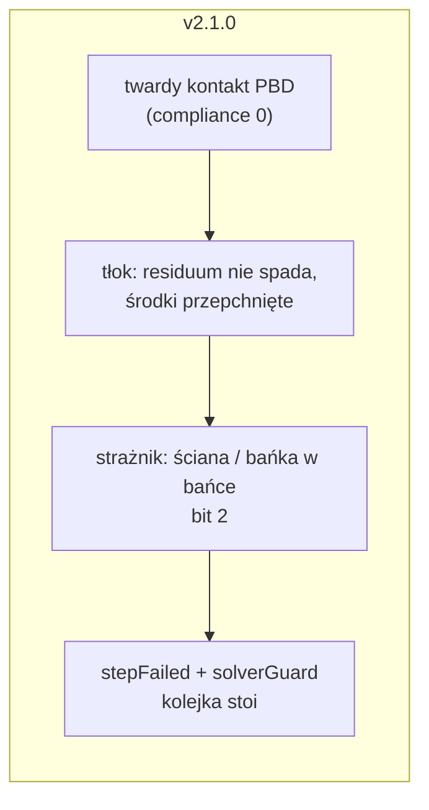
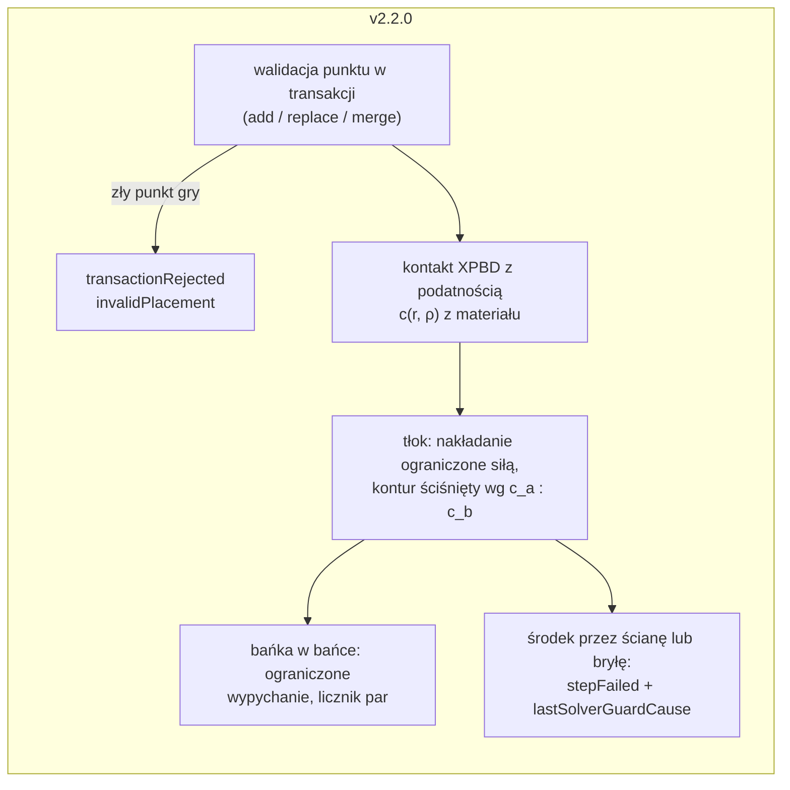
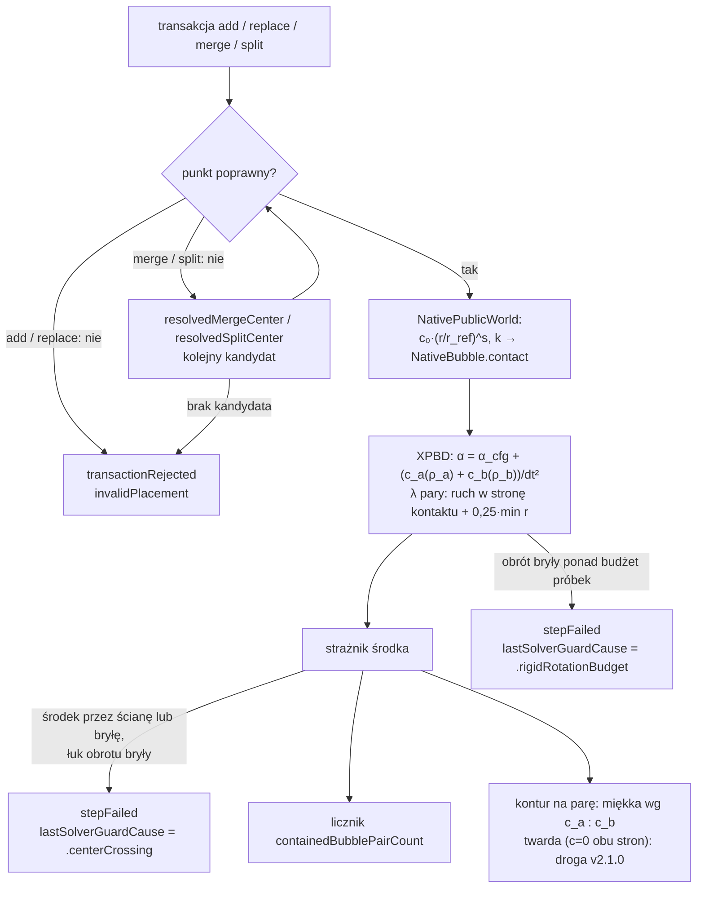

# Change Design: Ściskanie zamiast odrzucenia kroku w tłoku baniek (v2.2.0)

**Date:** 2026-11-14
**Artifact:** change-design
**Status:** Approved
**Template version:** default/0.3.2
**References:** `../2KBubbles-iOS/docs/benchmarks/stage-0-physics-gate.md`, sekcja „Specyfikacja zmiany silnika” (stan 2026-11-14); dane `../2KBubbles-iOS/docs/benchmarks/stage-0/` (`crowd-growth.json`, `crowd-growth-free-spawn.json`, `grab-scan.json`)

**Plugin version:** 0.7.10
**Agent Sessions:** claude-code: 65849c84-3e5c-4a2f-8227-dee99104ae9e, claude-code: 1e5801ca-8562-4455-ae34-516fa025393d
**Revision:** 2026-11-15, po blokadzie wycinka 2 (odstępstwo 9 w `plan.md`): limit korekcji na parę zamiast budżetu na bańkę ([CD-D-9](#cd-d-9)), naprawa zawierania bez przesuwania baniek ([CD-D-19](#cd-d-19)), nowe kryterium stosu pod grawitacją ([G2-AC6](#g2-ac6)); po prototypie (`wip/prototype-pair-limit-approach.diff`) limit pary przepuszcza ruch baniek w stronę kontaktu, a wyjątek w [G4-AC6](#g4-ac6) wymaga dowodu przełącznikiem ([CD-D-20](#cd-d-20)). Odwołania `plik:linia` w tym dokumencie dotyczą gałęzi `main`; replan wycinka 2 sprawdza je na bieżącym kodzie
**Self-review:** pętla 1: CAP_REACHED — round-2 findings fixed, not re-reviewed (uwagi rundy 2: wyjątki od zachowania v2.1.0 dla walidacji punktu i scalenia oraz `.wrap`; wyłączenie z testu wspólnego środka obiektów usuwanych przez operację; ściany sceny tłoku i założenie dla kontaktu twardego; G2-AC2 bez bezwzględnego limitu; zakres ρ; nadpisanie przy materiale sztywnym; próg CD-D-7 sięgający do bufora GPU); pętla 2 (po uwagach właściciela): CAP_REACHED — round-2 findings fixed, not re-reviewed (uwagi rundy 2: pole `response.z` zajęte, więc ρ w nowym polu `rho` cache kontaktu; sprawdzenie skończoności nie obejmowało `startTransition` promienia i `updatePhysicsMaterial`; przykład G3-AC8 nie przepełniał Float; dwie normalizacje progu w G4-AC8; brak konstrukcji przypadku bez kandydata dla podziału; dwuznaczne „sztywna” w G4-AC4); pętla 3 (po drugich uwagach właściciela): CAP_REACHED — round-2 findings fixed, not re-reviewed (uwagi rundy 2: okno uspokojenia w G4-AC1–G4-AC3 i G4-AC8 obejmowało cały przebieg; c₀ = 0 przy skrajnym wykładniku dawało NaN, a wartości domyślne `.hard` nie były podane; scena G5-AC1 nie gwarantowała odrzucenia po CD-D-17; brak kolejności przyczyn `PlacementIssue`); ostatnie doprecyzowania właściciela (wolne miejsce w łańcuchu rzutów, zaokrąglenie do 0, kolejność w Key facts) bez kolejnej pętli, za zgodą właściciela; pętla 4 (rewizja 2026-11-15): CAP_REACHED — round-2 findings fixed, not re-reviewed (uwagi rundy 2: Components i inwentarz testów pomijały `NativeMetalContainmentRepair` w `NativeMetalChainKernels.swift` oraz testy wołające usuwane jądra, a G4-AC6 nie przewidywało usunięcia testów; porównanie dawnego i nowego limitu było prawdziwe tylko dla warm startu, bo v2.1.0 nie ograniczał λ w Jacobim; diagram pomijał podział i przyczynę `.rigidRotationBudget`; G4-AC4 nie miało czasu pomiaru; pole Self-review nie obejmowało rewizji); pętla 5 (po przeglądzie właściciela i prototypie, 2026-11-15): CAP_REACHED — round-2 findings fixed, not re-reviewed (uwagi rundy 2: G6-AC1 wpisywało do CHANGELOG nieprawdziwe porównanie dawnego i nowego limitu; §2 nazywało granicę jednej pary przy stałej normalnej przypadkiem ogólnym i zakładało v_max bez `maximumLinearSpeed`; §2 twierdziło, że `nativeUpdateVelocities` w ogóle nie przelicza korekcji na prędkość, a przelicza jej część min(1, contactStiffness · dt²)); pętla 6 (pomiar nasycenia prędkości, 2026-11-15): CAP_REACHED — round-2 findings fixed, not re-reviewed (po pętli właściciel poprawił podpis tolerancji na „tolerancja zaokrągleń” i uznał kolejną pętlę za zbędną; uwagi rundy 2: zdanie w Key facts o ograniczonej prędkości nasycenia przeczyło samo sobie, przeformułowane na proporcjonalność do przyspieszenia; G1-AC2 i G1-AC4 miały różną i nieokreśloną tolerancję, teraz obie 1e-3; pole Self-review było w złej kolejności i bez pętli 6)

---

<!-- hint: Keep the `**Artifact:** change-design` line — /plan and /implement use it to recognize this as a change-design artifact (requirements + design in one file) and skip the prd.md requirement. -->

> *Section audience —* 🔍 reviewer (understand the change without implementing it) · 🛠 author (implement the change). Sections without an icon serve both.

## Summary 🔍

Gra 2KBubbles zatrzymała się na silniku v2.1.0. W gęstym tłoku silnik odrzuca kroki z powodem `solverGuard`, a po pięciu odrzuceniach z rzędu gra ogłasza awarię planszy. Tak kończy się 36 z 36 pomiarów wzrostu w tłoku. Do tego duże bańki prawie się nie uginają, a małe są miażdżone.

Wersja 2.2.0 zmienia to zachowanie:
- Układ baniek, który da się postawić poprawnie, rozwiązuje się zawsze ściśnięciem konturów i ograniczonymi siłami. Bańka w bańce, wynik scalenia w zajętym miejscu i prawie wspólny środek nie odrzucają kroku.
- Zły punkt podany przez grę (ten sam środek co inna bańka, wnętrze bryły sztywnej, punkt poza regionem) odrzuca tylko transakcję, z nazwaną przyczyną. Zły punkt wyniku scalenia silnik poprawia sam.
- Krok może jeszcze odrzucić tylko przekroczenie przez środek ściany albo bryły w trakcie symulacji, łuk obrotu bryły, który pominięty przez próbkowanie mógł dotknąć bańki, oraz obrót bryły sztywnej szybszy niż budżet próbek obrotu. Przyczynę tego odrzucenia widać w diagnostyce, a pary „bańka w bańce” widać w osobnym liczniku.

Rdzeniem zmiany jest miękki kontakt XPBD (Extended Position Based Dynamics) między bańkami. Jego podatność opisuje materiał w dwóch wymiarach: jak podatność zależy od promienia nominalnego bańki i jak sztywnieje albo mięknie bańka pod ściśnięciem. Wgniecenie konturu pary dzieli się w proporcji podatności obu baniek. Domyślna podatność wynosi 0, więc zostaje dzisiejszy twardy kontakt i dzisiejszy kontur.

## Background & problem 🔍

Raport etapu 0 gry 2KBubbles (`stage-0-physics-gate.md`) pokazuje trzy zachowania v2.1.0, które blokują grę:

1. **Odrzucanie kroku w tłoku.** Strażnik środka (`nativeGuardCenter`, `Sources/BubblePhysicsNativeMetal/Shaders/NativePostSolveKernels.metal-source:183-205`) i walidator zawierania (`nativeValidateBubbleContainment`, `:350-363`) zapalają bit 2. Dzieje się to, gdy środek przechodzi przez ścianę albo leży we wnętrzu bryły, oraz gdy mniejsza bańka mieści się cała w większej. Bit 2 staje się `WorldRejectionReason.solverGuard` (`Sources/BubblePhysicsPublic/BubbleWorld.swift:423`). Świat żyje, ale krok jest odrzucony, a transakcja czeka w kolejce. Kontakt jest twardy: `NativeMetalConfiguration.contactCompliance` = 0 (`Sources/BubblePhysicsNativeMetal/NativeMetalBackend.swift:1-16`). Przy bilansie pól powyżej 1 pełne rozdzielenie kół jest niemożliwe, więc solver przepycha środki przez ściany i jedne bańki w drugie. Świat staje przy bilansie pól 0,85–1,81, często zanim zabraknie miejsca.
2. **Miękkość odwrotna do prawa Laplace'a.** Wgniecenie z nacisku to `clamp(λ · invMass / r, 0, 0,5)` (`NativePostSolveKernels.metal-source:700-702`), więc ciężka duża bańka się nie ugina, a mała bierze cały zgniot. Bańka „2” ma w tłumie promień efektywny 0–8 pt, a do chwytu potrzeba 16 pt. `deformability` ma sufit 1 (`Sources/BubblePhysicsPublic/Model/Resources.swift:26`), a podatności kontaktu gra w ogóle nie widzi.
3. **Jedna ogólna przyczyna.** Gra nie odróżnia odrzucenia za ścianę od odrzucenia za bańkę w bańce.

## Goals and non-goals

### Goals

**G1: Tłok nie odrzuca kroku**
Układ baniek postawionych w poprawnych punktach nigdy nie kończy się odrzuconym krokiem ani awarią świata, nawet gdy suma pól docelowych wielokrotnie przekracza pole planszy. Rosnący nacisk daje coraz mocniejsze ściśnięcie konturów, a środki nie wychodzą poza ściany. To obowiązuje dla każdej podatności, także dla domyślnego kontaktu twardego. Przy kontakcie twardym w tłoku nie ma płynnego ściśnięcia: bańki nachodzą na siebie, a przesunięcie od każdej pary w kroku ogranicza limit pary (CD-D-9).

**Scena tłoku** (wspólna dla G1-AC1–G1-AC3 i G2-AC5):
- `simulationRegion` to zewnętrzny prostokąt ścian (456 × 736), więc środek zrzutowany na wewnętrzną krawędź ściany leży w regionie;
- wnętrze ścian to prostokąt 360 × 640, a cztery ściany są statycznymi prostokątnymi bryłami sztywnymi o grubości 48. Ściany boczne mają pełną wysokość z grubością górnej i dolnej, a górna i dolna leżą między nimi, więc bryły stykają się krawędziami i nie nachodzą na siebie;
- promienie baniek losujemy równomiernie z [12, 48] stałym ziarnem;
- bańki stawiamy co 0,25 s w losowym punkcie wnętrza; punkt odrzucony przez `invalidPlacement` losujemy ponownie;
- każda bańka rośnie od 10% do pełnego promienia w ciągu 1 s (`startTransition`);
- stawianie kończy się, gdy bilans pól B (suma pól docelowych kół podzielona przez 360 · 640) dojdzie do zadanego progu.

Oba materiały sceny mają `maximumLinearSpeed` = 600. Materiał miękki ma c₀ > 0, s = 1, k = 1, a jego wartości zapisuje test.
- [ ] G1-AC1 — W scenie tłoku z progiem B = 2,5 świat po ostatniej bańce robi jeszcze 600 kroków (10 s). W całym przebiegu `lastAdvanceIssue` nie przyjmuje `stepFailed` ani `worldFailed`, `failureReason == nil`, nie ma zdarzeń `didExitSimulationRegion` i żadna bańka nie znika z klatki. · `verify: test na urządzeniu Metal przez publiczne BubbleWorld, osobno dla materiału z podatnością 0 i dla materiału z podatnością dodatnią`
- [ ] G1-AC2 — W tym samym przebiegu środek każdej bańki w każdej klatce leży wewnątrz prostokąta ograniczonego wewnętrznymi krawędziami ścian, z tolerancją zaokrągleń 1e-3 (strażnik stawia środek 0,002 wewnątrz). · `verify: asercja na pozycjach z każdej klatki w teście G1-AC1`
- [ ] G1-AC3 — Przy materiale miękkim liczymy średni stosunek promienia efektywnego do docelowego (z `WorldFrame`), uśredniony po wszystkich bańkach i po klatkach ostatniej sekundy przebiegu. Przy B = 2,5 wychodzi mniejszy niż przy B = 1,5. Silniejszy nacisk daje więc mocniejsze ściśnięcie, a nie awarię. · `verify: dwa przebiegi sceny tłoku z tym samym ziarnem i progami 1,5 oraz 2,5`
- [ ] G1-AC4 — Bańkę r = 20 pchamy stałą siłą 3000 (`MotorDrive`) po przekątnej w narożnik ramy z czterech stykających się ścian, a za nią napiera tłok 10 innych baniek. Materiały mają `maximumLinearSpeed` = 600, jak w scenie tłoku; masę bańki zapisuje test. Przez 5 s żaden krok nie jest odrzucony, a środek bańki w każdej klatce leży wewnątrz prostokąta ograniczonego wewnętrznymi krawędziami ścian, z tolerancją zaokrągleń 1e-3 (strażnik stawia środek 0,002 wewnątrz), jak w G1-AC2. Sprawdzamy osobno dla podatności 0 i dla materiału miękkiego. · `verify: test publicznego BubbleWorld`

**G2: Bańka w bańce i trudne punkty rozwiązuje siła, nie odrzucenie**
Bańka dodana częściowo albo całkiem wewnątrz innej, wynik scalenia, którego środek wypada w miejscu zajętym przez trzecią bańkę, i dwie bańki o prawie wspólnym środku dają w kolejnych krokach rozsunięte bańki. Rozsuwanie idzie bez odrzucenia kroku, bez skoków i bez teleportu.
- [ ] G2-AC1 — Bańkę r = 20 dodajemy ze środkiem 5 jednostek od środka bańki r = 60 na pustej planszy. Żaden krok nie jest odrzucony. `WorldDiagnostics.containedBubblePairCount` jest równy 1 w pierwszej klatce po dodaniu i spada do 0 w ciągu 2 s symulacji. · `verify: test publicznego BubbleWorld`
- [ ] G2-AC2 — W przebiegach G2-AC1 i G2-AC3, przy `advance` o dokładnie jeden stały krok, bez napędów i siły globalnej, przesunięcie środka każdej bańki w jednym kroku nie przekracza 0,25 · r + 100 · dt. To limit pary z CD-D-9 plus największy ruch z prędkości. W tych scenach każda bańka ma jeden kontakt bańka–bańka, a bańki tylko się rozchodzą, więc człon ruchu w stronę kontaktu z CD-D-9 wynosi 0. Materiał ma `maximumLinearSpeed` = 100 i tłumienie (`damping`) dobrane tak, że pojedyncza bańka puszczona z prędkością 100 zwalnia na pustej planszy poniżej 2 jedn./s w ciągu 1 s; wartość zapisuje test. Po 2 s prędkość każdej bańki spada poniżej 2 jedn./s. · `verify: asercja na różnicy pozycji kolejnych klatek i na prędkościach z WorldFrame`
- [ ] G2-AC3 — Dwie bańki r = 20 dodane w tej samej transakcji, ze środkami oddalonymi o 0,01 jednostki, są przyjęte. W ciągu 2 s rozsuwają się na odległość środków co najmniej 20, bez odrzuconego kroku. Dotyczy to zarówno materiału z podatnością 0, jak i materiału miękkiego. · `verify: test publicznego BubbleWorld, dwa materiały`
- [ ] G2-AC4 — `mergeBubbles` dwóch baniek, których punkt styku leży wewnątrz trzeciej bańki, kończy się zdarzeniem `didAdd` wyniku. Nie ma `transactionRejected` ani odrzuconego kroku w ciągu 2 s. · `verify: test publicznego BubbleWorld`
- [ ] G2-AC5 — W scenie tłoku z G1-AC1 (B = 2,5) `containedBubblePairCount` po każdej klatce jest liczbą skończoną i nieujemną, a krok nie jest odrzucony, także wtedy, gdy licznik jest większy od 0. · `verify: asercja w teście G1-AC1`
- [ ] G2-AC6 — Przy materiałach domyślnych dwie bańki r = 8 postawione jedna nad drugą na statycznej podłodze, pod grawitacją −400, w każdym z 600 kroków stoją jedna na drugiej (600 kroków obejmuje nasycenie prędkości w stronę kontaktu z Architecture §2, około 350. kroku): górna ma środek wyżej niż dolna, a odległość środków jest co najmniej 0,95 · 16. Limit pary (CD-D-9) nie zapada więc stosu pod stałym naciskiem. · `verify: test publicznego BubbleWorld na scenie z ContactEventTests.testBeganBubbleAndBubble, 600 kroków, asercja w każdej klatce`

**G3: Zły punkt od gry odrzuca transakcję, a zły punkt scalenia silnik poprawia sam**
Punkt, w którym bańki nie da się poprawnie postawić, wraca do gry jako odrzucona transakcja z nazwaną przyczyną. Świat działa dalej i gra może wysłać nowy punkt. Punkt wyniku scalenia i części podziału wybiera silnik, więc silnik sam go poprawia.
- [ ] G3-AC1 — `add` bańki ze środkiem w tym samym miejscu co środek istniejącej bańki (odległość poniżej progu z CD-D-7) daje w klatce zdarzenie `transactionRejected(token, rejection)` z `rejection.reason == .invalidPlacement(id, .coincidentCenter)`. Bańka się nie pojawia, a następny krok (z inną transakcją) jest przyjęty. · `verify: test publicznego BubbleWorld`
- [ ] G3-AC2 — `add` bańki ze środkiem we wnętrzu wielokąta bryły sztywnej daje `.invalidPlacement(id, .insideRigidBody)`. Ze środkiem poza `simulationRegion` daje `.invalidPlacement(id, .outsideRegion)`. W obu przypadkach świat przyjmuje następny krok. · `verify: test publicznego BubbleWorld`
- [ ] G3-AC3 — `replace` bańki na bańkę w złym punkcie odrzuca transakcję z tymi samymi przyczynami co `add`. · `verify: test publicznego BubbleWorld`
- [ ] G3-AC4 — `mergeBubbles`, którego punkt styku leży dokładnie w środku trzeciej bańki, we wnętrzu bryły albo poza regionem, kończy się `didAdd` wyniku. Środek wyniku w pierwszej klatce nie pokrywa się ze środkiem żadnej innej bańki, nie leży we wnętrzu bryły i leży w regionie. Ten sam układ wejściowy daje zawsze ten sam środek wyniku. · `verify: test publicznego BubbleWorld, dwa przebiegi z porównaniem pozycji`
- [ ] G3-AC5 — Transakcja z poprawnymi punktami, w tym bańka częściowo nachodząca na inną, nie jest odrzucana za punkt. · `verify: test publicznego BubbleWorld`
- [ ] G3-AC6 — `mergeBubbles`, dla którego żaden kandydat z listy CD-D-6 nie jest poprawny, daje `transactionRejected` z `.invalidPlacement(idWyniku, przyczyna punktu styku)`. Źródła zostają na planszy, a następny krok jest przyjęty. Środki źródeł wychodzą z testu tylko wtedy, gdy wcześniejsza operacja tej samej transakcji doda statyczną bryłę przykrywającą oba źródła i całą spiralę kandydatów. To np. wcześniejsza operacja dodająca bryłę; ten sam skutek dają `replaceRigidBodies` albo bryła kinematyczna przesunięta w tej samej transakcji. Test sprawdza wariant z dodaniem bryły. · `verify: test publicznego BubbleWorld z jedną transakcją: add bryły nad źródłami, potem mergeBubbles`
- [ ] G3-AC7 — `splitBubble` bańki dociśniętej do ściany tak, że centroid jednej części wypada we wnętrzu bryły, kończy się `didAdd` obu części. Środek każdej części w pierwszej klatce leży poza bryłami, w regionie i nie pokrywa się ze środkiem żadnej innej bańki, także drugiej części. Gdy żaden kandydat nie jest poprawny, transakcja jest odrzucona z `.invalidPlacement(idCzęści, przyczyna centroidu tej części)`. Ten przypadek daje np. wcześniejsza operacja tej samej transakcji, która dodaje statyczną bryłę przykrywającą centroid, cały odcinek do środka źródła i spiralę kandydatów. · `verify: test publicznego BubbleWorld; drugi przypadek: jedna transakcja z add bryły, potem splitBubble`
- [ ] G3-AC8 — `add`, `replace`, `mergeBubbles` i `splitBubble`, dla których największa możliwa α pary z tą bańką (α_cfg + 2 · c_worst / dt², z c_worst jak w Architecture i z nadpisaniem c₀, jeśli jest) nie jest skończoną liczbą Float, dają `transactionRejected` z `.invalidValue(.valueOutOfRange("contactCompliance"))`, a świat przyjmuje następny krok. Przykład: c₀ = 1, s = 70 i r / r_ref = 4, czyli 4^70 ≈ 1,4e42 > FLT_MAX. · `verify: test publicznego BubbleWorld`
- [ ] G3-AC9 — `startTransition` promienia bańki i `updatePhysicsMaterial`, po których największa możliwa α pary z którąś bańką na planszy przestaje być skończona, dają `transactionRejected` z `.invalidValue(.valueOutOfRange("contactCompliance"))`. Promień i materiał zostają bez zmian, a świat przyjmuje następny krok. · `verify: test publicznego BubbleWorld, osobno dla obu operacji`

**G4: Podatność kontaktu opisana w materiale w dwóch wymiarach**
Materiał bańki opisuje podatność kontaktu w dwóch wymiarach: jak podstawowa podatność zmienia się z promieniem nominalnym bańki i jak zmienia się sztywność wraz ze ściśnięciem (opis znormalizowany). Gra może nadpisać podstawową podatność dla jednej bańki. Podatność 0 zachowuje zachowanie v2.1.0.
- [ ] G4-AC1 — Dwie bańki r = 20 i r = 40 z tym samym materiałem (c₀ > 0, wykładnik promienia s = 2, wykładnik ściśnięcia k = 0) dociskamy osobno do ściany tą samą stałą siłą (`MotorDrive`). Po 2 s symulacji względne wgniecenie δ / r jest większe dla bańki r = 40. δ = r − d, gdzie d to odległość środka bańki od płaszczyzny ściany z `WorldFrame`. To miara liniowa względem siły, niezależna od definicji promienia efektywnego. · `verify: test publicznego BubbleWorld`
- [ ] G4-AC2 — Ta sama scena z s = 0 daje odwrotną kolejność: większe δ / r ma bańka r = 20. Przy tej samej sile względne wgniecenie rośnie jak r^(s−1), więc s = 1 daje równe względne wgniecenie. · `verify: ten sam test, drugi przypadek`
- [ ] G4-AC3 — Przy wykładniku ściśnięcia > 0 podwojenie siły docisku zwiększa δ / r (z G4-AC1) mniej niż dwukrotnie. Przy wykładniku 0 zwiększa je dwukrotnie (± 20%). · `verify: test publicznego BubbleWorld, dwie siły na bańkę`
- [ ] G4-AC4 — Bańkę z materiałem bańki (`kind: .bubble`) o podatności c₀ = 0 dociskamy stałą siłą do bańki miękkiej leżącej przy ścianie, a pierwsza bańka nie dotyka niczego innego. Po 2 s symulacji bańka o podatności 0 ma promień efektywny równy docelowemu (± 1%), a ściśnięcie bierze miękka: odległość środków jest mniejsza od sumy promieni docelowych, a miękka ma δ > 0 względem ściany. · `verify: test publicznego BubbleWorld`
- [ ] G4-AC5 — `contactCompliance` ustawione w `BubbleDescriptor`, a także w `BubbleResult` dla wyniku scalenia i dla obu części podziału, nadpisuje podstawową podatność materiału tylko tej bańki. Dwie bańki z tym samym materiałem i różnym nadpisaniem uginają się różnie w scenie G4-AC1, a bańka bez nadpisania zachowuje się jak bez niego. · `verify: test publicznego BubbleWorld`
- [ ] G4-AC6 — Przy materiałach domyślnych (c₀ = 0) istniejące testy kroku, konturu i renderu przechodzą bez zmian oczekiwań. Wyjątkiem są testy, które celowo sprawdzały odrzucenie za bańkę w bańce albo natychmiastowe rozdzielenie zawierania (te zmieniają się zgodnie z G2), oraz testy, które wołają wprost usuwane jądra naprawy zawierania (CD-D-19; te są usuwane). Zachowanie v2.1.0 może się zmienić tylko w sześciu przypadkach: w scenach, w których v2.1.0 odrzucał krok; gdy zmianę wywołuje limit pary z CD-D-9, czego dowodzi bliźniaczy test z wyłączonym przełącznikiem `pairCorrectionLimit` i dawnym oczekiwaniem, który przechodzi (CD-D-20); gdy bańka mieści się cała w innej (CD-D-19: zawieranie rozsuwa kontakt w kilku krokach zamiast naprawy w jednym); gdy `add` albo `replace` podaje zły punkt (G3, dziś przyjmowany); gdy punkt styku scalenia albo centroid części podziału jest zły (CD-D-6, dziś wynik stawał w tym punkcie); gdy strażnik rzutuje środek, który przekroczył krawędź ściany albo bryły albo leży w jej wnętrzu (CD-D-17: rzut na krawędź przekroczoną w ruchu względnym i wymóg wolnego miejsca). Testy wołające wprost usuwane jądra naprawy zawierania są usuwane, a opis PR je wymienia. · `verify: swift test na całym pakiecie, w tym bliźniacze testy z wyłączonym limitem pary; plan inwentaryzuje testy oczekujące odrzucenia za zawieranie, a opis PR wymienia każde zmienione oczekiwanie i każdy usunięty test`
- [ ] G4-AC7 — Przy tworzeniu materiału `ModelValidationError.valueOutOfRange` rzucają: podatność ujemna, NaN albo nieskończona, wykładnik NaN albo nieskończony, promień odniesienia ≤ 0, NaN albo nieskończony oraz podatność > 0 w materiale `kind: .rigid`. Bańka z materiałem `.rigid` jest już dziś odrzucana (`incompatiblePhysicsMaterial`, `TransactionStager.swift:482`), więc nadpisanie na bańce nie spotyka materiału sztywnego. Ujemne, NaN albo nieskończone `contactCompliance` rzuca przy tworzeniu `BubbleDescriptor`. W `BubbleResult` (inicjalizator nie rzuca) odrzuca transakcję zdarzeniem `transactionRejected` z `.invalidValue(.valueOutOfRange("contactCompliance"))`. · `verify: testy jednostkowe modelu i test transakcji scalenia`
- [ ] G4-AC8 — W scenach G4-AC1–G4-AC3 δ każdej bańki w oknie od 1 s do 2 s symulacji (pomiar w G4-AC1–G4-AC3 jest po 2 s) waha się o mniej niż 0,02 · r (różnica maksimum i minimum δ). Bańka jest więc uspokojona, a nie drga przez sprzężenie ρ^k. · `verify: asercja w tych samych testach`

**G5: Przyczyna odrzucenia i zawieranie są publicznie widoczne**
- [ ] G5-AC1 — Gdy krok zostaje odrzucony, bo środek bańki w trakcie symulacji przeszedł przez ścianę albo wszedł we wnętrze bryły, albo bo łuk obrotu bryły pominięty przez próbkowanie w `nativeRigidContacts` mógł dotknąć bańki (koło bańki w odległości promienia z marginesem od krawędzi bryły, więc środek mógł wejść do jej wnętrza), `lastRejectionReason == .solverGuard` i `lastSolverGuardCause == .centerCrossing`. · `verify: test publicznego BubbleWorld z bryłą kinematyczną przesuniętą jednym krokiem tak, że w położeniu końcowym nachodzi na ścianę i przykrywa środek bańki przyciśniętej do tej ściany, więc żaden z rzutów strażnika nie wyprowadza środka do wolnego miejsca; `simulationRegion` to zewnętrzny prostokąt ścian, jak w scenie tłoku`
- [ ] G5-AC2 — `lastSolverGuardCause` jest `nil`, gdy żaden krok nie został jeszcze odrzucony albo ostatnie odrzucenie miało inny powód niż `.solverGuard`. · `verify: test publicznego BubbleWorld`
- [ ] G5-AC3 — `containedBubblePairCount` podaje liczbę par baniek, z których mniejsza mieści się cała w kole większej, po ostatnim ukończonym kroku. Na pustej planszy wynosi 0. · `verify: G2-AC1 i test pustej planszy`
- [ ] G5-AC4 — Gdy krok zostaje odrzucony, bo bryła sztywna obróciła się w jednym kroku o więcej niż pozwala budżet 128 próbek obrotu (`nativeRigidPredict`, `NativePostSolveKernels.metal-source:470`), `lastRejectionReason == .solverGuard` i `lastSolverGuardCause == .rigidRotationBudget`. · `verify: test publicznego BubbleWorld z bryłą dynamiczną o prędkości kątowej przekraczającej budżet w jednym kroku`

**G6: Wydanie 2.2.0**
- [ ] G6-AC1 — Repozytorium ma tag `v2.2.0`. `CHANGELOG.md` opisuje nowe pola i przypadki, w tym nowy przypadek `TransactionRejectionReason.invalidPlacement` jako zmianę, która może wymagać gałęzi `default` w wyczerpującym `switch`, oraz zmiany zachowania przy materiałach domyślnych: zawieranie nie odrzuca kroku i rozsuwa się w kilku krokach, bo naprawy zawierania już nie ma, korekcja od pary baniek ma limit λ pary, wspólny dla warm startu i iteracji Jacobiego (0,25 · min r ponad ruch baniek w stronę kontaktu); w v2.1.0 limit r / (invMass · liczba kontaktów) miał tylko warm start, więc nowy limit bywa ostrzejszy albo łagodniejszy, zależnie od liczby kontaktów, prędkości i promieni pary, a Jacobi pierwszy raz ma limit, zły punkt `add` i `replace` (także poza regionem przy `regionExitPolicy == .wrap`) odrzuca transakcję, wynik scalenia i części podziału mogą stanąć poza punktem styku albo centroidem, `mergeBubbles` i `splitBubble` bez poprawnego kandydata odrzucają transakcję, a strażnik rzutuje środek na przekroczoną krawędź (CD-D-17). `README.md` podaje wersję 2.2.0, a `docs/integration-guide.md` zaleca ustawienie `maximumLinearSpeed` dla baniek w tłoku, opisuje podatność materiału i nadpisanie na bańce oraz to, że bańka w spoczynku pod stałą siłą raportuje prędkość w stronę kontaktu (nasyconą, Architecture §2) i zabiera ją ze sobą, gdy podparcie zniknie. · `verify: przegląd plików i git tag`
- [ ] G6-AC2 — Strażnik wydajności (`swift run -c release BubblePhysicsPerfGuard`) przechodzi na Macu z tymi samymi progami co dla 2.1.0. · `verify: uruchomienie strażnika`

### Non-goals

- Test przeciskania (W4 ze specyfikacji) i dobór parametrów gry: oba należą do 2KBubbles po tagu.
- Zmiany w repozytorium 2KBubbles, w tym podbicie wersji silnika.
- Ujawnianie liczby iteracji solvera grze (`makeBenchmarkWorld` zostaje `package`).
- Miękkie ściany i bryły: kontakt bańka–bryła używa tylko podatności bańki.
- Zmiana domyślnego zachowania: bez nowych parametrów silnik zachowuje się jak v2.1.0, poza wyjątkami wymienionymi w G4-AC6.
- Pomiary na iPhonie X i limit liczby baniek.
- Naprawa prędkości, którą bańka w spoczynku na kontakcie gromadzi w stronę kontaktu aż do nasycenia (v2.1.0, opis w Architecture §2): zmieniłaby ruch każdej bańki przy materiałach domyślnych, więc należy do osobnej zmiany.

## Architecture

Zmiana ma cztery części, od wejścia do wyjścia kroku.

**1. Walidacja punktu w transakcji (G3).** `TransactionStager` (`Sources/BubblePhysicsRuntime/TransactionStager.swift`) przy `add`, `replace`, `mergeBubbles` i `splitBubble` sprawdza środek nowej bańki względem stanu po wcześniejszych operacjach tej samej transakcji. Obiekty usuwane przez tę samą operację (bańka zastępowana przez `replace`, źródła `mergeBubbles`, źródło `splitBubble`) są z testu wyłączone. Warunki są sprawdzane w kolejności poniżej, a pierwszy niespełniony wyznacza przyczynę:
1. punkt poza `simulationRegion` daje `.outsideRegion`, niezależnie od `regionExitPolicy` (CD-D-14);
2. punkt we wnętrzu wielokąta, koła lub kapsuły bryły sztywnej daje `.insideRigidBody`;
3. odległość od środka każdej innej bańki poniżej progu `coincidentCenterTolerance` (CD-D-7) daje `.coincidentCenter`.

Przy `add` i `replace` błąd odrzuca całą transakcję istniejącą drogą `TransactionRejection` z nowym przypadkiem `invalidPlacement(ObjectID, PlacementIssue)`. Przy `mergeBubbles` silnik nie odrzuca transakcji. `StructuralOperations.mergeCenter` (`Sources/BubblePhysicsRuntime/StructuralOperations.swift:10`) zwraca punkt styku, a nowa funkcja `StructuralOperations.resolvedMergeCenter` sprawdza go tym samym testem i przy błędzie próbuje deterministycznie kolejnych kandydatów (CD-D-6). Kolejność kandydatów dla N źródeł:
1. dla każdego źródła w kolejności `sources`: punkty P + t · (S_i − P) dla t = 0,25, 0,5, 0,75, gdzie P to punkt styku, a S_i to środek źródła;
2. środki źródeł S_i w tej samej kolejności;
3. spirala wokół środka źródła o największej masie (przy równych masach wygrywa pierwsze w kolejności `sources`): 8 pierścieni o promieniach j · r_wyniku / 4 (j = 1…8), po 16 punktów na pierścień.

Pierwszy poprawny kandydat wygrywa. Lista ma 3N + N + 128 punktów i zawsze się kończy. Jeśli żaden kandydat nie jest poprawny (np. wokół źródeł są same bryły), transakcja jest odrzucona z `.invalidPlacement(idWyniku, przyczyna punktu styku)` (G3-AC6). Zazwyczaj przechodzi już kandydat z kroku 1 albo 2, bo źródła były postawione poprawnie.

Podział (`splitBubble`) idzie tą samą drogą. `StructuralOperations.initializeSplit` (`StructuralOperations.swift:35-60`) stawia części w centroidach odcinków koła. Gdy centroid części jest zły, `resolvedSplitCenter` próbuje punktów C + t · (S − C) dla t = 0,25, 0,5, 0,75, gdzie C to centroid, a S to środek źródła. Potem próbuje S, a na końcu spirali wokół S: 8 pierścieni o promieniach j · r_części / 4 (j = 1…8), po 16 punktów na pierścień. To 3 + 1 + 128 = 132 kandydatów na część. Części są rozwiązywane po kolei: najpierw `first`, potem `second`, a kandydat `second` nie może pokrywać się z już poprawionym środkiem `first`. Gdy któraś część stoi poza centroidem, środek masy części d_com = (m₁ · d₁ + m₂ · d₂) / (m₁ + m₂) odsuwa się od środka źródła, gdzie d_i to przesunięcie części względem środka źródła. To przesunięcie środka masy jest udokumentowaną konsekwencją. Prędkości `initializeSplit` liczy wtedy od nowa względem d_com: v_i = v_s + ω × (d_i − d_com), a ω wynika z momentu pędu źródła i bezwładności części liczonej względem d_com. Pęd liniowy i moment pędu źródła są więc zachowane. Kształt strukturalny części (`structuralShape`) ma początek w końcowym środku, tak jak dziś przy scaleniu (`StructuralOperations.swift:24`, `:73-74`). Gdy żaden nie przejdzie, transakcja jest odrzucona (G3-AC7).

Przy `add`, `replace`, scaleniu i podziale stager liczy najgorszy przypadek podatności bańki: c_worst = c₀ · (r*/r_ref)^s · ρ_min^min(k, 0). r* to ten koniec przedziału promieni bańki, który daje większe (r/r_ref)^s: większy promień przy s ≥ 0, mniejszy przy s < 0. Przedział obejmuje promień bieżący i, gdy trwa `startTransition`, promień początkowy i końcowy. Stager sprawdza skończoność α_cfg + 2 · c_worst / dt², czyli największej możliwej α pary z tą bańką. Gdy wartość nie jest skończona, transakcja jest odrzucana przez `.invalidValue` (G3-AC8). To samo sprawdzenie robią dwie operacje, które zmieniają podatność bańki już stojącej na planszy: `startTransition` promienia bańki (`ParameterTransition` z celem `.bubbleRadius(id)`, `Sources/BubblePhysicsPublic/Model/Transitions.swift:10`) z nowym promieniem końcowym oraz `updatePhysicsMaterial` z nowymi parametrami, dla każdej bańki używającej tego materiału, z uwzględnieniem jej nadpisania c₀ (G3-AC9). Dzięki temu GPU nigdy nie dostaje podatności, która przepełnia Float, a zakres wykładników nie jest potrzebny (CD-D-15).

**2. Podatność kontaktu (G1, G4).** `PhysicsMaterial` dostaje pole `contactCompliance: BubbleContactCompliance` z czterema wartościami:
- `base` c₀ ≥ 0, domyślnie 0;
- `referenceRadius` r_ref > 0, domyślnie 1;
- `radiusExponent` s, domyślnie 0;
- `compressionExponent` k, domyślnie 0.

Wartość `.hard` to właśnie te wartości domyślne. Gdy c₀ (po ewentualnym nadpisaniu na bańce) wynosi 0, c = 0 bez liczenia potęg, zarówno w stagerze, jak i na hoście i GPU. Skrajny wykładnik przy c₀ = 0 nie daje więc NaN z 0 · ∞ i nie powoduje odrzucenia.

`BubbleDescriptor` i `BubbleResult` dostają `contactCompliance: Float?`, które zastępuje c₀ jednej bańki. Podatność bańki w kroku to:

c = c₀ · (r / r_ref)^s · ρ^k,

gdzie r to bieżący promień fizyczny bańki (w trakcie `startTransition` promień przejściowy, a nie końcowy), a ρ ∈ [0, 1] to stosunek promienia konturu bańki do r w kierunku normalnej danego kontaktu, z konturu poprzedniego kroku. ρ jest więc liczone osobno dla każdego końca każdego kontaktu. Wartości wygładzone obu końców przechowuje nowe pole rekordu cache kontaktu `NativeContactCache.rho: float4` (ρ_a, ρ_b, rezerwa, rezerwa). `response.z` jest zajęte przez `allowedSide`, więc pole jest nowe, a test ABI się zmienia.

Wygładzanie odbywa się raz na krok symulacji, także gdy jedno `advance` robi kilka kroków: ρ_n = ρ_{n−1} + β · (ρ_konturu − ρ_{n−1}), gdzie β = 0,25 to stała silnika. Nowy kontakt i pierwsza klatka bańki zaczynają od ρ = 1. Wygładzenie tłumi drganie wynikające z tego, że ρ^k reaguje z opóźnieniem jednego kroku (CD-D-16). Wzór używa max(ρ, `ρ_min`), z `ρ_min` = 0,01 (stała silnika), żeby przy k < 0 potęga nie dawała nieskończoności. Kontur nie ma dolnej granicy: może spaść do 0.

Przy tej samej sile względne wgniecenie bańki rośnie jak r^(s−1). Dla s > 1 duże bańki uginają się względnie bardziej (prawo Laplace'a z W3), s = 1 daje równe względne wgniecenie, a s < 1 bardziej ugina małe. Część c₀ · (r / r_ref)^s liczy host w `NativePublicWorld` (`Sources/BubblePhysicsNativeMetal/NativePublicWorld.swift:158-171`) i zapisuje w nowych polach `NativeBubble` (`contact: float4` = część bazowa, k, rezerwa). Czynnik ρ^k liczy GPU.

W `nativeUpdateContactMultipliers` (`Sources/BubblePhysicsNativeMetal/Shaders/NativeXPBDKernels.metal-source:399-419`) `alpha` przestaje być tylko stałą świata (`solver.physics.x`, dziś `NativeMetalConfiguration.contactCompliance / dt²`, `NativeMetalSolver.swift:414-417`). Dochodzi do niej podatność pary podzielona przez dt²:
- para bańka–bańka: α = α_cfg + (c_a(ρ_a) + c_b(ρ_b)) / dt²;
- para bańka–bryła: α = α_cfg + c_a(ρ_a) / dt².

`nativeMeasureResidual` (`:439-459`) używa tego samego α. Przy c₀ = 0 po obu stronach α = α_cfg, czyli to samo co dziś. Pole konfiguracji dalej działa w harnessie benchmarków (CD-D-5).

Dodatkowo każdy kontakt bańka–bańka ma limit pary (CD-D-9). Jego mnożnik λ (`NativeContactCache.response.x`) jest wspólny dla warm startu i wszystkich iteracji Jacobiego w kroku i jest przycinany do

λ ≤ ((max(0, v_a · n) + max(0, −v_b · n)) · dt + 0,25 · min(r_a, r_b)) / max(invMass_a, invMass_b),

gdzie n to normalna od a do b, a v to przewidziana prędkość bańki w tym kroku. Pierwszy człon to ruch każdej bańki w stronę drugiej, liczony osobno dla każdej, a nie względem siebie. Limit go przepuszcza, bo korekcja, która go znosi, tylko zatrzymuje bańki w miejscu. Drugi człon ogranicza rozsuwanie nakładania sprzed kroku: każda bańka odsuwa się od pary w kroku najwyżej o 0,25 · min(r_a, r_b) ponad własny ruch i ruch partnera w jej stronę. Dla jednej pary przy stałej normalnej, gdy prędkość baniek ogranicza v_max (np. `maximumLinearSpeed`), bańka przesuwa się w kroku najwyżej o 0,25 · r + 2 · v_max · dt: własny ruch plus korekcja znosząca ruch partnera w jej stronę. Kilka par i obrót normalnej mogą dać więcej (niżej). W scenach G2-AC2 bańki tylko się rozchodzą, więc człon zbliżania wynosi 0, a granica to 0,25 · r + v_max · dt. Przycięcie działa na λ z poprzedniego kroku przed warm startem (`nativePrepareSolverContacts`, `NativeXPBDKernels.metal-source:333`, zastępuje dzisiejszy limit r / (invMass · liczba kontaktów)) i na λ po każdej aktualizacji w `nativeUpdateContactMultipliers` (`:399`). Korekcja Jacobiego to przyrost λ po przycięciu, a oba końce dostają tę samą λ, więc pęd pary jest zachowany bez dodatkowych kroków. Granica ruchu wynika z λ przy stałej normalnej. Warm start działa wzdłuż normalnej z cache, a przyrosty wzdłuż bieżącej, więc gdy normalna obraca się w kroku, przesunięcie może przekroczyć λ · invMass, w skrajnym przypadku dwukrotnie. W scenach G2-AC2 normalna jest stała. Limit nie dzieli się przez liczbę kontaktów i nie ma budżetu na bańkę, więc kontakty nie zużywają sobie nawzajem limitu. Bańka z kilkoma sąsiadami pchającymi w tę samą stronę może w kroku przesunąć się o sumę limitów tych par.

Człon ruchu w stronę kontaktu jest potrzebny z powodu zachowania v2.1.0: bańka w spoczynku na innej bańce niesie rosnącą prędkość w stronę kontaktu (w stosie z G2-AC6 −117 jedn./s po 50 krokach i −170 po 84), bo `nativeDampContactNormalMotion` (`NativeXPBDKernels.metal-source:976`) nie tłumi powyżej `restSpeed` = max(40, 2 · r), a `nativeUpdateVelocities` (`NativeXPBDKernels.metal-source:953-972`) przelicza na prędkość tylko część korekcji kontaktu, min(1, contactStiffness · dt²). Kontakt cofa więc bańkę w każdym kroku o v · dt. Limit bez tego członu zapada stos, gdy v · dt dojdzie do 0,25 · r (prototyp, 2026-11-15). Prędkość się nasyca: w stosie z G2-AC6 dochodzi do −193,33 jedn./s około 350. kroku i dalej się nie zmienia przez 600 kroków, identycznie na `main` i w prototypie. Stan ustalony odpowiada v ≈ a / (contactStiffness · dt), gdzie a to przyspieszenie od grawitacji albo napędu, więc ruch w stronę kontaktu w kroku to około a / contactStiffness. Prędkość jest widoczna w `WorldFrame` i bańka zabiera ją ze sobą, gdy podparcie zniknie (scalenie, pęknięcie, usunięcie), tak jak w v2.1.0. Sam ten mechanizm zostaje poza zmianą (Non-goals).

Limit ma przełącznik `NativeMetalConfiguration.pairCorrectionLimit` (domyślnie włączony, dostępny tylko wewnątrz pakietu, niewidoczny dla gry). Wyłączony daje dawny limit warm startu i Jacobiego bez limitu. Służy wyłącznie testom, które dowodzą wyjątku w G4-AC6 (CD-D-20).

Kontakty bańka–ściana i bańka–bryła limitowi pary nie podlegają: warm start zachowuje dla nich dzisiejszy limit r / (invMass · liczba kontaktów), a Jacobi ich nie przycina. Rzutowanie środka na ściany i bryły też nie ma limitu. Ruch z prędkości limitowi nie podlega. Ogranicza go `PhysicsMaterial.maximumLinearSpeed`, jeśli gra go ustawi.

**3. Kontur według podziału podatności (G4).** W `nativeAccumulateContactPressure` (`NativePostSolveKernels.metal-source:665-750`) droga konturu jest wybierana dla każdej pary osobno (CD-D-12):
- **Para miękka** (choć jedna strona ma c > 0): wycina kontur bańki a cięciwą prostopadłą do normalnej pary, na głębokości nakładanie · c_a / (c_a + c_b) od brzegu a. Bańka z c = 0 w takiej parze nie dostaje wgniecenia. Bańka miękka w kontakcie ze ścianą lub bryłą bierze całe nakładanie z tą przeszkodą.
- **Para twarda** (c = 0 po obu stronach) i kontakt bańki twardej z bryłą: jak dziś, czyli cięciwa radykalna, ograniczenie promieniem ściany i nacisk `λ · invMass / r` z sufitem 0,5.

Promień konturu w danym kierunku to minimum ze wszystkich par, jak dziś. Sufit 0,5 dotyczy tylko nacisku z par twardych.

**4. Strażniki bez odrzucenia za zawieranie (G2, G5).**
- Naprawa zawierania (`nativeSeparateContainedBubbles` i jej kopia z fuzją `nativeSeparateAndGuardContainedBubbles`, razem z ponownym strażnikiem `nativeReapplyCenterGuards`, `NativePostSolveKernels.metal-source:223-344`) znika: jądra są usuwane z shadera, a ich przebiegi z `NativeMetalSolver` (CD-D-19). Para zawarta zawsze na siebie nachodzi, więc jest kontaktem bańka–bańka, i rozsuwa ją solver kontaktów z limitem pary (CD-D-9). Zawieranie znika więc w kilku krokach, bez teleportu. Przy dokładnie wspólnym środku nowy kontakt dostaje normalną (1, 0) od końca a do końca b (`nativeBuildContacts`, `NativeGeometryKernels.metal-source:641`), a dalej używa normalnej z cache jako zapasowej (`nativeConstraintGeometry`, `NativeXPBDKernels.metal-source:369`). Kierunek zależy więc od kolejności końców w rekordzie kontaktu, a nie od kolejności ID jak w usuwanej naprawie, ale jest deterministyczny. Ten przypadek naprawdę występuje, bo strażnik potrafi zrzutować dwie bańki w ten sam punkt. Ponowny strażnik działał tylko dla baniek przesuniętych przez naprawę, więc jego usunięcie niczego nie zmienia w ochronie ścian. Rzut strażnika, który wepchnie bańkę w inną, rozsuwa kontakt w kolejnym kroku.
- `nativeValidateBubbleContainment` (`:350-363`) nie zapala bitu 2. Liczy pary zawarte atomowo do nowego licznika w `safetyControl`, a host publikuje go jako `WorldDiagnostics.containedBubblePairCount`.
- `nativeGuardCenter` (`:183-205`) zapala nowy bit `centerCrossing` razem z dotychczasowym bitem 2. `nativeRigidPredict` (`:470`) przy przekroczonym budżecie próbek obrotu zapala razem z bitem 2 nowy bit `rigidRotationBudget` (CD-D-10). `nativeRigidContacts` (`NativeXPBDKernels.metal-source:717`) odrzuca klatkę, gdy łuk obrotu bryły pominięty przez próbkowanie mógł dotknąć bańki, czyli koło bańki znalazło się w odległości promienia z marginesem od krawędzi bryły. Zapala wtedy razem z bitem 2 bit `centerCrossing`, bo środek mógł przejść do wnętrza bryły (decyzja właściciela w planie, 2026-11-14). `NativeMetalSolver` (`Sources/BubblePhysicsNativeMetal/NativeMetalSolver.swift:946-951`) przenosi przyczynę w `NativeMetalSafetyFailure`, a `BubbleWorld.handleAdvanceError` (`Sources/BubblePhysicsPublic/BubbleWorld.swift:378-393`) ustawia `lastSolverGuardCause`. Dziś strażnik rzutuje środek na najbliższą krawędź bryły, w której środek leży (`:170-179`). Przy dwóch stykających się ścianach w narożniku rzut przerzuca więc środek między nimi. Zmiana (CD-D-17): rzut idzie na krawędź, którą środek przekroczył na drodze start→end w ruchu względnym, czyli z położeniem krawędzi `previous` → `current` (`NativeSegment`), tak jak już liczy to `nativeForbiddenCenterCrossing`. Gdy żadna krawędź nie została przekroczona nawet w ruchu względnym (np. `replaceRigidBodies` postawiło bryłę na stojącej bańce), strażnik rzutuje środek, jak dziś, na najbliższą krawędź bryły, w której środek leży. Gdy wynik dalej leży we wnętrzu innej bryły, następuje rzut na krawędź tej sąsiedniej bryły, przez którą wychodzi się do wolnego miejsca. Przy dwóch prostopadłych ścianach daje to narożnik wewnętrzny z marginesem. Liczba takich kolejnych rzutów jest ograniczona do 4. „Wolne miejsce” oznacza punkt w `simulationRegion`, poza wszystkimi bryłami, do którego odcinek od punktu startowego kroku nie przecina wnętrza żadnej bryły. Gdy kilka krawędzi daje taki punkt, wygrywa ta, której punkt leży najbliżej punktu startowego kroku. Środek nie przeskoczy więc na drugą stronę ściany ani bryły kinematycznej. Gdy żadna krawędź nie daje wolnego miejsca, krok jest odrzucany (G5-AC1). Bit zapala dopiero końcowa walidacja po wszystkich rzutowaniach (`:183-205`), gdy środek dalej leży po złej stronie ściany albo we wnętrzu bryły, np. między dwiema nachodzącymi na siebie przeszkodami. Tylko w tym przypadku krok jest odrzucany (CD-D-3).

## Components

- **`Sources/BubblePhysicsPublic/Model/Resources.swift`**: `BubbleContactCompliance` (c₀, r_ref, s, k, wartość `.hard`) i pole `PhysicsMaterial.contactCompliance` z walidacją (G4-AC7).
- **`Sources/BubblePhysicsPublic/Model/Objects.swift`**: `BubbleDescriptor.contactCompliance: Float?` z walidacją.
- **`Sources/BubblePhysicsPublic/Model/WorldTransaction.swift`**: `BubbleResult.contactCompliance: Float?`, przenoszone na wynik scalenia i podziału.
- **`Sources/BubblePhysicsPublic/Model/WorldFrame.swift`**: `TransactionRejectionReason.invalidPlacement(ObjectID, PlacementIssue)` i wyliczenie `PlacementIssue` (`.coincidentCenter`, `.insideRigidBody`, `.outsideRegion`).
- **`Sources/BubblePhysicsPublic/Diagnostics.swift`**: `SolverGuardCause` (`.centerCrossing`, `.rigidRotationBudget`), pola `WorldDiagnostics.lastSolverGuardCause` i `containedBubblePairCount`.
- **`Sources/BubblePhysicsPublic/BubbleWorld.swift`**: przeniesienie przyczyny strażnika i licznika zawierania do diagnostyki.
- **`Sources/BubblePhysicsRuntime/TransactionStager.swift`**: walidacja punktu przy `add`, `replace`, `mergeBubbles` i `splitBubble` oraz skończoności największej α przy tych operacjach, przy `startTransition` promienia bańki i przy `updatePhysicsMaterial`.
- **`Sources/BubblePhysicsRuntime/StructuralOperations.swift`**: `resolvedMergeCenter` i `resolvedSplitCenter`, czyli deterministyczne listy kandydatów; przeniesienie nadpisania podatności na wynik.
- **`Sources/BubblePhysicsNativeMetal/NativePublicWorld.swift`**: wyliczenie części bazowej podatności i k dla każdej bańki.
- **`Sources/BubblePhysicsNativeMetal/NativeMetalBufferLayout.swift`** i struktura `NativeBubble` w `Shaders/NativeGeometryKernels.metal-source:4-16`: nowe pole `contact`, z aktualizacją testu ABI (`Tests/BubblePhysicsNativeMetalTests/NativeMetalShaderABITests.swift`).
- **`Sources/BubblePhysicsNativeMetal/Shaders/NativeXPBDKernels.metal-source`**: α pary w `nativeUpdateContactMultipliers` i `nativeMeasureResidual`, limit pary na λ w `nativePrepareSolverContacts` i `nativeUpdateContactMultipliers`.
- **`Sources/BubblePhysicsNativeMetal/Shaders/NativePostSolveKernels.metal-source`**: droga konturu na parę w `nativeAccumulateContactPressure`, usunięte jądra naprawy zawierania i `nativeReapplyCenterGuards`, licznik zawierania zamiast bitu 2, bit przyczyny i rzut na przekroczoną krawędź w `nativeGuardCenter`, wygładzenie ρ.
- **`Sources/BubblePhysicsNativeMetal/NativeMetalBackend.swift`**: przełącznik `NativeMetalConfiguration.pairCorrectionLimit` (CD-D-20), przekazywany do shadera.
- **`Sources/BubblePhysicsNativeMetal/NativeMetalChainKernels.swift`**: usunięcie `NativeMetalContainmentRepair` (`:266-300`), które koduje przebiegi naprawy zawierania.
- **`Sources/BubblePhysicsNativeMetal/NativeMetalSolver.swift`**: odczyt nowego bitu i licznika, przyczyna w `NativeMetalSafetyFailure`, usunięte przebiegi naprawy zawierania; wygładzone ρ obu końców w nowym polu `rho` rekordu cache kontaktu (`NativeContactCacheRecord`, `NativeMetalBufferLayout.swift:89-94`, i `NativeContactCache` w shaderach), z aktualizacją testu ABI.
- **`Tests/BubblePhysicsRuntimeTests/`**: nowe testy G1–G5 na publicznym `BubbleWorld`. Plan inwentaryzuje istniejące testy, które oczekują `guardFailure` za zawieranie albo natychmiastowego rozdzielenia (kandydaci: `Tests/BubblePhysicsNativeMetalDiagnosticsTests/NativeMetalSafetyTests.swift`, `Tests/BubblePhysicsNativeMetalTests/NativeMetalPreviousContourTests.swift`), i zmienia ich oczekiwania zgodnie z G2. Testy wołające wprost usuwane jądra naprawy (`Tests/BubblePhysicsNativeMetalTests/NativeMetalChainKernelTests.swift`, porównanie bit w bit kopii z fuzją i bez, oraz `Tests/BubblePhysicsNativeMetalDiagnosticsTests/NativeMetalContainmentParallelTests.swift`) usuwa razem z jądrami (CD-D-19).
- **`Tests/BubblePhysicsPublicTests/ModelValidationTests.swift`**: walidacja G4-AC7.
- **`CHANGELOG.md`, `README.md`, `docs/integration-guide.md`**: wydanie 2.2.0 (G6).

## Error handling

- Podatność wyliczona na GPU okazuje się nieskończona albo NaN (np. przez skrajny wykładnik). Krok kończy się istniejącą ścieżką `nonFiniteValues`, czyli `worldFailed`, jak każda inna wartość nieskończona. Walidacja materiału (G4-AC7) odrzuca nieskończone parametry i NaN, `ρ_min` chroni przed potęgą zera przy k < 0, a sprawdzenie największej możliwej α przy stawianiu bańki (G3-AC8) wyklucza przepełnienie. Ta ścieżka nie pojawia się więc w poprawnie przyjętych danych.
- Część c₀ · (r / r_ref)^s może być tak mała, że Float zaokrągli ją do 0. Wtedy c = 0 i para przechodzi na twardą drogę kontaktu i konturu. To nieszkodliwe i nie jest błędem: zachowanie odpowiada wtedy podatności 0.
- Transakcja z kilkoma operacjami, z których jedna ma zły punkt, jest odrzucona w całości, zgodnie z istniejącą semantyką `TransactionRejection.operationIndex`.

## Testing & verification

- Test regresji G4-AC6: cały `swift test` na Macu z urządzeniem Metal. W opisie PR wymieniamy każde zmienione oczekiwanie i jego powód.
- Strażnik wydajności G6-AC2, bo kontur i solver dostają dodatkowe obliczenia na parę.

## Decisions 🔍

| ID | Title | Context | Options | Choice | Rationale | Source | Goal impact | Consequences |
|----|-------|---------|---------|--------|-----------|--------|-------------|--------------|
| CD-D-1 | Test przeciskania poza zmianą | W4 wymagało testu przeciskania jako warunku tagu; najpierw wybrano test w 2KBubbles w tej zmianie | test w silniku; test w grze w tej zmianie; brak testu w zmianie | brak: test przeciskania i dobór parametrów robi gra po tagu | Właściciel uznał, że parametryzowana podatność wystarczy grze do zaliczenia testu po swojej stronie | `user` | usuwa W4 z celów; G1–G4 zastępują je testami silnika | zmiana nie dotyka repozytorium 2KBubbles; ryzyko, że parametry nie wystarczą, wychodzi dopiero w grze |
| CD-D-2 | Przyczyna odrzucenia jako dodatkowe pole | Dziś istnieje tylko `.solverGuard`, a wersja ma być minor | nowe pole `lastSolverGuardCause`; nowe przypadki `WorldRejectionReason` (3.0.0); wartość powiązana (3.0.0) | nowe pole `WorldDiagnostics.lastSolverGuardCause` | Zmiana tylko dodaje API, a gra przechowuje `WorldRejectionReason` w `BoardFailure.stepsRejected` bez zmian | `user` | G5-AC1, G5-AC2 | `.solverGuard` zostaje jedyną wartością odrzucenia przez strażnika |
| CD-D-3 | Granica kontraktu odrzucenia | Trzeba ustalić, kiedy odrzucenie jest jeszcze dozwolone | bańki nigdy nie odrzucają, zostają przeszkody sztywne; nigdy żadnego odrzucenia; kontrakt tylko dla planszy prostokątnej | bańki nigdy nie odrzucają kroku; niewłaściwe są tylko: ten sam środek co inna bańka, środek we wnętrzu bryły, środek poza planszą | Właściciel wskazał te trzy przypadki jako jedyne nierozwiązywalne | `user` | G1, G2, G3 | środek przepchnięty przez ścianę lub bryłę w trakcie symulacji dalej odrzuca krok (G5-AC1) |
| CD-D-4 | Zły punkt odrzuca transakcję | Odrzucony krok zostawia transakcję w kolejce, więc gra nie mogłaby podać nowego punktu | odrzucenie transakcji; odrzucenie kroku; odrzucenie kroku z usunięciem transakcji | `transactionRejected` z `invalidPlacement(ObjectID, PlacementIssue)`; świat idzie dalej | Spełnia intencję właściciela: wywołujący dowiaduje się o złym punkcie i podaje nowy; gra już obsługuje to zdarzenie (`BoardWorld.swift:447` w 2KBubbles) | `user` | G3-AC1–G3-AC3 | nowy przypadek w `TransactionRejectionReason` formalnie łamie wyczerpujący `switch`; gra ma tylko `if case`, więc wydanie zostaje minor z adnotacją w CHANGELOG (G6-AC1) |
| CD-D-5 | Rdzeń: miękki kontakt XPBD | Twardy PBD nie ma rozwiązania przy bilansie pól > 1 | XPBD z podatnością pary; twardy kontakt z limitem korekcji; zmiana promienia fizycznego | XPBD z α = α_cfg + (c_a + c_b) / dt², kontur dzielony według c_a : c_b | Jedna wielkość daje brak awarii, miękkość zależną od promienia i kontur zgodny z rozkładem zgniotu; solver ma już ścieżkę `alpha` | `user` | G1, G4 | α zależy od pary; `NativeMetalConfiguration.contactCompliance` dalej dodaje się do α (dla harnessu benchmarków), więc pole nie staje się martwe |
| CD-D-6 | Punkt scalenia poprawia silnik | Punkt wyniku scalenia wybiera silnik, nie gra | odrzucenie transakcji; deterministyczne szukanie innego punktu | `resolvedMergeCenter`: punkty między stykiem a źródłami, środki źródeł, potem 8 × 16 punktów spirali; gdy żaden nie przejdzie, odrzucenie transakcji | Właściciel: punkt wybrany przez silnik ma silnik poprawiać aż do skutku; determinizm zachowuje powtarzalność gry; jawne odrzucenie na końcu skończonej listy chroni przed pętlą bez końca w sytuacji bez wyjścia | `user` (szukanie), `auto (przegląd)` (zakres listy i odrzucenie na końcu) | G2-AC4, G3-AC4, G3-AC6 | wynik może pojawić się poza punktem styku; zdarzenie `mergeContact` dalej podaje punkt styku |
| CD-D-7 | Próg „tego samego środka” | „Identyczny środek” wymaga progu liczbowego | równość bitowa; stała względna do promienia; tolerancja solvera | `coincidentCenterTolerance` = max(1e-4 · r_mniejszej, tolerancja położenia solvera `NativeSolverConfiguration.positionTolerance` (`Sources/BubblePhysicsNativeMetal/NativeSolverInput.swift:91`, dostępna w Runtime bez sięgania do bufora GPU)), stała udokumentowana w kodzie | Równość bitowa przepuściłaby punkty różne o 1 ULP, których naprawa nie rozsunie stabilnie; próg względny działa przy każdej skali; środki oddalone o 0,01 przy r ≥ 20 są ponad progiem (G2-AC3) | `auto (CD-D-3, CD-D-4)` | G3-AC1, G2-AC3 | gra stawiająca bańkę bliżej niż próg dostaje odrzucenie i losuje nowy punkt |
| CD-D-8 | Dwa wymiary podatności w materiale | Właściciel chce jednego opisu, który obejmuje kontakt twardy, stały, miękki i sztywniejący | tryby `.hard`/`.radiusLaw`; tylko podatność na bańce; tylko krzywa ściśnięcia; dwa wykładniki | c = c₀ · (r / r_ref)^s · ρ^k w materiale, c₀ nadpisywane na bańce; dolna granica konturu 0 | Właściciel: jeden wymiar to zmiana podatności podstawowej z promieniem nominalnym, drugi to znormalizowany opis sztywności od ściśnięcia; gra wybiera materiał | `user` | G4-AC1–G4-AC5 | c₀ = 0 to dzisiejszy twardy kontakt; `deformability ≤ 1` zostaje bez zmian, bo miękkość kontaktu niesie podatność |
| CD-D-9 | Limit korekcji na parę baniek | W2 wymaga rozsuwania bez skoków i teleportu; dziś naprawa zawierania rozdziela od razu, a warm start może przesunąć środek o cały promień. Pierwsza wersja (budżet 0,25·r na bańkę dla sumy korekcji w kroku) zapadła stos baniek pod grawitacją: iteracje Jacobiego przepychały dolną bańkę na zmianę od podłogi i od pary, a ruch od pary wyczerpywał budżet; warm start poza budżetem trzymał stos, ale przesuwał bańkę o 10,1 przy granicy 6,67 (odstępstwo 9 w `plan.md`, 2026-11-15); czysty limit wspólnej λ pary (λ · invMass ≤ 0,25 · r) też zapadł stos w prototypie, bo bańka w spoczynku niesie w v2.1.0 rosnącą prędkość w stronę kontaktu | budżet na bańkę netto, ze ścianami; czysty limit wspólnej λ pary; limit λ pary z przepuszczeniem ruchu baniek w stronę kontaktu; naprawa wzrostu prędkości i czysty limit; limit tylko dla zawierania | λ każdego kontaktu bańka–bańka (warm start i Jacobi razem) ≤ ((max(0, v_a·n) + max(0, −v_b·n))·dt + 0,25·min(r_a, r_b)) / max(invMass_a, invMass_b); bez dzielenia przez liczbę kontaktów i bez budżetu na bańkę; kontakty ze ścianami i bryłami oraz rzutowanie na przeszkody bez limitu | Prototyp (`wip/prototype-pair-limit-approach.diff`): stos z G2-AC6 identyczny jak bez limitu; przechodzą testy G1, G2-AC1–G2-AC3, P-B-38 i przyczyny strażnika; w całym pakiecie padają tylko 3 testy hashy sceny akceptacyjnej (przechodzą z wyłączonym limitem) i 2 testy usuwanej naprawy. Wspólna λ zachowuje pęd bez jąder skalowania i bufora sum. Naprawa wzrostu prędkości zmieniłaby ruch każdej bańki przy materiałach domyślnych | `user` (rewizja i prototyp 2026-11-15) | G1, G2-AC1–G2-AC3, G4-AC6, G2-AC6 | bańka pchana przez kilku sąsiadów w tę samą stronę może w kroku przesunąć się o sumę limitów tych par; człon ruchu w stronę kontaktu liczony osobno dla każdej bańki daje luz v · dt także parze, która jedzie razem i wcale się nie zbliża (tłok zsuwający się pod grawitacją albo pchany `MotorDrive`), w spoczynku pod stałym przyspieszeniem a luz rośnie o przesunięcie z nasycenia z §2, około a / contactStiffness na krok z każdej strony; niezależnie od przyczyny luz na stronę nie przekracza v_max · dt przy ustawionym `maximumLinearSpeed` (10 jednostek na krok przy 600), więc obietnica „bez skoków” jest dla par w ruchu albo pod naciskiem słabsza niż dla par rozsuwanych z zawierania; przy obracającej się normalnej przesunięcie może przekroczyć λ·invMass; przez kilka klatek bańki mogą być widoczne jedna w drugiej; zmienia zachowanie v2.1.0 tam, gdzie limit przycina λ, czego dowodzi przełącznik z CD-D-20 (wyjątek w G4-AC6) |
| CD-D-19 | Naprawa zawierania nie przesuwa baniek | Po CD-D-9 bez budżetu na bańkę naprawa po solverze dołożyłaby drugie 0,25·r do ruchu od kontaktu | budżet naprawy z przesunięcia wykonanego przez solver; naprawa dzieli limit pary z kontaktem; naprawa tylko liczy pary | jądra naprawy zawierania (obie kopie i ponowny strażnik) są usuwane z shadera i z solvera; pary liczy `nativeValidateBubbleContainment` do `containedBubblePairCount`; rozsuwa wyłącznie kontakt z limitem pary | Para zawarta zawsze nachodzi, więc jest kontaktem z deterministyczną normalną zapasową; jedna droga rozsuwania to jedna reguła limitu i jeden przypadek do testów | `user` (rewizja 2026-11-15) | G2-AC1–G2-AC3, G5-AC3 | para wepchnięta w inną bańkę przez rzut strażnika jest widoczna jako zawarta o klatkę dłużej; zmiana zachowania v2.1.0 w scenach, w których bańka mieści się cała w innej, także tam, gdzie v2.1.0 nie odrzucał kroku (wyjątek w G4-AC6) |
| CD-D-20 | Dowód wyjątku przełącznikiem limitu | Wyjątek „zmianę wywołał limit” w G4-AC6 bez dowodu obejmuje prawie każdą zmianę w gęstej scenie | przełącznik w pakiecie z bliźniaczymi testami; zamknięta lista testów; jednorazowy przebieg opisany w PR | `NativeMetalConfiguration.pairCorrectionLimit` (domyślnie włączony, tylko wewnątrz pakietu); każde zmienione oczekiwanie ma bliźniaczy test z wyłączonym limitem i dawnym oczekiwaniem | Dowód zostaje w pakiecie i sprawdza się przy każdym `swift test`, także gdy wycinek 3 znowu przesunie hashe; podobne pole konfiguracji już istnieje (`contactCompliance`) | `user` (rewizja 2026-11-15) | G4-AC6 | dodatkowe pole konfiguracji i gałąź w shaderze zostają na stałe, choć służą tylko testom; komentarz w kodzie przy przełączniku i przy bliźniaczych testach wskazuje CD-D-20, żeby kolejny audyt nie uznał ich za kod martwy; bliźniacze testy wydłużają pakiet |
| CD-D-10 | Jedna przyczyna i licznik zawierania | Po W2 przyczyna „bańka w bańce” nie ma drogi, by się pojawić | jedna przyczyna i licznik; obie przyczyny; bez nowego pola | `SolverGuardCause.centerCrossing` i `WorldDiagnostics.containedBubblePairCount` | Nie ma martwego przypadku w API, a gra i testy mają sygnał zawierania bez awarii | `user` | G5-AC1–G5-AC3 | przyszłe przyczyny dojdą jako nowe przypadki wyliczenia |
| CD-D-18 | Druga przyczyna: budżet obrotu bryły | Plan znalazł drugie źródło bitu 2: `nativeRigidPredict` odrzuca krok, gdy obrót bryły w kroku wymaga ponad 128 próbek (`NativePostSolveKernels.metal-source:470`) | `.solverGuard` z przyczyną `nil`; nowy przypadek `.rigidRotationBudget` | `SolverGuardCause.rigidRotationBudget` z osobnym bitem obok bitu 2 | Gra dostaje pełną informację, a `.solverGuard` zawsze ma przyczynę | `user` (plan, 2026-11-14) | G5-AC4 | uzupełnia CD-D-10: wyliczenie ma dwa przypadki; zachowanie odrzucenia bez zmian |
| CD-D-11 | Ściany i bryły zostają twarde | Kontakt bańka–bryła potrzebuje α | bryła z własną podatnością; tylko podatność bańki | α = c_bańki / dt² | Bez nowego parametru brył; środek dalej nie przechodzi przez ścianę dzięki strażnikowi | `auto (CD-D-3)` | G1-AC2, G4-AC1 | miękkich ścian nie da się ustawić |
| CD-D-12 | Droga konturu wybierana dla pary | Domyślne materiały nie mogą zmienić konturów, a bańka może mieć jednocześnie pary miękkie i twarde | zawsze nowy kontur; nowy kontur dla bańki z choć jedną parą miękką; wybór dla każdej pary | każda para osobno: para z c = 0 po obu stronach (i kontakt bańki twardej z bryłą) idzie dzisiejszą drogą (cięciwa radykalna, nacisk z sufitem 0,5), para miękka idzie podziałem c_a : c_b; promień konturu to minimum ze wszystkich par | Gwarantuje G4-AC6 przy domyślnych danych i jednoznacznie określa przypadki mieszane | `auto (specyfikacja W3: „przy wartości zerowej nie gorzej niż v2.1.0”)` | G4-AC6 | dwie drogi konturu w shaderze |
| CD-D-13 | Wersja 2.2.0 | Zmiana dodaje API, ale nowy przypadek wyliczenia i zmiana semantyki zawierania są widoczne | 2.2.0; 3.0.0 | 2.2.0 z adnotacjami w CHANGELOG | Właściciel prosił o 2.2.0, gra nie ma wyczerpujących `switch` po zmienianych wyliczeniach | `user` | G6-AC1 | klient z wyczerpującym `switch` po `TransactionRejectionReason` musi dodać gałąź |
| CD-D-14 | Punkt poza regionem odrzucany przy każdej polityce wyjścia | Bańka z `regionExitPolicy == .wrap` postawiona poza regionem była w v2.1.0 przyjmowana i zawijana | odrzucenie przy każdej polityce; wyjątek dla `.wrap` | odrzucenie `.outsideRegion` niezależnie od polityki | Właściciel uznał środek „poza planszą gry” za niewłaściwy bez wyjątków; zawijanie dotyczy ruchu, a nie stawiania | `auto (CD-D-3)` | G3-AC2 | gra z `.wrap` musi stawiać bańki w regionie; zmiana opisana w CHANGELOG (G6-AC1) |
| CD-D-15 | Skończoność podatności sprawdzana w transakcji | Skończone parametry materiału (np. s = 40) mogą przepełnić Float na GPU i dać `worldFailed` | zakres wykładników w materiale; sprawdzenie najgorszego przypadku przy stawianiu bańki | sprawdzenie skończoności α_cfg + 2 · c_worst / dt², gdzie c_worst = c₀ · (r*/r_ref)^s · ρ_min^min(k, 0), przy `add`, `replace`, scaleniu, podziale, `startTransition` promienia i `updatePhysicsMaterial`; odrzucenie przez `.invalidValue` | Zależy od promienia bańki, więc samego materiału nie da się sprawdzić z góry; nie zawęża dopuszczalnych krzywych | `auto (przegląd właściciela, uwaga 2)` | G3-AC8, G3-AC9, G1 | sprawdzenie bierze koniec przedziału promieni maksymalizujący (r/r_ref)^s i sprawdza α pary, a nie samo c, więc dzielenie przez dt² nie przepełni Float; obejmuje też `startTransition` promienia i `updatePhysicsMaterial` (G3-AC9) |
| CD-D-16 | Wygładzenie ρ | ρ^k z opóźnieniem jednego kroku może drgać przy k > 0 | surowe ρ; wygładzenie wykładnicze | ρ dla każdego końca kontaktu, w nowym polu `rho` cache kontaktu: ρ_n = ρ_{n−1} + 0,25 · (ρ_konturu − ρ_{n−1}); nowy kontakt zaczyna od ρ = 1 | Tłumi sprzężenie bez zmiany równowagi; G4-AC8 mierzy uspokojenie | `auto (przegląd właściciela, uwaga mniejsza)` | G4-AC3, G4-AC8 | odpowiedź na ściśnięcie ma kilka kroków bezwładności |
| CD-D-17 | Rzut środka na przekroczoną krawędź | Rzut na najbliższą krawędź przerzuca środek między stykającymi się ścianami w narożniku i odrzuca krok | rama jako jedna bryła lub ściany z zakładką; rzut na krawędź przekroczoną z rzutem na sąsiada; tylko zapis ryzyka | rzut na krawędź przekroczoną na drodze start→end w ruchu względnym (z `previous` → `current` krawędzi); bez przekroczonej krawędzi rzut na najbliższą krawędź jak dziś; potem najwyżej 4 rzuty na krawędzie sąsiednich brył; kandydat rzutu musi leżeć w regionie i poza wszystkimi bryłami, a odcinek od punktu startowego do kandydata nie może przecinać wnętrza żadnej bryły; a z kilku wygrywa najbliższy punktowi startowemu; odrzucenie, gdy żadnego nie ma | Usuwa przyczynę w silniku dla ścian, jakie gra ma dziś (cztery prostokąty) | `user` | G1-AC1, G1-AC2, G1-AC4 | zmienia zachowanie strażnika także przy podatności 0; wyjątek dopisany do G4-AC6 |

## Key facts & assumptions

- **Najważniejsza reguła:** krok symulacji z bańkami w poprawnych punktach nigdy nie jest odrzucany z powodu baniek. Odrzucenie przez strażnika oznacza wyłącznie środek, który przeszedł przez ścianę albo bryłę, łuk obrotu bryły, który pominięty przez próbkowanie mógł dotknąć bańki (oba dają `.centerCrossing`), albo obrót bryły sztywnej szybszy niż budżet próbek obrotu (CD-D-18).
- Gwarancje G1 sprawdzamy przy `maximumLinearSpeed` = 600. Domyślnie limitu nie ma (`nil`). Duże skoki z prędkości obsługuje wtedy rzut na krawędź przekroczoną w ruchu względnym, ale bez limitu brak odrzuceń jest założeniem, a nie sprawdzonym kryterium. Dlatego przewodnik integracji zaleca limit (G6-AC1).
- Ściany planszy 2KBubbles to bryły sztywne (`BoardWorld.swift:113-120` w 2KBubbles), więc „poza planszą” w grze to wnętrze bryły albo punkt poza `simulationRegion`.
- Założenie niepotwierdzone, ale nie blokujące: przy podatności dodatniej i 8 iteracjach Jacobiego tłok o bilansie 2,5 dochodzi do stanu bez odrzuceń w 10 s. Jeśli test G1-AC1 pokaże inaczej, plan może zmienić liczbę iteracji wewnętrznie, bez nowego API, ale tylko tak, żeby strażnik wydajności dalej przechodził. G6-AC2 ma pierwszeństwo, a konflikt obu celów wraca do właściciela.
- Przy kontakcie twardym (c₀ = 0) w tłoku brak odrzuceń zapewnia nie ściśnięcie konturu, lecz trzy rzeczy: limit pary, ograniczenie ruchu z prędkości i rzutowanie środków na nienachodzące na siebie ściany. Nakładanie baniek może wtedy być duże. Limit pary (CD-D-9) pozwala bańce pchanej przez kilku sąsiadów w tę samą stronę przesunąć się w kroku o sumę limitów tych par, a przy obracającej się normalnej nawet o więcej, do dwukrotności. Przejście przez ścianę zatrzymuje rzut na przekroczoną krawędź (CD-D-17). Ruch z prędkości ogranicza `maximumLinearSpeed`, w scenie tłoku ustawione na 600, czyli 10 jednostek na krok przy 60 krokach/s, więc ścieżka środka nie przeskoczy ściany o grubości 48. Prototyp limitu pary (2026-11-15) przeszedł pełną scenę G1-AC1 dla c₀ = 0 (B = 2,5, 600 kroków po ostatniej bańce, `CrowdCompressionTests.testHardCrowdBalance2_5…`) i narożnik G1-AC4. Jeśli docelowa implementacja tego nie powtórzy, wraca to do właściciela jako decyzja o zakresie G1.
- Bańka w spoczynku na kontakcie pod stałą siłą ma w v2.1.0 prędkość w stronę kontaktu, która rośnie do nasycenia (pomiar 600 kroków: −193,33 jedn./s w stosie z G2-AC6, identycznie na `main` i w prototypie limitu pary). Ta zmiana jej nie naprawia (Non-goals), ale limit pary ją uwzględnia (CD-D-9), a przewodnik integracji ją opisuje (G6-AC1). Prędkość nasycenia jest proporcjonalna do przyspieszenia, około a / (contactStiffness · dt): przy grawitacji −400 to około 200 jedn./s, a przy `MotorDrive` rośnie z F / m bez górnej granicy. Dlatego przewodnik integracji zaleca `maximumLinearSpeed` dla baniek w tłoku i pod napędem; wymogiem nie jest, bo zmiana nie zmienia wartości domyślnej.
- Liczba ρ pochodzi z konturu poprzedniej klatki, więc odpowiedź na ściśnięcie ma opóźnienie jednego kroku.
