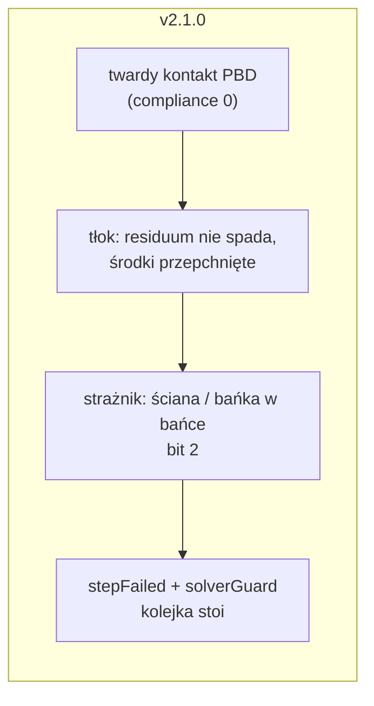
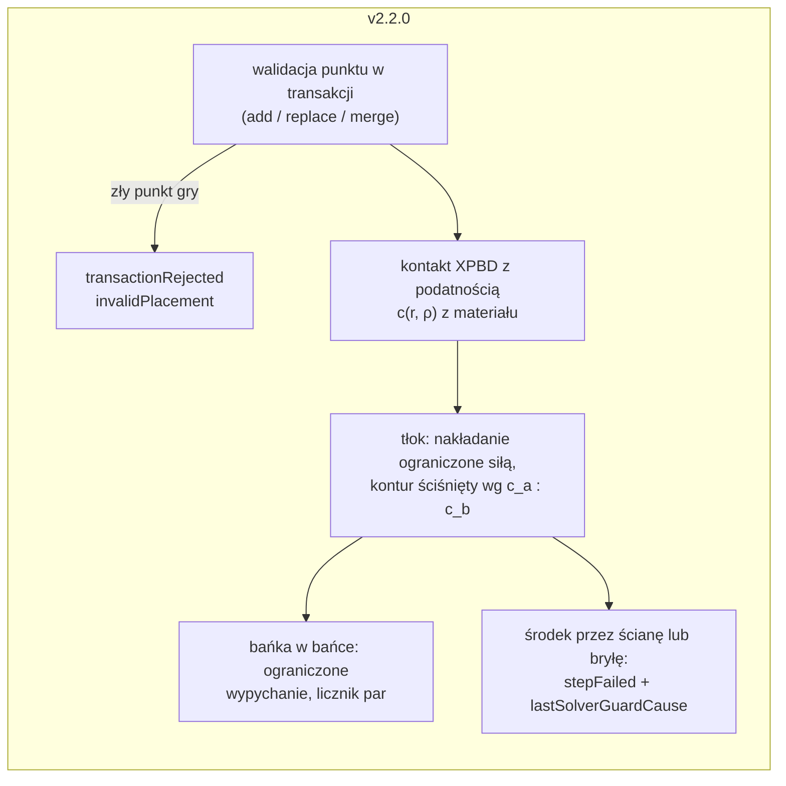
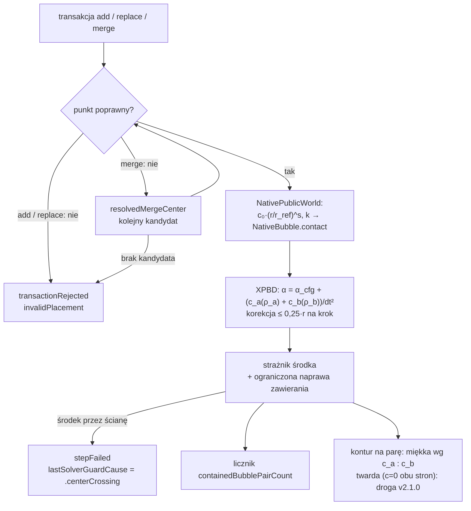

# Change Design: Ściskanie zamiast odrzucenia kroku w tłoku baniek (v2.2.0)

**Date:** 2026-11-14
**Artifact:** change-design
**Status:** Draft
**Template version:** default/0.3.2
**References:** `../2KBubbles-iOS/docs/benchmarks/stage-0-physics-gate.md`, sekcja „Specyfikacja zmiany silnika” (stan 2026-11-14); dane `../2KBubbles-iOS/docs/benchmarks/stage-0/` (`crowd-growth.json`, `crowd-growth-free-spawn.json`, `grab-scan.json`)

**Plugin version:** 0.7.10
**Agent Sessions:** claude-code: 65849c84-3e5c-4a2f-8227-dee99104ae9e
**Self-review:** pętla 1: CAP_REACHED — round-2 findings fixed, not re-reviewed (uwagi rundy 2: wyjątki od zachowania v2.1.0 dla walidacji punktu i scalenia oraz `.wrap`; wyłączenie z testu wspólnego środka obiektów usuwanych przez operację; ściany sceny tłoku i założenie dla kontaktu twardego; G2-AC2 bez bezwzględnego limitu; zakres ρ; nadpisanie przy materiale sztywnym; próg CD-D-7 sięgający do bufora GPU)

---

<!-- hint: Keep the `**Artifact:** change-design` line — /plan and /implement use it to recognize this as a change-design artifact (requirements + design in one file) and skip the prd.md requirement. -->

> *Section audience —* 🔍 reviewer (understand the change without implementing it) · 🛠 author (implement the change). Sections without an icon serve both.

## Summary 🔍

Gra 2KBubbles zatrzymała się na silniku v2.1.0. W gęstym tłoku silnik odrzuca kroki z powodem `solverGuard`, a po pięciu odrzuceniach z rzędu gra ogłasza awarię planszy. Tak kończy się 36 z 36 pomiarów wzrostu w tłoku. Do tego duże bańki prawie się nie uginają, a małe są miażdżone.

Wersja 2.2.0 zmienia to zachowanie:
- Układ baniek, który da się postawić poprawnie, rozwiązuje się zawsze ściśnięciem konturów i ograniczonymi siłami. Bańka w bańce, wynik scalenia w zajętym miejscu i prawie wspólny środek nie odrzucają kroku.
- Zły punkt podany przez grę (ten sam środek co inna bańka, wnętrze bryły sztywnej, punkt poza regionem) odrzuca tylko transakcję, z nazwaną przyczyną. Zły punkt wyniku scalenia silnik poprawia sam.
- Krok może jeszcze odrzucić tylko przekroczenie przez środek ściany albo bryły w trakcie symulacji. Przyczynę tego odrzucenia widać w diagnostyce, a pary „bańka w bańce” widać w osobnym liczniku.

Rdzeniem zmiany jest miękki kontakt XPBD (Extended Position Based Dynamics) między bańkami. Jego podatność opisuje materiał w dwóch wymiarach: jak podatność zależy od promienia nominalnego bańki i jak sztywnieje albo mięknie bańka pod ściśnięciem. Wgniecenie konturu pary dzieli się w proporcji podatności obu baniek. Domyślna podatność wynosi 0, więc zostaje dzisiejszy twardy kontakt i dzisiejszy kontur.

## Background & problem 🔍

Raport etapu 0 gry 2KBubbles (`stage-0-physics-gate.md`) pokazuje trzy zachowania v2.1.0, które blokują grę:

1. **Odrzucanie kroku w tłoku.** Strażnik środka (`nativeGuardCenter`, `Sources/BubblePhysicsNativeMetal/Shaders/NativePostSolveKernels.metal-source:183-205`) i walidator zawierania (`nativeValidateBubbleContainment`, `:350-363`) zapalają bit 2. Dzieje się to, gdy środek przechodzi przez ścianę albo leży we wnętrzu bryły, oraz gdy mniejsza bańka mieści się cała w większej. Bit 2 staje się `WorldRejectionReason.solverGuard` (`Sources/BubblePhysicsPublic/BubbleWorld.swift:423`). Świat żyje, ale krok jest odrzucony, a transakcja czeka w kolejce. Kontakt jest twardy: `NativeMetalConfiguration.contactCompliance` = 0 (`Sources/BubblePhysicsNativeMetal/NativeMetalBackend.swift:1-16`). Przy bilansie pól powyżej 1 pełne rozdzielenie kół jest niemożliwe, więc solver przepycha środki przez ściany i jedne bańki w drugie. Świat staje przy bilansie pól 0,85–1,81, często zanim zabraknie miejsca.
2. **Miękkość odwrotna do prawa Laplace'a.** Wgniecenie z nacisku to `clamp(λ · invMass / r, 0, 0,5)` (`NativePostSolveKernels.metal-source:700-702`), więc ciężka duża bańka się nie ugina, a mała bierze cały zgniot. Bańka „2” ma w tłumie promień efektywny 0–8 pt, a do chwytu potrzeba 16 pt. `deformability` ma sufit 1 (`Sources/BubblePhysicsPublic/Model/Resources.swift:26`), a podatności kontaktu gra w ogóle nie widzi.
3. **Jedna ogólna przyczyna.** Gra nie odróżnia odrzucenia za ścianę od odrzucenia za bańkę w bańce.

## Goals and non-goals

### Goals

**G1: Tłok nie odrzuca kroku**
Układ baniek postawionych w poprawnych punktach nigdy nie kończy się odrzuconym krokiem ani awarią świata, nawet gdy suma pól docelowych wielokrotnie przekracza pole planszy. Rosnący nacisk daje coraz mocniejsze ściśnięcie konturów, a środki nie wychodzą poza ściany. To obowiązuje dla każdej podatności, także dla domyślnego kontaktu twardego. Przy kontakcie twardym w tłoku nie ma płynnego ściśnięcia: bańki nachodzą na siebie, a ruch ogranicza limit korekcji na krok (CD-D-9).

**Scena tłoku** (wspólna dla G1-AC1–G1-AC3 i G2-AC5):
- wnętrze ścian to prostokąt 360 × 640, a cztery ściany są statycznymi prostokątnymi bryłami sztywnymi o grubości 48. Ściany boczne mają pełną wysokość z grubością górnej i dolnej, a górna i dolna leżą między nimi, więc bryły stykają się krawędziami i nie nachodzą na siebie;
- promienie baniek losujemy równomiernie z [12, 48] stałym ziarnem;
- bańki stawiamy co 0,25 s w losowym punkcie wnętrza; punkt odrzucony przez `invalidPlacement` losujemy ponownie;
- każda bańka rośnie od 10% do pełnego promienia w ciągu 1 s (`startTransition`);
- stawianie kończy się, gdy bilans pól B (suma pól docelowych kół podzielona przez 360 · 640) dojdzie do zadanego progu.

Materiał miękki ma c₀ > 0, s = 1, k = 1, a jego wartości zapisuje test.
- [ ] G1-AC1 — W scenie tłoku z progiem B = 2,5 świat po ostatniej bańce robi jeszcze 600 kroków (10 s). W całym przebiegu `lastAdvanceIssue` nie przyjmuje `stepFailed` ani `worldFailed`, `failureReason == nil`, nie ma zdarzeń `didExitSimulationRegion` i żadna bańka nie znika z klatki. · `verify: test na urządzeniu Metal przez publiczne BubbleWorld, osobno dla materiału z podatnością 0 i dla materiału z podatnością dodatnią`
- [ ] G1-AC2 — W tym samym przebiegu środek każdej bańki w każdej klatce leży wewnątrz prostokąta ograniczonego wewnętrznymi krawędziami ścian. · `verify: asercja na pozycjach z każdej klatki w teście G1-AC1`
- [ ] G1-AC3 — Przy materiale miękkim liczymy średni stosunek promienia efektywnego do docelowego (z `WorldFrame`), uśredniony po wszystkich bańkach i po klatkach ostatniej sekundy przebiegu. Przy B = 2,5 wychodzi mniejszy niż przy B = 1,5. Silniejszy nacisk daje więc mocniejsze ściśnięcie, a nie awarię. · `verify: dwa przebiegi sceny tłoku z tym samym ziarnem i progami 1,5 oraz 2,5`

**G2: Bańka w bańce i trudne punkty rozwiązuje siła, nie odrzucenie**
Bańka dodana częściowo albo całkiem wewnątrz innej, wynik scalenia, którego środek wypada w miejscu zajętym przez trzecią bańkę, i dwie bańki o prawie wspólnym środku dają w kolejnych krokach rozsunięte bańki. Rozsuwanie idzie bez odrzucenia kroku, bez skoków i bez teleportu.
- [ ] G2-AC1 — Bańkę r = 20 dodajemy ze środkiem 5 jednostek od środka bańki r = 60 na pustej planszy. Żaden krok nie jest odrzucony. `WorldDiagnostics.containedBubblePairCount` jest równy 1 w pierwszej klatce po dodaniu i spada do 0 w ciągu 2 s symulacji. · `verify: test publicznego BubbleWorld`
- [ ] G2-AC2 — W przebiegach G2-AC1 i G2-AC3, przy `advance` o dokładnie jeden stały krok, bez napędów i siły globalnej oraz z materiałem o `maximumLinearSpeed` = 100, przesunięcie środka każdej bańki w jednym kroku nie przekracza 0,25 · r + 100 · dt (limit korekcji z CD-D-9 plus największy ruch z prędkości). Po 2 s prędkość każdej bańki spada poniżej 2 jedn./s. · `verify: asercja na różnicy pozycji kolejnych klatek`
- [ ] G2-AC3 — Dwie bańki r = 20 dodane w tej samej transakcji, ze środkami oddalonymi o 0,01 jednostki, są przyjęte. W ciągu 2 s rozsuwają się na odległość środków co najmniej 20, bez odrzuconego kroku. Dotyczy to zarówno materiału z podatnością 0, jak i materiału miękkiego. · `verify: test publicznego BubbleWorld, dwa materiały`
- [ ] G2-AC4 — `mergeBubbles` dwóch baniek, których punkt styku leży wewnątrz trzeciej bańki, kończy się zdarzeniem `didAdd` wyniku. Nie ma `transactionRejected` ani odrzuconego kroku w ciągu 2 s. · `verify: test publicznego BubbleWorld`
- [ ] G2-AC5 — W scenie tłoku z G1-AC1 (B = 2,5) `containedBubblePairCount` po każdej klatce jest liczbą skończoną i nieujemną, a krok nie jest odrzucony, także wtedy, gdy licznik jest większy od 0. · `verify: asercja w teście G1-AC1`

**G3: Zły punkt od gry odrzuca transakcję, a zły punkt scalenia silnik poprawia sam**
Punkt, w którym bańki nie da się poprawnie postawić, wraca do gry jako odrzucona transakcja z nazwaną przyczyną. Świat działa dalej i gra może wysłać nowy punkt. Punkt wyniku scalenia wybiera silnik, więc silnik sam go poprawia.
- [ ] G3-AC1 — `add` bańki ze środkiem w tym samym miejscu co środek istniejącej bańki (odległość poniżej progu z CD-D-7) daje w klatce zdarzenie `transactionRejected(token, rejection)` z `rejection.reason == .invalidPlacement(id, .coincidentCenter)`. Bańka się nie pojawia, a następny krok (z inną transakcją) jest przyjęty. · `verify: test publicznego BubbleWorld`
- [ ] G3-AC2 — `add` bańki ze środkiem we wnętrzu wielokąta bryły sztywnej daje `.invalidPlacement(id, .insideRigidBody)`. Ze środkiem poza `simulationRegion` daje `.invalidPlacement(id, .outsideRegion)`. W obu przypadkach świat przyjmuje następny krok. · `verify: test publicznego BubbleWorld`
- [ ] G3-AC3 — `replace` bańki na bańkę w złym punkcie odrzuca transakcję z tymi samymi przyczynami co `add`. · `verify: test publicznego BubbleWorld`
- [ ] G3-AC4 — `mergeBubbles`, którego punkt styku leży dokładnie w środku trzeciej bańki, we wnętrzu bryły albo poza regionem, kończy się `didAdd` wyniku. Środek wyniku w pierwszej klatce nie pokrywa się ze środkiem żadnej innej bańki, nie leży we wnętrzu bryły i leży w regionie. Ten sam układ wejściowy daje zawsze ten sam środek wyniku. · `verify: test publicznego BubbleWorld, dwa przebiegi z porównaniem pozycji`
- [ ] G3-AC6 — `mergeBubbles`, dla którego żaden kandydat z listy CD-D-6 nie jest poprawny (np. wszystkie leżą we wnętrzu brył), daje `transactionRejected` z `.invalidPlacement(idWyniku, przyczyna punktu styku)`. Źródła zostają na planszy, a następny krok jest przyjęty. · `verify: test publicznego BubbleWorld z bryłami otaczającymi źródła`
- [ ] G3-AC5 — Transakcja z poprawnymi punktami, w tym bańka częściowo nachodząca na inną, nie jest odrzucana za punkt. · `verify: test publicznego BubbleWorld`

**G4: Podatność kontaktu opisana w materiale w dwóch wymiarach**
Materiał bańki opisuje podatność kontaktu w dwóch wymiarach: jak podstawowa podatność zmienia się z promieniem nominalnym bańki i jak zmienia się sztywność wraz ze ściśnięciem (opis znormalizowany). Gra może nadpisać podstawową podatność dla jednej bańki. Podatność 0 zachowuje zachowanie v2.1.0.
- [ ] G4-AC1 — Dwie bańki r = 20 i r = 40 z tym samym materiałem (c₀ > 0, wykładnik promienia s = 2, wykładnik ściśnięcia k = 0) dociskamy osobno do ściany tą samą stałą siłą (`MotorDrive`). Po uspokojeniu (1 s) stosunek spadku promienia efektywnego do promienia docelowego jest większy dla bańki r = 40. · `verify: test publicznego BubbleWorld`
- [ ] G4-AC2 — Ta sama scena z s = 0 daje odwrotną kolejność: większy względny spadek ma bańka r = 20. Przy tej samej sile względne wgniecenie rośnie jak r^(s−1), więc s = 1 daje równe względne wgniecenie. · `verify: ten sam test, drugi przypadek`
- [ ] G4-AC3 — Przy wykładniku ściśnięcia > 0 podwojenie siły docisku zwiększa względne ściśnięcie bańki mniej niż dwukrotnie. Przy wykładniku 0 zwiększa je dwukrotnie (± 20%). · `verify: test publicznego BubbleWorld, dwie siły na bańkę`
- [ ] G4-AC4 — Bańkę sztywną (podatność 0) dociskamy stałą siłą do bańki miękkiej leżącej przy ścianie, a bańka sztywna nie dotyka niczego innego. Po uspokojeniu bańka sztywna ma promień efektywny równy docelowemu (± 1%), a ściśnięcie bierze miękka. · `verify: test publicznego BubbleWorld`
- [ ] G4-AC5 — `contactCompliance` ustawione w `BubbleDescriptor`, a także w `BubbleResult` dla wyniku scalenia i dla obu części podziału, nadpisuje podstawową podatność materiału tylko tej bańki. Dwie bańki z tym samym materiałem i różnym nadpisaniem uginają się różnie w scenie G4-AC1, a bańka bez nadpisania zachowuje się jak bez niego. · `verify: test publicznego BubbleWorld`
- [ ] G4-AC6 — Przy materiałach domyślnych (c₀ = 0) istniejące testy kroku, konturu i renderu przechodzą bez zmian oczekiwań. Wyjątkiem są testy, które celowo sprawdzały odrzucenie za bańkę w bańce albo natychmiastowe rozdzielenie zawierania (te zmieniają się zgodnie z G2). Zachowanie v2.1.0 może się zmienić tylko w czterech przypadkach: w scenach, w których v2.1.0 odrzucał krok; gdy korekcja na krok przekraczała limit z CD-D-9; gdy `add` albo `replace` podaje zły punkt (G3, dziś przyjmowany); gdy punkt styku scalenia jest zły (CD-D-6, dziś wynik stawał w tym punkcie). · `verify: swift test na całym pakiecie; plan inwentaryzuje testy oczekujące odrzucenia za zawieranie, a opis PR wymienia każde zmienione oczekiwanie`
- [ ] G4-AC7 — Przy tworzeniu materiału `ModelValidationError.valueOutOfRange` rzucają: podatność ujemna, NaN albo nieskończona, wykładnik NaN albo nieskończony, promień odniesienia ≤ 0, NaN albo nieskończony oraz podatność > 0 w materiale `kind: .rigid`. Bańka z materiałem `.rigid` jest już dziś odrzucana (`incompatiblePhysicsMaterial`, `TransactionStager.swift:482`), więc nadpisanie na bańce nie spotyka materiału sztywnego. Ujemne, NaN albo nieskończone `contactCompliance` rzuca przy tworzeniu `BubbleDescriptor`. W `BubbleResult` (inicjalizator nie rzuca) odrzuca transakcję zdarzeniem `transactionRejected` z `.invalidValue(.valueOutOfRange("contactCompliance"))`. · `verify: testy jednostkowe modelu i test transakcji scalenia`

**G5: Przyczyna odrzucenia i zawieranie są publicznie widoczne**
- [ ] G5-AC1 — Gdy krok zostaje odrzucony, bo środek bańki w trakcie symulacji przeszedł przez ścianę albo wszedł we wnętrze bryły, `lastRejectionReason == .solverGuard` i `lastSolverGuardCause == .centerCrossing`. · `verify: test publicznego BubbleWorld z bryłą kinematyczną przesuniętą jednym krokiem na środek bańki przyciśniętej do ściany`
- [ ] G5-AC2 — `lastSolverGuardCause` jest `nil`, gdy żaden krok nie został jeszcze odrzucony albo ostatnie odrzucenie miało inny powód niż `.solverGuard`. · `verify: test publicznego BubbleWorld`
- [ ] G5-AC3 — `containedBubblePairCount` podaje liczbę par baniek, z których mniejsza mieści się cała w kole większej, po ostatnim ukończonym kroku. Na pustej planszy wynosi 0. · `verify: G2-AC1 i test pustej planszy`

**G6: Wydanie 2.2.0**
- [ ] G6-AC1 — Repozytorium ma tag `v2.2.0`. `CHANGELOG.md` opisuje nowe pola i przypadki, w tym nowy przypadek `TransactionRejectionReason.invalidPlacement` jako zmianę, która może wymagać gałęzi `default` w wyczerpującym `switch`, oraz zmiany zachowania przy materiałach domyślnych: zawieranie nie odrzuca kroku, korekcja na krok ma limit, zły punkt `add` i `replace` (także poza regionem przy `regionExitPolicy == .wrap`) odrzuca transakcję, a wynik scalenia może stanąć poza punktem styku. `README.md` podaje wersję 2.2.0, a `docs/integration-guide.md` opisuje podatność materiału i nadpisanie na bańce. · `verify: przegląd plików i git tag`
- [ ] G6-AC2 — Strażnik wydajności (`swift run -c release BubblePhysicsPerfGuard`) przechodzi na Macu z tymi samymi progami co dla 2.1.0. · `verify: uruchomienie strażnika`

### Non-goals

- Test przeciskania (W4 ze specyfikacji) i dobór parametrów gry: oba należą do 2KBubbles po tagu.
- Zmiany w repozytorium 2KBubbles, w tym podbicie wersji silnika.
- Ujawnianie liczby iteracji solvera grze (`makeBenchmarkWorld` zostaje `package`).
- Miękkie ściany i bryły: kontakt bańka–bryła używa tylko podatności bańki.
- Zmiana domyślnego zachowania: bez nowych parametrów silnik zachowuje się jak v2.1.0, poza wyjątkami wymienionymi w G4-AC6.
- Pomiary na iPhonie X i limit liczby baniek.

## Architecture

Zmiana ma cztery części, od wejścia do wyjścia kroku.

**1. Walidacja punktu w transakcji (G3).** `TransactionStager` (`Sources/BubblePhysicsRuntime/TransactionStager.swift`) przy `add`, `replace` i `mergeBubbles` sprawdza środek nowej bańki względem stanu po wcześniejszych operacjach tej samej transakcji. Obiekty usuwane przez tę samą operację (bańka zastępowana przez `replace`, źródła `mergeBubbles`) są z testu wyłączone:
- odległość od środka każdej innej bańki poniżej progu `coincidentCenterTolerance` (CD-D-7) daje `.coincidentCenter`;
- punkt we wnętrzu wielokąta, koła lub kapsuły bryły sztywnej daje `.insideRigidBody`;
- punkt poza `simulationRegion` daje `.outsideRegion`, niezależnie od `regionExitPolicy` (CD-D-14).

Przy `add` i `replace` błąd odrzuca całą transakcję istniejącą drogą `TransactionRejection` z nowym przypadkiem `invalidPlacement(ObjectID, PlacementIssue)`. Przy `mergeBubbles` silnik nie odrzuca transakcji. `StructuralOperations.mergeCenter` (`Sources/BubblePhysicsRuntime/StructuralOperations.swift:10`) zwraca punkt styku, a nowa funkcja `StructuralOperations.resolvedMergeCenter` sprawdza go tym samym testem i przy błędzie próbuje deterministycznie kolejnych kandydatów (CD-D-6). Kolejność kandydatów dla N źródeł:
1. dla każdego źródła w kolejności `sources`: punkty P + t · (S_i − P) dla t = 0,25, 0,5, 0,75, gdzie P to punkt styku, a S_i to środek źródła;
2. środki źródeł S_i w tej samej kolejności;
3. spirala wokół środka źródła o największej masie: 8 pierścieni o promieniach j · r_wyniku / 4 (j = 1…8), po 16 punktów na pierścień.

Pierwszy poprawny kandydat wygrywa. Lista ma 3N + N + 128 punktów i zawsze się kończy. Jeśli żaden kandydat nie jest poprawny (np. wokół źródeł są same bryły), transakcja jest odrzucona z `.invalidPlacement(idWyniku, przyczyna punktu styku)` (G3-AC6). Zazwyczaj przechodzi już kandydat z kroku 1 albo 2, bo źródła były postawione poprawnie.

**2. Podatność kontaktu (G1, G4).** `PhysicsMaterial` dostaje pole `contactCompliance: BubbleContactCompliance` z czterema wartościami:
- `base` c₀ ≥ 0, domyślnie 0;
- `referenceRadius` r_ref > 0;
- `radiusExponent` s;
- `compressionExponent` k.

`BubbleDescriptor` i `BubbleResult` dostają `contactCompliance: Float?`, które zastępuje c₀ jednej bańki. Podatność bańki w kroku to:

c = c₀ · (r / r_ref)^s · ρ^k,

gdzie r to promień docelowy, a ρ ∈ [0, 1] to stosunek promienia konturu do promienia docelowego w kierunku kontaktu z poprzedniej opublikowanej klatki. Wzór używa max(ρ, `ρ_min`), z `ρ_min` = 0,01 (stała silnika), żeby przy k < 0 potęga nie dawała nieskończoności. Kontur nie ma dolnej granicy: może spaść do 0.

Przy tej samej sile względne wgniecenie bańki rośnie jak r^(s−1). Dla s > 1 duże bańki uginają się względnie bardziej (prawo Laplace'a z W3), s = 1 daje równe względne wgniecenie, a s < 1 bardziej ugina małe. Część c₀ · (r / r_ref)^s liczy host w `NativePublicWorld` (`Sources/BubblePhysicsNativeMetal/NativePublicWorld.swift:158-171`) i zapisuje w nowych polach `NativeBubble` (`contact: float4` = część bazowa, k, rezerwa). Czynnik ρ^k liczy GPU.

W `nativeUpdateContactMultipliers` (`Sources/BubblePhysicsNativeMetal/Shaders/NativeXPBDKernels.metal-source:399-419`) `alpha` przestaje być tylko stałą świata (`solver.physics.x`, dziś `NativeMetalConfiguration.contactCompliance / dt²`, `NativeMetalSolver.swift:414-417`). Dochodzi do niej podatność pary podzielona przez dt²:
- para bańka–bańka: α = α_cfg + (c_a(ρ_a) + c_b(ρ_b)) / dt²;
- para bańka–bryła: α = α_cfg + c_a(ρ_a) / dt².

`nativeMeasureResidual` (`:439-459`) używa tego samego α. Przy c₀ = 0 po obu stronach α = α_cfg, czyli to samo co dziś. Pole konfiguracji dalej działa w harnessie benchmarków (CD-D-5).

Dodatkowo całkowita korekcja środka bańki w jednym kroku (kontakty, wypychanie z zawierania i warm start razem) jest ograniczona do `stepCorrectionLimit` = 0,25 · r tej bańki (CD-D-9). Ten limit zastępuje dzisiejszy limit warm startu równy promieniowi (`nativePrepareSolverContacts`, `NativeXPBDKernels.metal-source:333-350`). Rzutowanie środka na ściany i bryły limitowi nie podlega.

**3. Kontur według podziału podatności (G4).** W `nativeAccumulateContactPressure` (`NativePostSolveKernels.metal-source:665-750`) droga konturu jest wybierana dla każdej pary osobno (CD-D-12):
- **Para miękka** (choć jedna strona ma c > 0): wycina kontur bańki a cięciwą prostopadłą do normalnej pary, na głębokości nakładanie · c_a / (c_a + c_b) od brzegu a. Bańka z c = 0 w takiej parze nie dostaje wgniecenia. Bańka miękka w kontakcie ze ścianą lub bryłą bierze całe nakładanie z tą przeszkodą.
- **Para twarda** (c = 0 po obu stronach) i kontakt bańki twardej z bryłą: jak dziś, czyli cięciwa radykalna, ograniczenie promieniem ściany i nacisk `λ · invMass / r` z sufitem 0,5.

Promień konturu w danym kierunku to minimum ze wszystkich par, jak dziś. Sufit 0,5 dotyczy tylko nacisku z par twardych.

**4. Strażniki bez odrzucenia za zawieranie (G2, G5).**
- `nativeSeparateContainedBubbles` i `nativeSeparateAndGuardContainedBubbles` (`NativePostSolveKernels.metal-source:213-318`) dalej rozsuwają pełne zawieranie, ale ich korekcja wlicza się do `stepCorrectionLimit` (CD-D-9). Zawieranie znika więc w kilku krokach, bez teleportu. Kierunek przy prawie wspólnym środku zostaje deterministyczny (kolejność ID, `:251`). Pary o równych promieniach, które naprawa pomija (`:243`), rozsuwa kontakt, również z tym limitem.
- `nativeValidateBubbleContainment` (`:350-363`) nie zapala bitu 2. Liczy pary zawarte atomowo do nowego licznika w `safetyControl`, a host publikuje go jako `WorldDiagnostics.containedBubblePairCount`.
- `nativeGuardCenter` (`:183-205`) zapala nowy bit `centerCrossing` razem z dotychczasowym bitem 2. `NativeMetalSolver` (`Sources/BubblePhysicsNativeMetal/NativeMetalSolver.swift:946-951`) przenosi przyczynę w `NativeMetalSafetyFailure`, a `BubbleWorld.handleAdvanceError` (`Sources/BubblePhysicsPublic/BubbleWorld.swift:378-393`) ustawia `lastSolverGuardCause`. Strażnik najpierw, jak dziś, rzutuje środek na najbliższy punkt przekroczonej krawędzi z marginesem (`:170-179`). Bit zapala dopiero końcowa walidacja po wszystkich rzutowaniach (`:183-205`), gdy środek dalej leży po złej stronie ściany albo we wnętrzu bryły, np. między dwiema nachodzącymi na siebie przeszkodami. Tylko w tym przypadku krok jest odrzucany (CD-D-3).

## Components

- **`Sources/BubblePhysicsPublic/Model/Resources.swift`**: `BubbleContactCompliance` (c₀, r_ref, s, k, wartość `.hard`) i pole `PhysicsMaterial.contactCompliance` z walidacją (G4-AC7).
- **`Sources/BubblePhysicsPublic/Model/Objects.swift`**: `BubbleDescriptor.contactCompliance: Float?` z walidacją.
- **`Sources/BubblePhysicsPublic/Model/WorldTransaction.swift`**: `BubbleResult.contactCompliance: Float?`, przenoszone na wynik scalenia i podziału.
- **`Sources/BubblePhysicsPublic/Model/WorldFrame.swift`**: `TransactionRejectionReason.invalidPlacement(ObjectID, PlacementIssue)` i wyliczenie `PlacementIssue` (`.coincidentCenter`, `.insideRigidBody`, `.outsideRegion`).
- **`Sources/BubblePhysicsPublic/Diagnostics.swift`**: `SolverGuardCause` (`.centerCrossing`), pola `WorldDiagnostics.lastSolverGuardCause` i `containedBubblePairCount`.
- **`Sources/BubblePhysicsPublic/BubbleWorld.swift`**: przeniesienie przyczyny strażnika i licznika zawierania do diagnostyki.
- **`Sources/BubblePhysicsRuntime/TransactionStager.swift`**: walidacja punktu przy `add`, `replace` i `mergeBubbles`.
- **`Sources/BubblePhysicsRuntime/StructuralOperations.swift`**: `resolvedMergeCenter`, czyli deterministyczna lista kandydatów; przeniesienie nadpisania podatności na wynik.
- **`Sources/BubblePhysicsNativeMetal/NativePublicWorld.swift`**: wyliczenie części bazowej podatności i k dla każdej bańki.
- **`Sources/BubblePhysicsNativeMetal/NativeMetalBufferLayout.swift`** i struktura `NativeBubble` w `Shaders/NativeGeometryKernels.metal-source:4-16`: nowe pole `contact`, z aktualizacją testu ABI (`Tests/BubblePhysicsNativeMetalTests/NativeMetalShaderABITests.swift`).
- **`Sources/BubblePhysicsNativeMetal/Shaders/NativeXPBDKernels.metal-source`**: α pary w `nativeUpdateContactMultipliers` i `nativeMeasureResidual`, limit korekcji na krok w `nativePrepareSolverContacts` i `nativeSolveJacobi`.
- **`Sources/BubblePhysicsNativeMetal/Shaders/NativePostSolveKernels.metal-source`**: droga konturu na parę w `nativeAccumulateContactPressure`, limit korekcji zawierania, licznik zawierania zamiast bitu 2, bit przyczyny w `nativeGuardCenter`.
- **`Sources/BubblePhysicsNativeMetal/NativeMetalSolver.swift`**: odczyt nowego bitu i licznika, przyczyna w `NativeMetalSafetyFailure`.
- **`Tests/BubblePhysicsRuntimeTests/`**: nowe testy G1–G5 na publicznym `BubbleWorld`. Plan inwentaryzuje istniejące testy, które oczekują `guardFailure` za zawieranie albo natychmiastowego rozdzielenia (kandydaci: `Tests/BubblePhysicsNativeMetalDiagnosticsTests/NativeMetalSafetyTests.swift`, `Tests/BubblePhysicsNativeMetalTests/NativeMetalPreviousContourTests.swift`), i zmienia ich oczekiwania zgodnie z G2.
- **`Tests/BubblePhysicsPublicTests/ModelValidationTests.swift`**: walidacja G4-AC7.
- **`CHANGELOG.md`, `README.md`, `docs/integration-guide.md`**: wydanie 2.2.0 (G6).

## Error handling

- Podatność wyliczona na GPU okazuje się nieskończona albo NaN (np. przez skrajny wykładnik). Krok kończy się istniejącą ścieżką `nonFiniteValues`, czyli `worldFailed`, jak każda inna wartość nieskończona. Walidacja materiału (G4-AC7) odrzuca nieskończone parametry i NaN, a `ρ_min` chroni przed potęgą zera przy k < 0, więc ta ścieżka nie powinna się pojawiać w poprawnych danych.
- Transakcja z kilkoma operacjami, z których jedna ma zły punkt, jest odrzucona w całości, zgodnie z istniejącą semantyką `TransactionRejection.operationIndex`.

## Testing & verification

- Test regresji G4-AC6: cały `swift test` na Macu z urządzeniem Metal. W opisie PR wymieniamy każde zmienione oczekiwanie i jego powód.
- Strażnik wydajności G6-AC2, bo kontur i solver dostają dodatkowe obliczenia na parę.

## Decisions 🔍

| ID | Title | Context | Options | Choice | Rationale | Source | Goal impact | Consequences |
|----|-------|---------|---------|--------|-----------|--------|-------------|--------------|
| CD-D-1 | Test przeciskania poza zmianą | W4 wymagało testu przeciskania jako warunku tagu; najpierw wybrano test w 2KBubbles w tej zmianie | test w silniku; test w grze w tej zmianie; brak testu w zmianie | brak: test przeciskania i dobór parametrów robi gra po tagu | Właściciel uznał, że parametryzowana podatność wystarczy grze do zaliczenia testu po swojej stronie | `user` | usuwa W4 z celów; G1–G4 zastępują je testami silnika | zmiana nie dotyka repozytorium 2KBubbles; ryzyko, że parametry nie wystarczą, wychodzi dopiero w grze |
| CD-D-2 | Przyczyna odrzucenia jako dodatkowe pole | Dziś istnieje tylko `.solverGuard`, a wersja ma być minor | nowe pole `lastSolverGuardCause`; nowe przypadki `WorldRejectionReason` (3.0.0); wartość powiązana (3.0.0) | nowe pole `WorldDiagnostics.lastSolverGuardCause` | Zmiana tylko dodaje API, a gra przechowuje `WorldRejectionReason` w `BoardFailure.stepsRejected` bez zmian | `user` | G5-AC1, G5-AC2 | `.solverGuard` zostaje jedyną wartością odrzucenia przez strażnika |
| CD-D-3 | Granica kontraktu odrzucenia | Trzeba ustalić, kiedy odrzucenie jest jeszcze dozwolone | bańki nigdy nie odrzucają, zostają przeszkody sztywne; nigdy żadnego odrzucenia; kontrakt tylko dla planszy prostokątnej | bańki nigdy nie odrzucają kroku; niewłaściwe są tylko: ten sam środek co inna bańka, środek we wnętrzu bryły, środek poza planszą | Właściciel wskazał te trzy przypadki jako jedyne nierozwiązywalne | `user` | G1, G2, G3 | środek przepchnięty przez ścianę lub bryłę w trakcie symulacji dalej odrzuca krok (G5-AC1) |
| CD-D-4 | Zły punkt odrzuca transakcję | Odrzucony krok zostawia transakcję w kolejce, więc gra nie mogłaby podać nowego punktu | odrzucenie transakcji; odrzucenie kroku; odrzucenie kroku z usunięciem transakcji | `transactionRejected` z `invalidPlacement(ObjectID, PlacementIssue)`; świat idzie dalej | Spełnia intencję właściciela: wywołujący dowiaduje się o złym punkcie i podaje nowy; gra już obsługuje to zdarzenie (`BoardWorld.swift:447` w 2KBubbles) | `user` | G3-AC1–G3-AC3 | nowy przypadek w `TransactionRejectionReason` formalnie łamie wyczerpujący `switch`; gra ma tylko `if case`, więc wydanie zostaje minor z adnotacją w CHANGELOG (G6-AC1) |
| CD-D-5 | Rdzeń: miękki kontakt XPBD | Twardy PBD nie ma rozwiązania przy bilansie pól > 1 | XPBD z podatnością pary; twardy kontakt z limitem korekcji; zmiana promienia fizycznego | XPBD z α = α_cfg + (c_a + c_b) / dt², kontur dzielony według c_a : c_b | Jedna wielkość daje brak awarii, miękkość zależną od promienia i kontur zgodny z rozkładem zgniotu; solver ma już ścieżkę `alpha` | `user` | G1, G4 | α zależy od pary; `NativeMetalConfiguration.contactCompliance` dalej dodaje się do α (dla harnessu benchmarków), więc pole nie staje się martwe |
| CD-D-6 | Punkt scalenia poprawia silnik | Punkt wyniku scalenia wybiera silnik, nie gra | odrzucenie transakcji; deterministyczne szukanie innego punktu | `resolvedMergeCenter`: punkty między stykiem a źródłami, środki źródeł, potem 8 × 16 punktów spirali; gdy żaden nie przejdzie, odrzucenie transakcji | Właściciel: punkt wybrany przez silnik ma silnik poprawiać aż do skutku; determinizm zachowuje powtarzalność gry; jawne odrzucenie na końcu skończonej listy chroni przed pętlą bez końca w sytuacji bez wyjścia | `user` (szukanie), `auto (przegląd)` (zakres listy i odrzucenie na końcu) | G2-AC4, G3-AC4, G3-AC6 | wynik może pojawić się poza punktem styku; zdarzenie `mergeContact` dalej podaje punkt styku |
| CD-D-7 | Próg „tego samego środka” | „Identyczny środek” wymaga progu liczbowego | równość bitowa; stała względna do promienia; tolerancja solvera | `coincidentCenterTolerance` = max(1e-4 · r_mniejszej, tolerancja położenia solvera `NativeSolverInput.positionTolerance` (`Sources/BubblePhysicsNativeMetal/NativeSolverInput.swift:91`, dostępna w Runtime bez sięgania do bufora GPU)), stała udokumentowana w kodzie | Równość bitowa przepuściłaby punkty różne o 1 ULP, których naprawa nie rozsunie stabilnie; próg względny działa przy każdej skali; środki oddalone o 0,01 przy r ≥ 20 są ponad progiem (G2-AC3) | `auto (CD-D-3, CD-D-4)` | G3-AC1, G2-AC3 | gra stawiająca bańkę bliżej niż próg dostaje odrzucenie i losuje nowy punkt |
| CD-D-8 | Dwa wymiary podatności w materiale | Właściciel chce jednego opisu, który obejmuje kontakt twardy, stały, miękki i sztywniejący | tryby `.hard`/`.radiusLaw`; tylko podatność na bańce; tylko krzywa ściśnięcia; dwa wykładniki | c = c₀ · (r / r_ref)^s · ρ^k w materiale, c₀ nadpisywane na bańce; dolna granica konturu 0 | Właściciel: jeden wymiar to zmiana podatności podstawowej z promieniem nominalnym, drugi to znormalizowany opis sztywności od ściśnięcia; gra wybiera materiał | `user` | G4-AC1–G4-AC5 | c₀ = 0 to dzisiejszy twardy kontakt; `deformability ≤ 1` zostaje bez zmian, bo miękkość kontaktu niesie podatność |
| CD-D-9 | Limit korekcji środka na krok | W2 wymaga rozsuwania bez skoków i teleportu; dziś naprawa zawierania rozdziela od razu, a warm start może przesunąć środek o cały promień | limit tylko dla naprawy zawierania; limit dla całej korekcji solvera; brak limitu | `stepCorrectionLimit` = 0,25 · r bańki na krok dla sumy korekcji (kontakty, zawieranie, warm start), stała silnika; rzutowanie na przeszkody bez limitu | Limit samej naprawy nie wystarcza: bańki o równych promieniach i prawie wspólnym środku rozsuwa kontakt. Przy 60 krokach/s zawieranie znika w ułamku sekundy | `auto (W2 ze specyfikacji, przegląd)` | G1, G2-AC1–G2-AC3, G4-AC6 | przez kilka klatek bańki mogą być widoczne jedna w drugiej; w tłoku twardym nakładanie utrzymuje się dłużej; zmienia zachowanie v2.1.0 tylko tam, gdzie korekcja przekraczała ćwierć promienia |
| CD-D-10 | Jedna przyczyna i licznik zawierania | Po W2 przyczyna „bańka w bańce” nie ma drogi, by się pojawić | jedna przyczyna i licznik; obie przyczyny; bez nowego pola | `SolverGuardCause.centerCrossing` i `WorldDiagnostics.containedBubblePairCount` | Nie ma martwego przypadku w API, a gra i testy mają sygnał zawierania bez awarii | `user` | G5-AC1–G5-AC3 | przyszłe przyczyny dojdą jako nowe przypadki wyliczenia |
| CD-D-11 | Ściany i bryły zostają twarde | Kontakt bańka–bryła potrzebuje α | bryła z własną podatnością; tylko podatność bańki | α = c_bańki / dt² | Bez nowego parametru brył; środek dalej nie przechodzi przez ścianę dzięki strażnikowi | `auto (CD-D-3)` | G1-AC2, G4-AC1 | miękkich ścian nie da się ustawić |
| CD-D-12 | Droga konturu wybierana dla pary | Domyślne materiały nie mogą zmienić konturów, a bańka może mieć jednocześnie pary miękkie i twarde | zawsze nowy kontur; nowy kontur dla bańki z choć jedną parą miękką; wybór dla każdej pary | każda para osobno: para z c = 0 po obu stronach (i kontakt bańki twardej z bryłą) idzie dzisiejszą drogą (cięciwa radykalna, nacisk z sufitem 0,5), para miękka idzie podziałem c_a : c_b; promień konturu to minimum ze wszystkich par | Gwarantuje G4-AC6 przy domyślnych danych i jednoznacznie określa przypadki mieszane | `auto (specyfikacja W3: „przy wartości zerowej nie gorzej niż v2.1.0”)` | G4-AC6 | dwie drogi konturu w shaderze |
| CD-D-13 | Wersja 2.2.0 | Zmiana dodaje API, ale nowy przypadek wyliczenia i zmiana semantyki zawierania są widoczne | 2.2.0; 3.0.0 | 2.2.0 z adnotacjami w CHANGELOG | Właściciel prosił o 2.2.0, gra nie ma wyczerpujących `switch` po zmienianych wyliczeniach | `user` | G6-AC1 | klient z wyczerpującym `switch` po `TransactionRejectionReason` musi dodać gałąź |
| CD-D-14 | Punkt poza regionem odrzucany przy każdej polityce wyjścia | Bańka z `regionExitPolicy == .wrap` postawiona poza regionem była w v2.1.0 przyjmowana i zawijana | odrzucenie przy każdej polityce; wyjątek dla `.wrap` | odrzucenie `.outsideRegion` niezależnie od polityki | Właściciel uznał środek „poza planszą gry” za niewłaściwy bez wyjątków; zawijanie dotyczy ruchu, a nie stawiania | `auto (CD-D-3)` | G3-AC2 | gra z `.wrap` musi stawiać bańki w regionie; zmiana opisana w CHANGELOG (G6-AC1) |

## Key facts & assumptions

- **Najważniejsza reguła:** krok symulacji z bańkami w poprawnych punktach nigdy nie jest odrzucany z powodu baniek. Odrzucenie przez strażnika oznacza wyłącznie środek, który przeszedł przez ścianę albo bryłę.
- Ściany planszy 2KBubbles to bryły sztywne (`BoardWorld.swift:113-120` w 2KBubbles), więc „poza planszą” w grze to wnętrze bryły albo punkt poza `simulationRegion`.
- Założenie niepotwierdzone, ale nie blokujące: przy podatności dodatniej i 8 iteracjach Jacobiego tłok o bilansie 2,5 dochodzi do stanu bez odrzuceń w 10 s. Jeśli test G1-AC1 pokaże inaczej, plan może zmienić liczbę iteracji wewnętrznie, bez nowego API, ale tylko tak, żeby strażnik wydajności dalej przechodził. G6-AC2 ma pierwszeństwo, a konflikt obu celów wraca do właściciela.
- Założenie niepotwierdzone, ale nie blokujące: przy kontakcie twardym (c₀ = 0) w tłoku brak odrzuceń zapewniają limit korekcji na krok (najwyżej 0,25 · r, mniej niż grubość ściany 48 w scenie tłoku, więc ścieżka środka nie przeskoczy ściany) oraz rzutowanie środków na nienachodzące na siebie ściany, a nie ściśnięcie konturu. Nakładanie baniek może wtedy być duże. Jeśli G1-AC1 dla c₀ = 0 nie przejdzie, wraca to do właściciela jako decyzja o zakresie G1.
- Liczba ρ pochodzi z konturu poprzedniej klatki, więc odpowiedź na ściśnięcie ma opóźnienie jednego kroku.
