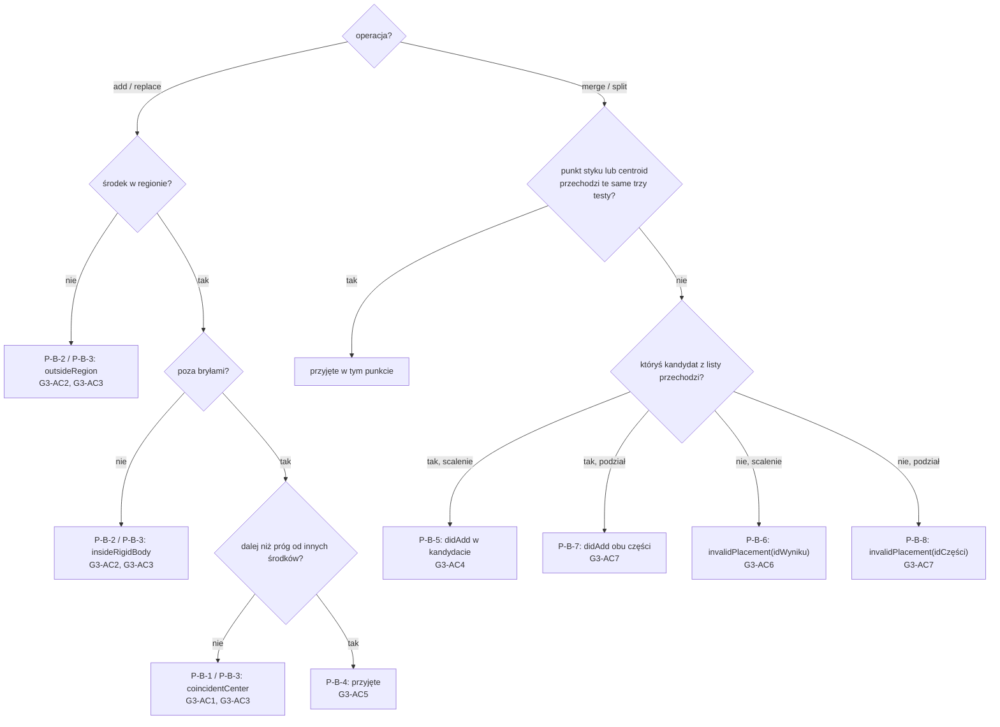

# Plan: Ściskanie zamiast odrzucenia kroku w tłoku baniek (v2.2.0)

> **For agentic workers:** REQUIRED PHASE COMMAND: Run `/tt-agentic-sdlc:implement` with this file's path to execute this plan. It runs one slice per session, and only a slice with tasks. The program design below is binding: build the call trees as drawn, and turn each behaviour into a failing test before you write the code.

**Date:** 2026-11-14
**Artifact:** plan
**Design:** [change-design.md](change-design.md)
**References:** `../2KBubbles-iOS/docs/benchmarks/stage-0-physics-gate.md`, sekcja „Specyfikacja zmiany silnika”
**Strategy:** all at once
**Test command:** `swift test`
**Status:** Draft
**Template version:** default/0.3.3
**Plugin version:** 0.7.10
**Agent Sessions:** claude-code: ef9afe81-5293-4d9d-99d5-ada5d3e46e43

---

## Program design

### R0 — Headline

Gra 2KBubbles ogłasza awarię planszy, gdy w tłoku silnik odrzuca kroki. Po zmianie tłok ściska kontury i nie odrzuca kroku. Zły punkt od gry odrzuca tylko transakcję, z nazwaną przyczyną. Podatność kontaktu opisuje materiał, a diagnostyka podaje przyczynę odrzucenia przez strażnika i liczbę par „bańka w bańce”.

### R1 — The whole flow

```mermaid
flowchart LR
    subgraph legend["legend"]
      direction LR
      L1["unchanged"]:::same
      L2["added"]:::added
      L3["modified"]:::changed
      L4["removed"]:::removed
      L1 ~~~ L2 ~~~ L3 ~~~ L4
    end

    W["BubbleWorld.advanceImpl"]:::same
    ST["TransactionStager<br/>+ walidacja punktu, poprawa punktu scalenia i podziału,<br/>+ skończoność największej α"]:::changed
    REJ["transactionRejected<br/>NEW invalidPlacement(id, PlacementIssue)"]:::added
    NPW["NativePublicWorld.step<br/>+ NativeBubble.contact = c₀·(r/r_ref)^s, k"]:::changed
    RHO["nativeUpdateContactRho<br/>NEW wygładzone ρ w cache kontaktu"]:::added
    XPBD["XPBD: α pary = α_cfg + Σc/dt²<br/>+ limit korekcji 0,25·r na krok"]:::changed
    GUARD["nativeGuardCenter<br/>rzut na przekroczoną krawędź, bit centerCrossing"]:::changed
    CONT["nativeValidateBubbleContainment<br/>licznik par zamiast bitu 2"]:::changed
    CB2["bit 2 za zawieranie"]:::removed
    PRESS["nativeAccumulateContactPressure<br/>para miękka: podział c_a : c_b"]:::changed
    DIAG["WorldDiagnostics<br/>NEW lastSolverGuardCause, containedBubblePairCount"]:::added

    W --> ST
    ST -->|zły punkt| REJ
    ST --> NPW --> RHO --> XPBD --> GUARD --> CONT --> PRESS
    CONT -.-> CB2
    GUARD -->|stepFailed| DIAG
    CONT --> DIAG

    classDef same fill:#f6f8fa,stroke:#8c959f,stroke-width:1px,color:#24292f
    classDef added fill:#dafbe1,stroke:#2da44e,stroke-width:3px,color:#24292f
    classDef changed fill:#fff8c5,stroke:#bf8700,stroke-width:3px,color:#24292f
    classDef removed fill:#ffebe9,stroke:#cf222e,stroke-width:2px,stroke-dasharray:4 3,color:#24292f
```



Zmiana idzie przez cały krok, od transakcji po kontur. Na CPU dochodzi walidacja w stagerze. Na GPU zmieniają się cztery miejsca: α pary, limit korekcji, strażnik i kontur. Jedno jądro jest nowe: wygładzanie ρ.

### R2 — Seams — where the change attaches to existing code

```diff
  Sources/
    BubblePhysicsPublic/Model/
+     Resources.swift              # BubbleContactCompliance (.hard), PhysicsMaterial.contactCompliance + walidacja
+     Objects.swift                # BubbleDescriptor.contactCompliance: Float? + walidacja
+     WorldTransaction.swift       # BubbleResult.contactCompliance: Float?
+     WorldFrame.swift             # TransactionRejectionReason.invalidPlacement, PlacementIssue
    BubblePhysicsPublic/
+     Diagnostics.swift            # SolverGuardCause, WorldDiagnostics.lastSolverGuardCause, containedBubblePairCount
+     BubbleWorld.swift            # outcome(of:) przenosi przyczynę; licznik przypisany po kroku; α_cfg ze steppera do stageBatch
    BubblePhysicsRuntime/
+     PlacementGeometry.swift      # NOWY: test punktu (region, koło/kapsuła/wielokąt bryły, wspólny środek), wydzielony z QueryIndex
+     QueryIndex.swift             # Shape/contains przeniesione do PlacementGeometry (bez zmiany logiki)
+     TransactionStager.swift      # validatePlacement przy add/replace/merge/split; sprawdzenie α przy 6 operacjach
+     StructuralOperations.swift   # resolvedMergeCenter, resolvedSplitCenter, prędkości podziału względem d_com, nadpisanie c₀ na wyniku
+     CompleteStep.swift           # CompletedRuntimeStep.containedBubblePairCount; CompleteStepper.baseContactCompliance (domyślnie 0)
+     NativeCompleteStepper.swift  # zapamiętuje configuration.contactCompliance z init; przekazuje licznik z ramki
    BubblePhysicsNativeMetal/
+     NativeSolverInput.swift      # NativeMetalSafetyFailure.centerCrossing: Bool; NativeSolverFrame.containedBubblePairCount (:219)
+     NativePublicWorld.swift      # NativePublicProperties.contact; licznik par kopiowany do ramki jak overflow (:302)
+     NativeMetalBufferLayout.swift# NativeMetalBubble.contact, NativeContactCacheRecord.rho, NativeMetalSafetyControl.diagnostics
+     NativeMetalSolver.swift      # bufor solverCorrectionTotals; nativeUpdateContactRho w stageNames (:1234) i dispatch; bit 8; licznik do NativeSolverFrame (:1077)
+     NativeMetalChainKernels.swift# NativeMetalContainmentRepair.encodePass wiąże solverCorrectionTotals
      Shaders/
+       NativeGeometryKernels      # NativeBubble.contact, NativeContactCache.rho (start 1,1), nativeContactCompliance(bubble, ρ)
+       NativeXPBDKernels          # α pary w nativeUpdateContactMultipliers i nativeMeasureResidual; limit w warm starcie i Jacobim; ρ niesione w nativeMatchContactCache
+       NativePostSolveKernels     # nativeUpdateContactRho; nativeGuardCenter (rzut, bit 8); naprawa zawierania z limitem; licznik; kontur na parę (omija bramkę deformowalności)
+       NativeRenderKernels        # RenderBubble.contact (trzecie lustro NativeBubble, brak w Components projektu)
  Tests/
+   BubblePhysicsRuntimeTests/PlacementValidationTests.swift   # NOWY: walidacja i poprawa punktu
+   BubblePhysicsRuntimeTests/CrowdSceneSupport.swift          # NOWY: scena tłoku, rama 4 ścian, docisk do ściany
+   BubblePhysicsRuntimeTests/ContainmentResolutionTests.swift # NOWY: bańka w bańce, prawie wspólny środek, scalenie w zajętym miejscu
+   BubblePhysicsRuntimeTests/CrowdCompressionTests.swift      # NOWY: tłok i narożnik dla obu materiałów
+   BubblePhysicsRuntimeTests/SolverGuardCauseTests.swift      # NOWY: przyczyna odrzucenia przez strażnika
+   BubblePhysicsRuntimeTests/ContactComplianceTests.swift     # NOWY: docisk do ściany, nadpisania, skończoność α
+   BubblePhysicsPublicTests/ModelValidationTests.swift        # walidacja podatności w materiale i deskryptorze
+   BubblePhysicsNativeMetalTests/NativeMetalShaderABITests.swift  # pola contact, rho, sonda safetyControl, stride 12·16
+   (oczekiwania zmienione wg inwentarza w R3)
+ CHANGELOG.md, README.md:5, docs/integration-guide.md         # 2.2.0
```

Transakcja. Walidacja punktu nie siedzi w `add(_:)`, bo podział dodaje części w środku źródła, zanim `initializeSplit` je przesunie (`TransactionStager.swift:598`), a scalenie woła `add` przed poprawą punktu (`:593`). `validatePlacement` woła więc `apply` przy `.add` i `.replace`, a `merge` i `split` przez listę kandydatów. α_cfg idzie ze steppera: `NativeCompleteStepper` zapamiętuje `configuration.contactCompliance` z `init` i podaje je przez `CompleteStepper.baseContactCompliance`, a `BubbleWorld.advanceImpl` przekazuje je do `stageBatch`. Stager dzieli je przez dt² z `configuration.fixedTimeStep`.

```text
BubbleWorld.advanceImpl                          BubbleWorld.swift:254
└── TransactionStager.stageBatch(…, baseContactCompliance: stepper.baseContactCompliance)   TransactionStager.swift:178
    └── StagingContext.apply(op)                 :221
        ├── .add → add(_:) :400 → validate(RuntimeObject) :479
        │   ├── + validatePlacement(center, excluding: [])     # w apply, po add; region → bryła → wspólny środek
        │   └── + validateWorstAlpha(object)                   # α_cfg + 2·c_worst/dt² skończona
        ├── .replace :225-234 → validate(RuntimeObject) :479
        │   ├── + validatePlacement(center, excluding: [zastępowana])
        │   └── + validateWorstAlpha(object)
        ├── .mergeBubbles → merge                :572
        │   ├── StructuralOperations.mergeCenter :10
        │   ├── + StructuralOperations.resolvedMergeCenter     # 3N + N + 128 kandydatów, test validatePlacement bez źródeł
        │   ├── add(descriptor) :593                           # bez testu punktu w add
        │   ├── initializeMerge (+ nadpisanie c₀ z BubbleResult)
        │   └── + validateWorstAlpha(result)
        ├── .splitBubble → split                 :598
        │   ├── initializeSplit                  # centroidy
        │   ├── + resolvedSplitCenter(first), potem (second, z wykluczeniem first)   # 132 kandydatów na część
        │   ├── + prędkości i ω względem d_com, structuralShape z końcowym środkiem
        │   └── + validateWorstAlpha(first, second)
        ├── .startTransition(.bubbleRadius) → validate(ParameterTransition) :527 + validateWorstAlpha(r końcowe)
        └── .updatePhysicsMaterial → + validateWorstAlpha dla każdej bańki z tym materiałem
```

Krok GPU. Kolejność jąder w `NativeMetalSolver.executeSnapshot` (`NativeMetalSolver.swift:314`), od dopasowania cache do konturu:

```diff
  nativeBuildContacts                    # + rho = (1, 1, 0, 0) dla nowego kontaktu
  nativeMatchContactCache                # + przy trafieniu kopiuje rho z poprzedniego rekordu
  nativeRetainContactCache, nativeCompactContactCache
+ nativeUpdateContactRho                 # ρ_konturu = 1 − publishedDeformation.x w kierunku normalnej; ρ += 0,25·(ρ_konturu − ρ)
  nativeClearAdjacency … nativeBuildAdjacency
  nativePrepareSolverContacts            # - limit warm startu = promień;  + budżet w solverCorrectionTotals
  nativeApplyWarmStart                   # + wlicza korekcję do solverCorrectionTotals
  pętla × solverIterationCount:
    nativeUpdateContactMultipliers       # + α = solver.physics.x + (c_a + c_b)/dt² (bańka–bryła: c_a)
    nativeSolveJacobi                    # + przycięcie korekcji do 0,25·r − |suma|
    measureResidual → nativeMeasureResidual   # + to samo α
  nativeFindFastCandidates, nativeResolveCCD, nativeApplyCenterGuards
    └── nativeGuardCenter                # Post:138-216; - rzut na najbliższą krawędź (Post:158-183)
                                         # + rzut na przekroczoną krawędź, ≤ 4 rzuty na sąsiadów, test wolnego miejsca
                                         # + bit 8 (centerCrossing) obok bitu 2 w Post:196-213
  NativeMetalContainmentRepair.encodePass × 8   # + korekcja w budżecie solverCorrectionTotals
  nativeValidateBubbleContainment        # - bit 2 (Post:362); + atomic add do safetyControl.diagnostics.x
  … nativeCheckFinite
  nativeAccumulateContactPressure        # + para miękka: cięciwa na głębokości nakładanie·c_a/(c_a+c_b); twarda bez zmian
```

Para miękka omija bramkę deformowalności na końcu jądra (`if (softness == 0 && bubble.material.z == 0) value.xy = 0`, Post:742). Inaczej materiał z domyślnym `deformability` = 0 nie miałby konturu i ρ zostałoby 1. Miękkość pary niesie podatność ([CD-D-8](change-design.md#cd-d-8)). Bramka `material.z >= 1` zostaje.

`solverCorrectionTotals` to bufor `float2` na bańkę w `NativeMetalPersistentState`, zerowany `memset` obok `scratch` (`NativeMetalSolver.swift:420`). `nativeContactCompliance` daje c = 0 bez potęg, gdy `contact.x == 0` ([CD-D-8](change-design.md#cd-d-8)). Host liczy `contact.x` tylko dla c₀ > 0.

Przyczyna wraca w górę tak:

```text
NativeMetalSolver: odczyt safetyControl          NativeMetalSolver.swift:946-951
├── counts.w & 2 → NativeMetalSafetyFailure(.guardFailure, centerCrossing: counts.w & 8 != 0)
│   └── BubbleWorld.handleAdvanceError :378 → outcome(of:) :404 → lastSolverGuardCause = .centerCrossing albo nil
└── diagnostics.x → NativeSolverFrame (:1077) → NativePublicFrame (:302) → CompletedRuntimeStep.containedBubblePairCount
    └── BubbleWorld: przypisanie po kroku, jak maximumContactCandidatesPerObject (:335), nie suma jak :334
        → WorldDiagnostics.containedBubblePairCount
```

Drugie spojrzenie należy się `nativeGuardCenter`. Ten sam kod woła też fuzja naprawy zawierania (Post:328), a test bitowej identyczności fuzji (`NativeMetalChainKernelTests.swift:490`) musi dalej przechodzić.

Bit 2 zapala też `nativeRigidPredict` po przekroczeniu budżetu próbek obrotu bryły (Post:470). To nie jest przekroczenie środka, więc bit 8 się tam nie zapala i `lastSolverGuardCause` zostaje `nil` (wiersz w Deviations from Design).

Fakty niepotwierdzone przy rekonesansie:
- Czy `nativeRetainContactCache` i `nativeCompactContactCache` kopiują cały rekord, a więc i `rho`. Pierwsze zadanie z ρ to sprawdza.
- Czy przy 8 iteracjach Jacobiego tłok z podatnością dochodzi do stanu bez odrzuceń. To założenie projektu (Key facts). Jeśli test pokaże inaczej, wraca do właściciela.

### R3 — Behaviour

Walidacja punktu w transakcji:

| P-B-ID | Situation | Result | Proves |
|---|---|---|---|
| <a id="p-b-1"></a>P-B-1 | `add` ze środkiem bliżej niż `coincidentCenterTolerance` od innej bańki | `transactionRejected` z `.invalidPlacement(id, .coincidentCenter)`; następny krok przyjęty | [G3-AC1](change-design.md#g3-ac1) |
| <a id="p-b-2"></a>P-B-2 | `add` ze środkiem we wnętrzu bryły albo poza `simulationRegion` (także przy `.wrap`) | `.insideRigidBody` albo `.outsideRegion`; przy kilku błędach wygrywa pierwszy w kolejności region → bryła → środek | [G3-AC2](change-design.md#g3-ac2) |
| <a id="p-b-3"></a>P-B-3 | `replace` na bańkę w złym punkcie | te same przyczyny co `add`; bańka zastępowana jest z testu wyłączona | [G3-AC3](change-design.md#g3-ac3) |
| <a id="p-b-4"></a>P-B-4 | poprawne punkty, w tym bańka częściowo nachodząca na inną | transakcja przyjęta | [G3-AC5](change-design.md#g3-ac5) |
| <a id="p-b-5"></a>P-B-5 | `mergeBubbles` z punktem styku w środku trzeciej bańki, w bryle albo poza regionem | `didAdd` wyniku w poprawnym punkcie; dwa przebiegi dają ten sam środek | [G3-AC4](change-design.md#g3-ac4) |
| <a id="p-b-6"></a>P-B-6 | `mergeBubbles` po wcześniejszym `add` bryły nad źródłami i spiralą | `.invalidPlacement(idWyniku, przyczyna punktu styku)`; źródła zostają | [G3-AC6](change-design.md#g3-ac6) |
| <a id="p-b-7"></a>P-B-7 | `splitBubble` przy ścianie, centroid części w bryle | `didAdd` obu części w poprawnych, różnych punktach; pęd i moment pędu zachowane | [G3-AC7](change-design.md#g3-ac7) |
| <a id="p-b-8"></a>P-B-8 | `splitBubble` po wcześniejszym `add` bryły nad centroidem, odcinkiem i spiralą | `.invalidPlacement(idCzęści, przyczyna centroidu)` | [G3-AC7](change-design.md#g3-ac7) |

**Co wybiera wynik operacji z punktem.** Liście to zachowania [P-B-1](#p-b-1)–[P-B-8](#p-b-8) z tabeli wyżej: warunki idą w kolejności region → bryła → wspólny środek, a pierwszy niespełniony daje przyczynę. Przy `add` i `replace` błąd odrzuca transakcję, a przy scaleniu i podziale silnik próbuje kolejnych kandydatów. Dowodzą [G3-AC1](change-design.md#g3-ac1)–[G3-AC7](change-design.md#g3-ac7).



Zawieranie, limit korekcji i strażnik, przy każdej podatności:

| P-B-ID | Situation | Result | Proves |
|---|---|---|---|
| <a id="p-b-9"></a>P-B-9 | bańka r = 20 dodana 5 od środka r = 60 | brak odrzuconego kroku; licznik par 1 w pierwszej klatce, 0 po ≤ 2 s; pusta plansza daje 0 | [G2-AC1](change-design.md#g2-ac1), [G5-AC3](change-design.md#g5-ac3) |
| <a id="p-b-10"></a>P-B-10 | przebiegi z [P-B-9](#p-b-9) i [P-B-11](#p-b-11), `advance` o jeden krok | przesunięcie środka ≤ 0,25·r + 100·dt na krok; po 2 s prędkości < 2 | [G2-AC2](change-design.md#g2-ac2) |
| <a id="p-b-11"></a>P-B-11 | dwie bańki r = 20 w jednej transakcji, środki o 0,01, materiał c₀ = 0 | przyjęte; po ≤ 2 s odległość ≥ 20 bez odrzucenia | [G2-AC3](change-design.md#g2-ac3) |
| <a id="p-b-12"></a>P-B-12 | `mergeBubbles` z punktem styku wewnątrz trzeciej bańki | `didAdd`, brak odrzucenia transakcji i kroku przez 2 s | [G2-AC4](change-design.md#g2-ac4) |
| <a id="p-b-13"></a>P-B-13 | scena tłoku B = 2,5, materiał c₀ = 0, potem 600 kroków | brak `stepFailed`, `worldFailed`, wyjść z regionu i znikania; środki w ramie w każdej klatce; licznik par skończony i ≥ 0 | [G1-AC1](change-design.md#g1-ac1), [G1-AC2](change-design.md#g1-ac2), [G2-AC5](change-design.md#g2-ac5) |
| <a id="p-b-14"></a>P-B-14 | bańka r = 20 pchana w narożnik ramy z tłokiem 10 baniek, c₀ = 0, 5 s | brak odrzucenia; środek w ramie z marginesem strażnika | [G1-AC4](change-design.md#g1-ac4) |
| <a id="p-b-15"></a>P-B-15 | bryła kinematyczna jednym krokiem nachodzi na ścianę i przykrywa środek przyciśniętej bańki | `lastRejectionReason == .solverGuard`, `lastSolverGuardCause == .centerCrossing` | [G5-AC1](change-design.md#g5-ac1) |
| <a id="p-b-16"></a>P-B-16 | brak odrzucenia albo ostatnie odrzucenie z innego powodu | `lastSolverGuardCause == nil` | [G5-AC2](change-design.md#g5-ac2) |

Podatność kontaktu. Sceny docisku do ściany używają `MotorDrive`, a δ = r − d mierzy odległość od płaszczyzny ściany:

| P-B-ID | Situation | Result | Proves |
|---|---|---|---|
| <a id="p-b-17"></a>P-B-17 | materiał z ujemną, NaN lub nieskończoną podatnością, złym wykładnikiem, r_ref ≤ 0, podatnością > 0 przy `.rigid`; złe nadpisanie w `BubbleDescriptor` | `ModelValidationError.valueOutOfRange` przy tworzeniu | [G4-AC7](change-design.md#g4-ac7) |
| <a id="p-b-18"></a>P-B-18 | złe nadpisanie w `BubbleResult` scalenia | `.invalidValue(.valueOutOfRange("contactCompliance"))` | [G4-AC7](change-design.md#g4-ac7) |
| <a id="p-b-19"></a>P-B-19 | `add`, `replace`, scalenie, podział z c₀ = 1, s = 70, r/r_ref = 4 | `.invalidValue(.valueOutOfRange("contactCompliance"))`; następny krok przyjęty; c₀ = 0 przy tym samym s przechodzi | [G3-AC8](change-design.md#g3-ac8) |
| <a id="p-b-20"></a>P-B-20 | `startTransition` promienia i `updatePhysicsMaterial`, po których α przepełnia Float | odrzucone; promień i materiał bez zmian | [G3-AC9](change-design.md#g3-ac9) |
| <a id="p-b-21"></a>P-B-21 | r = 20 i r = 40 dociskane tą samą siłą, s = 2, k = 0 | po 2 s δ/r większe dla r = 40 | [G4-AC1](change-design.md#g4-ac1) |
| <a id="p-b-22"></a>P-B-22 | ta sama scena z s = 0 | δ/r większe dla r = 20 | [G4-AC2](change-design.md#g4-ac2) |
| <a id="p-b-23"></a>P-B-23 | podwojona siła docisku | k > 0: δ/r rośnie mniej niż 2×; k = 0: 2× ± 20% | [G4-AC3](change-design.md#g4-ac3) |
| <a id="p-b-24"></a>P-B-24 | w scenach [P-B-21](#p-b-21)–[P-B-23](#p-b-23), okno od 1 s do 2 s | max δ − min δ < 0,02·r | [G4-AC8](change-design.md#g4-ac8) |
| <a id="p-b-25"></a>P-B-25 | bańka c₀ = 0 dociskana do miękkiej przy ścianie | twarda ma promień efektywny = docelowy (± 1%); miękka ma δ > 0 | [G4-AC4](change-design.md#g4-ac4) |
| <a id="p-b-26"></a>P-B-26 | nadpisanie c₀ w `BubbleDescriptor` oraz w `BubbleResult` scalenia i obu części podziału | ugina się tylko ta bańka; bez nadpisania jak materiał | [G4-AC5](change-design.md#g4-ac5) |
| <a id="p-b-27"></a>P-B-27 | scena tłoku B = 2,5 z materiałem miękkim (c₀ > 0, s = 1, k = 1) | jak [P-B-13](#p-b-13) | [G1-AC1](change-design.md#g1-ac1), [G1-AC2](change-design.md#g1-ac2), [G2-AC5](change-design.md#g2-ac5) |
| <a id="p-b-28"></a>P-B-28 | scena tłoku, materiał miękki, to samo ziarno, B = 1,5 i B = 2,5 | średni stosunek promienia efektywnego do docelowego z ostatniej sekundy mniejszy przy 2,5 | [G1-AC3](change-design.md#g1-ac3) |
| <a id="p-b-29"></a>P-B-29 | narożnik z [P-B-14](#p-b-14) z materiałem miękkim | brak odrzucenia; środek w ramie | [G1-AC4](change-design.md#g1-ac4) |
| <a id="p-b-30"></a>P-B-30 | para z [P-B-11](#p-b-11) z materiałem miękkim | odległość ≥ 20 po ≤ 2 s bez odrzucenia | [G2-AC3](change-design.md#g2-ac3) |

Regresja i wydanie:

| P-B-ID | Situation | Result | Proves |
|---|---|---|---|
| <a id="p-b-31"></a>P-B-31 | istniejące testy scalenia, podziału i `add` przy materiałach domyślnych | przechodzą; zmienia się tylko oczekiwanie przy złym punkcie, wpisane do opisu PR | [G4-AC6](change-design.md#g4-ac6) |
| <a id="p-b-32"></a>P-B-32 | istniejące testy strażnika, naprawy zawierania i warm startu | zmieniają się tylko oczekiwania z inwentarza poniżej, każde w opisie PR z powodem | [G4-AC6](change-design.md#g4-ac6) |
| <a id="p-b-33"></a>P-B-33 | istniejące testy konturu, XPBD i renderu przy c₀ = 0 | przechodzą bez zmian oczekiwań | [G4-AC6](change-design.md#g4-ac6) |
| <a id="p-b-34"></a>P-B-34 | wydanie | tag `v2.2.0`; CHANGELOG, `README.md:5` i przewodnik integracji opisują zmianę jak w [G6-AC1](change-design.md#g6-ac1) | [G6-AC1](change-design.md#g6-ac1) |
| <a id="p-b-35"></a>P-B-35 | `swift run -c release BubblePhysicsPerfGuard` na Macu | przechodzi z progami 2.1.0 (`docs/benchmarks/perf-guard.json`) | [G6-AC2](change-design.md#g6-ac2) |

Inwentarz testów, których oczekiwania się zmieniają ([P-B-32](#p-b-32)). Każdy wpis idzie do opisu PR z powodem:
- `NativeMetalSafetyTests.swift`: `:57` (zawieranie nie zapala już bitu 2), `:38` (rozdzielenie z jednego kroku łamie limit 0,25·r), `:9` (rzut na przekroczoną krawędź).
- `NativeMetalContainmentParallelTests.swift`: `:20`, `:34`, `:50` (dokładne korekcje przycięte limitem), `:69` (bit 2 zastąpiony licznikiem).
- `NativeMetalXPBDTests.swift:138` (limit warm startu równy promieniowi zastąpiony przez 0,25·r).
- Do uruchomienia i ewentualnej zmiany przez rzut na przekroczoną krawędź: `NativeMetalSafetyTests.swift:199`, `:230`, `:135`, `:418`–`:464`; `NativeMetalPreviousContourTests.swift:143` (scena musi dalej dawać odrzucenie, w razie potrzeby nowa scena bez wolnego miejsca); `NativeMetalPublicObjectTests.swift:144`; `NativeMetalChainKernelTests.swift:490`.

Gałąź `default` w wyczerpującym `switch` po `TransactionRejectionReason` nie jest w repozytorium potrzebna: takich `switch` nie ma.

### Test strategy

| Level | What it proves | Behaviours |
|---|---|---|
| unit (model, bez Metal) | walidacja materiału i deskryptora | [P-B-17](#p-b-17) |
| integracja: publiczny `BubbleWorld` na urządzeniu Metal | transakcje, scenariusze fizyczne i diagnostyka od wejścia gry do `WorldFrame` | [P-B-1](#p-b-1)–[P-B-16](#p-b-16), [P-B-18](#p-b-18)–[P-B-30](#p-b-30) |
| regresja: cały pakiet | domyślne materiały zachowują v2.1.0 poza inwentarzem | [P-B-31](#p-b-31)–[P-B-33](#p-b-33) |
| kontrola statyczna: test ABI | układ `NativeBubble`, `NativeContactCache`, `RenderBubble`, `safetyControl` zgodny ze Swift | [P-B-33](#p-b-33) |
| strażnik wydajności i przegląd wydania | progi 2.1.0, pliki wydania i tag | [P-B-34](#p-b-34), [P-B-35](#p-b-35) |

Wszystkie komendy `verify:` uruchamia się z korzenia repozytorium.

**Where:** nowe testy w `Tests/BubblePhysicsRuntimeTests/` (jak w Components projektu), z urządzeniem przez `try XCTUnwrap(MTLCreateSystemDefaultDevice())`, tak jak reszta pakietu. Pomocnicze sceny w `CrowdSceneSupport.swift`, wzorowane na `Tests/BubblePhysicsMetalRenderTests/Support/PhysicsSceneBuilders.swift`, bo cel Runtime tego pliku nie widzi. Testy modelu w `Tests/BubblePhysicsPublicTests/ModelValidationTests.swift`. Pojedyncze klasy: `swift test --filter <Klasa>`. Repozytorium nie ma lintera.

**Test command:** `swift test`

## Tasks

Każde zmienione oczekiwanie istniejącego testu trafia do treści commita z powodem, a zadanie 26 zbiera je do opisu PR. Zadania, które piszą testy, ustalają przedrostki nazw metod, których używają filtry w późniejszych zadaniach.

1. Dodać `PlacementIssue` i `invalidPlacement` do modelu oraz napisać `PlacementValidationTests` dla [P-B-1](#p-b-1)–[P-B-8](#p-b-8), z metodami `testAdd…`, `testReplace…`, `testValid…`, `testMerge…` i `testSplit…` · verify: `swift build --build-tests && ! swift test --filter PlacementValidationTests`
2. Wydzielić `Shape`/`contains` z `QueryIndex` do `PlacementGeometry.swift` bez zmiany logiki · verify: `test -f Sources/BubblePhysicsRuntime/PlacementGeometry.swift && swift test --filter QueryIndexTests`
3. Dodać `validatePlacement` w `apply` przy `.add` i `.replace`, z wyłączeniem bańki zastępowanej, pokrywając [P-B-1](#p-b-1)–[P-B-4](#p-b-4) · verify: `swift test --filter "PlacementValidationTests.testAdd|PlacementValidationTests.testReplace|PlacementValidationTests.testValid"`
4. Dodać `resolvedMergeCenter` z listą kandydatów i odrzuceniem na końcu listy, pokrywając [P-B-5](#p-b-5) i [P-B-6](#p-b-6) · verify: `swift test --filter PlacementValidationTests.testMerge`
5. Dodać `resolvedSplitCenter` z prędkościami względem d_com i `structuralShape` z końcowym środkiem, pokrywając [P-B-7](#p-b-7) i [P-B-8](#p-b-8) · verify: `swift test --filter PlacementValidationTests`
6. Uruchomić istniejące testy stagera, regionu i operacji strukturalnych i zmienić tylko oczekiwania przy złym punkcie, pokrywając [P-B-31](#p-b-31) · verify: `swift test --filter "TransactionStagerTests|RegionPolicyTests|NativeMetalStructuralOperationTests"`
7. Napisać `CrowdSceneSupport.swift` oraz `ContainmentResolutionTests` dla [P-B-9](#p-b-9)–[P-B-12](#p-b-12), z metodami `testContained…`, `testStepDisplacement…`, `testHardNearCoincident…` i `testMergeIntoOccupied…`, i zadeklarować `containedBubblePairCount` · verify: `swift build --build-tests && ! swift test --filter ContainmentResolutionTests`
8. Napisać `CrowdCompressionTests` z metodami `testHard…` dla [P-B-13](#p-b-13) i [P-B-14](#p-b-14) oraz `SolverGuardCauseTests` dla [P-B-15](#p-b-15) i [P-B-16](#p-b-16), i zadeklarować `SolverGuardCause` i `lastSolverGuardCause` · verify: `swift build --build-tests && ! swift test --filter "CrowdCompressionTests|SolverGuardCauseTests"`
9. Zastąpić bit 2 w `nativeValidateBubbleContainment` licznikiem w `NativeMetalSafetyControl.diagnostics` (z sondą ABI) przekazywanym przez `NativeSolverFrame` i `CompletedRuntimeStep` do `WorldDiagnostics`, pokrywając [P-B-9](#p-b-9) · verify: `grep -q diagnostics Tests/BubblePhysicsNativeMetalTests/NativeMetalShaderABITests.swift && swift test --filter "NativeMetalShaderABITests|ContainmentResolutionTests.testContained"`
10. Dodać bufor `solverCorrectionTotals` i limit 0,25·r w warm starcie, Jacobim i naprawie zawierania, pokrywając [P-B-10](#p-b-10)–[P-B-12](#p-b-12) · verify: `swift test --filter ContainmentResolutionTests`
11. Zmienić rzut w `nativeGuardCenter` na przekroczoną krawędź z testem wolnego miejsca, dodać bit 8 i przenieść przyczynę do `lastSolverGuardCause`, pokrywając [P-B-13](#p-b-13)–[P-B-16](#p-b-16) · verify: `swift test --filter "SolverGuardCauseTests|CrowdCompressionTests.testHard"`
12. Zmienić oczekiwania testów z inwentarza w R3, pokrywając [P-B-32](#p-b-32) · verify: `swift test --filter "NativeMetalSafetyTests|NativeMetalContainmentParallelTests|NativeMetalXPBDTests|NativeMetalPreviousContourTests|NativeMetalPublicObjectTests|NativeMetalChainKernelTests|NativeMetalRigidPolygonTests"`
13. Zadeklarować `BubbleContactCompliance` i pola `contactCompliance` oraz napisać testy [P-B-17](#p-b-17) w `ModelValidationTests` z metodami `testContactCompliance…` · verify: `swift build --build-tests && ! swift test --filter ModelValidationTests.testContactCompliance`
14. Napisać `ContactComplianceTests` dla [P-B-18](#p-b-18)–[P-B-26](#p-b-26) (metody `testResult…`, `testRejects…`, `testWall…`, `testHardAgainstSoft…`, `testOverride…`) oraz przypadki `testSoft…` dla [P-B-27](#p-b-27)–[P-B-30](#p-b-30) w `CrowdCompressionTests` i `ContainmentResolutionTests` · verify: `swift build --build-tests && ! swift test --filter "ContactComplianceTests|CrowdCompressionTests.testSoft|ContainmentResolutionTests.testSoft"`
15. Dodać walidację materiału i `BubbleDescriptor` (c₀ = 0 bez potęg), pokrywając [P-B-17](#p-b-17) · verify: `swift test --filter ModelValidationTests`
16. Przenieść nadpisanie z `BubbleResult` na wynik scalenia i części podziału, z odrzuceniem złej wartości, pokrywając [P-B-18](#p-b-18) · verify: `swift test --filter ContactComplianceTests.testResult`
17. Dodać `CompleteStepper.baseContactCompliance` i `validateWorstAlpha` przy sześciu operacjach, pokrywając [P-B-19](#p-b-19) i [P-B-20](#p-b-20) · verify: `swift test --filter ContactComplianceTests.testRejects`
18. Dodać `contact` do `NativePublicProperties`, `NativeMetalBubble`, `NativeBubble` i `RenderBubble` (stride 12·16) i do testu ABI · verify: `grep -q "12 \* 16" Tests/BubblePhysicsNativeMetalTests/NativeMetalShaderABITests.swift && swift test --filter "NativeMetalShaderABITests|NativeMetalRenderHandoffTests"`
19. Dodać `rho` do rekordu cache (start 1, kopia w `nativeMatchContactCache`, sprawdzona kopia w retain i compact) i jądro `nativeUpdateContactRho` w `stageNames` · verify: `grep -q '"rho"' Tests/BubblePhysicsNativeMetalTests/NativeMetalShaderABITests.swift && grep -q nativeUpdateContactRho Sources/BubblePhysicsNativeMetal/NativeMetalSolver.swift && swift test --filter "NativeMetalShaderABITests|NativeMetalContactMemoryTests"`
20. Wprowadzić α pary w `nativeUpdateContactMultipliers` i `nativeMeasureResidual`, pokrywając [P-B-21](#p-b-21)–[P-B-24](#p-b-24) · verify: `swift test --filter ContactComplianceTests.testWall`
21. Dodać drogę konturu dla pary miękkiej w `nativeAccumulateContactPressure`, z ominięciem bramki deformowalności, pokrywając [P-B-25](#p-b-25) i [P-B-26](#p-b-26) · verify: `swift test --filter "ContactComplianceTests|NativeMetalContourTests"`
22. Uruchomić przypadki miękkie tłoku, narożnika i prawie wspólnego środka, a porażkę po dostrojeniu iteracji w granicach strażnika wydajności zgłosić właścicielowi, pokrywając [P-B-27](#p-b-27)–[P-B-30](#p-b-30) · verify: `swift test --filter "CrowdCompressionTests|ContainmentResolutionTests"`
23. Uruchomić cały pakiet przy materiałach domyślnych, pokrywając [P-B-31](#p-b-31)–[P-B-33](#p-b-33) · verify: `swift test`
24. Opisać wydanie w `CHANGELOG.md` (sekcja `## 2.2.0`), `README.md:5` i prozie `docs/integration-guide.md` (bez nowych bloków Swift), pokrywając [P-B-34](#p-b-34) · verify: `grep -q "^## 2.2.0" CHANGELOG.md && grep -q "Wersja 2.2.0" README.md && grep -q "maximumLinearSpeed" docs/integration-guide.md && swift test --filter IntegrationGuideTests`
25. Uruchomić strażnika wydajności na bezczynnym Macu (load average ≤ 2) i wpisać wynik do tego pliku jako wiersz `Perf guard 2.2.0: …`, pokrywając [P-B-35](#p-b-35) · verify: `swift run -c release BubblePhysicsPerfGuard && grep -q "^Perf guard 2.2.0:" docs/sdlc/changes/2026-11-14-crowd-solver-compression/plan.md`
26. Otworzyć PR z listą zmienionych oczekiwań; push i PR wymagają konta właściciela · verify: `gh pr list --head feature/crowd-solver-compression --state open --json number --jq length | grep -qx 1`
27. Po scaleniu PR i za zgodą właściciela wypchnąć tag `v2.2.0` na `main`, pokrywając [P-B-34](#p-b-34) · verify: `git ls-remote --tags origin v2.2.0 | grep -q v2.2.0`

## Deviations from Design

| ID | Type | Status | Design updated? | Note |
|----|------|--------|-----------------|------|
| [CD-D-10](change-design.md#cd-d-10) | change | pending | no | `nativeRigidPredict` zapala bit 2 po przekroczeniu budżetu próbek obrotu bryły (Post:470), czego projekt nie wymienia. Plan zostawia to odrzucenie jako `.solverGuard` z `lastSolverGuardCause == nil`, więc `.solverGuard` nie oznacza już wyłącznie przekroczenia środka (Key facts, [G5-AC2](change-design.md#g5-ac2)). |

## Implementation deviations

> *Inline guidance:* Leave the table empty at plan time. `implement` adds one row for each place the code departs from this plan, and reads the rows of earlier slices before it starts the next one. A `change` row is a deliberate departure; a `gap` row is something the plan missed. `Status` starts `pending`. The user decides on each row at the end of the slice's run: `approved` as recorded, or `approved — plan §X / design §Y edited {date}`.

| # | Slice | Task | Type (change/gap) | Description | Status | Date |
|---|-------|------|-------------------|-------------|--------|------|
|   |       |      |                   |             |        |      |
