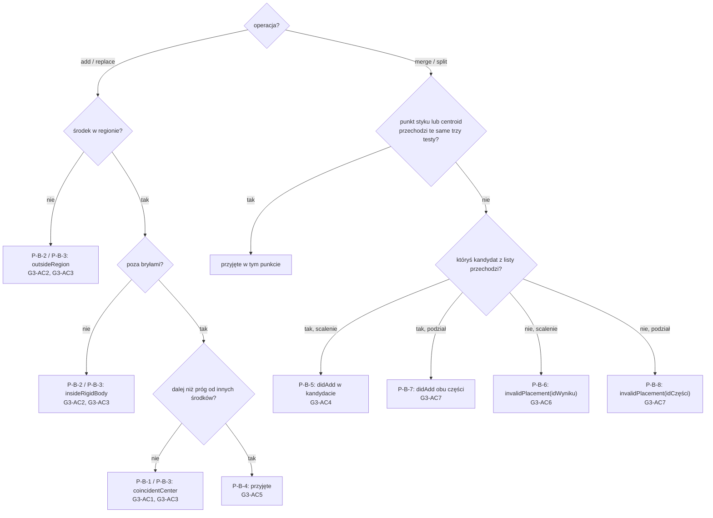

# Plan: Ściskanie zamiast odrzucenia kroku w tłoku baniek (v2.2.0)

> **For agentic workers:** REQUIRED PHASE COMMAND: Run `/tt-agentic-sdlc:implement` with this file's path to execute this plan. It runs one slice per session, and only a slice with tasks. The program design below is binding: build the call trees as drawn, and turn each behaviour into a failing test before you write the code.

**Date:** 2026-11-14
**Artifact:** plan
**Design:** [change-design.md](change-design.md)
**References:** `../2KBubbles-iOS/docs/benchmarks/stage-0-physics-gate.md`, sekcja „Specyfikacja zmiany silnika”
**Strategy:** slices
**Test command:** `swift test`
**Status:** Approved
**Template version:** default/0.3.3
**Plugin version:** 0.7.10
**Agent Sessions:** claude-code: ef9afe81-5293-4d9d-99d5-ada5d3e46e43, e19c7740-a3a8-4ca5-8140-6dad21b637f7, cf667a2a-34f1-4d88-ab50-9bfc3c56bd23, 2e38e424-233b-44f6-8878-e078a693a316, 70ddadc2-21db-41ec-9a8f-e56fb0dcf8af, a0d1d82b-d9bf-4160-96b9-616ae3c91bb1, 9138f45a-d8ff-402a-b3f2-6fbdc869d8e2
**Agent Sessions:** claude-code: 33c25f33-6177-44cc-94b1-2b152b62a8e9, 10522c84-bde1-40a6-87fa-52f39a8fb7ff

---

## Program design

### R0 — Headline

Gra 2KBubbles ogłasza awarię planszy, gdy w tłoku silnik odrzuca kroki. Po zmianie tłok ściska kontury i nie odrzuca kroku. Zły punkt od gry odrzuca tylko transakcję, z nazwaną przyczyną. Podatność kontaktu opisuje materiał, a diagnostyka podaje przyczynę odrzucenia przez strażnika i liczbę par „bańka w bańce”.

### R1 — The whole flow

```mermaid
flowchart LR
    subgraph legend["legend"]
      direction LR
      L1["unchanged"]:::same
      L2["added"]:::added
      L3["modified"]:::changed
      L4["removed"]:::removed
      L1 ~~~ L2 ~~~ L3 ~~~ L4
    end

    W["BubbleWorld.advanceImpl"]:::same
    ST["TransactionStager<br/>+ walidacja punktu, poprawa punktu scalenia i podziału,<br/>+ skończoność największej α"]:::changed
    REJ["transactionRejected<br/>NEW invalidPlacement(id, PlacementIssue)"]:::added
    NPW["NativePublicWorld.step<br/>+ NativeBubble.contact = c₀·(r/r_ref)^s, k"]:::changed
    RHO["nativeUpdateContactRho<br/>NEW wygładzone ρ w cache kontaktu"]:::added
    XPBD["XPBD: α pary = α_cfg + Σc/dt²<br/>+ limit λ pary: ruch w stronę kontaktu + 0,25·min r"]:::changed
    GUARD["nativeGuardCenter<br/>rzut na przekroczoną krawędź, bit centerCrossing"]:::changed
    REP["naprawa zawierania<br/>+ ponowny strażnik"]:::removed
    CONT["nativeValidateBubbleContainment<br/>licznik par zamiast bitu 2"]:::changed
    CB2["bit 2 za zawieranie"]:::removed
    PRESS["nativeAccumulateContactPressure<br/>para miękka: podział c_a : c_b"]:::changed
    DIAG["WorldDiagnostics<br/>NEW lastSolverGuardCause, containedBubblePairCount"]:::added

    W --> ST
    ST -->|zły punkt| REJ
    ST --> NPW --> RHO --> XPBD --> GUARD --> CONT --> PRESS
    CONT -.-> CB2
    GUARD -.-> REP
    GUARD -->|stepFailed| DIAG
    CONT --> DIAG

    classDef same fill:#f6f8fa,stroke:#8c959f,stroke-width:1px,color:#24292f
    classDef added fill:#dafbe1,stroke:#2da44e,stroke-width:3px,color:#24292f
    classDef changed fill:#fff8c5,stroke:#bf8700,stroke-width:3px,color:#24292f
    classDef removed fill:#ffebe9,stroke:#cf222e,stroke-width:2px,stroke-dasharray:4 3,color:#24292f
```



Zmiana idzie przez cały krok, od transakcji po kontur. Na CPU dochodzi walidacja w stagerze. Na GPU zmieniają się cztery miejsca: α pary, limit λ pary, strażnik i kontur. Jedno jądro jest nowe: wygładzanie ρ. Naprawa zawierania znika, a parę zawartą rozsuwa sam solver kontaktów ([CD-D-19](change-design.md#cd-d-19)).

### R2 — Seams — where the change attaches to existing code

```diff
  Sources/
    BubblePhysicsPublic/Model/
+     Resources.swift              # BubbleContactCompliance (.hard), PhysicsMaterial.contactCompliance + walidacja (slice 3)
+     Objects.swift                # BubbleDescriptor.contactCompliance: Float? + walidacja (slice 3)
+     WorldTransaction.swift       # BubbleResult.contactCompliance: Float? (slice 3)
+     WorldFrame.swift             # TransactionRejectionReason.invalidPlacement, PlacementIssue (slice 1)
    BubblePhysicsPublic/
+     Diagnostics.swift            # SolverGuardCause, WorldDiagnostics.lastSolverGuardCause, containedBubblePairCount (slice 2)
+     BubbleWorld.swift            # outcome(of:) przenosi przyczynę; licznik przypisany po kroku; makeBenchmarkWorld (:71) + parametr pairCorrectionLimit (domyślnie true) dla bliźniaczych testów; α_cfg ze steppera do stageBatch (slice 2; α_cfg: slice 3)
    BubblePhysicsRuntime/
+     PlacementGeometry.swift      # NOWY: test punktu (region, koło/kapsuła/wielokąt bryły, wspólny środek), wydzielony z QueryIndex (slice 1)
+     QueryIndex.swift             # Shape/contains przeniesione do PlacementGeometry (bez zmiany logiki) (slice 1)
+     TransactionStager.swift      # validatePlacement przy add/replace/merge/split; sprawdzenie α przy 6 operacjach; resultDescriptor (:575) przenosi nadpisanie c₀ z BubbleResult (slice 1; α, nadpisanie: slice 3)
+     StructuralOperations.swift   # resolvedMergeCenter, resolvedSplitCenter, prędkości podziału względem d_com (slice 1)
+     CompleteStep.swift           # CompletedRuntimeStep.containedBubblePairCount; CompleteStepper.baseContactCompliance (domyślnie 0) (slice 2; baseContactCompliance: slice 3)
+     NativeCompleteStepper.swift  # przekazuje licznik z ramki; nowe pole z configuration.contactCompliance z init (:14), dziś konfiguracji nie przechowuje (slice 2; contactCompliance: slice 3)
    BubblePhysicsNativeMetalDiagnostics/
+     NativeMetalWorldRunner.swift # containedBubblePairCount w NativeMetalWorldFrame (slice 2)
+     ReferenceSolverInputAdapter.swift # containedBubblePairCount w adapterze referencyjnym (slice 2)
    BubblePhysicsNativeMetal/
+     NativeMetalBackend.swift     # NativeMetalConfiguration (:1-30) + package var pairCorrectionLimit = true, poza public init, zachowane w sanitized; komentarz wskazuje CD-D-20 (slice 2)
+     NativeSolverInput.swift      # NativeMetalSafetyFailure.guardCause (NativeMetalGuardCause: centerCrossing, rigidRotationBudget); NativeSolverFrame.containedBubblePairCount (slice 2)
+     NativePublicWorld.swift      # NativePublicProperties.contact; licznik par kopiowany do ramki jak overflow (licznik: slice 2; contact: slice 3)
+     NativeMetalBufferLayout.swift# NativeMetalBubble.contact, NativeContactCacheRecord.rho, NativeMetalSafetyControl.diagnostics, drugie słowo uint4 czytane w shaderach jako safety+4 (stride 32) (diagnostics: slice 2; contact, rho: slice 3)
+     NativeMetalSolver.swift      # control.contactDamping.y = pairCorrectionLimit ? 1 : 0 (wypełnianie control); - pętla naprawy po nativeApplyCenterGuards, bufor containmentRepairActive i 3 nazwy w stageNames (linie na f0cdc1d: :778-787, :92/:207/:427-428, :1264-1265; po zadaniu 16 się przesuną); nativeUpdateContactRho w stageNames i dispatch; bit 8; licznik do NativeSolverFrame (flaga, usunięcie naprawy, bity, licznik: slice 2; ρ: slice 3)
+     NativeMetalChainKernels.swift# - enum NativeMetalContainmentRepair; reszta pliku (GridSort, Scan, ContourSmoothing…) zostaje (slice 2)
      Shaders/
+       NativeGeometryKernels      # NativeBubble.contact, NativeContactCache.rho (start 1,1), nativeContactCompliance(bubble, ρ) (slice 3)
+       NativeXPBDKernels          # NOWA nativePairLambdaLimit (:333); limit λ pary w nativePrepareSolverContacts i nativeUpdateContactMultipliers; α pary w nativeUpdateContactMultipliers (:422) i nativeMeasureResidual (:467); ρ niesione przy trafieniu w nativeMatchContactCache (:204; retain i compact kopiują cały rekord); bit 8 w nativeRigidContacts (limit, bit 8: slice 2; α, ρ: slice 3)
+       NativePostSolveKernels     # nativeUpdateContactRho; nativeGuardCenter (rzut, bit 8); nativeRigidPredict (bit 16); - naprawa zawierania; licznik; kontur na parę w nativeAccumulateContactPressure (:605-690, cięciwa :650-658, omija bramkę deformowalności :685); nativeCheckFinite + isfinite(rho) (:346) (strażnik, usunięcie naprawy, licznik: slice 2; ρ, kontur, rho w nativeCheckFinite: slice 3)
+       NativeRenderKernels        # RenderBubble.contact (trzecie lustro NativeBubble, brak w Components projektu) (slice 3)
  Tests/
+   BubblePhysicsRuntimeTests/PlacementValidationTests.swift   # NOWY: walidacja i poprawa punktu (slice 1)
+   BubblePhysicsRuntimeTests/CrowdSceneSupport.swift          # NOWY: scena tłoku, rama 4 ścian (slice 2); materiał miękki i docisk do ściany przez MotorDrive (slice 3)
+   BubblePhysicsRuntimeTests/ContainmentResolutionTests.swift # NOWY: bańka w bańce, prawie wspólny środek, scalenie w zajętym miejscu, stos dwóch baniek pod grawitacją (slice 2; miękkie: slice 3)
+   BubblePhysicsNativeMetalTests/NativeMetalChainKernelTests.swift  # - blok naprawy zawierania (repairPass, repairSegment, test fuzji); reszta zostaje (slice 2)
+   BubblePhysicsNativeMetalDiagnosticsTests/NativeMetalContainmentParallelTests.swift # - testy naprawy i fixture separate; testy walidatora zostają (slice 2)
+   BubblePhysicsNativeMetalDiagnosticsTests/NativeMetalSafetyTests.swift # NOWE testy rzutu na przekroczoną krawędź (P-B-40, P-B-41) (slice 2)
+   BubblePhysicsRuntimeTests/CrowdCompressionTests.swift      # NOWY: tłok i narożnik dla obu materiałów (twarde: slice 2; miękkie: slice 3)
+   BubblePhysicsRuntimeTests/SolverGuardCauseTests.swift      # NOWY: przyczyna odrzucenia przez strażnika (slice 2)
+   BubblePhysicsRuntimeTests/ContactComplianceTests.swift     # NOWY: docisk do ściany, nadpisania, skończoność α (slice 3)
+   BubblePhysicsPublicTests/ModelValidationTests.swift        # walidacja podatności w materiale i deskryptorze (slice 3)
+   BubblePhysicsNativeMetalTests/NativeMetalShaderABITests.swift  # pola contact, rho w sondach bubble, cache i render (slice 3); safety nie ma struktury MSL, więc sondy nie ma
+   BubblePhysicsNativeMetalDiagnosticsTests/NativeMetalSolverLifecycleTests.swift # rozmiary na sztywno (:241-250): bańka 176 → 192, cache 64 → 80 (slice 3)
+   (oczekiwania zmienione wg inwentarza w R3)   # (slice 1 i slice 2)
+ Tests/BubblePhysicsPublicTests/MigrationGuideTests.swift      # oczekiwana wersja README 2.1.0 → 2.2.0 (slice 4)
+ CHANGELOG.md, README.md:5, docs/integration-guide.md         # CHANGELOG: wpisy w każdym wycinku; wersja, README, przewodnik (sekcja bez bloków `swift`, bo IntegrationGuideTests wiąże je z przykładem): slice 4
```

Transakcja. Walidacja punktu nie siedzi w `add(_:)`, bo podział dodaje części w środku źródła, zanim silnik poprawi ich punkt (`split`, `TransactionStager.swift:628`), a scalenie dodaje wynik w ten sam sposób (`merge`, `:584`). `validatePlacement` woła więc `apply` przy `.add` i `.replace`, a `merge` i `split` przez listę kandydatów. α_cfg idzie ze steppera: `NativeCompleteStepper` zapamiętuje `configuration.contactCompliance` z `init` i podaje je przez `CompleteStepper.baseContactCompliance`, a `BubbleWorld.advanceImpl` przekazuje je do `stageBatch`. Stager dzieli je przez dt² z `configuration.fixedTimeStep`.

Drzewo pokazuje stager zbudowany w wycinku 1 (odstępstwa 1 i 2 z `## Implementation deviations`) i to, co dokłada wycinek 3:

```text
BubbleWorld.advanceImpl                          BubbleWorld.swift:260
└── TransactionStager.stageBatch(…, + baseContactCompliance: stepper.baseContactCompliance)   TransactionStager.swift:178, wołane z BubbleWorld.swift:302
    └── StagingContext.apply(op)                 :221
        ├── .add :223 → add(_:) :404 → validate(RuntimeObject) :491; .replace :228 → validate(RuntimeObject) :491
        │   ├── validatePlacement :413 → PlacementGeometry.issue :415   # (slice 1) w apply :226 i :234; region → bryła → wspólny środek; replace wyklucza zastępowaną
        │   └── + validateWorstAlpha(object)                   # (slice 3) α_cfg + 2·c_worst/dt² skończona
        ├── .mergeBubbles :356 → merge :584
        │   ├── StructuralOperations.resolvedMergeCenter :51   # (slice 1) mergeCandidates :27, spiral :39; test w domknięciu PlacementGeometry.issue (:610)
        │   ├── resultDescriptor :575 (+ nadpisanie c₀ z BubbleResult; złe → .invalidValue, slice 3)
        │   ├── initializeMerge :57
        │   └── + validateWorstAlpha(result)                   # (slice 3)
        ├── .splitBubble :357 → split :628
        │   ├── resultDescriptor :575 dla obu części (+ nadpisanie c₀, slice 3)
        │   ├── initializeSplit :69                            # centroidy
        │   ├── resolvedSplitCenter :113 (first, potem second)  # (slice 1) domknięcie PlacementGeometry.issue (:665)
        │   ├── relocateSplitParts :125                        # (slice 1) prędkości i ω względem d_com
        │   └── + validateWorstAlpha(first, second)            # (slice 3)
        ├── .startTransition :352 → validate(ParameterTransition) :539 + validateWorstAlpha(r końcowe)   # (slice 3)
        └── .updatePhysicsMaterial :239 → + validateWorstAlpha dla każdej bańki z tym materiałem       # (slice 3)
```

Krok GPU. Kolejność jąder w `NativeMetalSolver.executeSnapshot` (`NativeMetalSolver.swift:314`), od dopasowania cache do konturu:

```diff
  nativeBuildContacts                    # + rho = (1, 1, 0, 0) dla nowego kontaktu
  nativeMatchContactCache                # + przy trafieniu kopiuje rho z poprzedniego rekordu
  nativeRetainContactCache, nativeCompactContactCache
+ nativeUpdateContactRho                 # ρ_konturu = 1 − publishedDeformation.x w kierunku normalnej; ρ += 0,25·(ρ_konturu − ρ)
                                         #   kontur poprzedniej klatki: indeks starej bańki przez nativeSafetyBubbleIndex(identity, previousBubbles, …)
                                         #   i próbki wg publishedContourCounts, jak w nativeAccumulateContactPressure (Post:666-676);
                                         #   bańka bez konturu z poprzedniej klatki (nowa, wynik scalenia lub podziału): ρ_konturu = 1
  nativeClearAdjacency … nativeBuildAdjacency
  nativePrepareSolverContacts            # przycina λ z cache przed warm startem (XPBD na main :333-350)
                                         # bańka–bańka: - r/(invMass·degree)   + nativePairLambdaLimit (gdy control.contactDamping.y ≠ 0)
                                         # ściana, odcinek: r/(invMass·degree) bez zmian
  nativeApplyWarmStart                   # bez zmian względem main
  pętla × solverIterationCount:
    nativeUpdateContactMultipliers       # + α = solver.physics.x + (c_a + c_b)/dt² (bańka–odcinek, czyli ściana i bryła statyczna: c_a)
                                         # + po next = max(0, λ + δ/degree): bańka–bańka next = min(next, nativePairLambdaLimit)
    nativeSolveJacobi                    # bez zmian względem main: korekcja = przyrost λ po przycięciu, ten sam dla obu końców
    nativeRigidContacts, nativeRigidApplyBodies, … nativeRigidApplyBubbles   # gdy są bryły; kontakt bańki z bryłą niestatyczną zostaje twardy (bryły niestatyczne nie tworzą odcinków)
      └── próbkowanie łuku obrotu        # XPBD:783-799: + bit 8 (centerCrossing) obok bitu 2
    measureResidual → nativeMeasureResidual   # + to samo α
  nativeFindFastCandidates, nativeResolveCCD, nativeApplyCenterGuards
    └── nativeGuardCenter                # funkcja Post:139-209; - rzut na najbliższą krawędź
                                         # + rzut na przekroczoną krawędź, ≤ 4 rzuty na sąsiadów, test wolnego miejsca
                                         # + bit 8 (centerCrossing) obok każdego bitu 2 walidacji
- NativeMetalContainmentRepair.encodePass × 8   # nativeSeparateContainedBubbles, fuzja nativeSeparateAndGuardContainedBubbles,
-                                        #   nativeReapplyCenterGuards, pomocnicza nativeContainmentCorrection (CD-D-19)
  nativeValidateBubbleContainment        # - bit 2; + atomic add do safety+4 (diagnostics.x)
  … nativeCheckFinite                    # + isfinite(rho) obok geometry i response
  nativeAccumulateContactPressure        # + para miękka: cięciwa na głębokości nakładanie·c_a/(c_a+c_b); twarda bez zmian
                                         # + bańka z contact.x > 0 omija bramkę deformowalności (Post:685), więc ściana tnie jej kontur
                                         #   istniejącym ograniczeniem promieniem odcinka (Post:625-627): całe nakładanie z przeszkodą
```

Bańka miękka (c > 0) omija bramkę deformowalności na końcu jądra (`if (softness == 0 && bubble.material.z == 0) value.xy = 0`, Post:685). Inaczej materiał z domyślnym `deformability` = 0 nie miałby konturu i ρ zostałoby 1. Miękkość pary niesie podatność ([CD-D-8](change-design.md#cd-d-8)). Bramka `material.z >= 1` zostaje.

`nativePairLambdaLimit(a, b, n, dt)` = ((max(0, v_a·n) + max(0, −v_b·n))·dt + 0,25·min(r_a, r_b)) / max(invMass_a, invMass_b) ([CD-D-9](change-design.md#cd-d-9)), z v = `motion.xy` i dt = `control.physics.x`. Wzorem jest prototyp `wip/prototype-pair-limit-approach.diff`. Jego `if false` i `0..<0` nie trafiają do kodu: jądra i przebiegi się usuwa. λ jest jedno dla obu końców, więc pęd pary jest zachowany bez jąder skalowania i bez bufora sum ([P-B-38](#p-b-38)). Kod budżetu na bańkę z commitów a9c8752 i 97a00f0 (bufory `solverCorrectionTotals`, `solverCorrectionScales`, jądra `nativeLimitBubbleCorrections`, `nativeScaleContactCorrections`, `nativeNetScale`) wraca do stanu z `main`, razem z oczekiwaniami testów zmienionymi w tych commitach. Prędkość, którą bańka w spoczynku gromadzi w stronę kontaktu, zostaje bez zmian (Non-goals projektu). Limit ją przepuszcza i dzięki temu stos pod grawitacją się trzyma ([P-B-39](#p-b-39)).

Przełącznik `pairCorrectionLimit` ([CD-D-20](change-design.md#cd-d-20)) idzie z konfiguracji do shadera tak:

```text
NativeMetalConfiguration.pairCorrectionLimit (package, domyślnie true)    NativeMetalBackend.swift
├── BubbleWorld.makeBenchmarkWorld(…, + pairCorrectionLimit:)              BubbleWorld.swift:71-74   # testy hashy sceny akceptacyjnej
├── var c = NativeMetalConfiguration(…); c.pairCorrectionLimit = false     # testy XPBD i strażnika (dostęp package z celu testów)
└── NativeMetalSolver.init → configuration.sanitized (:291)
    └── wypełnianie control (:409-416): contactDamping.y = 1 albo 0
        └── nativePrepareSolverContacts (control, bufor 3) i nativeUpdateContactMultipliers (control, bufor 4)
```

Każdy test, którego oczekiwanie zmienia limit pary, dostaje bliźniaka z `pairCorrectionLimit = false` i dawnym oczekiwaniem. Komentarz przy przełączniku i przy bliźniakach wskazuje [CD-D-20](change-design.md#cd-d-20). Przełącznik nie trafia do publicznego `init`, więc gra go nie widzi. `nativeContactCompliance` daje c = 0 bez potęg, gdy `contact.x == 0` ([CD-D-8](change-design.md#cd-d-8)). Host liczy `contact.x` tylko dla c₀ > 0.

Przyczyna wraca w górę tak:

```text
NativeMetalSolver: odczyt safetyControl          NativeMetalSolver.swift (counts.w & 2)
├── counts.w & 2 → NativeMetalSafetyFailure(.guardFailure, guardCause: bit 8 → centerCrossing, inaczej bit 16 → rigidRotationBudget)
│   # oba bity w jednej klatce: wygrywa centerCrossing
│   └── BubbleWorld.handleAdvanceError :378 → outcome(of:) :404 → lastSolverGuardCause
└── safety+4 (diagnostics.x) → NativeSolverFrame (:1077) → NativePublicFrame (:302) → CompletedRuntimeStep.containedBubblePairCount
    └── BubbleWorld: przypisanie po kroku, jak maximumContactCandidatesPerObject (:335), nie suma jak :334
        → WorldDiagnostics.containedBubblePairCount
```

Drugie spojrzenie należy się `nativeGuardCenter`. To funkcja, a nie jądro. Dziś wołają ją trzy miejsca: `nativeApplyCenterGuards` (Post:218), fuzja naprawy zawierania (Post:348) i `nativeReapplyCenterGuards` (Post:360). Po usunięciu naprawy zostaje tylko pierwsze, więc rzut na przekroczoną krawędź zmienia się w jednym miejscu wywołania. `stageNames` (`NativeMetalSolver.swift:1226-1240`) musi zgadzać się z shaderem, bo pipeline'y powstają z tej listy (:1257-1260), więc nazwy usuwa się razem z jądrami. Komentarze przy `nativeValidateBubbleContainment` (Post:370-371) i przy `stageNames` (:1252-1254) też się poprawia. Bit 2 zapalają cztery miejsca: walidacja w `nativeGuardCenter`, `nativeRigidPredict` (Post:491), próbkowanie łuku obrotu w `nativeRigidContacts` (XPBD:783-799) i walidator zawierania, który bit 2 traci (zadanie 12). Pierwsze i trzecie miejsce dokładają bit 8, a drugie bit 16, więc nowe bity zapalają się zawsze razem z bitem 2. Host odrzuca więc krok tą samą gałęzią `counts.w & 2` (`NativeMetalSolver.swift:950`) i tylko odczytuje z bitów przyczynę.

Bit 2 zapala też `nativeRigidPredict`, gdy obrót bryły w kroku wymaga ponad 128 próbek (Post:491). Tam razem z bitem 2 zapala się bit 16, czyli `.rigidRotationBudget` ([CD-D-18](change-design.md#cd-d-18)). Próbkowanie łuku obrotu w `nativeRigidContacts` (XPBD:783-799) zapala razem z bitem 2 bit 8, czyli `.centerCrossing` ([P-B-37](#p-b-37)).

Fakt niepotwierdzony przy rekonesansie:
- Czy przy 8 iteracjach Jacobiego tłok z podatnością dochodzi do stanu bez odrzuceń. To założenie projektu (Key facts). Jeśli test pokaże inaczej, wraca do właściciela.

### R3 — Behaviour

Walidacja punktu w transakcji:

| P-B-ID | Situation | Result | Proves |
|---|---|---|---|
| <a id="p-b-1"></a>P-B-1 | `add` ze środkiem bliżej niż `coincidentCenterTolerance` od innej bańki | `transactionRejected` z `.invalidPlacement(id, .coincidentCenter)`; następny krok przyjęty | [G3-AC1](change-design.md#g3-ac1) |
| <a id="p-b-2"></a>P-B-2 | `add` ze środkiem we wnętrzu bryły albo poza `simulationRegion` (także przy `.wrap`) | `.insideRigidBody` albo `.outsideRegion`; przy kilku błędach wygrywa pierwszy w kolejności region → bryła → środek | [G3-AC2](change-design.md#g3-ac2) |
| <a id="p-b-3"></a>P-B-3 | `replace` na bańkę w złym punkcie | te same przyczyny co `add`; bańka zastępowana jest z testu wyłączona | [G3-AC3](change-design.md#g3-ac3) |
| <a id="p-b-4"></a>P-B-4 | poprawne punkty, w tym bańka częściowo nachodząca na inną | transakcja przyjęta | [G3-AC5](change-design.md#g3-ac5) |
| <a id="p-b-5"></a>P-B-5 | `mergeBubbles` z punktem styku w środku trzeciej bańki, w bryle albo poza regionem | `didAdd` wyniku w poprawnym punkcie; dwa przebiegi dają ten sam środek | [G3-AC4](change-design.md#g3-ac4) |
| <a id="p-b-6"></a>P-B-6 | `mergeBubbles` po wcześniejszym `add` bryły nad źródłami i spiralą | `.invalidPlacement(idWyniku, przyczyna punktu styku)`; źródła zostają | [G3-AC6](change-design.md#g3-ac6) |
| <a id="p-b-7"></a>P-B-7 | `splitBubble` przy ścianie, centroid części w bryle | `didAdd` obu części w poprawnych, różnych punktach; pęd i moment pędu zachowane | [G3-AC7](change-design.md#g3-ac7) |
| <a id="p-b-8"></a>P-B-8 | `splitBubble` po wcześniejszym `add` bryły nad centroidem, odcinkiem i spiralą | `.invalidPlacement(idCzęści, przyczyna centroidu)` | [G3-AC7](change-design.md#g3-ac7) |

**Co wybiera wynik operacji z punktem.** Liście to zachowania [P-B-1](#p-b-1)–[P-B-8](#p-b-8) z tabeli wyżej: warunki idą w kolejności region → bryła → wspólny środek, a pierwszy niespełniony daje przyczynę. Przy `add` i `replace` błąd odrzuca transakcję, a przy scaleniu i podziale silnik próbuje kolejnych kandydatów. Dowodzą [G3-AC1](change-design.md#g3-ac1)–[G3-AC7](change-design.md#g3-ac7).



Zawieranie, limit korekcji i strażnik, przy każdej podatności:

| P-B-ID | Situation | Result | Proves |
|---|---|---|---|
| <a id="p-b-9"></a>P-B-9 | bańka r = 20 dodana 5 od środka r = 60 | brak odrzuconego kroku; licznik par 1 w pierwszej klatce, 0 po ≤ 2 s; pusta plansza daje 0 | [G2-AC1](change-design.md#g2-ac1), [G5-AC3](change-design.md#g5-ac3) |
| <a id="p-b-10"></a>P-B-10 | przebiegi z [P-B-9](#p-b-9) i [P-B-11](#p-b-11), `advance` o jeden krok | przesunięcie środka ≤ 0,25·r + 100·dt na krok; po 2 s prędkości < 2 | [G2-AC2](change-design.md#g2-ac2) |
| <a id="p-b-11"></a>P-B-11 | dwie bańki r = 20 w jednej transakcji, środki o 0,01, materiał c₀ = 0 | przyjęte; po ≤ 2 s odległość ≥ 20 bez odrzucenia | [G2-AC3](change-design.md#g2-ac3) |
| <a id="p-b-12"></a>P-B-12 | `mergeBubbles` z punktem styku wewnątrz trzeciej bańki | `didAdd`, brak odrzucenia transakcji i kroku przez 2 s | [G2-AC4](change-design.md#g2-ac4) |
| <a id="p-b-13"></a>P-B-13 | scena tłoku B = 2,5, materiał c₀ = 0, potem 600 kroków | brak `stepFailed`, `worldFailed`, wyjść z regionu i znikania; środki w ramie w każdej klatce z tolerancją zaokrągleń 1e-3; licznik par skończony i ≥ 0 | [G1-AC1](change-design.md#g1-ac1), [G1-AC2](change-design.md#g1-ac2), [G2-AC5](change-design.md#g2-ac5) |
| <a id="p-b-14"></a>P-B-14 | bańka r = 20 pchana siłą 3000 w narożnik ramy z tłokiem 10 baniek, c₀ = 0, `maximumLinearSpeed` = 600, 5 s | brak odrzucenia; środek w ramie z tolerancją zaokrągleń 1e-3 | [G1-AC4](change-design.md#g1-ac4) |
| <a id="p-b-15"></a>P-B-15 | bryła statyczna `[-180,200]×[-320,320]` dodana jedną transakcją nad bańką przyciśniętą do ściany przykrywa jej środek i nie zostawia wolnego miejsca (scena wg odstępstwa 5) | `lastRejectionReason == .solverGuard`, `lastSolverGuardCause == .centerCrossing` | [G5-AC1](change-design.md#g5-ac1) |
| <a id="p-b-16"></a>P-B-16 | brak odrzucenia albo ostatnie odrzucenie z innego powodu | `lastSolverGuardCause == nil` | [G5-AC2](change-design.md#g5-ac2) |
| <a id="p-b-36"></a>P-B-36 | bryła dynamiczna z prędkością kątową, która w jednym kroku przekracza budżet 128 próbek obrotu | `lastRejectionReason == .solverGuard`, `lastSolverGuardCause == .rigidRotationBudget` | [G5-AC4](change-design.md#g5-ac4) |
| <a id="p-b-37"></a>P-B-37 | bryła kinematyczna obraca się w jednym kroku tak, że łuk obrotu pominięty przez próbkowanie w `nativeRigidContacts` mógł dotknąć bańki | `lastRejectionReason == .solverGuard`, `lastSolverGuardCause == .centerCrossing` | [G5-AC1](change-design.md#g5-ac1) |
| <a id="p-b-38"></a>P-B-38 | bańki r = 20 i r = 40 o różnych masach, środki o 0,01, kontakt twardy, bez prędkości, napędów i siły globalnej; jeden krok, w którym działa limit | suma pędu m·v obu baniek po kroku ≈ 0 (z tolerancją Float), mimo że limit pary przycina λ | [G2-AC2](change-design.md#g2-ac2) |
| <a id="p-b-39"></a>P-B-39 | materiały domyślne, dwie bańki r = 8 jedna nad drugą na statycznej podłodze (scena `ContactEventTests.testBeganBubbleAndBubble`), grawitacja −400, 600 kroków | w każdej klatce górna ma środek wyżej niż dolna, a odległość środków ≥ 0,95·16 | [G2-AC6](change-design.md#g2-ac6) |
| <a id="p-b-40"></a>P-B-40 | gruby wielokąt przesuwa się w kroku (`previous` → `current`) tak, że środek stojącej bańki ląduje w jego wnętrzu bliżej krawędzi tylnej | środek trafia na krawędź przekroczoną w ruchu względnym (przednią), z marginesem, po stronie startu; dziś rzut na najbliższą krawędź wyrzuca go za wielokąt | [G1-AC2](change-design.md#g1-ac2), [CD-D-17](change-design.md#cd-d-17) |
| <a id="p-b-41"></a>P-B-41 | środek kończy krok we wnętrzu dwóch stykających się, prostopadłych ścian przy narożniku | kolejne rzuty (≤ 4) dają narożnik wewnętrzny z marginesem w wolnym miejscu, bez odrzucenia kroku; dziś rzut przerzuca środek między ścianami | [G1-AC4](change-design.md#g1-ac4), [CD-D-17](change-design.md#cd-d-17) |

Podatność kontaktu. Sceny docisku do ściany używają `MotorDrive`, a δ = r − d mierzy odległość od płaszczyzny ściany:

| P-B-ID | Situation | Result | Proves |
|---|---|---|---|
| <a id="p-b-17"></a>P-B-17 | materiał z ujemną, NaN lub nieskończoną podatnością, złym wykładnikiem, r_ref ≤ 0, NaN lub nieskończonym, podatnością > 0 przy `.rigid`; złe nadpisanie w `BubbleDescriptor` | `ModelValidationError.valueOutOfRange` przy tworzeniu | [G4-AC7](change-design.md#g4-ac7) |
| <a id="p-b-18"></a>P-B-18 | złe nadpisanie w `BubbleResult` scalenia | `.invalidValue(.valueOutOfRange("contactCompliance"))` | [G4-AC7](change-design.md#g4-ac7) |
| <a id="p-b-19"></a>P-B-19 | `add`, `replace`, scalenie, podział z c₀ = 1, s = 70, r/r_ref = 4 | `.invalidValue(.valueOutOfRange("contactCompliance"))`; następny krok przyjęty; c₀ = 0 przy tym samym s przechodzi | [G3-AC8](change-design.md#g3-ac8) |
| <a id="p-b-20"></a>P-B-20 | `startTransition` promienia i `updatePhysicsMaterial`, po których α przepełnia Float | odrzucone; promień i materiał bez zmian | [G3-AC9](change-design.md#g3-ac9) |
| <a id="p-b-21"></a>P-B-21 | r = 20 i r = 40 dociskane tą samą siłą, s = 2, k = 0 | po 2 s δ/r większe dla r = 40 | [G4-AC1](change-design.md#g4-ac1) |
| <a id="p-b-22"></a>P-B-22 | ta sama scena z s = 0 | δ/r większe dla r = 20 | [G4-AC2](change-design.md#g4-ac2) |
| <a id="p-b-23"></a>P-B-23 | podwojona siła docisku | k > 0: δ/r rośnie mniej niż 2×; k = 0: 2× ± 20% | [G4-AC3](change-design.md#g4-ac3) |
| <a id="p-b-24"></a>P-B-24 | w scenach [P-B-21](#p-b-21)–[P-B-23](#p-b-23), okno od 1 s do 2 s | max δ − min δ < 0,02·r | [G4-AC8](change-design.md#g4-ac8) |
| <a id="p-b-25"></a>P-B-25 | bańka c₀ = 0 dociskana do miękkiej przy ścianie | twarda ma promień efektywny = docelowy (± 1%); miękka ma δ > 0 | [G4-AC4](change-design.md#g4-ac4) |
| <a id="p-b-26"></a>P-B-26 | nadpisanie c₀ w `BubbleDescriptor` oraz w `BubbleResult` scalenia i obu części podziału | ugina się tylko ta bańka; bez nadpisania jak materiał | [G4-AC5](change-design.md#g4-ac5) |
| <a id="p-b-27"></a>P-B-27 | scena tłoku B = 2,5 z materiałem miękkim (c₀ > 0, s = 1, k = 1) | jak [P-B-13](#p-b-13); do tego średnie nakładanie par baniek z ostatniej sekundy większe niż w przebiegu z c₀ = 0 i tym samym ziarnem, więc materiał naprawdę działa | [G1-AC1](change-design.md#g1-ac1), [G1-AC2](change-design.md#g1-ac2), [G2-AC5](change-design.md#g2-ac5) |
| <a id="p-b-28"></a>P-B-28 | scena tłoku, materiał miękki, to samo ziarno, B = 1,5 i B = 2,5 | średni stosunek promienia efektywnego do docelowego z ostatniej sekundy mniejszy przy 2,5 | [G1-AC3](change-design.md#g1-ac3) |
| <a id="p-b-29"></a>P-B-29 | narożnik z [P-B-14](#p-b-14) z materiałem miękkim | brak odrzucenia; środek w ramie; wgniecenie δ pchanej bańki względem ściany na końcu większe niż w przebiegu z c₀ = 0 | [G1-AC4](change-design.md#g1-ac4) |
| <a id="p-b-30"></a>P-B-30 | para z [P-B-11](#p-b-11) z materiałem miękkim | odległość ≥ 20 po ≤ 2 s bez odrzucenia; po pierwszym kroku odległość środków mniejsza niż przy c₀ = 0 | [G2-AC3](change-design.md#g2-ac3) |

Regresja i wydanie:

| P-B-ID | Situation | Result | Proves |
|---|---|---|---|
| <a id="p-b-31"></a>P-B-31 | istniejące testy scalenia, podziału i `add` przy materiałach domyślnych | przechodzą; zmienia się tylko oczekiwanie przy złym punkcie, wpisane do opisu PR | [G4-AC6](change-design.md#g4-ac6) |
| <a id="p-b-32"></a>P-B-32 | istniejące testy strażnika, naprawy zawierania, warm startu i hashy sceny akceptacyjnej | zmieniają się tylko oczekiwania z inwentarza poniżej, każde w opisie PR z powodem; zmianę przez limit pary dowodzi bliźniak z `pairCorrectionLimit = false` i dawnym oczekiwaniem, który przechodzi; testy wołające usuwane jądra naprawy są usunięte i wymienione w opisie PR | [G4-AC6](change-design.md#g4-ac6) |
| <a id="p-b-33"></a>P-B-33 | istniejące testy konturu, XPBD i renderu przy c₀ = 0 | przechodzą bez zmian oczekiwań | [G4-AC6](change-design.md#g4-ac6) |
| <a id="p-b-34"></a>P-B-34 | pliki wydania | CHANGELOG, `README.md:5` (pilnuje go `MigrationGuideTests.testReadmeStatesCurrentVersion…`) i przewodnik integracji opisują zmianę jak w [G6-AC1](change-design.md#g6-ac1) | [G6-AC1](change-design.md#g6-ac1) |
| <a id="p-b-42"></a>P-B-42 | PR całej zmiany po `review-implementation`, wszystkie commity gałęzi wypchnięte | commit scalający na `main` zawiera głowę gałęzi; na nim adnotowany tag `v2.2.0` „BubblePhysics 2.2.0” w `origin` | [G6-AC1](change-design.md#g6-ac1) |
| <a id="p-b-35"></a>P-B-35 | `swift run -c release BubblePhysicsPerfGuard` na Macu | przechodzi z progami 2.1.0 (`docs/benchmarks/perf-guard.json`) | [G6-AC2](change-design.md#g6-ac2) |

Inwentarz testów, których oczekiwania się zmieniają ([P-B-32](#p-b-32)). Każdy wpis idzie do opisu PR z powodem:
- Zmienione w zadaniu 12 (zawieranie nie zapala bitu 2): `NativeMetalSafetyTests.swift` (licznik zamiast bitu 2) i walidator w `NativeMetalContainmentParallelTests.swift` (`:76`, `:87`, odczyt licznika). To nie jest zmiana przez limit, więc bez bliźniaka.
- Usuwane razem z naprawą zawierania ([CD-D-19](change-design.md#cd-d-19)): `NativeMetalChainKernelTests.testFusedRepairPassIsBitIdenticalToSeparationThenGuard` z pomocniczymi `RepairResult`, `repairPass` i `repairSegment` oraz w `NativeMetalContainmentParallelTests` testy `testInactiveRepairCopiesPositionsWithoutCorrection`, `testParallelRepairAggregatesOpposingAxesAndRepeatsExactly`, `testParallelRepairIncludesNeighborsBeyondOneSIMDWidth`, `testRepairEarlyOutRetainsCompletedStateInEveryPingPongPass` z fixture `separate`.
- Zmieniane przez rozsuwanie zawierania w kilku krokach zamiast naprawy w jednym ([CD-D-19](change-design.md#cd-d-19), bez bliźniaka, bo naprawy nie da się wyłączyć): `NativeMetalSafetyTests.testCoincidentDifferentRadiiSeparateWithoutMakingElasticOverlapRigid` (rozdzielenie w pierwszej klatce), do sprawdzenia `testMovingPolygonGuardCannotPublishNewBubbleContainment` i `testImpossibleContainmentRepairIsCountedAndDoesNotRejectTheFrame`.
- Zmieniane przez limit pary, każdy z bliźniakiem ([CD-D-20](change-design.md#cd-d-20)). W `NativeMetalXPBDTests` (nazwy po zadaniu 16, czyli jak na `main`): `testInverseMassWeightsCorrectionsAndPreservesCenterOfMass` (−0,125 i 1,875 → −1/12 i 1,75), `testThreeBubbleChainIsRepeatableAndRaceFree`, `testSameInputProducesSamePublishedStateHash`, `testWarmStartNeedsNoMoreIterationsThanColdStartAfterFirstFrame`, `testWarmStartBoundsAnOversizedMatchedMultiplierByBubbleRadius`. To testy, które zmienił już budżet w a9c8752. Bez prędkości w stronę kontaktu limit pary daje ten sam próg 0,25·min r / max invMass, a gdy test ma taką prędkość, próg wychodzi luźniejszy o człon ruchu z [CD-D-9](change-design.md#cd-d-9), więc oczekiwanie może się różnić od wartości z a9c8752. Do tego `AcceptanceEquivalenceTests` (oba testy wzorca, hashe), `AcceptanceRenderEquivalenceTests.testAcceptanceSceneRenderedAfter120StepsEqualsTheReferencePixels` i do sprawdzenia `testSegmentContactSeparatesAndIterationBudgetIsReported` (ściana jest poza limitem, więc oczekiwanie powinno zostać). `PublishedStateDeterminismTests` to tylko straż determinizmu (ten sam hash w dwóch przebiegach, bez stałej wzorca), więc nie ma oczekiwania do zmiany: musi przechodzić z limitem i nie dostaje bliźniaka. Każde inne oczekiwanie zmienione przez limit dostaje bliźniaka i wiersz w `## Implementation deviations`.
- Do uruchomienia i ewentualnej zmiany przez rzut na przekroczoną krawędź: testy strażnika i CCD w `NativeMetalSafetyTests.swift` (`:145`–`:251`, `:428`–`:485`), `NativeMetalPreviousContourTests.swift:143` (scena musi dalej dawać odrzucenie, w razie potrzeby nowa scena bez wolnego miejsca), `NativeMetalPublicObjectTests.swift:144`.

Gałąź `default` w wyczerpującym `switch` po `TransactionRejectionReason` nie jest w repozytorium potrzebna: takich `switch` nie ma.

### Test strategy

| Level | What it proves | Behaviours |
|---|---|---|
| unit (model, bez Metal) | walidacja materiału i deskryptora | [P-B-17](#p-b-17) |
| integracja: publiczny `BubbleWorld` na urządzeniu Metal | transakcje, scenariusze fizyczne i diagnostyka od wejścia gry do `WorldFrame` | [P-B-1](#p-b-1)–[P-B-16](#p-b-16), [P-B-36](#p-b-36)–[P-B-39](#p-b-39), [P-B-18](#p-b-18)–[P-B-30](#p-b-30) |
| integracja: harness `NativeMetal` (`executeFrame`, odcinki `previous` → `current`) | rzut strażnika w jednym kroku, niewidoczny dla publicznego świata, bo strażnik widzi tam tylko statyczne wielokąty | [P-B-40](#p-b-40), [P-B-41](#p-b-41) |
| regresja: cały pakiet z bliźniakami (`pairCorrectionLimit = false`) | domyślne materiały zachowują v2.1.0 poza inwentarzem, a zmiana przez limit pary znika po jego wyłączeniu | [P-B-31](#p-b-31)–[P-B-33](#p-b-33) |
| kontrola statyczna: test ABI i rozmiary rekordów w `NativeMetalSolverLifecycleTests` | układ `NativeBubble`, `NativeContactCache`, `RenderBubble` zgodny ze Swift | [P-B-33](#p-b-33) |
| strażnik wydajności i przegląd wydania | progi 2.1.0, pliki wydania (test wersji w README) i tag | [P-B-34](#p-b-34), [P-B-35](#p-b-35), [P-B-42](#p-b-42) |

Wszystkie komendy `verify:` uruchamia się z korzenia repozytorium.

**Where:** nowe testy w `Tests/BubblePhysicsRuntimeTests/` (jak w Components projektu), na wzór `PlacementValidationTests.swift`: `BubbleWorld(configuration:)` sam bierze urządzenie Metal (`:46`), a zdarzenia czyta `run` (`:55`). Pomocnicze sceny są w `CrowdSceneSupport.swift`: rama z czterech prostokątnych brył statycznych i docisk przez `MotorDrive`. Wzorem są `Tests/BubblePhysicsMetalRenderTests/Support/PhysicsSceneBuilders.swift` (`box`, `:37`) i `KinematicStagingTests.swift:96-108` (`MotorDrive`), bo cel Runtime pliku `SceneBuilders` nie widzi i nie ma tam ani ramy, ani `MotorDrive`. Testy modelu w `Tests/BubblePhysicsPublicTests/ModelValidationTests.swift`. Pojedyncze klasy: `swift test --filter <Klasa>`. Repozytorium nie ma lintera.

**Test command:** `swift test`

## Slice Status

| Slice | Name | Delivers | Seams | Behaviours | Status |
|-------|------|----------|-------|------------|--------|
| 1 | Zły punkt odrzuca transakcję | gra dostaje `invalidPlacement` z przyczyną dla złego punktu `add` i `replace`, a scalenie i podział same poprawiają punkt wyniku ([G3-AC1](change-design.md#g3-ac1)–[G3-AC7](change-design.md#g3-ac7)) | `WorldFrame.swift`, `PlacementGeometry.swift`, `QueryIndex.swift`, `TransactionStager.swift`, `StructuralOperations.swift`, `PlacementValidationTests`, wpis w CHANGELOG | [P-B-1](#p-b-1)–[P-B-8](#p-b-8), [P-B-31](#p-b-31) | done |
| 2 | Tłok i bańka w bańce bez odrzucenia kroku | bańka w bańce, prawie wspólny środek i tłok przy kontakcie twardym nie odrzucają kroku, a stos baniek pod grawitacją się trzyma; gra widzi przyczynę odrzucenia i licznik par ([G1](change-design.md#g1-ac1) dla c₀ = 0, [G2](change-design.md#g2-ac1), [G5](change-design.md#g5-ac1)). Kolejność: licznik równy 1 w pierwszej klatce ([P-B-9](#p-b-9)) sprawdza dopiero zadanie z limitem pary, bo naprawa i Jacobi bez limitu rozdzielają parę w jednym kroku przed walidacją. | `Diagnostics.swift`, `BubbleWorld.swift` (+ `makeBenchmarkWorld`), `CompleteStep.swift`, `NativeCompleteStepper.swift`, `NativeMetalBackend.swift` (przełącznik), `NativeSolverInput.swift`, `NativePublicWorld.swift` (licznik), `NativeMetalBufferLayout.swift` (diagnostics), `NativeMetalSolver.swift`, `NativeMetalChainKernels.swift` (usunięcie), `NativeXPBDKernels` (limit pary), `NativePostSolveKernels` (strażnik, usunięcie naprawy, licznik), testy tłoku, zawierania, stosu i przyczyny, inwentarz z bliźniakami, wpis w CHANGELOG | [P-B-9](#p-b-9)–[P-B-16](#p-b-16), [P-B-32](#p-b-32), [P-B-36](#p-b-36)–[P-B-41](#p-b-41) | done |
| 3 | Miękki kontakt z materiału | podatność kontaktu w materiale z nadpisaniem na bańce, ugięcie zgodne z prawem Laplace'a i tłok ściskający kontury ([G4](change-design.md#g4-ac1), [G3-AC8](change-design.md#g3-ac8), [G3-AC9](change-design.md#g3-ac9), warianty miękkie G1 i G2). Kolejność: przypadek k > 0 z [P-B-23](#p-b-23) i [P-B-24](#p-b-24) sprawdza zadanie z jądrem ρ, po zadaniu z konturem bańki miękkiej, bo bez konturu ρ = 1. | `Resources.swift`, `Objects.swift`, `WorldTransaction.swift`, `TransactionStager.swift` (α, nadpisanie), `BubbleWorld.swift`, `CompleteStep.swift`, `NativeCompleteStepper.swift` (α_cfg), `NativePublicWorld.swift`, `NativeMetalBufferLayout.swift` (contact, rho), `NativeMetalSolver.swift` (ρ), `NativeGeometryKernels`, `NativeXPBDKernels`, `NativePostSolveKernels`, `NativeRenderKernels`, `ContactComplianceTests`, `ModelValidationTests`, `CrowdSceneSupport.swift`, przypadki miękkie w `CrowdCompressionTests` i `ContainmentResolutionTests`, `NativeMetalShaderABITests`, `NativeMetalSolverLifecycleTests`, wpis w CHANGELOG | [P-B-17](#p-b-17)–[P-B-30](#p-b-30), [P-B-33](#p-b-33) | done |
| 4 | Wydanie 2.2.0 | gotowy do scalenia PR wersji 2.2.0 z opisem w CHANGELOG, README i przewodniku integracji, w tym z opisem prędkości w stronę kontaktu, którą bańka w spoczynku gromadzi do nasycenia ([G6](change-design.md#g6-ac1)). Strażnik wydajności musi mierzyć to samo obciążenie co w 2.1.0, czyli tyle samo przyjętych baniek w scenach benchmarku (liczby z zadania 8 wycinka 1 bez różnic). Jeden PR całej zmiany z inwentarzami wycinków 1–3 w opisie. | `CHANGELOG.md` (wersja), `README.md:5`, `MigrationGuideTests.swift` (test wersji), `docs/integration-guide.md`, strażnik wydajności, opis PR | [P-B-34](#p-b-34), [P-B-35](#p-b-35) | unplanned |
| 5 | Tag v2.2.0 | gra może podbić silnik do adnotowanego tagu `v2.2.0` na `main`, jak przy 2.1.0 ([G6-AC1](change-design.md#g6-ac1)); po `review-implementation` całej gałęzi | push wszystkich commitów gałęzi, scalenie PR commitem scalającym, tag | [P-B-42](#p-b-42) | unplanned |

Wycinek 1 działa tylko na CPU i daje grze odrzucanie złych punktów, zanim powstanie cokolwiek w GPU. Brakuje w nim jeszcze kroku bez odrzuceń w tłoku. Wycinek 2 usuwa odrzucenia przy domyślnym, twardym kontakcie i sprawdza założenie projektu o tłoku twardym, zanim dojdzie miękki kontakt. Brakuje w nim jeszcze płynnego ściśnięcia. Wycinek 3 daje miękkość, ale bez tagu gra nie może go jeszcze użyć. Wycinek 4 przygotowuje wydanie po przejściu strażnika wydajności i otwiera PR, ale gra nie ma jeszcze tagu. Wycinek 5 scala PR i zakłada tag dopiero po przeglądzie wycinka 4 i `review-implementation`, więc ich poprawki trafiają do `v2.2.0`.

## Slice 1: Zły punkt odrzuca transakcję

**Delivers:** `add` i `replace` w złym punkcie odrzucają transakcję z `invalidPlacement` i przyczyną, a scalenie i podział stawiają wynik w poprawnym, deterministycznym punkcie albo odrzucają transakcję, gdy go nie ma.

Każde zmienione oczekiwanie istniejącego testu trafia do treści commita z powodem, bo opis PR musi je wymienić. W zadaniach z `! swift test` implementer sprawdza w wyjściu, że testy padają na asercjach, a nie na błędzie urządzenia Metal czy crashu. Wszystkie komendy `verify:` uruchamia się z korzenia repozytorium.

1. Dodać `PlacementIssue` i `invalidPlacement` do modelu oraz napisać `PlacementValidationTests` dla [P-B-1](#p-b-1)–[P-B-8](#p-b-8), z metodami `testAdd…`, `testReplace…`, `testValid…`, `testMerge…` i `testSplit…` · verify: `swift build --build-tests && ! swift test --filter PlacementValidationTests`
    ```text
    $ swift build --build-tests && ! swift test --filter PlacementValidationTests
    (faza czerwona przy commicie 4cbdb39: testy padały na asercjach, bez błędu Metal ani crasha)
    przy weryfikacji końcowej na 5e1bfa9: exit 1, bo PlacementValidationTests przechodzi (26 testów, 0 porażek), czyli zgodnie z oczekiwaniem po implementacji
    ```
2. Wydzielić `Shape`/`contains` z `QueryIndex` do `PlacementGeometry.swift` bez zmiany logiki · verify: `test -f Sources/BubblePhysicsRuntime/PlacementGeometry.swift && swift test --filter QueryIndexTests`
    ```text
    $ test -f Sources/BubblePhysicsRuntime/PlacementGeometry.swift && swift test --filter QueryIndexTests
    Executed 15 tests, with 0 failures (0 unexpected) in 0.035 (0.038) seconds
    ```
3. Dodać `validatePlacement` w `apply` przy `.add` i `.replace`, z wyłączeniem bańki zastępowanej, pokrywając [P-B-1](#p-b-1)–[P-B-4](#p-b-4) · verify: `swift test --filter "PlacementValidationTests.testAdd|PlacementValidationTests.testReplace|PlacementValidationTests.testValid"`
    ```text
    $ swift test --filter "PlacementValidationTests.testAdd|PlacementValidationTests.testReplace|PlacementValidationTests.testValid"
    Executed 10 tests, with 0 failures (0 unexpected) in 0.300 (0.302) seconds
    ```
4. Dodać `resolvedMergeCenter` z listą kandydatów i odrzuceniem na końcu listy, pokrywając [P-B-5](#p-b-5) i [P-B-6](#p-b-6) · verify: `swift test --filter PlacementValidationTests.testMerge`
    ```text
    $ swift test --filter PlacementValidationTests.testMerge
    Executed 9 tests, with 0 failures (0 unexpected) in 0.297 (0.299) seconds
    ```
5. Dodać `resolvedSplitCenter` z prędkościami względem d_com i `structuralShape` z końcowym środkiem, pokrywając [P-B-7](#p-b-7) i [P-B-8](#p-b-8) · verify: `swift test --filter PlacementValidationTests`
    ```text
    $ swift test --filter PlacementValidationTests
    Executed 26 tests, with 0 failures (0 unexpected) in 0.619 (0.623) seconds
    ```
6. Zmienić w istniejących testach stagera, regionu i operacji strukturalnych tylko oczekiwania przy złym punkcie, pokrywając [P-B-31](#p-b-31) · verify: `swift test --filter "TransactionStagerTests|RegionPolicyTests|NativeMetalStructuralOperationTests"`
    ```text
    $ swift test --filter "TransactionStagerTests|RegionPolicyTests|NativeMetalStructuralOperationTests"
    Executed 48 tests, with 0 failures (0 unexpected) in 0.677 (0.683) seconds
    ```
7. Dodać do `CHANGELOG.md` sekcję `## 2.2.0 (w przygotowaniu)` z `invalidPlacement`, uwagą o gałęzi `default` w wyczerpującym `switch` i zmianami zachowania z tego wycinka (także `.wrap`) · verify: `grep -q "invalidPlacement" CHANGELOG.md`
    ```text
    $ grep -q "invalidPlacement" CHANGELOG.md   → exit 0
    9:- `TransactionRejectionReason.invalidPlacement(ObjectID, PlacementIssue)`: transakcja odrzucona z powodu złego punktu bańki. …
    ```
8. Uruchomić cały pakiet. Oczekiwania zmienione przez walidację punktu poza stagerem (np. `BubblePhysicsMetalRenderTests`) zmienić z powodem w commicie, a dla scen `BubblePhysicsMetalRenderBenchmark` zapisać w tym pliku wiersz `Benchmark baniek przyjętych: …` z liczbą „przed” zmierzoną na `main` (bez walidacji punktu) i „po” na tym branchu · verify: `swift test && grep -q "^Benchmark baniek przyjętych:" docs/sdlc/changes/2026-11-14-crowd-solver-compression/plan.md`
    ```text
    $ swift test && grep -q "^Benchmark baniek przyjętych:" docs/sdlc/changes/2026-11-14-crowd-solver-compression/plan.md   → exit 0
    Executed 1345 tests, with 1 test skipped and 0 failures (0 unexpected) in 474.523 (474.654) seconds
    ```

Benchmark baniek przyjętych: przed (main afe237a) i po (feature/crowd-solver-compression) bez różnic, w pierwszej klatce po transakcji początkowej: stress-300 300 → 300, mixed 200 → 200, decals 300 → 300, acceptance 300 → 300, stress-600 600 → 600, capacity-300 300 → 300, capacity-600 600 → 600; żadnej transakcji odrzuconej.

## Slice 2: Tłok i bańka w bańce bez odrzucenia kroku

**Delivers:** przy domyślnym, twardym kontakcie bańka w bańce, prawie wspólny środek, scalenie w zajętym miejscu, tłok i narożnik nie odrzucają kroku, stos baniek pod grawitacją się trzyma, λ każdej pary bańka–bańka ma limit ruchu w stronę kontaktu plus 0,25·min r, naprawy zawierania już nie ma, a gra widzi `lastSolverGuardCause` i `containedBubblePairCount`.

Każde zmienione oczekiwanie istniejącego testu trafia do treści commita z powodem, bo opis PR musi je wymienić. W zadaniach z `! swift test` implementer sprawdza w wyjściu, że testy padają na asercjach, a nie na błędzie urządzenia Metal czy crashu. Wszystkie komendy `verify:` uruchamia się z korzenia repozytorium.

Zadania 9–14 są zbudowane (commity 74bfd5c, 385be0e, 2d557e9, b5ea0be, a9c8752). Rewizja projektu z 2026-11-15 zastąpiła budżet na bańkę z zadań 13 i 14 limitem λ pary ([CD-D-9](change-design.md#cd-d-9)) i usunięciem naprawy zawierania ([CD-D-19](change-design.md#cd-d-19)), więc ich kod wycofuje zadanie 16. Implementer zaczyna od zadania 15. Strażnik wydajności z zadania 24 mierzy informacyjnie nowy rzut strażnika, najdroższą nową pętlę na GPU: jego porażka nie blokuje wycinka, ale wraca do właściciela przed wycinkiem 3. Implementer zatrzymuje się i oddaje decyzję właścicielowi, gdy: tłok twardy ([P-B-13](#p-b-13)) albo narożnik ([P-B-14](#p-b-14)) dalej odrzuca krok po zadaniu 21 (założenie projektu z Key facts); stos ([P-B-39](#p-b-39)) zapada się po zadaniu 18; limit pary zmienia oczekiwanie testu spoza inwentarza w R3, a bliźniak z wyłączonym limitem tego nie tłumaczy.

9. Dodać `SolverGuardCause` i pola `WorldDiagnostics.lastSolverGuardCause` (zawsze `nil`) i `containedBubblePairCount` (zawsze 0) bez logiki, `CrowdSceneSupport.swift` z ramą, sceną tłoku i dociskiem oraz `SolverGuardCauseTests` dla [P-B-15](#p-b-15), [P-B-16](#p-b-16), [P-B-36](#p-b-36) (bryła dynamiczna, materiał bez `maximumAngularSpeed`, bo `nativeRigidPredict` przycina ω do limitu i pomija bryły kinematyczne przed budżetem, Post:462-466; ω > 128 · 0,05 / dt ≈ 384 rad/s przy 60 Hz) i [P-B-37](#p-b-37) · verify: `swift build --build-tests && ! swift test --filter SolverGuardCauseTests`
10. Napisać `ContainmentResolutionTests` (`testContainedPair…`, `testCoincidentPair…`, `testMergeIntoOccupied…`, `testEmptyBoard…`, `testStepDisplacementCoincident…`, `testStepDisplacementContained…`, `testLimitedPairKeepsMomentum…`) i `CrowdCompressionTests` dla kontaktu twardego (`testHardCrowd…`, `testHardCorner…`), pokrywając [P-B-9](#p-b-9)–[P-B-14](#p-b-14) i [P-B-38](#p-b-38) · verify: `swift build --build-tests && ! swift test --filter "ContainmentResolutionTests|CrowdCompressionTests"`
11. Zapalić bit 8 w walidacji `nativeGuardCenter` i w `nativeRigidContacts` (XPBD:717), bit 16 w `nativeRigidPredict`, i przenieść przyczynę przez `NativeMetalSafetyFailure.guardCause` do `lastSolverGuardCause` w `handleAdvanceError` (`nil` przy innym powodzie), pokrywając [P-B-15](#p-b-15), [P-B-16](#p-b-16), [P-B-36](#p-b-36) i [P-B-37](#p-b-37) · verify: `swift test --filter "SolverGuardCauseTests|BubbleWorldCompletionTests"`
12. Zastąpić bit 2 w `nativeValidateBubbleContainment` licznikiem w safety+4 i przenieść go przez ramkę do `containedBubblePairCount`, przepisując `NativeMetalContainmentParallelTests.swift:69` na odczyt licznika bez bitu 2 i zmieniając oczekiwanie `NativeMetalSafetyTests.swift:57`, co pokrywa pustą planszę z [P-B-9](#p-b-9) · verify: `! sed -n '/kernel void nativeValidateBubbleContainment/,/^}/p' Sources/BubblePhysicsNativeMetal/Shaders/NativePostSolveKernels.metal-source | grep -q "nativeSafetyFailure(safety, 2)" && swift test --filter "ContainmentResolutionTests.testEmptyBoard|NativeMetalContainmentParallelTests|NativeMetalSafetyTests"`
13. Dodać bufory `solverCorrectionTotals` i `solverCorrectionScales`, przycięcie λ do 0,25·r w `nativePrepareSolverContacts` oraz `nativeLimitBubbleCorrections` i `nativeScaleContactCorrections` skalujące korekcję i Δλ kontaktu przez min(s_a, s_b), zmieniając oczekiwania `NativeMetalXPBDTests.swift:138`, `NativeMetalSafetyTests.swift:38` i `:9`, co pokrywa [P-B-10](#p-b-10) dla pary z [P-B-11](#p-b-11) i [P-B-38](#p-b-38) · verify: `swift test --filter "ContainmentResolutionTests.testStepDisplacementCoincident|ContainmentResolutionTests.testCoincidentPair|ContainmentResolutionTests.testLimitedPairKeepsMomentum|NativeMetalXPBDTests|NativeMetalSafetyTests"` — **zastąpione** (rewizja [CD-D-9](change-design.md#cd-d-9), kod wycofuje zadanie 16)
14. Wliczyć korekcję obu kopii naprawy zawierania do `solverCorrectionTotals` (indeks 12), zmieniając oczekiwania `NativeMetalContainmentParallelTests.swift:20`, `:34` i `:50`, co pokrywa [P-B-9](#p-b-9), [P-B-10](#p-b-10) i [P-B-12](#p-b-12) · verify: `swift test --filter "ContainmentResolutionTests|NativeMetalContainmentParallelTests|NativeMetalChainKernelTests|NativeMetalSafetyTests"` — **zastąpione** (rewizja [CD-D-19](change-design.md#cd-d-19), kod wycofuje zadanie 16)
15. Dopisać do `ContainmentResolutionTests` test stosu dwóch baniek r = 8 na podłodze pod grawitacją −400 przez 600 kroków (`testTwoBubbleStackUnderGravityHolds…`), pokrywając [P-B-39](#p-b-39) · verify: `swift build --build-tests && ! swift test --filter ContainmentResolutionTests.testTwoBubbleStack`

    ```text
    $ swift test --filter ContainmentResolutionTests.testTwoBubbleStack   # faza czerwona minęła; stan na 7aec3ce
    Executed 1 test, with 0 failures (0 unexpected) in 0.797 seconds
    ```
16. Wycofać zmiany commitów a9c8752 i 97a00f0 w `Sources/` i `Tests/` (bufory i jądra budżetu, `nativeNetScale`, budżet w naprawie i zmienione wtedy oczekiwania testów), zostawiając pliki w `wip/` · verify: `! grep -rqE "solverCorrectionTotals|solverCorrectionScales|nativeLimitBubbleCorrections|nativeScaleContactCorrections|nativeNetScale" Sources Tests && swift test --filter "NativeMetalXPBDTests|NativeMetalSafetyTests|NativeMetalChainKernelTests|NativeMetalContainmentParallelTests|ContactEventTests"`

    ```text
    $ ! grep -rqE "solverCorrectionTotals|…|nativeNetScale" Sources Tests && swift test --filter "NativeMetalXPBDTests|NativeMetalSafetyTests|NativeMetalChainKernelTests|NativeMetalContainmentParallelTests|ContactEventTests"
    grep: no matches
    Executed 85 tests, with 0 failures (0 unexpected) in 6.534 seconds
    ```
17. Usunąć naprawę zawierania: jądra i `nativeContainmentCorrection` z `NativePostSolveKernels`, `NativeMetalContainmentRepair`, pętlę, bufor `containmentRepairActive`, trzy nazwy w `stageNames` i testy naprawy z inwentarza, zmieniając oczekiwania `NativeMetalSafetyTests` z inwentarza dla [CD-D-19](change-design.md#cd-d-19) · verify: `! grep -rqE "nativeSeparateContainedBubbles|nativeSeparateAndGuardContainedBubbles|nativeReapplyCenterGuards|nativeContainmentCorrection|NativeMetalContainmentRepair|containmentRepairActive" Sources Tests && swift test --filter "NativeMetalContainmentParallelTests|NativeMetalChainKernelTests|NativeMetalResourceReuseTests|NativeMetalSafetyTests|ContainmentResolutionTests.testMergeIntoOccupied|ContainmentResolutionTests.testEmptyBoard"`

    ```text
    $ ! grep -rqE "nativeSeparateContainedBubbles|…|containmentRepairActive" Sources Tests && swift test --filter "NativeMetalContainmentParallelTests|NativeMetalChainKernelTests|NativeMetalResourceReuseTests|NativeMetalSafetyTests|ContainmentResolutionTests.testMergeIntoOccupied|ContainmentResolutionTests.testEmptyBoard"
    grep: no matches
    Executed 46 tests, with 0 failures (0 unexpected) in 1.830 seconds
    ```
18. Dodać przełącznik `pairCorrectionLimit` (konfiguracja, `control.contactDamping.y`, parametr `makeBenchmarkWorld`) i `nativePairLambdaLimit` w `nativePrepareSolverContacts` i `nativeUpdateContactMultipliers`, pokrywając [P-B-9](#p-b-9)–[P-B-11](#p-b-11), [P-B-38](#p-b-38) i [P-B-39](#p-b-39) · verify: `swift test --filter "ContainmentResolutionTests|ContactEventTests"`

    ```text
    $ swift test --filter "ContainmentResolutionTests|ContactEventTests"
    Executed 38 tests, with 0 failures (0 unexpected) in 5.981 seconds
    ```
19. Uruchomić testy z inwentarza dla limitu pary i każdemu zmienionemu oczekiwaniu dodać bliźniaka z `pairCorrectionLimit: false` i dawnym oczekiwaniem, pokrywając [P-B-32](#p-b-32) · verify: `grep -rqE "pairCorrectionLimit(: | = )false" Tests/BubblePhysicsNativeMetalDiagnosticsTests && grep -rqE "pairCorrectionLimit(: | = )false" Tests/BubblePhysicsMetalRenderTests && swift test --filter "NativeMetalXPBDTests|NativeMetalSafetyTests|AcceptanceEquivalenceTests|AcceptanceRenderEquivalenceTests|PublishedStateDeterminismTests"`

    ```text
    $ grep -rqE "pairCorrectionLimit(: | = )false" Tests/BubblePhysicsNativeMetalDiagnosticsTests && grep -rqE … Tests/BubblePhysicsMetalRenderTests && swift test --filter "NativeMetalXPBDTests|NativeMetalSafetyTests|AcceptanceEquivalenceTests|AcceptanceRenderEquivalenceTests|PublishedStateDeterminismTests"
    grep: both match
    Executed 58 tests, with 0 failures (0 unexpected) in 27.156 seconds
    ```
20. Dopisać do `NativeMetalSafetyTests` testy rzutu strażnika `testGuardProjectsOntoTheEdgeCrossedInRelativeMotion…` i `testGuardResolvesTwoTouchingWallsToTheInnerCorner…`, pokrywając [P-B-40](#p-b-40) i [P-B-41](#p-b-41) · verify: `swift build --build-tests && ! swift test --filter "NativeMetalSafetyTests.testGuardProjects|NativeMetalSafetyTests.testGuardResolves"`

    ```text
    $ swift test --filter "NativeMetalSafetyTests.testGuardProjects|NativeMetalSafetyTests.testGuardResolves"   # faza czerwona minęła (59fd455); stan na 7aec3ce
    Executed 2 tests, with 0 failures (0 unexpected) in 0.150 seconds
    ```
21. Zmienić rzut w `nativeGuardCenter` na przekroczoną krawędź z najwyżej 4 rzutami na sąsiadów i testem wolnego miejsca ([CD-D-17](change-design.md#cd-d-17)), zmieniając tylko te testy strażnika z inwentarza, które zmienia rzut, co pokrywa [P-B-13](#p-b-13), [P-B-14](#p-b-14), [P-B-32](#p-b-32), [P-B-40](#p-b-40) i [P-B-41](#p-b-41) · verify: `swift test --filter "NativeMetalSafetyTests|CrowdCompressionTests|SolverGuardCauseTests|NativeMetalPreviousContourTests|NativeMetalPublicObjectTests"`

    ```text
    $ swift test --filter "NativeMetalSafetyTests|CrowdCompressionTests|SolverGuardCauseTests|NativeMetalPreviousContourTests|NativeMetalPublicObjectTests"
    Executed 57 tests, with 0 failures (0 unexpected) in 13.008 seconds
    ```
22. Dopisać do sekcji 2.2.0 w `CHANGELOG.md` `lastSolverGuardCause`, `containedBubblePairCount`, zawieranie rozsuwane w kilku krokach bez naprawy i bez odrzucenia kroku, limit λ pary z porównaniem do v2.1.0 jak w [G6-AC1](change-design.md#g6-ac1) i rzut na przekroczoną krawędź · verify: `grep -q "containedBubblePairCount" CHANGELOG.md && grep -q "lastSolverGuardCause" CHANGELOG.md && grep -q "limit λ pary" CHANGELOG.md`

    ```text
    $ grep -q "containedBubblePairCount" CHANGELOG.md && grep -q "lastSolverGuardCause" CHANGELOG.md && grep -q "limit λ pary" CHANGELOG.md
    grep: all three match
    ```
23. Uruchomić cały pakiet i zapisać pod tym wycinkiem wiersz `Inwentarz wycinka 2: …` z każdym zmienionym oczekiwaniem, jego powodem i bliźniakiem albo usuniętym testem · verify: `swift test && grep -q "^Inwentarz wycinka 2:" docs/sdlc/changes/2026-11-14-crowd-solver-compression/plan.md`

    ```text
    $ swift test && grep -q "^Inwentarz wycinka 2:" plan.md
    Executed 1369 tests, with 1 test skipped and 0 failures (0 unexpected) in 485.963 seconds
    exit 0; grep: match
    ```
24. Uruchomić informacyjnie `swift run -c release BubblePhysicsPerfGuard` i zapisać wynik pod tym wycinkiem w wierszu `Strażnik wydajności wycinka 2: …` · verify: `grep -q "^Strażnik wydajności wycinka 2:" docs/sdlc/changes/2026-11-14-crowd-solver-compression/plan.md`

    ```text
    $ grep -q "^Strażnik wydajności wycinka 2:" plan.md
    grep: match (wynik strażnika: exit 1, FAIL stress-300 i acceptance — do decyzji właściciela)
    ```

Inwentarz wycinka 2: każde zmienione oczekiwanie istniejącego testu, z powodem i bliźniakiem albo usuniętym testem (pełny `swift test` na 62e8fc4: 1368 testów, 1 pominięty, 0 porażek). (1) Limit λ pary (CD-D-9), każdy z bliźniakiem `pairCorrectionLimit = false` i dawnym oczekiwaniem: `NativeMetalXPBDTests.testInverseMassWeightsCorrectionsAndPreservesCenterOfMass` (−1/12 i 1,75 zamiast −0,125 i 1,875), `testThreeBubbleChainIsRepeatableAndRaceFree` (odstęp 1,75 w pierwszej klatce zamiast ≥ 2), `testSameInputProducesSamePublishedStateHash` (odstęp 1,65 zamiast ≥ 2), `testWarmStartNeedsNoMoreIterationsThanColdStartAfterFirstFrame` (bez wymogu zbieżności w jednym kroku, nie więcej niż cold start); `AcceptanceEquivalenceTests` (dwa testy wzorca: nowe hashe stanu 4e78b25ccda3ae78 i konturów f3be8eabdb1ca5fb, bliźniaki odtwarzają 62aa8c214dcaec24 i bc19bd9b8aa48c7d); `AcceptanceRenderEquivalenceTests.testAcceptanceSceneRenderedAfter120StepsEqualsTheReferencePixels` (nowy hash pikseli becb5955496833ea, bliźniak odtwarza 5e37c3629219412c). Bez zmian: `PublishedStateDeterminismTests`, `testWarmStartBoundsAnOversizedMatchedMultiplierByBubbleRadius`, `testSegmentContactSeparatesAndIterationBudgetIsReported`. (2) Zawieranie bez bitu 2 (zadanie 12, bez bliźniaka): walidator w `NativeMetalContainmentParallelTests` czyta licznik par zamiast bitu 2, `NativeMetalSafetyTests.testUnresolvableContainmentIsCountedAndDoesNotRejectTheFrame` (dawniej odrzucenie klatki, teraz licznik 1 i klatka przyjęta). (3) Naprawa zawierania usunięta (CD-D-19, zadanie 17, bez bliźniaka, bo naprawy nie da się wyłączyć): `NativeMetalSafetyTests.testCoincidentDifferentRadiiSeparateOverSeveralAcceptedFrames` (para r = 3 i r = 1 o wspólnym środku rozdziela się w kilku klatkach, każda przyjęta, na końcu licznik 0 i odległość ≥ 2) i `testMovingPolygonGuardPublishesContainedPairCountedWithoutRejection` (para zostaje zawarta w tej klatce: licznik 1 zamiast rozsunięcia naprawą). (4) Usunięte testy wołające usuwane jądra naprawy: `NativeMetalChainKernelTests.testFusedRepairPassIsBitIdenticalToSeparationThenGuard` (z `RepairResult`, `repairPass`, `repairSegment`) oraz w `NativeMetalContainmentParallelTests` `testInactiveRepairCopiesPositionsWithoutCorrection`, `testParallelRepairAggregatesOpposingAxesAndRepeatsExactly`, `testParallelRepairIncludesNeighborsBeyondOneSIMDWidth`, `testRepairEarlyOutRetainsCompletedStateInEveryPingPongPass` z fixture `separate`. (5) Rzut strażnika na przekroczoną krawędź (CD-D-17, zadanie 21): żadne istniejące oczekiwanie nie zmieniło się; `testMovingPolygonGuard…`, `testMovingPolygonCannotContainBubbleCenter`, `testInitiallyContainedCenterCanEscapePolygon`, `NativeMetalPreviousContourTests` i `NativeMetalPublicObjectTests` przechodzą bez zmian, a nowe `testGuardProjectsOntoTheEdgeCrossedInRelativeMotionNotTheNearestEdge` i `testGuardResolvesTwoTouchingWallsToTheInnerCorner` dodano w `NativeMetalSafetyTests`.

Strażnik wydajności wycinka 2: `swift run -c release BubblePhysicsPerfGuard` na 62e8fc4 (Apple M1 Pro, informacyjnie, exit 1): FAIL stress-300 p95 2,1939 ms przy punkcie odniesienia 1,9634 ms i limicie 2,1598 ms (+11,7%); PASS mixed 4,1653 ms (+9,8%, limit 4,1736 ms); PASS decals 2,3468 ms (+7,8%); FAIL acceptance 3,6013 ms przy punkcie odniesienia 2,4590 ms i limicie 2,7049 ms (+46,5%); skalowanie 600/300 1,49 (limit 2,50) PASS. Etapy acceptance: host_waiting 2,63 ms, gpu 2,29 ms, gpu_physics 1,23 ms. Porażki nie blokują wycinka 2, ale wracają do właściciela przed wycinkiem 3. Przyczyny nie rozdzielono (limit λ pary, nowy rzut strażnika albo szum maszyny); `docs/benchmarks/perf-guard.json` bez zmian.

## Slice 3: Miękki kontakt z materiału

**Delivers:** materiał bańki opisuje podatność kontaktu (c₀, r_ref, s, k) z nadpisaniem c₀ na bańce i wyniku scalenia lub podziału, α pary i kontur pary miękkiej działają na GPU z wygładzonym ρ, stager odrzuca podatność przepełniającą Float, a tłok z materiałem miękkim ściska kontury bez odrzucenia kroku.

Każde zmienione oczekiwanie istniejącego testu trafia do treści commita z powodem, bo opis PR musi je wymienić. W zadaniach z `! swift test` implementer sprawdza w wyjściu, że testy padają na asercjach, a nie na błędzie kompilacji, urządzenia Metal czy crashu. Wszystkie komendy `verify:` uruchamia się z korzenia repozytorium. Implementer zatrzymuje się i oddaje decyzję właścicielowi, gdy: tłok miękki ([P-B-27](#p-b-27)) albo narożnik miękki ([P-B-29](#p-b-29)) odrzuca krok po zadaniu 32 (założenie projektu o 8 iteracjach z Key facts); materiały domyślne zmieniają oczekiwanie istniejącego testu poza testami ABI i rozmiarów rekordów ([P-B-33](#p-b-33)).

25. Zmierzyć `swift run -c release BubblePhysicsPerfGuard` po 3 razy w tymczasowym `git worktree` poza repozytorium na `main` (afe237a), 24dcc3b, dd50455 (limit pary), ff7ccfa (rzut strażnika) i jeszcze raz afe237a na końcu, usunąć worktree i zapisać pod tym wycinkiem wiersz `Przyczyna spowolnienia strażnika wydajności: …` z p95 stress-300 i acceptance każdego przebiegu, zaznaczając, że krok afe237a → 24dcc3b obejmuje cały wycinek 1, bity przyczyny, licznik par i usunięcie naprawy, a nie samą naprawę · verify: `grep -q "^Przyczyna spowolnienia strażnika wydajności:" docs/sdlc/changes/2026-11-14-crowd-solver-compression/plan.md && test -z "$(git worktree list | sed 1d)"`
    ```text
    $ grep -q "^Przyczyna spowolnienia strażnika wydajności:" docs/sdlc/changes/2026-11-14-crowd-solver-compression/plan.md && test -z "$(git worktree list | sed 1d)"
    exit 0 (wiersz zapisany w 7e8b108, brak dodatkowych worktree)
    ```
Przyczyna spowolnienia strażnika wydajności: nierozstrzygnięta jako regresja kodu, bo spowolnienia z wycinka 2 (acceptance 3,6013 ms, stress-300 2,1939 ms na 62e8fc4) nie udało się odtworzyć. Pomiar 2026-11-15 (Apple M1 Pro, `swift run -c release BubblePhysicsPerfGuard`, 3 przebiegi na commit, p95 w ms, stress-300 / acceptance; punkt odniesienia 1,9634 / 2,4590, limit 2,1598 / 2,7049): afe237a (main) 2,1263 / 2,5726, 2,0480 / 2,6555, 2,0647 / 2,5455; 24dcc3b (koniec wycinka 1 plus bity przyczyny, licznik par i usunięcie naprawy, nie sama naprawa) 2,1397 / 2,4925, 1,9245 / 2,5513, 1,9699 / 2,5328; dd50455 (limit pary) 1,9451 / 2,5713, 1,9767 / 2,4889, 1,9475 / 2,5051; ff7ccfa (rzut strażnika) 2,1310 / 2,4950, 2,1839 / 2,5356, 2,0165 / 2,5032; afe237a na końcu 2,0481 / 2,5486, 2,0947 / 2,5531, 2,0487 / 2,5740. Acceptance na żadnym commicie nie przekracza limitu (najwyżej 2,6555 na afe237a, czyli main sam mieści się w limicie z zapasem 0,05 ms), a żaden krok nie dodaje więcej niż szum między przebiegami (około 0,1 ms); gpu_physics 1,07–1,13 ms i host_waiting 1,80–1,85 ms bez trendu. Kod ff7ccfa i 62e8fc4 różni się tylko CHANGELOG-iem, więc wynik 3,6013 ms z 62e8fc4 pochodzi z obciążenia maszyny przy tamtym pomiarze, a nie z kodu. Jedyny przekroczony limit: stress-300 2,1839 ms na ff7ccfa w jednym z trzech przebiegów (limit 2,1598), przy medianie 2,1310 ms i afe237a w tej samej serii 2,0481–2,1263 ms, czyli w granicach szumu punktu odniesienia.
26. Dodać `BubbleContactCompliance` (`.hard`), `PhysicsMaterial.contactCompliance` (ostatni parametr, domyślnie `.hard`), `BubbleDescriptor.contactCompliance` i `BubbleResult.contactCompliance` bez walidacji i logiki oraz napisać w `ModelValidationTests` testy [P-B-17](#p-b-17) · verify: `swift build --build-tests && ! swift test --filter ModelValidationTests`
    ```text
    $ swift build --build-tests && ! swift test --filter ModelValidationTests
    (faza czerwona przy commicie d11d29e: testy padały na asercjach)
    przy weryfikacji końcowej na 88e4955: exit 1, bo ModelValidationTests przechodzi:
    Executed 21 tests, with 0 failures (0 unexpected), czyli zgodnie z oczekiwaniem po implementacji
    ```
27. Napisać `ContactComplianceTests` (`testResultValidation…`, `testWorstAlpha…`, `testRadiusLaw…`, `testCompressionExponent…`, `testSettles…`, `testHardAgainstSoft…`, `testOverride…`) z dociskiem do ściany i materiałem miękkim w `CrowdSceneSupport.swift` oraz miękkie warianty `CrowdCompressionTests` (`testSoftCrowdBalance…`, `testSoftCrowdCompressesMore…`, `testSoftCorner…`) i `ContainmentResolutionTests.testSoftCoincidentPair…`, każdy z asercją porównania z przebiegiem c₀ = 0 z R3, żeby padał, póki podatność nie działa, pokrywając [P-B-18](#p-b-18)–[P-B-30](#p-b-30) · verify: `swift build --build-tests && ! swift test --filter "ContactComplianceTests|CrowdCompressionTests.testSoft|ContainmentResolutionTests.testSoft"`
    ```text
    $ swift build --build-tests && ! swift test --filter "ContactComplianceTests|CrowdCompressionTests.testSoft|ContainmentResolutionTests.testSoft"
    (faza czerwona przy commicie 6301d39: 14 testów GPU padało na asercjach porównania, bez błędu kompilacji, Metal ani crasha)
    przy weryfikacji końcowej na 88e4955: exit 1, bo filtr przechodzi:
    Executed 26 tests, with 0 failures (0 unexpected), czyli zgodnie z oczekiwaniem po implementacji
    ```
28. Dodać walidację podatności w `PhysicsMaterial` i `BubbleDescriptor` ([G4-AC7](change-design.md#g4-ac7)), pokrywając [P-B-17](#p-b-17) · verify: `swift test --filter ModelValidationTests`
    ```text
    $ swift test --filter ModelValidationTests
    Executed 21 tests, with 0 failures (0 unexpected)
    ```
29. Przenieść nadpisanie c₀ z `BubbleResult` przez `resultDescriptor` na wynik scalenia i obie części podziału, ze złą wartością odrzucaną przez `.invalidValue(.valueOutOfRange("contactCompliance"))`, pokrywając [P-B-18](#p-b-18) · verify: `swift test --filter ContactComplianceTests.testResultValidation`
    ```text
    $ swift test --filter ContactComplianceTests.testResultValidation
    exit 0
    ```
30. Przekazać α_cfg z `NativeCompleteStepper` przez `CompleteStepper.baseContactCompliance` do `stageBatch` i dodać `validateWorstAlpha` przy `add`, `replace`, scaleniu, podziale, `startTransition` promienia i `updatePhysicsMaterial` ([CD-D-15](change-design.md#cd-d-15)), pokrywając [P-B-19](#p-b-19) i [P-B-20](#p-b-20) · verify: `swift test --filter "ContactComplianceTests.testWorstAlpha|TransactionStagerTests|BubbleWorldCompletionTests"`
    ```text
    $ swift test --filter "ContactComplianceTests.testWorstAlpha|TransactionStagerTests|BubbleWorldCompletionTests"
    Executed 58 tests, with 0 failures (0 unexpected)
    ```
31. Dodać `contact` do `NativeMetalBubble`, `NativeBubble` i `RenderBubble` (host liczy c₀·(r/r_ref)^s tylko dla c₀ > 0, z nadpisaniem) oraz `rho` do `NativeContactCacheRecord` i `NativeContactCache` (start (1, 1, 0, 0) w `nativeBuildContacts`, przeniesienie przy trafieniu w `nativeMatchContactCache`, `isfinite` w `nativeCheckFinite`), poprawiając sondy ABI i rozmiary w `NativeMetalSolverLifecycleTests`, co pokrywa [P-B-33](#p-b-33) dla układu rekordów · verify: `grep -qw rho Sources/BubblePhysicsNativeMetal/NativeMetalBufferLayout.swift && grep -qw rho Sources/BubblePhysicsNativeMetal/Shaders/NativeGeometryKernels.metal-source && grep -q 192 Tests/BubblePhysicsNativeMetalDiagnosticsTests/NativeMetalSolverLifecycleTests.swift && swift test --filter "NativeMetalShaderABITests|NativeMetalSolverLifecycleTests|NativeMetalXPBDTests|NativeMetalContourTests"`
    ```text
    $ grep -qw rho …BufferLayout.swift && grep -qw rho …NativeGeometryKernels.metal-source && grep -q 192 …NativeMetalSolverLifecycleTests.swift && swift test --filter "NativeMetalShaderABITests|NativeMetalSolverLifecycleTests|NativeMetalXPBDTests|NativeMetalContourTests"
    Executed 48 tests, with 0 failures (0 unexpected)
    ```
32. Dodać `nativeContactCompliance(bubble, ρ)` (c = 0 bez potęg przy `contact.x == 0`) i α pary w `nativeUpdateContactMultipliers` i `nativeMeasureResidual`, pokrywając [P-B-21](#p-b-21), [P-B-22](#p-b-22), [P-B-23](#p-b-23) dla k = 0, [P-B-26](#p-b-26), [P-B-27](#p-b-27), [P-B-29](#p-b-29) i [P-B-30](#p-b-30) · verify: `swift test --filter "ContactComplianceTests.testRadiusLaw|ContactComplianceTests.testOverride|CrowdCompressionTests.testSoftCrowdBalance|CrowdCompressionTests.testSoftCorner|ContainmentResolutionTests.testSoft|NativeMetalXPBDTests"`
    ```text
    $ swift test --filter "ContactComplianceTests.testRadiusLaw|ContactComplianceTests.testOverride|CrowdCompressionTests.testSoftCrowdBalance|CrowdCompressionTests.testSoftCorner|ContainmentResolutionTests.testSoft|NativeMetalXPBDTests"
    Executed 26 tests, with 0 failures (0 unexpected)
    ```
33. Dodać w `nativeAccumulateContactPressure` drogę pary miękkiej (cięciwa na głębokości nakładanie·c_a/(c_a+c_b); para twarda bez zmian, [CD-D-12](change-design.md#cd-d-12)) i ominięcie bramki deformowalności dla bańki z c > 0, także przy samej ścianie, pokrywając [P-B-25](#p-b-25) i [P-B-28](#p-b-28) · verify: `swift test --filter "ContactComplianceTests.testHardAgainstSoft|CrowdCompressionTests.testSoftCrowdCompressesMore|NativeMetalContourTests"`
    ```text
    $ swift test --filter "ContactComplianceTests.testHardAgainstSoft|CrowdCompressionTests.testSoftCrowdCompressesMore|NativeMetalContourTests"
    Executed 13 tests, with 0 failures (0 unexpected)
    ```
34. Dodać jądro `nativeUpdateContactRho` (β = 0,25, `ρ_min` = 0,01, [CD-D-16](change-design.md#cd-d-16); kontur poprzedniej klatki przez indeks starej bańki, bez niego ρ_konturu = 1) do `stageNames` i do kroku po `nativeCompactContactCache`, pokrywając [P-B-23](#p-b-23) dla k > 0 i [P-B-24](#p-b-24) · verify: `swift test --filter "ContactComplianceTests.testCompressionExponent|ContactComplianceTests.testSettles|NativeMetalResourceReuseTests"`
    ```text
    $ swift test --filter "ContactComplianceTests.testCompressionExponent|ContactComplianceTests.testSettles|NativeMetalResourceReuseTests"
    Executed 6 tests, with 0 failures (0 unexpected)
    ```
35. Dopisać do sekcji 2.2.0 w `CHANGELOG.md` `BubbleContactCompliance`, `PhysicsMaterial.contactCompliance`, nadpisanie `contactCompliance` w `BubbleDescriptor` i `BubbleResult` oraz odrzucenie podatności przepełniającej Float · verify: `grep -q "BubbleContactCompliance" CHANGELOG.md && grep -q "BubbleResult.contactCompliance" CHANGELOG.md`
    ```text
    $ grep -q "BubbleContactCompliance" CHANGELOG.md && grep -q "BubbleResult.contactCompliance" CHANGELOG.md
    exit 0
    ```
36. Uruchomić cały pakiet i zapisać pod tym wycinkiem wiersz `Inwentarz wycinka 3: …` z każdym zmienionym oczekiwaniem istniejącego testu i jego powodem albo „brak poza ABI i rozmiarami rekordów” · verify: `swift test && grep -q "^Inwentarz wycinka 3:" docs/sdlc/changes/2026-11-14-crowd-solver-compression/plan.md`
    ```text
    $ swift test && grep -q "^Inwentarz wycinka 3:" docs/sdlc/changes/2026-11-14-crowd-solver-compression/plan.md
    Executed 1402 tests, with 1 test skipped and 0 failures (0 unexpected) in 529.281 (529.413) seconds
    exit 0
    ```
Inwentarz wycinka 3: brak poza ABI i rozmiarami rekordów (pełny `swift test` na 04bdb03: 1401 testów, 1 pominięty, 0 porażek). Zmienione oczekiwania istniejących testów: `NativeMetalSolverLifecycleTests.testABIRecordsUseSixteenByteLanes` (rekord bańki 176 → 192 B, cache kontaktu 64 → 80 B, bo doszły `NativeMetalBubble.contact` i `NativeContactCacheRecord.rho`), `NativeMetalShaderABITests` (sondy `contact` w rekordzie bańki i w `RenderBubble` oraz `rho` w cache, rozmiar rekordu bańki 11 → 12 lane'ów po 16 B). Żadne inne oczekiwanie istniejącego testu się nie zmieniło, więc materiały domyślne (c₀ = 0) zachowują v2.1.0 w testach konturu, XPBD i renderu ([P-B-33](#p-b-33)). Poprawki testów z zadania 27 po pomiarze (nowe testy wycinka, nie istniejące): scena docisku w zakresie liniowym (F = 300, c₀ = 1e-3), bo przy F ≈ 1000 tłumik kontaktu wyłącza się powyżej `restSpeed` i bańka dochodzi do δ = r, a współczynnik solvera δ/(c·F) wynosi ok. 3,85; [P-B-27](#p-b-27) dowodzi działania materiału rozkładem nakładania (więcej par płyciej i mniejsze największe nakładanie niż przy c₀ = 0), bo średnie nakładanie par w tłoku B = 2,5 jest przy kontakcie miękkim mniejsze (13,8 wobec 16,8).
37. Uruchomić informacyjnie `swift run -c release BubblePhysicsPerfGuard` i zapisać wynik pod tym wycinkiem w wierszu `Strażnik wydajności wycinka 3: …`, obok wyniku z zadania 25 · verify: `grep -q "^Strażnik wydajności wycinka 3:" docs/sdlc/changes/2026-11-14-crowd-solver-compression/plan.md`
    ```text
    $ grep -q "^Strażnik wydajności wycinka 3:" docs/sdlc/changes/2026-11-14-crowd-solver-compression/plan.md
    exit 0
    ```
Strażnik wydajności wycinka 3: `swift run -c release BubblePhysicsPerfGuard` na 04bdb03 (Apple M1 Pro, informacyjnie, exit 0): PASS stress-300 p95 2,0499 ms (punkt odniesienia 1,9634 ms, limit 2,1598 ms, +4,4%); PASS mixed 3,8226 ms (+0,7%, limit 4,1736 ms); PASS decals 2,2359 ms (+2,7%); PASS acceptance 2,6126 ms (punkt odniesienia 2,4590 ms, limit 2,7049 ms, +6,2%); skalowanie 600/300 1,49 (limit 2,50) PASS. Etapy acceptance: host_waiting 1,86 ms, gpu 1,58 ms, gpu_physics 1,14 ms. Obok wyniku z zadania 25: acceptance 2,6126 ms mieści się w zakresie pomiarów main/afe237a (2,5455–2,6555 ms) i w limicie z zapasem 0,09 ms, a stress-300 2,0499 ms w zakresie 2,0480–2,1263 ms z main, więc wycinek 3 (jądro ρ, α pary, kontur pary miękkiej) nie wykracza poza szum maszyny; `docs/benchmarks/perf-guard.json` bez zmian.

## Slice 4: Wydanie 2.2.0

**Delivers:** otwarty PR wersji 2.2.0 z inwentarzem w opisie, a CHANGELOG, README i przewodnik integracji opisują zmianę jak w [G6-AC1](change-design.md#g6-ac1).

38. Zamknąć sekcję 2.2.0 w `CHANGELOG.md`: nagłówek `## 2.2.0` bez „(w przygotowaniu)”, wpis o odrzucaniu podatności przepełniającej Float bez pustej linii przed nim, sprawdzenie punkt po punkcie z listą [G6-AC1](change-design.md#g6-ac1), pokrywając [P-B-34](#p-b-34) · verify: `grep -q "^## 2.2.0$" CHANGELOG.md && ! grep -q "w przygotowaniu" CHANGELOG.md`
39. Zmienić `MigrationGuideTests.testReadmeStatesCurrentVersionAndLinksTheChangelogAndBothGuides` (`:107`) na oczekiwanie wersji 2.2.0, pokrywając [P-B-34](#p-b-34) · verify: `grep -q '"2.2.0"' Tests/BubblePhysicsPublicTests/MigrationGuideTests.swift && ! swift test --filter MigrationGuideTests`
40. Podać w `README.md:5` wersję 2.2.0, pokrywając [P-B-34](#p-b-34) · verify: `swift test --filter MigrationGuideTests && grep -q "Wersja 2.2.0" README.md && ! grep -q "Wersja 2.1.0" README.md`
41. Dodać do `docs/integration-guide.md` sekcję o tłoku bez bloków `swift`: zalecenie `maximumLinearSpeed` dla baniek w tłoku i pod napędem, podatność `PhysicsMaterial.contactCompliance` z nadpisaniem `contactCompliance` na bańce, prędkość w stronę kontaktu u bańki w spoczynku (nasycona, zabierana po zniknięciu podparcia) i nowy punkt po `invalidPlacement`, pokrywając [P-B-34](#p-b-34) · verify: `grep -q "maximumLinearSpeed" docs/integration-guide.md && grep -q "contactCompliance" docs/integration-guide.md && grep -q "invalidPlacement" docs/integration-guide.md && swift test --filter IntegrationGuideTests`
42. Uruchomić cały pakiet i `swift run -c release BubblePhysicsPerfGuard` z progami 2.1.0, bez zmian w `docs/benchmarks/perf-guard.json`, i zapisać pod tym wycinkiem wiersz `Strażnik wydajności wycinka 4: …`; porażka strażnika wraca do właściciela, pokrywając [P-B-35](#p-b-35) · verify: `swift test && swift run -c release BubblePhysicsPerfGuard && git diff --exit-code main -- docs/benchmarks/perf-guard.json && grep -q "^Strażnik wydajności wycinka 4:" docs/sdlc/changes/2026-11-14-crowd-solver-compression/plan.md`
43. Wymaga właściciela (zgoda na push; push przez `git -c credential.helper= -c 'credential.helper=!gh auth git-credential' push origin feature/crowd-solver-compression`): otworzyć do `main` jeden PR całej zmiany, którego opis wymienia z powodem każde zmienione oczekiwanie i każdy usunięty test z zadania 8 i inwentarzy wycinków 2 i 3 ([P-B-31](#p-b-31)–[P-B-33](#p-b-33)), i zapisać numer PR pod tym wycinkiem, a potem wypchnąć ten zapis · verify: `gh pr view feature/crowd-solver-compression --json body -q .body | grep -q "testFusedRepairPassIsBitIdenticalToSeparationThenGuard"`

## Deviations from Design

| ID | Type | Status | Design updated? | Note |
|----|------|--------|-----------------|------|
| [CD-D-10](change-design.md#cd-d-10) | change | approved | yes, [CD-D-18](change-design.md#cd-d-18), [G5-AC4](change-design.md#g5-ac4), §4 Architecture, Components i Key facts edited 2026-11-14 | Rekonesans znalazł drugie źródło bitu 2: `nativeRigidPredict` przy przekroczonym budżecie próbek obrotu (Post:470). Właściciel wybrał nowy przypadek `SolverGuardCause.rigidRotationBudget` zamiast przyczyny `nil`, więc plan dodaje [P-B-36](#p-b-36). |
| [G5-AC1](change-design.md#g5-ac1) | change | approved | yes, Summary, G5-AC1, §4 Architecture i Key facts edited 2026-11-14 | Przegląd planu wycinka 2 znalazł trzecie źródło odrzucenia przez strażnika: próbkowanie łuku obrotu bryły w `nativeRigidContacts` (`NativeXPBDKernels.metal-source:717`). Właściciel przypisał mu `.centerCrossing`, bo środek mógł wejść do wnętrza bryły, więc plan dodaje [P-B-37](#p-b-37). |
| [G5-AC1](change-design.md#g5-ac1) | change | approved | yes, G5-AC1 `verify:` edited 2026-11-15 | Weryfikacja kryterium mówi o bryle kinematycznej, a w świecie publicznym strażnik widzi tylko statyczne wielokąty (odstępstwo 5). Scena [P-B-15](#p-b-15) używa bryły statycznej dodanej jedną transakcją nad przyciśniętą bańką. Treść kryterium zostaje, zmienia się scena weryfikacji. Właściciel zatwierdził scenę i edycję projektu 2026-11-15. |
| [CD-D-11](change-design.md#cd-d-11) | change | approved | yes, §2 Architecture edited 2026-11-15 | Projekt §2 mówi „para bańka–bryła: α = α_cfg + c_a/dt²” bez rozróżnienia brył. W kodzie mnożniki (`nativeUpdateContactMultipliers`) obsługują tylko odcinki, a te mają wyłącznie ściany i bryły statyczne. Kontakt z bryłą niestatyczną idzie przez `nativeRigidContacts` (odstępstwo 5). Plan daje podatność c_a kontaktowi z odcinkiem, a kontakt z bryłą niestatyczną zostawia twardy. Kryteria G1–G4 używają tylko ścian statycznych. |

## Replan log

| Slice | Assumed | Found | Plan change | Date |
|-------|---------|-------|-------------|------|
| 2 | Licznik par w `NativeMetalSafetyControl.diagnostics`, a test ABI ma sondę `safetyControl` | Shadery nie mają struktury safety, adresują `atomic_uint *safety` jako `safety+0..3` (Post:1-8, `NativeMetalBufferLayout.swift:151`) | R2: licznik w drugim słowie, czytany jako safety+4 (stride 32); sonda ABI usunięta z R2 i ze strategii testów; licznik sprawdzają testy zachowania | 2026-11-14 |
| 2 | Limit warm startu „= promień” zastąpiony budżetem w `solverCorrectionTotals` | Limit to przycięcie λ na kontakt do r/(invMass·degree) (XPBD:344-347); `nativeApplyWarmStart` i `nativeSolveJacobi` liczą korekcję w wątku bańki, bez atomików | R2: λ przycinane do 0,25·r/(invMass·degree), suma przycinana w `ApplyWarmStart` i `Jacobi`; zadanie 13 | 2026-11-14 |
| 2 | Naprawa zawierania to jedno jądro wiązane w `encodePass` | Dwie kopie: Post:223-273 i fuzja Post:276-330; test bitowej zgodności `NativeMetalChainKernelTests.swift:490` porównuje obie | R2: limit w obu kopiach, `solverCorrectionTotals` na indeksie 12; zadanie 14 | 2026-11-14 |
| 2 | `nativeGuardCenter` Post:138-216, rzut :158-183, bit 2 :196-213 | Funkcja Post:138-208 wołana z :217, :328, :340; rzut :160-181; bit 2 w :196, :199, :205; bity 8 i 16 wolne; host odrzuca krok tylko po bicie 2 | R2: odwołania i trzy miejsca wywołania; bity przyczyny zawsze razem z bitem 2 | 2026-11-14 |
| 2 | Bit 2 zapalają strażnik, `nativeRigidPredict` i walidator zawierania | Przegląd planu znalazł czwarte miejsce: próbkowanie łuku obrotu w `nativeRigidContacts` (XPBD:717). Właściciel przypisał mu `.centerCrossing` | Projekt §4 uzupełniony; R2, nowe zachowanie [P-B-37](#p-b-37), zadania 9 i 11; wiersz w Deviations from Design | 2026-11-14 |
| 2 | R2 pokazuje stager według planu wycinka 1 (`validatePlacement` w `apply`, linie :400, :479, :527, :572, :598) | Zbudowano wg odstępstw 1 i 2: `validatePlacement` :413 wołane w `apply` (:226, :234), `PlacementGeometry.issue` w domknięciach `merge` :584 i `split` :628, `mergeCandidates`, `spiral`, `relocateSplitParts`; `validate` :491 i :539 | R2: drzewo transakcji pokazuje stan zbudowany i miejsca dla wycinka 3 | 2026-11-14 |
| 2 | Jacobi przycina korekcję osobno dla każdej bańki | Uwaga właściciela: `nativeUpdateContactMultipliers` zapisuje pełny przyrost λ (XPBD:415-417); przycięcie na bańkę łamie akcję i reakcję i rozjeżdża λ z ruchem | R2: dwa jądra skalujące korekcję i Δλ kontaktu przez min(s_a, s_b); nowe zachowanie [P-B-38](#p-b-38) (pęd pary o różnych masach); zadania 10 i 13 | 2026-11-14 |
| 2 | `NativeMetalSafetyTests.swift:9` zmienia rzut na przekroczoną krawędź | Uwaga właściciela: oba środki trafiają na tę samą krawędź x = 1, a pada przez limit przy `timeStep: 1` | Inwentarz: nowy powód; `NativeMetalSafetyTests` w weryfikacji zadań 13 i 14 | 2026-11-14 |
| 2 | Przyczyna z bitów 8 i 16 bez kolejności | Uwaga właściciela: oba bity mogą się zapalić w jednej klatce | R2: wygrywa `centerCrossing` | 2026-11-14 |
| 2 | Odrzucenie za budżet obrotu wywołuje dowolna bryła z dużą ω | `nativeRigidPredict` przycina ω do `maximumAngularSpeed` i pomija bryły kinematyczne przed budżetem (Post:462-466) | Zadanie 9: bryła dynamiczna bez limitu kątowego, ω > ok. 384 rad/s | 2026-11-14 |
| 2 | Wydajność mierzona dopiero w wycinku 4 | Uwaga właściciela: nowy rzut strażnika i jądra limitu to najdroższe nowe pętle | Zadanie 17 (po replanie 2026-11-15: zadanie 24): informacyjny `BubblePhysicsPerfGuard` | 2026-11-14 |
| 2 | Testy biorą urządzenie przez `MTLCreateSystemDefaultDevice()`, sceny wzorowane na `SceneBuilders` | `PlacementValidationTests.swift:46` tworzy `BubbleWorld(configuration:)` bez urządzenia; `SceneBuilders` nie ma ramy ani `MotorDrive` (wzorzec w `KinematicStagingTests.swift:96-108`) | Test strategy, „Where” | 2026-11-14 |
| 2 | `memset` `scratch` w `NativeMetalSolver.swift:420`, bramka konturu Post:742 | :422 i :745 | R2: odwołania | 2026-11-14 |
| 2 | Limit 0,25·r jako budżet na bańkę: bufory sum i skal, jądra `nativeLimitBubbleCorrections` i `nativeScaleContactCorrections` (zadanie 13) | Budżet zapadł stos baniek (odstępstwo 9). Rewizja projektu 49ad6ab–f0cdc1d: limit λ pary z ruchem w stronę kontaktu ([CD-D-9](change-design.md#cd-d-9)), ściany poza limitem; prototyp `wip/prototype-pair-limit-approach.diff` | R1, R2: `nativePairLambdaLimit` w `nativePrepareSolverContacts` i `nativeUpdateContactMultipliers`, bez buforów i jąder skalowania; zadanie 13 zastąpione, zadania 16 i 18 | 2026-11-15 |
| 2 | Naprawa zawierania zostaje, z limitem w obu kopiach (zadanie 14) | [CD-D-19](change-design.md#cd-d-19): naprawa usunięta; Post:221-361, `NativeMetalContainmentRepair` (ChainKernels:267-313), pętla SOLVER:778-787, `containmentRepairActive`, `stageNames` :1264-1265 | R1, R2: węzeł usunięty; zadanie 14 zastąpione, zadanie 17; inwentarz: testy naprawy usunięte | 2026-11-15 |
| 2 | Brak przełącznika limitu | [CD-D-20](change-design.md#cd-d-20): `pairCorrectionLimit` z bliźniaczymi testami; `makeBenchmarkWorld` (`BubbleWorld.swift:71-74`) ma konfigurację na sztywno, flaga może iść w `control.contactDamping.y` (SOLVER:409-416) | R2: `NativeMetalBackend.swift`, parametr `makeBenchmarkWorld`, drzewo przełącznika; zadania 18 i 19; strategia testów | 2026-11-15 |
| 2 | Brak kryterium stosu pod grawitacją | [G2-AC6](change-design.md#g2-ac6) | Nowe zachowanie [P-B-39](#p-b-39); zadanie 15 | 2026-11-15 |
| 2 | Rzut na przekroczoną krawędź sprawdzają testy tłoku i narożnika | Przegląd planu: tłok i narożnik przechodzą już ze starym strażnikiem (Key facts, odstępstwo 7), więc nie odróżniają reguł | Nowe zachowania [P-B-40](#p-b-40), [P-B-41](#p-b-41) w harnessie `NativeMetal`; zadania 20 i 21 | 2026-11-15 |
| 2 | Inwentarz: limit zmienia `ContainmentParallel` :20/:34/:50, `Safety` :38, `XPBD` :138, bitowa zgodność fuzji | Testy naprawy usuwane; limit pary według prototypu zmienia 3 hashe sceny akceptacyjnej; `Safety:42` zmienia się przez CD-D-19 | Inwentarz w R3 przepisany; [P-B-32](#p-b-32) z bliźniakami | 2026-11-15 |
| 2 | Odwołania: strażnik Post:138-208, wywołania :217/:328/:340, bit 16 Post:470, łuk XPBD:717 | Post:139-209, wywołania :218/:348/:360, bit 16 Post:491, łuk XPBD:783-799 | R2: odwołania | 2026-11-15 |
| 2 | Odstępstwa 5–8 czekają na decyzję | Właściciel zatwierdził 2026-11-15 | R2 (części z odstępstwa 6), R3 ([P-B-14](#p-b-14), [P-B-15](#p-b-15)); wiersz [G5-AC1](change-design.md#g5-ac1) w Deviations from Design | 2026-11-15 |
| 2 | Wycinek 2 kończy się zadaniem 17 | Wycinek był w toku, zablokowany; zbudowano zadania 9–14 | Wyjątek od reguły przeplanowania (wycinek w toku, za zgodą właściciela): sekcja wycinka 2 przepisana w miejscu, zadania 15–24 | 2026-11-15 |
| 3 | Strażnik wydajności wycinka 2 informacyjny, porażka wraca do właściciela przed wycinkiem 3 | FAIL: acceptance +46,5%, stress-300 +11,7%, przyczyna nierozdzielona; właściciel wybrał 2026-11-15 pomiar teraz, naprawę po decyzji przed wycinkiem 4 | Zadania 25 (pomiar na commitach afe237a, 24dcc3b, dd50455, ff7ccfa) i 37 (pomiar po wycinku 3) | 2026-11-15 |
| 3 | Nadpisanie c₀ z `BubbleResult` w `initializeMerge` (`StructuralOperations.swift`) | Pola `BubbleResult` przepisuje `StagingContext.resultDescriptor` (`TransactionStager.swift:575`) | R2: nadpisanie w `resultDescriptor` dla scalenia i obu części podziału; `StructuralOperations.swift` poza wycinkiem 3; zadanie 29 | 2026-11-15 |
| 3 | Niepotwierdzone: czy retain i compact cache kopiują cały rekord | Kopiują cały rekord (XPBD:221/228, :240); trafienie w `nativeMatchContactCache` przenosi pola po kolei (XPBD:204) | R2: fakt wykreślony; przeniesienie `rho` przy trafieniu zostaje; zadanie 31 | 2026-11-15 |
| 3 | Rozmiary rekordów sprawdza test ABI | `NativeMetalSolverLifecycleTests.swift:241-250` ma rozmiary 176 i 64 na sztywno | R2 i strategia testów: plik dodany (192 i 80); zadanie 31 | 2026-11-15 |
| 3 | `nativeCheckFinite` bez zmian | Sprawdza `geometry` i `response` cache (Post:346-349), nowe `rho` nie byłoby sprawdzane | R2: `isfinite(rho)`, zgodnie z Error handling projektu; zadanie 31 | 2026-11-15 |
| 3 | Pomocnik docisku do ściany w `CrowdSceneSupport.swift` z wycinka 2 | Usunięty w przeglądzie wycinka 2 (odstępstwo 14); wzorzec `MotorDrive` w `CrowdCompressionTests.swift:32` | R2: docisk i materiał miękki w wycinku 3; zadanie 27 | 2026-11-15 |
| 3 | `NativeCompleteStepper` zapamiętuje `contactCompliance` | Nie przechowuje konfiguracji (`init` :14) | R2: opis poprawiony, nowe pole w wycinku 3; zadanie 30 | 2026-11-15 |
| 3 | Odwołania: `advanceImpl` :254, `stageBatch` z :296, bramka Post:745, `stageNames` :1255-1274 | :260, :302, Post:685, :1226-1240; kontur Post:605-690, α XPBD:422 i :467 | R2: odwołania | 2026-11-15 |
| 4 | Wycinek 4 to dokumenty, strażnik wydajności i tag | Gałąź nie ma PR (`gh pr list --head` pusty, 88 commitów ponad `main`), a [P-B-31](#p-b-31) i [P-B-32](#p-b-32) wymagają opisu PR z inwentarzem; 2.1.0 wydano przez PR #4, commit scalający afe237a i adnotowany tag „BubblePhysics 2.1.0” na nim | Wiersz wycinka 4; zadanie 43 (PR z inwentarzem, za zgodą właściciela). Przegląd planu: scalenie i tag w zadaniu wycinka 4 wyprzedziłyby end-review wycinka i `review-implementation`, a commity po otwarciu PR nie trafiłyby do `main`; więc nowy wycinek 5 (push, scalenie, tag) i zachowanie [P-B-42](#p-b-42), a [P-B-34](#p-b-34) bez tagu | 2026-11-15 |
| 4 | Porażkę strażnika z wycinka 2 naprawia się po decyzji przed wycinkiem 4 | Zadanie 25 nie odtworzyło spowolnienia (main ma te same czasy), po wycinku 3 PASS: acceptance 2,61 ms przy limicie 2,70 ms | Bez zadania naprawy; zadanie 42 mierzy na commicie wydania z progami 2.1.0, porażka wraca do właściciela | 2026-11-15 |
| 4 | CHANGELOG dostaje wpisy wydania w wycinku 4 | Sekcja „2.2.0 (w przygotowaniu)” pisana w wycinkach 1–3 pokrywa punkty [G6-AC1](change-design.md#g6-ac1); wpis o podatności przepełniającej Float za pustą linią | Zadanie 38 tylko zamyka i porządkuje sekcję | 2026-11-15 |
| 4 | README zmienia się bez zmiany testów | Przegląd planu: `MigrationGuideTests.swift:107` oczekuje „2.1.0” w README; w 2.1.0 test zmieniono osobnym commitem przed README (2f36559) | R2 i [P-B-34](#p-b-34): test wersji; zadanie 39 przed README (test najpierw) | 2026-11-15 |
| 4 | Przewodnik integracji opisuje zmianę | `docs/integration-guide.md` nie mówi nic o tłoku, podatności ani `maximumLinearSpeed`; `IntegrationGuideTests` wymaga, żeby każdy blok `swift` był regionem przykładu | R2: sekcja bez bloków `swift`; zadanie 41, z jednym zdaniem o `invalidPlacement` | 2026-11-15 |
| 4 | Liczba przyjętych baniek w benchmarku do sprawdzenia w wycinku 4 | Zadanie 8 bez różnic; wycinki 2–3 przy c₀ = 0 sprawdzają w stagerze tylko skończoność α_cfg | Bez zadania | 2026-11-15 |

## Implementation deviations

> *Inline guidance:* Leave the table empty at plan time. `implement` adds one row for each place the code departs from this plan, and reads the rows of earlier slices before it starts the next one. A `change` row is a deliberate departure; a `gap` row is something the plan missed. `Status` starts `pending`. The user decides on each row at the end of the slice's run: `approved` as recorded, or `approved — plan §X / design §Y edited {date}`.

| # | Slice | Task | Type (change/gap) | Description | Status | Date |
|---|-------|------|-------------------|-------------|--------|------|
| 1 | 1 | 4, 5 | change | R2 mówi, że kandydatów scalenia i podziału sprawdza `validatePlacement` „bez źródeł”. Zbudowano to inaczej: `merge` i `split` wołają wprost `PlacementGeometry.issue(at:radius:in:excluding:)` w domknięciu przekazanym do `resolvedMergeCenter` i `resolvedSplitCenter`, które zwracają `WorldPoint?`. Test jest ten sam (region → bryła → wspólny środek), a stager rzuca `invalidPlacement` z przyczyną punktu styku albo centroidu. | approved | 2026-11-14 |
| 2 | 1 | 2, 4, 5 | gap | R2 nie pokazuje części widocznych w module, które dodano. W `StructuralOperations` doszły `mergeCandidates`, `spiral` i `relocateSplitParts`, a ta ostatnia przelicza prędkości względem d_com i działa tylko przy przesuniętej części. W `PlacementGeometry` doszły `issue(at:radius:in:excluding:)`, `coincidentCenterTolerance` i `shape(of:at:)`, ta ostatnia dla `QueryIndex`. Próg wspólnego środka zgodny z CD-D-7: max(1e-4·r mniejszej, `NativeSolverConfiguration().positionTolerance`). Świat buduje konfigurację solvera tylko z kroku i tłumienia, więc to ta sama wartość. | approved | 2026-11-14 |
| 3 | 1 | 5 | gap | Plan mówi „`structuralShape` z końcowym środkiem” (R2), a kod ustawia `structuralShape.origin` na końcowy środek przesuniętej części. Jądro `nativeSeedStructuralContours` liczy segment względem `origin`, więc segment koła zostaje w starym miejscu i nie jedzie z częścią. Przy dalekim kandydacie pierwszy kontur może być jednostronny. To samo dotyczy scalenia ze spiralą poza sumą źródeł. Decyzja właściciela 2026-11-14: kontur zostaje w miejscu (ciągłość wizualna), `origin` = końcowy środek bez zmian. | approved | 2026-11-14 |
| 4 | 1 | 4 | change | Poprawka wymuszona przeglądem końcowym (5e1bfa9). Kandydaci scalenia i rozstrzygnięcie remisu mas brali `sources` w kolejności gry, więc `[1,2]` i `[2,1]` dawały różne środki wyniku, wbrew G3-AC4. Teraz biorą źródła posortowane po ID. Ta sama poprawka przywróciła test reguły remisu w raycaście `QueryIndex`, utracony w zadaniu 8. Dodała też testy publicznego świata dla pozycji wyniku scalenia i części podziału w pierwszej klatce oraz dla przyczyny punktu styku lub centroidu. | approved | 2026-11-14 |
| 5 | 2 | 9, 11 | gap | Scena odrzucenia przez strażnika ([P-B-15](#p-b-15)) ma bryłę statyczną `[-180,200]×[-320,320]` dodaną jedną transakcją nad przyciśniętą bańką, a nie bryłę kinematyczną, jak chcą plan i `verify:` kryterium [G5-AC1](change-design.md#g5-ac1). W świecie publicznym strażnik widzi tylko statyczne wielokąty (`NativePublicWorld.swift`: bryły niestatyczne nie tworzą odcinków), więc scena kinematyczna nie odrzucała kroku. Bryła statyczna pokrywa wnętrze ramy i pas ściany, więc nie daje wolnego miejsca także po rzucie z zadania 15. Treść kryterium zostaje, zmienia się scena weryfikacji. | approved — plan R3 (P-B-15) edited 2026-11-15; projekt: wiersz G5-AC1 w Deviations from Design | 2026-11-15 |
| 6 | 2 | 11, 12 | gap | Części spoza R2: typ przyczyny to `NativeMetalGuardCause` (package enum) w `NativeMetalSafetyFailure.guardCause`; test przekazania przyczyny przez skryptowy stepper w `BubbleWorldCompletionTests` i test [P-B-16](#p-b-16) w realnym świecie (odrzucenie `.centerCrossing`, potem `.frameEncoding` z przyczyną `nil`). Licznik `containedBubblePairCount` dopisany też do `NativeMetalWorldFrame` (`NativeMetalWorldRunner.swift`) i `ReferenceSolverInputAdapter.swift`, bo `NativeMetalSafetyTests` czyta go przez `executeFrame(world:)`. | approved — plan R2 edited 2026-11-15 | 2026-11-15 |
| 7 | 2 | 10 | gap | Wartości sceny, których plan nie podaje: siła docisku narożnika 3000, generator SplitMix64 z ziarnem 2500, test założenia tłumienia `testDampingSlowsAFastBubbleBelowTwoWithinOneSecond` (damping 5). Narożnik twardy ([P-B-14](#p-b-14)) i scalenie w zajętym miejscu przechodzą już przed limitem korekcji. | approved — plan R3 (P-B-14) edited 2026-11-15 | 2026-11-15 |
| 8 | 2 | 13, 14 | change | Zadania 13 i 14 w jednym commicie a9c8752, bo para zawarta r = 20 i r = 40 z [P-B-38](#p-b-38) wymaga limitu naprawy zawierania. Naprawa zawierania nie przycina korekcji osobno dla każdej bańki (R2), tylko daje parze wspólny współczynnik z budżetów obu końców i dodatkowo przycina sumę par bańki. Inaczej pęd nie jest zachowany. `solverCorrectionTotals` ma dwie połówki `float2` na bańkę (przebieg naprawy `p` czyta `p&1`, pisze drugą), a `encodePass` dostał parametr `correctionTotals`. Poza inwentarzem zmienione: w `NativeMetalXPBDTests` pięć testów (wagi mas, łańcuch trzech baniek, hash stanu, kontakt z odcinkiem, warm start przy nakładaniu 0,1) i w `NativeMetalContainmentParallelTests` test wczesnego wyjścia naprawy. | approved — zastąpione: kod wycofuje zadanie 16 | 2026-11-15 |
| 9 | 2 | 13, 14 | gap | **Blokada, wycinek wraca do projektu.** Limit 0,25·r z [CD-D-9](change-design.md#cd-d-9) psuje 15 testów spoza inwentarza. Najważniejszy: `ContactEventTests.testBeganBubbleAndBubble`, czyli dwie bańki r = 8 na podłodze przy grawitacji −400 zapadają się w siebie, co jest regresją wbrew [G4-AC6](change-design.md#g4-ac6). Decyzje właściciela z 2026-11-15, sprawdzone po kolei: (a) kontakty bańka–ściana poza limitem naprawiają 11 z 15 testów, stos dalej się zapada; (b) budżet liczony na przesunięciu netto `|total + Δ| ≤ 0,25·r` daje wynik identyczny co do 6 cyfr, bo impuls pary ściśniętej przy podłodze rośnie do 0,25·r, a limit tnie korekcję od bańki, nie od podłogi; (c) warm start poza budżetem trzyma stos, ale łamie [G2-AC2](change-design.md#g2-ac2): przesunięcie na krok 10,1 przy granicy 6,67 (r = 20). Potrzebna reguła, w której warm start i Jacobi razem mieszczą się w 0,25·r + 100·dt, a stos pod grawitacją się trzyma. Warianty (a) i (b) w commicie roboczym 97a00f0 (czerwone: test stosu baniek i 3 testy hashów; pełny pakiet nieuruchomiony). Wariant (c): `wip/xpbd-warmstart-outside-budget.metal-source.txt`. | approved — design CD-D-9, CD-D-19, CD-D-20, G2-AC6, G4-AC6 edited 2026-11-15; plan: zadania 15–24 | 2026-11-15 |
| 10 | 2 | 15 | gap | Scena stosu ([P-B-39](#p-b-39)): plan nie podaje masy baniek ani podłogi. Pomocnik `ContainmentResolutionTests.bubble` daje masę r²/400 = 0,16, przy której stos zapada się także na kodzie v2.1.0, więc test dostał parametr `mass:` i masę 1, jak `ContactEventTests.testBeganBubbleAndBubble`, plus podłogę i grawitację −400 w samym teście (0079cb6, poprawka masy w 446262a). Fazę czerwoną widziano na scenie ze złą masą, a nie na kodzie budżetu z masą 1. Po wycofaniu budżetu test przechodzi. | approved | 2026-11-15 |
| 11 | 2 | 17 | change | Po usunięciu naprawy zawierania zmieniono w `NativeMetalSafetyTests` dwa oczekiwania inaczej, niż mówi inwentarz („rozdzielenie w pierwszej klatce”). Test pary o wspólnym środku i różnych promieniach przeszedł z `contactCompliance` 1e6 na kontakt twardy i rozsuwa parę w kilku klatkach. Zniknęły asercje unieważnienia cache i górna granica < 2,01, bo bez naprawy stara konfiguracja nie rozsuwała pary. Test strażnika z przesuwanym wielokątem oczekuje teraz pary zawartej w tej klatce (`containedBubblePairCount` 1). Nazwy obu testów poprawiono w 7aec3ce (wiersz 14). `nativeContainmentCorrection` nie trzeba było usuwać, bo istniało tylko w wycofanym kodzie budżetu. | approved | 2026-11-15 |
| 12 | 2 | 20 | change | Scena rzutu na przekroczoną krawędź ([P-B-40](#p-b-40)): bańka przed przesuwaną krawędzią przechodziła już na starym kodzie, bo CCD i pierwsza pętla strażnika wracają przez każdą przekroczoną krawędź. Test stawia środek na początku kroku dokładnie na krawędzi `previous` (t = 0), gdzie `nativeCenterCrossing` nie widzi przejścia, a stary rzut na najbliższą krawędź odrzuca krok. Przegląd końcowy: to test dopasowany do implementacji. Nie ma testu krawędzi przekroczonej, która nie jest najbliższa, przy starcie wewnątrz przesuwanego wielokąta. Do testu narożnika ([P-B-41](#p-b-41)) doszła asercja `sideCorrectionCount` i powtórzenie na nowym solverze (determinizm). | approved | 2026-11-15 |
| 13 | 2 | 21 | gap | R2 nie pokazuje części `nativeGuardCenter` zbudowanych w `NativePostSolveKernels.metal-source`. Doszły cztery globalne funkcje shadera, widoczne dla innych plików jednej biblioteki: `nativeContainingOwner`, `nativeSegmentsProperlyCross`, `nativeFreeCenter` i `nativeEdgeCrossed`. Reguły, których plan nie podaje: start na krawędzi `previous` w granicy marginesu liczy się jako przekroczenie; pierwszy rzut idzie przez krawędź przekroczoną albo najbliższą bez szukania wolnego miejsca (inaczej środek wyskakuje przez daleki brzeg ściany); kolejne rzuty (razem ≤ 1 + 4) biorą najbliższą startowi krawędź z wolnym miejscem; wolne miejsce sprawdza region z `control.region` tylko przy dodatnich wymiarach (harness go nie ustawia), a z odcinka start→kandydat wyłącza wielokąt, w którym stoi start. `guardCorrectionCount` rośnie teraz raz na sekwencję rzutów, a nie raz na wielokąt (komentarz w 7aec3ce). | approved | 2026-11-15 |
| 14 | 2 | 17, 10, 19 | change | Poprawki wymuszone przeglądem końcowym (7aec3ce). Zmieniono nazwy trzech testów `NativeMetalSafetyTests`, które przeczyły nowym oczekiwaniom: na `testMovingPolygonGuardPublishesContainedPairCountedWithoutRejection`, `testUnresolvableContainmentIsCountedAndDoesNotRejectTheFrame` i `testCoincidentDifferentRadiiSeparateOverSeveralAcceptedFrames` (wiersz inwentarza poprawiony). Z `CrowdSceneSupport.swift` usunięto nieużywane pomocniki docisku, bo wycinek 3 doda, co mu trzeba. Test narożnika twardego ([P-B-14](#p-b-14)) sprawdza teraz, że bańka dochodzi do narożnika (odległość < r·√2 + 1). Doszedł bliźniak `…WithoutPairCorrectionLimit` dla testu przycięcia warm startu, który z limitem pary przechodził trywialnie. | approved | 2026-11-15 |
| 15 | 3 | 27, 32 | change | Dowód działania materiału w tłoku miękkim ([P-B-27](#p-b-27)) jest inny, niż mówi R3. R3 chce średniego nakładania par z ostatniej sekundy większego niż przy c₀ = 0. W scenie B = 2,5 przebieg miękki ma mniejsze średnie nakładanie (13,8 wobec 16,8), mniejsze największe nakładanie (61 wobec 86) i więcej nachodzących par na klatkę (807 wobec 729). Przy c₀ od 1e-3 do 3e-2 średnia zostaje poniżej przebiegu twardego. Test sprawdza teraz więcej nachodzących par na klatkę i mniejsze największe nakładanie (`CrowdCompressionTests.swift`, pomocniki `overlappingPairsPerFrameInLastSecond` i `maximumOverlapInLastSecond` w `CrowdSceneSupport.swift`). Kryteria G1-AC1, G1-AC2 i G2-AC5, czyli brak odrzuceń, środki w ramie i licznik, sprawdza w całości. | approved | 2026-11-15 |
| 16 | 3 | 27 | change | Porównanie wgniecenia w narożniku miękkim ([P-B-29](#p-b-29)) ma osobną scenę. W scenie z tłokiem bańka twarda dochodzi już do marginesu strażnika (δ = 19,998 ≈ r), więc miękka nie może dać więcej. Pełna scena z tłokiem sprawdza dla materiału miękkiego brak odrzuceń, środek w ramie i dojście do narożnika. Porównanie δ z c₀ = 0 jest w drugiej scenie z samą pchaną bańką (siła 3000 po przekątnej, 180 kroków), gdzie twarda daje δ ≈ 0,016. | approved | 2026-11-15 |
| 17 | 3 | 27, 32 | gap | Wartości scen, których plan nie podaje: docisk do ściany F = 300, c₀ = 1e-3, r_ref = 20, 120 kroków; tłok miękki c₀ = 1e-3, s = 1, k = 1, ziarno 2500 także w przebiegu odniesienia; narożnik c₀ = 3e-4; para z [P-B-30](#p-b-30) c₀ = 4e-3. Docisk zaczynał od F = 500 i c₀ = 4e-3. Zmieniono go w 40ee0e2, bo zmierzone wgniecenie to ok. 3,85·c·F, a powyżej F ≈ 600 (m = 1) tłumik kontaktu wyłącza się (prędkość nad `restSpeed` = max(40, 2r)) i bańka wchodzi na δ = r. Testy prawa promienia porównują przebiegi względnie, a nie z bezwzględnym δ = c·F. | approved | 2026-11-15 |
| 18 | 3 | 26–34 | gap | Części spoza R2: `NativePublicProperties.contact(of:override:radius:)` i pole `contact` (`NativePublicWorld.swift`, test w `NativeMetalShaderABITests`); `BubbleContactCompliance.validate(for:)`; parametr `baseContactCompliance` także w `TransactionStager.stage` (R2 pokazuje go tylko w `stageBatch`), domyślna implementacja `CompleteStepper.baseContactCompliance` = 0 w extension; globalne funkcje i stałe shadera `nativeContactAlpha`, `nativePreviousContourRatio`, `kNativeMinimumContourRatio`, `kNativeContactRhoSmoothing`; `ScriptedAlphaStepper` i dwa testy w `BubbleWorldCompletionTests.swift`. Reguły, których plan nie podaje: walidacja podatności rzuca `valueOutOfRange` także dla NaN i nieskończoności; wykładniki i r_ref sprawdza też przy c₀ = 0; `validateWorstAlpha` sprawdza samo α_cfg przy c₀ = 0; para miękka nie dostaje kierunkowego nacisku z λ także na twardym końcu (zgodnie z G4-AC4). Testy spoza planu: nadpisanie w deskryptorze wyniku scalenia i podziału (CPU), cztery testy najgorszej α, przekazanie α_cfg ze steppera, twarda deformowalna bańka bez wgniecenia w parze miękkiej, kontur twardy–miękki przy ścianie. | approved | 2026-11-15 |
| 19 | 3 | 31–34 | change | Poprawki wymuszone przeglądem końcowym (88e4955). (a) Kontur pary miękkiej brał ρ z końca partnera zamiast z własnego (zła konwencja `edge.w`), więc przy k ≠ 0 podział wgniecenia c_a : c_b rozjeżdżał się z α solvera; poprawione, z testem regresji `testSoftPairSplitsTheDentByComplianceOfEachEndWithItsOwnRho` (para k = 0 i k = 3, na starym kodzie padał). (b) Test [P-B-23](#p-b-23) dla k > 0 porównuje teraz stosunek z przebiegiem k = 0 (ratio(k=2) < ratio(k=0) − 0,1); stara asercja `< 2` przechodziła przy wyłączonym jądrze ρ. (c) Host liczy `contact` w Double jak stager, bo `powf` dawał inf tam, gdzie stager przyjmował transakcję. (d) Wynik scalenia lub podziału z ponownie użytym ID dostaje ρ_konturu = 1: `nativeUpdateContactRho` wiąże `structuralHeaderBuffer` jako bufor 8 i zachowuje `bubbles` oraz `control`, bo szuka bieżącego indeksu bańki. Na ten przypadek nie ma testu, bo cache kontaktu nie jest dostępny z publicznego świata. (e) `validateWorstAlpha` przy scaleniu po `initializeMerge`, jak w R2. (f) Usunięty martwy pomocnik `meanOverlapInLastSecond`. | approved | 2026-11-15 |
