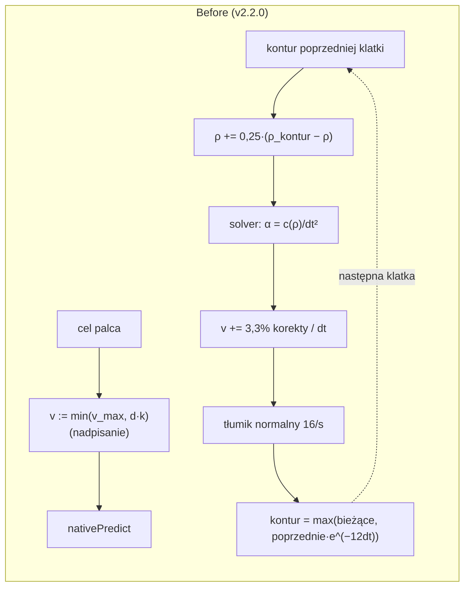
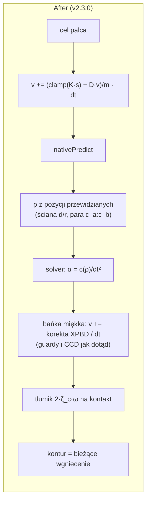
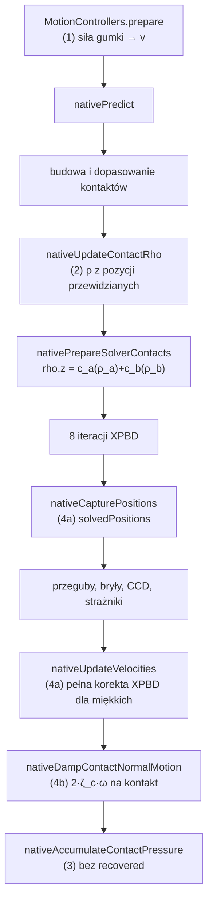

# Change Design: BubblePhysics v2.3.0 — gumka siłowa, ρ bez opóźnienia, kontur z bieżących kontaktów, fizyczna dynamika kontaktu

**Date:** 2026-11-19
**Artifact:** change-design
**Status:** Approved
**Template version:** default/0.3.2
**References:** specyfikacja autora `2KBubbles-iOS/docs/benchmarks/stage-0/v2.3.0-engine-spec.md` (commit 6092ec3 w repo gry); punkt wyjścia: gałąź PR #6 (`feature/crowd-review-followups`, poprawki po przeglądzie v2.2.0)

**Plugin version:** 0.7.10
**Agent Sessions:** claude-code: ab52f6fb-160c-4aef-aa48-da87badbf8db

---

<!-- hint: Keep the `**Artifact:** change-design` line — /plan and /implement use it to recognize this as a change-design artifact (requirements + design in one file) and skip the prd.md requirement. -->

> *Section audience —* 🔍 reviewer (understand the change without implementing it) · 🛠 author (implement the change). Sections without an icon serve both.

## Summary 🔍

Gra potrzebuje chwytu „siłą w stronę palca”. Dziś palec narzuca bańce prędkość, a przy ścianie zamienia się to w siłę rzędu 20–240 tysięcy, która miażdży bańkę. Do tego sprężyna kontaktu twardnieje z opóźnieniem o klatkę, a kontur pamięta wgniecenie z poprzedniej klatki. Kontakt miękki też nie działa jak sprężyna: do prędkości trafia tylko 3,3 % korekty XPBD, więc ugięcie w równowadze to 3,85 · c · F zamiast c · F (zmierzone sondą), bańka w spoczynku publikuje prędkość w stronę ściany, a duże bańki odjeżdżają od ściany przez dziesiątki sekund.

v2.3.0 wprowadza cztery zmiany. Pierwsza to opcjonalny tryb gumki w `BubbleDrivePolicy`: siła F = K_band · naciągnięcie − D · v z górną granicą, całkowana przez masę. Druga to ρ kontaktu liczone raz na krok z pozycji przewidzianych w tym kroku, bez konturu poprzedniej klatki i bez wygładzania. Trzecia to kontur, którego głębokość wgniecenia wynika tylko z bieżących kontaktów, bez relaksacji w czasie. Czwarta to fizyczna dynamika kontaktu miękkiego: bańka z podatnością dostaje do prędkości pełną korektę XPBD, a tłumienie jest ułamkiem tłumienia krytycznego (`PhysicsMaterial.contactDampingRatio`), liczonym dla każdego kontaktu z jego podatności i mas.

API zmienia się addytywnie, więc to wersja minor. Bez `bandStiffness` napęd działa jak w v2.2.0. Model kontaktów miękkich zmienia się celowo. Strojenie, przegląd w laboratorium i bramka przeciskania należą do repo gry.

## Background & problem 🔍

Pełne tło, pomiary i rachunki są w specyfikacji autora (sekcja 1). Tu zostaje tylko to, czego potrzeba, żeby ocenić projekt.

- **Napęd prędkością.** Gałąź `.playerDriven` w `MotionControllers.prepare` (Sources/BubblePhysicsRuntime/MotionControllers.swift:68) co krok NADPISUJE prędkość: v = min(v_max, odległość · `distanceResponse`). Przy ścianie nasycony napęd działa jak siła m · v / dt. Dla 7168 daje to ok. 242 000 (wyliczone), czyli ściśnięcie 73 %.
- **Opóźnione twardnienie.** `nativeUpdateContactRho` (Sources/BubblePhysicsNativeMetal/Shaders/NativePostSolveKernels.metal-source:627) bierze ρ z konturu poprzedniej klatki i wygładza je ρ += 0,25 · (ρ_kontur − ρ). Bańka rozpędzona ku ścianie dochodzi do niej, zanim sprężyna stwardnieje (pomiar).
- **Pamięć konturu.** `nativeAccumulateContactPressure` (`:729-752` tego samego pliku) bierze max(bieżące wgniecenie, wgniecenie z poprzedniej klatki · e^(−12·dt)). Kontur nie jest więc czystym wynikiem bieżących kontaktów.
- **Stałe tłumienie kontaktu.** `nativeDampContactNormalMotion` (Sources/BubblePhysicsNativeMetal/Shaders/NativeXPBDKernels.metal-source:1010) tłumi prędkość względną wzdłuż normalnej tempem 2 · `contactDamping` = 16/s, niezależnie od masy i sprężyny. Dla dużych baniek to wielokrotność tłumienia krytycznego, stąd pomiar 7168: 0,81 r po 20 s.
- **Częściowa korekta prędkości.** `nativeUpdateVelocities` (NativeXPBDKernels.metal-source:987) przenosi pozycję po solverze w całości, ale do prędkości dopisuje tylko korekta · s / dt, gdzie s = min(1, `contactStiffness` · dt²) = 120 / 3600 ≈ 0,033. Resztę prędkości w stronę ściany gasi tylko tłumik normalny f = 1 − e^(−16·dt). W równowadze ugięcie wynosi więc k · c · F, gdzie k = 1 / (1 − (1 − s) · (1 − f)). Sonda `ContactVelocityCorrectionProbeTests` (commit 599276a) mierzy k = 3,852 przy dt = 1/60 dla m = 1 i m = 4 oraz 7,569 przy dt = 1/120, czyli zgodnie z modelem do czterech cyfr. Bańka stoi z opublikowaną prędkością 14,3 jedn./s w stronę ściany (m = 1). Nagłówek `ContactComplianceTests` przypisuje k niedomkniętym iteracjom Jacobiego, co jest błędne: przy mniejszym kroku k rośnie, a według tej hipotezy powinno spadać do 1. Przy tej ścieżce kontakt nie drga, a ugięcie zależy od tłumienia, więc samo tłumienie z ζ_c przestawiłoby też ugięcie statyczne (ζ_c = 0 dałoby ok. 30 · c · F).

Teraz, bo PRD gry wymaga chwytu siłą (FR-009) i spłaszczenia przy ścianie z powrotem kształtu, a projekt rozwiązania gry zapowiedział tę zmianę silnika.

## Goals and non-goals

### Goals

**G1: gumka działa siłą** — opcjonalny tryb `BubbleDrivePolicy`, w którym chwycona bańka dostaje siłę rosnącą z naciągnięciem, a prędkość wynika z siły i masy.
- [ ] G1-AC1 — Bańka bez kontaktów, bez siły globalnej i pól, z tłumieniem materiału γ = `PhysicsMaterial.damping` > 0 (tempo w 1/s, nie mylić ze współczynnikiem ζ_c z G4), ciągnięta ze stałym naciągnięciem s (cel przesuwany co krok tak, by naciągnięcie zostało stałe), osiąga prędkość ustaloną v = K_band · s / (m · γ + D) z tolerancją 10 % (wzór to przybliżenie dla małego dt; przy dt = 1/60 błąd przybliżenia jest poniżej 1 %), gdzie D to `bandDamping`. Prędkość ustalona jest poniżej `maximumLinearSpeed` materiału · `verify: test integracyjny przez publiczne API świata, dwa zestawy (D = 0 i D > 0)`
- [ ] G1-AC2 — Dwie bańki z tego samego materiału, o różnych masach, ciągnięte tym samym naciągnięciem przy D = 0 (warunki jak w G1-AC1) mają stosunek prędkości ustalonych równy odwrotności stosunku mas z tolerancją 10 % · `verify: test integracyjny, dwie bańki w osobnych światach`
- [ ] G1-AC3 — Bańka z materiału o kc = 0 (podatność c = c₀ (r/r_ref)^s nie zależy od ρ) dociśnięta gumką do ściany, bez siły globalnej, po uspokojeniu (|v| < 0,1 jedn./s, więc D · v pomijalne; wymaga G4-AC5): siła dociskająca wyliczona z jej równowagi statycznej (F = ugięcie / c) równa się K_band · s z tolerancją 10 % dla trzech naciągnięć poniżej `maximumForce` / K_band, a dla dwóch naciągnięć powyżej tej granicy położenie równowagi jest to samo z tolerancją 0,5 jednostki · `verify: test integracyjny, pięć naciągnięć`
- [ ] G1-AC4 — Po `endPlayerDrive` bańka zachowuje prędkość z ostatniego kroku napędu (nie jest zerowana) · `verify: test integracyjny: prędkość w ramce po puszczeniu ≈ prędkość przed`
- [ ] G1-AC5 — `BubbleDrivePolicy` odrzuca `bandStiffness` ≤ 0 lub nieskończone, `bandDamping` < 0 lub nieskończone, `maximumForce` ≤ 0 lub nieskończone oraz `bandDamping` ≠ 0 albo `maximumForce` ≠ `nil` przy `bandStiffness` = `nil` (`ModelValidationError.valueOutOfRange` z nazwą pola). `maximumForce` = `nil` oznacza brak limitu siły. Transakcja jest odrzucana z `valueOutOfRange("drive.bandStiffness")`, gdy bańka z gumką ma K_band · dt² / m ≥ 1 przy swojej masie `mass`: wstawienie, zamiana oraz wynik scalenia lub podziału (podział zmniejsza masę). W trybie gumki `beginPlayerDrive` i `updatePlayerDrive` odrzucają cel o składowej większej co do modułu niż limit `requireDriveMagnitude` (jak siła `MotorDrive`), więc siła gumki jest zawsze skończona · `verify: testy jednostkowe modelu i transakcji, w tym podział do zbyt małej masy i cel 1e38`
- [ ] G1-AC6 — W trybie gumki, przy D = 0, `damping` materiału = 0, naciągnięciu poniżej `maximumForce` / K_band, bez kontaktów, siły globalnej i pól, przy celu niezmienionym między ramkami i dokładnie jednym kroku stałym na ramkę (`advance(by: fixedTimeStep)`; `FixedStepDriver` przy dłuższej ramce robi kilka kroków): wektor zmiany prędkości między ramką N a N+1 równa się K_band · (`target` − `achievedPoint`) / m · dt, z `target` i `achievedPoint` z `DriveFeedback` ramki N, z tolerancją 1 %. Długość gumki rysowana z ramki to więc naciągnięcie następnego kroku · `verify: test integracyjny dwóch kolejnych ramek`

**G2: twardnienie sprężyny bez opóźnienia** — ρ każdego końca kontaktu wynika z geometrii bieżącego kroku.
- [ ] G2-AC1 — Kontakt ze ścianą nie zależy od historii: świat A dociska bańkę (bez napędu, `rigidifies` nieistotne) do ściany stałą siłą globalną przez kilka sekund, aż do położenia P. Świat B ma tę samą siłę globalną i dostaje bańkę od razu w położeniu P z tą samą prędkością (nowa bańka, bez historii konturu i cache). Po jednym kroku oba mają to samo położenie środka i ten sam kontur z tolerancją 1e-3 jednostki. Rekord kontaktu świata A niesie jeszcze warm start λ (`nativeApplyWarmStart`); dla pojedynczego więzu ściany solver domyka wynik niezależnie od niego, a jeśli test pokaże różnicę, jest to osobna historia, którą trzeba nazwać w opisie PR. Dla pary baniek zależność od ρ z poprzedniego kroku jest dopuszczona (zasada podziału wgniecenia dla pary) · `verify: test integracyjny przez publiczne API`
- [ ] G2-AC2 — (weryfikacja wewnętrzna) Dla kontaktu bańki ze ścianą ρ rekordu w kroku równa się d / r (obcięte do [0, 1]), gdzie d to odległość przewidzianego środka od ściany, z tolerancją 1e-4. Dla pary ρ każdego końca równa się (r − nakładanie · c_self / (c_self + c_other)) / r przy tych samych pozycjach, z c policzonym z ρ rekordu z poprzedniego kroku; nowy rekord pary i każdy kontakt wyniku scalenia lub podziału w jego pierwszym kroku przyjmują ρ poprzedniego kroku = 1 · `verify: test kernela przez diagnostykę NativeMetal`
- [ ] G2-AC3 — Raport siatki c₀ ∈ {1e-3, 2,5e-3, 4e-3} × kc ∈ {0, 1,5, 3} przy r_ref 20 i s 1: bańka o masie 1,36 (masa bańki „2” w strojeniu T3 ze specyfikacji) i promieniu podanym w raporcie jest dociągana do ściany gumką w nasyceniu, czyli stałą siłą `maximumForce`. Dla każdego punktu raport podaje maksimum przejściowe ściśnięcia i równowagę statyczną obok wartości ze wzoru ε = a (1 − ε)^kc, gdzie a = c₀ (r/r_ref)^s · F / r. Wzór liczy ρ z pozycji rzeczywistej, a solver z pozycji przewidzianej, głębszej w spoczynku o F · dt² / m; raport podaje więc też wartość ze wzoru z ρ = 1 − ε − F · dt² / (m · r). Bez progu, ocenia autor · `verify: test opt-in RhoGridReportTests w BubblePhysicsRuntimeTests (BUBBLE_PHYSICS_RHO_GRID_REPORT=1) zapisuje przez publiczny świat raport docs/benchmarks/v2.3.0-rho-grid-<data>.md; moduł BubblePhysicsNativeMetalDiagnostics nie zależy od runtime, w którym działa gumka (poprawka z planu 2026-11-19)`

**G3: kontur z bieżących kontaktów** — głębokość wgniecenia konturu w kroku wynika tylko z kontaktów tego kroku.
- [ ] G3-AC1 — Gdy kontakt zniknie (bańki rozsunięte poza próg kontaktu), w ramce tego samego kroku wgniecenie konturu w kierunku byłego kontaktu wynosi 0 (bańka bez innych kontaktów ma kontur kołowy). Wyjątek: pierwsza klatka wyniku scalenia lub podziału (CD-D-13) · `verify: test integracyjny ramki`
- [ ] G3-AC2 — W scenie z bańką dociśniętą do ściany i parą baniek w kontakcie wgniecenie konturu w każdej próbce jest nie mniejsze niż wgniecenie geometryczne bieżących kontaktów (odcięcie ścianą i cięciwą pary), a po uspokojeniu kontury nie przenikają ścian ani siebie nawzajem (tolerancja 0,5 jednostki) · `verify: nowy test porównujący kontur z wgnieceniem geometrycznym; istniejące testy nieprzenikania przechodzą`

**G4: fizyczna dynamika kontaktu miękkiego** — kontakt miękki działa jak sprężyna o podatności c: ugięcie w równowadze to c · F, a tempo tłumienia prędkości względnej wzdłuż normalnej wynika ze sprężyny i mas.
- [ ] G4-AC1 — Warunki testu: kc = 0 (sprężyna liniowa), `damping` materiału = 0, restytucja 0, wychylenie z równowagi mniejsze niż ugięcie statyczne, prędkości poniżej progu spoczynkowego tłumika (max(40, 2r) jedn./s). Wariant ściany: bańka dociśnięta do ściany stałą siłą globalną; mierzy się odległość środka od ściany. Wariant pary, bez ścian: dwie bańki o różnych masach ściskane ku sobie dwoma polami kierunkowymi (`ForceFieldDescriptor` `.directional`, każde z filtrem na ID jednej bańki, siły przeciwne o równym module); mierzy się odległość środków. Mierzona wielkość drga wokół równowagi jak oscylator tłumiony o ω = √(1 / (c · μ)) i ζ_c = `contactDampingRatio` (c to suma podatności końców, μ masa zredukowana; przy ścianie masa bańki; w parze ζ_c to średnia z obu materiałów). Para przy ścianie to łańcuch dwóch mas o dwóch modach, więc nie nadaje się na ten test. Przy ζ_c = 0,2 dekrement logarytmiczny kolejnych wychyleń wynosi 2π · ζ_c / √(1 − ζ_c²) z tolerancją 10 %, a przy ζ_c = 1 nie ma przestrzelenia równowagi · `verify: test integracyjny, pomiar wychyleń środka w kolejnych ramkach`
- [ ] G4-AC2 — W warunkach z G4-AC1 przy ζ_c = 0 kontakt miękki nie ma tłumienia normalnego: bańka puszczona z wychylenia przestrzeliwuje położenie równowagi co najmniej dwa razy · `verify: test integracyjny`
- [ ] G4-AC3 — Kontakty twarde (podatność obu końców = 0) tłumią się jak w v2.2.0 (`contactDamping`), a bańki twarde zachowują dotychczasową korektę prędkości (s = min(1, `contactStiffness` · dt²)), bez zmian wyników testów kontaktów twardych · `verify: istniejące testy kontaktów twardych przechodzą bez zmian`
- [ ] G4-AC4 — `PhysicsMaterial` odrzuca `contactDampingRatio` < 0 lub nieskończone, a dla materiału innego niż bańka (`kind != .bubble`) każdą wartość różną od domyślnej, tak jak dziś `contactCompliance`. Wartość domyślna to 1 · `verify: test jednostkowy modelu`
- [ ] G4-AC5 — Warunki: kc = 0, `damping` materiału = 0, ζ_c ∈ {0,2, 1}, bańka dociśnięta do ściany stałą siłą (`MotorDrive`, scena `ContactVelocityCorrectionProbeTests`). Po uspokojeniu ugięcie równa się c · F z tolerancją 10 % dla m ∈ {1, 4} i dt ∈ {1/60, 1/120}, nie zależy od ζ_c (różnica między ζ_c = 0,2 i 1 poniżej 10 %), a opublikowana prędkość bańki ma moduł < 0,1 jedn./s · `verify: sonda ContactVelocityCorrectionProbeTests przepisana na te oczekiwania`

**G5: zgodność i brak regresji**
- [ ] G5-AC1 — Bez `bandStiffness` (domyślnie `nil`) napęd zachowuje się jak w v2.2.0: testy napędu z v2.2.0 przechodzą bez zmian · `verify: swift test, filtr testów napędu`
- [ ] G5-AC2 — Cały zestaw testów repozytorium przechodzi. Każdy test, którego oczekiwania zmieniły się przez zmiany G2–G4 (ρ z poprzedniej klatki, relaksacja konturu, stałe tłumienie i częściowa korekta prędkości kontaktu miękkiego), jest wymieniony z powodem w opisie PR. Nagłówek `ContactComplianceTests` przestaje opisywać współczynnik 3,85 jako skutek iteracji Jacobiego, a granica liniowości F ≈ 600 jest przeliczona dla nowej dynamiki · `verify: swift test; lista w opisie PR`
- [ ] G5-AC3 — Perf guard (`docs/benchmarks/perf-guard.json`) przechodzi z obecnymi progami · `verify: uruchomienie BubblePhysicsPerfGuard`
- [ ] G5-AC4 — Komentarz `ObjectState.Kind.bubble(effectiveRadius:)` mówi, że to minimalna odległość konturu od środka, i nie wspomina już o „odbudowie”. Przewodnik integracji opisuje tryb gumki, `contactDampingRatio`, zakres stabilności K_band, zalecenie `rigidifies: false` z gumką oraz migrację z `maximumSpeed`/`distanceResponse` · `verify: przegląd diffu dokumentacji`

### Non-goals

- Zadania gry: pierścień podświetlenia z promienia niezdeformowanego, zasada „jeden palec na bańkę” w `TouchDriver` i zmiana PRD, nowa definicja drogi hamowania (G2-AC2 gry), migracja `PhysicsTuning.json`.
- Przegląd w laboratorium, przeszukanie strojenia i bramka przeciskania 15/15 (kryteria A1, A2 i A6 specyfikacji). Robi je repo gry na wydanym v2.3.0.
- Wygładzanie przestrzenne konturu (13 przejść, `contourSurfaceTension`) zostaje bez zmian. Pytanie otwarte autora rozstrzyga laboratorium.
- Nowe pola promienia w `ObjectState` (decyzja 9 autora).
- Zmiana wzoru podatności c = c₀ (r/r_ref)^s ρ^kc, krzywej masy, solvera XPBD, łączenia i podziału baniek.
- Backendy referencyjne (`BubblePhysicsReference`, `BubblePhysicsReferenceMetal`) i ich własne `contactDamping`. Nie są backendem publicznego świata.
- Usunięcie `maximumSpeed`/`distanceResponse` z API.

## Architecture

Cztery jednostki: jedna po stronie hosta (runtime) i trzy w shaderach natywnego solvera. Łączy je kolejność w kroku. Kryteria bezwzględne gumki (G1-AC3) i raport siatki (G2-AC3) zależą od jednostki 4, bo dopiero ona daje ugięcie c · F.

**1. Gumka (host, runtime).** `BubbleDrivePolicy` dostaje trzy pola opcjonalne. W `MotionControllers.prepare` gałąź `.playerDriven` sprawdza `bandStiffness`. Gdy jest `nil`, działa dotychczasowy kod. Gdy jest ustawione:

- s = cel − pozycja;
- F_band = K_band · s, obcięte do |F| ≤ `maximumForce` z zachowaniem kierunku;
- F = F_band + siła globalna + pola (jak w gałęzi `.dynamic`);
- v = (v + F / m · dt) · e^(−D · dt / m), czyli tarcie gumki F_D = −D · v w formie wykładniczej, stabilnej przy każdym D ≥ 0.

Prędkość nie jest nadpisywana, więc przechodzi z kroku na krok przez obiekt, jak w trybie `.dynamic`. Dalej działa niezmieniony `nativePredict` (tłumienie materiału e^(−ζ·dt), obcięcie do `maximumLinearSpeed`). Walidację K_band · dt² / m < 1 robi `TransactionStager` z jawną masą bańki (`BubbleDescriptor.mass`) po wstawieniu, zamianie, scaleniu i podziale. Przejście promienia nie zmienia masy, więc go nie dotyczy. Cel napędu w trybie gumki przechodzi `requireDriveMagnitude` (TransactionStager.swift:309).

**2. ρ bez opóźnienia (shader).** `nativeUpdateContactRho` przestaje czytać kontur poprzedniej klatki i nie wygładza. Liczy ρ z pozycji przewidzianych w bieżącym kroku (bufor roboczy po `nativePredict`):

- odcinek (ściana albo bryła statyczna): ρ = clamp(d / r, 0, 1), gdzie d to odległość środka od odcinka;
- para: ρ_self = clamp((r − nakładanie · c_self / (c_self + c_other)) / r, 0, 1), gdzie c liczone z ρ rekordu z poprzedniego kroku. To jedno przybliżenie punktu stałego na krok, bez iteracji. Para twarda albo bez nakładania ma ρ = 1.

Kernel zostaje w tym samym miejscu kolejności (przed sąsiedztwem i `nativePrepareSolverContacts`), więc podatność c_a(ρ_a) + c_b(ρ_b) dalej trafia do `rho.z` raz na kontakt (LD-D-6 bez zmian). Bufory poprzedniego konturu przestają być wejściem tego kernela. Wyniki scalenia i podziału nie potrzebują już specjalnego przypadku ρ = 1, bo ρ nie zależy od konturu poprzedniej klatki.

**3. Kontur bez relaksacji (shader).** W `nativeAccumulateContactPressure` znika składnik `recovered`: wartość to `deficit`, a dla bańki z `publicFlags.x` max(`deficit`, `directionalPressure · softness`). Parametr `deformationRecoveryRate` i jego przekazanie w `NativeContourControl.shape.y` znikają z `NativeSolverInput` (to API `package`, nie publiczne). Wygładzanie przestrzenne `nativeGenerateContours(Fused)` zostaje. `nativeSeedStructuralContours` (Sources/BubblePhysicsNativeMetal/Shaders/NativeGeometryKernels.metal-source:67) też zostaje: pierwsza klatka wyniku scalenia lub podziału dalej dostaje kontur z unii albo przecięcia źródeł (CD-D-13), a od następnej klatki kontur wynika już tylko z kontaktów. Komentarz kernela o „normalnej relaksacji” w późniejszych krokach trzeba poprawić.

**4. Dynamika kontaktu miękkiego (shader + model).** Dwie części.

*a) Pełna korekta XPBD w prędkości (CD-D-16).* Przeguby i bryły działają w tej samej pętli iteracji co `nativeSolveJacobi` (`NativeMetalSolver.swift:723-751`), więc nie ma chwili „po Jacobim, przed przegubami”. Nowy bufor `contactCorrection` inicjalizuje `nativeApplyWarmStart` swoim przesunięciem, a `nativeSolveJacobi` w każdej iteracji, przed przegubami i bryłami, dopisuje do niego to samo `correction`, które już liczy (bez nowego kernela); solved oznacza dalej predicted + `contactCorrection`. `nativeUpdateVelocities` dla bańki z podatnością (`contact.x` > 0) liczy:

- v += (solved − predicted) / dt, czyli pełna korekta kontaktów XPBD; wszystkie kontakty takiej bańki są miękkie, bo c_self > 0;
- v += (final − solved) · s / dt, czyli korekty przegubów, brył, CCD i strażników z dotychczasową skalą s, tak jak chroni przed tym komentarz kernela.

Bańka twarda (`contact.x` = 0) liczy jak dotąd: v += (final − predicted) · s / dt. Obcięcie do `maximumLinearSpeed` zostaje.

*b) Tłumienie z ζ_c.* `PhysicsMaterial` dostaje `contactDampingRatio` (domyślnie 1), które trafia do zarezerwowanej składowej `NativeBubble.contact.z`. W `nativeDampContactNormalMotion` czynnik tłumienia przechodzi do pętli po kontaktach:

- kontakt miękki (`rho.z` > 0): ω = √((m_a⁻¹ + m_b⁻¹) / rho.z); przy odcinku (ściana albo bryła) m_b⁻¹ = 0 i ζ_c bańki, bez uśredniania z materiałem bryły; w parze baniek ζ_c to średnia z obu końców; czynnik = 1 − e^(−2 · ζ_c · ω · dt);
- kontakt twardy (`rho.z` = 0): dotychczasowy czynnik z `contactDamping`.

Forma wykładnicza jest bezwarunkowo stabilna, więc ζ_c nie potrzebuje górnej granicy. Pozostała logika kernela (restytucja, tarcie, próg `restSpeed` = max(40, 2r), powyżej którego tłumik nie działa, podział przez `share`) bez zmian.

## Components

- **`Sources/BubblePhysicsPublic/Model/Motion.swift`** — `BubbleDrivePolicy`: pola `bandStiffness`, `bandDamping`, `maximumForce` i ich walidacja w init.
- **`Sources/BubblePhysicsPublic/Model/Resources.swift`** — `PhysicsMaterial.contactDampingRatio` z walidacją.
- **`Sources/BubblePhysicsPublic/Model/WorldFrame.swift`** — komentarz `effectiveRadius`: minimum odległości konturu od środka, bez „odbudowy”.
- **`Sources/BubblePhysicsRuntime/MotionControllers.swift`** — gałąź siłowa `.playerDriven`.
- **`Sources/BubblePhysicsRuntime/TransactionStager.swift`** — walidacja K_band · dt² / m < 1 dla baniek z gumką (wstawienie, zamiana, scalenie, podział) i limit modułu celu w trybie gumki.
- **`Sources/BubblePhysicsNativeMetalDiagnostics/ReferenceSolverInputAdapter.swift`** — przestaje przekazywać `deformationRecoveryRate` (pole `ReferenceConfiguration` zostaje dla backendu referencyjnego).
- **`Sources/BubblePhysicsNativeMetal/Shaders/NativeGeometryKernels.metal-source`** — poprawiony komentarz `nativeSeedStructuralContours`; logika bez zmian.
- **`Sources/BubblePhysicsNativeMetal/NativePublicWorld.swift`**, **`NativeSolverInput.swift`**, **`NativeMetalBufferLayout.swift`** — przekazanie ζ_c do `NativeBubble.contact`; usunięcie `deformationRecoveryRate`.
- **`Sources/BubblePhysicsNativeMetal/NativeMetalSolver.swift`** — nowe bufory wejściowe `nativeUpdateContactRho` (segmenty zamiast konturu poprzedniej klatki); `shape.y` konturu nieużywane; bufor `solvedPositions` i wywołanie `nativeCapturePositions` po iteracjach Jacobiego, przekazanie bufora do `nativeUpdateVelocities`.
- **`Sources/BubblePhysicsNativeMetal/Shaders/NativePostSolveKernels.metal-source`** — `nativeUpdateContactRho` z bieżącej geometrii, usunięcie stałej wygładzania i `nativePreviousContourRatio`; usunięcie `recovered` w `nativeAccumulateContactPressure`.
- **`Sources/BubblePhysicsNativeMetal/Shaders/NativeXPBDKernels.metal-source`** — `nativeUpdateVelocities`: rozdział korekty XPBD i pozostałych korekt dla bańki miękkiej; `nativeDampContactNormalMotion`: czynnik na kontakt z ζ_c i ω.
- **`Tests/…`** — nowe testy G1–G4; sonda `ContactVelocityCorrectionProbeTests` przepisana na G4-AC5; nagłówek i progi `ContactComplianceTests` poprawione; testy ABI (`NativeMetalShaderABITests`) i testy zależne od ρ, relaksacji, stałego tłumienia i korekty prędkości zaktualizowane.
- **`Tests/BubblePhysicsRuntimeTests/RhoGridReportTests.swift` + `docs/benchmarks/`** — raport siatki twardnienia (G2-AC3).
- **`docs/integration-guide.md`**, **`CHANGELOG`/notatka wydania** — tryb gumki, ζ_c, migracja.

## Error handling

- Nieprawidłowe parametry gumki i ζ_c są odrzucane przy tworzeniu modelu (G1-AC5, G4-AC4). Za duże K_band względem masy jest odrzucane na poziomie transakcji, więc świat nigdy nie dostaje niestabilnego stanu.
- Siła gumki nieskończona nie może powstać: pola polityki są skończone, a cel w trybie gumki jest ograniczony przez `requireDriveMagnitude` (G1-AC5). Tarcie gumki jest wykładnicze, więc nie ma warunku stabilności dla D.

## Testing & verification

- Testy G1 jadą przez publiczne API świata na backendzie natywnym (Mac, GPU), jak dotychczasowe testy napędu.
- Przed scaleniem: pełne `swift test` i perf guard (G5-AC2, G5-AC3). Opis PR wymienia zmienione testy z powodem.
- Po wydaniu, w repo gry (poza tą zmianą): laboratorium, przeszukanie strojenia i bramka przeciskania.

## Decisions 🔍

| ID | Title | Context | Options | Choice | Rationale | Source | Goal impact | Consequences |
|----|-------|---------|---------|--------|-----------|--------|-------------|--------------|
| CD-D-1 | Granica zakresu: silnik a gra | Kryteria A1, A2 i A6 specyfikacji wymagają plików strojenia i bramek gry | wszystko w silniku; tylko testy silnika; wydanie RC przed laboratorium | silnik zamyka kryteria sprawdzalne w swoim repo (A3, A4, A5, A7, A8) i wydaje v2.3.0; laboratorium, strojenie i bramka przeciskania idą w repo gry | tak przebiegały v2.1.0 i v2.2.0; strojenie wymaga gotowego silnika | user | G1–G5; non-goals | problem z laboratorium → v2.3.1 |
| CD-D-2 | Kształt API gumki | Specyfikacja: pola w `BubbleDrivePolicy` albo osobny przypadek | pola opcjonalne; enum `Response`; pola + `maximumSpeed` jako limit | trzy pola opcjonalne: `bandStiffness: Float?`, `bandDamping: Float = 0`, `maximumForce: Float?` | addytywne, wersja minor, gra przypięta `exact` się nie psuje; enum łamie API | user | G1, G5-AC1 | w trybie siłowym `maximumSpeed`/`distanceResponse` są ignorowane |
| CD-D-3 | Tłumienie gumki | Specyfikacja: „względem palca”, silnik nie zna prędkości palca | względem świata; względem prędkości celu | F_D = −D · v_bańki (tarcie proporcjonalne do prędkości bańki) | autor: „tłumienie jak tarcie, proporcjonalnie do prędkości bańki”; bez stanu i bez szumu dotyku | user | G1-AC1 | v_ustalona ≈ K·s / (m·γ + D), γ = `damping` materiału; całkowane wykładniczo jak tłumienie materiału, bez warunku stabilności |
| CD-D-4 | Częstość liczenia ρ | Specyfikacja proponuje przeliczanie co iterację; PR #6 (LD-D-6) liczy podatność raz na kontakt | co iterację; raz na krok z pozycji przewidzianych; raz + w połowie | raz na krok, z pozycji po `nativePredict`, w `nativeUpdateContactRho` | usuwa oba źródła opóźnienia (kontur poprzedniej klatki, wygładzanie 0,25), nie zmienia α w iteracjach (zbieżność przy kc 3), zachowuje LD-D-6 | auto (rekomendacja, autor oddał decyzję) | G2 | jeśli siatka G2-AC3 pokaże przelot, przejście na liczenie co iterację jest lokalne |
| CD-D-5 | ρ pary: punkt stały | ρ zależy od c(ρ) (uwikłanie) | iteracja do zbieżności; jedno przybliżenie z ρ poprzedniego kroku | jedno przybliżenie: podział c_a : c_b z ρ rekordu z poprzedniego kroku | ρ zmienia się płynnie między krokami; ściana (najważniejszy przypadek) nie ma uwikłania | auto (specyfikacja, zmiana 2) | G2-AC2 | to nie jest opóźnienie geometrii: pozycje są bieżące |
| CD-D-6 | Miejsce ζ_c | Specyfikacja: „materiał albo konfiguracja” | pole materiału (domyślnie 1); wartość na świat; pole materiału z `nil` = 16/s | `PhysicsMaterial.contactDampingRatio`, domyślnie 1, średnia w parze, przy ścianie wartość bańki | parametr leży obok sprężyny, którą tłumi; gra może różnicować klasy | user | G4 | zmiana zachowania kontaktów miękkich dla wszystkich użytkowników; ujęte w G5-AC2 |
| CD-D-7 | Tłumienie kontaktu twardego | Kontakt twardy (c = 0) nie ma ω | stałe `contactDamping`; nowy model | dotychczasowe `contactDamping` | zgodność z v2.1.0 (specyfikacja, zmiana 3 b) | auto (specyfikacja) | G4-AC3 | dwie ścieżki w kernelu, rozróżniane `rho.z` |
| CD-D-8 | Los `deformationRecoveryRate` | Po usunięciu `recovered` parametr jest martwy | zostawić nieczynny; usunąć | usunąć z `NativeSolverInput` i sterowania konturem | API `package`, bez zgodności zewnętrznej; martwy parametr myli | auto (specyfikacja zostawia autorowi silnika) | G3 | zmiana testów ABI |
| CD-D-9 | Walidacja stabilności gumki | Jawne całkowanie sprężyny gumki wymaga K·dt²/m ≪ 1; specyfikacja: silnik ma walidować | brak; obcięcie; odrzucenie transakcji; całkowanie półniejawne | odrzucenie transakcji przy K_band · dt² / m ≥ 1 z jawną masą bańki (wstawienie, zamiana, scalenie, podział) | przy dt = 1/60 granica to K_band < 3600 · m, dla m ≈ 1,36 ok. 4 900 (estymata specyfikacji „kilkaset tysięcy” była błędna o czynnik 100). Przewidywane strojenie: siła przy ścianie rzędu 250–5 000 przy naciągnięciu rzędu 100–700 jednostek, czyli K_band ok. 0,4–50, zapas ok. 100× przy górnej granicy | auto (specyfikacja, „Ryzyko” zmiany 1; rachunek przeliczony) | G1-AC5 | podział zmniejsza masę, więc walidacja obejmuje wyniki podziału; przejście promienia nie zmienia masy |
| CD-D-10 | Siły globalne w trybie gumki | Dziś `.playerDriven` ignoruje siłę globalną i pola | ignorować; dodawać | dodawać jak w `.dynamic` | gumka to zwykła siła zewnętrzna (model autora); bańka nie ma być wyjęta spod pozostałych sił | auto (specyfikacja, „siła jest całką zewnętrzną”) | G1 | tryb prędkościowy bez zmian |
| CD-D-11 | Puszczenie bańki | Czy po `endPlayerDrive` zerować prędkość | zerować; zachować | zachować | wynika z modelu siłowego; dzisiejsze `endPlayerDrive` też nie zeruje | auto (kod `TransactionStager.swift:362`) | G1-AC4 | rzut bańki jest możliwy, hamuje go tłumienie materiału |
| CD-D-12 | Gałąź bazowa | PR #6 otwarty i zmienia te same shadery | od main; od PR #6 | `feature/engine-v2-3-0` od gałęzi PR #6 | projekt opiera się na kodzie, który trafi do main (LD-D-6) | user | none | po scaleniu PR #6 rebase na main; wydanie v2.3.0 po PR #6 |
| CD-D-13 | Kontur pierwszej klatki scalenia/podziału | `nativeSeedStructuralContours` buduje pierwszy kontur wyniku z konturów źródeł (historia), a dotąd `recovered` wygaszało go płynnie | zostawić seed jako wyjątek; usunąć seed i jego bufory | zostawić seed; od drugiej klatki kontur tylko z kontaktów | usunięcie seeda zmienia scalanie i podział, które są poza zakresem; specyfikacja zmienia tylko relaksację w czasie | auto (specyfikacja, „co zostaje bez zmian”: łączenie baniek) | G3-AC1 (wyjątek) | kształt z seeda znika skokowo po jednej klatce; ocena wzrokowa w laboratorium gry |
| CD-D-14 | Pola gumki bez `bandStiffness` | `bandDamping`/`maximumForce` nie mają sensu w trybie prędkościowym | ignorować; odrzucać | odrzucać w init | sprzeczna konfiguracja wychodzi od razu, a nie jako „gumka nie działa” | auto (zasada walidacji modelu w `Motion.swift`) | G1-AC5 | — |
| CD-D-15 | ζ_c dla materiału bryły | `PhysicsMaterial` ma `kind`; `contactCompliance` jest dla brył odrzucany | ignorować; odrzucać wartość ≠ domyślnej | odrzucać jak `contactCompliance` | ten sam wzorzec co podatność, do której ζ_c należy | auto (Resources.swift:51) | G4-AC4 | — |
| CD-D-16 | Korekta prędkości kontaktu miękkiego | `nativeUpdateVelocities` dopisuje do prędkości s ≈ 3,3 % całej korekty pozycji; sonda potwierdziła ugięcie k · c · F (k = 3,85 przy dt = 1/60, 7,57 przy 1/120) i prędkość w spoczynku ≠ 0. Korekta w tym kernelu zawiera też przeguby, bryły, CCD i strażniki, które działają wcześniej | zostawić s i skalibrować c przez k; s = 1 dla całej korekty bańki miękkiej; pełna korekta tylko z XPBD (bufor po Jacobim), reszta ze skalą s | pełna korekta XPBD dla bańki z `contact.x` > 0 (suma przesunięć warm startu i Jacobiego z każdej iteracji, bo przeguby i bryły działają w tej samej pętli; poprawka z planu 2026-11-19), pozostałe korekty i bańki twarde ze skalą s | bez tego kontakt nie drga, a ugięcie zależy od tłumienia, więc G4 i G1-AC3 są niespełnialne; s = 1 dla całości zamieniłoby skoki strażników i CCD w prędkość, przed czym chroni komentarz kernela; kalibracja przez k zostawia prędkość w spoczynku i zależność od tłumienia | user (potwierdzone 2026-11-19 na podstawie sondy 599276a) | G4-AC5, G4-AC1, G1-AC3, G2-AC3 | ugięcie kontaktów miękkich spada ok. 3,85× przy tych samych c₀; gra musi przestroić c₀ (zwykle × ok. 3,85, żeby zachować dzisiejszy wygląd); bańka twarda w parze z miękką dostaje tylko s korekty, więc para nie zachowuje pędu dokładnie (dziś też nie zachowuje); dodatkowa kopia pozycji na krok, sprawdzana perf guardem (G5-AC3) |

## Key facts & assumptions

- **Niezmiennik:** bez `bandStiffness` napęd zachowuje się bit w bit jak w v2.2.0. Zmiany G2–G4 dotyczą kontaktów i konturu niezależnie od napędu.
- `nativePredict` zapisuje przewidzianą pozycję do `bubbles[].position.xy`, zanim zbudowane zostaną kontakty, więc `nativeUpdateContactRho` widzi geometrię bieżącego kroku (sprawdzone w kodzie).
- Bańka z `rigidifies = true` (domyślne) ma przy chwycie wyzerowany kontur (`material.z >= 1`), więc dociśnięta do ściany wygląda jak koło nachodzące na ścianę. Tak jest już w v2.2.0. Gra używa gumki z `rigidifies: false`, a przewodnik integracji to zaleca (G5-AC4).
- Ryzyko niepotwierdzone, nieblokujące: bez `recovered` kontur w tłumie w spoczynku może migotać przy kontaktach, które pojawiają się i znikają. Ocenia to autor w laboratorium gry.
- Tłumik normalny nie działa powyżej `restSpeed` = max(40, 2r). Gumka w nasyceniu może dociągać bańkę szybciej, więc w chwili uderzenia kontakt miękki nie ma tłumienia i może odbić bańkę. To zachowanie z v2.2.0; jeśli raport siatki (G2-AC3) pokaże przelot przy uderzeniu, próg jest kandydatem do zmiany w v2.3.1.
- Kolejność kroku (sprawdzona w `NativeMetalSolver.swift:726-785`): iteracje Jacobiego, przeguby, bryły, `nativeResolveCCD`, `nativeApplyCenterGuards`, `nativeFinalizeSolverContacts`, a dopiero potem `nativeUpdateVelocities`. Dlatego CD-D-16 potrzebuje bufora pozycji po Jacobim.
- Rachunki ω i siły w specyfikacji to estymaty, a nie pomiary. Tolerancje 10 % w G1 i G4 to estymaty progu ze specyfikacji.
