# Plan: BubblePhysics v2.3.0 — gumka siłowa, ρ bez opóźnienia, kontur z bieżących kontaktów, fizyczna dynamika kontaktu

> **For agentic workers:** REQUIRED PHASE COMMAND: Run `/tt-agentic-sdlc:implement` with this file's path to execute this plan. It runs one slice per session, and only a slice with tasks. The program design below is binding: build the call trees as drawn, and turn each behaviour into a failing test before you write the code.

**Date:** 2026-11-19
**Artifact:** plan
**Design:** [change-design.md](change-design.md)
**References:** specyfikacja autora `2KBubbles-iOS/docs/benchmarks/stage-0/v2.3.0-engine-spec.md` (commit 6092ec3 w repo gry); gałąź bazowa PR #6 `feature/crowd-review-followups` ([CD-D-12](change-design.md#cd-d-12))
**Strategy:** all at once
**Test command:** `swift build --build-tests && swift test`
**Status:** Draft
**Template version:** default/0.3.3

**Plugin version:** 0.7.10
**Agent Sessions:** claude-code: 226bb044-4b96-41a6-9190-fa96c346d482

---

## Program design

### R0 — Headline

Gra dostaje chwyt „siłą w stronę palca”: opcjonalna gumka w `BubbleDrivePolicy` daje siłę zamiast narzucać prędkość, więc bańka przy ścianie nie jest miażdżona. Kontakt miękki działa jak sprężyna: ugięcie c · F, bańka w spoczynku stoi, tłumienie wynika ze sprężyny i mas. Sprężyna twardnieje w tym samym kroku, a kontur pokazuje tylko bieżące kontakty.

### R1 — The whole flow

```mermaid
flowchart LR
    subgraph legend["legend"]
      direction LR
      L1["unchanged"]:::same
      L2["added"]:::added
      L3["modified"]:::changed
      L4["removed"]:::removed
      L1 ~~~ L2 ~~~ L3 ~~~ L4
    end

    stage["TransactionStager<br/>walidacja K·dt²/m &lt; 1,<br/>limit celu gumki"]:::changed
    prep["MotionControllers.prepare<br/>.playerDriven: siła gumki → v"]:::changed
    predict["nativePredict"]:::same
    rho["nativeUpdateContactRho<br/>ρ z pozycji przewidzianych"]:::changed
    prev["kontur poprzedniej klatki<br/>+ wygładzanie 0,25"]:::removed
    jacobi["8 iteracji: Jacobi, przeguby, bryły"]:::same
    cap["nativeAccumulateContactCorrection<br/>NEW po każdym Jacobim → contactCorrection"]:::added
    guards["CCD, strażniki, finalizacja"]:::same
    vel["nativeUpdateVelocities<br/>bańka miękka: pełna korekta XPBD"]:::changed
    damp["nativeDampContactNormalMotion<br/>czynnik 2·ζ_c·ω na kontakt miękki"]:::changed
    acc["nativeAccumulateContactPressure<br/>wartość = bieżące wgniecenie"]:::changed
    rec["recovered: e^(−12·dt)<br/>deformationRecoveryRate"]:::removed
    mat["PhysicsMaterial.contactDampingRatio<br/>→ NativeBubble.contact.z"]:::added

    stage --> prep --> predict --> rho --> jacobi --> guards --> vel --> damp --> acc
    jacobi --> cap
    cap --> vel
    prev -.-> rho
    rec -.-> acc
    mat --> damp

    classDef same fill:#f6f8fa,stroke:#8c959f,stroke-width:1px,color:#24292f
    classDef added fill:#dafbe1,stroke:#2da44e,stroke-width:3px,color:#24292f
    classDef changed fill:#fff8c5,stroke:#bf8700,stroke-width:3px,color:#24292f
    classDef removed fill:#ffebe9,stroke:#cf222e,stroke-width:2px,stroke-dasharray:4 3,color:#24292f
```



Jedna zmiana po stronie hosta (gumka i jej walidacja) i trzy w kroku natywnym. Kolejność kroku się nie zmienia. Dochodzi tylko sumowanie przesunięcia samego Jacobiego w każdej iteracji, bo przeguby i bryły działają w tej samej pętli, a pełną korektę w prędkości dostają tylko kontakty XPBD ([CD-D-16](change-design.md#cd-d-16), wiersz odstępstwa niżej).

### R2 — Seams — where the change attaches to existing code

```diff
  Sources/BubblePhysicsPublic/Model/
+   Motion.swift                     # BubbleDrivePolicy: bandStiffness, bandDamping, maximumForce + walidacja w init
+   Resources.swift                  # PhysicsMaterial.contactDampingRatio (domyślnie 1, odrzucany dla .rigid jak contactCompliance)
+   WorldFrame.swift                 # komentarz effectiveRadius: minimum odległości konturu od środka
  Sources/BubblePhysicsRuntime/
+   MotionControllers.swift          # gałąź siłowa .playerDriven; siła globalna i pola jak w .dynamic
+   TransactionStager.swift          # validateBandStability przy add/replace/merge/split; requireDriveMagnitude celu gumki
  Sources/BubblePhysicsNativeMetal/
+   NativePublicWorld.swift          # NativePublicProperties.contact(of:override:radius:dampingRatio:) wpisuje ζ_c do lane .z zawsze (także bańka twarda)
+   NativeSolverInput.swift          # bez deformationRecoveryRate w NativeSolverConfiguration
+   NativeMetalBufferLayout.swift    # komentarze: contact.z = ζ_c, rho.x/y bez wygładzania, shape.y zarezerwowane
+   NativeMetalSolver.swift          # bufor contactCorrection (start = przesunięcie warm startu), nativeAccumulateContactCorrection po każdym nativeSolveJacobi, nowe wiązania rho/velocities, shape.y = 0
    Shaders/
+     NativePostSolveKernels.metal-source  # nativeUpdateContactRho z geometrii kroku; bez kNativeContactRhoSmoothing,
+                                          #   nativePreviousContourRatio; nativeAccumulateContactPressure bez recovered
+     NativeXPBDKernels.metal-source       # NEW kernel nativeAccumulateContactCorrection; nativeUpdateVelocities: korekta XPBD + reszta·s; damping na kontakt
+     NativeGeometryKernels.metal-source   # komentarz nativeSeedStructuralContours i NativeBubble.contact
  Sources/BubblePhysicsNativeMetalDiagnostics/
+   ReferenceSolverInputAdapter.swift      # bez przekazania deformationRecoveryRate
  Tests/BubblePhysicsPublicTests/
+   ModelValidationTests.swift       # walidacja contactDampingRatio
+   MotionCommandTests.swift         # walidacja pól gumki, limit celu w trybie gumki
  Tests/BubblePhysicsRuntimeTests/
+   BandDriveTests.swift             # NEW: G1 przez publiczny świat (prędkość ustalona, masy, ściana, puszczenie, ramki)
+   MotionControllersPrepareTests.swift  # gałąź siłowa: siła globalna i pola, tłumienie gumki
+   TransactionStagerTests.swift     # odrzucenie K·dt²/m ≥ 1 (wstawienie, zamiana, scalenie, podział)
+   ContactVelocityCorrectionProbeTests.swift  # przepisana na ugięcie c·F i v ≈ 0
+   ContactDynamicsTests.swift       # NEW: oscylator kontaktu (ściana, para), ζ_c = 0 / 0,2 / 1
+   ContactComplianceTests.swift     # nagłówek bez „Jacobiego”, granica liniowości przeliczona
+   ContactRhoHistoryTests.swift     # NEW: świat A vs świat B (P-B-11)
+   RhoGridReportTests.swift         # NEW: raport siatki c₀ × kc (opt-in, zapis do docs/benchmarks)
    CrowdSceneSupport.swift          # sceny dociśnięcia do ściany (pressedBubble, wallDepth) — reużywane
  Tests/BubblePhysicsNativeMetalTests/
+   NativeMetalShaderABITests.swift  # testHostComputesContactComplianceForBubbleRecord: lane .z = ζ_c także dla bańki twardej
  Tests/BubblePhysicsNativeMetalDiagnosticsTests/
+   NativeMetalXPBDTests.swift       # ρ rekordu: ściana d/r, para z podziałem c, nowy rekord ρ_prev = 1
+   NativeMetalContourTests.swift    # kontur = bieżące wgniecenie; test relaksacji 30 klatek zastąpiony
+   NativeMetalRestDampingTests.swift # oczekiwania tłumienia przeliczone dla ζ_c
  docs/
+   integration-guide.md             # tryb gumki, ζ_c, zakres K_band, rigidifies: false, migracja z maximumSpeed
+   benchmarks/v2.3.0-rho-grid-<data>.md  # raport siatki (P-B-14)
+ CHANGELOG.md                       # ## 2.3.0
```

Krok hosta. Gałąź siłowa zastępuje nadpisanie prędkości tylko przy `bandStiffness != nil`:

```diff
 BubbleWorld.advance(by:)                                 # BubbleWorld.swift:245
 └── stepLoop, na krok stały
     ├── TransactionStager.stageBatch → StagingContext.apply
     │   ├── .add / .replace       → validate, validatePlacement, validateWorstAlpha
+    │   │                         → validateBandStability(object)            # K·dt²/m < 1, masa z BubbleDescriptor.mass
     │   ├── .mergeBubbles → merge → validateWorstAlpha(merged)
+    │   │                         → validateBandStability(merged)
     │   ├── .splitBubble  → split → validateWorstAlpha(a), (b)
+    │   │                         → validateBandStability(a), (b)            # podział zmniejsza masę
     │   └── .beginPlayerDrive / .updatePlayerDrive → requireFinite(target)
+    │                             → requireDriveMagnitude(target)           # tylko gdy drivePolicy.bandStiffness != nil
     └── NativeCompleteStepper.completeStep → performStep
         ├── MotionControllers.prepare(&state, duration:)
         │   └── prepare(object, fields:, globalForce:, dt:)
         │       └── case .playerDriven
-        │           └── velocity = velocity(to: target, speed: bubbleDriveSpeed(...))
+        │           ├── bandStiffness == nil → velocity(to:speed:)           # bez zmian, v2.2.0
+        │           └── bandStiffness = K → F = clamp(K·(target − position), maximumForce)
+        │                                    + globalForce + fieldForce(...)
+        │                                v = (v + F/m·dt) · e^(−bandDamping·dt/m)
         ├── native.step(...)                                                # NativeMetalSolver, niżej
         └── MotionControllers.feedback(...)                                 # DriveFeedback.target / achievedPoint
```

Krok natywny (`NativeMetalSolver.swift:605-792`). Przeguby i bryły działają wewnątrz pętli iteracji (`:723-751`), więc migawka pozycji po pętli zawierałaby ich korekty. Dlatego po każdym `nativeSolveJacobi`, przed przegubami, nowy kernel dodaje `output − input` do `contactCorrection`:

```diff
 nativePredict                                                               # bubbles[].position.xy = przewidziane
 nativeBuildContacts → nativeMatchContactCache → nativeCompactContactCache
-nativeUpdateContactRho(bubbles, cache, control, contactControl, contour, previousBubbles, previousDeformation, previousCounts, structuralHeaders)
+nativeUpdateContactRho(bubbles, segments, cache, control, contactControl)    # ściana: clamp(d/r); para: podział c z ρ rekordu
 nativeEmitAdjacency → nativePrepareSolverContacts                           # rho.z = c_a(ρ_a) + c_b(ρ_b), bez zmian
 nativeApplyWarmStart                                                        # solverPositionsPing = predicted + warm start
+contactCorrection := solverPositionsPing − predicted                        # warm start to też korekta kontaktów XPBD
 for 0..<solverIterationCount {
     nativeSolveJacobi(input → output)
+    nativeAccumulateContactCorrection(input, output, contactCorrection)     # += output − input, tylko bańki
     swap, przeguby, bryły
 }
 nativeCapturePositions(→ diagnosticPostSolver)                              # diagnostyka, bez zmian
 nativeResolveCCD → nativeApplyCenterGuards → nativeFinalizeSolverContacts
-nativeUpdateVelocities(bubbles, finalPositions, control)
+nativeUpdateVelocities(bubbles, finalPositions, control, contactCorrection) # contact.x > 0: X/dt + (final − pred − X)·s/dt, X = contactCorrection
 nativeDampContactNormalMotion(bubbles, segments, cache, control, contactControl, adjacency, degrees)
+    └── na kontakt: rho.z > 0 → 1 − e^(−2·ζ_c·ω·dt), ω = √((m_a⁻¹ + m_b⁻¹)/rho.z); rho.z = 0 → contactDamping
-nativeAccumulateContactPressure: value = max(deficit, recovered)
+nativeAccumulateContactPressure: value = deficit                            # bańka z publicFlags.x: max(deficit, pressure·softness)
 nativeSeedStructuralContours                                                # bez zmian: pierwsza klatka scalenia/podziału
```

Dane, które trzeba znać: `NativeBubble.contact` (x = c₀(r/r_ref)^s, y = kc, z = ζ_c, w wolne), `NativeContactCache.rho` (x, y = ρ końców, z = suma podatności, 0 = kontakt twardy), `NativeContourControl.shape.y` (zarezerwowane, 0). Rozmiary struktur się nie zmieniają, więc testy ABI zmieniają tylko oczekiwanie lane `.z`. Szew testów jądra: `NativeMetalSolver.cachedContacts` i `executeFrame(input:scenarioStep:)`, jak w `NativeMetalXPBDTests`.

Miejsce do obejrzenia dwa razy: `nativeUpdateVelocities` — bańka twarda zostaje przy `(final − predicted)·s/dt` bit w bit, a dla miękkiej skala s dotyczy wszystkiego poza sumą przesunięć Jacobiego (przeguby, bryły, CCD, strażniki).

### R3 — Behaviour

Gumka (G1). Kryteria bezwzględne ([G1-AC3](change-design.md#g1-ac3)) wymagają dynamiki kontaktu z G4.

| P-B-ID | Situation | Result | Proves |
|---|---|---|---|
| <a id="p-b-1"></a>P-B-1 | Bańka bez kontaktów, γ > 0, stałe naciągnięcie s, D = 0 i D > 0 | prędkość ustalona K·s/(m·γ + D) ±10 %, poniżej `maximumLinearSpeed` | [G1-AC1](change-design.md#g1-ac1) |
| <a id="p-b-2"></a>P-B-2 | Dwie bańki o różnych masach, to samo s, D = 0, osobne światy | stosunek prędkości = odwrotność stosunku mas ±10 % | [G1-AC2](change-design.md#g1-ac2) |
| <a id="p-b-3"></a>P-B-3 | Bańka kc = 0 dociśnięta gumką do ściany, pięć naciągnięć | poniżej limitu ugięcie/c = K·s ±10 %; powyżej limitu ta sama równowaga ±0,5 jedn. | [G1-AC3](change-design.md#g1-ac3) |
| <a id="p-b-4"></a>P-B-4 | `endPlayerDrive` po napędzie gumką | prędkość w ramce po puszczeniu ≈ prędkość przed | [G1-AC4](change-design.md#g1-ac4) |
| <a id="p-b-5"></a>P-B-5 | `BubbleDrivePolicy` z K ≤ 0 / ∞, D < 0 / ∞, maximumForce ≤ 0 / ∞, D ≠ 0 lub maximumForce bez K | `valueOutOfRange` z nazwą pola (`drive.bandStiffness`, `drive.bandDamping`, `drive.maximumForce`) | [G1-AC5](change-design.md#g1-ac5) |
| <a id="p-b-6"></a>P-B-6 | Wstawienie, zamiana, scalenie, podział dają bańkę z K·dt²/m ≥ 1 | transakcja odrzucona `valueOutOfRange("drive.bandStiffness")`, świat bez zmian | [G1-AC5](change-design.md#g1-ac5), [CD-D-9](change-design.md#cd-d-9) |
| <a id="p-b-7"></a>P-B-7 | `beginPlayerDrive` / `updatePlayerDrive` w trybie gumki z celem 1e38 | odrzucone jak siła `MotorDrive`; w trybie prędkościowym bez zmian | [G1-AC5](change-design.md#g1-ac5) |
| <a id="p-b-8"></a>P-B-8 | Gumka, D = 0, γ = 0, cel stały, jeden krok na ramkę | Δv między ramkami = K·(target − achievedPoint)/m·dt z `DriveFeedback` ramki N, ±1 % | [G1-AC6](change-design.md#g1-ac6) |
| <a id="p-b-9"></a>P-B-9 | Gumka z siłą globalną i polem kierunkowym | do siły gumki dodane siła globalna i pola, jak w `.dynamic` | [CD-D-10](change-design.md#cd-d-10) |
| <a id="p-b-10"></a>P-B-10 | Polityka bez `bandStiffness` | testy napędu v2.2.0 przechodzą bez zmian | [G5-AC1](change-design.md#g5-ac1) |

Twardnienie i kontur (G2, G3).

| P-B-ID | Situation | Result | Proves |
|---|---|---|---|
| <a id="p-b-11"></a>P-B-11 | Świat A dociska bańkę do ściany do położenia P; świat B dostaje nową bańkę w P z tą samą prędkością | po jednym kroku to samo położenie i kontur ±1e-3 | [G2-AC1](change-design.md#g2-ac1) |
| <a id="p-b-12"></a>P-B-12 | Kontakt bańki ze ścianą w kroku | ρ rekordu = clamp(d/r, 0, 1) z przewidzianego środka ±1e-4 | [G2-AC2](change-design.md#g2-ac2) |
| <a id="p-b-13"></a>P-B-13 | Para baniek w kontakcie; nowy rekord; wynik scalenia lub podziału | ρ końca = (r − nakładanie·c_self/(c_self + c_other))/r z c z ρ poprzedniego kroku; nowy rekord i wyniki: ρ_prev = 1 | [G2-AC2](change-design.md#g2-ac2) |
| <a id="p-b-14"></a>P-B-14 | Siatka c₀ × kc, bańka m = 1,36 dociągana gumką w nasyceniu | raport `docs/benchmarks/v2.3.0-rho-grid-<data>.md`: maksimum przejściowe, równowaga, wzór, wzór z poprawką F·dt²/(m·r) | [G2-AC3](change-design.md#g2-ac3) |
| <a id="p-b-15"></a>P-B-15 | Kontakt znika | w tej samej ramce wgniecenie w jego kierunku = 0 (kontur kołowy bez innych kontaktów) | [G3-AC1](change-design.md#g3-ac1) |
| <a id="p-b-16"></a>P-B-16 | Pierwsza klatka wyniku scalenia lub podziału | kontur z seeda źródeł jak dotąd; od drugiej klatki tylko z kontaktów | [G3-AC1](change-design.md#g3-ac1), [CD-D-13](change-design.md#cd-d-13) |
| <a id="p-b-17"></a>P-B-17 | Bańka przy ścianie i para w kontakcie | wgniecenie konturu ≥ wgniecenie geometryczne w każdej próbce; po uspokojeniu bez przenikania ±0,5 | [G3-AC2](change-design.md#g3-ac2) |
| <a id="p-b-18"></a>P-B-18 | Kod po zmianie | `deformationRecoveryRate`, `nativePreviousContourRatio`, `kNativeContactRhoSmoothing` nie występują w `Sources/BubblePhysicsNativeMetal*` | [CD-D-8](change-design.md#cd-d-8) |

Dynamika kontaktu miękkiego (G4). Warunki z [G4-AC1](change-design.md#g4-ac1): kc = 0, `damping` = 0, restytucja 0, prędkości poniżej `restSpeed`.

| P-B-ID | Situation | Result | Proves |
|---|---|---|---|
| <a id="p-b-19"></a>P-B-19 | Bańka dociśnięta `MotorDrive` do ściany, m ∈ {1, 4}, dt ∈ {1/60, 1/120}, ζ_c ∈ {0,2, 1} | ugięcie = c·F ±10 %, różnica między ζ_c < 10 %, moduł prędkości < 0,1 | [G4-AC5](change-design.md#g4-ac5), [CD-D-16](change-design.md#cd-d-16) |
| <a id="p-b-20"></a>P-B-20 | Wariant ściany: wychylenie z równowagi | ζ_c = 0,2: dekrement 2π·ζ_c/√(1 − ζ_c²) ±10 %; ζ_c = 1: bez przestrzelenia | [G4-AC1](change-design.md#g4-ac1) |
| <a id="p-b-21"></a>P-B-21 | Wariant pary: dwie masy ściskane polami kierunkowymi z filtrem ID | jak [P-B-20](#p-b-20), ω z masy zredukowanej, ζ_c średnie | [G4-AC1](change-design.md#g4-ac1), [CD-D-6](change-design.md#cd-d-6) |
| <a id="p-b-22"></a>P-B-22 | ζ_c = 0, puszczenie z wychylenia | co najmniej dwa przestrzelenia równowagi | [G4-AC2](change-design.md#g4-ac2) |
| <a id="p-b-23"></a>P-B-23 | Kontakty twarde, bańki twarde | tłumienie `contactDamping` i korekta ·s jak w v2.2.0; testy kontaktów twardych bez zmian | [G4-AC3](change-design.md#g4-ac3), [CD-D-7](change-design.md#cd-d-7) |
| <a id="p-b-24"></a>P-B-24 | `PhysicsMaterial` z ζ_c < 0 / ∞; materiał `.rigid` z ζ_c ≠ 1 | `valueOutOfRange`; domyślnie 1 | [G4-AC4](change-design.md#g4-ac4), [CD-D-15](change-design.md#cd-d-15) |

Zgodność (G5).

| P-B-ID | Situation | Result | Proves |
|---|---|---|---|
| <a id="p-b-25"></a>P-B-25 | Nagłówek `ContactComplianceTests` | bez współczynnika 3,85 i „Jacobiego”; granica liniowości F przeliczona dla nowej dynamiki | [G5-AC2](change-design.md#g5-ac2) |
| <a id="p-b-26"></a>P-B-26 | Cały zestaw na końcu zmiany | `swift test` przechodzi; opis PR wymienia każdy test o zmienionych oczekiwaniach z powodem | [G5-AC2](change-design.md#g5-ac2) |
| <a id="p-b-27"></a>P-B-27 | Perf guard | `swift run -c release BubblePhysicsPerfGuard` przechodzi z progami `docs/benchmarks/perf-guard.json` | [G5-AC3](change-design.md#g5-ac3) |
| <a id="p-b-28"></a>P-B-28 | Dokumentacja | komentarz `effectiveRadius` bez „odbudowy”; przewodnik: gumka, ζ_c, zakres K_band, `rigidifies: false`, migracja; CHANGELOG 2.3.0 | [G5-AC4](change-design.md#g5-ac4) |

Niezmiennik zastępowanego kodu: przy `bandStiffness == nil` napęd liczy bit w bit jak w v2.2.0 ([P-B-10](#p-b-10)), a bańka twarda dostaje tę samą korektę prędkości ([P-B-23](#p-b-23)).

### Test strategy

| Level | What it proves | Behaviours |
|---|---|---|
| unit (model, bez GPU) — `BubblePhysicsPublicTests` | walidacja pól polityki i materiału | [P-B-5](#p-b-5), [P-B-24](#p-b-24) |
| unit (runtime) — `MotionControllersPrepareTests`, `TransactionStagerTests`, `MotionCommandTests` | całkowanie siły gumki, sumowanie sił, odrzucenia transakcji i celu | [P-B-6](#p-b-6), [P-B-7](#p-b-7), [P-B-9](#p-b-9) |
| integracja przez publiczny świat (Metal) — `BubblePhysicsRuntimeTests` | dynamika gumki, kontaktu i historii ρ end to end | [P-B-1](#p-b-1)–[P-B-4](#p-b-4), [P-B-8](#p-b-8), [P-B-10](#p-b-10), [P-B-11](#p-b-11), [P-B-19](#p-b-19)–[P-B-22](#p-b-22), [P-B-25](#p-b-25) |
| jądro natywne — `BubblePhysicsNativeMetalDiagnosticsTests`, `BubblePhysicsNativeMetalTests` | ρ rekordu, kontur, ABI, tłumienie twarde | [P-B-12](#p-b-12), [P-B-13](#p-b-13), [P-B-15](#p-b-15)–[P-B-17](#p-b-17), [P-B-23](#p-b-23) |
| raport (opt-in, zapis pliku) | siatka twardnienia dla autora, bez progu | [P-B-14](#p-b-14) |
| static check (grep, diff dokumentacji) | usunięty kod i dokumentacja | [P-B-18](#p-b-18), [P-B-28](#p-b-28) |
| pełny zestaw + perf guard | brak regresji | [P-B-26](#p-b-26), [P-B-27](#p-b-27) |

**Where:** `Tests/BubblePhysicsPublicTests/`, `Tests/BubblePhysicsRuntimeTests/` (sceny z `CrowdSceneSupport.swift`), `Tests/BubblePhysicsNativeMetalTests/`, `Tests/BubblePhysicsNativeMetalDiagnosticsTests/`. Testy wymagają lokalnego GPU Metal (macOS). Perf guard nie jest częścią `swift test`: `swift run -c release BubblePhysicsPerfGuard` na bezczynnym Macu (M1 Pro, jak baseline). Brak lintera w repozytorium.

**Test command:** `swift build --build-tests && swift test`

## Tasks

1. Dodać `PhysicsMaterial.contactDampingRatio` (domyślnie 1, bez walidacji) i napisać w `ModelValidationTests` testy `testContactDampingRatio…` dla [P-B-24](#p-b-24) · verify: `swift build --build-tests && ! swift test --filter ModelValidationTests`
2. Walidować `contactDampingRatio` w `PhysicsMaterial.init` według wzorca `BubbleContactCompliance.validate(for:)`, pokrywając [P-B-24](#p-b-24) · verify: `swift test --filter ModelValidationTests`
3. Przepisać `ContactVelocityCorrectionProbeTests` na oczekiwania [P-B-19](#p-b-19) i napisać `ContactDynamicsTests` (ściana; para z dwoma polami `.directional` filtrowanymi na ID; ζ_c = 0, 0,2 i 1) dla [P-B-20](#p-b-20)–[P-B-22](#p-b-22) · verify: `swift build --build-tests && ! swift test --filter "ContactVelocityCorrectionProbeTests|ContactDynamicsTests"`
4. Dodać parametr `dampingRatio` do `NativePublicProperties.contact(of:override:radius:)` i wpisywać ζ_c do lane `.z` także dla bańki twardej (średnia w parze miękka–twarda), poprawić komentarze `contact` w `NativeMetalBufferLayout.swift` i `NativeGeometryKernels.metal-source` oraz oczekiwanie `testHostComputesContactComplianceForBubbleRecord` · verify: `grep -q "contactDampingRatio" Sources/BubblePhysicsNativeMetal/NativePublicWorld.swift && swift test --filter NativeMetalShaderABITests`
5. Dodać bufor `contactCorrection` (`SIMD2<Float>`, inicjalizowany po `nativeApplyWarmStart` przesunięciem warm startu), kernel `nativeAccumulateContactCorrection` po każdym `nativeSolveJacobi` (rejestracja w `stageNames`) i rozdział korekt w `nativeUpdateVelocities` dla `contact.x > 0`, z bańką twardą bez zmian, pokrywając [P-B-19](#p-b-19) i [P-B-23](#p-b-23) · verify: `swift test --filter ContactVelocityCorrectionProbeTests`
6. Przenieść czynnik tłumienia `nativeDampContactNormalMotion` do pętli po kontaktach (miękki: 2·ζ_c·ω; twardy: `contactDamping`), pokrywając [P-B-20](#p-b-20)–[P-B-23](#p-b-23) · verify: `swift test --filter "ContactDynamicsTests|ContactVelocityCorrectionProbeTests"`
7. Przepisać nagłówek `ContactComplianceTests` bez współczynnika 3,85 i „Jacobiego”, przeliczyć granicę liniowości F ([P-B-25](#p-b-25)) i zmienić oczekiwania testów miękkich zmienionych przez G4 (np. `NativeMetalRestDampingTests`, `CrowdCompressionTests`), każdy z powodem w commicie, bez zmian w testach kontaktów twardych · verify: `! grep -q "Jacobiego" Tests/BubblePhysicsRuntimeTests/ContactComplianceTests.swift && swift test --filter "BubblePhysicsRuntimeTests|BubblePhysicsNativeMetalTests|BubblePhysicsNativeMetalDiagnosticsTests"`
8. Napisać `ContactRhoHistoryTests` ([P-B-11](#p-b-11)), testy ρ ściany i pary w `NativeMetalXPBDTests` ([P-B-12](#p-b-12), [P-B-13](#p-b-13)) w `NativeMetalContourTests` przepisany `testReleasedContourReturnsWithinTwoPercentAfterThirtyFrames` na zero wgniecenia w ramce zniknięcia kontaktu ([P-B-15](#p-b-15)) i test względem wgniecenia geometrycznego ([P-B-17](#p-b-17)) oraz w `NativeMetalStructuralOperationTests` test konturu wyniku scalenia w drugiej klatce bez kontaktów ([P-B-16](#p-b-16)) · verify: `swift build --build-tests && ! swift test --filter "ContactRhoHistoryTests|NativeMetalXPBDTests|NativeMetalContourTests|NativeMetalStructuralOperationTests"`
9. Przepisać `nativeUpdateContactRho` na pozycje przewidziane z wiązaniem `workingSegments`, usunąć `kNativeContactRhoSmoothing`, `nativePreviousContourRatio` (i `nativeIsStructuralResult`, jeśli zostanie bez użycia), zmienić wiązania w `NativeMetalSolver.swift:688` i komentarze `rho`, pokrywając [P-B-11](#p-b-11)–[P-B-13](#p-b-13) · verify: `swift test --filter "NativeMetalXPBDTests|ContactRhoHistoryTests"`
10. Usunąć `recovered` z `nativeAccumulateContactPressure`, `deformationRecoveryRate` z `NativeSolverConfiguration`, `NativeMetalSolver.swift:410` (`shape.y` = 0) i `ReferenceSolverInputAdapter.swift:47`, poprawić komentarz `nativeSeedStructuralContours`, pokrywając [P-B-15](#p-b-15)–[P-B-18](#p-b-18) · verify: `! grep -rqE "deformationRecoveryRate|nativePreviousContourRatio|kNativeContactRhoSmoothing" Sources/BubblePhysicsNativeMetal Sources/BubblePhysicsNativeMetalDiagnostics && swift test --filter "NativeMetalContourTests|NativeMetalStructuralOperationTests|ReferenceSolverInputAdapterTests"`
11. Zmienić oczekiwania pozostałych testów zmienionych przez G2–G3 (np. `NativeMetalPreviousContourTests`), każdy z powodem w commicie · verify: `swift test --filter "BubblePhysicsRuntimeTests|BubblePhysicsNativeMetalTests|BubblePhysicsNativeMetalDiagnosticsTests"`
12. Dodać pola `bandStiffness`, `bandDamping`, `maximumForce` na końcu `BubbleDrivePolicy.init` (bez walidacji i logiki) i napisać testy: `MotionCommandTests.testBandPolicy…` ([P-B-5](#p-b-5)), `MotionCommandTests.testBandDrive…` ([P-B-7](#p-b-7)), `TransactionStagerTests.testBand…` ([P-B-6](#p-b-6)), `MotionControllersPrepareTests.testBand…` ([P-B-9](#p-b-9)) i `BandDriveTests` ([P-B-1](#p-b-1)–[P-B-4](#p-b-4), [P-B-8](#p-b-8)) · verify: `swift build --build-tests && ! swift test --filter "testBand|BandDriveTests"`
13. Walidować pola gumki w `BubbleDrivePolicy.init` (`drive.bandStiffness`, `drive.bandDamping`, `drive.maximumForce`), pokrywając [P-B-5](#p-b-5) · verify: `swift test --filter MotionCommandTests.testBandPolicy`
14. Dodać `validateBandStability` przy `.add`, `.replace`, `merge` i `split` obok `validateWorstAlpha` oraz `requireDriveMagnitude` celu w `.beginPlayerDrive`/`.updatePlayerDrive` przy `bandStiffness != nil`, pokrywając [P-B-6](#p-b-6) i [P-B-7](#p-b-7) · verify: `swift test --filter "TransactionStagerTests.testBand|MotionCommandTests.testBandDrive"`
15. Dodać gałąź siłową `.playerDriven` w `MotionControllers.prepare` (siła gumki z limitem, siła globalna i pola, tłumienie wykładnicze), pokrywając [P-B-1](#p-b-1)–[P-B-4](#p-b-4), [P-B-8](#p-b-8)–[P-B-10](#p-b-10) · verify: `swift test --filter "MotionControllersPrepareTests|BandDriveTests|MotionCommandTests|NativeMetalMotionRoleTests|KinematicDriveControllerTests"`
16. Napisać `RhoGridReportTests` (pomijany bez `BUBBLE_PHYSICS_RHO_GRID_REPORT=1`), uruchomić go i zacommitować raport `docs/benchmarks/v2.3.0-rho-grid-<data>.md`, pokrywając [P-B-14](#p-b-14) · verify: `BUBBLE_PHYSICS_RHO_GRID_REPORT=1 swift test --filter RhoGridReportTests && ls docs/benchmarks/v2.3.0-rho-grid-*.md`
17. Poprawić komentarz `effectiveRadius` w `WorldFrame.swift`, opisać w `docs/integration-guide.md` gumkę, `contactDampingRatio`, zakres K_band, `rigidifies: false` i migrację z `maximumSpeed`/`distanceResponse` oraz dodać `## 2.3.0` do `CHANGELOG.md` (w tym przestrojenie c₀ o ok. 3,85), pokrywając [P-B-28](#p-b-28) · verify: `! grep -q "odbudow" Sources/BubblePhysicsPublic/Model/WorldFrame.swift && grep -q "bandStiffness" docs/integration-guide.md && grep -q "contactDampingRatio" docs/integration-guide.md && grep -q "^## 2.3.0" CHANGELOG.md && swift test --filter IntegrationGuideTests`
18. Uruchomić perf guard na bezczynnym Macu (load average ≤ 2, M1 Pro jak baseline) i zapisać w tym pliku wiersz `Perf guard:` z wynikiem, pokrywając [P-B-27](#p-b-27) · verify: `swift run -c release BubblePhysicsPerfGuard && grep -q "^Perf guard:" docs/sdlc/changes/2026-11-19-engine-v2-3-0/plan.md`
19. Uruchomić cały zestaw i zapisać w tym pliku wiersz `Testy o zmienionych oczekiwaniach:` z listą testów i powodów do opisu PR, pokrywając [P-B-26](#p-b-26) · verify: `swift build --build-tests && swift test && grep -q "^Testy o zmienionych oczekiwaniach:" docs/sdlc/changes/2026-11-19-engine-v2-3-0/plan.md`

## Deviations from Design

| ID | Type | Status | Design updated? | Note |
|----|------|--------|-----------------|------|
| [CD-D-16](change-design.md#cd-d-16) | change | pending | no | Projekt każe przechwycić pozycje `nativeCapturePositions` „po iteracjach Jacobiego, przed przegubami, bryłami”, ale przeguby i bryły działają w tej samej pętli (`NativeMetalSolver.swift:723-751`), więc takiej chwili nie ma. Plan sumuje przesunięcie warm startu i samego Jacobiego w każdej iteracji (`contactCorrection`, nowy kernel `nativeAccumulateContactCorrection`) i liczy X/dt + (final − predicted − X)·s/dt. To ten sam wzór co w projekcie przy solved = predicted + X, z korektami przegubów i brył ze skalą s, jak chciał projekt. |
| [G2-AC3](change-design.md#g2-ac3) | change | pending | no | Raport siatki powstaje w teście opt-in `RhoGridReportTests` w `BubblePhysicsRuntimeTests` przez publiczny świat, a nie jako scenariusz w `BubblePhysicsNativeMetalDiagnostics`: ten moduł nie zależy od runtime, w którym działa gumka (`Package.swift:49`), a żaden kod w repo nie zapisuje dziś raportów do `docs/benchmarks/`. |

## Implementation deviations

| # | Slice | Task | Type (change/gap) | Description | Status | Date |
|---|-------|------|-------------------|-------------|--------|------|
|   |       |      |                   |             |        |      |
