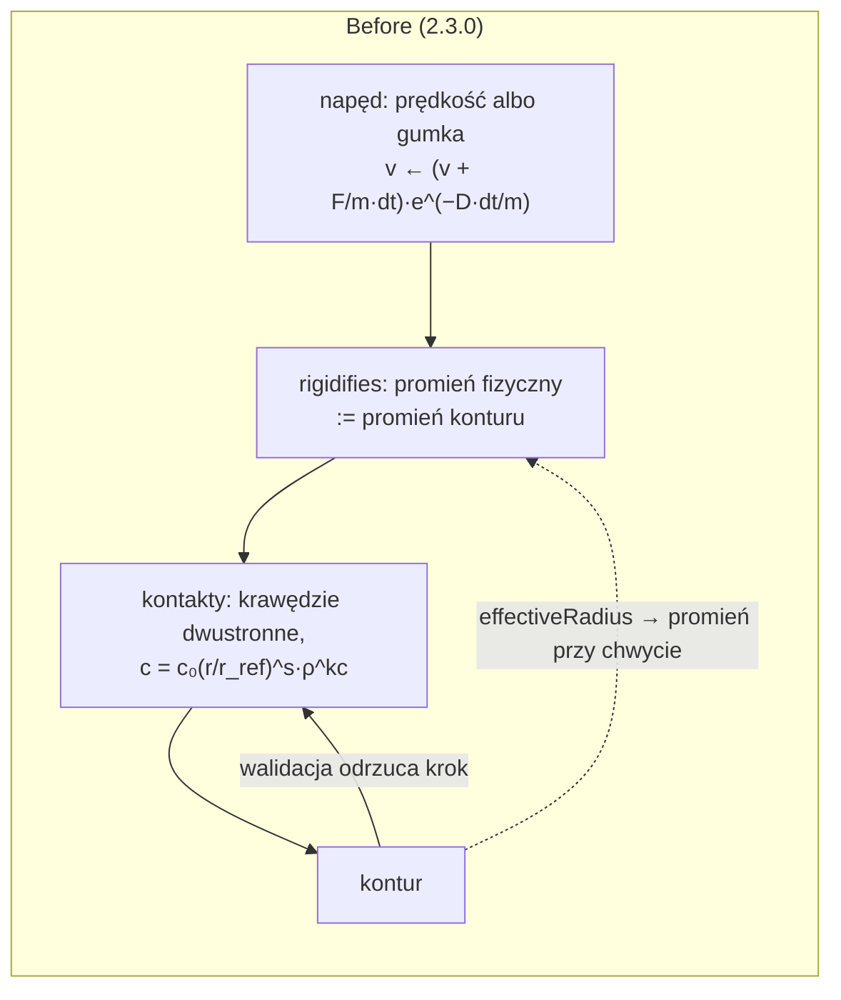
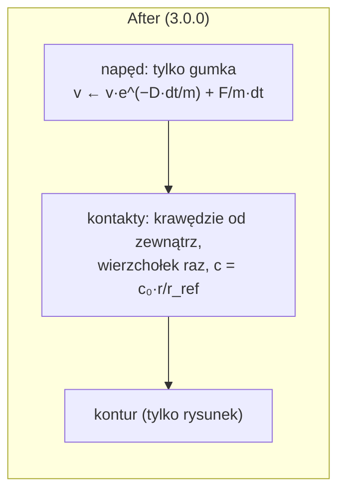
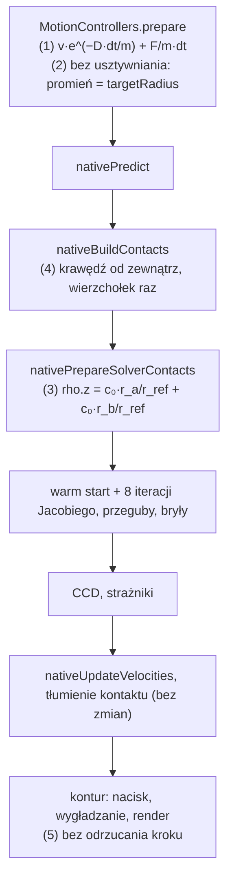

# Change Design: BubblePhysics 3.0.0 — poprawki tłumienia gumki i krawędzi ścian, model fizyki autora (bez kc, s = 1, tylko siły, kontur tylko rysowany)

**Date:** 2026-11-20
**Artifact:** change-design
**Status:** Draft
**Template version:** default/0.3.2
**References:** dokument wejściowy autora `2KBubbles-iOS/docs/benchmarks/stage-0/v2.3.0-engine-3.0.0-input.md` (pomiary i dane surowe w `v2.3.0/wall/` repo gry); punkt wyjścia: `main` = v2.3.0 (e669fb1)

**Plugin version:** 0.7.11
**Agent Sessions:** claude-code: c5b90ea6-86f7-4190-a0d2-2990f317affb
**Self-review (2026-11-20):** CAP_REACHED — round-2 findings fixed, not re-reviewed: (1) G3-AC2: równowaga pary poprzecznie nietrwała; dopisano start na wspólnej osi i pola równoległe do niej; (2) G2-AC4 przeczył Key facts w sprawie testów CCD i strażników; zmiana oczekiwań dozwolona z powodem w opisie PR; (3) walidacja α w stagerze bez kryterium; dodano G3-AC5; (4) G2-AC3 i G2-AC1 bez długości ściany i strony zsuwania; dopisano długość 800 i zsuwanie po długiej ścianie; (5) poprawione cytowania `NativeSolverInput.swift:80` i `TransactionStager.swift:53-57`.
**Self-review po bramce (2026-11-20, nowa pętla):** CAP_REACHED — round-2 findings fixed, not re-reviewed: (1) G1-AC1 i G1-AC3 nie ustalały kierunku celu gumki; cel na prostej prostopadłej do czoła ściany przez środek bańki; (2) G2-AC4 bez długości ściany, punktu startu i definicji „za ścianą”; dopisano długość 800, start 200 przed czołem i definicję; (3) G3-AC5 podawało nieistniejący przypadek odrzucenia; poprawiono na `invalidValue(.valueOutOfRange("contactCompliance"))`; cytowanie bramki deformowalności poprawione na :734.

---

<!-- hint: Keep the `**Artifact:** change-design` line — /plan and /implement use it to recognize this as a change-design artifact (requirements + design in one file) and skip the prd.md requirement. -->

> *Section audience —* 🔍 reviewer (understand the change without implementing it) · 🛠 author (implement the change). Sections without an icon serve both.

## Summary 🔍

Pomiary gry na 2.3.0 pokazały dwa błędy, przez które bańka w spoczynku nie ugina się o c · F. Pierwszy: tłumienie gumki mnoży też przyrost prędkości z siły, więc gumka oddaje w spoczynku tylko F · e^(−D·dt/m) (ok. 88 % dla bańki „2”). Drugi: każda krawędź statycznego wielokąta odpycha z obu stron. Gdy wgniecenie przekracza grubość ściany, bańka dostaje drugą sprężynę od tylnej krawędzi i ugięcie się załamuje. Autor ustalił też model fizyki, w którym zostają tylko środki, promienie, sprężyny i siły. Kontur ma być wyłącznie rysunkiem.

3.0.0 poprawia oba błędy i doprowadza silnik do tego modelu. Tłumienie gumki działa najpierw na prędkość, a dopiero potem dochodzi F/m · dt. Krawędź statycznego wielokąta daje kontakt tylko od zewnątrz, a wypukły wierzchołek jest liczony raz. Podatność to c = c₀ · r / r_ref, bez wykładników `radiusExponent` i `compressionExponent` i bez ρ. Napęd gracza to tylko gumka siłowa, a usztywnianie przy chwycie, które podmieniało promień fizyczny na promień konturu, znika. Kontur liczy się na końcu kroku i nie może już ani zmienić fizyki, ani odrzucić kroku.

Stare parametry znikają z API, więc to wersja główna. Gra jest jedynym użytkownikiem i dostaje przewodnik migracji. Wybór ζ_c, spoczynek planszy i strojenie zostają w repo gry.

## Background & problem 🔍

Pomiary i rachunki są w dokumencie wejściowym autora. Tu zostaje tylko to, czego potrzeba do oceny projektu.

- **Błąd 1: tłumienie gumki zabiera siłę w spoczynku.** `MotionControllers.prepare` (Sources/BubblePhysicsRuntime/MotionControllers.swift:65-78) liczy v ← (v + F/m · dt) · e^(−D·dt/m). Mnożnik działa też na przyrost z siły, więc w spoczynku przy ścianie kontakt dostaje F · e^(−D·dt/m). Pomiar gry (r 24, m 1,36, D 10, dt 1/60): ε 0,5676 zamiast 0,648, czynnik 0,885. Zgodność z modelem błędu 0,990 w 6 punktach (D 10/20/40, masa ×1/×4/×0,25). Specyfikacja 2.3.0 zakładała F −= D · v, czyli zero w spoczynku.
- **Błąd 2: ściany odpychają obiema krawędziami.** `NativePublicWorld` (Sources/BubblePhysicsNativeMetal/NativePublicWorld.swift:212-227) zamienia każdą krawędź statycznego wielokąta w dwustronny odcinek (`.fixed`, `NativeSolverInput.swift:61` i :80), a `nativeBuildContacts` (Sources/BubblePhysicsNativeMetal/Shaders/NativeGeometryKernels.metal-source:655-662) bierze normalną od najbliższego punktu. Gra buduje ścianę jako prostokąt grubości T = 48. Gdy δ > T, bańka dotyka tylnej krawędzi i dostaje drugi kontakt z tą samą normalną: δ = (c · F + T) / 2. Pomiar: liniowo do δ ≈ 48, potem nachylenie 0,49. W wypukłym narożniku działa ten sam mechanizm: obie krawędzie mają najbliższy punkt w tym samym wierzchołku.
- **Model fizyki autora.** Podatność 2.3.0 to c = c₀ · (r/r_ref)^s · ρ^kc (Sources/BubblePhysicsPublic/Model/Resources.swift:9-38), gdzie ρ liczy `nativeUpdateContactRho` (Sources/BubblePhysicsNativeMetal/Shaders/NativePostSolveKernels.metal-source:596-644). Autor chce s = 1 na stałe, bez kc i bez ρ: ta sama siła ściska każdą bańkę o ten sam ułamek promienia, ε = c₀ · F / r_ref, a w parze wgniecenie dzieli się w proporcji promieni.
- **Kontur jeszcze wpływa na fizykę, w dwóch miejscach.** Po pierwsze, `rigidifies` przy chwycie podmienia promień fizyczny na `effectiveRadius` konturu (Sources/BubblePhysicsRuntime/TransactionStager.swift:355, MotionControllers.swift:41-50), a ten promień trafia do kolizji, podatności i scalania. Po drugie, walidacja konturu odrzuca cały krok: na GPU (`nativeSafetyFailure(safety, 4)`, NativePostSolveKernels.metal-source:847 i :929, plus sprawdzenia skończoności) i na CPU (Sources/BubblePhysicsNativeMetal/NativeMetalSolver.swift:1005-1032). Kontur z konstrukcji leży w kole o promieniu fizycznym (próbka = środek + kierunek · r · (1 − deficyt), deficyt ∈ [0, 1]), więc te sprawdzenia nie wykrywają niczego, czego nie wykryłaby walidacja stanu fizycznego.
- **Napęd prędkością.** `BubbleDrivePolicy` (Sources/BubblePhysicsPublic/Model/Motion.swift:10-50) ma obok gumki tryb prędkościowy (`maximumSpeed`, `distanceResponse`) i usztywnianie (`rigidifies`, `rigidificationDuration`, `relaxationDuration`). Autor zostawia tylko gumkę.

## Goals and non-goals

### Goals

**G1: gumka oddaje w spoczynku pełną siłę** — tłumienie gumki zabiera tylko prędkość.
- [ ] G1-AC1 — Bańka r 24 z materiału c₀ 0,0108, r_ref 20, dociągana gumką w nasyceniu do ściany grubości co najmniej 2r, bez siły globalnej i pól: K_band = 100, `maximumForce` = 1 200, cel 1 000 jednostek za czołem ściany na prostej prostopadłej do czoła przez środek bańki, więc siła działa prostopadle do ściany. Naciągnięcie przekracza wtedy 1 000, więc K_band · naciągnięcie > 1 200, a K_band · dt² / m ≤ 0,082 dla najlżejszej bańki (granica stabilności K_band < 1 224 przy m 0,34). Po uspokojeniu ugięcie (r − odległość środka od czoła ściany) równa się c₀ · (r / r_ref) · `maximumForce` z tolerancją 2 % dla każdej kombinacji D ∈ {0, 10, 40} i m ∈ {0,34, 1,36, 5,44}. Ugięcia przy różnych D nie różnią się między sobą o więcej niż 2 % · `verify: test integracyjny przez publiczne API świata, 9 kombinacji`
- [ ] G1-AC2 — Bańka w trybie gumki, bez kontaktów, siły globalnej i pól, z `damping` materiału 0, z naciągnięciem poniżej `maximumForce` / K_band, przy celu niezmienionym między ramkami i jednym kroku stałym na ramkę. Prędkość w ramce N+1 równa się v_N · e^(−D·dt/m) + K_band · (`target` − `achievedPoint`) / m · dt, z `target` i `achievedPoint` z `DriveFeedback` ramki N, z tolerancją 1 % dla D ∈ {0, 10} · `verify: test integracyjny dwóch kolejnych ramek`
- [ ] G1-AC3 — Bańka r 24 (materiał jak w G1-AC1, `deformability` 0) dociągana do ściany gumką w nasyceniu (K_band = 100, `maximumForce` = F = 600, cel 1 000 jednostek za czołem ściany na prostej prostopadłej do czoła przez środek bańki; `MotorDrive` też prostopadle) ma po uspokojeniu to samo położenie środka i ten sam kontur co ta sama bańka dociśnięta `MotorDrive` stałą siłą F, z tolerancją 2 % ugięcia (dla konturu: wgniecenie w kierunku ściany). `deformability` 0 nie wyłącza konturu: bańka z podatnością > 0 omija bramkę deformowalności (NativePostSolveKernels.metal-source:734), a jej kontur jest wtedy czysto geometryczny, bez członu nacisku. Chwyt nie zmienia więc promienia ani kształtu bańki · `verify: test integracyjny, dwa światy`

**G2: krawędź statycznej bryły odpycha tylko od zewnątrz i raz**
- [ ] G2-AC1 — Bańka r 148 (c₀ 0,0108, r_ref 20) dociśnięta stałą siłą do środka długiej krawędzi ściany-prostokąta grubości T = 48 i długości 800. Siła działa prostopadle do czoła ściany. Po uspokojeniu ugięcie równa się c · F z tolerancją 2 % dla F ∈ {300, 700, 900, 1 100, 1 300}, czyli c · F ≈ 24, 56, 72, 88, 104: cztery siły dają c · F > T, a wszystkie ε = c · F / r ≤ 0,8, więc środek zostaje przed czołem ściany. Ta sama scena ze ścianą grubości 400 daje ugięcia równe z tolerancją 2 % · `verify: test integracyjny, dwie grubości ściany`
- [ ] G2-AC2 — Bańka r 24, m 1,36 (c₀ 0,0108, r_ref 20) zaczyna ze środkiem w obszarze wypukłego wierzchołka, czyli tam, gdzie najbliższym punktem obu sąsiednich krawędzi jest ten wierzchołek. Jest dociskana `MotorDrive` siłą F = 600, której kierunek co ramkę ustawia się od środka bańki do wierzchołka. Siła jest więc zawsze promieniowa względem wierzchołka i równowaga nie zależy od zsunięcia. Wielokąt testowy ma trzy wypukłe wierzchołki o kątach wewnętrznych 30°, 90° i 120°, a kryterium dotyczy każdego z nich. Po uspokojeniu, póki środek leży w obszarze wierzchołka, odległość środka od wierzchołka równa się r − c · F z tolerancją 2 %. Podwójny kontakt z wierzchołkiem dałby r − c · F / 2, a brak kontaktu wejście bańki w narożnik · `verify: test integracyjny z transakcją siły w każdej ramce, trzy wierzchołki`
- [ ] G2-AC3 — Jeden świat z czterema bańkami r 24 (c₀ 0,0108, r_ref 20), każda pchana `MotorDrive` stałą siłą 600: pierwsza prostopadle na ścianę grubości 400, druga prostopadle na ścianę grubości 48, trzecia na wypukły narożnik ściany grubości 48 i długości 800 pod kątem 30° do dwusiecznej, odchylonym ku długiej ścianie, startując 50 jednostek od narożnika. Wszystkie bańki mają m 1,36, `damping` materiału 2 i `friction` 0, więc trzecia zsuwa się po długiej ścianie z prędkością ustaloną ok. 600 · sin 15° / (1,36 · 2) ≈ 57 jednostek/s i przez 600 kroków (10 s) przejeżdża ok. 570 jednostek, nie dochodząc do drugiego końca, czwarta wzdłuż dwusiecznej w wewnętrzny narożnik wielokąta wklęsłego w kształcie litery L. Pozycje środków w każdej ramce przez 600 kroków i położenia ustalone baniek pierwszej, drugiej i czwartej są takie same z tolerancją 1e-2 jednostki, niezależnie od tego, czy wierzchołki wszystkich wielokątów podano zgodnie z ruchem wskazówek zegara, czy przeciwnie. Tolerancja 1e-2, a nie bit w bit, bo odwrócenie kolejności zmienia numerację odcinków i kolejność sumowania kontaktów w float32 · `verify: test integracyjny, dwa światy z odwróconą kolejnością wierzchołków`
- [ ] G2-AC4 — Bańka r 12 z materiału o `maximumLinearSpeed` 6 000, puszczona z prędkością 6 000 jednostek/s (100 jednostek na krok, więcej niż 2r + T = 72) prostopadle i pod kątem 30° do normalnej, na środek długiej krawędzi ściany grubości 48 i długości 800, startując 200 jednostek przed czołem, nie kończy żadnego kroku ze środkiem wewnątrz ściany ani za nią (za ścianą: środek po wewnętrznej stronie prostej tylnej krawędzi, w obrębie długości ściany), a żaden krok nie zostaje odrzucony · `verify: test integracyjny; istniejące testy CCD i strażników przechodzą, a każda zmiana ich oczekiwań jest wymieniona z powodem w opisie PR (G6-AC1)`
- [ ] G2-AC5 — Kontakt nie skacze przy przejściu przez wypukły wierzchołek. Bańka r 24, m 1,36 (c₀ 0,0108, r_ref 20, `damping` materiału 4, `friction` 0) startuje ze środkiem 40 jednostek przed wierzchołkiem w obszarze jednej krawędzi, przy uspokojonym docisku. Dociska ją `MotorDrive`, którego siła w każdej ramce to F = 600 w stronę najbliższego punktu wielokąta plus 30 w kierunku stycznym, stale w jedną stronę. Prędkość ustalona wzdłuż brzegu to 30 / (m · 4) ≈ 5,5 jednostki/s, więc siła odśrodkowa na łuku wokół wierzchołka jest poniżej 1 % F. Bańka przechodzi przez obszar wierzchołka do obszaru drugiej krawędzi, aż jej środek znajdzie się 40 jednostek za wierzchołkiem (najwyżej 1 500 kroków). Wielokąt testowy ma trzy wypukłe wierzchołki o kątach wewnętrznych 30°, 90° i 120°, a kryterium dotyczy każdego z nich. W każdej ramce przejścia odległość środka od najbliższego punktu wielokąta różni się od r − c · F o nie więcej niż 5 % c · F. Podwójny kontakt w choćby jednym kroku dałby odchylenie rzędu 50 % c · F, a zniknięcie kontaktu dosunięcie bańki do ściany · `verify: test integracyjny z transakcją siły w każdej ramce, pomiar w każdej ramce przejścia, trzy wierzchołki`
- [ ] G2-AC6 — Wierzchołek współliniowy nie zmienia kontaktu. Ściana-prostokąt grubości 48 i długości 800, której długa krawędź jest podana jako dwa współliniowe odcinki po 400 (dodatkowy wierzchołek w środku). Bańka r 24, m 1,36 (c₀ 0,0108, r_ref 20) dociśnięta prostopadle stałą siłą F = 600 dokładnie nad dodatkowym wierzchołkiem ma po uspokojeniu ugięcie c · F z tolerancją 2 %, a ta sama scena z krawędzią podaną jako jeden odcinek daje te same pozycje środka z tolerancją 1e-2 jednostki · `verify: test integracyjny, dwa światy`

**G3: model podatności c = c₀ · r / r_ref**
- [ ] G3-AC1 — Bańki r ∈ {12, 24, 48, 148} z tego samego materiału (c₀ 0,0108, r_ref 20), każda dociśnięta do grubej ściany tą samą stałą siłą F = 600 (ε ze wzoru ≈ 0,32), mają po uspokojeniu względne ugięcie ε = ugięcie / r równe c₀ · F / r_ref z tolerancją 2 % · `verify: test integracyjny, cztery rozmiary`
- [ ] G3-AC2 — Dwie bańki z tego samego materiału, bez ścian, z `deformability` 0, ściskane ku sobie dwoma przeciwnymi polami kierunkowymi o module F = 600 (każde z filtrem na jedną bańkę). Środki startują dokładnie na jednej osi (ta sama współrzędna y), a pola są do niej równoległe, bo poprzecznie ta równowaga jest nietrwała. `deformability` 0 daje kontur czysto geometryczny (bańka z podatnością omija bramkę deformowalności, NativePostSolveKernels.metal-source:734). Pary promieni (12, 24), (24, 24) i (24, 148). Po uspokojeniu nakładanie równa się (c_a + c_b) · F z tolerancją 2 %, a wgniecenie konturu każdej bańki w kierunku partnera równa się nakładanie · r_self / (r_a + r_b) z tolerancją 2 % · `verify: test integracyjny, pomiar środków i konturu z ramki`
- [ ] G3-AC3 — `BubbleContactCompliance` ma tylko `base` (c₀ ≥ 0) i `referenceRadius` (r_ref > 0). Wartość ujemna, NaN albo nieskończona i r_ref ≤ 0 dają `ModelValidationError.valueOutOfRange` z nazwą pola, a materiał `.rigid` przyjmuje tylko `.hard`, jak w 2.3.0 · `verify: test jednostkowy modelu; kod używający radiusExponent albo compressionExponent się nie kompiluje`
- [ ] G3-AC4 — Bańka z c₀ = 0 (`.hard`) i jej kontakty zachowują się jak w 2.3.0 · `verify: istniejące testy kontaktów twardych przechodzą bez zmian oczekiwań`
- [ ] G3-AC5 — Transakcja wstawiająca albo zmieniająca bańkę miękką jest odrzucana z `invalidValue(.valueOutOfRange("contactCompliance"))`, gdy α_cfg + 2 · c₀ · r_max / r_ref / dt² albo samo c₀ · r_max / r_ref nie jest skończonym Float, gdzie r_max to największy z promieni: bieżącego, docelowego i końcowego trwającego albo nowego przejścia promienia. Transakcja z c₀ o rząd wielkości mniejszym od tej granicy jest przyjmowana · `verify: test stagera, para przypadków po obu stronach granicy`

**G4: napęd gracza tylko gumką siłową**
- [ ] G4-AC1 — `BubbleDrivePolicy` ma tylko `bandStiffness` (wymagane), `bandDamping` (domyślnie 0) i `maximumForce` (domyślnie `nil` = bez limitu). Walidacja pól jak w 2.3.0: `bandStiffness` ≤ 0 albo nieskończone, `bandDamping` < 0 albo nieskończone i `maximumForce` ≤ 0 albo nieskończone dają `valueOutOfRange` z nazwą pola · `verify: test jednostkowy modelu`
- [ ] G4-AC2 — Bańka bez polityki napędu (`drivePolicy` = `nil`, wartość domyślna deskryptora) nie daje się chwycić: transakcja z `beginPlayerDrive` dla niej jest odrzucana z `incompatibleObjectKind(id)`, a bańka zachowuje ruch sprzed transakcji. Tak samo jest odrzucany `beginPlayerDrive` dla bryły sztywnej, którą w 2.3.0 dało się chwycić napędem prędkościowym; bryłami steruje się `MotorDrive` albo napędem kinematycznym · `verify: test transakcji dla bańki bez polityki i dla bryły wielokątnej`
- [ ] G4-AC3 — Walidacja stabilności gumki (K_band · dt² / m < 1 przy wstawieniu, zamianie, scaleniu i podziale) i limit modułu celu w `beginPlayerDrive` / `updatePlayerDrive` działają jak w 2.3.0 · `verify: istniejące testy stagera dla gumki przechodzą`
- [ ] G4-AC4 — Zamiana (`replace`), scalenie albo podział chwyconej bańki kończy chwyt, tak jak w 2.3.0. W ramce po transakcji nie ma `DriveFeedback` dla tej bańki. Gdy po transakcji pod tym ID istnieje bańka (zamiana albo wynik scalenia lub podziału, który ponownie użył ID źródła), `updatePlayerDrive` na nim jest odrzucane z `driveNotActive`. Gdy ID przestało istnieć, odrzucenie to `objectNotFound`. Wyniki zaczynają niechwycone. Ponowny chwyt wyniku jest możliwy tylko wtedy, gdy jego deskryptor ma `drivePolicy`. Przy `nil` `beginPlayerDrive` jest odrzucany (G4-AC2), więc gra, która chce chwytać wyniki scalenia i podziału, musi podać im politykę jawnie · `verify: testy transakcji dla replace, merge i split chwyconej bańki, z polityką i bez`

**G5: kontur tylko rysowany**
- [ ] G5-AC1 — Dwa światy z tą samą sceną, różniące się tylko `deformability` materiałów baniek (0 i 0,65) oraz tym, czy ramka czyta punkty konturu, dają identyczne bit w bit pozycje, prędkości i promienie wszystkich obiektów przez 600 kroków. Scena ma ściany, tłok co najmniej 20 baniek, chwyt gumką, scalenie i podział · `verify: test integracyjny porównujący ramki dwóch światów`
- [ ] G5-AC2 — W scenach testów konturu każdy punkt konturu leży nie dalej od środka niż promień bańki (tolerancja 1e-3), a każda krawędź konturu jest nie dłuższa niż `maxContourSegmentLength`. Żaden krok nie jest odrzucany z powodu konturu · `verify: test niezmienników konturu w scenach testów konturu`
- [ ] G5-AC3 — Po uspokojeniu sceny tłoku przy ścianach kontury nie przenikają się nawzajem ani nie przenikają ścian, z tolerancją 0,5 jednostki · `verify: istniejący test nieprzenikania konturów (G3-AC2 zmiany 2.3.0) przechodzi`

**G6: wydanie 3.0.0 bez regresji**
- [ ] G6-AC1 — Cały zestaw testów repozytorium przechodzi. Opis PR wymienia z powodem każdy test usunięty albo zmieniony przez G1–G5 (napęd prędkością, `rigidifies`, kc, s, ρ, krawędzie dwustronne, walidacja konturu) · `verify: swift test; lista w opisie PR`
- [ ] G6-AC2 — CHANGELOG ma sekcję 3.0.0, a nowy przewodnik migracji (`docs/MIGRATION-v3.md`) mówi, co gra musi zmienić: przestroić c₀ po usunięciu s i kc, zastąpić napęd prędkością gumką, usunąć `rigidifies` i czasy usztywniania, podawać `drivePolicy` bańkom, które gracz chwyta, że bryły sztywne nie dają się już chwycić `beginPlayerDrive`, oraz że krawędzie statycznych wielokątów odpychają tylko od zewnątrz. `docs/integration-guide.md` opisuje model 3.0.0 · `verify: przegląd diffu dokumentacji`
- [ ] G6-AC3 — Wynik perf guarda (`BubblePhysicsPerfGuard`) i obciążenie maszyny w chwili pomiaru są w opisie PR · `verify: opis PR`

### Non-goals

- Wybór ζ_c i sposób na spoczynek planszy. Autor rozstrzyga to po poprawkach; `contactDampingRatio` zostaje jak w 2.3.0. Czas dochodzenia dużych baniek do równowagi (10–39 s dla 7168) się nie zmienia.
- Zadania gry: strojenie, przepakowane plansze z bramką przenikania 0, bramka przeciskania, laboratorium, migracja `PhysicsTuning.json`.
- Raport pomiarowy z liczbami (decyzja autora, wystarczą testy).
- Zmiana kontaktu twardego (c₀ = 0) i jego ścieżki w solverze.
- Zmiana algorytmu konturu: wygładzanie między punktami styku, majoranta i seed pierwszej klatki scalenia lub podziału zostają.
- Kinematyczne i dynamiczne bryły wielokątne: już dziś mają kontakt jednostronny (`nativeRigidContacts`).
- Backendy referencyjne (`BubblePhysicsReference`, `BubblePhysicsReferenceMetal`) i stary moduł `BubblePhysics`.
- Warstwa zgodności ze starym API.

## Architecture

Zmiana ma sześć części (opisane niżej, każda z miejscem w kodzie). Po zmianie krok wygląda tak:

1. **Siły (host).** `MotionControllers.prepare` w gałęzi `.playerDriven` liczy F = clamp(K_band · (cel − pozycja), `maximumForce`) + siła globalna + pola i v ← v · e^(−D·dt/m) + F / m · dt.
2. **Predykcja, kontakty, XPBD (GPU)** z c = c₀ · r / r_ref, bez ρ.
3. **Prędkość i tłumienie kontaktu (GPU)** jak w 2.3.0.
4. **Kontur (GPU)** na końcu, bez wpływu na wynik i bez prawa odrzucenia kroku.

**1. Tłumienie gumki (host, `MotionControllers.swift`).** Linia całkowania zmienia kolejność: najpierw v · e^(−D·dt/m), potem + F / m · dt. W spoczynku v = 0, więc kontakt dostaje pełne F. Prędkość ustalona bez kontaktów to (F / m · dt) / (1 − e^(−D·dt/m)) ≈ F / D przy małym dt, czyli jak w 2.3.0 z dokładnością do przybliżenia małego kroku.

**2. Gumka jako jedyny napęd (API + host).** `BubbleDrivePolicy` traci `rigidifies`, `rigidificationDuration`, `relaxationDuration`, `maximumSpeed` i `distanceResponse`, a `bandStiffness` staje się wymagane. Znika `BubbleDrivePolicy.standard`. `drivePolicy` w `BubbleDescriptor` i w wynikach scalenia i podziału jest opcjonalne, domyślnie `nil`, a `beginPlayerDrive` dla bańki bez polityki i dla bryły sztywnej odrzuca transakcję z `incompatibleObjectKind` (CD-D-15). W `MotionControllers` znika gałąź prędkościowa (`bubbleDriveSpeed`) i blok usztywniania (:41-50), więc promień kolizyjny bańki to zawsze jej promień (`targetRadius`). W `RuntimeObject` (`TransactionStager.swift:53-57`) znikają `capturedRadius`, `radiusBlendStart`, `rigidity`, `rigidityBlendStart` i `shapeElapsed`, chyba że plan pokaże, że przejścia promienia ich potrzebują (wtedy zostaje tylko to, czego używają przejścia). Do GPU przestaje trafiać `rigidity` (`material.z`), a bramka konturu `material.z >= 1` (NativePostSolveKernels.metal-source:735) znika.

**3. Podatność c = c₀ · r / r_ref (API, host, shader).** `BubbleContactCompliance` traci `radiusExponent` i `compressionExponent`, a `scaledBase` liczy c₀ · r / r_ref. Rekord bańki niesie w `contact.x` gotową podatność, a `contact.y` (dziś kc) staje się wolne. `nativeContactCompliance` (NativeGeometryKernels.metal-source:18-24) zwraca `contact.x` bez potęgi ρ. Znikają `nativeUpdateContactRho` z dyspozycją (NativeMetalSolver.swift:691-693) i `nativeIsStructuralResult`, a z rekordu kontaktu `rho.x/y` i ich przenoszenie przy trafieniu cache (NativeXPBDKernels.metal-source:204). Zostaje `rho.z`, suma podatności końców, którą czytają α, bramka twarda/miękka limitu λ pary i częstość tłumienia kontaktu; plan może przemianować pole. Kontur dzieli wgniecenie pary miękkiej wg c_a : c_b, co przy jednym c₀ daje r_a : r_b. Walidacja najgorszego α w stagerze (`TransactionStager.swift:559-588`) traci składnik ρ_min^kc i wybór promienia wg znaku s: bierze największy promień (G3-AC5).

**4. Krawędź statycznego wielokąta jednostronna (host + shader).** `NativePublicWorld` liczy znak pola wielokąta i przekazuje dla każdej krawędzi stronę zewnętrzną (dla obiegu przeciwnego do ruchu wskazówek zegara zewnętrzna jest prawa normalna) oraz dla każdego z jej dwóch końców, czy wierzchołek jest wypukły. Krawędzie współliniowe (kąt wewnętrzny 180° z tolerancją) łączy przed budową odcinków w jedną krawędź, więc każdy pozostały wierzchołek jest ściśle wypukły albo ściśle wklęsły. `nativeBuildContacts` i ponowne liczenie normalnej w iteracjach (NativeXPBDKernels.metal-source:415) dla takiej krawędzi:

- tworzą kontakt z wnętrzem krawędzi tylko wtedy, gdy rzut środka bańki wypada wewnątrz odcinka (0 < t < 1), a środek leży po zewnętrznej stronie jej prostej;
- tworzą jeden kontakt z wypukłym wierzchołkiem tylko wtedy, gdy środek leży w jego obszarze: rzut środka na obie sąsiednie krawędzie wypada poza nie, za tym wierzchołkiem. Kontakt ten daje jedna, ustalona krawędź (np. ta, która zaczyna się w wierzchołku). Wierzchołek wklęsły nie daje własnego kontaktu, bo obszary jego krawędzi zachodzą na siebie i bańka w zagłębieniu dostaje dwa kontakty z wnętrzami krawędzi o różnych normalnych, a tak ma być. Reguła działa dla każdego kąta: przy wierzchołku ostrym nie gubi kontaktu, a przy rozwartym nie dubluje go (sama strona prostej sąsiedniej krawędzi tego nie gwarantuje);
- na granicy obszarów każdy punkt należy do dokładnie jednego obszaru: przy końcu wypukłym granica t = 0 albo t = 1 należy do obszaru wierzchołka, a przy końcu wklęsłym do wnętrza krawędzi (oba obszary krawędzi przy wierzchołku wklęsłym mają różne normalne, więc ich wspólna granica nie dubluje sprężyny);
- biorą normalną jak dziś, od najbliższego punktu do środka, więc na narożniku bańka toczy się po wierzchołku.

Plan rozstrzyga, czy wykorzystać istniejące pole `allowedSide` ze zmienioną semantyką (dziś nikt go nie ustawia, a wymusza ono stałą normalną), czy dodać nową flagę. Zapewnia przy tym, że CCD (`nativeForbiddenCenterCrossing`, NativePostSolveKernels.metal-source:58-65) i strażniki środka (:204-271) dalej wypychają środek na stronę, z której przyszedł (G2-AC4).

**5. Kontur bez prawa weta (shader + host).** Znikają sprawdzenia konturu, które odrzucają krok: `nativeSafetyFailure(safety, 4)` za długą krawędź (NativePostSolveKernels.metal-source:847, :929), sprawdzenia skończoności wartości konturu w kernelach konturu oraz w odczycie ramki `NativeMetalSolver.swift:1005-1032` sprawdzenia punktów, długości krawędzi, zakresu deformacji, `effectiveRadius` i `bounds`. Zostaje walidacja stanu fizycznego (pozycje, prędkości, promienie, rekordy kontaktów). Niezmienniki konturu pilnują testy (G5-AC2). Sprawdzenia spójności pakietu (ID i geometria bańki zgodne z rekordem) to kontrola fizyki, a nie konturu, więc zostają.

**6. Wydanie 3.0.0.** CHANGELOG, `docs/MIGRATION-v3.md`, `docs/integration-guide.md`.

## Components

- **`Sources/BubblePhysicsPublic/Model/Motion.swift`** — `BubbleDrivePolicy`: tylko pola gumki, `bandStiffness` wymagane, bez `.standard`.
- **`Sources/BubblePhysicsPublic/Model/Objects.swift`**, **`WorldTransaction.swift`** — `drivePolicy: BubbleDrivePolicy?`, domyślnie `nil`, w deskryptorze bańki i w wynikach scalenia i podziału.
- **`Sources/BubblePhysicsPublic/Model/Resources.swift`** — `BubbleContactCompliance(base:referenceRadius:)`, `scaledBase` = c₀ · r / r_ref, walidacja bez wykładników.
- **`Sources/BubblePhysicsRuntime/MotionControllers.swift`** — kolejność tłumienia gumki; usunięcie gałęzi prędkościowej i usztywniania.
- **`Sources/BubblePhysicsRuntime/TransactionStager.swift`** — odrzucenie chwytu bańki bez polityki; usunięcie pól usztywniania z `RuntimeObject`; walidacja α bez ρ i s.
- **`Sources/BubblePhysicsRuntime/NativeCompleteStepper.swift`**, **`StructuralOperations.swift`** — bez `rigidity` i przejęcia `effectiveRadius` do fizyki; promień scalania i podziału = promień bańki.
- **`Sources/BubblePhysicsNativeMetal/NativePublicWorld.swift`**, **`NativeSolverInput.swift`**, **`NativeMetalBufferLayout.swift`** — strona zewnętrzna krawędzi statycznego wielokąta ze znaku pola, wypukłość obu końców krawędzi i łączenie krawędzi współliniowych; `contact` bez kc; `material.z` bez `rigidity`; `rho` bez `x/y`.
- **`Sources/BubblePhysicsNativeMetal/NativeMetalSolver.swift`** — bez dyspozycji `nativeUpdateContactRho`; odczyt ramki bez walidacji konturu.
- **`Sources/BubblePhysicsNativeMetal/Shaders/NativeGeometryKernels.metal-source`** — `nativeContactCompliance` bez ρ; `nativeBuildContacts`: krawędź jednostronna i wierzchołek raz.
- **`Sources/BubblePhysicsNativeMetal/Shaders/NativeXPBDKernels.metal-source`** — normalna krawędzi jednostronnej w iteracjach; cache bez `rho.x/y`.
- **`Sources/BubblePhysicsNativeMetal/Shaders/NativePostSolveKernels.metal-source`** — usunięcie `nativeUpdateContactRho` i `nativeIsStructuralResult`; kontur bez ρ i bez bramki `material.z`; bez `nativeSafetyFailure` z konturu.
- **`Sources/BubblePhysicsNativeMetalDiagnostics/…`** — dostosowanie do nowego wejścia solvera (bez kc i `rigidity`).
- **`Tests/…`** — nowe testy G1–G5. Usunięte albo przepisane: testy napędu prędkością i usztywniania, `ContactRhoHistoryTests`, `RhoGridReportTests`, testy zależne od kc i s, testy ABI (`NativeMetalShaderABITests`), testy odrzucenia kroku przez kontur. Sonda `ZZWallPressProbeTests.swift` nie wchodzi do repozytorium.
- **`CHANGELOG.md`**, **`docs/MIGRATION-v3.md`** (nowy), **`docs/integration-guide.md`** — wydanie 3.0.0 i migracja.

## Decisions 🔍

| ID | Title | Context | Options | Choice | Rationale | Source | Goal impact | Consequences |
|----|-------|---------|---------|--------|-----------|--------|-------------|--------------|
| CD-D-1 | Kontakt twardy (c₀ = 0) | Model autora mówi „bańki są ściśliwe”, a kod ma osobną ścieżkę dla c₀ = 0 (stałe `contactDamping`, częściowa korekta prędkości, limit λ pary) | zostawić bez zmian; usunąć i wymagać c₀ > 0; liczyć c₀ = 0 ścieżką miękką z bardzo małą podatnością | zostawić bez zmian | decyzje autora go nie dotyczą; usunięcie to duża zmiana shaderów i testów; c → 0 na ścieżce miękkiej daje wystrzał z zawierania (CD-D-18 zmiany 2.3.0) | user | G3-AC4 | wzór c = c₀ · r / r_ref daje 0 dla `.hard`, więc dwie ścieżki w solverze zostają |
| CD-D-2 | Kontur a przyjęcie kroku | Walidacja konturu na GPU i CPU odrzuca krok, choć kontur z konstrukcji leży w kole, a nieskończoność może przyjść tylko z fizyki | usunąć sprawdzenia konturu z przyjęcia kroku; nie odrzucać, ale liczyć w diagnostyce; usunąć tylko sprawdzenie długości krawędzi | usunąć wszystkie sprawdzenia konturu z przyjęcia kroku; niezmienniki pilnują testy | kontur jest rysunkiem; jedyny realny przypadek (float32 przy bardzo dużych współrzędnych środka) to ograniczenie precyzji współrzędnych, a nie błąd kształtu | user (po przeglądzie sprawdzeń w kodzie) | G5-AC1, G5-AC2 | przy skrajnie dużych współrzędnych kontur może mieć krawędź dłuższą niż `maxContourSegmentLength`, a krok przejdzie; spójność pakietu renderu (ID, geometria) dalej sprawdzana |
| CD-D-3 | Krawędź statycznego wielokąta od zewnątrz | Dwustronny odcinek daje drugą sprężynę od tylnej krawędzi cienkiej ściany | pomijać kontakt, gdy środek leży po wewnętrznej stronie prostej krawędzi, normalna od najbliższego punktu, strona ze znaku pola; istniejące `allowedSide` ze stałą normalną; wymagać od gry obiegu wierzchołków | pomijanie od tyłu, normalna od najbliższego punktu, strona ze znaku pola | znosi załamanie przy δ > T, narożniki toczą się jak dziś, wklęsłe wielokąty działają; stała normalna wypycha bańkę przy narożniku w złą stronę; obieg łatwo policzyć w silniku | user | G2-AC1, G2-AC3, G2-AC4 | CCD i strażniki muszą dalej zwracać środek na stronę wejścia; dotyczy tylko statycznych wielokątów |
| CD-D-4 | Wypukły wierzchołek liczony raz | Przy samej regule strony (CD-D-3) wierzchołek wypukły daje dwa kontakty z tym samym punktem (kąt prosty i rozwarty: dwie sprężyny równolegle, ta sama klasa błędu co błąd 2) albo żadnego (kąt ostry, środek po wewnętrznej stronie prostej sąsiedniej krawędzi) | kontakty według obszarów (wnętrze krawędzi przy 0 < t < 1 po stronie zewnętrznej, wierzchołek wypukły raz, gdy rzut na obie krawędzie wypada za nim); wierzchołek końcowy należy do następnej krawędzi; zostawić podwójny kontakt | kontakty według obszarów | model autora: od bryły bańka odpycha się jak od jednej sprężyny; przegląd pokazał, że przypisanie wierzchołka do następnej krawędzi działa tylko dla kąta prostego (kontrprzykłady dla 30° i 120°) | auto (wynika z CD-D-3, modelu autora i przeglądu) | G2-AC2, G2-AC5, G2-AC6 | wielokąt testowy z kątami 30°, 90° i 120°; krawędzie współliniowe łączone przez host, więc wierzchołek 180° nie powstaje; zachowanie w iteracjach to pytanie otwarte dla planu (Key facts) |
| CD-D-5 | Tolerancja ugięcia | Dokument wejściowy zostawia tolerancję ε do ustalenia | 2 %; 5 %; 10 % jak w 2.3.0 | 2 % | łapie oba błędy (11,5 % i nachylenie 0,49); pomiar 0,990 mieści się z zapasem | user | G1-AC1, G1-AC3, G2-AC1, G2-AC2, G3-AC1, G3-AC2 | testy na dużych bańkach wymagają długiego uspokojenia (r 148: tysiące kroków) |
| CD-D-6 | Raport pomiarowy | W 2.3.0 był raport opt-in z liczbami do oceny autora | pełny raport; tylko ε; bez raportu | bez raportu, wystarczą testy | decyzja autora | user | none | dane do wyboru ζ_c gra zbiera sama |
| CD-D-7 | Kształt `BubbleDrivePolicy` i bańka bez polityki | Po usunięciu napędu prędkością `.standard` traci sens, a sztywność gumki zależy od masy i strojenia | `bandStiffness` wymagane i `drivePolicy` opcjonalne (nil = nie do chwycenia); `.standard` z domyślnymi K, D; `drivePolicy` wymagane w każdym deskryptorze | `BubbleDrivePolicy(bandStiffness:bandDamping:maximumForce:)`, `drivePolicy` opcjonalne, domyślnie `nil`, chwyt bez polityki odrzucany | stała K w silniku byłaby zgadywaniem i mogłaby nie przejść walidacji K · dt² / m < 1 dla lekkiej bańki; wymaganie polityki zmusza do jej podawania także bańkom, których nikt nie chwyta | auto (rekomendacja; autor oddał decyzje tego poziomu agentowi) | G4-AC1, G4-AC2, G4-AC4 | gra musi podać politykę każdej bańce, którą gracz może chwycić; wynik scalenia i podziału niesie politykę jawnie |
| CD-D-8 | Kolejność tłumienia gumki | Mnożnik e^(−D·dt/m) działa dziś na przyrost z siły | v · e^(−D·dt/m) + F/m · dt; F −= D · v jawnie | tłumienie najpierw, potem F/m · dt | kierunek poprawki z dokumentu wejściowego; forma wykładnicza zostaje bezwarunkowo stabilna dla każdego D ≥ 0; w spoczynku kontakt dostaje pełne F | auto (dokument wejściowy, błąd 1) | G1-AC1, G1-AC2 | prędkość ustalona bez kontaktów zmienia się tylko o błąd przybliżenia małego kroku |
| CD-D-9 | Usunięcie ρ | Bez kc ρ nie wpływa na podatność, a `rho.x/y` czyta tylko podatność i kontur | zostawić ρ nieczynne; usunąć `nativeUpdateContactRho`, `nativeIsStructuralResult`, `rho.x/y` i ich przenoszenie | usunąć; `rho.z` (suma podatności) zostaje | martwy kod i jeden dispatch GPU mniej na krok; kontur liczy podział z `contact.x` | auto (decyzja 1 autora + przegląd kodu) | G3-AC1, G3-AC2, G3-AC5 | zmiana układu rekordu kontaktu i testów ABI |
| CD-D-10 | Usunięcie usztywniania przy chwycie | `rigidifies` podmienia promień fizyczny na `effectiveRadius` konturu i zeruje kontur | usunąć całość (promień, `rigidity`, bramkę konturu, czasy); zostawić tylko zerowanie konturu | usunąć całość | decyzje 3 i 4 autora: bez `rigidifies`, kontur bez wpływu na fizykę; zerowanie konturu bez usztywnienia nie ma znaczenia | auto (decyzje 3 i 4 autora) | G1-AC3, G5-AC1 | chwycona bańka dociśnięta do ściany ugina się i wygląda tak samo jak niechwycona |
| CD-D-11 | Granica zakresu: silnik a gra | Kryteria 3.0.0 mówią o przepakowanych planszach gry, a ζ_c i spoczynek są do decyzji po poprawkach | wszystko w silniku; silnik zamyka kryteria sprawdzalne w swoim repo, gra resztę | silnik: ε przy ścianie i w parze, krawędzie, kontur bez wpływu, nieprzenikanie w scenie tłoku; gra: przepakowane plansze, ζ_c, spoczynek, strojenie | tak przebiegały 2.1.0–2.3.0 (CD-D-1 zmiany 2.3.0, decyzja autora); strojenie wymaga wydanego silnika | auto (precedens decyzji autora z 2.3.0) | G5-AC3; non-goals | problem z plansz gry wraca jako 3.0.x |
| CD-D-12 | Perf guard | Powtórki perf guarda tej samej bazy rozjeżdżają się bardziej niż różnica baza–zmiana (acceptance 3,12 vs 5,43 ms przy load 1,5 vs 3) | warunek scalenia; wynik i obciążenie w opisie PR | wynik i obciążenie w opisie PR | pomiar jest dziś zbyt zaszumiony, by blokować; zmiana usuwa jeden dispatch i nie dodaje nowych | auto (pomiary perf guarda z 2.3.0) | G6-AC3 | autor ocenia wynik przy przeglądzie PR |
| CD-D-13 | Wersja i zgodność | Usunięcie parametrów łamie API | 3.0.0 bez warstwy zgodności; parametry przestarzałe w 2.x | 3.0.0, stare parametry usunięte | decyzja 5 autora; gra jest jedynym użytkownikiem | user (decyzja 5 dokumentu wejściowego) | G6-AC2 | gra migruje jednym krokiem wg `docs/MIGRATION-v3.md` |
| CD-D-14 | Dowód „kontur nie zmienia fizyki” | Kryterium wejściowe: ten sam przebieg środków z konturem i bez | dwa światy różniące się `deformability` i odczytem konturu, porównanie bit w bit; porównanie z tolerancją | bit w bit | po CD-D-2 i CD-D-10 nie ma żadnej drogi z konturu do fizyki, więc każda różnica to błąd; `deformability` steruje tylko konturem | auto (przegląd kodu: `deformability` czyta tylko kernel konturu) | G5-AC1 | test wykryje każdą przyszłą drogę z konturu do fizyki |
| CD-D-15 | Odrzucenie chwytu bez gumki | Bez napędu prędkością chwyt bańki bez polityki i bryły sztywnej (dziś gałąź prędkościowa z `policy == nil`, MotionControllers.swift:144-145) nie ma czym jechać | odrzucenie istniejącym `incompatibleObjectKind`; nowy przypadek `TransactionRejectionReason`; gumka z domyślną sztywnością dla brył | `incompatibleObjectKind(id)` dla bańki bez polityki i dla bryły | gra chwyta tylko bańki (`TouchDriver` w BoardKit); istniejący przypadek nie poszerza API; domyślna sztywność to zgadywanie (CD-D-7) | auto (rekomendacja; autor oddał decyzje tego poziomu agentowi) | G4-AC2 | test `testPlayerDrivenPolygonReportsWallAndMotorTorqueChangesRotation` (NativeMetalMotionRoleTests.swift:127) do przepisania albo usunięcia; przewodnik migracji wymienia koniec chwytu brył |

## Key facts & assumptions

- **Niezmiennik:** kontur nie ma żadnej drogi do fizyki. Ani do promieni, pozycji, prędkości i kontaktów, ani do decyzji o przyjęciu kroku (G5-AC1).
- Po usunięciu usztywniania `effectiveRadius` służy już tylko do zapytań (`QueryIndex.swift:43`) i ramki. To nie jest fizyka.
- `deformability` czyta tylko kernel konturu (NativePostSolveKernels.metal-source:730-734), więc nadaje się na przełącznik w teście G5-AC1.
- W parze wgniecenie dzieli się w proporcji promieni tylko przy tym samym c₀. Nadpisanie c₀ na bańce (`contactCompliance` w transakcji) zostaje i daje podział c_a : c_b.
- Duże bańki dochodzą do równowagi długo (7168 przy ścianie: 10–39 s zależnie od ζ_c), więc testy G2-AC1 i G3-AC1 dla r 148 potrzebują długiego uspokojenia albo ζ_c dobranego pod szybki spoczynek. Tolerancja dotyczy stanu ustalonego.
- Pytanie otwarte dla planu: normalną krawędzi przelicza się w każdej iteracji (NativeXPBDKernels.metal-source:415). Plan musi rozstrzygnąć, co się dzieje, gdy w trakcie iteracji środek przejdzie na wewnętrzną stronę prostej krawędzi albo najbliższy punkt przejdzie na wierzchołek należący do sąsiedniej krawędzi. Czy kontakt znika w trakcie iteracji, czy obowiązuje decyzja z budowy kontaktów aż do końca kroku? G2-AC5 sprawdza skutek z zewnątrz.
- Granica obszarów krawędzi i wierzchołka (parametr t najbliższego punktu) jest liczona w float32. Plan musi zapewnić, że błąd zaokrąglenia na granicy nie daje na krok dwóch kontaktów ani żadnego (G2-AC5).
- Założenie niepotwierdzone, nieblokujące: istniejące testy CCD i strażników przejdą po zmianie krawędzi na jednostronne bez zmian oczekiwań. Jeśli nie, zmiana oczekiwań jest dozwolona z powodem w opisie PR (G2-AC4, G6-AC1).
