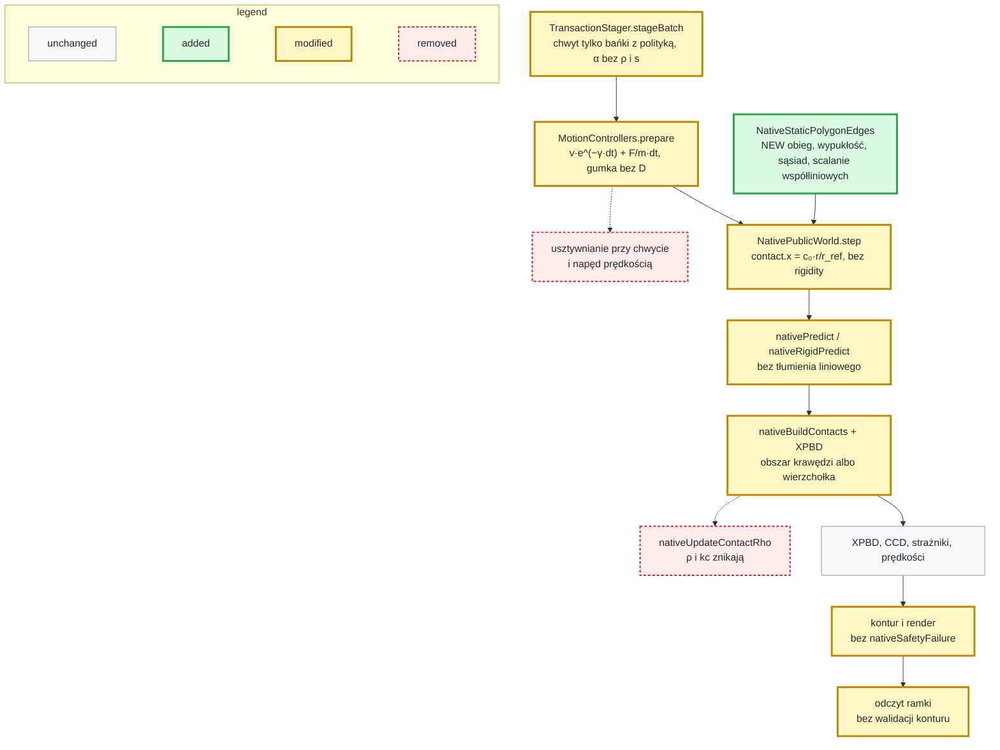

# Plan: BubblePhysics 3.0.0 — pełna siła w spoczynku, jednostronne krawędzie ścian, kontur tylko rysowany

> **For agentic workers:** REQUIRED PHASE COMMAND: Run `/tt-agentic-sdlc:implement` with this file's path to execute this plan. It runs one slice per session, and only a slice with tasks. The program design below is binding: build the call trees as drawn, and turn each behaviour into a failing test before you write the code.

**Date:** 2026-11-20
**Artifact:** plan
**Design:** [change-design.md](change-design.md)
**References:** dokument wejściowy autora `2KBubbles-iOS/docs/benchmarks/stage-0/v2.3.0-engine-3.0.0-input.md`; punkt wyjścia `main` = v2.3.0 (e669fb1)
**Strategy:** slices
**Test command:** `swift build --build-tests && swift test` (macOS z GPU; pojedynczy test: `swift test --filter <Cel>.<Klasa>/<test>`)
**Status:** Draft
**Template version:** default/0.3.3

**Plugin version:** 0.7.11
**Agent Sessions:** claude-code: 4d9652fc-4c22-43fc-85a3-1ee938d5d1e2

---

## Program design

### R0 — Headline

Bańka dociśnięta do ściany ugina się dokładnie o c · F. Zmiana usuwa tłumienie gumki i przenosi tłumienie ruchu przed przyrost prędkości z sił. Krawędź ściany odpycha tylko od zewnątrz, a wierzchołek raz. Podatność to c₀ · r / r_ref. Kontur jest już tylko rysunkiem. Stare parametry znikają z API, więc wydanie to 3.0.0.

### R1 — The whole flow

Jeden krok świata po zmianie. Patrz na trzy miejsca, w których fizyka dostaje nowe reguły: host (tłumienie i siły), budowa kontaktów (obszary krawędzi) i koniec kroku (kontur bez weta).



Tłumienie liniowe przenosi się z kerneli GPU do hosta. Tylko host wie, jaką część prędkości dały siły, a jaka prędkość jest narzucona torem.

### R2 — Seams — where the change attaches to existing code

Pliki po całej zmianie. Każdy wpis mówi, co się w nim zmienia, i który wycinek to buduje.

```diff
  Sources/BubblePhysicsPublic/Model/
+   Resources.swift              # BubbleContactCompliance(base:referenceRadius:), scaledBase = c₀·r/r_ref (slice 1)
+   Motion.swift                 # BubbleDrivePolicy(bandStiffness:maximumForce:), bez .standard (slice 2)
+   Objects.swift                # BubbleDescriptor.drivePolicy: BubbleDrivePolicy? = nil (slice 2)
+   WorldTransaction.swift       # BubbleResult.drivePolicy: BubbleDrivePolicy? = nil (slice 2)
  Sources/BubblePhysicsRuntime/
+   TransactionStager.swift      # validateWorstAlpha z r_max (slice 1); chwyt bez polityki odrzucany, RuntimeObject bez pól usztywniania (slice 2)
+   MotionControllers.swift      # tłumienie γ w hoście przed F/m·dt; bez gałęzi prędkościowej i usztywniania (slice 2)
+   NativeCompleteStepper.swift  # NativePublicObject bez rigidity (slice 2)
    StructuralOperations.swift   # bez zmian: czyta collisionRadius, które jest teraz zawsze targetRadius
  Sources/BubblePhysicsNativeMetal/
+   NativePublicWorld.swift      # contact.x = c₀·r/r_ref, contact.y wolne (slice 1); material.z = 0 (slice 2); krawędzie z NativeStaticPolygonEdges (slice 3)
+   NativeStaticPolygonEdges.swift # NOWY: wielokąt statyczny → odcinki z obiegiem, wypukłością końców i sąsiadem (slice 3)
+   NativeSolverInput.swift      # NativeSolverSegment.polygonEdge (strona zewnętrzna, wypukłość, sąsiad) (slice 3)
+   NativeMetalBufferLayout.swift # cache: rho → compliance, x = c_a + c_b (slice 1); segment: nowy pas `region`, 112 → 128 B (slice 3)
    NativeRigidPolygonState.swift # bez zmian: motion.w (0 dla .kinematic) tłumi już tylko obrót
+   NativeMetalSolver.swift      # bez dyspozycji nativeUpdateContactRho (slice 1); odczyt ramki bez walidacji konturu (slice 4)
  Sources/BubblePhysicsNativeMetal/Shaders/
+   NativeGeometryKernels.metal-source  # nativeContactCompliance = contact.x (slice 1); nativePredict bez tłumienia liniowego (slice 2); nativeBuildContacts według obszarów (slice 3)
+   NativeXPBDKernels.metal-source      # cache i α na compliance.x (slice 1); nativeConstraintGeometry według cechy z budowy (slice 3)
+   NativePostSolveKernels.metal-source # bez nativeUpdateContactRho i nativeIsStructuralResult (slice 1); nativeRigidPredict tłumi tylko obrót, bez bramki material.z (slice 2); kontur bez nativeSafetyFailure (slice 4)
  Tests/
+   BubblePhysicsRuntimeTests/CrowdSceneSupport.swift # softBubblePhysics bez wykładników (slice 1)
+   BubblePhysicsRuntimeTests/…  # nowe testy G1–G5; usunięte ContactRhoHistoryTests, RhoGridReportTests (slice 1)
+   BubblePhysicsNativeMetalTests/NativeMetalShaderABITests.swift # układy cache (slice 1) i segmentu (slice 3)
+   BubblePhysicsNativeMetalTests/NativeStaticPolygonEdgesTests.swift # NOWY: znak obiegu, wypukłość końców, sąsiad, tolerancja scalania (slice 3)
-   BubblePhysicsRuntimeTests/ZZWallPressProbeTests.swift # sonda spoza repo, kasowana w slice 1
  Examples/BubblePhysicsShowcase/App/
+   BubbleScene.swift            # drivePolicy dla baniek i wyników scalenia, region merge-events (slice 2)
  docs/ i korzeń
+   CHANGELOG.md, docs/MIGRATION-v3.md, docs/integration-guide.md # każdy wycinek dopisuje swoją część
+   README.md, Tests/BubblePhysicsPublicTests/MigrationGuideTests.swift:107 # „Wersja 3.0.0” (slice 4)
```

Krok świata po zmianie. `+` to nowe wywołanie, `-` usunięte, a komentarz mówi, co się zmienia w wywołaniu bez znacznika.

```diff
  BubbleWorld.advanceImpl                          # BubbleWorld.swift:260
  ├─ TransactionStager.stageBatch                  # TransactionStager.swift:183
  │  ├─ beginPlayerDrive                           # :345
+ │  │  └─ requireDrivePolicy(id)                  # incompatibleObjectKind: bryła albo bańka z drivePolicy nil (slice 2)
- │  │  └─ capturedRadius = effectiveRadius …      # usztywnianie znika (slice 2)
  │  └─ validateWorstAlpha                         # :566, r_max z promieni, c₀·r_max/r_ref, bez ρ_min^kc (slice 1)
  └─ NativeCompleteStepper.performStep             # NativeCompleteStepper.swift:100
     ├─ MotionControllers.prepare                  # MotionControllers.swift:13
-    │  ├─ blok usztywniania                       # :40-51 (slice 2)
-    │  ├─ bubbleDriveSpeed / velocity(to:)        # gałąź prędkościowa :79-83 (slice 2)
+    │  ├─ dampedVelocity(object, γ, dt)           # v·e^(−γ·dt) dla .dynamic, .motorDriven, .playerDriven (slice 2)
     │  └─ velocity += F/m·dt                      # gumka bez e^(−D·dt/m), MotorDrive, siła globalna, pola
     └─ NativePublicWorld.step                     # NativePublicWorld.swift:151
+       ├─ NativeStaticPolygonEdges.segments(…)    # zamiast pętli .fixed :213-227 (slice 3)
        └─ NativeMetalSolver.executeSnapshot       # NativeMetalSolver.swift:316
           ├─ nativePredict                        # tłumienie liniowe tylko z control.physics.y, gdy publicFlags.x == 0 (slice 2)
           ├─ nativeRigidPredict                   # mnożnik e^(−motion.w·dt) tylko dla motion.z (slice 2)
           ├─ nativeBuildContacts                  # obszar wnętrza krawędzi albo wierzchołka, cecha w response.w (slice 3)
           ├─ nativeMatchContactCache              # przy trafieniu kopiuje compliance zamiast rho (slice 1)
-          ├─ nativeUpdateContactRho               # :692 i kernel POST:615-644 (slice 1)
           ├─ nativePrepareSolverContacts          # compliance.x = contact.x_a + contact.x_b (slice 1)
           ├─ XPBD × 8: nativeConstraintGeometry   # cecha z budowy obowiązuje do końca kroku (slice 3)
           ├─ CCD, strażniki                       # bez zmian
           ├─ nativeAccumulateContactPressure      # podział wg contact.x (slice 1), bez bramki material.z (slice 2), bez safety (slice 4)
           ├─ kontury, nativePrepareRenderData*    # bez nativeSafetyFailure 1 i 4 (slice 4)
           ├─ nativeApplyPublicRegion              # bez sprawdzenia skończoności punktów konturu POST:994; :987 (pozycja) zostaje (slice 4)
           └─ odczyt ramki                         # bez sprawdzeń :1013-1016, :1019-1025, :1031-1032 (slice 4)
```

Projekt zostawił planowi pięć rozstrzygnięć. Plan wybiera tak:

| Pytanie projektu | Wybór planu |
|---|---|
| Gdzie tłumić ruch liniowy ([CD-D-8](change-design.md#cd-d-8)) | W hoście. `MotionControllers.prepare` mnoży prędkość przez e^(−γ·dt) przed dodaniem F/m·dt, tylko dla ról `.dynamic`, `.motorDriven` i `.playerDriven`. γ to `PhysicsMaterial.damping` z `state.physicsMaterials`. Kernele przestają tłumić ruch liniowy. `nativePredict` używa jeszcze `control.physics.y` tylko na ścieżce diagnostycznej (`publicFlags.x == 0`). Obrót tłumią jak dziś. `NativeRigidPolygonState` się nie zmienia, bo `motion.w` (0 dla `.kinematic`) tłumi już tylko obrót. |
| Pola usztywniania w `RuntimeObject` | Usunięte wszystkie pięć. Przejścia promienia piszą wprost `targetRadius` (MotionControllers.swift:238), więc żadne z tych pól nie jest im potrzebne. `collisionRadius` zostaje i zawsze równa się `targetRadius`. |
| `allowedSide` czy nowa flaga ([CD-D-3](change-design.md#cd-d-3)) | Nowa flaga. `allowedSide` (stała normalna) zostaje dla adaptera diagnostycznego `ReferenceSolverInputAdapter.swift:36`. Krawędź wielokąta statycznego ma `flags.w`: bit 0 = krawędź z obszarami, bit 1 = wypukły początek, bit 2 = wypukły koniec. Nowy pas `region` niesie (drugi koniec krawędzi poprzedniej w wierzchołku początkowym, x i y, znak strony zewnętrznej względem lewej normalnej, 0). Kontakt z wierzchołkiem wypukłym daje krawędź, która w nim się zaczyna. Kolejność wierzchołków zostaje taka, jak podała gra. |
| Tolerancja krawędzi współliniowych | Krawędzie sąsiednie są łączone, gdy \|cross(e₁, e₂)\| ≤ 1e-5 · \|e₁\| · \|e₂\| i dot(e₁, e₂) > 0. |
| Iteracje i granice obszarów ([CD-D-4](change-design.md#cd-d-4)) | Cecha wybrana w `nativeBuildContacts` (wnętrze krawędzi albo wierzchołek, zapisana w `response.w`) obowiązuje do końca kroku. W iteracjach kontakt z wnętrzem ma stałą normalną zewnętrzną krawędzi, a kontakt z wierzchołkiem ma normalną od wierzchołka do bieżącego środka. Kontakt nie znika w trakcie iteracji. Gdy wgniecenie spadnie poniżej zera, λ obcina się do 0 jak dziś. Granica obszarów nie dzieli: porównuje dot(c − a, b − a) z \|b − a\|² w jednej funkcji pomocniczej, wołanej z tymi samymi argumentami przez obie krawędzie przy wierzchołku. Dlatego klasyfikacja na granicy jest dokładnym dopełnieniem, także o jedno ULP obok. |

Dwa miejsca warto przeczytać dwa razy. Pierwsze to wspólna funkcja granicy obszarów w `nativeBuildContacts`: od niej zależy, czy bańka na granicy dostanie zawsze dokładnie jeden kontakt ([G2-AC7](change-design.md#g2-ac7)). Drugie to zmiana pasa `rho` na `compliance` w rekordzie cache. Rekord ma dalej 80 B, ale zmienia się każde miejsce, które czyta `rho.z`.

### R3 — Behaviour

| P-B-ID | Situation | Result | Proves |
|---|---|---|---|
| <a id="p-b-1"></a>P-B-1 | Bańki r 12, 24, 48 i 148 z jednego materiału, dociśnięte do grubej ściany siłą 600 | ugięcie / r = c₀ · F / r_ref ± 2 % | [G3-AC1](change-design.md#g3-ac1) |
| <a id="p-b-2"></a>P-B-2 | Para ściskana dwoma polami kierunkowymi wzdłuż osi, pary promieni (12, 24), (24, 24), (24, 148) | nakładanie (c_a + c_b) · F ± 2 %, wgniecenie konturu nakładanie · r_self / (r_a + r_b) ± 2 % | [G3-AC2](change-design.md#g3-ac2) |
| <a id="p-b-3"></a>P-B-3 | `BubbleContactCompliance` z wartością spoza zakresu, materiał `.rigid` z podatnością | `valueOutOfRange` z nazwą pola; `radiusExponent` i `compressionExponent` nie istnieją | [G3-AC3](change-design.md#g3-ac3) |
| <a id="p-b-4"></a>P-B-4 | Kontakty twarde (c₀ = 0) | istniejące testy przechodzą; każda zmiana oczekiwań ma powód w opisie PR | [G3-AC4](change-design.md#g3-ac4) |
| <a id="p-b-5"></a>P-B-5 | Transakcja z c₀ na granicy skończoności α przy r_max i z c₀ dziesięć razy mniejszym | pierwsza odrzucona z `invalidValue(.valueOutOfRange("contactCompliance"))`, druga przyjęta | [G3-AC5](change-design.md#g3-ac5) |
| <a id="p-b-6"></a>P-B-6 | Tłok co najmniej 20 baniek w narożniku pudła; pojedyncza bańka i para (przepisane `ContactContourTests`) | kontury nie przenikają się ani ścian ± 0,5 | [G5-AC3](change-design.md#g5-ac3) |
| <a id="p-b-7"></a>P-B-7 | Gumka w nasyceniu dociąga bańkę do ściany, γ ∈ {0; 0,6; 4}, m ∈ {0,34; 1,36; 5,44} | ugięcie c₀ · (r/r_ref) · `maximumForce` ± 2 % w 9 kombinacjach, rozrzut między γ ≤ 2 % | [G1-AC1](change-design.md#g1-ac1) |
| <a id="p-b-8"></a>P-B-8 | `MotorDrive` F 600 i, w drugim świecie, siła globalna o tym samym module, γ 0,6 | ugięcie c · F ± 2 % w obu światach | [G1-AC2](change-design.md#g1-ac2) |
| <a id="p-b-9"></a>P-B-9 | Bańka z gumką, bańka z `MotorDrive` i bryła z `MotorDrive`, bez kontaktów, dwie kolejne ramki | v_{N+1} = v_N · e^(−γ·dt) + F/m · dt ± 1 % | [G1-AC3](change-design.md#g1-ac3) |
| <a id="p-b-10"></a>P-B-10 | Gumka ze stałym naciągnięciem, `maximumForce` nil, γ ∈ {0,6; 4} | prędkość ustalona K · s · dt / (m · (1 − e^(−γ·dt))) ± 1 % | [G1-AC4](change-design.md#g1-ac4) |
| <a id="p-b-11"></a>P-B-11 | Ta sama bańka dociągnięta gumką i dociśnięta `MotorDrive` | to samo położenie środka i ten sam kontur ± 2 % ugięcia | [G1-AC5](change-design.md#g1-ac5) |
| <a id="p-b-12"></a>P-B-12 | Bańka i bryła na torze z γ 4; bryła kinematyczna `.velocity` z `damping` 4 | krok 120 · dt ± 1 %, koniec w ostatnim punkcie ± 1e-3; poza bryły kinematycznej po 600 krokach ± 1e-3 | [G1-AC6](change-design.md#g1-ac6) |
| <a id="p-b-13"></a>P-B-13 | `BubbleDrivePolicy` z `bandStiffness` ≤ 0 albo nieskończonym, `maximumForce` ≤ 0 albo nieskończonym | `valueOutOfRange` z nazwą pola; `bandDamping` nie istnieje | [G4-AC1](change-design.md#g4-ac1) |
| <a id="p-b-14"></a>P-B-14 | `beginPlayerDrive` dla bańki z `drivePolicy` nil i dla bryły wielokątnej | `incompatibleObjectKind(id)`, ruch bez zmian | [G4-AC2](change-design.md#g4-ac2) |
| <a id="p-b-15"></a>P-B-15 | Gumka z K · dt²/m ≥ 1 przy wstawieniu, zamianie, scaleniu i podziale; cel ponad limit modułu | odrzucenie jak w 2.3.0 (istniejące testy stagera) | [G4-AC3](change-design.md#g4-ac3) |
| <a id="p-b-16"></a>P-B-16 | `replace`, scalenie i podział chwyconej bańki, z polityką i bez | brak `DriveFeedback`, `driveNotActive` albo `objectNotFound`, ponowny chwyt tylko z polityką | [G4-AC4](change-design.md#g4-ac4) |
| <a id="p-b-17"></a>P-B-17 | Przykład `BubblePhysicsShowcase` na 3.0.0 | buduje się; bańki i wyniki scalenia mają `drivePolicy`; regiony przewodnika zgodne | [G6-AC4](change-design.md#g6-ac4) |
| <a id="p-b-18"></a>P-B-18 | Bańka r 148 dociśnięta do ściany T 48 siłą F ∈ {300 … 1 300}, ta sama scena przy T 400 | ugięcie c · F ± 2 %, oba T dają to samo ± 2 % | [G2-AC1](change-design.md#g2-ac1) |
| <a id="p-b-19"></a>P-B-19 | Bańka w obszarze wypukłego wierzchołka 30°, 90° i 120°, siła promieniowa 600 | odległość od wierzchołka r − c · F ± 2 % | [G2-AC2](change-design.md#g2-ac2) |
| <a id="p-b-20"></a>P-B-20 | Cztery bańki: dwie ściany, narożnik wypukły, narożnik wklęsły L; wierzchołki zgodnie i przeciwnie do ruchu wskazówek zegara | trajektorie przez 600 kroków i położenia ustalone równe ± 1e-2 | [G2-AC3](change-design.md#g2-ac3) |
| <a id="p-b-21"></a>P-B-21 | Bańka r 12 z prędkością 6 000, prostopadle i pod kątem 30°, na ścianę T 48 | żaden krok nie kończy się w ścianie ani za nią, żaden nie jest odrzucony; istniejące testy CCD i strażników przechodzą | [G2-AC4](change-design.md#g2-ac4) |
| <a id="p-b-22"></a>P-B-22 | Bańka zsuwa się po brzegu przez wypukły wierzchołek 30°, 90° i 120° | w każdej ramce przejścia odległość od brzegu r − c · F ± 5 % c · F | [G2-AC5](change-design.md#g2-ac5) |
| <a id="p-b-23"></a>P-B-23 | Długa krawędź podana jako dwa współliniowe odcinki | ugięcie c · F ± 2 %, pozycje jak dla jednego odcinka ± 1e-2 | [G2-AC6](change-design.md#g2-ac6) |
| <a id="p-b-24"></a>P-B-24 | Środki gęsto wokół wierzchołków 30°, 90°, 120° i 270°, na granicach obszarów i o jedno ULP obok | każdy środek bliżej niż r ma co najmniej jeden kontakt i nigdy dwóch o normalnych różnych o mniej niż 1e-3 rad | [G2-AC7](change-design.md#g2-ac7) |
| <a id="p-b-30"></a>P-B-30 | Wielokąt podany zgodnie i przeciwnie do ruchu wskazówek zegara; krawędzie prawie współliniowe w tolerancji 1e-5 i tuż poza nią; wielokąt L | strona zewnętrzna każdej krawędzi wskazuje na zewnątrz; wypukłość końców i sąsiad zgodne z geometrią; krawędzie w tolerancji scalone, poza nią nie | [G2-AC6](change-design.md#g2-ac6), [CD-D-4](change-design.md#cd-d-4) |
| <a id="p-b-25"></a>P-B-25 | Dwa światy z `deformability` 0 i 0,65, jeden czyta kontur; ściany, tłok, chwyt, scalenie, podział | pozycje, prędkości i promienie identyczne bit w bit przez 600 kroków | [G5-AC1](change-design.md#g5-ac1) |
| <a id="p-b-26"></a>P-B-26 | Sceny testów konturu | punkty konturu w kole o promieniu bańki ± 1e-3, krawędzie ≤ `maxContourSegmentLength`, żaden krok nie odrzucony przez kontur | [G5-AC2](change-design.md#g5-ac2) |
| <a id="p-b-27"></a>P-B-27 | Cały zestaw testów na gałęzi wydania | przechodzi; opis PR wymienia z powodem każdy usunięty albo zmieniony test | [G6-AC1](change-design.md#g6-ac1) |
| <a id="p-b-28"></a>P-B-28 | Dokumentacja wydania | CHANGELOG 3.0.0, pełny `docs/MIGRATION-v3.md` z siedmioma punktami z [G6-AC2](change-design.md#g6-ac2), `docs/integration-guide.md` z modelem 3.0.0, README „Wersja 3.0.0” | [G6-AC2](change-design.md#g6-ac2) |
| <a id="p-b-29"></a>P-B-29 | Perf guard przed scaleniem wydania | wynik i obciążenie maszyny w opisie PR | [G6-AC3](change-design.md#g6-ac3) |

Zachowania, które muszą przetrwać:

- Spójność pakietu renderu (ID, geometria bańki, liczba punktów, NativeMetalSolver.swift:1005-1009) dalej odrzuca krok ([CD-D-2](change-design.md#cd-d-2)).
- Walidacja stanu fizycznego (skończoność pozycji, prędkości, promieni i rekordów kontaktów, λ ≥ 0) zostaje.
- Ścieżka diagnostyczna (`publicSettings` nil) tłumi ruch jak dziś przez `control.physics.y/z`.
- Kontakty twarde (c₀ = 0) zostają na swojej ścieżce w solverze ([CD-D-1](change-design.md#cd-d-1)).

### Test strategy

| Level | What it proves | Behaviours |
|---|---|---|
| integracja przez publiczny świat (`BubbleWorld.advance`) | stan ustalony i przebieg ramek zgadzają się z modelem fizyki | [P-B-1](#p-b-1), [P-B-2](#p-b-2), [P-B-6](#p-b-6)–[P-B-12](#p-b-12), [P-B-18](#p-b-18)–[P-B-23](#p-b-23), [P-B-25](#p-b-25) |
| jednostkowe modelu, stagera i hosta NativeMetal | walidacja API, odrzucenia transakcji, budowa krawędzi wielokąta | [P-B-3](#p-b-3), [P-B-5](#p-b-5), [P-B-13](#p-b-13)–[P-B-16](#p-b-16), [P-B-30](#p-b-30) |
| NativeMetal przez solver diagnostyczny (`NativeMetalSolver.executeFrame(snapshot:)`, `cachedContacts`) | budowa kontaktów na granicach obszarów i niezmienniki konturu | [P-B-24](#p-b-24), [P-B-26](#p-b-26) |
| istniejący zestaw | brak regresji kontaktów twardych, CCD, strażników i stagera | [P-B-4](#p-b-4), [P-B-15](#p-b-15), [P-B-21](#p-b-21), [P-B-27](#p-b-27) |
| build i test przewodnika | przykład się buduje, regiony przewodnika zgodne | [P-B-17](#p-b-17) |
| przegląd dokumentu i opisu PR | dokumentacja wydania i wynik perf guarda | [P-B-28](#p-b-28), [P-B-29](#p-b-29) |

**Where:** sceny ze ścianami w `Tests/BubblePhysicsRuntimeTests/` na wzór `CrowdSceneSupport.swift` (`CrowdScene.makeWorld`, `pressedBubble`, `bandPressedBubble`, `wallPress`) i `ContactVelocityCorrectionProbeTests.swift`. Model w `Tests/BubblePhysicsPublicTests/` (`ModelValidationTests`, `MotionCommandTests`, `IntegrationGuideTests`). Stager w `Tests/BubblePhysicsRuntimeTests/TransactionStagerTests.swift`. Budowa krawędzi w `Tests/BubblePhysicsNativeMetalTests/NativeStaticPolygonEdgesTests.swift` (na wzór `NativeSolverInputTests.swift`). Kernele w `Tests/BubblePhysicsNativeMetalDiagnosticsTests/` na wzór `NativeMetalXPBDTests.testPreparedContactCarriesTheSumOfEndComplianceInRhoZ`. ABI w `Tests/BubblePhysicsNativeMetalTests/NativeMetalShaderABITests.swift` i `NativeMetalSolverLifecycleTests.testABIRecordsUseSixteenByteLanes`. Przykład: `xcodebuild -project Examples/BubblePhysicsShowcase/BubblePhysicsShowcase.xcodeproj -scheme BubblePhysicsShowcase -sdk iphonesimulator -destination 'generic/platform=iOS Simulator' CODE_SIGNING_ALLOWED=NO build`. Perf guard: `swift run -c release BubblePhysicsPerfGuard`. Repozytorium nie ma lintera.

**Test command:** `swift build --build-tests && swift test`

## Slice Status

| Slice | Name | Delivers | Seams | Behaviours | Status |
|-------|------|----------|-------|------------|--------|
| 1 | Podatność c₀ · r / r_ref | ugięcie bańki to ten sam ułamek promienia przy każdym r, para dzieli wgniecenie w proporcji promieni ([G3-AC1](change-design.md#g3-ac1)–[G3-AC5](change-design.md#g3-ac5), [G5-AC3](change-design.md#g5-ac3)) | `Resources.swift`, `validateWorstAlpha`, `NativePublicProperties.contact`, cache `rho` → `compliance`, bez `nativeUpdateContactRho`, kontur wg `contact.x` | [P-B-1](#p-b-1)–[P-B-6](#p-b-6) | todo |
| 2 | Jedno tłumienie ruchu i gumka jako jedyny napęd | w spoczynku działa pełna siła, chwyt nie zmienia promienia ani kształtu ([G1-AC1](change-design.md#g1-ac1)–[G1-AC6](change-design.md#g1-ac6), [G4-AC1](change-design.md#g4-ac1)–[G4-AC4](change-design.md#g4-ac4), [G6-AC4](change-design.md#g6-ac4)) | `Motion.swift`, `Objects.swift`, `WorldTransaction.swift`, `MotionControllers`, `TransactionStager` (chwyt, `RuntimeObject`), `nativePredict`, `nativeRigidPredict`, bramka `material.z`, `BubbleScene.swift` | [P-B-7](#p-b-7)–[P-B-17](#p-b-17) | unplanned |
| 3 | Jednostronne krawędzie statycznych wielokątów | cienka ściana i narożnik odpychają jak jedna sprężyna ([G2-AC1](change-design.md#g2-ac1)–[G2-AC7](change-design.md#g2-ac7)) | `NativeStaticPolygonEdges.swift`, `NativeSolverSegment`, pas `region` segmentu, `nativeBuildContacts`, `nativeConstraintGeometry` | [P-B-18](#p-b-18)–[P-B-24](#p-b-24), [P-B-30](#p-b-30) | unplanned |
| 4 | Kontur tylko rysowany i wydanie 3.0.0 | kontur nie odrzuca kroku i nie wpływa na fizykę; dokumentacja i wersja 3.0.0 ([G5-AC1](change-design.md#g5-ac1), [G5-AC2](change-design.md#g5-ac2), [G6-AC1](change-design.md#g6-ac1)–[G6-AC3](change-design.md#g6-ac3)) | kernele konturu i renderu bez `nativeSafetyFailure`, odczyt ramki, README, CHANGELOG, `docs/MIGRATION-v3.md`, `docs/integration-guide.md` | [P-B-25](#p-b-25)–[P-B-29](#p-b-29) | unplanned |

Każdy wycinek zostawia zestaw testów zielony i dopisuje swoją część do CHANGELOG i `docs/MIGRATION-v3.md`, więc każdy można scalić osobno. Wycinek 1 daje nowy model podatności, ale przy ścianie zostaje błąd tłumienia (ok. 1 %) i dwustronne krawędzie. Wycinek 2 usuwa błąd tłumienia, ale cienka ściana nadal daje drugą sprężynę. Wycinek 3 domyka fizykę, a kontur dalej może odrzucić krok. Dopiero wycinek 4 jest wydaniem 3.0.0 z tagiem.

## Slice 1: Podatność c₀ · r / r_ref

**Delivers:** podatność bańki to c₀ · r / r_ref bez wykładników i bez ρ, a para miękka dzieli wgniecenie w proporcji podatności.

1. Usuń nieśledzoną sondę `Tests/BubblePhysicsRuntimeTests/ZZWallPressProbeTests.swift` · verify: `! test -e Tests/BubblePhysicsRuntimeTests/ZZWallPressProbeTests.swift`
2. Dodaj do `ContactComplianceTests` test czterech rozmiarów i test pary ściskanej polami kierunkowymi, z materiałem `BubbleContactCompliance(base:referenceRadius:)` (dzisiejszy `init` daje s = 0, więc testy kompilują się i padają), obejmujące [P-B-1](#p-b-1) i [P-B-2](#p-b-2) · verify: `swift test --filter "ContactComplianceTests/(testRelativeDeflectionIsTheSameForEveryRadius|testSoftPairOverlapIsTheSumOfCompliancesAndDentsSplitByRadius)"` pada na asercji
3. Dodaj do `TransactionStagerTests` parę przypadków po obu stronach granicy α przy r_max liczonej jako c₀ · r_max / r_ref, obejmującą [P-B-5](#p-b-5) · verify: `swift test --filter TransactionStagerTests/testSoftBubbleIsRejectedWhenWorstAlphaAtMaximumRadiusIsNotFinite` pada na asercji
4. Dodaj do `ContactContourTests` test tłoku co najmniej 20 baniek r 12–48 w narożniku pudła, obejmujący [P-B-6](#p-b-6) · verify: `swift test --filter ContactContourTests/testCrowdInBoxCornerContoursDoNotPenetrateEachOtherOrWalls 2>&1 | grep -q "Executed 1 test, with 0 failures"`
5. W jednym kroku zmień `BubbleContactCompliance` na `base` i `referenceRadius`, `scaledBase` na c₀ · r / r_ref, `validate` bez wykładników i `NativePublicProperties.contact` na `contact.y` = 0, a wszystkie wywołania z wykładnikami przepisz: `CrowdScene.softBubblePhysics`, `ModelValidationTests` (z testami pól `base`, `referenceRadius` i `.rigid` tylko z `.hard`), `NativeMetalShaderABITests`, `NativeMetalStructuralOperationTests`, `ContactComplianceTests`, oba testy `ContactContourTests`, `MotionControllersPrepareTests`, `ContainmentResolutionTests`, `docs/integration-guide.md:96`, a `ContactRhoHistoryTests` i `RhoGridReportTests` usuń; obejmuje [P-B-1](#p-b-1)–[P-B-3](#p-b-3) · verify: `! grep -rn "radiusExponent\|compressionExponent" Sources Tests Examples docs/integration-guide.md && swift test --filter "ContactComplianceTests|ModelValidationTests|ContactContourTests|NativeMetalShaderABITests"`
6. Uprość `validateWorstAlpha` do r_max ze wszystkich promieni i c₀ · r_max / r_ref bez ρ_min^kc · verify: `swift test --filter TransactionStagerTests`
7. Zamień pas `rho` rekordu cache na `compliance` (x = c_a + c_b) w Swift i MSL, usuń `nativeUpdateContactRho`, `nativeIsStructuralResult` i ich dyspozycję, a `nativeContactCompliance` i podział konturu oprzyj na `contact.x` · verify: `! grep -rn "nativeUpdateContactRho\|nativeIsStructuralResult\|\.rho\b" Sources/BubblePhysicsNativeMetal && swift test --filter "NativeMetalShaderABITests|NativeMetalSolverLifecycleTests|NativeMetalXPBDTests"`
8. Dodaj sekcję 3.0.0 do CHANGELOG, utwórz `docs/MIGRATION-v3.md` z częścią o przestrojeniu c₀ po usunięciu s i kc, a w `docs/integration-guide.md` opisz podatność c₀ · r / r_ref · verify: `grep -q "## 3.0.0" CHANGELOG.md && grep -q "r_ref" docs/MIGRATION-v3.md && swift test --filter IntegrationGuideTests`
9. Uruchom cały zestaw, popraw oczekiwania testów zmienionych przez nowy model (m.in. `ContactVelocityCorrectionProbeTests`, `CrowdCompressionTests`, `ContactDynamicsTests`, `PairLambdaCeilingProbeTests`, `BandDriveTests`), potwierdź, że kontakty twarde przechodzą bez zmian oczekiwań, i zapisz w `plan.md` listę usuniętych i zmienionych testów z powodami do opisu PR, obejmuje [P-B-4](#p-b-4) · verify: `swift build --build-tests && swift test`

## Deviations from Design

None.

## Replan log

| Slice | Assumed | Found | Plan change | Date |
|-------|---------|-------|-------------|------|
|       |         |       |             |      |

## Implementation deviations

| # | Slice | Task | Type (change/gap) | Description | Status | Date |
|---|-------|------|-------------------|-------------|--------|------|
|   |       |      |                   |             |        |      |
