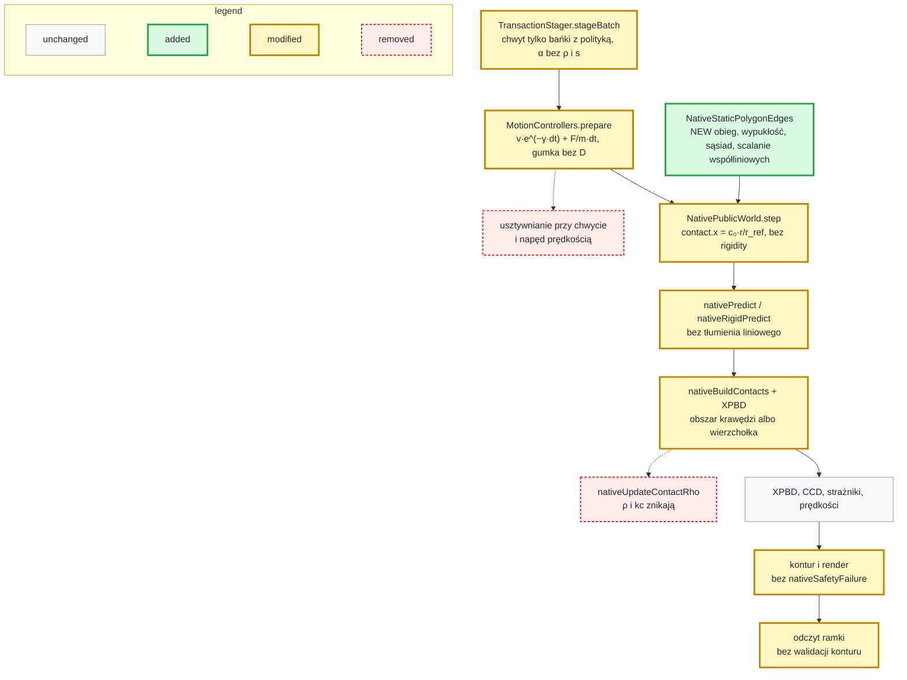

# Plan: BubblePhysics 3.0.0 — pełna siła w spoczynku, jednostronne krawędzie ścian, kontur tylko rysowany

> **For agentic workers:** REQUIRED PHASE COMMAND: Run `/tt-agentic-sdlc:implement` with this file's path to execute this plan. It runs one slice per session, and only a slice with tasks. The program design below is binding: build the call trees as drawn, and turn each behaviour into a failing test before you write the code.

**Date:** 2026-11-20
**Artifact:** plan
**Design:** [change-design.md](change-design.md)
**References:** dokument wejściowy autora `2KBubbles-iOS/docs/benchmarks/stage-0/v2.3.0-engine-3.0.0-input.md`; punkt wyjścia `main` = v2.3.0 (e669fb1)
**Strategy:** slices
**Test command:** `swift build --build-tests && swift test` (macOS z GPU; pojedynczy test: `swift test --filter <Cel>.<Klasa>/<test>`)
**Status:** Approved
**Template version:** default/0.3.3

**Plugin version:** 0.7.11
**Agent Sessions:** claude-code: 4d9652fc-4c22-43fc-85a3-1ee938d5d1e2
**Agent Sessions:** claude-code: 91e9ab31-6453-4964-ae79-d7295ae8a4b4
**Agent Sessions:** claude-code: c40d73d0-667d-4675-9150-ea3bbc6b537b
**Agent Sessions:** claude-code: ebd2dab0-e7e7-4852-b75c-a0b9496c511d

---

## Program design

### R0 — Headline

Bańka dociśnięta do ściany ugina się dokładnie o c · F. Zmiana usuwa tłumienie gumki i przenosi tłumienie ruchu przed przyrost prędkości z sił. Krawędź ściany odpycha tylko od zewnątrz, a wierzchołek raz. Podatność to c₀ · r / r_ref. Kontur jest już tylko rysunkiem. Stare parametry znikają z API, więc wydanie to 3.0.0.

### R1 — The whole flow

Jeden krok świata po zmianie. Patrz na trzy miejsca, w których fizyka dostaje nowe reguły: host (tłumienie i siły), budowa kontaktów (obszary krawędzi) i koniec kroku (kontur bez weta).



Tłumienie liniowe przenosi się z kerneli GPU do hosta. Tylko host wie, jaką część prędkości dały siły, a jaka prędkość jest narzucona torem.

### R2 — Seams — where the change attaches to existing code

Pliki po całej zmianie. Każdy wpis mówi, co się w nim zmienia, i który wycinek to buduje.

```diff
  Sources/BubblePhysicsPublic/Model/
+   Resources.swift              # BubbleContactCompliance(base:referenceRadius:), scaledBase = c₀·r/r_ref (slice 1)
+   Motion.swift                 # BubbleDrivePolicy(bandStiffness:maximumForce:), bez .standard (slice 2)
+   Objects.swift                # BubbleDescriptor.drivePolicy: BubbleDrivePolicy? = nil (slice 2)
+   WorldTransaction.swift       # BubbleResult.drivePolicy: BubbleDrivePolicy? = nil (slice 2)
  Sources/BubblePhysicsRuntime/
+   TransactionStager.swift      # validateWorstAlpha z r_max (slice 1); chwyt bez polityki odrzucany, RuntimeObject bez pól usztywniania (slice 2)
+   MotionControllers.swift      # tłumienie γ w hoście przed F/m·dt, γ z materiału obiektu; bez gałęzi prędkościowej, usztywniania i `bandDamping` (slice 2)
+   NativeCompleteStepper.swift  # bez przepisywania rigidity do NativePublicObject :130 (slice 2)
    StructuralOperations.swift   # bez zmian: czyta collisionRadius, które jest teraz zawsze targetRadius
  Sources/BubblePhysicsNativeMetal/
+   NativePublicWorld.swift      # contact.x = c₀·r/r_ref, contact.y wolne (slice 1); bez pola NativePublicObject.rigidity :18 i material.z = 0 (slice 2); krawędzie z NativeStaticPolygonEdges (slice 3)
+   NativeStaticPolygonEdges.swift # NOWY: wielokąt statyczny → odcinki z obiegiem, wypukłością końców i sąsiadem (slice 3)
+   NativeSolverInput.swift      # NativeSolverSegment.polygonEdge (strona zewnętrzna, wypukłość, sąsiad), domyślnie nil, więc adapter diagnostyczny bez zmian (slice 3)
+   NativeMetalBufferLayout.swift # cache: rho → compliance, x = c_a + c_b (slice 1); segment: `flags.w` i nowy pas `region`, 112 → 128 B, `flags.z` krawędzi wielokąta zostaje 0 (slice 3)
    NativeRigidPolygonState.swift # bez zmian: motion.w (0 dla .kinematic) tłumi już tylko obrót
+   NativeMetalSolver.swift      # bez dyspozycji nativeUpdateContactRho (slice 1); odczyt ramki bez walidacji konturu (slice 4)
  Sources/BubblePhysicsNativeMetal/Shaders/
+   NativeGeometryKernels.metal-source  # nativeContactCompliance = contact.x (slice 1); nativePredict bez członu liniowego :173 na ścieżce publicznej, obrót :178 dalej z material.x = γ (slice 2); struktura NativeSegment z pasem `region`, wspólna funkcja granicy obszarów, nativeBuildContacts według obszarów (slice 3)
+   NativeXPBDKernels.metal-source      # cache i α na compliance.x (slice 1); nativeEmitAdjacency bez starych rekordów krawędzi wielokąta, nativeConstraintGeometry z parametrem cechy i nativeFinalizeSolverContacts :541-549 według cechy z budowy (slice 3)
+   NativePostSolveKernels.metal-source # bez nativeUpdateContactRho i nativeIsStructuralResult (slice 1); nativeRigidPredict tłumi tylko obrót, bez trzech użyć material.z :677, :681, :682 (slice 2); kontur bez nativeSafetyFailure (slice 4)
  Tests/
+   BubblePhysicsRuntimeTests/CrowdSceneSupport.swift # softBubblePhysics bez wykładników (slice 1)
+   BubblePhysicsRuntimeTests/…  # nowe testy G1–G5; usunięte ContactRhoHistoryTests, RhoGridReportTests (slice 1)
+   BubblePhysicsRuntimeTests/MotionDampingTests.swift # NOWY: ugięcie w spoczynku i przebieg prędkości przy jednym tłumieniu (slice 2)
+   BubblePhysicsRuntimeTests/CrowdSceneSupport.swift:68 # `CrowdScene.bubble` z `drivePolicy` nil (slice 2)
+   BubblePhysicsNativeMetalTests/NativeMetalShaderABITests.swift # układy cache (slice 1) i segmentu z polem `region` (slice 3)
+   BubblePhysicsNativeMetalDiagnosticsTests/NativeMetalSolverLifecycleTests.swift # stride segmentu 112 → 128 :248 (slice 3)
+   BubblePhysicsNativeMetalTests/NativeSolverInputTests.swift # pakowanie `flags.w` i `region`; odcinek spoza wielokąta ma `flags.w` = 0 (slice 3)
+   BubblePhysicsNativeMetalTests/NativeStaticPolygonEdgesTests.swift # NOWY: znak obiegu, wypukłość końców, sąsiad, tolerancja scalania (slice 3)
+   BubblePhysicsNativeMetalTests/NativeStaticPolygonContactTests.swift # NOWY: kontakty gęstych środków wokół wierzchołków, granice obszarów ± 1 ULP (slice 3)
+   BubblePhysicsRuntimeTests/StaticPolygonEdgeTests.swift # NOWY: cienka ściana, wierzchołki, obieg, szybka bańka, zsuwanie, krawędź współliniowa (slice 3)
-   BubblePhysicsRuntimeTests/ZZWallPressProbeTests.swift # sonda spoza repo, przenoszona poza pakiet w slice 1 (nie kasowana)
  Examples/BubblePhysicsShowcase/App/
+   BubbleScene.swift            # drivePolicy dla baniek i wyników scalenia, region merge-events (slice 2)
  docs/ i korzeń
+   CHANGELOG.md, docs/MIGRATION-v3.md, docs/integration-guide.md # każdy wycinek dopisuje swoją część
+   README.md, Tests/BubblePhysicsPublicTests/MigrationGuideTests.swift:107 # „Wersja 3.0.0” (slice 4)
```

Krok świata po zmianie. `+` to nowe wywołanie, `-` usunięte, a komentarz mówi, co się zmienia w wywołaniu bez znacznika.

```diff
  BubbleWorld.advanceImpl                          # BubbleWorld.swift:260
  ├─ TransactionStager.stageBatch                  # TransactionStager.swift:183
  │  ├─ beginPlayerDrive                           # :345
+ │  │  └─ requireDrivePolicy(id)                  # incompatibleObjectKind: bryła albo bańka z drivePolicy nil (slice 2)
- │  │  └─ capturedRadius = effectiveRadius …      # usztywnianie znika (slice 2)
  │  └─ validateWorstAlpha                         # :566, r_max z promieni, c₀·r_max/r_ref, bez ρ_min^kc (slice 1)
  └─ NativeCompleteStepper.performStep             # NativeCompleteStepper.swift:100
     ├─ MotionControllers.prepare                  # MotionControllers.swift:13
-    │  ├─ blok usztywniania                       # :40-49 (slice 2)
     │  ├─ collisionRadius = targetRadius          # :50 zostaje, już bez warunku: tędy przejścia promienia docierają do fizyki
-    │  ├─ bubbleDriveSpeed / velocity(to:)        # gałąź prędkościowa :79-83; `.playerDriven` z celem bez polityki gumki dostaje prędkość 0 jak bez celu (:66), stager go nie dopuszcza (slice 2)
+    │  ├─ dampedVelocity(object, γ, dt)           # v·e^(−γ·dt) dla .dynamic, .motorDriven, .playerDriven; zewnętrzne prepare :13 odczytuje γ ze state.physicsMaterials[physicsMaterialID z deskryptora] (`RuntimeObject.material`, TransactionStager.swift:83) i przekazuje ją jako parametr do prepare obiektu :37 (slice 2)
     │  └─ velocity += F/m·dt                      # gumka bez e^(−D·dt/m), MotorDrive, siła globalna, pola
     └─ NativePublicWorld.step                     # NativePublicWorld.swift:151
+       ├─ NativeStaticPolygonEdges.segments(…)    # zamiast pętli .fixed :214-228, w gałęzi bez trafienia cache wielokątów (slice 3)
        └─ NativeMetalSolver.executeSnapshot       # NativeMetalSolver.swift:316
           ├─ nativePredict                        # tłumienie liniowe tylko z control.physics.y, gdy publicFlags.x == 0; obrót bez zmian (slice 2)
           ├─ nativeRigidPredict                   # mnożnik e^(−motion.w·dt) tylko dla motion.z (slice 2)
           ├─ nativeBuildContacts                  # obszar wnętrza krawędzi albo wierzchołka, cecha w response.w; środek poza obszarami krawędzi: wgniecenie −FLT_MAX (skończone, na wypadek obliczeń przed kompaktowaniem), więc rekord odpada w kompaktowaniu (slice 3)
           ├─ nativeMatchContactCache              # przy trafieniu kopiuje compliance zamiast rho (slice 1)
           ├─ nativeEmitAdjacency                  # rekord krawędzi z flags.w niewidziany w tym kroku (metadata.z ≠ contacts.limits.x) jest nieaktywny, choć cache go zachowuje (slice 3)
-          ├─ nativeUpdateContactRho               # :692 i kernel POST:615-644 (slice 1)
           ├─ nativePrepareSolverContacts          # compliance.x = contact.x_a + contact.x_b (slice 1)
           ├─ XPBD × 8: nativeConstraintGeometry   # cecha z budowy (parametr z response.w) obowiązuje do końca kroku (slice 3)
           ├─ nativeFinalizeSolverContacts         # normalna i punkt według tej samej cechy (slice 3)
           ├─ CCD, strażniki                       # bez zmian: nie czytają kontaktów, oddają środek na stronę wejścia; działają dwustronnie, bo krawędź wielokąta nie dostaje flags.z
           ├─ nativeAccumulateContactPressure      # podział wg contact.x (slice 1); miękkość = material.y, bramka deformowalności bez członu material.z, bez bramki material.z >= 1 (slice 2); bez safety (slice 4)
           ├─ kontury, nativePrepareRenderData*    # bez nativeSafetyFailure 1 i 4 (slice 4)
           ├─ nativeApplyPublicRegion              # bez sprawdzenia skończoności punktów konturu POST:994; :987 (pozycja) zostaje (slice 4)
           └─ odczyt ramki                         # bez sprawdzeń :1013-1016, :1019-1025, :1031-1032 (slice 4)
```

Projekt zostawił planowi pięć rozstrzygnięć. Plan wybiera tak:

| Pytanie projektu | Wybór planu |
|---|---|
| Gdzie tłumić ruch liniowy ([CD-D-8](change-design.md#cd-d-8)) | W hoście. `MotionControllers.prepare` mnoży prędkość przez e^(−γ·dt) przed dodaniem F/m·dt, tylko dla ról `.dynamic`, `.motorDriven` i `.playerDriven`. γ to `PhysicsMaterial.damping` z `state.physicsMaterials`. Kernele przestają tłumić ruch liniowy. `nativePredict` używa jeszcze `control.physics.y` tylko na ścieżce diagnostycznej (`publicFlags.x == 0`). Obrót tłumią jak dziś. `NativeRigidPolygonState` się nie zmienia, bo `motion.w` (0 dla `.kinematic`) tłumi już tylko obrót. |
| Pola usztywniania w `RuntimeObject` | Usunięte wszystkie pięć. Przejścia promienia piszą wprost `targetRadius` (MotionControllers.swift:238), więc żadne z tych pól nie jest im potrzebne. `collisionRadius` zostaje i zawsze równa się `targetRadius`. |
| `allowedSide` czy nowa flaga ([CD-D-3](change-design.md#cd-d-3)) | Nowa flaga. `allowedSide` (stała normalna) zostaje dla adaptera diagnostycznego `ReferenceSolverInputAdapter.swift:36`. Krawędź wielokąta statycznego ma `flags.w`: bit 0 = krawędź z obszarami, bit 1 = wypukły początek, bit 2 = wypukły koniec. Nowy pas `region` niesie (drugi koniec krawędzi poprzedniej w wierzchołku początkowym, x i y, znak strony zewnętrznej względem lewej normalnej, 0). Kontakt z wierzchołkiem wypukłym daje krawędź, która w nim się zaczyna. Kolejność wierzchołków zostaje taka, jak podała gra. |
| Tolerancja krawędzi współliniowych | Krawędzie sąsiednie są łączone, gdy \|cross(e₁, e₂)\| ≤ 1e-5 · \|e₁\| · \|e₂\| i dot(e₁, e₂) > 0. |
| Iteracje i granice obszarów ([CD-D-4](change-design.md#cd-d-4)) | Cecha wybrana w `nativeBuildContacts` (wnętrze krawędzi albo wierzchołek, zapisana w `response.w`) obowiązuje do końca kroku. W iteracjach kontakt z wnętrzem ma stałą normalną zewnętrzną krawędzi, a kontakt z wierzchołkiem ma normalną od wierzchołka do bieżącego środka. Kontakt nie znika w trakcie iteracji. Gdy wgniecenie spadnie poniżej zera, λ obcina się do 0 jak dziś. Przy zmianie cechy w obrębie tej samej krawędzi λ przechodzi przez cache, bo klucz to (bańka, odcinek) bez cechy; przejście do wierzchołka innej krawędzi daje świeży kontakt z λ = 0. Granica obszarów nie dzieli: porównuje dot(c − a, b − a) z \|b − a\|² w jednej funkcji pomocniczej, wołanej z tymi samymi argumentami przez obie krawędzie przy wierzchołku. Dlatego klasyfikacja na granicy jest dokładnym dopełnieniem, także o jedno ULP obok. |

Dwa miejsca warto przeczytać dwa razy. Pierwsze to wspólna funkcja granicy obszarów w `nativeBuildContacts`: od niej zależy, czy bańka na granicy dostanie zawsze dokładnie jeden kontakt ([G2-AC7](change-design.md#g2-ac7)). Drugie to zmiana pasa `rho` na `compliance` w rekordzie cache. Rekord ma dalej 80 B, ale zmienia się każde miejsce, które czyta `rho.z`.

### R3 — Behaviour

| P-B-ID | Situation | Result | Proves |
|---|---|---|---|
| <a id="p-b-1"></a>P-B-1 | Bańki r 12, 24, 48 i 148 z jednego materiału, dociśnięte do grubej ściany siłą 600 | ugięcie / r = c₀ · F / r_ref ± 2 % | [G3-AC1](change-design.md#g3-ac1) |
| <a id="p-b-2"></a>P-B-2 | Para ściskana dwoma polami kierunkowymi wzdłuż osi, pary promieni (12, 24), (24, 24), (24, 148) | nakładanie (c_a + c_b) · F ± 2 %, wgniecenie konturu nakładanie · r_self / (r_a + r_b) ± 2 % | [G3-AC2](change-design.md#g3-ac2) |
| <a id="p-b-3"></a>P-B-3 | `BubbleContactCompliance` z wartością spoza zakresu, materiał `.rigid` z podatnością | `valueOutOfRange` z nazwą pola; `radiusExponent` i `compressionExponent` nie istnieją | [G3-AC3](change-design.md#g3-ac3) |
| <a id="p-b-4"></a>P-B-4 | Kontakty twarde (c₀ = 0) | istniejące testy przechodzą; każda zmiana oczekiwań ma powód w opisie PR | [G3-AC4](change-design.md#g3-ac4) |
| <a id="p-b-5"></a>P-B-5 | Transakcja z c₀ na granicy skończoności α przy r_max i z c₀ dziesięć razy mniejszym | pierwsza odrzucona z `invalidValue(.valueOutOfRange("contactCompliance"))`, druga przyjęta | [G3-AC5](change-design.md#g3-ac5) |
| <a id="p-b-6"></a>P-B-6 | Tłok co najmniej 20 baniek w narożniku pudła; pojedyncza bańka i para (przepisane `ContactContourTests`) | kontury nie przenikają się ani ścian ± 0,5 | [G5-AC3](change-design.md#g5-ac3) |
| <a id="p-b-7"></a>P-B-7 | Gumka w nasyceniu dociąga bańkę do ściany, γ ∈ {0; 0,6; 4}, m ∈ {0,34; 1,36; 5,44} | ugięcie c₀ · (r/r_ref) · `maximumForce` ± 2 % w 9 kombinacjach, rozrzut między γ ≤ 2 % | [G1-AC1](change-design.md#g1-ac1) |
| <a id="p-b-8"></a>P-B-8 | `MotorDrive` F 600 i, w drugim świecie, siła globalna o tym samym module, γ 0,6 | ugięcie c · F ± 2 % w obu światach | [G1-AC2](change-design.md#g1-ac2) |
| <a id="p-b-9"></a>P-B-9 | Bańka z gumką, bańka z `MotorDrive` i bryła z `MotorDrive`, bez kontaktów, dwie kolejne ramki | v_{N+1} = v_N · e^(−γ·dt) + F/m · dt ± 1 % | [G1-AC3](change-design.md#g1-ac3) |
| <a id="p-b-10"></a>P-B-10 | Gumka ze stałym naciągnięciem, `maximumForce` nil, γ ∈ {0,6; 4} | prędkość ustalona K · s · dt / (m · (1 − e^(−γ·dt))) ± 1 % | [G1-AC4](change-design.md#g1-ac4) |
| <a id="p-b-11"></a>P-B-11 | Ta sama bańka dociągnięta gumką i dociśnięta `MotorDrive` | to samo położenie środka i ten sam kontur ± 2 % ugięcia | [G1-AC5](change-design.md#g1-ac5) |
| <a id="p-b-12"></a>P-B-12 | Bańka i bryła na torze z γ 4; bryła kinematyczna `.velocity` z `damping` 4 | krok 120 · dt ± 1 %, koniec w ostatnim punkcie ± 1e-3; poza bryły kinematycznej po 600 krokach ± 1e-3 | [G1-AC6](change-design.md#g1-ac6) |
| <a id="p-b-13"></a>P-B-13 | `BubbleDrivePolicy` z `bandStiffness` ≤ 0 albo nieskończonym, `maximumForce` ≤ 0 albo nieskończonym | `valueOutOfRange` z nazwą pola; `bandDamping` nie istnieje | [G4-AC1](change-design.md#g4-ac1) |
| <a id="p-b-14"></a>P-B-14 | `beginPlayerDrive` dla bańki z `drivePolicy` nil i dla bryły wielokątnej | `incompatibleObjectKind(id)`, ruch bez zmian | [G4-AC2](change-design.md#g4-ac2) |
| <a id="p-b-15"></a>P-B-15 | Gumka z K · dt²/m ≥ 1 przy wstawieniu, zamianie, scaleniu i podziale; cel ponad limit modułu | odrzucenie jak w 2.3.0 (istniejące testy stagera) | [G4-AC3](change-design.md#g4-ac3) |
| <a id="p-b-16"></a>P-B-16 | `replace`, scalenie i podział chwyconej bańki, z polityką i bez | brak `DriveFeedback`, `driveNotActive` albo `objectNotFound`, ponowny chwyt tylko z polityką | [G4-AC4](change-design.md#g4-ac4) |
| <a id="p-b-17"></a>P-B-17 | Przykład `BubblePhysicsShowcase` na 3.0.0 | buduje się; bańki i wyniki scalenia mają `drivePolicy`; regiony przewodnika zgodne | [G6-AC4](change-design.md#g6-ac4) |
| <a id="p-b-18"></a>P-B-18 | Bańka r 148 dociśnięta do ściany T 48 siłą F ∈ {300 … 1 300}, ta sama scena przy T 400 | ugięcie c · F ± 2 %, oba T dają to samo ± 2 % | [G2-AC1](change-design.md#g2-ac1) |
| <a id="p-b-19"></a>P-B-19 | Bańka w obszarze wypukłego wierzchołka 30°, 90° i 120°, siła promieniowa 600 | odległość od wierzchołka r − c · F ± 2 % | [G2-AC2](change-design.md#g2-ac2) |
| <a id="p-b-20"></a>P-B-20 | Cztery bańki: dwie ściany, narożnik wypukły, narożnik wklęsły L; wierzchołki zgodnie i przeciwnie do ruchu wskazówek zegara | trajektorie przez 600 kroków i położenia ustalone równe ± 1e-2 | [G2-AC3](change-design.md#g2-ac3) |
| <a id="p-b-21"></a>P-B-21 | Bańka r 12 z prędkością 6 000, prostopadle i pod kątem 30°, na ścianę T 48 | żaden krok nie kończy się w ścianie ani za nią, żaden nie jest odrzucony; istniejące testy CCD i strażników przechodzą | [G2-AC4](change-design.md#g2-ac4) |
| <a id="p-b-22"></a>P-B-22 | Bańka zsuwa się po brzegu przez wypukły wierzchołek 30°, 90° i 120° | w każdej ramce przejścia odległość od brzegu r − c · F ± 5 % c · F | [G2-AC5](change-design.md#g2-ac5) |
| <a id="p-b-23"></a>P-B-23 | Długa krawędź podana jako dwa współliniowe odcinki | ugięcie c · F ± 2 %, pozycje jak dla jednego odcinka ± 1e-2 | [G2-AC6](change-design.md#g2-ac6) |
| <a id="p-b-24"></a>P-B-24 | Środki gęsto wokół wierzchołków 30°, 90°, 120° i 270°, na granicach obszarów i o jedno ULP obok | każdy środek bliżej niż r ma co najmniej jeden kontakt i nigdy dwóch o normalnych różnych o mniej niż 1e-3 rad | [G2-AC7](change-design.md#g2-ac7) |
| <a id="p-b-25"></a>P-B-25 | Dwa światy z `deformability` 0 i 0,65, jeden czyta kontur; ściany, tłok, chwyt, scalenie, podział | pozycje, prędkości i promienie identyczne bit w bit przez 600 kroków | [G5-AC1](change-design.md#g5-ac1) |
| <a id="p-b-26"></a>P-B-26 | Sceny testów konturu | punkty konturu w kole o promieniu bańki ± 1e-3, krawędzie ≤ `maxContourSegmentLength`, żaden krok nie odrzucony przez kontur | [G5-AC2](change-design.md#g5-ac2) |
| <a id="p-b-27"></a>P-B-27 | Cały zestaw testów na gałęzi wydania | przechodzi; opis PR wymienia z powodem każdy usunięty albo zmieniony test | [G6-AC1](change-design.md#g6-ac1) |
| <a id="p-b-28"></a>P-B-28 | Dokumentacja wydania | CHANGELOG 3.0.0, pełny `docs/MIGRATION-v3.md` z siedmioma punktami z [G6-AC2](change-design.md#g6-ac2), `docs/integration-guide.md` z modelem 3.0.0, README „Wersja 3.0.0” | [G6-AC2](change-design.md#g6-ac2) |
| <a id="p-b-29"></a>P-B-29 | Perf guard przed scaleniem wydania | wynik i obciążenie maszyny w opisie PR | [G6-AC3](change-design.md#g6-ac3) |
| <a id="p-b-30"></a>P-B-30 | Wielokąt podany zgodnie i przeciwnie do ruchu wskazówek zegara; krawędzie prawie współliniowe w tolerancji 1e-5 i tuż poza nią; wielokąt L | strona zewnętrzna każdej krawędzi wskazuje na zewnątrz; wypukłość końców i sąsiad zgodne z geometrią; krawędzie w tolerancji scalone, poza nią nie | [G2-AC6](change-design.md#g2-ac6), [CD-D-4](change-design.md#cd-d-4) |

Zachowania, które muszą przetrwać:

- Spójność pakietu renderu (ID, geometria bańki, liczba punktów, NativeMetalSolver.swift:1005-1009) dalej odrzuca krok ([CD-D-2](change-design.md#cd-d-2)).
- Walidacja stanu fizycznego (skończoność pozycji, prędkości, promieni i rekordów kontaktów, λ ≥ 0) zostaje.
- Ścieżka diagnostyczna (`publicSettings` nil) tłumi ruch jak dziś przez `control.physics.y/z`.
- Kontakty twarde (c₀ = 0) zostają na swojej ścieżce w solverze ([CD-D-1](change-design.md#cd-d-1)).

### Test strategy

| Level | What it proves | Behaviours |
|---|---|---|
| integracja przez publiczny świat (`BubbleWorld.advance`) | stan ustalony i przebieg ramek zgadzają się z modelem fizyki | [P-B-1](#p-b-1), [P-B-2](#p-b-2), [P-B-6](#p-b-6)–[P-B-12](#p-b-12), [P-B-18](#p-b-18)–[P-B-23](#p-b-23), [P-B-25](#p-b-25) |
| jednostkowe modelu, stagera i hosta NativeMetal | walidacja API, odrzucenia transakcji, budowa krawędzi wielokąta | [P-B-3](#p-b-3), [P-B-5](#p-b-5), [P-B-13](#p-b-13)–[P-B-16](#p-b-16), [P-B-30](#p-b-30) |
| NativeMetal przez solver (`NativeMetalSolver.executeFrame(input:)` z odcinkami z `NativeStaticPolygonEdges`, `cachedContacts` z filtrem `lastSeenFrame`; dla konturu też `executeFrame(snapshot:)`) | budowa kontaktów na granicach obszarów i niezmienniki konturu | [P-B-24](#p-b-24), [P-B-26](#p-b-26) |
| istniejący zestaw | brak regresji kontaktów twardych, CCD, strażników i stagera | [P-B-4](#p-b-4), [P-B-15](#p-b-15), [P-B-21](#p-b-21), [P-B-27](#p-b-27) |
| build i test przewodnika | przykład się buduje, regiony przewodnika zgodne | [P-B-17](#p-b-17) |
| przegląd dokumentu i opisu PR | dokumentacja wydania i wynik perf guarda | [P-B-28](#p-b-28), [P-B-29](#p-b-29) |

**Where:** sceny ze ścianami w `Tests/BubblePhysicsRuntimeTests/` na wzór `CrowdSceneSupport.swift` (`CrowdScene.makeWorld`, `pressedBubble`, `bandPressedBubble`, `wallPress`) i `ContactVelocityCorrectionProbeTests.swift`. Model w `Tests/BubblePhysicsPublicTests/` (`ModelValidationTests`, `MotionCommandTests`, `IntegrationGuideTests`). Stager w `Tests/BubblePhysicsRuntimeTests/TransactionStagerTests.swift`. Budowa krawędzi w `Tests/BubblePhysicsNativeMetalTests/NativeStaticPolygonEdgesTests.swift`, a kontakty gęstych środków w `NativeStaticPolygonContactTests.swift` obok (oba na wzór `NativeSolverInputTests.swift`; bańki tego testu nie kolidują ze sobą: filtr kolizji albo osobna klatka). Sceny krawędzi przez publiczny świat w `Tests/BubblePhysicsRuntimeTests/StaticPolygonEdgeTests.swift`, z własnym światem na wzór `MotionDampingTests.world` (pomocniki `CrowdScene` znają tylko ściany lewą i prawą grubości 48); siła w każdej ramce przez `world.submit(WorldTransaction().setMotorDrive(…))` przed każdym `advance`, jak `MotionDampingTests.rampBandToSaturation`. Kernele w `Tests/BubblePhysicsNativeMetalDiagnosticsTests/` na wzór `NativeMetalXPBDTests.testPreparedContactCarriesTheSumOfEndComplianceInComplianceX`. ABI w `Tests/BubblePhysicsNativeMetalTests/NativeMetalShaderABITests.swift` i `NativeMetalSolverLifecycleTests.testABIRecordsUseSixteenByteLanes`. Przykład: `xcodebuild -project Examples/BubblePhysicsShowcase/BubblePhysicsShowcase.xcodeproj -scheme BubblePhysicsShowcase -sdk iphonesimulator -destination 'generic/platform=iOS Simulator' CODE_SIGNING_ALLOWED=NO build`. Perf guard: `swift run -c release BubblePhysicsPerfGuard`. Repozytorium nie ma lintera.

**Test command:** `swift build --build-tests && swift test`

## Slice Status

| Slice | Name | Delivers | Seams | Behaviours | Status |
|-------|------|----------|-------|------------|--------|
| 1 | Podatność c₀ · r / r_ref | ugięcie bańki to ten sam ułamek promienia przy każdym r, para dzieli wgniecenie w proporcji promieni ([G3-AC1](change-design.md#g3-ac1)–[G3-AC5](change-design.md#g3-ac5), [G5-AC3](change-design.md#g5-ac3)) | `Resources.swift`, `validateWorstAlpha`, `NativePublicProperties.contact`, cache `rho` → `compliance`, bez `nativeUpdateContactRho`, kontur wg `contact.x` | [P-B-1](#p-b-1)–[P-B-6](#p-b-6) | done |
| 2 | Jedno tłumienie ruchu i gumka jako jedyny napęd | w spoczynku działa pełna siła, chwyt nie zmienia promienia ani kształtu ([G1-AC1](change-design.md#g1-ac1)–[G1-AC6](change-design.md#g1-ac6), [G4-AC1](change-design.md#g4-ac1)–[G4-AC4](change-design.md#g4-ac4), [G6-AC4](change-design.md#g6-ac4)) | `Motion.swift`, `Objects.swift`, `WorldTransaction.swift`, `MotionControllers`, `TransactionStager` (chwyt, `RuntimeObject`), `nativePredict`, `nativeRigidPredict`, bramka `material.z`, `BubbleScene.swift` | [P-B-7](#p-b-7)–[P-B-17](#p-b-17) | done |
| 3 | Jednostronne krawędzie statycznych wielokątów | cienka ściana i narożnik odpychają jak jedna sprężyna ([G2-AC1](change-design.md#g2-ac1)–[G2-AC7](change-design.md#g2-ac7)) | `NativeStaticPolygonEdges.swift`, `NativeSolverSegment`, `flags.w` i pas `region` segmentu, `nativeBuildContacts`, `nativeConstraintGeometry`, `nativeFinalizeSolverContacts` | [P-B-18](#p-b-18)–[P-B-24](#p-b-24), [P-B-30](#p-b-30) | wip |
| 4 | Kontur tylko rysowany i wydanie 3.0.0 | kontur nie odrzuca kroku i nie wpływa na fizykę; dokumentacja i wersja 3.0.0 ([G5-AC1](change-design.md#g5-ac1), [G5-AC2](change-design.md#g5-ac2), [G6-AC1](change-design.md#g6-ac1)–[G6-AC3](change-design.md#g6-ac3)) | kernele konturu i renderu bez `nativeSafetyFailure`, odczyt ramki, README, CHANGELOG, `docs/MIGRATION-v3.md`, `docs/integration-guide.md`; opis PR z przestrzałem lekkiej bańki (rozbieżność 6) | [P-B-25](#p-b-25)–[P-B-29](#p-b-29) | unplanned |

Każdy wycinek zostawia zestaw testów zielony i dopisuje swoją część do CHANGELOG i `docs/MIGRATION-v3.md`, więc każdy można scalić osobno. Wycinek 1 daje nowy model podatności, ale przy ścianie zostają oba błędy tłumienia i dwustronne krawędzie. Bańka dociągana gumką traci dalej ok. 11,5 % siły (e^(−D·dt/m) przy D 10, m 1,36), a każda siła traci jeszcze e^(−γ·dt), ok. 1 % przy γ 0,6. Wycinek 2 usuwa błąd tłumienia, ale cienka ściana nadal daje drugą sprężynę. Wycinek 3 domyka fizykę, a kontur dalej może odrzucić krok. Dopiero wycinek 4 jest wydaniem 3.0.0 z tagiem.

## Slice 1: Podatność c₀ · r / r_ref

**Delivers:** podatność bańki to c₀ · r / r_ref bez wykładników i bez ρ, a para miękka dzieli wgniecenie w proporcji podatności.

1. Przenieś nieśledzoną sondę `Tests/BubblePhysicsRuntimeTests/ZZWallPressProbeTests.swift` poza pakiet do `/Users/adamowim/priv/ios/bubble_phisics-probes/ZZWallPressProbeTests.swift` (najpierw `mkdir -p` katalogu, bo jeszcze nie istnieje), nie kasując jej (git jej nie zna, więc skasowania nie da się cofnąć; wpis w `.git/info/exclude` nie wystarczy, bo SwiftPM kompiluje każdy plik w `Tests/`, a sonda używa API zmienianego w zadaniu 5 i w wycinku 2) · verify: `! test -e Tests/BubblePhysicsRuntimeTests/ZZWallPressProbeTests.swift && test -s /Users/adamowim/priv/ios/bubble_phisics-probes/ZZWallPressProbeTests.swift`

   ```text
   $ ! test -e Tests/BubblePhysicsRuntimeTests/ZZWallPressProbeTests.swift && test -s /Users/adamowim/priv/ios/bubble_phisics-probes/ZZWallPressProbeTests.swift && echo T1 OK
   T1 OK
   ```
2. Dodaj do `ContactComplianceTests` test czterech rozmiarów i test pary ściskanej polami kierunkowymi, z materiałem `BubbleContactCompliance(base:referenceRadius:)` (dzisiejszy `init` daje s = 0, więc testy kompilują się i padają), obejmujące [P-B-1](#p-b-1) i [P-B-2](#p-b-2) · verify: `swift test --filter "ContactComplianceTests/(testRelativeDeflectionIsTheSameForEveryRadius|testSoftPairOverlapIsTheSumOfCompliancesAndDentsSplitByRadius)"` pada na asercji

   ```text
   (faza czerwona przed zadaniem 5 w f9ce7d4: pada na asercji; po wycinku, HEAD 491ee99:)
   $ swift test --filter "ContactComplianceTests/(testRelativeDeflectionIsTheSameForEveryRadius|testSoftPairOverlapIsTheSumOfCompliancesAndDentsSplitByRadius)"
   Executed 2 tests, with 0 failures (0 unexpected) in 3.891 (3.892) seconds
   ```
3. Dodaj do `TransactionStagerTests` parę przypadków po obu stronach granicy α przy r_max liczonej jako c₀ · r_max / r_ref, obejmującą [P-B-5](#p-b-5) · verify: `swift test --filter TransactionStagerTests/testSoftBubbleIsRejectedWhenWorstAlphaAtMaximumRadiusIsNotFinite` pada na asercji

   ```text
   (faza czerwona przed zadaniem 6 w f9ce7d4: pada na asercji; po wycinku, HEAD 491ee99:)
   $ swift test --filter TransactionStagerTests/testSoftBubbleIsRejectedWhenWorstAlphaAtMaximumRadiusIsNotFinite
   Executed 1 test, with 0 failures (0 unexpected) in 0.001 (0.003) seconds
   ```
4. Dodaj do `ContactContourTests` test tłoku co najmniej 20 baniek r 12–48 w narożniku pudła, obejmujący [P-B-6](#p-b-6) · verify: `swift test --filter ContactContourTests/testCrowdInBoxCornerContoursDoNotPenetrateEachOtherOrWalls 2>&1 | grep -q "Executed 1 test, with 0 failures"`

   ```text
   $ swift test --filter ContactContourTests/testCrowdInBoxCornerContoursDoNotPenetrateEachOtherOrWalls
   Executed 1 test, with 0 failures (0 unexpected) in 3.093 (3.094) seconds
   ```
5. W jednym kroku zmień `BubbleContactCompliance` na `base` i `referenceRadius`, `scaledBase` na c₀ · r / r_ref, `validate` bez wykładników i `NativePublicProperties.contact` na `contact.y` = 0, a wszystkie wywołania z wykładnikami przepisz: `CrowdScene.softBubblePhysics`, `ModelValidationTests` (z testami pól `base`, `referenceRadius` i `.rigid` tylko z `.hard`), `NativeMetalShaderABITests`, `NativeMetalStructuralOperationTests`, `ContactComplianceTests`, oba testy `ContactContourTests`, `MotionControllersPrepareTests`, `ContainmentResolutionTests`, `docs/integration-guide.md:96`, a `ContactRhoHistoryTests` i `RhoGridReportTests` usuń; obejmuje [P-B-1](#p-b-1)–[P-B-3](#p-b-3) · verify: `! grep -rn "radiusExponent\|compressionExponent" Sources Tests Examples docs/integration-guide.md && swift test --filter "ContactComplianceTests|ModelValidationTests|ContactContourTests|NativeMetalShaderABITests"`

   ```text
   $ ! grep -rn "radiusExponent\|compressionExponent" Sources Tests Examples docs/integration-guide.md
   (brak trafień, exit 0)
   $ swift test --filter "ContactComplianceTests|ModelValidationTests|ContactContourTests|NativeMetalShaderABITests"
   Executed 56 tests, with 0 failures (0 unexpected) in 12.466 (12.472) seconds
   ```
6. Uprość `validateWorstAlpha` do r_max ze wszystkich promieni i c₀ · r_max / r_ref bez ρ_min^kc · verify: `swift test --filter TransactionStagerTests`

   ```text
   $ swift test --filter TransactionStagerTests
   Executed 32 tests, with 0 failures (0 unexpected) in 0.008 (0.011) seconds
   ```
7. Zamień pas `rho` rekordu cache na `compliance` (x = c_a + c_b) w Swift i MSL, usuń `nativeUpdateContactRho`, `nativeIsStructuralResult` i ich dyspozycję, a `nativeContactCompliance` i podział konturu oprzyj na `contact.x` · verify: `! grep -rnE 'nativeUpdateContactRho|nativeIsStructuralResult|\.rho([^a-zA-Z_]|$)' Sources/BubblePhysicsNativeMetal && swift test --filter "NativeMetalShaderABITests|NativeMetalSolverLifecycleTests|NativeMetalXPBDTests"`

   ```text
   $ ! grep -rnE 'nativeUpdateContactRho|nativeIsStructuralResult|\.rho([^a-zA-Z_]|$)' Sources/BubblePhysicsNativeMetal
   (brak trafień, exit 0)
   $ swift test --filter "NativeMetalShaderABITests|NativeMetalSolverLifecycleTests|NativeMetalXPBDTests"
   Executed 42 tests, with 0 failures (0 unexpected) in 2.365 (2.371) seconds
   ```
8. Dodaj sekcję 3.0.0 do CHANGELOG, utwórz `docs/MIGRATION-v3.md` z częścią o przestrojeniu c₀ po usunięciu s i kc, a w `docs/integration-guide.md` opisz podatność c₀ · r / r_ref · verify: `grep -q "## 3.0.0" CHANGELOG.md && grep -q "r_ref" docs/MIGRATION-v3.md && swift test --filter IntegrationGuideTests`

   ```text
   $ grep -q "## 3.0.0" CHANGELOG.md && grep -q "r_ref" docs/MIGRATION-v3.md && swift test --filter IntegrationGuideTests
   Executed 3 tests, with 0 failures (0 unexpected) in 0.013 (0.014) seconds
   ```
9. Uruchom cały zestaw, popraw oczekiwania testów zmienionych przez nowy model (m.in. `ContactVelocityCorrectionProbeTests`, `CrowdCompressionTests`, `ContactDynamicsTests`, `PairLambdaCeilingProbeTests`, `BandDriveTests`), potwierdź, że kontakty twarde przechodzą bez zmian oczekiwań, i zapisz w `plan.md` listę usuniętych i zmienionych testów z powodami do opisu PR, obejmuje [P-B-4](#p-b-4) · verify: `swift build --build-tests && swift test`

   ```text
   $ swift build --build-tests && swift test        (HEAD 491ee99)
   exit 0
   Executed 1453 tests, with 1 test skipped and 0 failures (0 unexpected) in 592.682 (592.835) seconds
   ```

   **Usunięte i zmienione testy (do opisu PR).** Testy kontaktów twardych: bez zmian oczekiwań ([P-B-4](#p-b-4)).

   - Usunięte pliki: `ContactRhoHistoryTests` (2 testy: kontakt ze ścianą z historią ρ i bez niej) i `RhoGridReportTests.testWritesTheHardeningGridReport` (raport utwardzania ρ), bo ρ nie istnieje.
   - `ContactComplianceTests`, usunięte (nie ma s, k ani ρ_min): `testRadiusLawWithExponent2DentsTheLargerBubbleMoreInRelativeTerms`, `testRadiusLawWithExponent0DentsTheSmallerBubbleMoreInRelativeTerms`, `testCompressionExponentMakesDoubledForceDentLessThanTwice`, `testSettlesWithCompressionExponentInWindowBetweenOneAndTwoSeconds`, `testWorstAlphaRejectsCompressionExponentWhoseMinimumRhoFactorOverflowsFloatEvenWithTinyBase`, `testWorstAlphaTakesTheSmallerRadiusWhenTheRadiusExponentIsNegative`.
   - `ContactComplianceTests`, przemianowane albo przepisane: `testRadiusLawWithExponent1GivesEqualRelativeDent` → `testRadiusLawGivesEqualRelativeDent` (s = 1 to teraz jedyny model, tolerancja 20 % → 2 %); `testRadiusLawWithoutCompressionExponentDoublesTheDentWithDoubleForce` → `testDoubledForceDoublesTheDent`; `testSoftPairSplitsTheDentByComplianceOfEachEndWithItsOwnRho` → `testSoftPairSplitsTheDentByComplianceOfEachEnd` (bez ρ, podział przez nadpisanie `contactCompliance` jednej bańki, proporcja 3); `testWorstAlphaCountsTheFactorTwoTheTimeStepAndTheMinimumRhoForNegativeCompressionExponent` → `testWorstAlphaCountsTheFactorTwoAndTheTimeStep` (bez ρ_min).
   - Nowe: `ContactComplianceTests.testRelativeDeflectionIsTheSameForEveryRadius` ([P-B-1](#p-b-1)), `ContactComplianceTests.testSoftPairOverlapIsTheSumOfCompliancesAndDentsSplitByRadius` ([P-B-2](#p-b-2)), `TransactionStagerTests.testSoftBubbleIsRejectedWhenWorstAlphaAtMaximumRadiusIsNotFinite` i `TransactionStagerTests.testWorstAlphaUsesTheLargestRadiusOfTheRunningAndTheNewRadiusTransition` ([P-B-5](#p-b-5)), `ContactContourTests.testCrowdInBoxCornerContoursDoNotPenetrateEachOtherOrWalls` ([P-B-6](#p-b-6)), `NativeMetalXPBDTests.testPreparedContactComplianceOfWallHardPairAndSoftHardPair`.
   - `ContactContourTests`: oba dotychczasowe testy przepisane bez wykładników. W teście ściany c₀ 0,2 (przy kc 3) → 0,06, bo bez kc dawne c₀ dałoby ugięcie równe promieniowi.
   - `ModelValidationTests`: walidacja podatności na dwóch polach `base` i `referenceRadius`, `valueOutOfRange` z nazwą pola, bez przypadków wykładników; `.rigid` tylko z `.hard` (albo z c₀ = 0).
   - `NativeMetalShaderABITests`: sonda cache mierzy `compliance` zamiast `rho`. `testHostComputesContactComplianceForBubbleRecord` sprawdza c₀ · r / r_ref, `contact.y` = 0 i liniowy wzrost z promieniem; usunięte przypadki skrajnych wykładników i przepełnienia Double/Float przy s = 70.
   - `NativeMetalXPBDTests`: usunięte `testWallRhoComesFromThePredictedCenter`, `testWallRhoOfShallowContactIsDistanceOverRadius`, `testPairRhoSplitsTheOverlapByComplianceFromThePreviousStep` i `testHardPairKeepsRhoOneAndSoftHardPairPutsTheWholeOverlapOnTheSoftEnd`, bo ρ nie istnieje; `testPreparedContactCarriesTheSumOfEndComplianceInRhoZ` → `testPreparedContactCarriesTheSumOfEndComplianceInComplianceX`.
   - `NativeMetalStructuralOperationTests`: `testMergeResultWithSourceIDStartsItsPairEndAtRhoOne` i `testSplitResultWithSourceIDStartsItsPairEndAtRhoOne` → `…StartsItsPairWithAFreshRecordAndTheComplianceOfItsOwnRadius` (świeży rekord, `compliance.x` = c₀ · (r_a + r_b) / r_ref, bez dziedziczenia ρ).
   - Zmienione tylko wywołania (bez wykładników), oczekiwania bez zmian: `NativeMetalStructuralOperationTests` (materiały), `ContainmentResolutionTests`, `MotionControllersPrepareTests`, `CrowdScene.softBubblePhysics`. Materiał tłoku `CrowdScene.softCrowdPhysics` traci k = 1; `CrowdCompressionTests` i pokrewne przechodzą bez zmiany oczekiwań.

## Slice 2: Jedno tłumienie ruchu i gumka jako jedyny napęd

**Delivers:** w spoczynku kontakt dostaje pełną siłę gumki, `MotorDrive` i siły globalnej, chwyt nie zmienia promienia ani kształtu, a prędkość narzucona torem nie jest tłumiona.

10. Utwórz `Tests/BubblePhysicsRuntimeTests/MotionDampingTests.swift` z testami ugięcia w spoczynku: gumka w nasyceniu w 9 kombinacjach γ i m, `MotorDrive` i siła globalna, gumka a `MotorDrive` (położenie i kontur), na ścianie grubości co najmniej 2r i z `BubbleDrivePolicy(rigidifies: false, bandStiffness:maximumForce:)`, obejmujące [P-B-7](#p-b-7), [P-B-8](#p-b-8) i [P-B-11](#p-b-11) · verify: `swift test --filter "MotionDampingTests/testRest"` pada na asercji

   ```text
   (faza czerwona w 2021234: pada na asercji; po wycinku, HEAD 70d30ef:)
   $ swift test --filter "MotionDampingTests/testRest"
   Executed 3 tests, with 0 failures (0 unexpected) in 13.813 (13.815) seconds
   ```
11. Dodaj do `MotionDampingTests` testy przebiegu prędkości: dwie kolejne ramki dla bańki z gumką, bańki z `MotorDrive` i bryły z `MotorDrive`, prędkość ustalona gumki przy stałym naciągnięciu, bańka i bryła na torze z γ 4 oraz bryła kinematyczna `.velocity` (ten jeden test przechodzi już dziś, bo host zeruje jej tłumienie w `motion.w`, NativeRigidPolygonState.swift:235; chroni przed regresją po rozdzieleniu mnożnika), obejmujące [P-B-9](#p-b-9), [P-B-10](#p-b-10) i [P-B-12](#p-b-12) · verify: `swift test --filter "MotionDampingTests/testVelocity"` pada na asercji

   ```text
   (faza czerwona w 2021234: pada na asercji poza testem bryły kinematycznej, który przechodził zgodnie z planem; po wycinku, HEAD 70d30ef:)
   $ swift test --filter "MotionDampingTests/testVelocity"
   Executed 5 tests, with 0 failures (0 unexpected) in 2.935 (2.937) seconds
   ```
12. Dodaj do `TransactionStagerTests` test odrzucenia `beginPlayerDrive` dla bryły wielokątnej z `incompatibleObjectKind(id)` i bez zmiany ruchu, część [P-B-14](#p-b-14) · verify: `swift test --filter TransactionStagerTests/testBeginPlayerDriveIsRejectedForARigidPolygon` pada na asercji

   ```text
   (faza czerwona w 2021234: chwyt bryły przyjęty, pada na asercji; po wycinku, HEAD 70d30ef:)
   $ swift test --filter TransactionStagerTests/testBeginPlayerDriveIsRejectedForARigidPolygon
   Executed 1 test, with 0 failures (0 unexpected) in 0.001 (0.002) seconds
   ```
13. Napisz testy nowego API, które jeszcze się nie kompilują: w `MotionCommandTests` `testBandPolicyHasOnlyStiffnessAndMaximumForce` (pola i `valueOutOfRange` z nazwą pola), w `TransactionStagerTests` `testBeginPlayerDriveIsRejectedForABubbleWithoutDrivePolicy` oraz `testReplaceMergeAndSplitOfAGrabbedBubbleEndTheDriveWithAndWithoutPolicy` (bez `DriveFeedback`, `driveNotActive` albo `objectNotFound`, ponowny chwyt tylko z polityką), obejmujące [P-B-13](#p-b-13), [P-B-14](#p-b-14) i [P-B-16](#p-b-16) · verify: `grep -q testBeginPlayerDriveIsRejectedForABubbleWithoutDrivePolicy Tests/BubblePhysicsRuntimeTests/TransactionStagerTests.swift && ! swift build --build-tests`

   ```text
   (faza czerwona w 721fa52: grep trafia, `swift build --build-tests` się nie kompiluje; po wycinku, HEAD 70d30ef:)
   $ grep -q testBeginPlayerDriveIsRejectedForABubbleWithoutDrivePolicy Tests/BubblePhysicsRuntimeTests/TransactionStagerTests.swift && echo OK
   OK
   ```
14. W jednym kroku zmień API napędu i hosta: `BubbleDrivePolicy(bandStiffness:maximumForce:)` bez `.standard`, `drivePolicy: BubbleDrivePolicy?` = nil w `BubbleDescriptor` i `BubbleResult`, odrzucenie chwytu bańki bez polityki i bryły po `physicalObject(id)` w `beginPlayerDrive`, `validateBandStability` i `requireBandDriveTarget` na polityce opcjonalnej, w `MotionControllers` bez gałęzi prędkościowej, `bubbleDriveSpeed`, usztywniania i `bandDamping` (z `collisionRadius = targetRadius` bez warunku), bez pięciu pól usztywniania w `RuntimeObject`, bez `NativePublicObject.rigidity` (`material.z` = 0) i bez trzech użyć `material.z` w `nativeAccumulateContactPressure` (z komentarzami: „Bramka `material.z >= 1` zostaje” w NativePostSolveKernels.metal-source:680 i „rigidity” w opisie pasa `material` w NativePublicWorld.swift:70), a testy i pomocniki z usuniętym API przepisz albo usuń (`MotionCommandTests`, `BandDriveTests`, `MotionControllersPrepareTests`, `TransactionStagerTests`, `NativeMetalMotionRoleTests`, `JointStagingTests`, `MotionControllersFeedbackTests` z bańkami z polityką, `CrowdScene.bubble`, `rigidifies: false` w `MotionDampingTests`) · verify: `! grep -rnE 'bandDamping|rigidifies|rigidificationDuration|relaxationDuration|distanceResponse|capturedRadius|rigidityBlendStart|bubbleDriveSpeed|material\.z|\.rigidity|var rigidity' Sources Tests Examples && swift test --filter "MotionCommandTests|TransactionStagerTests|MotionControllersPrepareTests|NativeMetalMotionRoleTests|JointStagingTests|MotionControllersFeedbackTests" && swift test --list-tests > /tmp/slice2-tests.txt && grep -q testBandPolicyHasOnlyStiffnessAndMaximumForce /tmp/slice2-tests.txt && grep -q testBeginPlayerDriveIsRejectedForABubbleWithoutDrivePolicy /tmp/slice2-tests.txt && grep -q testReplaceMergeAndSplitOfAGrabbedBubbleEndTheDriveWithAndWithoutPolicy /tmp/slice2-tests.txt`

   ```text
   $ ! grep -rnE 'bandDamping|rigidifies|…|var rigidity' Sources Tests Examples        (HEAD 70d30ef)
   (brak trafień, exit 0)
   $ swift test --filter "MotionCommandTests|TransactionStagerTests|MotionControllersPrepareTests|NativeMetalMotionRoleTests|JointStagingTests|MotionControllersFeedbackTests"
   Executed 77 tests, with 0 failures (0 unexpected) in 0.917 (0.923) seconds
   $ swift test --list-tests > $CLAUDE_JOB_DIR/tmp/slice2-tests.txt && grep -q … (trzy testy)
   listed testBandPolicyHasOnlyStiffnessAndMaximumForce
   listed testBeginPlayerDriveIsRejectedForABubbleWithoutDrivePolicy
   listed testReplaceMergeAndSplitOfAGrabbedBubbleEndTheDriveWithAndWithoutPolicy
   ```
15. Przenieś tłumienie ruchu liniowego do hosta: `MotionControllers.prepare` przekazuje γ z materiału obiektu i mnoży prędkość przez e^(−γ·dt) przed F/m·dt dla `.dynamic`, `.motorDriven` i `.playerDriven`, `nativePredict` traci człon liniowy :173 na ścieżce publicznej, a `nativeRigidPredict` tłumi `motion.w` tylko `motion.z`; przepisz oczekiwania `NativeMetalPublicObjectTests.testMaterialUpdateAffectsEveryReferencingObjectOnNextCompleteFrame`, `BandDriveTests` i `MotionControllersPrepareTests` pod nową kolejność · verify: `swift test --filter "MotionDampingTests|BandDriveTests|MotionControllersPrepareTests|NativeMetalPublicObjectTests|ContainmentResolutionTests"`

   ```text
   $ swift test --filter "MotionDampingTests|BandDriveTests|MotionControllersPrepareTests|NativeMetalPublicObjectTests|ContainmentResolutionTests"        (HEAD 70d30ef)
   Executed 44 tests, with 0 failures (0 unexpected) in 23.535 (23.541) seconds
   ```
16. Dodaj `drivePolicy` z `bandStiffness` bańkom i `BubbleResult` w `BubbleScene.swift` (region `merge-events` przenieś do bloku przewodnika), przepisz w `docs/integration-guide.md` „Chwyt gumką” i opis `drivePolicy` pod model 3.0.0, a do CHANGELOG i `docs/MIGRATION-v3.md` dopisz napęd tylko gumką, `bandDamping` → γ, koniec `rigidifies`, politykę dla chwytanych baniek i koniec chwytu brył; obejmuje [P-B-17](#p-b-17) · verify: `xcodebuild -project Examples/BubblePhysicsShowcase/BubblePhysicsShowcase.xcodeproj -scheme BubblePhysicsShowcase -sdk iphonesimulator -destination 'generic/platform=iOS Simulator' CODE_SIGNING_ALLOWED=NO build && grep -q "bandDamping" docs/MIGRATION-v3.md && grep -q "drivePolicy" docs/MIGRATION-v3.md && sed -n '/^## 3.0.0/,/^## 2.3.0/p' CHANGELOG.md | grep -q bandDamping && sed -n '/^## 3.0.0/,/^## 2.3.0/p' CHANGELOG.md | grep -q drivePolicy && ! grep -nE 'rigidifies|maximumSpeed:|distanceResponse' docs/integration-guide.md && swift test --filter IntegrationGuideTests`

   ```text
   $ xcodebuild -project Examples/BubblePhysicsShowcase/BubblePhysicsShowcase.xcodeproj … build        (HEAD 70d30ef)
   ** BUILD SUCCEEDED **
   $ grep … docs/MIGRATION-v3.md, CHANGELOG.md (sekcja 3.0.0); ! grep … docs/integration-guide.md
   greps OK
   $ swift test --filter IntegrationGuideTests
   Executed 3 tests, with 0 failures (0 unexpected) in 0.012 (0.013) seconds
   ```
17. Uruchom cały zestaw, potwierdź, że testy stabilności gumki w stagerze (`testAddRejectsABandBubbleWithTooSmallAMass`, `testReplaceRejectsABandBubbleWithTooSmallAMass`, `testMergeRejectsAResultWithTooSmallAMass`, `testSplitRejectsAPartWithTooSmallAMass`) oraz limitu celu w `MotionCommandTests.testReasonableDriveTargetIsAcceptedInBandMode` przechodzą bez zmiany oczekiwań, i zapisz w `plan.md` pod nagłówkiem „Usunięte i zmienione testy wycinka 2” listę z powodami do opisu PR, obejmuje [P-B-15](#p-b-15) · verify: `grep -q "Usunięte i zmienione testy wycinka 2" docs/sdlc/changes/2026-11-20-engine-3-0-0/plan.md && swift build --build-tests && swift test`

   ```text
   $ grep -q "Usunięte i zmienione testy wycinka 2" docs/sdlc/changes/2026-11-20-engine-3-0-0/plan.md && swift build --build-tests && swift test        (HEAD 70d30ef)
   exit 0
   Executed 1461 tests, with 1 test skipped and 0 failures (0 unexpected) in 567.860 (567.995) seconds
   ```

   Stabilność gumki w stagerze (`testAddRejectsABandBubbleWithTooSmallAMass`, `testReplaceRejectsABandBubbleWithTooSmallAMass`, `testMergeRejectsAResultWithTooSmallAMass`, `testSplitRejectsAPartWithTooSmallAMass`) i `MotionCommandTests.testReasonableDriveTargetIsAcceptedInBandMode` przechodzą bez zmiany oczekiwań ([P-B-15](#p-b-15)).

   **Usunięte i zmienione testy wycinka 2 (do opisu PR).**

   - Nowe: `MotionDampingTests` (`testRestBandInSaturationDeflectsByTheFullMaximumForceForEveryDampingAndMass`, `testRestMotorDriveAndGlobalForceDeflectByTheFullForce`, `testRestBandAndMotorDriveGiveTheSamePositionAndContour`, `testVelocityStepIsPreviousVelocityTimesDecayPlusForceOverMassTimesStep`, `testVelocityOfTheBandAtConstantStretchSettlesAtTheDiscreteSteadyState`, `testVelocityImposedByAPathIsNotDampedForABubble` i `…ForARigidBody`, `testVelocityOfAKinematicBodyIsNotDampedByTheMaterial`; [P-B-7](#p-b-7)–[P-B-12](#p-b-12)); `TransactionStagerTests.testBeginPlayerDriveIsRejectedForARigidPolygon`, `…ForABubbleWithoutDrivePolicy` i `testReplaceMergeAndSplitOfAGrabbedBubbleEndTheDriveWithAndWithoutPolicy` ([P-B-14](#p-b-14), [P-B-16](#p-b-16)); `MotionCommandTests.testBandPolicyHasOnlyStiffnessAndMaximumForce` ([P-B-13](#p-b-13)).
   - `MotionCommandTests`, usunięte: `testPlayerDriveUsesDistanceResponsiveSpeedUpToConfiguredMaximum` (nie ma `maximumSpeed` ani `distanceResponse`), `testBandPolicyRejectsOutOfRangeFieldsWithTheFieldName` i `testBandDampingOrMaximumForceWithoutStiffnessIsRejected` (nie ma `bandDamping`, a `bandStiffness` jest wymagane, więc nie ma sprzecznej konfiguracji; walidację pól przejął `testBandPolicyHasOnlyStiffnessAndMaximumForce`).
   - `MotionCommandTests`, zmienione: `testHugeDriveTargetIsRejectedInBandModeAndAcceptedInVelocityMode` → `testHugeDriveTargetIsRejected` (nie ma trybu prędkościowego, cel ponad limit odrzucany zawsze); test wyniku scalenia z polityką: `maximumSpeed: 3` → `bandStiffness: 120`, oczekiwane przesunięcie w pierwszym kroku 0,05 → 0,17 ± 0,03 (v = F / m · dt); `BubbleDrivePolicy(rigidificationDuration: …)` → `BubbleDrivePolicy(bandStiffness: -.infinity)` w teście wartości nieskończonych; bańki testowe dostały `drivePolicy: BubbleDrivePolicy(bandStiffness: 60)`, bo bez polityki nie da się ich chwycić.
   - `BandDriveTests`, usunięte: `testSteadySpeedWithBandDampingAndMassOtherThanOne` (nie ma D). Przepisane: `testSteadySpeedIsStiffnessTimesStretchOverMassTimesMaterialDampingPlusBandDamping` → `…OverMassTimesMaterialDamping` (bez gałęzi D > 0); pozostałe testy bez `rigidifies: false` i `bandDamping`, pętla testu bez tłumienia z 240 do 60 kroków (γ = 0, bańka przyspiesza, więc krótsza pętla wystarcza).
   - `MotionControllersPrepareTests`, usunięte: `testBandDampingDecaysTheVelocityExponentiallyAfterTheForceIncrement` (nie ma D; przebieg e^(−γ·dt) pokrywa `MotionDampingTests`) i `testPolicyWithoutBandKeepsTheV220VelocityDrive` (nie ma napędu prędkościowego); zastąpiony przez `testPlayerDrivenBubbleWithoutPolicyGetsZeroVelocity`. Pomocnik `drivenState` przyjmuje politykę opcjonalną.
   - `NativeMetalMotionRoleTests`: `testPlayerDrivenBubbleTransitionsToEffectiveRigidCircleThenRelaxesAfterRelease` → `testGrabAndReleaseKeepTheCollisionRadiusAtTheTargetRadius` (nie ma usztywniania: promień kolizji równa się `targetRadius` w czasie chwytu i po puszczeniu); `testPlayerDrivenPolygonReportsWallAndMotorTorqueChangesRotation` → `testPolygonCannotBeGrabbedAndMotorTorqueChangesRotation` (chwyt bryły odrzucany z `incompatibleObjectKind`, brak `DriveFeedback`); `testDynamicAndMotorDrivenReceiveFieldsWhileActivePlayerDriveDoesNot` → `testDynamicMotorDrivenAndBandPlayerDriveReceiveFieldsWhilePathAndStaticDoNot` (CD-D-10: chwycona gumką bańka dostaje siłę globalną i pola jak `.dynamic`); w teście ściany tolerancja wnikania 1,001 → 1,01 (gumka K = 60 dociska bańkę siłą ok. 420, twardy kontakt dopuszcza ułamek procenta wnikania); bańki testowe z `drivePolicy`.
   - `NativeMetalPublicObjectTests.testMaterialUpdateAffectsEveryReferencingObjectOnNextCompleteFrame`: scena na dwóch bryłach dynamicznych z `angularVelocity` 4 zamiast baniek z `velocity` 4. Zmiana materiału nadal działa na następnej ramce, ale kernel tłumi już tylko obrót (4 · e^(−1)), a prędkość liniowa zostaje 4 i położenie 2 (ruch liniowy tłumi host).
   - `TransactionStagerTests`: `testMergeResultTakesDrivePolicyFromBubbleResultAndDefaultsToStandard` → `…DefaultsToNil` (`BubbleResult.drivePolicy` domyślnie `nil`); pozostałe zmiany to bańki testowe z polityką i usunięte `rigidifies`.
   - `JointStagingTests`: bańka chwytana w teście więzów ma politykę gumki (`grabbableBubble`) i jest końcem dodanego więzu dystansowego; test zmiany ról używa `setMotion(.motorDriven)` zamiast `beginPlayerDrive` na bańce bez polityki.
   - `CrowdScene.bubble` (pomocnik): `drivePolicy` nil. `MotionDampingTests`: bez `rigidifies: false`.
   - Zmiany bez udziału testów: `Examples/BubblePhysicsShowcase/App/BubbleScene.swift` i `docs/integration-guide.md` (region `merge-events`) dostały `drivePolicy` w bańkach i wynikach scalenia, `IntegrationGuideTests` zgodne.
   - Po przeglądzie końcowym (70d30ef): w `MotionDampingTests.testVelocityStepIsPreviousVelocityTimesDecayPlusForceOverMassTimesStep` materiał bryły ma inne γ niż materiał baniek; nowy `MotionControllersPrepareTests.testHostDampsDynamicAndPlayerDrivenVelocityBeforeAddingForceAndLeavesPathDrivenAlone`. `MotionControllersFeedbackTests` bez zmian.

## Slice 3: Jednostronne krawędzie statycznych wielokątów

**Delivers:** krawędź statycznego wielokąta odpycha bańkę tylko od zewnątrz, wypukły wierzchołek raz, niezależnie od grubości ściany i obiegu wierzchołków.

18. Utwórz `Tests/BubblePhysicsRuntimeTests/StaticPolygonEdgeTests.swift` z testami cienkiej ściany T 48 a T 400 w pięciu siłach i krawędzi podanej jako dwa współliniowe odcinki, obejmującymi [P-B-18](#p-b-18) i [P-B-23](#p-b-23) · verify: `swift test --filter "StaticPolygonEdgeTests/(testThinWall|testCollinear)"` pada na asercji
19. Dodaj do `StaticPolygonEdgeTests` testy wierzchołków 30°, 90° i 120° z siłą promieniową ustawianą w każdej ramce oraz zsuwania przez te wierzchołki z siłą do najbliższego punktu i styczną 30, obejmujące [P-B-19](#p-b-19) i [P-B-22](#p-b-22) · verify: `swift test --filter "StaticPolygonEdgeTests/(testConvexVertex|testSlide)"` pada na asercji
20. Dodaj do `StaticPolygonEdgeTests` test czterech baniek w światach o obiegu zgodnym i przeciwnym do ruchu wskazówek zegara oraz test bańki r 12 z prędkością 6 000 prostopadle i pod kątem 30° w ścianę T 48; oba mogą przechodzić już dziś (krawędzie dwustronne nie zależą od obiegu, a CCD zatrzymuje bańkę) i chronią przed regresją; test, który dziś pada, zostaje bez zmian jako czerwony test zadania 23, a wykonawca zapisuje rozbieżność i usuwa go z filtra tego sprawdzenia; obejmują [P-B-20](#p-b-20) i [P-B-21](#p-b-21) · verify: `grep -q testWinding Tests/BubblePhysicsRuntimeTests/StaticPolygonEdgeTests.swift && grep -q testFastBubble Tests/BubblePhysicsRuntimeTests/StaticPolygonEdgeTests.swift && swift test --filter "StaticPolygonEdgeTests/(testWinding|testFastBubble)"`
21. Napisz testy, które jeszcze się nie kompilują: `NativeStaticPolygonEdgesTests` (znak obiegu, wypukłość końców i sąsiad dla trójkąta 30° i wielokąta L, scalanie w tolerancji 1e-5 i brak scalenia tuż poza nią) i `NativeStaticPolygonContactTests` (gęste środki wokół wierzchołków 30°, 90°, 120° i 270°, na granicach obszarów i o jedno ULP obok, przez `executeFrame(input:)`), obejmujące [P-B-30](#p-b-30) i [P-B-24](#p-b-24) · verify: `test -f Tests/BubblePhysicsNativeMetalTests/NativeStaticPolygonContactTests.swift && ! swift build --build-tests`
22. Zbuduj stronę hosta: `NativeStaticPolygonEdges.segments(…)` z obiegiem, wypukłością końców, sąsiadem i scalaniem współliniowych, pole `NativeSolverSegment.polygonEdge`, pakowanie do `flags.w` i pasa `region` w `NativeMetalSegment` i w MSL `NativeSegment` (128 B, `flags.z` zostaje 0), wywołanie w `NativePublicWorld.step` zamiast pętli `.fixed`, oraz testy ABI (`NativeMetalShaderABITests`, stride 128 w `NativeMetalSolverLifecycleTests`, `NativeSolverInputTests`) · verify: `swift test --filter "NativeStaticPolygonEdgesTests|NativeMetalShaderABITests|NativeMetalSolverLifecycleTests|NativeSolverInputTests|CrowdCompressionTests|ContainmentResolutionTests|ContactComplianceTests"` (sceny ze ścianami łapią regresję scalania krawędzi, zanim kernele staną się jednostronne)
23. Zbuduj kontakty według obszarów: wspólna funkcja granicy, `nativeBuildContacts` z cechą w `response.w` i wgnieceniem −`FLT_MAX` poza obszarami, `nativeEmitAdjacency` bez rekordów krawędzi z `flags.w` niewidzianych w tym kroku, `nativeConstraintGeometry` z parametrem cechy i `nativeFinalizeSolverContacts` według cechy, obejmujące [P-B-18](#p-b-18)–[P-B-24](#p-b-24) · verify: `swift test --filter "NativeStaticPolygonContactTests|StaticPolygonEdgeTests"`
24. Dopisz do CHANGELOG (sekcja 3.0.0) i `docs/MIGRATION-v3.md`, że krawędzie statycznych wielokątów odpychają tylko od zewnątrz, a wypukły wierzchołek raz, oraz zdanie o tym w `docs/integration-guide.md` przy ścianach · verify: `sed -n '/^## 3.0.0/,/^## 2.3.0/p' CHANGELOG.md | grep -q "od zewnątrz" && grep -q "od zewnątrz" docs/MIGRATION-v3.md && grep -q "od zewnątrz" docs/integration-guide.md && swift test --filter "IntegrationGuideTests|MigrationGuideTests"`
25. Uruchom cały zestaw, popraw z powodem oczekiwania testów CCD, strażników i ścian zmienionych przez jednostronne krawędzie, i zapisz w `plan.md` pod pogrubionym nagłówkiem na początku linii (jak w wycinku 2) listę usuniętych i zmienionych testów wycinka 3 z powodami do opisu PR, obejmuje [P-B-21](#p-b-21) · verify: `grep -q '^ *\*\*Usunięte i zmienione testy wycinka 3' docs/sdlc/changes/2026-11-20-engine-3-0-0/plan.md && swift build --build-tests && swift test`

## Deviations from Design

None.

## Replan log

| Slice | Assumed | Found | Plan change | Date |
|-------|---------|-------|-------------|------|
| 2 | `nativePredict` przestaje tłumić ruch liniowy, obrót jak dziś | na ścieżce publicznej oba człony czytają `material.x` = γ (NativeGeometryKernels.metal-source:173 i :178) | R2: znika tylko człon liniowy :173, `material.x` zostaje γ dla obrotu | 2026-11-20 |
| 2 | jedna bramka `material.z` w kernelu nacisku (projekt cytuje :735) | trzy użycia: miękkość :677, człon bramki deformowalności :681, bramka konturu :682 (NativePostSolveKernels.metal-source) | R2 i zadanie 13: usunięte wszystkie trzy | 2026-11-20 |
| 2 | γ dostępne w `MotionControllers.prepare` ze `state.physicsMaterials` | `prepare` obiektu (MotionControllers.swift:37) nie dostaje stanu | R2: zewnętrzne `prepare` odczytuje γ ze `state.physicsMaterials[physicsMaterialID z deskryptora]` i przekazuje ją jako parametr do `prepare` obiektu | 2026-11-20 |
| 2 | testy do przepisania to testy gumki i napędu prędkością | także dokładna prędkość po tłumieniu w kernelu (`NativeMetalPublicObjectTests:184`) i domyślne `.standard` z `beginPlayerDrive` w `MotionCommandTests`, `NativeMetalMotionRoleTests`, `JointStagingTests`, `TransactionStagerTests`, `MotionControllersFeedbackTests`, `CrowdScene.bubble:68` | zadania 13 i 14 wymieniają te pliki | 2026-11-20 |
| 2 | bryły nie da się chwycić | bryłę z rolą `.playerDriven` bez celu można dalej dodać (`RegionPolicyTests:131`, `ModelValidationTests:78`), stoi z prędkością 0; projekt mówi tylko o `beginPlayerDrive` | none | 2026-11-20 |
| 3 | cechę z budowy czytają `nativeBuildContacts` i `nativeConstraintGeometry` | `nativeFinalizeSolverContacts` (NativeXPBDKernels:541-549) po rozwiązaniu liczy od nowa najbliższy punkt i normalną i nadpisuje `geometry`; `nativeConstraintGeometry` dostaje dziś tylko `fallback` | R2 i zadanie 23: finalizacja według cechy, cecha jako parametr | 2026-11-21 |
| 3 | mechanizm braku kontaktu poza obszarem nieopisany | `nativeBuildContacts` pisze rekord 1:1 dla kandydata, bez atomików; rekord odpada przy `response.y` ≤ −`thresholds.w` (NativeXPBDKernels:164, :170) | R2: wgniecenie −`FLT_MAX` poza obszarami (skończone, na wypadek obliczeń przed kompaktowaniem) | 2026-11-21 |
| 3 | rekord odrzucony w budowie przestaje działać | `nativeRetainContactCache` zachowuje stary rekord tego samego klucza do 30 klatek, a `nativeEmitAdjacency` (NativeXPBDKernels:296-299) uznaje go za aktywny przy `response.y` z poprzedniej finalizacji; bańka zsuwająca się z wnętrza krawędzi do wierzchołka następnej miałaby dwie sprężyny (wynik przeglądu planu) | R2 i zadanie 23: `nativeEmitAdjacency` wyłącza rekord krawędzi z `flags.w`, którego nie widziano w tym kroku | 2026-11-21 |
| 3 | CCD i strażniki bez zmian | nie czytają kontaktów, oddają środek na stronę wejścia; `flags.z` przełączyłby je na tryb `allowedSide` (NativePostSolveKernels:49, :61, :204) | R2: krawędź wielokąta ma tylko `flags.w`, `flags.z` = 0 | 2026-11-21 |
| 3 | zmiana cechy nie była rozważana w cache | klucz cache to (bańka, odcinek) bez cechy: λ przechodzi między wnętrzem a wierzchołkiem tej samej krawędzi, przejście do wierzchołka innej krawędzi daje λ = 0 | R2 (tabela wyborów): cecha poza kluczem, skok łapie [P-B-22](#p-b-22) | 2026-11-21 |
| 3 | [P-B-24](#p-b-24) przez `executeFrame(snapshot:)` diagnostyki | `ReferenceSegment` nie ma trybu krawędzi wielokąta; `cachedContacts` trzyma też stare rekordy | strategia testów: `executeFrame(input:)` z odcinkami z `NativeStaticPolygonEdges`, filtr `lastSeenFrame`, test w `BubblePhysicsNativeMetalTests` | 2026-11-21 |
| 3 | ABI segmentu w `NativeMetalShaderABITests` | stride 112 też w `NativeMetalSolverLifecycleTests`:248, pola w `NativeSolverInputTests.testSnapshotKeepsSegmentSideAndKinematicFlagsInABI` | R2 i zadanie 22 | 2026-11-21 |
| 3 | sceny ścian przez pomocniki `CrowdScene` | pomocniki znają tylko ściany lewą i prawą grubości 48; żaden test nie ustawia siły w każdej ramce | strategia testów: własny świat i `world.submit` przed każdym `advance` | 2026-11-21 |
| 3 | rozbieżność 6: przestrzał lekkiej bańki do sprawdzenia w wycinku 3 | przestrzał był przy ścianie grubości 300 ze środkiem na czole, tylna krawędź 300 dalej, więc dwustronność go nie powoduje | uwaga przeniesiona do opisu PR w wycinku 4 | 2026-11-21 |

## Implementation deviations

| # | Slice | Task | Type (change/gap) | Description | Status | Date |
|---|-------|------|-------------------|-------------|--------|------|
| 1 | 1 | 2 | change | Test czterech rozmiarów ([P-B-1](#p-b-1)) ma własny świat ze ścianą statyczną grubości 300 (lico x = −100, region ±500) zamiast ścian `CrowdScene`: ściana 48 dałaby bańce r 148 drugą sprężynę z tyłu (dwustronne krawędzie zostają do wycinka 3). | approved | 2026-11-20 |
| 2 | 1 | 3 | change | Obok zaplanowanego testu stagera doszedł drugi, `testWorstAlphaUsesTheLargestRadiusOfTheRunningAndTheNewRadiusTransition`: r_max obejmuje też promień trwającego i nowego przejścia promienia. | approved | 2026-11-20 |
| 3 | 1 | 5 | change | W `ContactComplianceTests` testy oparte na s, k i ρ_min są usunięte, nie przeniesione; test podziału wgniecenia w parze dzieli przez nadpisanie `contactCompliance` jednej bańki (proporcja 3) zamiast przez kc. | approved | 2026-11-20 |
| 4 | 1 | 5 | change | Test konturu przy ścianie w `ContactContourTests`: c₀ 0,2 → 0,06 (c · F = 0,3 r), bo bez kc dawne c₀ dawałoby ugięcie równe całemu promieniowi. | approved | 2026-11-20 |
| 5 | 1 | przegląd końcowy (491ee99) | change | Test pary ([P-B-2](#p-b-2)) przeniesiony z `CrowdScene.makeWorld` (rama ścian; bańka r 148 startowała 26 jednostek w ścianie) do otwartego świata ±500 bez ścian, z asercją uspokojenia. Test tłoku ([P-B-6](#p-b-6)) dostał asercję uspokojenia (maks. prędkość < 5) i dotyku obu ścian przez bańkę w narożniku. | approved | 2026-11-20 |
| 6 | 2 | 10 | change | Testy gumki w nasyceniu ([P-B-7](#p-b-7)) i gumki a `MotorDrive` ([P-B-11](#p-b-11)): naciągnięcie gumki narasta przez 120 kroków, dopiero potem cel skacze 1 000 jednostek za lico ściany. Planowana pełna siła 1 200 od pierwszej ramki daje lekkiej bańce (m 0,34, γ 0 i 0,6) przestrzał do ugięcia ≈ r i środek na licu ściany, także z `MotorDrive` 1 200 i także na kodzie sprzed zmiany; stan ustalony mierzony jest ten sam. Przestrzał lekkiej bańki przy dużym impulsie zostaje do sprawdzenia w wycinku 3 (dwustronne krawędzie) albo do opisu PR. | approved | 2026-11-21 |
| 7 | 2 | 10 | change | Testy `MotorDrive` i siły globalnej ([P-B-8](#p-b-8)) oraz gumki a `MotorDrive` ([P-B-11](#p-b-11)) obok γ 0,6 ze specyfikacji liczą też γ 4, bo przy γ 0,6 stara kolejność traci tylko ok. 1 % siły, w tolerancji 2 %. Test [P-B-11](#p-b-11) sprawdza też bezwzględne ugięcie c · F, bo sama równość gumki i `MotorDrive` przechodziła na starym kodzie. | approved | 2026-11-21 |
| 8 | 2 | 10–11 | change | Świat testów spoczynku ma własną scenę: region ±1 500, ściana grubości 300 z licem x = −100 (cel 1 000 jednostek za ścianą nie mieści się w regionie ±456 `CrowdScene`). Testy toru i bryły kinematycznej nie robią kroku przygotowania, a 1 % na każdym kroku toru sprawdza jedna asercja najgorszego odchylenia, bez ostatnich kroków przed punktem toru. | approved | 2026-11-21 |
| 9 | 2 | 14 | change | `NativeMetalMotionRoleTests`: chwycona gumką bańka dostaje siłę globalną i pola jak `.dynamic` (test przemianowany), a w teście ściany tolerancja wnikania 1,001 → 1,01, bo gumka K 60 dociska bańkę siłą ok. 420. `MotionControllersFeedbackTests`, wymienione w zadaniu, nie wymagało zmian (ustawia cel na bryłach wprost i testuje tylko feedback). | approved | 2026-11-21 |
| 10 | 2 | 15 | change | `NativeMetalPublicObjectTests.testMaterialUpdateAffectsEveryReferencingObjectOnNextCompleteFrame` przepisany na dwie bryły dynamiczne z `angularVelocity` 4 zamiast baniek z `velocity` 4: kernel tłumi już tylko obrót, a bańki nie mają prędkości kątowej w publicznym API. | approved | 2026-11-21 |
| 11 | 2 | 15, przegląd końcowy (bb2fbe6) | change | Wywołania z R2 zbudowane inaczej: γ trafia do `prepare` obiektu jako niewychodzące domknięcie (odczyt leniwy tylko dla `.dynamic`, `.motorDriven` i `.playerDriven`, uwaga przeglądu o odczycie słownika w każdym kroku), a nie jako wartość; `dampedVelocity(_ velocity:damping:dt:)` przyjmuje prędkość, nie obiekt; `requireDrivePolicy(_ id:)` sam wyszukuje obiekt i go zwraca, żeby `beginPlayerDrive` nie szukał dwa razy. Zachowanie bez zmian. | approved | 2026-11-21 |
| 12 | 2 | 16, przegląd końcowy (bb2fbe6) | change | Przykład: polityka chwytu K 20, `maximumForce` 600 (plan nie podawał wartości) jako region przewodnika `grip-policy` pokazany w „Chwyt gumką”, zamiast przenoszenia regionu `merge-events`. Materiał baniek przykładu dostał `damping` 1,5, bo bez γ chwycona bańka byłaby nietłumioną sprężyną; opadanie pod siłą globalną to teraz ok. 6,7 j/s. W przewodniku przepisany też akapit o `BubbleResult.drivePolicy` i punkt „Ramki” (z e^(−γ·dt)). | approved | 2026-11-21 |
| 13 | 2 | przegląd końcowy (bb2fbe6) | change | Dodatki z przeglądu: w teście [P-B-9](#p-b-9) materiał bryły ma γ + 1,3, inne niż materiał baniek, żeby test łapał γ z niewłaściwego materiału (sprawdzone celowo błędnym odczytem); nowy test hosta `MotionControllersPrepareTests.testHostDampsDynamicAndPlayerDrivenVelocityBeforeAddingForceAndLeavesPathDrivenAlone`; w `docs/MIGRATION-v3.md` przepis przestrojenia napędu prędkością: K = v · m · γ / s, `maximumForce` = v_max · m · γ. | approved | 2026-11-21 |
