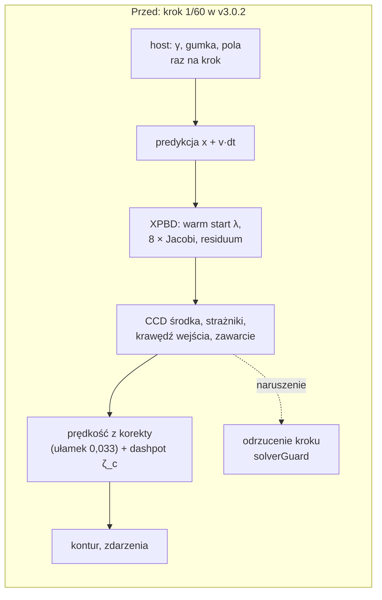
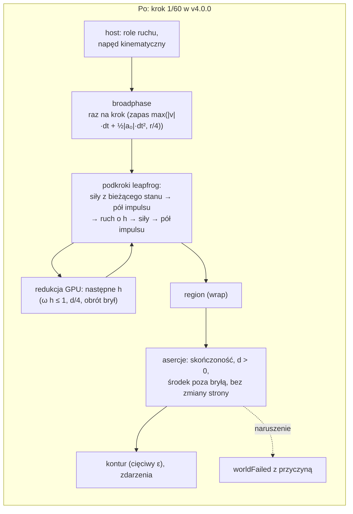
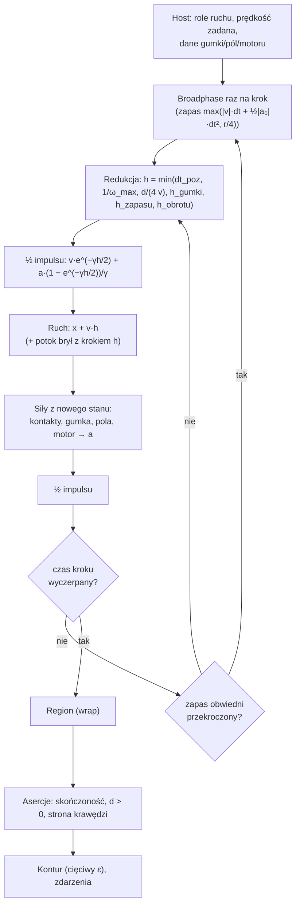

# Change Design: Silnik BubblePhysics 4.0.0 — prawo kontaktu z granicą na promieniu i całkowanie siłowe z podkrokami

**Date:** 2026-11-23
**Artifact:** change-design
**Status:** Draft
**Template version:** default/0.3.2
**References:** specyfikacja autora `2KBubbles-iOS/docs/benchmarks/stage-0/v4.0.0-engine-spec.md` (zatwierdzona 2026-11-23, dalej „specyfikacja”); punkt wyjścia tag `v3.0.2` (`74c3503`)

**Plugin version:** 0.7.11
**Agent Sessions:** claude-code: 57e1ec5d-55c2-4b0f-8128-9fc22ccffaaf

---

<!-- hint: Keep the `**Artifact:** change-design` line — /plan and /implement use it to recognize this as a change-design artifact (requirements + design in one file) and skip the prd.md requirement. -->

> *Odbiorcy sekcji —* 🔍 recenzent (rozumie zmianę bez jej implementowania) · 🛠 autor (implementuje zmianę). Sekcje bez ikony służą obu.

Ścieżki kodu są względne do korzenia repozytorium BubblePhysics. Skróty: K_c — sztywność kontaktu materiału bańki (jednostka siły); γ — opór ruchu (1/s); ε — ugięcie względne x / r; h — podkrok; dt — krok stały 1/60 s; AC (acceptance criterion) — kryterium przyjęcia; „2”, „128”, „7168” — bańki gry o promieniu 24 / ok. 64 / 148 j i masie gry m = (n/2)^(1/2,25). Numery w nawiasach „(spec. …)” wskazują sekcję specyfikacji.

## Summary 🔍

Wersja 3.0.x dotarła do modelu fizyki autora przez kolejne łaty: tłumienie kontaktu ζ_c, „krawędź wejścia” ze środkiem w ścianie, strażniki środka, CCD, odrzucanie kroku i ułamek prędkości z korekty XPBD. Każda z nich leczy ten sam objaw: kontakt jest liniową sprężyną bez granicy, a solver jest pozycyjny. Wydanie 4.0.0 (zmiana łamiąca) usuwa te łaty. Materiał bańki to tylko sztywność kontaktu K_c i opór γ. Kontakt działa według prawa F = K_c · ε / (1 − ε)², w którym siła rośnie bez granic, zanim środek dojdzie do ściany albo do środka drugiej bańki. Solver XPBD znika. Ruch liczy całkowanie siłowe leapfrog z adaptacyjnymi podkrokami wewnątrz kroku 1/60. Długość podkroku wynika z częstości kontaktów (ω h ≤ 1), z drogi środka względem odległości do przeszkody (najwyżej ćwierć w podkroku) i z obrotu brył. Dzięki temu przejście przez ścianę lub bańkę jest wykluczone z konstrukcji, bez CCD i strażników. Wszystkie siły (kontakty, gumka, pola, motor, bryły) liczą się w każdym podkroku z bieżącego stanu, więc wynik nie zależy od podziału kroku. Gra zmienia się osobno, ale bramka przeciskania z gry rusza przed tagiem.

## Background & problem 🔍

Model autora (spec. 1): bańka to środek i promień, nakładające się koła odpychają się sprężyną, tylko siły przesuwają środki, ta sama siła ugina każdą bańkę o ten sam ułamek promienia (s = 1), kontury nigdy się nie przenikają, a palec działa gumką siłową.

Kod `v3.0.2` realizuje ten model inaczej. Kontakt to podatność liniowa c = c₀ · r / r_ref w XPBD (`Sources/BubblePhysicsPublic/Model/Resources.swift:9`), z 8 iteracjami Jacobiego, warm startem λ i jednym krokiem 1/60 (`Sources/BubblePhysicsNativeMetal/NativeMetalSolver.swift:699-755`). Prędkość odtwarza się z korekty położenia, częściowo przez ułamek `contactStiffness · dt²` (`NativeXPBDKernels.metal-source:992-1021`). Stąd biorą się skutki w grze:

- Ściśnięcie ε = c₀ · F / r_ref nie ma granicy. Przy F > 1852 środek wchodzi w ścianę, a gra potrzebuje walidatora ε < 1, `maximumForce` i granicy ucieczki powiększonej o grubość ściany.
- ζ_c = 5 sprawiało, że duża bańka dochodziła do równowagi przy ścianie przez 39 s. Przy ζ_c = 0,3 bańka przestrzeliwuje.
- Przed przejściem chronią CCD środka (dopiero przy ruchu > 1 · r na krok), strażniki z rzutami, wyjątek krawędzi wejścia i odrzucanie kroku `solverGuard`. Para baniek nie ma CCD, a zawarta para „wystrzeliwuje” mniejszą bańkę.
- `deformability` przy kontakcie miękkim nic nie robi (`NativePostSolveKernels.metal-source:713-720`).

Autor zatwierdził 2026-11-23 decyzje 1–16 (spec. 2): usunąć łaty zamiast dokładać nowe.

## Goals and non-goals

### Goals

**G1: Materiał bańki to K_c i γ, a usunięte elementy znikają z API**
- [ ] G1-AC1 — `PhysicsMaterial` rodzaju `.bubble` tworzy się z `contactStiffness` (K_c) i `damping` (γ). K_c ≤ 0, NaN albo ∞ oraz γ < 0, NaN albo ∞ dają `ModelValidationError.valueOutOfRange` z nazwą pola. Materiał `.bubble` utworzony z `friction`, `restitution` albo limitem prędkości różnym od domyślnego jest odrzucany `valueOutOfRange` · `verify: swift test`
- [ ] G1-AC2 — Symbole `BubbleContactCompliance`, `contactCompliance` (materiał i `BubbleDescriptor`), `contactDampingRatio`, `deformability`, `SolverGuardCause`, `WorldRejectionReason.solverGuard` oraz publiczne pola `NativeMetalConfiguration` (`solverIterationCount`, `contactCompliance`, `cacheExpiryFrames`, `teleportDistanceMultiplier`, `ccdVelocityMultiplier`) nie występują w publicznym grafie symboli modułów `BubblePhysicsModel`, `BubblePhysics` (Public), `BubblePhysicsRuntime`, `BubblePhysicsNativeMetal` i `BubblePhysicsMetalRender` (bez `BubblePhysicsLegacy`). `docs/MIGRATION-v4.md` wymienia każdy z tych elementów i jego zastępstwo albo powód usunięcia · `verify: swift package dump-symbol-graph + grep nazw`
- [ ] G1-AC3 — Materiał `.rigid` przyjmuje te same pola i wartości co w `v3.0.2` (tarcie, restytucja, limity prędkości, γ), z wyjątkiem pól usuniętych w G1-AC2 (`deformability`, `contactCompliance`, `contactDampingRatio`), a testy brył bez baniek przechodzą bez zmiany oczekiwań · `verify: swift test`

**G2: Prawo kontaktu z granicą na promieniu (statyka)**
- [ ] G2-AC1 — Przy K_c = 229 bańka „2” (r 24, m 1) i 7168 (r 148, m 38) dociśnięta stałą siłą F = 10², 1200, 10⁴, 2 · 10⁴ i 10⁵ do ściany, oraz para „2”–„2” i para „2”–7168 tego samego materiału ściśnięta tą siłą (dwa pola kierunkowe z filtrem obiektów, każde na jedną bańkę, o równych i przeciwnych siłach; R = r_a + r_b zamiast r), startuje w spoczynku w odległości d* = r · (1 − ε*), gdzie ε* rozwiązuje ε / (1 − ε)² = F / K_c w Double. Przy γ = 0 przez 20 s (dłużej niż okres drgań 7168 przy F = 10², ok. 18 s) odległość spełnia w każdej klatce |d − d*| ≤ 0,5 % · d* + 1e-3 j. Błąd prawa siły o ΔF przesuwa równowagę o ΔF / k i daje drgania o amplitudzie do 2 ΔF / k, które test widzi. Zawsze d > 0, a stały docisk nie daje `worldFailed` ani kroku bez postępu (N3, N4) · `verify: swift test`
- [ ] G2-AC2 — Odwrotność prawa w silniku (float32) zgadza się z rozwiązaniem w Double z błędem względnym ε ≤ 1e-3 dla q = F / K_c od 10⁻⁴ do 10⁶ (CD-D-16) · `verify: swift test`
- [ ] G2-AC3 — W parze tego samego materiału wgniecenia dzielą się w proporcji r_a : r_b ± 2 %. W parze różnych K_a ≠ K_b suma ugięć równa się nakładaniu, a siła zgadza się z rozwiązaniem równania r_a ε(F/K_a) + r_b ε(F/K_b) = δ policzonym w Double ± 1 % · `verify: swift test`
- [ ] G2-AC4 — Przy K_c = 229 bańka „2” dociśnięta siłą F = 10², 1200 i 10⁴ do statycznego koła (promień 50 j), statycznej kapsuły (promień 20 j, długość 100 j) i bryły dynamicznej (kwadrat 100 j, masa 10), która opiera się drugą stroną o ścianę, spełnia to samo prawo co przy ścianie. Scena jak w G2-AC1: start w d* liczonym od środka bańki do powierzchni bryły, γ = 0, 20 s, |d − d*| ≤ 0,5 % · d* + 1e-3 j w każdej klatce · `verify: swift test`
- [ ] G2-AC5 — Dla każdej pary w kontakcie cięciwy konturów obu baniek pokrywają się (różnica ≤ 1e-3 · R), a kontury się nie przenikają (N8) · `verify: swift test`

**G3: Brak przejścia przy dowolnej sile i prędkości w zakresie reprezentowalnym we float32**
- [ ] G3-AC1 — Bańki „2”, 128 i 7168 wystrzelone prostopadle i ukośnie w ścianę grubości 1 leżącą przy współrzędnej rzędu 360 j (jak plansza gry) z prędkością 10², 10³, 3 · 10³, 10⁴ j/s mają po każdym podkroku środek poza bryłą ściany i po stronie startowej jej płaszczyzny (nie przechodzą na drugą stronę). Przy γ = 0 i bez gumki najmniejsza odległość d_min zgadza się ± 10 % (tolerancja na d_min) z d = r · (1 − ε_max), gdzie ε_max wynika z bilansu energii U(ε_max) = ½ m v_n², gdzie v_n to składowa normalna prędkości, a U(ε) = ∫F dx = K_c · r · (1/(1 − ε) + ln(1 − ε) − 1). Przy każdej z tych prędkości i γ ∈ {0; 1} nie ma `worldFailed`. Ten sam strzał 10⁴ j/s powtórzony przy ścianie o współrzędnej 2048 j (z zapasem wobec największej współrzędnej planszy gry) sprawdza tylko brak przejścia i brak `worldFailed`, bez porównania d_min (tam ±10 % to ok. 1 ulp) (N1, CD-D-25) · `verify: swift test`
- [ ] G3-AC2 — Para czołowa i ukośna przy tych samych prędkościach, także „2” na 7168, ma odległość środków > 0 po każdym podkroku, a środki nie zamieniają się stronami wzdłuż prostej zderzenia (N2) · `verify: swift test`
- [ ] G3-AC3 — Bańka uderzona krawędzią bryły dynamicznej wirującej z prędkością kątową 10, 50, 200 i 500 rad/s (ostatnia uruchamia warunek obrotu w h, bo przekracza 384 rad/s) ma środek poza bryłą po każdym podkroku, a świat nie zgłasza odrzucenia ani `worldFailed` · `verify: swift test`
- [ ] G3-AC4 — Bańka ściśnięta przez 10 s między dwiema bryłami dynamicznymi dociśniętymi siłą globalną do ściany kończy każdą klatkę z d > 0 i bez `worldFailed` · `verify: swift test`

**G4: Całkowanie siłowe spójne fizycznie**
- [ ] G4-AC1 — Bańka „2” i 7168 (K_c = 229) bez gumki, z γ = 0, uderza prostopadle w ścianę z prędkością 10², 10³ i 10⁴ j/s i odbija się z prędkością równą prędkości przed uderzeniem ± 2 % (N5) · `verify: swift test`
- [ ] G4-AC2 — Bańka „2” i 7168 (K_c = 229) bez gumki, z γ ∈ {1; 5}, uderza prostopadle w ścianę z prędkością 10² i 10³ j/s. Ubytek energii (kinetycznej i sprężystej) między chwilą t₀ = 0,1 s przed pierwszym kontaktem a t₁ = 0,1 s po jego końcu równa się ∫ γ · m · |v|² dt po przedziale [t₀, t₁] ± 5 %, z dopuszczoną dodatkową różnicą numeryczną nie większą niż 1 % energii początkowej (to błąd metody z G4-AC1, CD-D-22). Innej straty nie ma (N5) · `verify: swift test`
- [ ] G4-AC3 — Ta sama scena (zderzenie pary, odbicie od ściany, gumka ciągnąca bańkę w tłum, bańka w polu radialnym) liczona z naturalną liczbą podkroków i z wymuszonym czterokrotnie drobniejszym podziałem kończy 1 s symulacji z pozycjami zgodnymi do 1 j i prędkościami zgodnymi do 2 % największej prędkości w scenie (tolerancja bezwzględna, bo część baniek prawie stoi) · `verify: swift test`
- [ ] G4-AC4 — Gumka liczy się w każdym podkroku. Bańka „2” (m 1) i 7168 (m 38) z K_band = 22, ciągnięta przy stałym naciągnięciu s = 50 j (cel ustawiany w każdym kroku na x + s wzdłuż stałego kierunku) z γ ∈ {1; 5}, ustala prędkość v = K_band · s / (m · γ) ± 1 %. Przy tym samym s stosunek prędkości dwóch baniek jest odwrotny do mas. Wariant z celem jadącym ze stałą prędkością u: w stanie ustalonym obie bańki jadą z u, a naciągnięcie wynosi s = u · m · γ / K_band ± 1 %. `maximumForce` ogranicza siłę gumki tylko wtedy, gdy jest ustawione. Puszczenie zachowuje prędkość. Gumka z K_band · dt² / m ≥ 1 (K_band = 10⁴, m = 1, γ = 10) jest przyjmowana przez stager, a bańka startująca 300 j od nieruchomego celu jest po 2 s w odległości ≤ 1 j od niego (amplituda maleje jak e^(−γt/2), czyli do ok. 0,014 j), bez wartości nieskończonych · `verify: swift test`
- [ ] G4-AC5 — Siła globalna, pola (kierunkowe, radialne, wirowe, z filtrem obiektów) i siła motoru liczą się w każdym podkroku z bieżącej pozycji. Scena: pole radialne w kole o promieniu 400 j, `strength` = −500 (przyciąga), `falloff` = 0; bańka „2” (m 1), γ = 0, startuje 100 j od środka pola z prędkością styczną 100 j/s, bez kontaktów. Po 2 s jej pozycja zgadza się z całkowaniem referencyjnym tego samego pola w Double (krok 1e-4) do 1 j · `verify: swift test`
- [ ] G4-AC6 — Bańka kinematyczna i prowadzona ścieżką (`.kinematic`, `.pathDriven`) dostaje prędkość od hosta na początku kroku i przy braku kontaktów dociera do pozy z toru jak w `v3.0.2` ± 1e-3 j. Kontakty działają na nią siłą w podkrokach · `verify: swift test`

**G5: Podkroki dobrane z geometrii i częstości**
- [ ] G5-AC1 — Tłum w spoczynku i swobodny ruch wolniejszy niż d / (4 dt) liczą dokładnie 1 podkrok na krok (N6) · `verify: swift test`
- [ ] G5-AC2 — Liczba podkroków rośnie z ω · dt i z v · dt / d zgodnie ze wzorem na h. Przy K_c = 229 i bańce „2” (r 24, m 1): przy statycznym docisku F = 20 000 do ściany 3 podkroki ± 1 (ω · dt ≈ 2,2). Przy czołowym uderzeniu w ścianę z prędkością 1000 j/s największa liczba podkroków w jednej klatce w czasie kontaktu zgadza się ± 20 % z jednowymiarową symulacją odniesienia tej samej reguły h w Double (wartość orientacyjna, nie próg: oceny autora dały ok. 10 przy d / 2 i ok. 20 przy d / 4 w samej fazie dojazdu; z warunkiem d / 4 przy odjeździe ok. 2 × tyle). Od pierwszej klatki po końcu kontaktu, w której d > 4 · v · dt, znowu 1 (N6) · `verify: swift test`
- [ ] G5-AC3 — Bryła dynamiczna wirująca z prędkością kątową, przy której obrót w kroku 1/60 przekracza 128 · 0,05 rad, przechodzi krok bez odrzucenia, a jej obrót na podkrok nie przekracza 128 · 0,05 rad · `verify: swift test`
- [ ] G5-AC4 — Bańka 128 w spoczynku, bez sił (zapas z początku kroku = r / 4), zostaje w trakcie kroku uderzona czołowo bańką „2” lecącą 10⁴ j/s i wypchnięta w stronę trzeciej przeszkody (cienka ściana albo bańka 128). Przeszkoda leży dalej niż r / 4 od bańki 128, ale w zasięgu jej ruchu w tym kroku policzonym w jednowymiarowej symulacji odniesienia. Żadna bańka nie przechodzi przez przeszkodę ani przez inną bańkę (środek po każdym podkroku poza bryłą i po stronie startowej, odległość środków > 0). Telemetria tej klatki podaje co najmniej jedną przebudowę siatki (CD-D-23) · `verify: swift test`
- [ ] G5-AC5 — Bańka „2” w spoczynku, przy współrzędnych rzędu 360 j, pociągnięta gumką K_band = 10⁴ (γ = 1) z naciągnięciem 100 j w stronę cienkiej ściany (grubość 1) i, w drugim wariancie, bańki 128, leżących 80 j od niej. Przeszkoda jest w zasięgu drogi bańki w pierwszym kroku (ok. 1,1 · s) i wewnątrz zapasu ½ |a₀| · dt² (ok. 1,39 · s). Uderzenie wypada przy ok. 10⁴ j/s, czyli w zakresie G3 (CD-D-25). Bańka nie przechodzi przez żadną z przeszkód: środek po każdym podkroku poza bryłą i po stronie startowej, odległość środków > 0. Energia (kinetyczna, sprężysta gumki i kontaktu) po 0,67 s nie przekracza energii początkowej, czyli nie ma pompowania (CD-D-27). Ta sama scena z pakietowym przełącznikiem „zapas = tylko minimum r / 4” daje ten sam brak przejścia i co najmniej jedną przebudowę siatki w telemetrii, co sprawdza ograniczenie h przez zapas (CD-D-23) · `verify: swift test`

**G6: Stabilność tłumu i asercje zamiast korekt**
- [ ] G6-AC1 — Tłum 4 × 10, 150 baniek, gumka bez `maximumForce` ciągnie po kolei po kilka baniek w róg przez 60 s: zero `worldFailed`, zero wartości nieskończonych, d > 0 w każdej klatce, przenikanie konturów 0 (N7) · `verify: swift test`
- [ ] G6-AC2 — Stan z d ≤ 0 w parze albo ze środkiem bańki wewnątrz bryły statycznej lub dynamicznej (test punktu w wielokącie, kole lub kapsule), wstrzyknięty diagnostycznie po podkrokach, przełącza świat w `worldFailed` z przyczyną naruszenia kontaktu i identyfikatorami obiektów w diagnostyce. Krok nie jest odrzucany ani powtarzany · `verify: swift test`
- [ ] G6-AC3 — Wartość NaN albo ∞ w stanie przełącza świat w `worldFailed(.nonFiniteValues)`, jak w `v3.0.2` · `verify: swift test`
- [ ] G6-AC4 — Bańka z `regionExitPolicy == .wrap` zawinięta na wolne miejsce symuluje się dalej bez `worldFailed`. Zawinięta na miejsce nakładające się z inną bańką przy d > 0 symuluje się dalej, a para rozsuwa się siłą kontaktu. Zawinięta tak, że jej środek trafia do wnętrza bryły statycznej albo dokładnie na środek innej bańki (d = 0), przełącza świat w `worldFailed` z przyczyną naruszenia kontaktu, bo asercja biegnie po regionie (CD-D-19) · `verify: swift test`
- [ ] G6-AC5 — Bryła kinematyczna jadąca stałą prędkością 100 j/s prostopadle do ściany wciska w nią bańkę „2”, a scena leży przy współrzędnych rzędu 360 j, jak w grze. W ciągu 1 s symulacji od pierwszego kontaktu świat przechodzi w `worldFailed` z przyczyną kroku bez postępu i identyfikatorami bańki i bryły. Żadna klatka tej sceny nie przekracza 10⁴ podkroków (CD-D-4, CD-D-21) · `verify: swift test`

**G7: Transakcja nie tworzy stanu niemożliwego**
- [ ] G7-AC1 — Wstawienie, `replace` albo zmiana pozycji bańki ze środkiem wewnątrz bryły statycznej (test punktu w wielokącie, kole lub kapsule; brzeg liczy się jako wnętrze) jest odrzucana błędem walidacji transakcji. Świat zostaje w stanie sprzed transakcji · `verify: swift test`
- [ ] G7-AC2 — Wstawienie albo zmiana pozycji bańki w odległości od środka innej bańki mniejszej niż 1e-3 · (r_a + r_b) jest odrzucana tym samym błędem · `verify: swift test`
- [ ] G7-AC3 — Łączenie albo podział, którego wynikowy środek trafiłby w bryłę statyczną albo na środek innej bańki (G7-AC1, G7-AC2), jest odrzucany tym samym błędem i nie zmienia świata · `verify: swift test`

**G8: Telemetria i wydajność**
- [ ] G8-AC1 — `NativeMetalFrameTelemetry` podaje liczbę podkroków w klatce, liczbę przebudów siatki w klatce, czas GPU fizyki i czas GPU konturu osobno, a benchmark stress raportuje histogram podkroków (p95, maksimum). Pola po XPBD, CCD i strażnikach znikają · `verify: swift test`
- [ ] G8-AC2 — Benchmark `Benchmarks/iOS/BubblePhysicsBench` na iPhonie X, w Release, ze 150 bańkami w czterech scenach (tłum w spoczynku, gumka w pełnym naciągnięciu do ściany, czołowe zderzenie dwóch baniek 128 z prędkością 10³ j/s każda, jedna bańka „2” wystrzelona z prędkością 10⁴ j/s w tłum) ma p95 klatki ≤ 16,67 ms. Raport podaje histogram podkroków, najdłuższą klatkę każdej sceny i czas fizyki osobno od konturu (A6). To bramka tagu `v4.0.0`: przekroczenie wstrzymuje tag i wraca do autora jako decyzja o lokalnym h (CD-D-7) · `verify: pomiar na iPhonie X, raport w docs/benchmarks/`
- [ ] G8-AC3 — Bazowe wyniki perf guard i benchmarku stress są odświeżone na 4.0.0 (kryterium raportowe, bez progu: progiem wydajności jest G8-AC2), a raport w `docs/benchmarks/` podaje ich zmianę względem `v3.0.2` zmierzoną naprzemiennie na tym samym Macu · `verify: swift run -c release BubblePhysicsPerfGuard`

**G9: Wydanie 4.0.0 i przyjęcie w grze**
- [ ] G9-AC1 — Testy z listy „do usunięcia” (spec. 4) są usunięte. Testy z listy „do zachowania” przechodzą z oczekiwaniem przeliczonym na nowe prawo. Testy nowe N1–N8 oraz testy z G3-AC3, G3-AC4, G4-AC3, G4-AC5, G4-AC6, G5-AC3, G5-AC4, G5-AC5, G6-AC2, G6-AC4, G6-AC5 i G7 istnieją i przechodzą. Pełne `swift test` jest zielone · `verify: swift test`
- [ ] G9-AC2 — Showcase i benchmark stress kompilują się i działają na kontakcie z K_c (bez kontaktu twardego, przegubów z bańkami i kontaktu PBD bańka–bryła) · `verify: xcodebuild Showcase i BubblePhysicsBench`
- [ ] G9-AC3 — Przed tagiem `v4.0.0` gałąź gry wskazująca na gałąź silnika przechodzi bramkę przeciskania z projektu gry (G2-AC10 w `solution-design.md` gry, kryterium A1 specyfikacji) na Macu. Scena to plansza 4 × 10, ziarna 1–5 × 3 powtórzenia, gumka bez `maximumForce` i jeden materiał. Wynik: 15/15 przebiegów zaliczonych, wszystkie 40 łączeń sceny wykonane w każdym przebiegu, przenikanie konturów 0, ucieczki 0 w granicy ścisłej, zero `worldFailed` (A1). Raport podaje wersje `PhysicsGate.json` i `PhysicsTuning.json` oraz rozbieżności względem specyfikacji · `verify: bramka PhysicsLab w 2KBubbles`
- [ ] G9-AC4 — `CHANGELOG.md`, wersja w `README.md` i `MigrationGuideTests` wskazują 4.0.0, a `docs/MIGRATION-v4.md` opisuje zmiany zachowania prostymi słowami (spec. 7) · `verify: swift test`

### Non-goals

- Zmiany w repozytorium gry 2KBubbles (spec. 5): strojenie, `TuningPanel`, granica ucieczki, testy gry. To osobna zmiana, prowadzona przez autora w 2KBubbles. **Warunek wejścia dla G9-AC3:** zanim ruszy tag, gałąź gry z migracją API i strojeniem na 4.0.0 musi istnieć. Ta zmiana dostarcza do niej gałąź silnika i `docs/MIGRATION-v4.md`.
- Lokalne h dla wysp kontaktów. Jeśli pomiar wydajności (G8-AC2) przekroczy budżet, tag czeka, a autor decyduje, czy wyspy wejdą do 4.0.0 (zmiana zakresu tego projektu) czy osobnego wydania.
- Model siłowy dla kontaktu bryła–bryła. Pozycyjny solver brył zostaje (kierunek na przyszłość).
- Restytucja i tarcie w kontakcie bańki. Wracają tylko decyzją autora (spec. decyzja 7).
- Moduły nieużywane przez grę i ścieżkę publiczną: `BubblePhysicsLegacy` (`Sources/BubblePhysics/`), `BubblePhysicsReference`, `BubblePhysicsReferenceMetal`, `BubblePhysicsMetal`, `BubblePhysicsCore`.
- Generowanie konturu poza wzorem cięciwy pary: promienie, wygładzanie, majoranta, `effectiveRadius`, `bounds` (spec. 8).

## Architecture

**Kształt zmiany.** Jeden krok stały dt = 1/60 (bez zmian w `FixedStepDriver`) składa się teraz z czterech faz:

1. Host przygotowuje stan.
2. Broadphase działa raz na krok.
3. Pętla podkroków leapfrog działa na GPU.
4. Na końcu idą region, asercje, kontur i zdarzenia.

Solver XPBD, CCD baniek, strażniki, krawędź wejścia, walidacja zawierania, dashpot, cache λ, kontakt twardy i przeguby z bańkami znikają w całości (spec. zmiana 4). Rekordy kontaktów kroku zostają, bo karmią zdarzenia kontaktu, łączenie i kontur.

**1. Host (Runtime).** `MotionControllers.prepare` przestaje liczyć γ, gumkę, pola i motor. Ustala tylko rolę ruchu i prędkość zadaną:
- `.static` → zero;
- `.kinematic` i `.pathDriven` → prędkość z toru, jak dziś (CD-D-9).

Gumkę (cel, K_band, opcjonalne `maximumForce`), siłę globalną, opisy pól z filtrami i motor (siła, moment) przekazuje GPU jako dane wejściowe kroku (CD-D-5). Masa, promień kolizji i materiał (K_c, γ) idą w rekordzie bańki zamiast podatności, ζ_c i limitów.

**2. Broadphase (raz na krok).** Siatka i kandydaci powstają jak dziś (`nativePrepareGrid` … `nativeCompactCandidates`), z obwiednią powiększoną o zapas max(|v| · dt_pozostałe + ½ |a₀| · dt_pozostałe², r / 4). Tu a₀ to przyspieszenie z sił bez kontaktów (gumka, pola, siła globalna, motor), które nie potrzebują sąsiedztwa, a dt_pozostałe to cały krok przy pierwszej budowie i reszta kroku przy przebudowie (CD-D-23). Kolejność na początku kroku jest więc taka: siły bez kontaktów → zapas → broadphase → pełne siły z kontaktami → podkroki, bez zależności cyklicznej. Zapas działa także dla bańki w spoczynku, którą sztywna gumka rusza w pierwszym podkroku. Każda bańka mierzy odległość |x − x₀| od pozycji z ostatniej budowy siatki (a nie przebytą drogę, więc drgania nie wyczerpują zapasu). h_zapasu liczy się z rzeczywistym przyspieszeniem w podkroku i nie pozwala tej odległości przekroczyć zapasu, więc bezpieczeństwa pilnuje h, a zapas wpływa tylko na częstość przebudowy. Gdy zapas którejś się wyczerpie, redukcja h ustawia znacznik przebudowy: pozostałe podkroki w tym buforze wychodzą od razu, a następny bufor poleceń tej samej klatki zaczyna się od przebudowy siatki i kandydatów (G5-AC4, CD-D-18). W typowej klatce nie ma więc żadnych dodatkowych dyspozycji. Limit `candidateLimitPerObject` i raport przepełnienia zostają. `nativeBuildContacts` traci wyjątek krawędzi wejścia i odczyt cache poprzedniej klatki. Kandydat to bańka–bańka, bańka–krawędź jednostronna albo wypukły wierzchołek (`NativeStaticPolygonEdges.swift` bez zmian) i bańka–bryła (statyczne koło, kapsuła, bryła dynamiczna).

**3. Podkrok (leapfrog, kick–drift–kick, CD-D-6).** Stan bańki to x, v i przyspieszenie a. Na początku każdego kroku siły liczą się od nowa z bieżącego stanu. Przyspieszenie z poprzedniej klatki byłoby nieaktualne po transakcji, zmianie celu gumki, zawinięciu regionu albo zmianie prędkości kinematycznej. Wewnątrz kroku siły z końca podkroku są początkiem następnego. Koszt: jedno obliczenie sił więcej na krok.

1. **Wybór h** (redukcja GPU, CD-D-7): h = min(dt_pozostałe, 1/ω_max, min_kandydatów d / (4 · v), h_gumki, h_zapasu, h_obrotu).
   - ω_max to górne oszacowanie najwyższej częstości układu (Gershgorin dla sztywności znormalizowanej masami, CD-D-24), liczone na obiekt i redukowane do maksimum: ω_i² = Σ_j k_j · (1/m_i + 1/√(m_i · m_j)) + K_band / m_i. Suma idzie po kontaktach aktywnych obiektu i, a k_j = dF/dδ kontaktu j. Dla ściany i bryły statycznej m_j = ∞, więc człon partnera znika. Dla pary tego samego materiału k_j = K_c (1 + ε) / (R (1 − ε)³), dla pary różnych K dwie sprężyny szeregowo 1/k_j = 1/k_a + 1/k_b z k_i = K_i (1 + ε_i) / (r_i (1 − ε_i)³). Bryła dynamiczna wchodzi w punkcie styku masą efektywną z obrotem: 1/m_eff = 1/M + (ρ_j × n_j)² / I. Ma też własny wiersz, redukowany razem z bańkami: ω_B² = Σ_j k_j · (1/m_eff,j + 1/√(m_eff,j · m_j)) po wszystkich kontaktach bryły z bańkami. Lekka bryła ściśnięta między ciężkimi bańkami dostaje więc ω² rzędu 2k / M, a nie k / √(m · M). Oszacowanie jest dokładne dla pary (2k/m) i przy ścianie (k/m), a w gęstej sieci heksagonalnej zawyża ω najwyżej o √2. Tam ε jest małe i wystarcza jeden podkrok, więc koszt jest pomijalny.
   - **Aktywny kontakt** (ściana albo bryła: d < r; para: d < R) podlega warunkowi d / 4 niezależnie od kierunku ruchu, z |v_n| zamiast v_zbl: |v_n| + (|a_a| + |a_b|) · h / 2 ≤ d / (4h), gdzie v_n to względna prędkość wzdłuż d. Krok jest wtedy tak samo krótki przy odjeździe jak przy dojeździe, co zachowuje odwracalność leapfrogu. Z warunku wypada wyłącznie **kandydat bez kontaktu**, który się oddala: v_zbl,0 + (|a_a| + |a_b|) · h_max / 2 ≤ 0, gdzie v_zbl,0 to prędkość zbliżania z początku podkroku, a h_max to minimum pozostałych członów h. Kandydat bez kontaktu, który się zbliża (także oddalający się, ale z dużym przyspieszeniem w stronę przeszkody), podlega nierówności niżej z v_zbl.
   - Dla bryły dynamicznej i kinematycznej v_zbl zawiera prędkość punktu bryły: |v_bryły| + |ω_bryły| · ρ_bryły, gdzie ρ_bryły to promień obwiedni od środka masy.
   - h_zapasu: największe h, przy którym odległość bańki od pozycji z ostatniej budowy siatki po podkroku (|x − x₀| powiększone o |v| · h + ½ |a| · h², z rzeczywistym a podkroku) nie przekracza zapasu obwiedni kandydatów (CD-D-23). Gdy zapas się kończy, ustawia się znacznik przebudowy siatki.
   - h_gumki = 0,25 / ω_band, gdzie ω_band = √(K_band / m) dla każdej bańki z gumką (CD-D-27). Przy ω_band · h ≈ 1 oscylator gumki ma ok. 30 % błędu fazowego energii, a uderzenie w ścianę „zamraża” go w losowej fazie, co pompuje energię (×11 w 0,67 s w scenie G5-AC5). Człon dotyczy tylko sztywnych gumek: gumka gry (K_band ≈ 22, ω_band · dt ≈ 0,08) go nie odczuwa.
   - h_obrotu = 128 · 0,05 / |ω_bryły| (CD-D-3).
   - Stałe 1, 4, 128 i 0,05 to stałe metody i istniejącego próbkowania, a nie parametry strojenia.
   - **Krok bez postępu (CD-D-21).** Krok jest bez postępu, gdy zachodzi jeden z dwóch warunków wynikających z formatu float32:
     - obiekt, który wyznacza h, nie zmienia pozycji (ani obrotu, dla bryły) we float32 przez 1024 kolejne podkroki tego samego kroku. Obiekt wyznaczający h to: bańka lub bryła o największym ω_i, gdy h = 1/ω_max; bańka z pary, gdy h = d / (4 · v_zbl); bryła, gdy h = h_obrotu. To jest dokładnie stan „pozycje zamarły, a h zostało małe”: ruch spoza sił (bryła kinematyczna, korekta bryła–bryła) ściska bańkę, a przyrosty v · h są mniejsze od ulp współrzędnej. Liczba 1024 to stała wykrywania, a nie strojenia fizyki. Prawidłowa klatka ma od 1 do ok. 200 podkroków (ocena: ok. 85 przy dojeździe z 10⁴ j/s, drugie tyle przy odjeździe, ok. 107 przy dojeździe w scenie sztywnej gumki), a nieruchomy docisk ma ω · dt podkroków w kroku. Dla bańki „2” (K_c 229) 1024 podkroki wypadają przy d ≈ 0,041 j, czyli przy sile ok. 8 · 10⁷, prawie trzy rzędy powyżej zakresu kryteriów (10⁵). Powyżej tej siły, oraz przy bańce spoczywającej w celu gumki z K_band ≳ (1024 / dt)² · m ≈ 3,8 · 10⁹ · m, warunek zgłosi fałszywy krok bez postępu (znane ograniczenie, CD-D-26). Stała dotyczy kolejnych podkroków bez zmiany pozycji, a nie ich łącznej liczby;
     - h < 2⁻²⁰ · dt, czyli czasu kroku nie da się posunąć.
     Warunku nie wywołuje: nieruchomy docisk przy sile w zakresie kryteriów (do 10⁵, ω · dt ≈ 7), hamująca bryła kinematyczna (przy h ≈ 1/ω krok ma tylko kilka podkroków), krótkie h z dt_pozostałe ani z h_zapasu, ani szybkie odbicie (pozycja się zmienia). Sam warunek czasu nie wystarcza, bo przy współrzędnych rzędu 360 (ulp ok. 3 · 10⁻⁵ j) pozycje zamierają, zanim h spadnie pod 2⁻²⁰ · dt, a klatka robiłaby ok. 10⁵ podkroków. Świat przechodzi w `worldFailed` z przyczyną kroku bez postępu i identyfikatorem obiektu, który wyznaczył h, oraz jego kontaktów.
2. **Pół impulsu:** v ← v · e^(−γ h/2) + a · (1 − e^(−γ h/2)) / γ, a przy γ = 0 po prostu v + a · h/2. To dokładne rozwiązanie dv/dt = a − γ v przy stałej sile w półkroku, więc prędkość ustalona pod stałą siłą wynosi dokładnie a / γ przy każdym h (zamiast a/γ · (1 + γh/4) przy kolejności „opór, potem a · h/2”). Bryły dynamiczne robią to samo z siłą i momentem od baniek. Role ruchu w podkroku: bańka `.static` ma masę nieskończoną (`inverseMass = 0`, `NativePublicWorld.swift:190`), więc nic jej nie rusza; bańki `.kinematic` i `.pathDriven` nie dostają oporu ani impulsu z gumki, a ich prędkość z hosta zmieniają tylko kontakty (jak dziś, `MotionControllers.swift:88`, CD-D-9); bryła kinematyczna porusza się ściśle według zadanego ruchu i ignoruje siły oraz kontakty.
3. **Ruch:** x ← x + v · h. Obrót bańki: kąt + ω · h, ω · e^(−γ h). Bryły dynamiczne przechodzą cały istniejący potok brył z krokiem h: predykcja z próbkowaniem obrotu względem ścian, CCD bryła–bryła, kontakty bryła–bryła i wypychanie ze ścian (CD-D-2). Bez brył dynamicznych nic z tego się nie koduje.
4. **Siły z nowego stanu → a.** Kontakt według prawa (niżej), gumka K_band · (cel − x) z opcjonalnym obcięciem, siła globalna, pola z bieżącej pozycji i motor. Bryła dostaje siłę równą i przeciwną w punkcie styku (siła i moment).
5. **Drugie pół impulsu:** ta sama postać co w punkcie 2.

Iloczyn mnożników oporu po podkrokach daje e^(−γ · dt). Półimpuls z oporem jest dokładny dla siły stałej w półkroku, więc suma impulsów przybliża całkę siły z oporem w granicy błędu metody O(h²). Wynik nie zależy od podziału kroku w tej samej granicy (G4-AC3).

**Prawo kontaktu (spec. zmiana 2).** ε = x / r, F = K_c · ε / (1 − ε)².
- **Ściana i bryła:** ugięcie x = r − d, F = K_c · (r − d) · r / d². Dla ściany d to odległość od prostej krawędzi wzdłuż normalnej zewnętrznej albo od wypukłego wierzchołka. Dla koła, kapsuły i bryły dynamicznej d to odległość od powierzchni (CD-D-10).
- **Para tego samego materiału:** postać zamknięta F = K_c · (R − d) · R / d², gdzie R = r_a + r_b.
- **Para różnych materiałów:** F to jedyne rozwiązanie r_a ε(F/K_a) + r_b ε(F/K_b) = δ. Liczy je stała liczba kroków Newtona od rozwiązania zamkniętego dla K_min, czyli od dolnego ograniczenia F (CD-D-16).
- Rekord kontaktu przechowuje F, ε_a i ε_b dla zdarzeń i konturu.

**Wykonanie na GPU (CD-D-18).**
- Podkrok to trzy dyspozycje: siły po sąsiedztwie z całkowaniem (dwa półimpulsy i ruch), redukcja h i, przy bryłach, potok brył.
- Host koduje w pierwszym buforze poleceń 2 × tyle podkroków, ile zużyła poprzednia klatka (co najmniej 2). Każdy podkrok, którego czas już się skończył, wychodzi od razu. Gdy podkroków zabraknie, ta sama klatka dostaje następny bufor, po odczycie licznika na końcu poprzedniego, a każdy kolejny bufor tej klatki ma dwa razy więcej podkroków niż poprzedni. Klatka potrzebująca N podkroków ma więc O(log N) buforów: uderzenie 10³ j/s (ok. 40 podkroków z fazą odjazdu) po klatce z 1 podkrokiem to 5 buforów (2 + 4 + 8 + 16 + 32), uderzenie 10⁴ j/s (ok. 170) to 7, a klatka wykrycia kroku bez postępu (ok. 1400) to ok. 10.
- CPU nie czyta niczego w środku bufora.

**4. Koniec kroku.**
- `nativeCheckFinite` zostaje.
- Nowa asercja po każdym kroku (i diagnostycznie po podkroku) sprawdza dwie rzeczy: każda para ma d > 0, a środek żadnej bańki nie leży wewnątrz bryły statycznej ani dynamicznej (test punktu w wielokącie, kole lub kapsule, w pozie bryły z końca kroku). Dla każdej krawędzi jednostronnej w kontakcie każdy podkrok porównuje stronę prostej krawędzi z początku i z końca tego podkroku, gdy środek leży w obszarze rzutu odcinka. Zmiana strony ustawia znacznik bańki, który asercja czyta po kroku. To wyłapuje przejście przez cienką ścianę w dowolnym podkroku i nie zgłasza obejścia końca ściany (wtedy środek wychodzi poza rzut odcinka). Naruszenie to błąd silnika: `worldFailed` z nową przyczyną i identyfikatorami obiektów (CD-D-12). Zastępuje to `nativeValidateBubbleContainment` i ostatnią pętlę strażnika.
- Kontur: cięciwa bańki a leży w r_a · (1 − ε_a) od jej środka. Zastępuje to podział c_a : c_b (`NativePostSolveKernels.metal-source:728-732`), więc cięciwy obu baniek się pokrywają. Przycinanie krawędzią ściany, wygładzanie i majoranta zostają.
- Zdarzenia kontaktu, łączenia i sensory czytają rekordy kontaktów końca kroku jak dziś.
- Region (`nativeApplyPublicRegion`) działa raz na krok, po podkrokach i przed asercjami. Zawinięcie (`.wrap`) to jedyne przesunięcie środka poza siłami, wybrane przez grę polityką regionu. Asercja po regionie wyłapuje zawinięcie na zajęte miejsce (CD-D-19, G6-AC4).

**Walidacja transakcji (CD-D-8).** `TransactionStager` odrzuca błędem walidacji każdą zmianę, po której środek bańki leżałby:
- wewnątrz bryły statycznej (test punktu w bryle; brzeg liczy się jako wnętrze);
- bliżej niż 1e-3 · (r_a + r_b) od środka innej bańki.

Dotyczy to wstawienia, `replace`, zmiany pozycji oraz wyniku łączenia i podziału.

**Znane ograniczenie (CD-D-4).** Pozycyjne korekty bryła–bryła i wypychanie bryły ze ściany przesuwają bryłę poza siłami, więc nie podlegają warunkowi d / 4. Gwarancja z konstrukcji obejmuje ściany, pary baniek oraz ruch brył z całkowania. Skrajny przypadek korekty wyłapuje asercja d > 0 (`worldFailed` z przyczyną). Tak samo jest z bryłą kinematyczną, która wciska bańkę w ścianę, bo jej ruch jest zadany i ignoruje siły. Ten przypadek kończy krok bez postępu (CD-D-21, G6-AC5), a nie zawieszeniem klatki.

## Components

- **`Sources/BubblePhysicsPublic/Model/Resources.swift`** — `PhysicsMaterial` dla `.bubble`: `contactStiffness` i `damping`. Usunięte: `BubbleContactCompliance`, `contactDampingRatio`, `deformability`. Pola `friction`, `restitution` i limity prędkości zostają tylko dla `.rigid` (CD-D-11).
- **`Sources/BubblePhysicsPublic/Model/Objects.swift`** — usunięte nadpisanie `contactCompliance` na `BubbleDescriptor`.
- **`Sources/BubblePhysicsPublic/Diagnostics.swift`**, **`Sources/BubblePhysicsPublic/BubbleWorld.swift`** — usunięte `SolverGuardCause`, `WorldRejectionReason.solverGuard`, `lastSolverGuardCause`, licznik zawartych par i `makeBenchmarkWorld(solverIterationLimit:pairCorrectionLimit:)`. Nowe przyczyny `WorldFailureReason`: naruszenie asercji kontaktu i krok bez postępu, z identyfikatorami w diagnostyce.
- **`Sources/BubblePhysicsRuntime/MotionControllers.swift`** — host liczy tylko prędkość zadaną ról kinematycznych. γ, gumka, pola i motor przechodzą do danych wejściowych GPU.
- **`Sources/BubblePhysicsRuntime/TransactionStager.swift`** — walidacja położenia środka (G7), usunięcie walidacji przepełnienia α (`:553`) i strażnika sztywności gumki `validateBandStability` (`:542`, CD-D-20).
- **`Sources/BubblePhysicsRuntime/NativeCompleteStepper.swift`** — przekazanie danych gumki, pól i motoru do kroku natywnego oraz odbiór telemetrii podkroków.
- **`Sources/BubblePhysicsNativeMetal/NativePublicWorld.swift`** — rekord bańki z K_c, γ i masą (bez toru `contact.z`, podatności, ζ_c i limitów). Rekordy gumki, pól i motoru. Mapowanie przegubów bez baniek.
- **`Sources/BubblePhysicsNativeMetal/NativeSolverInput.swift`** — usunięte `contactStiffness`, `contactDamping`, `linearDamping`, `angularDamping`, `contactTolerance`, `separationTolerance`, `positionTolerance` i bity strażnika. Zostają `timeStep`, `maxContourSegmentLength` i `contourSurfaceTension`.
- **`Sources/BubblePhysicsNativeMetal/NativeMetalBackend.swift`** — `NativeMetalConfiguration` bez pól publicznych. Zostają pakietowe przełączniki dla testów: wymuszony podział podkroku (G4-AC3), zapas obwiedni ograniczony do minimum r / 4 (G5-AC5), zapis pozycji po każdym podkroku (rozwinięcie dzisiejszego `nativeCapturePositions`, G3), asercja po każdym podkroku i wstrzyknięcie stanu po podkrokach (G6-AC2). Kodowanie tych przełączników leży w `NativeMetalSolver.swift`. Telemetria: liczba podkroków, liczba przebudów siatki w klatce oraz czasy GPU fizyki i konturu (CD-D-17).
- **`Sources/BubblePhysicsNativeMetal/NativeMetalSolver.swift`** — nowy potok kroku: broadphase, pętla podkroków z przebudową siatki, asercje, kontur. Usunięte: warm start, pętla Jacobiego, residuum, CCD, strażniki, zawarcie, dashpot, cache λ i teleport.
- **`Sources/BubblePhysicsNativeMetal/Shaders/NativeForceKernels.metal-source`** (nowy) — prawo kontaktu (ściana, bryła, para, Newton dla różnych K), gumka, pola i motor, dwa półimpulsy i ruch, redukcja h, asercje kontaktu.
- **`Sources/BubblePhysicsNativeMetal/Shaders/NativeXPBDKernels.metal-source`** — zostają skan, kompaktowanie, sąsiedztwo i rekordy kontaktów oraz kontakt bryła–bryła. Usunięte: mnożniki, Jacobi, residuum, warm start, cache λ, `nativeRigidApplyBubbles`, część kontaktu bańka–bryła w `nativeRigidContacts`, `nativeApplyJointBubbles`, `nativeUpdateVelocities` i `nativeDampContactNormalMotion`. Plik dostaje nazwę według nowej roli, jeśli plan tak zdecyduje.
- **`Sources/BubblePhysicsNativeMetal/Shaders/NativePostSolveKernels.metal-source`** — usunięte: CCD, strażniki, krawędź wejścia, walidacja zawarcia i nacisk konturu z λ. Wzór cięciwy z ε (spec. zmiana 2, „Kontur”). Potok brył (`nativeRigidPredict`, `nativeRigidGuardWalls`, CCD brył) przyjmuje krok h, a przekroczenie budżetu obrotu przestaje być możliwe.
- **`Sources/BubblePhysicsNativeMetal/Shaders/NativeGeometryKernels.metal-source`** — `nativePredict` znika (ruch jest w podkroku). `nativeBuildContacts` bez krawędzi wejścia. Kandydaci z zapasem max(|v| · dt + ½ |a₀| · dt², r / 4) z sił bez kontaktów (CD-D-23).
- **`Sources/BubblePhysicsNativeMetal/NativeJointState.swift`**, **`NativeRigidPolygonState.swift`**, **`NativeMetalBufferLayout.swift`** — przeguby tylko bryła–bryła. Statyczna ściana w kontakcie z bańką nie czyta tarcia ani restytucji. Nowy układ rekordu bańki.
- **`Sources/BubblePhysicsMetalRenderBenchmark/PublicWorldStressBenchmark.swift`**, **`Benchmarks/macOS/BubblePhysicsPerfGuard`**, **`Benchmarks/iOS/BubblePhysicsBench`** — kontakt z K_c, sceny z G8-AC2, histogram podkroków, nowe wartości bazowe.
- **`Examples/BubblePhysicsShowcase`** — `BubbleScene` i `RigidScene` na kontakcie z K_c, bez `deformability` i kontaktu twardego.
- **`Tests/…`** — audyt według spec. 4 (usuń, zachowaj z przeliczeniem, nowe N1–N8) oraz testy z G3-AC3, G3-AC4, G4-AC3, G4-AC5, G4-AC6, G5-AC3, G5-AC4, G5-AC5, G6-AC2, G6-AC4, G6-AC5 i G7.
- **`docs/MIGRATION-v4.md`** (nowy), **`CHANGELOG.md`**, **`README.md`**, **`docs/integration-guide.md`** — opis wydania i migracji.

## Error handling

- **Naruszenie asercji kontaktu** (d ≤ 0 w parze, środek wewnątrz bryły statycznej albo znacznik zmiany strony krawędzi w podkroku) po podkrokach to błąd silnika. Świat przechodzi w `worldFailed` z nową przyczyną. Diagnostyka podaje obiekty, krawędź i odległość. Kroku nie odrzuca się ani nie powtarza (G6-AC2).
- **Zawinięcie regionu na zajęte miejsce** kończy się `worldFailed` z przyczyną naruszenia kontaktu (CD-D-19, G6-AC4).
- **Wartości nieskończone** prowadzą do `worldFailed(.nonFiniteValues)`, bez zmian (G6-AC3).
- **Transakcja tworząca stan niemożliwy** jest odrzucana błędem walidacji. Świat żyje dalej w stanie sprzed transakcji (G7).
- **Przepełnienie kandydatów** jest raportowane jak dziś (`contactCandidateOverflow`). Para albo krawędź pominięta przez `candidateLimitPerObject` nie ma ani siły, ani warunku d / 4, ani znacznika strony, więc gwarancja braku przejścia jej nie obejmuje. Asercja wyłapie tylko skutek widoczny na końcu kroku (środek w bryle, d ≤ 0), a przejście pary przez siebie albo przez cienką ścianę z d > 0 może umknąć. Jedynym pewnym sygnałem jest licznik przepełnienia, który gra powinna traktować jako błąd konfiguracji (limit `candidateLimitPerObject` = 128 kandydatów na obiekt, `NativeMetalSolver.swift:268`, przy tłumie 150 baniek gry nie jest osiągany). Znane ograniczenie, CD-D-26.
- **Krok bez postępu** (obiekt wyznaczający h stoi we float32 przez 1024 kolejne podkroki, albo h < 2⁻²⁰ · dt) kończy się `worldFailed` z przyczyną i identyfikatorami, więc klatka nie zawiesza się na dokładaniu buforów (CD-D-21, G6-AC5).
- **Brak podkroków w buforze** to nie błąd. Klatka dostaje następny bufor poleceń (CD-D-18).

## Testing & verification

- **Bliźniak zgodności podziału (G4-AC3)** to najważniejszy test przekrojowy. Pakietowy przełącznik wymusza czterokrotnie drobniejszy podział kroku, a test porównuje stan po 1 s z przebiegiem naturalnym. Chroni zasadę „wynik nie zależy od podkroków” przed regresją każdej z sił z osobna.
- **Odniesienie w Double** dla prawa kontaktu, odwrotności prawa, Newtona dla różnych K i bilansu energii (N1, N3, G2-AC3, G4-AC5). Testy porównują wynik silnika z rachunkiem w teście, a nie z wartością przypiętą z przebiegu.
- **Dowód, że zielone nie jest puste.** Testy braku przejścia (G3) sprawdzają stan po każdym podkroku przez diagnostyczny zapis pozycji (dziś `nativeCapturePositions`). Asercja liczby podkroków > 1 w scenie uderzenia pokazuje, że warunek d / 4 rzeczywiście zadziałał.
- **Bramka gry (G9-AC3)** idzie na gałęzi gry z zależnością od gałęzi silnika, przed tagiem.

## Decisions 🔍

| ID | Title | Context | Options | Choice | Rationale | Source | Goal impact | Consequences |
|----|-------|---------|---------|--------|-----------|--------|-------------|--------------|
| CD-D-1 | Zakres: tylko silnik, bramka gry przed tagiem | Zmiany gry są w innym repozytorium, a przyjęcie A1 mierzy się w grze | jeden dokument dla silnika i gry; tylko silnik z bramką przed tagiem; tylko silnik, bramka po wydaniu | tylko silnik; bramka przeciskania z gałęzi gry przed tagiem `v4.0.0` | plan i implementacja w jednym repozytorium jak w 3.0.x; bramka to jedyny dowód działania w realnym tłumie | user | G9-AC3, Non-goals | zmiana gry (spec. 5) to osobny change w 2KBubbles; tag czeka na bramkę |
| CD-D-2 | Bryły dynamiczne w podkrokach | Specyfikacja: bryła całkuje się w podkrokach, bryła–bryła bez zmian; bryły mogą się pojawić w kolejnych grach | cały potok brył w każdym podkroku; tylko całkowanie w podkroku, bryła–bryła raz na dt; bryły poza podkrokami | cały istniejący potok brył w każdym podkroku z krokiem h; nic się nie koduje bez brył dynamicznych | tylko tak każde przesunięcie bryły z całkowania podlega warunkowi h; algorytmy bryła–bryła bez zmian | user | G2-AC4, G3-AC3, G3-AC4 | koszt rośnie z liczbą brył × podkroków; zachowanie brył w Showcase zmienia się liczbowo (mniejszy krok) |
| CD-D-3 | Budżet obrotu bryły w warunku h | `rigidRotationBudget` to jedyna przyczyna `solverGuard` poza bańkami, a decyzja 4 usuwa `solverGuard` | warunek obrotu w h; zostawić strażnika brył; zamienić na `worldFailed` | h_obrotu = 128 · 0,05 / \|ω_bryły\|; w v_zbl prędkość punktu bryły \|ω\| · ρ; strażnik, `solverGuard` i `SolverGuardCause` znikają | ta sama metoda co dla baniek: dobrać krok zamiast odrzucać; stałe to istniejące próbkowanie, nie strojenie | user | G5-AC3, G3-AC3, G1-AC2 | szybko wirująca bryła kosztuje więcej podkroków; świat nie stoi |
| CD-D-4 | Pozycyjne korekty brył poza gwarancją | Korekty bryła–bryła i wypychanie ze ściany przesuwają bryłę poza siłami | znane ograniczenie i asercja; obcinanie korekt do d / 4; siłowy model brył | znane ograniczenie, wyłapywane asercją d > 0 (`worldFailed`); test bańki między bryłami | obcinanie to łata tego rodzaju, który 4.0.0 usuwa; korekty w małym h są rzędu wnikania; model siłowy brył to osobne wydanie | user | G3-AC4, G6-AC2, Non-goals | dotyczy też bryły kinematycznej wciskającej bańkę w ścianę; kierunek na przyszłość: siłowy kontakt bryła–bryła |
| CD-D-5 | Wszystkie siły w każdym podkroku | Dziś host liczy γ, gumkę, pola i motor raz na krok; specyfikacja (pytanie 2) proponuje podkrok | raz na krok na hoście; w każdym podkroku na GPU | kontakty, gumka, siła globalna, pola z filtrem i motor liczą się w każdym podkroku z bieżącego stanu; impuls F · h, opór e^(−γh) | spójność fizyczna (autor): każda siła w tym samym schemacie całkowania i z tego samego stanu, więc wynik nie zależy od podziału kroku | user | G4-AC3, G4-AC4, G4-AC5 | wzory pól przechodzą z `MotionControllers` na GPU; host przekazuje opisy pól i gumki |
| CD-D-6 | Leapfrog (kick–drift–kick) zamiast półniejawnego Eulera | Specyfikacja wybrała półniejawny Euler; autor oczekuje lepszego całkowania i wydajności | półniejawny Euler; leapfrog z przyspieszeniem z poprzedniej klatki; leapfrog ze świeżymi siłami na początku kroku | leapfrog z oporem jako dwa dokładne półkroki e^(−γh/2); siły liczone od nowa na początku każdego kroku, wewnątrz kroku przenoszone z końca podkroku | drugi rząd dokładności zamiast pierwszego i odwracalność w czasie: dokładniejsze odbicie i słabsza zależność od podziału. Koszt to jedno obliczenie sił więcej na krok (w typowej klatce 2 zamiast 1). Obliczenie sił to jedna dyspozycja O(kontaktów), mała wobec konturu (13 przejść wygładzania). Przyspieszenie z poprzedniej klatki odrzucone, bo jest nieaktualne po transakcji, zmianie celu gumki, regionie i napędzie kinematycznym | auto (autor przekazał wybór z zasadą „wydajnie, błąd rzędu piksela”; ocena projektu 2026-11-23) | G4-AC1, G4-AC3 | bufor przyspieszeń na bańkę; v_zbl liczone po półimpulsie (zachowawczo z \|a\| · h / 2) |
| CD-D-7 | Wspólne h dla całego świata | Specyfikacja, pytanie 3: wspólne h oznacza 20–30 podkroków dla wszystkich baniek w klatce uderzenia | wspólne h i pomiar; lokalne h dla wysp od razu | wspólne h; lokalne h tylko po przekroczeniu budżetu w G8-AC2, jako osobne wydanie | podkrok to 3 krótkie dyspozycje na 150 baniek; wyspy to złożony mechanizm z przypadkami brzegowymi, do dodania na podstawie danych | auto (autor przekazał wybór z warunkiem wydajności) | G5-AC2, G8-AC2 | telemetria podkroków jest warunkiem decyzji o wyspach |
| CD-D-8 | Transakcja nie może postawić środka w bryle ani na bańce | Gwarancja dotyczy ruchu; pozycje z transakcji (wstawienie, `replace`, łączenie, podział) mogą dać d ≤ 0 | walidacja w stagerze; `worldFailed`; przesunięcie środka | stager odrzuca błędem walidacji; świat bez zmian | stan „środek w ścianie” nie istnieje w 4.0.0, więc to złe dane; błąd gry nie kończy świata; przesunięcie byłoby łatą | user | G7-AC1..3 | gra musi wstawiać bańki poza bryłami; środek łączenia przy ścianie wklęsłej może dać odrzucenie łączenia |
| CD-D-9 | Bańki kinematyczne i prowadzone ścieżką | Dziś host nadaje im prędkość raz na krok, a solver je koryguje (masa skończona, `NativePublicWorld.swift:190`) | prędkość z hosta na początku kroku, siły w podkrokach; ruch ściśle zadany (masa nieskończona) | prędkość z hosta na początku kroku, kontakty działają siłą w podkrokach | zachowuje dzisiejszą semantykę ról i gwarancję braku przejścia (ruch z całkowania) | auto (kod `MotionControllers.swift:107-128`) | G4-AC6 | bez zmian w API ról ruchu |
| CD-D-10 | Statyczne koło, kapsuła i bryła dynamiczna na tym samym prawie | Specyfikacja opisuje krawędzie i wierzchołki; koła i kapsuły nie mają odcinków i bańki widzą je w solverze brył (`NativePublicWorld.swift:213`) | to samo prawo z d do powierzchni; zostawić PBD dla brył okrągłych | to samo prawo z d mierzonym do powierzchni bryły | bryła jest sztywna jak ściana; jeden kontakt bańka–bryła zamiast dwóch modeli | auto (spec. zmiana 2, „bańka–bryła dynamiczna”) | G2-AC4 | znika kontakt PBD bańka–bryła w całości |
| CD-D-11 | Kształt API materiału | Pola fizyczne bańki to K_c i γ; `.rigid` bez zmian | jeden `PhysicsMaterial` z polami zależnymi od rodzaju; osobne typy | jeden `PhysicsMaterial`; `contactStiffness` wymagane dla `.bubble`; tarcie, restytucja i limity tylko dla `.rigid` | najmniejsza zmiana rejestru materiałów i przejść materiału (spec. decyzja 2) | auto (spec. zmiana 1) | G1-AC1, G1-AC3 | dokładne sygnatury ustala plan; migracja w `MIGRATION-v4.md` |
| CD-D-12 | Naruszenie asercji kończy świat z przyczyną | Specyfikacja, zmiana 4: asercje zamiast korekt, bez cichego odrzucenia | nowa przyczyna `WorldFailureReason`; ponowne użycie `nonFiniteValues` | nowa przyczyna naruszenia kontaktu z obiektami w diagnostyce | rozróżnia błąd geometrii od NaN przy diagnozie | auto (spec. zmiana 4) | G6-AC2 | nowy przypadek w publicznym enumie (zmiana łamiąca w ramach 4.0.0) |
| CD-D-13 | Moduły poza ścieżką publiczną bez zmian | Pakiet ma moduły Legacy, Reference, ReferenceMetal, Metal i Core | zostawić; usunąć; przepisać | zostawić bez zmian | gra i ścieżka publiczna ich nie używają; specyfikacja ich nie obejmuje | auto (`Package.swift:34-58`) | Non-goals | ich testy biegną dalej bez zmian |
| CD-D-14 | Zasada wydajności | Autor: jeśli błąd jest jednopikselowy, a obliczenia dużo wydajniejsze, wybrać ten kierunek | — | przy wyborach implementacji preferowany tańszy wariant, gdy błąd ≤ ok. 1 j | wydajność na iPhonie X jest kryterium przyjęcia (A6) | user | G8-AC2, G4-AC3 (tolerancja 1 j) | wiąże plan i implementację |
| CD-D-15 | Decyzje autora ze specyfikacji | Specyfikacja zawiera zatwierdzone decyzje 1–16 | — | przyjęte bez zmian, z doprecyzowaniem w CD-D-2..12 | zatwierdzone przez autora 2026-11-23 | user | wszystkie cele | półniejawny Euler zastąpiony leapfrogiem (CD-D-6); pola w podkroku (CD-D-5) rozstrzygają pytanie otwarte 2; wspólne h (CD-D-7) rozstrzyga pytanie otwarte 3 |
| CD-D-16 | Para różnych materiałów: Newton od dołu o stałej liczbie kroków | Dla K_a ≠ K_b siła nie ma postaci zamkniętej | Newton od rozwiązania dla średniej K; Newton od dolnego ograniczenia; bisekcja; tablica | Newton o stałej liczbie kroków (dobranej w planie do zbieżności 1e-4 w float32), startujący od rozwiązania zamkniętego dla K_min, czyli od dolnego ograniczenia F. Odwrotność prawa liczona w postaci stabilnej ε(q) = 2q / ((2q + 1) + √(4q + 1)), q = F / K | g(F) = Σ r_i ε(F/K_i) − δ jest rosnąca i wklęsła, więc Newton od dołu zbiega monotonicznie i nie daje ujemnego F. Start od średniej K mógł wylądować po prawej stronie pierwiastka i dać F < 0. Postać ((2q + 1) − √(4q + 1)) / (2q) traci w float32 ok. 6 % przy q = 10⁻³. Stały koszt na GPU. Gra używa jednego materiału, więc postać zamknięta jest ścieżką główną | auto (spec. zmiana 2; ocena projektu 2026-11-23) | G2-AC2, G2-AC3 | test porównuje z rozwiązaniem w Double |
| CD-D-17 | Telemetria po XPBD | Pola `solverIterationCount`, `ccdCandidateCount`, `guardCorrectionCount`, `cache*` tracą znaczenie | zastąpić; zostawić z zerami | zastąpić: liczba podkroków, liczba przebudów siatki w klatce, czas GPU fizyki, czas GPU konturu | specyfikacja, „Jak zmierzyć koszt”; martwe pola zaciemniają raport | auto (spec. zmiana 3) | G8-AC1 | benchmark i perf guard czytają nowe pola |
| CD-D-18 | Kodowanie pętli podkroków i przebudowy siatki | Liczba podkroków i potrzeba przebudowy siatki są znane dopiero na GPU | 2 × liczba z poprzedniej klatki z wczesnym wyjściem i dobiciem buforem; odczyt CPU po każdym podkroku; stała liczba maksymalna; przebudowa kodowana po każdym podkroku z wczesnym wyjściem | 2 × poprzednia (min. 2); puste podkroki są dyspozycjami pośrednimi (`dispatchThreadgroups(indirectBuffer:)`), którym redukcja h wpisuje zero grup, więc kosztują prawie nic; brak podkroków albo znacznik przebudowy → następny bufor tej samej klatki, zaczynający od przebudowy, jeśli znacznik ustawiony | bez odczytu CPU w środku bufora; typowa klatka nie płaci za przebudowę, a koszt pustych dyspozycji jest mały | auto (spec. zmiana 3) | G5-AC2, G5-AC4, G8-AC2 | klatka potrzebująca N podkroków ma O(log N) buforów, bo każde dobicie podwaja liczbę podkroków (uderzenie 10³ j/s ok. 5, 10⁴ j/s ok. 7, wykrycie kroku bez postępu ok. 10) |
| CD-D-19 | Zawinięcie regionu a reguła „tylko siły” | `.wrap` przesuwa środek poza siłami i może postawić bańkę w bryle albo na innej bańce | asercja po regionie i `worldFailed`; odroczenie zawinięcia do wolnego miejsca; walidacja jak w stagerze | region przed asercjami; zawinięcie na zajęte miejsce → `worldFailed` z przyczyną | zawinięcie to polityka wybrana przez grę, a nie korekta silnika; odroczenie byłoby nowym zachowaniem, o które nikt nie prosił; gra używa `.remove` | auto (kod `NativePostSolveKernels.metal-source:953`, przegląd projektu) | G6-AC4 | gra z `.wrap` musi zapewnić wolne miejsce po drugiej stronie. Różnica wobec stagera jest celowa: próg 1e-3 · R w transakcji odrzuca dane wejściowe, które niemal na pewno są błędem rozmieszczenia w grze, a zawinięcie to ciąg dalszy stanu fizycznego, w którym każde d > 0 jest dozwolone (duża, ale skończona siła i krótsze h) |
| CD-D-20 | Strażnik sztywności gumki w stagerze znika | `validateBandStability` (`TransactionStager.swift:542`) odrzuca K_band · dt² / m ≥ 1, bo dziś gumka całkuje się raz na krok | zostawić; usunąć | usunąć: gumka jest w podkroku i wchodzi do ω_max | specyfikacja, zmiana 5: warunek przestaje być ograniczeniem; strażnik blokowałby to, co podkroki obsługują | auto (spec. zmiana 5) | G4-AC4 | testy strażnika gumki trafiają na listę „do usunięcia” |
| CD-D-21 | Krok bez postępu kończy świat | Ruch poza siłami (bryła kinematyczna, korekta bryła–bryła) może zamrozić pozycje we float32 przy małym h i zawiesić klatkę na ok. 10⁵ podkrokach | limit liczby podkroków; h < 2⁻²⁰ · dt; d / 4 < ulp; ruch spoza sił < ulp; para zbliżająca się z d zamrożonym; obiekt wyznaczający h zamrożony przez kolejne podkroki | obiekt wyznaczający h (największe ω_i, bańka z pary d / 4 albo bryła z h_obrotu) nie zmienia pozycji we float32 przez 1024 kolejne podkroki tego samego kroku, albo h < 2⁻²⁰ · dt → `worldFailed` z przyczyną kroku bez postępu i identyfikatorami | sam warunek czasu nie wystarcza (pozycje zamierają wcześniej); „d / 4 < ulp” zamienia prawidłowe szybkie odbicie w błąd (CD-D-25); „ruch spoza sił < ulp” nie jest związany ze ściskaną bańką i daje fałszywe alarmy; para wyznaczająca h jest niejednoznaczna przy członie 1/ω_max (przegląd, pętla 3), a obiekt z ω_max jest jednoznaczny; 1024 kolejne podkroki wykluczają nieruchomy docisk i każdą prawidłową klatkę | auto (przeglądy i oceny projektu 2026-11-23) | G6-AC5, G2-AC1 | nowa przyczyna `WorldFailureReason` obok naruszenia kontaktu (CD-D-12); 1024 to stała wykrywania; klatka wykrycia kosztuje ok. 1024 podkroków |
| CD-D-22 | Droga w podkroku najwyżej d / 4, dla aktywnego kontaktu w obu kierunkach | Symulacja 1D (pierwsza ocena autora): przy d / 2 odbicie 0,973–0,977 prędkości, a d_min odbiega od bilansu o +4,5…+11 %. Trzecia ocena: zwolnienie aktywnego kontaktu z warunku przy odjeździe daje zysk energii (odbicie 1,096–1,142 przy 10³–3 · 10⁴ j/s), bo krok niesymetryczny psuje odwracalność | d / 2 (specyfikacja); d / 4 tylko przy zbliżaniu; d / 4 dla aktywnego kontaktu w obu kierunkach; d / 10 | d / 4 z |v_n| dla każdego aktywnego kontaktu; zwolnienie tylko dla oddalających się kandydatów bez kontaktu | odbicie 0,990–0,995 przy 10³–3 · 10⁴ j/s mieści się w ±2 % (G4-AC1), także dla 7168; d / 10 daje 0,998 przy ok. 2,5 × więcej podkroków; koszt d / 4 to podkroki przy dojeździe i drugie tyle przy odjeździe, tylko w klatkach kontaktu szybkiego (CD-D-14) | auto (oceny autora 2026-11-23, zasada CD-D-14) | G3-AC1, G4-AC1, G5-AC2 | gwarancja braku przejścia działa dalej: d_{n+1} ≥ ¾ d_n > 0 |
| CD-D-23 | Zapas obwiedni z przyspieszeniem bez kontaktów i minimum, h ograniczone zapasem | Zapas \|v\| · dt z początku kroku jest zerowy dla bańki w spoczynku, a sztywna gumka (K_band 10⁴, naciągnięcie 300 j) rusza ją w pierwszym podkroku o ok. 150 j obok obiektów spoza listy kandydatów; zapas z pełnych sił byłby zależnością cykliczną (siły kontaktów potrzebują kandydatów) | zapas \|v\| · dt i przebudowa po ruchu; zapas z pełnych sił; zapas z sił bez kontaktów, minimum i h_zapasu | zapas max(\|v\| · dt_pozostałe + ½ \|a₀\| · dt_pozostałe², r / 4) z a₀ z sił bez kontaktów; odległość \|x − x₀\| od pozycji z ostatniej budowy; h_zapasu z rzeczywistym a podkroku nie pozwala przekroczyć zapasu; wyczerpanie → przebudowa z resztą kroku | ograniczenie h przed ruchem zamyka lukę z konstrukcji niezależnie od zapasu, więc zapas wpływa tylko na koszt (częstość przebudów); siły bez kontaktów nie potrzebują sąsiedztwa; odległość zamiast drogi nie karze drgań | auto (ocena projektu 2026-11-23, dwie rundy) | G5-AC4, G5-AC5 | minimum r / 4 nieco powiększa listę kandydatów w spoczynku |
| CD-D-24 | ω_max z oszacowania Gershgorina na obiekt | Częstość liczona po pojedynczych kontaktach zaniża częstość układu: w sieci heksagonalnej √3 ×, z gumką ω · h ≈ 2 (granica stabilności leapfrog), a masa zredukowana bryły pomija obrót (na końcu pręta M / 4) | ω z pary; ω_i² = (Σ k_j + K_band) / m_i; Gershgorin dla sztywności znormalizowanej masami | ω_i² = Σ_j k_j (1/m_i + 1/√(m_i m_j)) + K_band / m_i; bryła dynamiczna z masą efektywną w punkcie styku i z własnym wierszem po swoich kontaktach | to rzetelne górne ograniczenie najwyższej częstości. Wariant (Σ k_j + K_band) / m_i zaniża parę o √2 (k/m zamiast 2k/m). Nadal jedna tania redukcja | auto (ocena projektu 2026-11-23, poprawiona) | G6-AC1, G5-AC2 | w gęstym tłumie ω zawyżone najwyżej √2 ×, a przy małym ε bez skutku dla liczby podkroków |
| CD-D-25 | Granica prędkości z rozdzielczości float32 | Przy bardzo szybkim uderzeniu d_min spada do rzędu ulp współrzędnej; specyfikacja obiecywała „dowolną prędkość” | znane ograniczenie i test przy dużej współrzędnej; Double na GPU; współrzędne względne | znane ograniczenie przyjęte jako d_min = 4 ulp współrzędnej. Z bilansu energii d_min ≈ 2 K_c r² / (m v²), więc v_max ≈ √(K_c r² / (2 m ulp)), ok. 4,6 · 10⁴ j/s przy 360 i 1,6 · 10⁴ j/s przy 2048 dla „2”; test 10⁴ j/s przy 2048 daje d_min ≈ 0,0026 j ≈ 11 ulp | Double na GPU iPhone'a jest niedostępne albo bardzo drogie; współrzędne względne to przebudowa całego potoku; gra nie zbliża się do granicy | auto (ocena projektu 2026-11-23) | G3-AC1 | cel G3 zawężony do zakresu reprezentowalnego; opis w `MIGRATION-v4.md` |
| CD-D-26 | Znane ograniczenia poza zakresem kryteriów | Przegląd (pętla 3) wskazał dwa miejsca, gdzie gwarancje nie obowiązują: przepełnienie listy kandydatów i fałszywy krok bez postępu przy skrajnym docisku | traktować przepełnienie jako `worldFailed`; limit walidacji K_band i K_c; zapisać jako znane ograniczenia | zapisać jako znane ograniczenia: (a) przy przepełnieniu `candidateLimitPerObject` gwarancja braku przejścia nie obejmuje pominiętych kandydatów, a sygnałem jest `contactCandidateOverflow`; (b) nieruchomy docisk powyżej ok. 8 · 10⁷ (dla „2”, K_c 229) albo gumka K_band ≳ 3,8 · 10⁹ · m dają fałszywy krok bez postępu | przepełnienie jako `worldFailed` kończyłoby świat z powodu pojemności, a nie fizyki; limit walidacji to nowy parametr; oba przypadki leżą daleko poza grą i kryteriami | auto (przegląd projektu, pętla 3, runda 2) | Error handling, CD-D-21 | opis w `MIGRATION-v4.md` |
| CD-D-27 | Osobny warunek kroku dla sztywnej gumki | Po usunięciu strażnika sztywności gumki (CD-D-20) gumka K_band = 10⁴ uderzająca w ścianę pompuje energię przy ω · h ≤ 1 (×11 w 0,67 s zamiast spadku do ok. 0,5 przy γ = 1; prędkości do 10⁶ j/s i krok bez postępu) | tylko ω · h ≤ 1; zaostrzyć ω · h dla całości; osobny człon dla gumki | h ≤ 0,25 / ω_band przy zostawionym ω · h ≤ 1 dla całości | symulacja z trzeciej oceny: energia spada zgodnie z γ (0,47 po 0,67 s wobec oczekiwanych 0,51); kontakty same są stabilne, więc zaostrzanie całości kosztowałoby bez potrzeby; gumka gry i tłum dalej liczą 1 podkrok (G5-AC1) | auto (trzecia ocena autora 2026-11-23) | G4-AC4, G5-AC5, G5-AC1 | koszt tylko dla sztywnych gumek |

## Key facts & assumptions

- **Najważniejsza reguła:** środek przesuwają tylko siły. Żaden mechanizm silnika nie poprawia pozycji bańki poza całkowaniem (jedyny wyjątek to zawinięcie regionu wybrane przez grę, CD-D-19), a naruszenie geometrii to błąd silnika, a nie stan do naprawienia.
- K_c = 229 daje ε 0,648 przy F ≈ 1200, jak w strojeniu gry v5. Przy lekkim kontakcie bańki są miększe (ε 0,3 przy 140 zamiast 556). Ocenia to autor w laboratorium gry, a zmiana dotyczy tylko K_c.
- Liczby podkroków to rachunki i symulacje 1D z ocen autora, a nie pomiary. W typowej grze 1 podkrok, przy F = 20 000 ok. 3 (specyfikacja). Przy d / 4 sama faza dojazdu daje ok. 20 podkroków dla „2” i 29 dla 7168 przy 10³ j/s, 81–85 przy 10⁴ j/s i 107 w scenie sztywnej gumki. Warunek d / 4 przy odjeździe (CD-D-22) mniej więcej podwaja te liczby. Jedna bańka 10⁴ j/s narzuca to wspólne h całemu światu. Wszystko leży daleko poniżej progu wykrywania 1024 (CD-D-21). Mierzy je G8-AC2.
- Float32 wystarcza w zakresie gry: d_min przy 10⁴ j/s ≈ 0,003 j, a rozdzielczość przy współrzędnej 360 to ok. 3 · 10⁻⁵ j (spec. 9). Wariant ε / (1 − ε) odrzucono właśnie z tego powodu. **Znane ograniczenie (CD-D-25):** brak przejścia z konstrukcji obowiązuje, dopóki d_min ≥ 4 ulp współrzędnej. Z bilansu energii d_min ≈ 2 · K_c · r² / (m · v²), więc granica prędkości uderzenia to ok. v ≈ √(K_c · r² / (2 · m · ulp)), czyli ok. 4,6 · 10⁴ j/s przy współrzędnych rzędu 360 i ok. 1,6 · 10⁴ j/s przy 2048 dla bańki „2” (ocena 2026-11-23). Powyżej d może spaść do zera w zaokrągleniu, a asercja d > 0 kończy świat. Gra mieści się w tym zakresie z zapasem, a G3-AC1 sprawdza 10⁴ j/s przy 2048.
- Niepotwierdzone, nieblokujące: lista 6 testów gry czerwonych na strojeniu wersji 6 (spec., pytanie otwarte 1). Dotyczy zmiany gry.

## Historia przeglądów

Przebieg przeglądów projektu przed zatwierdzeniem (szczegóły w commitach gałęzi).

- **Ocena projektu (2026-11-23, przed zatwierdzeniem):** poprawki CD-D-6, CD-D-16, CD-D-18, CD-D-19, CD-D-21 oraz nowe CD-D-22..24; druga ocena autora (2026-11-23): G2-AC1 od d* przy γ = 0, G4-AC4 przy γ = 10, krok bez postępu powiązany z parą (64 podkroki), granica prędkości CD-D-25, zapas z sił bez kontaktów, poprawki drobne; wcześniejszy przegląd po poprawkach: runda 1 — 7 uwag (start Newtona, literówka wzoru, zapas obwiedni w diagramach, G5-AC4/AC5 bez wymuszenia przebudowy, krok bez postępu przez rozdzielczość pozycji, parametry G4-AC2, nawias w G5-AC2), poprawione. Runda 2: CAP_REACHED — round-2 findings fixed, not re-reviewed. Uwagi rundy 2: (1) warunek kroku bez postępu fałszywie zgłasza błąd przy nieruchomym docisku (h z 1/ω, v ≈ 0); (2) opór przed siłą w półimpulsie daje błąd prędkości ustalonej +2,1 % przy γ = 5, sprzeczny z G4-AC4; (3) ω_max bez własnego wiersza bryły dynamicznej; (4) opór γ nie może dotyczyć ról `.kinematic` i `.pathDriven`; (5) asercja strony krawędzi bez określonego momentu porównania, „za krawędzią” niezdefiniowane; (6) licznik przebudów siatki brak w Components i CD-D-17; (7) G4-AC4, G4-AC5 i para w G2-AC1 bez parametrów sceny.
- **Self-review (trzecie wejście, po drugiej ocenie):** runda 1 — 8 uwag poprawionych (puste przedziały scen G5-AC4/AC5, obiekt wyznaczający h przy 1/ω_max, `BubblePhysicsModel` w G1-AC2, pola zamiast sił globalnych w G2-AC1, zakres 1–52, d_min = 4 ulp, przyspieszenie partnera w d / 4). Runda 2: CAP_REACHED — round-2 findings fixed, not re-reviewed. Uwagi rundy 2: (1) role `.static` i bryła kinematyczna w półimpulsie sprzeczne z kodem; (2) asercja bez brył dynamicznych; (3) Error handling obiecuje wykrycie przy przepełnieniu kandydatów; (4) liczba buforów poleceń sprzeczna z CD-D-18; (5) fałszywe uzasadnienie progu 1024; (6) wykluczenie v_zbl ≤ 0 zależy od h; (7) G4-AC4 wewnętrznie sprzeczne; (8) G4-AC3 tolerancja prędkości niemierzalna; (9) G1-AC3 a pola usunięte; (10) G2-AC4 niewykonalne dla bryły dynamicznej; (11) Components bez przełączników diagnostycznych; (12) G3-AC1 bez współrzędnej sceny.
- **Self-review (pierwsze wejście):** CAP_REACHED — round-2 findings fixed, not re-reviewed. Uwagi rundy 2: (1) brak górnego limitu podkroków — ciąg Zenona przy bryle kinematycznej wciskającej bańkę w ścianę; (2) G1-AC2 przez graf symboli niewykonalne, bo `friction`/`restitution` zostają dla `.rigid`; (3) asercja d > 0 nie pokrywa progu 1e-3 z G6-AC4; (4) „za krawędzią / po wewnętrznej stronie krawędzi” niezdefiniowane dla wielokąta z krawędziami jednostronnymi; (5) kryteria bez parametrów sceny (G2-AC2, G3-AC1 γ, G4-AC1, G5-AC2 „klatka uderzenia”, G8-AC2 „szybkie bańki”); (6) G1-AC1 bez γ = ∞; (7) G3-AC3 nie wchodzi w reżim h_obrotu (ω > 384 rad/s).
- **Trzecia ocena autora (2026-11-23):** warunek d / 4 dla każdego aktywnego kontaktu także przy odjeździe (zysk energii do ×1,14), osobny człon h ≤ 0,25 / ω_band dla sztywnej gumki (CD-D-27), scena G5-AC5 z naciągnięciem 100 j, przeliczone liczby podkroków, historia przeniesiona z nagłówka do tej sekcji. Bez kolejnego przeglądu subagenta przed bramką: poprawki sprawdzi przegląd po wejściu w pętlę.
