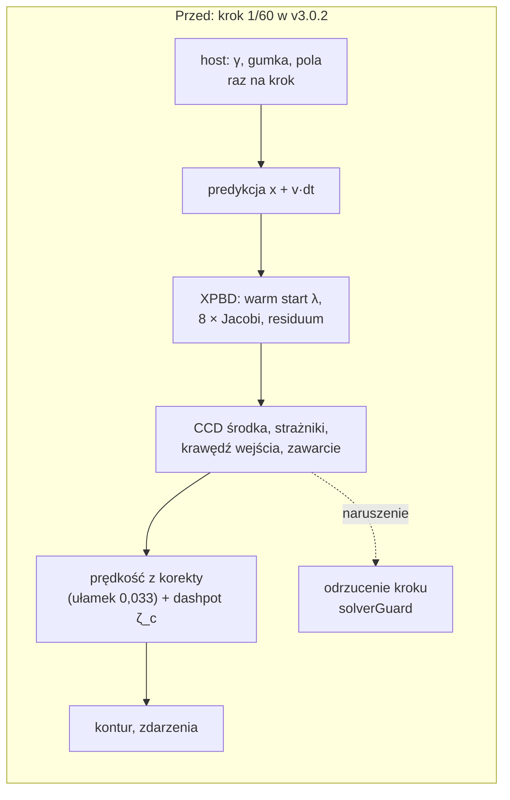
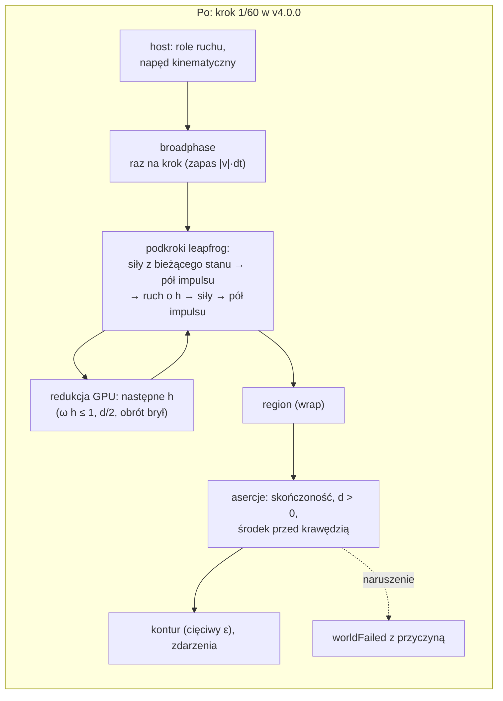
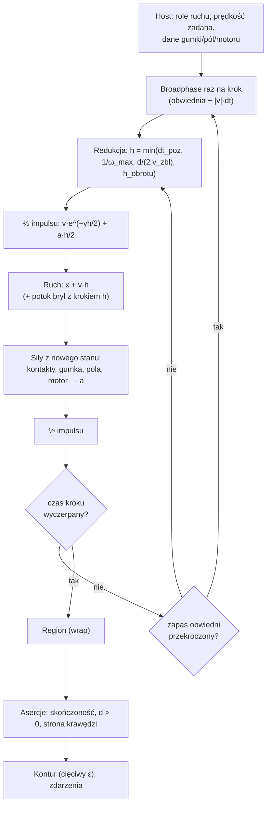

# Change Design: Silnik BubblePhysics 4.0.0 — prawo kontaktu z granicą na promieniu i całkowanie siłowe z podkrokami

**Date:** 2026-11-23
**Artifact:** change-design
**Status:** Draft
**Template version:** default/0.3.2
**References:** specyfikacja autora `2KBubbles-iOS/docs/benchmarks/stage-0/v4.0.0-engine-spec.md` (zatwierdzona 2026-11-23, dalej „specyfikacja”); punkt wyjścia tag `v3.0.2` (`74c3503`)

**Plugin version:** 0.7.11
**Agent Sessions:** claude-code: 57e1ec5d-55c2-4b0f-8128-9fc22ccffaaf

---

<!-- hint: Keep the `**Artifact:** change-design` line — /plan and /implement use it to recognize this as a change-design artifact (requirements + design in one file) and skip the prd.md requirement. -->

> *Odbiorcy sekcji —* 🔍 recenzent (rozumie zmianę bez jej implementowania) · 🛠 autor (implementuje zmianę). Sekcje bez ikony służą obu.

Ścieżki kodu są względne do korzenia repozytorium BubblePhysics. Skróty: K_c — sztywność kontaktu materiału bańki (jednostka siły); γ — opór ruchu (1/s); ε — ugięcie względne x / r; h — podkrok; dt — krok stały 1/60 s; AC (acceptance criterion) — kryterium przyjęcia; „2”, „128”, „7168” — bańki gry o promieniu 24 / ok. 64 / 148 j i masie gry m = (n/2)^(1/2,25). Numery w nawiasach „(spec. …)” wskazują sekcję specyfikacji.

## Summary 🔍

Wersja 3.0.x dotarła do modelu fizyki autora przez kolejne łaty: tłumienie kontaktu ζ_c, „krawędź wejścia” ze środkiem w ścianie, strażniki środka, CCD, odrzucanie kroku i ułamek prędkości z korekty XPBD. Każda z nich leczy ten sam objaw: kontakt jest liniową sprężyną bez granicy, a solver jest pozycyjny. Wydanie 4.0.0 (zmiana łamiąca) usuwa te łaty. Materiał bańki to tylko sztywność kontaktu K_c i opór γ. Kontakt działa według prawa F = K_c · ε / (1 − ε)², w którym siła rośnie bez granic, zanim środek dojdzie do ściany albo do środka drugiej bańki. Solver XPBD znika. Ruch liczy całkowanie siłowe leapfrog z adaptacyjnymi podkrokami wewnątrz kroku 1/60. Długość podkroku wynika z częstości kontaktów (ω h ≤ 1), z drogi środka względem odległości do przeszkody (najwyżej połowa w podkroku) i z obrotu brył. Dzięki temu przejście przez ścianę lub bańkę jest wykluczone z konstrukcji, bez CCD i strażników. Wszystkie siły (kontakty, gumka, pola, motor, bryły) liczą się w każdym podkroku z bieżącego stanu, więc wynik nie zależy od podziału kroku. Gra zmienia się osobno, ale bramka przeciskania z gry rusza przed tagiem.

## Background & problem 🔍

Model autora (spec. 1): bańka to środek i promień, nakładające się koła odpychają się sprężyną, tylko siły przesuwają środki, ta sama siła ugina każdą bańkę o ten sam ułamek promienia (s = 1), kontury nigdy się nie przenikają, a palec działa gumką siłową.

Kod `v3.0.2` realizuje ten model inaczej. Kontakt to podatność liniowa c = c₀ · r / r_ref w XPBD (`Sources/BubblePhysicsPublic/Model/Resources.swift:9`), z 8 iteracjami Jacobiego, warm startem λ i jednym krokiem 1/60 (`Sources/BubblePhysicsNativeMetal/NativeMetalSolver.swift:699-755`). Prędkość odtwarza się z korekty położenia, częściowo przez ułamek `contactStiffness · dt²` (`NativeXPBDKernels.metal-source:992-1021`). Stąd biorą się skutki w grze:

- Ściśnięcie ε = c₀ · F / r_ref nie ma granicy. Przy F > 1852 środek wchodzi w ścianę, a gra potrzebuje walidatora ε < 1, `maximumForce` i granicy ucieczki powiększonej o grubość ściany.
- ζ_c = 5 sprawiało, że duża bańka dochodziła do równowagi przy ścianie przez 39 s. Przy ζ_c = 0,3 bańka przestrzeliwuje.
- Przed przejściem chronią CCD środka (dopiero przy ruchu > 1 · r na krok), strażniki z rzutami, wyjątek krawędzi wejścia i odrzucanie kroku `solverGuard`. Para baniek nie ma CCD, a zawarta para „wystrzeliwuje” mniejszą bańkę.
- `deformability` przy kontakcie miękkim nic nie robi (`NativePostSolveKernels.metal-source:713-720`).

Autor zatwierdził 2026-11-23 decyzje 1–16 (spec. 2): usunąć łaty zamiast dokładać nowe.

## Goals and non-goals

### Goals

**G1: Materiał bańki to K_c i γ, a usunięte elementy znikają z API**
- [ ] G1-AC1 — `PhysicsMaterial` rodzaju `.bubble` tworzy się z `contactStiffness` (K_c) i `damping` (γ). K_c ≤ 0, NaN albo ∞ oraz γ < 0 albo NaN dają `ModelValidationError.valueOutOfRange` z nazwą pola · `verify: swift test`
- [ ] G1-AC2 — Kod, który używa `contactCompliance`, `BubbleContactCompliance`, `contactDampingRatio`, `deformability`, `friction`/`restitution`/limitów prędkości materiału bańki, nadpisania `contactCompliance` na `BubbleDescriptor`, `SolverGuardCause`, `WorldRejectionReason.solverGuard` albo publicznych pól `NativeMetalConfiguration` (iteracje, podatność, cache, teleport, CCD) nie istnieje w publicznym interfejsie modułów `BubblePhysics*` (graf symboli bez tych nazw). `docs/MIGRATION-v4.md` wymienia każdy z tych elementów i jego zastępstwo albo powód usunięcia · `verify: swift package dump-symbol-graph + grep nazw`
- [ ] G1-AC3 — Materiał `.rigid` przyjmuje te same pola i wartości co w `v3.0.2` (tarcie, restytucja, limity prędkości, γ), a testy brył bez baniek przechodzą bez zmiany oczekiwań · `verify: swift test`

**G2: Prawo kontaktu z granicą na promieniu (statyka)**
- [ ] G2-AC1 — Przy K_c = 229 bańka „2” (r 24, m 1) i 7168 (r 148, m 38) dociśnięta stałą siłą F = 100, 1200 i 20 000 do ściany staje z ε spełniającym ε / (1 − ε)² = F / K_c ± 2 % (N4). Para tego samego materiału daje to samo z R = r_a + r_b zamiast r · `verify: swift test`
- [ ] G2-AC2 — Przy F = 10², 10³, 10⁴, 10⁵ statyczne ε zgadza się z odwrotnością prawa ± 1 %, a odległość środka od ściany jest > 0 (N3) · `verify: swift test`
- [ ] G2-AC3 — W parze tego samego materiału wgniecenia dzielą się w proporcji r_a : r_b ± 2 %. W parze różnych K_a ≠ K_b suma ugięć równa się nakładaniu, a siła zgadza się z rozwiązaniem równania r_a ε(F/K_a) + r_b ε(F/K_b) = δ policzonym w Double ± 1 % · `verify: swift test`
- [ ] G2-AC4 — Bańka dociśnięta do statycznego koła, statycznej kapsuły i bryły dynamicznej spełnia to samo prawo co przy ścianie, z d mierzonym od środka bańki do powierzchni bryły ± 2 % · `verify: swift test`
- [ ] G2-AC5 — Dla każdej pary w kontakcie cięciwy konturów obu baniek pokrywają się (różnica ≤ 1e-3 · R), a kontury się nie przenikają (N8) · `verify: swift test`

**G3: Brak przejścia przy dowolnej prędkości i sile**
- [ ] G3-AC1 — Bańki „2”, 128 i 7168 wystrzelone prostopadle i ukośnie w ścianę grubości 1 z prędkością 10², 10³, 3 · 10³, 10⁴ j/s mają środek po stronie zewnętrznej krawędzi po każdym podkroku. Przy γ = 0 i bez gumki najmniejsza odległość zgadza się z bilansem energii U(ε_max) = ½ m v_n² ± 10 %, gdzie v_n to składowa normalna prędkości, a U(ε) = ∫F dx = K_c · r · (1/(1 − ε) + ln(1 − ε) − 1). Przy każdej prędkości i γ nie ma `worldFailed` (N1) · `verify: swift test`
- [ ] G3-AC2 — Para czołowa i ukośna przy tych samych prędkościach, także „2” na 7168, ma odległość środków > 0 po każdym podkroku, a środki nie zamieniają się stronami wzdłuż prostej zderzenia (N2) · `verify: swift test`
- [ ] G3-AC3 — Bańka uderzona krawędzią bryły dynamicznej wirującej z prędkością kątową 10, 50 i 200 rad/s ma środek po stronie zewnętrznej bryły po każdym podkroku, a świat nie zgłasza odrzucenia ani `worldFailed` · `verify: swift test`
- [ ] G3-AC4 — Bańka ściśnięta przez 10 s między dwiema bryłami dynamicznymi dociśniętymi siłą globalną do ściany kończy każdą klatkę z d > 0 i bez `worldFailed` · `verify: swift test`

**G4: Całkowanie siłowe spójne fizycznie**
- [ ] G4-AC1 — Bańka bez gumki, z γ = 0, uderza w ścianę i odbija się z prędkością równą prędkości przed uderzeniem ± 2 % (N5) · `verify: swift test`
- [ ] G4-AC2 — Przy γ > 0, bez gumki: ubytek energii (kinetycznej i sprężystej) między chwilą t₀ = 0,1 s przed pierwszym kontaktem a t₁ = 0,1 s po jego końcu równa się ∫ γ · m · |v|² dt po całym przedziale [t₀, t₁] ± 5 %. Innej straty nie ma (N5) · `verify: swift test`
- [ ] G4-AC3 — Ta sama scena (zderzenie pary, odbicie od ściany, gumka ciągnąca bańkę w tłum, bańka w polu radialnym) liczona z naturalną liczbą podkroków i z wymuszonym czterokrotnie drobniejszym podziałem kończy 1 s symulacji z pozycjami zgodnymi do 1 j i prędkościami do 2 % · `verify: swift test`
- [ ] G4-AC4 — Gumka liczy się w każdym podkroku. Bańka ciągnięta przy stałym naciągnięciu s ustala prędkość v = K_band · s / (m · γ) ± 1 %. Stosunek prędkości dwóch baniek jest odwrotny do mas. `maximumForce` ogranicza siłę gumki tylko wtedy, gdy jest ustawione. Puszczenie zachowuje prędkość. Gumka z K_band · dt² / m ≥ 1 (np. K_band = 10⁴, m = 1) jest przyjmowana przez stager i bańka dochodzi do celu bez wartości nieskończonych · `verify: swift test`
- [ ] G4-AC5 — Siła globalna, pola (kierunkowe, radialne, wirowe, z filtrem obiektów) i siła motoru liczą się w każdym podkroku z bieżącej pozycji. Bańka w polu radialnym zgadza się z całkowaniem referencyjnym w Double (krok 1e-4) do 1 j po 2 s · `verify: swift test`
- [ ] G4-AC6 — Bańka kinematyczna i prowadzona ścieżką (`.kinematic`, `.pathDriven`) dostaje prędkość od hosta na początku kroku i przy braku kontaktów dociera do pozy z toru jak w `v3.0.2` ± 1e-3 j. Kontakty działają na nią siłą w podkrokach · `verify: swift test`

**G5: Podkroki dobrane z geometrii i częstości**
- [ ] G5-AC1 — Tłum w spoczynku i swobodny ruch wolniejszy niż d / (2 dt) liczą dokładnie 1 podkrok na krok (N6) · `verify: swift test`
- [ ] G5-AC2 — Liczba podkroków rośnie z ω · dt i z v · dt / d zgodnie ze wzorem na h. Przy K_c = 229 i bańce „2” (r 24, m 1): przy statycznym docisku F = 20 000 do ściany 3 podkroki ± 1 (ω · dt ≈ 2,2); przy czołowym uderzeniu w ścianę z prędkością 1000 j/s 15–40 podkroków w klatce uderzenia (tolerancja wokół wyliczonych 20–30), potem znowu 1 (N6) · `verify: swift test`
- [ ] G5-AC3 — Bryła dynamiczna wirująca z prędkością kątową, przy której obrót w kroku 1/60 przekracza 128 · 0,05 rad, przechodzi krok bez odrzucenia, a jej obrót na podkrok nie przekracza 128 · 0,05 rad · `verify: swift test`
- [ ] G5-AC4 — Bańka, której suma przesunięć w podkrokach przekracza zapas obwiedni kandydatów, dostaje kontakty z obiektami, do których dojechała w tym samym kroku (przebudowa siatki), co widać po braku przejścia w G3-AC1 przy 10⁴ j/s i po kontakcie z bańką leżącą dalej niż |v| · dt na początku kroku · `verify: swift test`

**G6: Stabilność tłumu i asercje zamiast korekt**
- [ ] G6-AC1 — Tłum 4 × 10, 150 baniek, gumka bez `maximumForce` ciągnie po kolei po kilka baniek w róg przez 60 s: zero `worldFailed`, zero wartości nieskończonych, d > 0 w każdej klatce, przenikanie konturów 0 (N7) · `verify: swift test`
- [ ] G6-AC2 — Stan z d ≤ 0 albo ze środkiem po wewnętrznej stronie krawędzi statycznej, wstrzyknięty diagnostycznie po podkrokach, przełącza świat w `worldFailed` z przyczyną naruszenia kontaktu i identyfikatorami obiektów w diagnostyce. Krok nie jest odrzucany ani powtarzany · `verify: swift test`
- [ ] G6-AC3 — Wartość NaN albo ∞ w stanie przełącza świat w `worldFailed(.nonFiniteValues)`, jak w `v3.0.2` · `verify: swift test`
- [ ] G6-AC4 — Bańka z `regionExitPolicy == .wrap` zawinięta na wolne miejsce symuluje się dalej bez `worldFailed`. Zawinięta tak, że jej środek trafia w bryłę statyczną albo bliżej niż 1e-3 · (r_a + r_b) od środka innej bańki, przełącza świat w `worldFailed` z przyczyną naruszenia kontaktu, bo asercja biegnie po regionie (CD-D-19) · `verify: swift test`

**G7: Transakcja nie tworzy stanu niemożliwego**
- [ ] G7-AC1 — Wstawienie, `replace` albo zmiana pozycji bańki ze środkiem we wnętrzu bryły statycznej albo za którąkolwiek jej krawędzią jest odrzucana błędem walidacji transakcji. Świat zostaje w stanie sprzed transakcji · `verify: swift test`
- [ ] G7-AC2 — Wstawienie albo zmiana pozycji bańki w odległości od środka innej bańki mniejszej niż 1e-3 · (r_a + r_b) jest odrzucana tym samym błędem · `verify: swift test`
- [ ] G7-AC3 — Łączenie albo podział, którego wynikowy środek trafiłby w bryłę statyczną albo na środek innej bańki (G7-AC1, G7-AC2), jest odrzucany tym samym błędem i nie zmienia świata · `verify: swift test`

**G8: Telemetria i wydajność**
- [ ] G8-AC1 — `NativeMetalFrameTelemetry` podaje liczbę podkroków w klatce, czas GPU fizyki i czas GPU konturu osobno, a benchmark stress raportuje histogram podkroków (p95, maksimum). Pola po XPBD, CCD i strażnikach znikają · `verify: swift test`
- [ ] G8-AC2 — Benchmark `Benchmarks/iOS/BubblePhysicsBench` na iPhonie X, w Release, ze 150 bańkami w trzech scenach (tłum w spoczynku, gumka w pełnym naciągnięciu do ściany, zderzenie dwóch szybkich baniek) ma p95 klatki ≤ 16,67 ms. Raport podaje histogram podkroków i czas fizyki osobno od konturu (A6). To bramka tagu `v4.0.0`: przekroczenie wstrzymuje tag i wraca do autora jako decyzja o lokalnym h (CD-D-7) · `verify: pomiar na iPhonie X, raport w docs/benchmarks/`
- [ ] G8-AC3 — Bazowe wyniki perf guard i benchmarku stress są odświeżone na 4.0.0 (kryterium raportowe, bez progu: progiem wydajności jest G8-AC2), a raport w `docs/benchmarks/` podaje ich zmianę względem `v3.0.2` zmierzoną naprzemiennie na tym samym Macu · `verify: swift run -c release BubblePhysicsPerfGuard`

**G9: Wydanie 4.0.0 i przyjęcie w grze**
- [ ] G9-AC1 — Testy z listy „do usunięcia” (spec. 4) są usunięte. Testy z listy „do zachowania” przechodzą z oczekiwaniem przeliczonym na nowe prawo. Testy nowe N1–N8 oraz testy z G3-AC3, G3-AC4, G4-AC3, G4-AC5, G4-AC6, G5-AC3, G5-AC4, G6-AC2, G6-AC4 i G7 istnieją i przechodzą. Pełne `swift test` jest zielone · `verify: swift test`
- [ ] G9-AC2 — Showcase i benchmark stress kompilują się i działają na kontakcie z K_c (bez kontaktu twardego, przegubów z bańkami i kontaktu PBD bańka–bryła) · `verify: xcodebuild Showcase i BubblePhysicsBench`
- [ ] G9-AC3 — Przed tagiem `v4.0.0` gałąź gry wskazująca na gałąź silnika przechodzi bramkę przeciskania z projektu gry (G2-AC10 w `solution-design.md` gry, kryterium A1 specyfikacji) na Macu. Scena to plansza 4 × 10, ziarna 1–5 × 3 powtórzenia, gumka bez `maximumForce` i jeden materiał. Wynik: 15/15 przebiegów zaliczonych, wszystkie 40 łączeń sceny wykonane w każdym przebiegu, przenikanie konturów 0, ucieczki 0 w granicy ścisłej, zero `worldFailed` (A1). Raport podaje wersje `PhysicsGate.json` i `PhysicsTuning.json` oraz rozbieżności względem specyfikacji · `verify: bramka PhysicsLab w 2KBubbles`
- [ ] G9-AC4 — `CHANGELOG.md`, wersja w `README.md` i `MigrationGuideTests` wskazują 4.0.0, a `docs/MIGRATION-v4.md` opisuje zmiany zachowania prostymi słowami (spec. 7) · `verify: swift test`

### Non-goals

- Zmiany w repozytorium gry 2KBubbles (spec. 5): strojenie, `TuningPanel`, granica ucieczki, testy gry. To osobna zmiana, prowadzona przez autora w 2KBubbles. **Warunek wejścia dla G9-AC3:** zanim ruszy tag, gałąź gry z migracją API i strojeniem na 4.0.0 musi istnieć. Ta zmiana dostarcza do niej gałąź silnika i `docs/MIGRATION-v4.md`.
- Lokalne h dla wysp kontaktów. Jeśli pomiar wydajności (G8-AC2) przekroczy budżet, tag czeka, a autor decyduje, czy wyspy wejdą do 4.0.0 (zmiana zakresu tego projektu) czy osobnego wydania.
- Model siłowy dla kontaktu bryła–bryła. Pozycyjny solver brył zostaje (kierunek na przyszłość).
- Restytucja i tarcie w kontakcie bańki. Wracają tylko decyzją autora (spec. decyzja 7).
- Moduły nieużywane przez grę i ścieżkę publiczną: `BubblePhysicsLegacy` (`Sources/BubblePhysics/`), `BubblePhysicsReference`, `BubblePhysicsReferenceMetal`, `BubblePhysicsMetal`, `BubblePhysicsCore`.
- Generowanie konturu poza wzorem cięciwy pary: promienie, wygładzanie, majoranta, `effectiveRadius`, `bounds` (spec. 8).

## Architecture

**Kształt zmiany.** Jeden krok stały dt = 1/60 (bez zmian w `FixedStepDriver`) składa się teraz z czterech faz:

1. Host przygotowuje stan.
2. Broadphase działa raz na krok.
3. Pętla podkroków leapfrog działa na GPU.
4. Na końcu idą region, asercje, kontur i zdarzenia.

Solver XPBD, CCD baniek, strażniki, krawędź wejścia, walidacja zawierania, dashpot, cache λ, kontakt twardy i przeguby z bańkami znikają w całości (spec. zmiana 4). Rekordy kontaktów kroku zostają, bo karmią zdarzenia kontaktu, łączenie i kontur.

**1. Host (Runtime).** `MotionControllers.prepare` przestaje liczyć γ, gumkę, pola i motor. Ustala tylko rolę ruchu i prędkość zadaną:
- `.static` → zero;
- `.kinematic` i `.pathDriven` → prędkość z toru, jak dziś (CD-D-9).

Gumkę (cel, K_band, opcjonalne `maximumForce`), siłę globalną, opisy pól z filtrami i motor (siła, moment) przekazuje GPU jako dane wejściowe kroku (CD-D-5). Masa, promień kolizji i materiał (K_c, γ) idą w rekordzie bańki zamiast podatności, ζ_c i limitów.

**2. Broadphase (raz na krok).** Siatka i kandydaci powstają jak dziś (`nativePrepareGrid` … `nativeCompactCandidates`), z obwiednią powiększoną o drogę |v| · dt. Każda bańka liczy sumę przesunięć w podkrokach. Gdy któraś przekroczy zapas, redukcja h ustawia znacznik przebudowy: pozostałe podkroki w tym buforze wychodzą od razu, a następny bufor poleceń tej samej klatki zaczyna się od przebudowy siatki i kandydatów (G5-AC4, CD-D-18). W typowej klatce nie ma więc żadnych dodatkowych dyspozycji. Limit `candidateLimitPerObject` i raport przepełnienia zostają. `nativeBuildContacts` traci wyjątek krawędzi wejścia i odczyt cache poprzedniej klatki. Kandydat to bańka–bańka, bańka–krawędź jednostronna albo wypukły wierzchołek (`NativeStaticPolygonEdges.swift` bez zmian) i bańka–bryła (statyczne koło, kapsuła, bryła dynamiczna).

**3. Podkrok (leapfrog, kick–drift–kick, CD-D-6).** Stan bańki to x, v i przyspieszenie a z końca poprzedniego podkroku (w pierwszym podkroku a liczy się z x na starcie).

1. **Wybór h** (redukcja GPU, CD-D-7): h = min(dt_pozostałe, 1/ω_max, min_kandydatów d / (2 · v_zbl), h_obrotu).
   - ω_max to największa częstość √(k_eff / μ) po kontaktach aktywnych oraz √(K_band / m) dla gumki. Dla ściany i bryły k_eff = K_c (1 + ε) / (r (1 − ε)³), μ = m (dla bryły dynamicznej masa zredukowana z masą bryły). Dla pary μ = m_a m_b / (m_a + m_b), a k_eff to sztywność dwóch sprężyn szeregowo: 1 / k_eff = 1 / k_a + 1 / k_b, gdzie k_i = K_i (1 + ε_i) / (r_i (1 − ε_i)³). Przy jednym materiale daje to K_c (1 + ε) / (R (1 − ε)³).
   - Kandydat z v_zbl ≤ 0 (oddala się) nie ogranicza h. v_zbl to prędkość zbliżania wzdłuż d po półimpulsie, czyli z v + a · h / 2. Liczy się zachowawczo: |v_zbl| + |a| · h / 2 ≤ d / (2h), rozwiązane jawnie z równania kwadratowego.
   - Dla bryły dynamicznej v_zbl zawiera prędkość punktu bryły: |v_bryły| + |ω_bryły| · ρ_bryły, gdzie ρ_bryły to promień obwiedni od środka masy.
   - h_obrotu = 128 · 0,05 / |ω_bryły| (CD-D-3).
   - Stałe 1, 2, 128 i 0,05 to stałe metody i istniejącego próbkowania, a nie parametry strojenia.
2. **Pół impulsu:** v ← v · e^(−γ h/2) + a · h/2 (najpierw opór, potem siła, jak dziś). Bryły dynamiczne robią to samo z siłą i momentem od baniek.
3. **Ruch:** x ← x + v · h. Obrót bańki: kąt + ω · h, ω · e^(−γ h). Bryły dynamiczne przechodzą cały istniejący potok brył z krokiem h: predykcja z próbkowaniem obrotu względem ścian, CCD bryła–bryła, kontakty bryła–bryła i wypychanie ze ścian (CD-D-2). Bez brył dynamicznych nic z tego się nie koduje.
4. **Siły z nowego stanu → a.** Kontakt według prawa (niżej), gumka K_band · (cel − x) z opcjonalnym obcięciem, siła globalna, pola z bieżącej pozycji i motor. Bryła dostaje siłę równą i przeciwną w punkcie styku (siła i moment).
5. **Drugie pół impulsu:** v ← v · e^(−γ h/2) + a · h/2.

Iloczyn mnożników oporu po podkrokach daje e^(−γ · dt), a suma impulsów daje całkę siły, więc wynik nie zależy od podziału kroku do błędu O(h²) (G4-AC3).

**Prawo kontaktu (spec. zmiana 2).** ε = x / r, F = K_c · ε / (1 − ε)².
- **Ściana i bryła:** ugięcie x = r − d, F = K_c · (r − d) · r / d². Dla ściany d to odległość od prostej krawędzi wzdłuż normalnej zewnętrznej albo od wypukłego wierzchołka. Dla koła, kapsuły i bryły dynamicznej d to odległość od powierzchni (CD-D-10).
- **Para tego samego materiału:** postać zamknięta F = K_c · (R − d) · R / d², gdzie R = r_a + r_b.
- **Para różnych materiałów:** F to jedyne rozwiązanie r_a ε(F/K_a) + r_b ε(F/K_b) = δ. Liczy je stała liczba kroków Newtona od rozwiązania dla średniej K (CD-D-16).
- Rekord kontaktu przechowuje F, ε_a i ε_b dla zdarzeń i konturu.

**Wykonanie na GPU (CD-D-18).**
- Podkrok to trzy dyspozycje: siły po sąsiedztwie z całkowaniem (dwa półimpulsy i ruch), redukcja h i, przy bryłach, potok brył.
- Host koduje w buforze poleceń 2 × tyle podkroków, ile zużyła poprzednia klatka (co najmniej 2). Każdy podkrok, którego czas już się skończył, wychodzi od razu. Gdy podkroków zabraknie, ta sama klatka dostaje następny bufor, po odczycie licznika na końcu poprzedniego.
- CPU nie czyta niczego w środku bufora.

**4. Koniec kroku.**
- `nativeCheckFinite` zostaje.
- Nowa asercja sprawdza każdy kontakt i każdą krawędź statyczną: d > 0 i środek po stronie zewnętrznej. Naruszenie to błąd silnika: `worldFailed` z nową przyczyną i identyfikatorami obiektów (CD-D-12). Zastępuje to `nativeValidateBubbleContainment` i ostatnią pętlę strażnika.
- Kontur: cięciwa bańki a leży w r_a · (1 − ε_a) od jej środka. Zastępuje to podział c_a : c_b (`NativePostSolveKernels.metal-source:728-732`), więc cięciwy obu baniek się pokrywają. Przycinanie krawędzią ściany, wygładzanie i majoranta zostają.
- Zdarzenia kontaktu, łączenia i sensory czytają rekordy kontaktów końca kroku jak dziś.
- Region (`nativeApplyPublicRegion`) działa raz na krok, po podkrokach i przed asercjami. Zawinięcie (`.wrap`) to jedyne przesunięcie środka poza siłami, wybrane przez grę polityką regionu. Asercja po regionie wyłapuje zawinięcie na zajęte miejsce (CD-D-19, G6-AC4).

**Walidacja transakcji (CD-D-8).** `TransactionStager` odrzuca błędem walidacji każdą zmianę, po której środek bańki leżałby:
- we wnętrzu bryły statycznej albo za którąś z jej krawędzi;
- bliżej niż 1e-3 · (r_a + r_b) od środka innej bańki.

Dotyczy to wstawienia, `replace`, zmiany pozycji oraz wyniku łączenia i podziału.

**Znane ograniczenie (CD-D-4).** Pozycyjne korekty bryła–bryła i wypychanie bryły ze ściany przesuwają bryłę poza siłami, więc nie podlegają warunkowi d / 2. Gwarancja z konstrukcji obejmuje ściany, pary baniek oraz ruch brył z całkowania. Skrajny przypadek korekty wyłapuje asercja d > 0 (`worldFailed` z przyczyną). Tak samo jest z bryłą kinematyczną, która wciska bańkę w ścianę, bo jej ruch jest zadany i ignoruje siły.

## Components

- **`Sources/BubblePhysicsPublic/Model/Resources.swift`** — `PhysicsMaterial` dla `.bubble`: `contactStiffness` i `damping`. Usunięte: `BubbleContactCompliance`, `contactDampingRatio`, `deformability`. Pola `friction`, `restitution` i limity prędkości zostają tylko dla `.rigid` (CD-D-11).
- **`Sources/BubblePhysicsPublic/Model/Objects.swift`** — usunięte nadpisanie `contactCompliance` na `BubbleDescriptor`.
- **`Sources/BubblePhysicsPublic/Diagnostics.swift`**, **`Sources/BubblePhysicsPublic/BubbleWorld.swift`** — usunięte `SolverGuardCause`, `WorldRejectionReason.solverGuard`, `lastSolverGuardCause`, licznik zawartych par i `makeBenchmarkWorld(solverIterationLimit:pairCorrectionLimit:)`. Nowa przyczyna `WorldFailureReason` dla naruszenia asercji kontaktu, z identyfikatorami w diagnostyce.
- **`Sources/BubblePhysicsRuntime/MotionControllers.swift`** — host liczy tylko prędkość zadaną ról kinematycznych. γ, gumka, pola i motor przechodzą do danych wejściowych GPU.
- **`Sources/BubblePhysicsRuntime/TransactionStager.swift`** — walidacja położenia środka (G7), usunięcie walidacji przepełnienia α (`:553`) i strażnika sztywności gumki `validateBandStability` (`:542`, CD-D-20).
- **`Sources/BubblePhysicsRuntime/NativeCompleteStepper.swift`** — przekazanie danych gumki, pól i motoru do kroku natywnego oraz odbiór telemetrii podkroków.
- **`Sources/BubblePhysicsNativeMetal/NativePublicWorld.swift`** — rekord bańki z K_c, γ i masą (bez toru `contact.z`, podatności, ζ_c i limitów). Rekordy gumki, pól i motoru. Mapowanie przegubów bez baniek.
- **`Sources/BubblePhysicsNativeMetal/NativeSolverInput.swift`** — usunięte `contactStiffness`, `contactDamping`, `linearDamping`, `angularDamping`, `contactTolerance`, `separationTolerance`, `positionTolerance` i bity strażnika. Zostają `timeStep`, `maxContourSegmentLength` i `contourSurfaceTension`.
- **`Sources/BubblePhysicsNativeMetal/NativeMetalBackend.swift`** — `NativeMetalConfiguration` bez pól publicznych. Zostaje pakietowy przełącznik wymuszający podział podkroku dla testów zgodności (G4-AC3). Telemetria: liczba podkroków oraz czasy GPU fizyki i konturu (CD-D-17).
- **`Sources/BubblePhysicsNativeMetal/NativeMetalSolver.swift`** — nowy potok kroku: broadphase, pętla podkroków z przebudową siatki, asercje, kontur. Usunięte: warm start, pętla Jacobiego, residuum, CCD, strażniki, zawarcie, dashpot, cache λ i teleport.
- **`Sources/BubblePhysicsNativeMetal/Shaders/NativeForceKernels.metal-source`** (nowy) — prawo kontaktu (ściana, bryła, para, Newton dla różnych K), gumka, pola i motor, dwa półimpulsy i ruch, redukcja h, asercje kontaktu.
- **`Sources/BubblePhysicsNativeMetal/Shaders/NativeXPBDKernels.metal-source`** — zostają skan, kompaktowanie, sąsiedztwo i rekordy kontaktów oraz kontakt bryła–bryła. Usunięte: mnożniki, Jacobi, residuum, warm start, cache λ, `nativeRigidApplyBubbles`, część kontaktu bańka–bryła w `nativeRigidContacts`, `nativeApplyJointBubbles`, `nativeUpdateVelocities` i `nativeDampContactNormalMotion`. Plik dostaje nazwę według nowej roli, jeśli plan tak zdecyduje.
- **`Sources/BubblePhysicsNativeMetal/Shaders/NativePostSolveKernels.metal-source`** — usunięte: CCD, strażniki, krawędź wejścia, walidacja zawarcia i nacisk konturu z λ. Wzór cięciwy z ε (spec. zmiana 2, „Kontur”). Potok brył (`nativeRigidPredict`, `nativeRigidGuardWalls`, CCD brył) przyjmuje krok h, a przekroczenie budżetu obrotu przestaje być możliwe.
- **`Sources/BubblePhysicsNativeMetal/Shaders/NativeGeometryKernels.metal-source`** — `nativePredict` znika (ruch jest w podkroku). `nativeBuildContacts` bez krawędzi wejścia. Kandydaci z zapasem |v| · dt.
- **`Sources/BubblePhysicsNativeMetal/NativeJointState.swift`**, **`NativeRigidPolygonState.swift`**, **`NativeMetalBufferLayout.swift`** — przeguby tylko bryła–bryła. Statyczna ściana w kontakcie z bańką nie czyta tarcia ani restytucji. Nowy układ rekordu bańki.
- **`Sources/BubblePhysicsMetalRenderBenchmark/PublicWorldStressBenchmark.swift`**, **`Benchmarks/macOS/BubblePhysicsPerfGuard`**, **`Benchmarks/iOS/BubblePhysicsBench`** — kontakt z K_c, sceny z G8-AC2, histogram podkroków, nowe wartości bazowe.
- **`Examples/BubblePhysicsShowcase`** — `BubbleScene` i `RigidScene` na kontakcie z K_c, bez `deformability` i kontaktu twardego.
- **`Tests/…`** — audyt według spec. 4 (usuń, zachowaj z przeliczeniem, nowe N1–N8) oraz testy z G3-AC3, G3-AC4, G4-AC3, G4-AC5, G4-AC6, G5-AC3, G5-AC4, G6-AC2, G6-AC4 i G7.
- **`docs/MIGRATION-v4.md`** (nowy), **`CHANGELOG.md`**, **`README.md`**, **`docs/integration-guide.md`** — opis wydania i migracji.

## Error handling

- **Naruszenie asercji kontaktu** (d ≤ 0, środek za krawędzią statyczną) po podkrokach to błąd silnika. Świat przechodzi w `worldFailed` z nową przyczyną. Diagnostyka podaje obiekty, krawędź i odległość. Kroku nie odrzuca się ani nie powtarza (G6-AC2).
- **Zawinięcie regionu na zajęte miejsce** kończy się `worldFailed` z przyczyną naruszenia kontaktu (CD-D-19, G6-AC4).
- **Wartości nieskończone** prowadzą do `worldFailed(.nonFiniteValues)`, bez zmian (G6-AC3).
- **Transakcja tworząca stan niemożliwy** jest odrzucana błędem walidacji. Świat żyje dalej w stanie sprzed transakcji (G7).
- **Przepełnienie kandydatów** jest raportowane jak dziś (`contactCandidateOverflow`). Kontakt pominięty przez limit nie łamie asercji, dopóki geometria jest poprawna. Gdy ją złamie, kończy się na `worldFailed` jak wyżej.
- **Brak podkroków w buforze** to nie błąd. Klatka dostaje następny bufor poleceń (CD-D-18).

## Testing & verification

- **Bliźniak zgodności podziału (G4-AC3)** to najważniejszy test przekrojowy. Pakietowy przełącznik wymusza czterokrotnie drobniejszy podział kroku, a test porównuje stan po 1 s z przebiegiem naturalnym. Chroni zasadę „wynik nie zależy od podkroków” przed regresją każdej z sił z osobna.
- **Odniesienie w Double** dla prawa kontaktu, odwrotności prawa, Newtona dla różnych K i bilansu energii (N1, N3, G2-AC3, G4-AC5). Testy porównują wynik silnika z rachunkiem w teście, a nie z wartością przypiętą z przebiegu.
- **Dowód, że zielone nie jest puste.** Testy braku przejścia (G3) sprawdzają stan po każdym podkroku przez diagnostyczny zapis pozycji (dziś `nativeCapturePositions`). Asercja liczby podkroków > 1 w scenie uderzenia pokazuje, że warunek d / 2 rzeczywiście zadziałał.
- **Bramka gry (G9-AC3)** idzie na gałęzi gry z zależnością od gałęzi silnika, przed tagiem.

## Decisions 🔍

| ID | Title | Context | Options | Choice | Rationale | Source | Goal impact | Consequences |
|----|-------|---------|---------|--------|-----------|--------|-------------|--------------|
| CD-D-1 | Zakres: tylko silnik, bramka gry przed tagiem | Zmiany gry są w innym repozytorium, a przyjęcie A1 mierzy się w grze | jeden dokument dla silnika i gry; tylko silnik z bramką przed tagiem; tylko silnik, bramka po wydaniu | tylko silnik; bramka przeciskania z gałęzi gry przed tagiem `v4.0.0` | plan i implementacja w jednym repozytorium jak w 3.0.x; bramka to jedyny dowód działania w realnym tłumie | user | G9-AC3, Non-goals | zmiana gry (spec. 5) to osobny change w 2KBubbles; tag czeka na bramkę |
| CD-D-2 | Bryły dynamiczne w podkrokach | Specyfikacja: bryła całkuje się w podkrokach, bryła–bryła bez zmian; bryły mogą się pojawić w kolejnych grach | cały potok brył w każdym podkroku; tylko całkowanie w podkroku, bryła–bryła raz na dt; bryły poza podkrokami | cały istniejący potok brył w każdym podkroku z krokiem h; nic się nie koduje bez brył dynamicznych | tylko tak każde przesunięcie bryły z całkowania podlega warunkowi h; algorytmy bryła–bryła bez zmian | user | G2-AC4, G3-AC3, G3-AC4 | koszt rośnie z liczbą brył × podkroków; zachowanie brył w Showcase zmienia się liczbowo (mniejszy krok) |
| CD-D-3 | Budżet obrotu bryły w warunku h | `rigidRotationBudget` to jedyna przyczyna `solverGuard` poza bańkami, a decyzja 4 usuwa `solverGuard` | warunek obrotu w h; zostawić strażnika brył; zamienić na `worldFailed` | h_obrotu = 128 · 0,05 / \|ω_bryły\|; w v_zbl prędkość punktu bryły \|ω\| · ρ; strażnik, `solverGuard` i `SolverGuardCause` znikają | ta sama metoda co dla baniek: dobrać krok zamiast odrzucać; stałe to istniejące próbkowanie, nie strojenie | user | G5-AC3, G3-AC3, G1-AC2 | szybko wirująca bryła kosztuje więcej podkroków; świat nie stoi |
| CD-D-4 | Pozycyjne korekty brył poza gwarancją | Korekty bryła–bryła i wypychanie ze ściany przesuwają bryłę poza siłami | znane ograniczenie i asercja; obcinanie korekt do d / 2; siłowy model brył | znane ograniczenie, wyłapywane asercją d > 0 (`worldFailed`); test bańki między bryłami | obcinanie to łata tego rodzaju, który 4.0.0 usuwa; korekty w małym h są rzędu wnikania; model siłowy brył to osobne wydanie | user | G3-AC4, G6-AC2, Non-goals | dotyczy też bryły kinematycznej wciskającej bańkę w ścianę; kierunek na przyszłość: siłowy kontakt bryła–bryła |
| CD-D-5 | Wszystkie siły w każdym podkroku | Dziś host liczy γ, gumkę, pola i motor raz na krok; specyfikacja (pytanie 2) proponuje podkrok | raz na krok na hoście; w każdym podkroku na GPU | kontakty, gumka, siła globalna, pola z filtrem i motor liczą się w każdym podkroku z bieżącego stanu; impuls F · h, opór e^(−γh) | spójność fizyczna (autor): każda siła w tym samym schemacie całkowania i z tego samego stanu, więc wynik nie zależy od podziału kroku | user | G4-AC3, G4-AC4, G4-AC5 | wzory pól przechodzą z `MotionControllers` na GPU; host przekazuje opisy pól i gumki |
| CD-D-6 | Leapfrog (kick–drift–kick) zamiast półniejawnego Eulera | Specyfikacja wybrała półniejawny Euler; autor oczekuje lepszego całkowania i wydajności | półniejawny Euler; leapfrog | leapfrog z oporem jako dwa dokładne półkroki e^(−γh/2) | ten sam koszt (siły z końca podkroku są początkiem następnego), drugi rząd dokładności zamiast pierwszego, odwracalny w czasie: dokładniejsze odbicie i słabsza zależność od podziału | auto (autor przekazał wybór z zasadą „wydajnie, błąd rzędu piksela”) | G4-AC1, G4-AC3 | bufor przyspieszeń na bańkę; v_zbl liczone po półimpulsie (zachowawczo z \|a\| · h / 2) |
| CD-D-7 | Wspólne h dla całego świata | Specyfikacja, pytanie 3: wspólne h oznacza 20–30 podkroków dla wszystkich baniek w klatce uderzenia | wspólne h i pomiar; lokalne h dla wysp od razu | wspólne h; lokalne h tylko po przekroczeniu budżetu w G8-AC2, jako osobne wydanie | podkrok to 3 krótkie dyspozycje na 150 baniek; wyspy to złożony mechanizm z przypadkami brzegowymi, do dodania na podstawie danych | auto (autor przekazał wybór z warunkiem wydajności) | G5-AC2, G8-AC2 | telemetria podkroków jest warunkiem decyzji o wyspach |
| CD-D-8 | Transakcja nie może postawić środka w bryle ani na bańce | Gwarancja dotyczy ruchu; pozycje z transakcji (wstawienie, `replace`, łączenie, podział) mogą dać d ≤ 0 | walidacja w stagerze; `worldFailed`; przesunięcie środka | stager odrzuca błędem walidacji; świat bez zmian | stan „środek w ścianie” nie istnieje w 4.0.0, więc to złe dane; błąd gry nie kończy świata; przesunięcie byłoby łatą | user | G7-AC1..3 | gra musi wstawiać bańki poza bryłami; środek łączenia przy ścianie wklęsłej może dać odrzucenie łączenia |
| CD-D-9 | Bańki kinematyczne i prowadzone ścieżką | Dziś host nadaje im prędkość raz na krok, a solver je koryguje (masa skończona, `NativePublicWorld.swift:190`) | prędkość z hosta na początku kroku, siły w podkrokach; ruch ściśle zadany (masa nieskończona) | prędkość z hosta na początku kroku, kontakty działają siłą w podkrokach | zachowuje dzisiejszą semantykę ról i gwarancję braku przejścia (ruch z całkowania) | auto (kod `MotionControllers.swift:107-128`) | G4-AC6 | bez zmian w API ról ruchu |
| CD-D-10 | Statyczne koło, kapsuła i bryła dynamiczna na tym samym prawie | Specyfikacja opisuje krawędzie i wierzchołki; koła i kapsuły nie mają odcinków i bańki widzą je w solverze brył (`NativePublicWorld.swift:213`) | to samo prawo z d do powierzchni; zostawić PBD dla brył okrągłych | to samo prawo z d mierzonym do powierzchni bryły | bryła jest sztywna jak ściana; jeden kontakt bańka–bryła zamiast dwóch modeli | auto (spec. zmiana 2, „bańka–bryła dynamiczna”) | G2-AC4 | znika kontakt PBD bańka–bryła w całości |
| CD-D-11 | Kształt API materiału | Pola fizyczne bańki to K_c i γ; `.rigid` bez zmian | jeden `PhysicsMaterial` z polami zależnymi od rodzaju; osobne typy | jeden `PhysicsMaterial`; `contactStiffness` wymagane dla `.bubble`; tarcie, restytucja i limity tylko dla `.rigid` | najmniejsza zmiana rejestru materiałów i przejść materiału (spec. decyzja 2) | auto (spec. zmiana 1) | G1-AC1, G1-AC3 | dokładne sygnatury ustala plan; migracja w `MIGRATION-v4.md` |
| CD-D-12 | Naruszenie asercji kończy świat z przyczyną | Specyfikacja, zmiana 4: asercje zamiast korekt, bez cichego odrzucenia | nowa przyczyna `WorldFailureReason`; ponowne użycie `nonFiniteValues` | nowa przyczyna naruszenia kontaktu z obiektami w diagnostyce | rozróżnia błąd geometrii od NaN przy diagnozie | auto (spec. zmiana 4) | G6-AC2 | nowy przypadek w publicznym enumie (zmiana łamiąca w ramach 4.0.0) |
| CD-D-13 | Moduły poza ścieżką publiczną bez zmian | Pakiet ma moduły Legacy, Reference, ReferenceMetal, Metal i Core | zostawić; usunąć; przepisać | zostawić bez zmian | gra i ścieżka publiczna ich nie używają; specyfikacja ich nie obejmuje | auto (`Package.swift:34-58`) | Non-goals | ich testy biegną dalej bez zmian |
| CD-D-14 | Zasada wydajności | Autor: jeśli błąd jest jednopikselowy, a obliczenia dużo wydajniejsze, wybrać ten kierunek | — | przy wyborach implementacji preferowany tańszy wariant, gdy błąd ≤ ok. 1 j | wydajność na iPhonie X jest kryterium przyjęcia (A6) | user | G8-AC2, G4-AC3 (tolerancja 1 j) | wiąże plan i implementację |
| CD-D-15 | Decyzje autora ze specyfikacji | Specyfikacja zawiera zatwierdzone decyzje 1–16 | — | przyjęte bez zmian, z doprecyzowaniem w CD-D-2..12 | zatwierdzone przez autora 2026-11-23 | user | wszystkie cele | półniejawny Euler zastąpiony leapfrogiem (CD-D-6); pola w podkroku (CD-D-5) rozstrzygają pytanie otwarte 2; wspólne h (CD-D-7) rozstrzyga pytanie otwarte 3 |
| CD-D-16 | Para różnych materiałów: Newton o stałej liczbie kroków | Dla K_a ≠ K_b siła nie ma postaci zamkniętej | stała liczba kroków Newtona od rozwiązania dla średniej K; bisekcja; tablica | Newton o stałej liczbie kroków (dobranej w planie do zbieżności 1e-4 w float32) | stały koszt na GPU, brak rozgałęzień zależnych od danych; gra używa jednego materiału, więc postać zamknięta jest ścieżką główną | auto (spec. zmiana 2) | G2-AC3 | test porównuje z rozwiązaniem w Double |
| CD-D-17 | Telemetria po XPBD | Pola `solverIterationCount`, `ccdCandidateCount`, `guardCorrectionCount`, `cache*` tracą znaczenie | zastąpić; zostawić z zerami | zastąpić: liczba podkroków, czas GPU fizyki, czas GPU konturu | specyfikacja, „Jak zmierzyć koszt”; martwe pola zaciemniają raport | auto (spec. zmiana 3) | G8-AC1 | benchmark i perf guard czytają nowe pola |
| CD-D-18 | Kodowanie pętli podkroków i przebudowy siatki | Liczba podkroków i potrzeba przebudowy siatki są znane dopiero na GPU | 2 × liczba z poprzedniej klatki z wczesnym wyjściem i dobiciem buforem; odczyt CPU po każdym podkroku; stała liczba maksymalna; przebudowa kodowana po każdym podkroku z wczesnym wyjściem | 2 × poprzednia (min. 2), puste podkroki wychodzą od razu; brak podkroków albo znacznik przebudowy → następny bufor tej samej klatki, zaczynający od przebudowy, jeśli znacznik ustawiony | bez odczytu CPU w środku bufora; typowa klatka nie płaci za przebudowę, a koszt pustych dyspozycji jest mały | auto (spec. zmiana 3) | G5-AC2, G5-AC4, G8-AC2 | klatka uderzenia albo szybkiego przelotu może mieć 2–3 bufory poleceń |
| CD-D-19 | Zawinięcie regionu a reguła „tylko siły” | `.wrap` przesuwa środek poza siłami i może postawić bańkę w bryle albo na innej bańce | asercja po regionie i `worldFailed`; odroczenie zawinięcia do wolnego miejsca; walidacja jak w stagerze | region przed asercjami; zawinięcie na zajęte miejsce → `worldFailed` z przyczyną | zawinięcie to polityka wybrana przez grę, a nie korekta silnika; odroczenie byłoby nowym zachowaniem, o które nikt nie prosił; gra używa `.remove` | auto (kod `NativePostSolveKernels.metal-source:953`, przegląd projektu) | G6-AC4 | gra z `.wrap` musi zapewnić wolne miejsce po drugiej stronie |
| CD-D-20 | Strażnik sztywności gumki w stagerze znika | `validateBandStability` (`TransactionStager.swift:542`) odrzuca K_band · dt² / m ≥ 1, bo dziś gumka całkuje się raz na krok | zostawić; usunąć | usunąć: gumka jest w podkroku i wchodzi do ω_max | specyfikacja, zmiana 5: warunek przestaje być ograniczeniem; strażnik blokowałby to, co podkroki obsługują | auto (spec. zmiana 5) | G4-AC4 | testy strażnika gumki trafiają na listę „do usunięcia” |

## Key facts & assumptions

- **Najważniejsza reguła:** środek przesuwają tylko siły. Żaden mechanizm silnika nie poprawia pozycji bańki poza całkowaniem (jedyny wyjątek to zawinięcie regionu wybrane przez grę, CD-D-19), a naruszenie geometrii to błąd silnika, a nie stan do naprawienia.
- K_c = 229 daje ε 0,648 przy F ≈ 1200, jak w strojeniu gry v5. Przy lekkim kontakcie bańki są miększe (ε 0,3 przy 140 zamiast 556). Ocenia to autor w laboratorium gry, a zmiana dotyczy tylko K_c.
- Liczby podkroków (1 w typowej grze, ok. 3 przy F = 20 000, 20–30 w klatce uderzenia) są wyliczone w specyfikacji, a nie zmierzone. Mierzy je G8-AC2.
- Float32 wystarcza: d_min przy 10⁴ j/s ≈ 0,003 j, a rozdzielczość przy współrzędnej 360 to ok. 3 · 10⁻⁵ j (spec. 9). Wariant ε / (1 − ε) odrzucono właśnie z tego powodu.
- Niepotwierdzone, nieblokujące: lista 6 testów gry czerwonych na strojeniu wersji 6 (spec., pytanie otwarte 1). Dotyczy zmiany gry.
