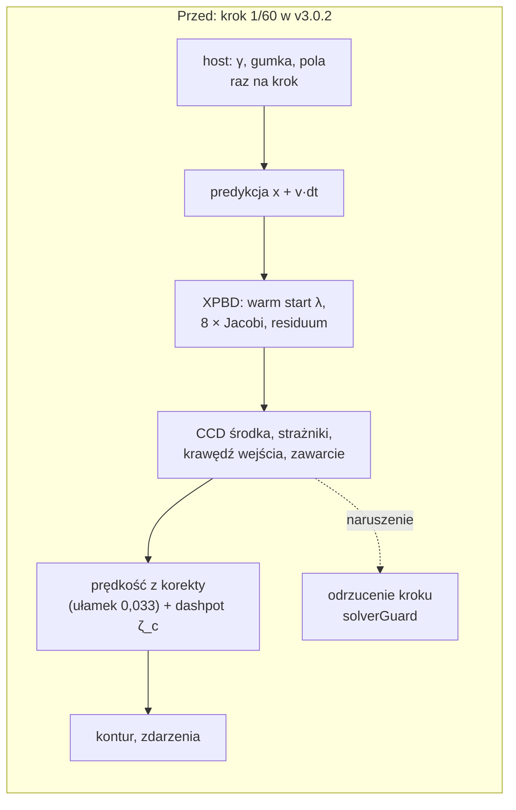
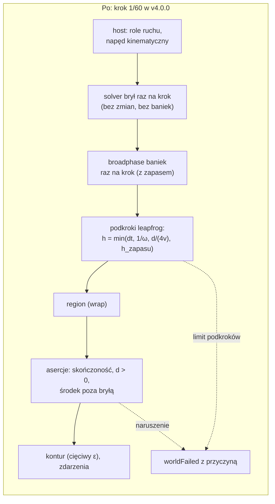
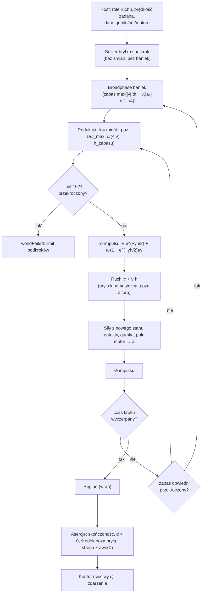

# Change Design: Silnik BubblePhysics 4.0.0 — prawo kontaktu z granicą na promieniu i całkowanie siłowe z podkrokami

**Date:** 2026-11-23
**Artifact:** change-design
**Status:** Approved (rewizja 2026-11-24 po pomiarze na iPhonie X zatwierdzona; pierwsza wersja zatwierdzona @e62d4c5)
**Template version:** default/0.3.2
**References:** specyfikacja autora `2KBubbles-iOS/docs/benchmarks/stage-0/v4.0.0-engine-spec.md` (zatwierdzona 2026-11-23, dalej „specyfikacja”); punkt wyjścia tag `v3.0.2` (`74c3503`); pomiar `docs/benchmarks/v4.0.0-iphone-x.md` (kod `8ef9d87`)

**Plugin version:** 0.7.11
**Agent Sessions:** claude-code: 57e1ec5d-55c2-4b0f-8128-9fc22ccffaaf, 3f3f491e-adfc-4ad1-8245-7849738bd56e

---

<!-- hint: Keep the `**Artifact:** change-design` line — /plan and /implement use it to recognize this as a change-design artifact (requirements + design in one file) and skip the prd.md requirement. -->

> *Odbiorcy sekcji —* 🔍 recenzent (rozumie zmianę bez jej implementowania) · 🛠 autor (implementuje zmianę). Sekcje bez ikony służą obu.

Ścieżki kodu są względne do korzenia repozytorium BubblePhysics. Skróty: K_c — sztywność kontaktu materiału bańki (jednostka siły); γ — opór ruchu (1/s); ε — ugięcie względne x / r; h — podkrok; dt — krok stały 1/60 s; AC (acceptance criterion) — kryterium przyjęcia; „2”, „128”, „7168” — bańki gry o promieniu 24 / ok. 64 / 148 j i masie gry m = (n/2)^(1/2,25). Numery w nawiasach „(spec. …)” wskazują sekcję specyfikacji. „Bryła ruchoma” to bryła dynamiczna albo kinematyczna.

## Summary 🔍

Wersja 3.0.x dotarła do modelu fizyki autora przez kolejne łaty: tłumienie kontaktu ζ_c, „krawędź wejścia” ze środkiem w ścianie, strażniki środka, CCD, odrzucanie kroku i ułamek prędkości z korekty XPBD. Każda z nich leczy ten sam objaw: kontakt jest liniową sprężyną bez granicy, a solver jest pozycyjny. Wydanie 4.0.0 (zmiana łamiąca) usuwa te łaty.

Materiał bańki to tylko sztywność kontaktu K_c i opór γ. Kontakt działa według prawa F = K_c · ε / (1 − ε)², w którym siła rośnie bez granic, zanim środek dojdzie do ściany albo do środka drugiej bańki. Solver XPBD znika, a ruch baniek liczy całkowanie siłowe leapfrog z podkrokami wewnątrz kroku 1/60. Podkrok wynika z trzech warunków: h = min(dt, 1/ω, d / (4 · v)), plus ograniczenie zapasem listy kandydatów. Gumka wchodzi do ω, a warunek d / 4 obejmuje aktywny kontakt w obu kierunkach. Dzięki temu przejście przez ścianę lub bańkę jest wykluczone z konstrukcji, bez CCD i strażników. Zabezpieczeniem przed błędem silnika jest twardy limit podkroków na klatkę, po którym świat kończy się błędem z przyczyną.

Bryły ruchome zostają poza podkrokami, jak dziś. Kinematyczna działa na bańki tym samym prawem, z pozą interpolowaną w podkroku. Dynamiczna w 4.0.0 nie styka się z bańkami, a świat odrzuca ich połączenie jasnym błędem. Gra zmienia się osobno, ale bramka przeciskania z gry rusza przed tagiem.

**Rewizja 2026-11-24.** Na iPhonie X dwie sceny uderzeń przekroczyły budżet: czołowe zderzenie baniek 128 (p95 21,5 ms) i strzał w tłum (p95 58,8 ms). Każdy dodatkowy podkrok kosztuje tam ok. 0,6–0,7 ms, bo to cztery zależne dyspozycje z barierami, a w buforze są też podkroki puste. Do tego klatka dokłada kolejne bufory z czekaniem CPU. Sama praca na 150 bańkach to ułamek tego czasu. Lokalne h dla wysp nie zmniejsza liczby kolejnych dyspozycji, więc rewizja je odrzuca. Zamiast nich cała pętla podkroków kroku biegnie w jednej dyspozycji jednej grupy wątków, z barierami wewnątrz grupy. Fizyka, reguła h i gwarancje się nie zmieniają (CD-D-27). Światy z więcej niż 1024 bańkami liczą się ścieżką wielu dyspozycji. To dotychczasowe kodowanie z jedną zmianą: siatkę przebudowuje się tylko po wyczerpaniu zapasu. W ścieżce jednej dyspozycji przebudowa siatki i kandydatów też odbywa się wewnątrz jądra pętli, w tej samej grupie wątków. Klatka ma więc zawsze jeden bufor podkroków, bez dodatkowych dyspozycji i bez obiegu przez CPU. W ścieżce wielu dyspozycji bufor końca kroku w parach niekońcowych ma zero grup poza odczytem licznika, bo przepisywałby sąsiedztwo czytane przez kontynuację pętli (CD-D-29).

Rewizja nie obiecuje zaliczenia budżetu. Prognoza z pomiaru (Key facts): zderzenie baniek 128 ok. 13–15 ms, strzał w tłum ok. 14–17 ms, czyli na granicy budżetu. Dzisiejsza klatka strzału ma ok. 4 pary buforów, a każda para powtarza też niebramkowaną część bufora końca kroku. Jedna para usuwa więc nie tylko narzut podkroków, ale i większość wzrostu czasu końca kroku. Gdyby przebudowa szła przez CPU w następnym buforze, strzał w tłum wyszedłby ok. 16–24 ms. Jeśli strzał w tłum nie przejdzie, decyzja wraca do autora (CD-D-28).

## Background & problem 🔍

Model autora (spec. 1) ma pięć zasad:
- bańka to środek i promień;
- nakładające się koła odpychają się sprężyną;
- tylko siły przesuwają środki;
- ta sama siła ugina każdą bańkę o ten sam ułamek promienia (s = 1);
- kontury nigdy się nie przenikają, a palec działa gumką siłową.

Kod `v3.0.2` realizuje ten model inaczej. Kontakt to podatność liniowa c = c₀ · r / r_ref w XPBD (`Sources/BubblePhysicsPublic/Model/Resources.swift:9`), z 8 iteracjami Jacobiego, warm startem λ i jednym krokiem 1/60 (`Sources/BubblePhysicsNativeMetal/NativeMetalSolver.swift:699-755`). Prędkość odtwarza się z korekty położenia, częściowo przez ułamek `contactStiffness · dt²` (`NativeXPBDKernels.metal-source:992-1021`). Skutki w grze:

- Ściśnięcie ε = c₀ · F / r_ref nie ma granicy. Przy F > 1852 środek wchodzi w ścianę, a gra potrzebuje walidatora ε < 1, `maximumForce` i granicy ucieczki powiększonej o grubość ściany.
- Przy ζ_c = 5 duża bańka dochodziła do równowagi przy ścianie przez 39 s. Przy ζ_c = 0,3 bańka przestrzeliwuje.
- Przed przejściem chronią CCD środka (dopiero przy ruchu > 1 · r na krok), strażniki z rzutami, wyjątek krawędzi wejścia i odrzucanie kroku `solverGuard`. Para baniek nie ma CCD, a zawarta para „wystrzeliwuje” mniejszą bańkę.
- `deformability` przy kontakcie miękkim nic nie robi (`NativePostSolveKernels.metal-source:713-720`).

Autor zatwierdził 2026-11-23 decyzje 1–16 (spec. 2): usunąć łaty zamiast dokładać nowe.

## Goals and non-goals

### Goals

**G1: Materiał bańki to K_c i γ, a usunięte elementy znikają z API**
- [ ] G1-AC1 — `PhysicsMaterial` rodzaju `.bubble` tworzy się z `contactStiffness` (K_c) i `damping` (γ). K_c ≤ 0, NaN albo ∞ oraz γ < 0, NaN albo ∞ dają `ModelValidationError.valueOutOfRange` z nazwą pola. Materiał `.bubble` utworzony z `friction`, `restitution` albo limitem prędkości różnym od domyślnego jest odrzucany `valueOutOfRange`. Przejście parametru materiału (`PhysicsParameter`) obejmuje dla bańki `contactStiffness` i `damping`; przejście `friction` albo `restitution` na materiale `.bubble` jest odrzucane `valueOutOfRange` (CD-D-11) · `verify: swift test`
- [ ] G1-AC2 — Symbole `BubbleContactCompliance`, `contactCompliance` (materiał, `BubbleDescriptor` i `BubbleResult`), `contactDampingRatio`, `deformability` (materiał i `PhysicsParameter.deformability`), `SolverGuardCause.centerCrossing` oraz publiczne pola `NativeMetalConfiguration` (`solverIterationCount`, `contactCompliance`, `cacheExpiryFrames`, `teleportDistanceMultiplier`, `ccdVelocityMultiplier`) nie występują w publicznym grafie symboli modułów `BubblePhysicsModel`, `BubblePhysics` (Public), `BubblePhysicsRuntime`, `BubblePhysicsNativeMetal` i `BubblePhysicsMetalRender` (bez `BubblePhysicsLegacy`). `docs/MIGRATION-v4.md` wymienia każdy z tych elementów i jego zastępstwo albo powód usunięcia · `verify: swift package dump-symbol-graph + grep nazw`
- [ ] G1-AC3 — Materiał `.rigid` przyjmuje te same pola i wartości co w `v3.0.2` (tarcie, restytucja, limity prędkości, γ), z wyjątkiem pól usuniętych w G1-AC2. Testy brył bez baniek przechodzą bez zmiany oczekiwań, także odrzucenie kroku przez budżet obrotu bryły (`SolverGuardCause.rigidRotationBudget`, CD-D-3) · `verify: swift test`

**G2: Prawo kontaktu z granicą na promieniu (statyka)**
- [ ] G2-AC1 — Scena statyczna przy K_c = 229:
  - bańka „2” (r 24, m 1) i 7168 (r 148, m 38) dociśnięta do ściany stałą siłą F = 10², 1200, 10⁴, 2 · 10⁴ i 10⁵;
  - para „2”–„2” i para „2”–7168 tego samego materiału ściśnięta tą siłą (dwa pola kierunkowe z filtrem obiektów, każde na jedną bańkę, o równych i przeciwnych siłach; R = r_a + r_b zamiast r);
  - start w spoczynku w odległości d* = r · (1 − ε*), gdzie ε* rozwiązuje ε / (1 − ε)² = F / K_c w Double.

  Przy γ = 0 przez 20 s (dłużej niż okres drgań 7168 przy F = 10², ok. 18 s) odległość spełnia w każdej klatce |d − d*| ≤ 0,5 % · d* + 1e-3 j. Błąd prawa siły o ΔF przesuwa równowagę o ΔF / k i daje drgania o amplitudzie do 2 ΔF / k, które test widzi. Zawsze d > 0, bez `worldFailed` (N3, N4) · `verify: swift test`
- [ ] G2-AC2 — Odwrotność prawa w silniku (float32) zgadza się z rozwiązaniem w Double z błędem względnym ε ≤ 1e-3 dla q = F / K_c od 10⁻⁴ do 10⁶ (CD-D-16) · `verify: swift test`
- [ ] G2-AC3 — W parze tego samego materiału wgniecenia dzielą się w proporcji r_a : r_b ± 2 %. W parze różnych K_a ≠ K_b suma ugięć równa się nakładaniu, a siła zgadza się z rozwiązaniem równania r_a ε(F/K_a) + r_b ε(F/K_b) = δ policzonym w Double ± 1 % · `verify: swift test`
- [ ] G2-AC4 — Przy K_c = 229 bańka „2” dociśnięta siłą F = 10², 1200 i 10⁴ do każdej z trzech brył spełnia to samo prawo co przy ścianie: statycznego koła (promień 50 j), statycznej kapsuły (promień 20 j, długość 100 j) i stojącej bryły kinematycznej (kwadrat 100 j, prędkość zadana 0). Scena jak w G2-AC1: start w d* liczonym od środka bańki do powierzchni bryły, γ = 0, 20 s, |d − d*| ≤ 0,5 % · d* + 1e-3 j w każdej klatce · `verify: swift test`
- [ ] G2-AC5 — Dla każdej pary w kontakcie cięciwy konturów obu baniek pokrywają się (różnica ≤ 1e-3 · R), a kontury się nie przenikają (N8) · `verify: swift test`

**G3: Brak przejścia w zakresie prędkości gry**
- [ ] G3-AC1 — Bańki „2”, 128 i 7168 wystrzelone prostopadle i ukośnie w ścianę grubości 1, leżącą przy współrzędnej rzędu 360 j (jak plansza gry), z prędkością 10², 10³ i 3 · 10³ j/s:
  - po każdym podkroku środek jest poza bryłą ściany i po stronie startowej jej płaszczyzny;
  - przy γ = 0 i bez gumki najmniejsza odległość d_min zgadza się ± 10 % z d = r · (1 − ε_max), gdzie ε_max wynika z bilansu energii U(ε_max) = ½ m v_n², v_n to składowa normalna prędkości, a U(ε) = ∫F dx = K_c · r · (1/(1 − ε) + ln(1 − ε) − 1);
  - przy każdej z tych prędkości i γ ∈ {0; 1} nie ma `worldFailed` (N1).

  `verify: swift test`
- [ ] G3-AC2 — Para czołowa i ukośna przy tych samych prędkościach, także „2” na 7168, ma odległość środków > 0 po każdym podkroku, a środki nie zamieniają się stronami wzdłuż prostej zderzenia (N2) · `verify: swift test`
- [ ] G3-AC3 — Bryła kinematyczna (kwadrat o boku 50 j, ρ ≈ 35 j) jedzie z prędkością 10³ j/s i obraca się z prędkością 20 rad/s (punkt bryły do ok. 1,7 · 10³ j/s). Uderza w swobodną bańkę „2” (γ = 0) przy współrzędnych rzędu 360 j. Po każdym podkroku środek bańki jest poza bryłą, bańka odbija się od bryły, nie ma `worldFailed`, a bryła jedzie dalej po swoim torze bez zmiany (CD-D-2) · `verify: swift test`

**G4: Całkowanie siłowe spójne fizycznie**
- [ ] G4-AC1 — Bańka „2” i 7168 (K_c = 229) bez gumki, z γ = 0, uderza prostopadle w ścianę z prędkością 10², 10³ i 3 · 10³ j/s i odbija się z prędkością równą prędkości przed uderzeniem ± 2 % (N5) · `verify: swift test`
- [ ] G4-AC2 — Bańka „2” (K_c = 229) bez gumki, z γ ∈ {1; 5}, dociera do ściany z prędkością 10² i 10³ j/s (prędkość w chwili pierwszego kontaktu; przy większym γ start bliżej ściany). Bańka 7168 to samo przy γ = 1 i 10³ j/s. W stałym oknie [t₀, t₀ + 3 s], gdzie t₀ to 0,1 s przed pierwszym kontaktem, ubytek energii (kinetycznej i sprężystej) równa się ∫ γ · m · |v|² dt po tym oknie ± 5 %. Całkę i energię liczy test z diagnostycznego zapisu stanu po każdym podkroku (x, v, h), a nie z próbek co klatkę. Dodatkowo dopuszczona jest różnica numeryczna nie większa niż 1 % energii początkowej (błąd metody z G4-AC1, CD-D-22). Innej straty nie ma (N5) · `verify: swift test`
- [ ] G4-AC3 — Cztery sceny przy współrzędnych rzędu 360 j liczy się dwa razy: z naturalną liczbą podkroków i z wymuszonym czterokrotnie drobniejszym podziałem.
  - (a) czołowe zderzenie pary „2”–„2” z prędkością 10² j/s każda, γ = 1;
  - (b) odbicie „2” od ściany przy 10² j/s, γ = 1;
  - (c) gumka K_band = 22 ciągnąca „2” (γ = 1) z celem jadącym 100 j/s w tłum 4 × 4 baniek „2” w spoczynku;
  - (d) pole radialne z G4-AC5.

  Po 1 s pozycje obu przebiegów zgadzają się do 1 j. Prędkości zgadzają się do 2 % największej prędkości w scenie (tolerancja bezwzględna, bo część baniek prawie stoi) · `verify: swift test`
- [ ] G4-AC4 — Gumka liczy się w każdym podkroku. Cel bańki „2” (m 1) i 7168 (m 38) z K_band = 22 jedzie ze stałą prędkością u = 100 j/s (w kroku stoi, a między krokami przesuwa się o u · dt), przy γ ∈ {1; 5}. Scena bez ścian, w regionie 10⁴ × 10⁴ j, tor celu wzdłuż osi x przez 60 s. Średnio po ostatnich 5 s obie bańki jadą z prędkością u ± 1 % (najwolniejszy przypadek, 7168 przy γ = 5, ma stałą czasową ok. 8,4 s). Naciągnięcie uśrednione po kroku wynosi s = u · m · γ / K_band ± 1 %, czyli rośnie proporcjonalnie do masy. `maximumForce` ogranicza siłę gumki tylko wtedy, gdy jest ustawione. Puszczenie zachowuje prędkość. Stager przyjmuje gumkę z K_band ≤ m / (16 · dt²), czyli ok. 225 · m (przy m = 1 przyjmuje 22 i 224, odrzuca 226; granicę liczy się z `fixedTimeStep` typu Float, więc sama wartość 225 leży na zaokrągleniu), a większą odrzuca `valueOutOfRange("drive.bandStiffness")` (CD-D-20) · `verify: swift test`
- [ ] G4-AC5 — Siła globalna, pola (kierunkowe, radialne, wirowe, z filtrem obiektów) i siła motoru liczą się w każdym podkroku z bieżącej pozycji. Scena: pole radialne w kole o promieniu 400 j, `strength` = −500 (przyciąga), `falloff` = 0. Bańka „2” (m 1), γ = 0, startuje 100 j od środka pola z prędkością styczną 100 j/s, bez kontaktów. Po 2 s jej pozycja zgadza się z całkowaniem referencyjnym tego samego pola w Double (krok 1e-4) do 1 j · `verify: swift test`
- [ ] G4-AC6 — Bańka prowadzona ścieżką (`.pathDriven`) dostaje prędkość od hosta na początku kroku i przy braku kontaktów dociera do pozy z toru jak w `v3.0.2` ± 1e-3 j. Kontakty działają na nią siłą w podkrokach. Bańka w roli `.kinematic` jest nadal odrzucana błędem `unsupportedMotionRole`, jak w `v3.0.2` (CD-D-9) · `verify: swift test`

**G5: Podkroki dobrane z geometrii i częstości**
- [ ] G5-AC1 — Tłum w spoczynku, swobodny ruch wolniejszy niż d / (4 dt) i bańka ciągnięta gumką gry (K_band = 22) liczą dokładnie 1 podkrok na krok (N6) · `verify: swift test`
- [ ] G5-AC2 — Liczba podkroków rośnie z ω · dt i z v · dt / d zgodnie ze wzorem na h. Przy K_c = 229 i bańce „2” (r 24, m 1):
  - przy statycznym docisku F = 20 000 do ściany są 3 podkroki ± 1 (ω · dt ≈ 2,2);
  - przy czołowym uderzeniu w ścianę z prędkością 1000 j/s największa liczba podkroków w jednej klatce w czasie kontaktu zgadza się ± 20 % z jednowymiarową symulacją odniesienia tej samej reguły h w Double. Wartość orientacyjna, nie próg: ok. 20 w fazie dojazdu i drugie tyle przy odjeździe (oceny autora);
  - od pierwszej klatki po końcu kontaktu, w której d > 4 · v · dt, znowu jest 1 podkrok (N6).

  `verify: swift test`
- [ ] G5-AC3 — Lekka bańka „2” w spoczynku, bez sił (zapas z początku kroku = r / 4 = 6 j), zostaje uderzona czołowo bańką 128 lecącą 10³ j/s i wypchnięta w stronę trzeciej przeszkody: cienkiej ściany albo, w drugim wariancie, bańki „2” w spoczynku (zapas 6 j). Przy K_c = 229 zderzenie trwa ok. 5 klatek: bańka 128 długo wchodzi w „2”, zanim ta ruszy, a przebudowa siatki zachodzi w klatce wybicia. Odstęp startowy dobiera się w jednowymiarowej symulacji odniesienia tak, żeby w klatce wybicia szczelina między „2” a przeszkodą była większa niż suma zapasów obu obiektów (przeszkoda nie jest kandydatem na początku kroku), ale mniejsza niż droga „2” w tym kroku. Ocena autora: największa droga w jednym kroku to ok. 19 j przy zapasie ok. 6 j, więc okno szczeliny wynosi ok. 6–19 j dla ściany i ok. 12–19 j dla bańki „2”. Wariant z bańką 128 jako przeszkodą (zapas 16 j) jest niewykonalny i nie wchodzi do testu.
  - Żadna bańka nie przechodzi przez przeszkodę ani przez inną bańkę: środek po każdym podkroku poza bryłą i po stronie startowej, odległość środków > 0.
  - Telemetria tej klatki podaje co najmniej jedną przebudowę siatki.
  - Ta sama scena z pakietowym przełącznikiem „zapas = tylko minimum r / 4” dla wszystkich baniek daje ten sam brak przejścia (CD-D-23).

  `verify: swift test`

**G6: Stabilność tłumu i asercje zamiast korekt**
- [ ] G6-AC1 — Tłum 150 baniek (120 × „2” i 30 × 128, K_c = 229, γ = 1) w ramce ze ścian 640 × 1280 j. Bańki startują w spoczynku z połową promienia, rozmieszczone losowo bez nakładania (ziarno 1, ok. 18 % pokrycia), i w ciągu 2 s rosną do pełnego promienia przejściem promienia, co daje ok. 74 % pokrycia. Gumka K_band = 22 bez `maximumForce` ciągnie po kolei trzy bańki do lewego dolnego rogu, każdą przez 5 s, w cyklu przez 60 s. Wynik: zero `worldFailed`, zero wartości nieskończonych, d > 0 w każdej klatce, przenikanie konturów 0 (N7) · `verify: swift test`
- [ ] G6-AC2 — Stan wstrzyknięty diagnostycznie po podkrokach, z d ≤ 0 w parze kolidującej według filtrów albo ze środkiem bańki wewnątrz kolidującej bryły statycznej lub kinematycznej (test punktu w wielokącie, kole lub kapsule), przełącza świat w `worldFailed` z przyczyną naruszenia kontaktu i identyfikatorami obiektów w diagnostyce. Krok nie jest odrzucany ani powtarzany. Dwie bańki z wykluczającymi się filtrami przechodzą przez siebie, a bańka z filtrem wykluczającym bryłę przechodzi przez nią, bez `worldFailed` · `verify: swift test`
- [ ] G6-AC3 — Wartość NaN albo ∞ w stanie przełącza świat w `worldFailed(.nonFiniteValues)`, jak w `v3.0.2` · `verify: swift test`
- [ ] G6-AC4 — Bańka z `regionExitPolicy == .wrap` w trzech przypadkach (CD-D-19):
  - zawinięta na wolne miejsce symuluje się dalej bez `worldFailed`;
  - zawinięta na miejsce nakładające się z inną bańką przy d > 0 symuluje się dalej, a para rozsuwa się siłą kontaktu;
  - zawinięta tak, że jej środek trafia do wnętrza bryły albo dokładnie na środek innej bańki (d = 0), przełącza świat w `worldFailed` z przyczyną naruszenia kontaktu, bo asercja biegnie po regionie.

  `verify: swift test`
- [ ] G6-AC5 — Bryła kinematyczna jedzie stałą prędkością 100 j/s prostopadle do ściany i wciska w nią bańkę „2”, przy współrzędnych rzędu 360 j. W ciągu 1 s symulacji od pierwszego kontaktu świat przechodzi w `worldFailed` z przyczyną przekroczenia limitu podkroków. Diagnostyka podaje obiekt, który wyznaczał h w ostatnim podkroku. Limit działa przy d ≈ 8 · 10⁻⁴ j, czyli ok. 26 ulp współrzędnej, więc przyczyną jest limit, a nie zaokrąglenie. Żadna klatka nie przekracza limitu 1024 podkroków, więc klatka się nie zawiesza (CD-D-4, CD-D-21) · `verify: swift test`

**G7: Transakcja nie tworzy stanu niemożliwego**
- [ ] G7-AC1 — Istniejąca walidacja rozmieszczenia (`PlacementGeometry.issue`, błąd `TransactionRejectionReason.invalidPlacement(_, .insideRigidBody)`) działa dalej dla wstawienia, `replace`, łączenia i podziału, a dodatkowo obejmuje zmianę pozycji bańki oraz wstawienie, `replace` i zmianę pozy bryły. Odrzucana jest każda taka transakcja, po której środek bańki leżałby wewnątrz bryły kolidującej z nią według filtrów (test punktu w wielokącie, kole lub kapsule; brzeg liczy się jako wnętrze). Świat zostaje w stanie sprzed transakcji. Bańka z filtrem wykluczającym bryłę może leżeć w jej wnętrzu bez odrzucenia · `verify: swift test`
- [ ] G7-AC2 — Wstawienie albo zmiana pozycji bańki w odległości od środka innej, kolidującej z nią bańki mniejszej niż max(1e-4 · min(r_a, r_b), tolerancja położenia) (dzisiejszy próg `PlacementGeometry.coincidentCenterTolerance`) jest odrzucana błędem `invalidPlacement(_, .coincidentCenter)` · `verify: swift test`
- [ ] G7-AC3 — Łączenie albo podział, którego wynikowy środek trafiłby w kolidującą bryłę albo na środek kolidującej bańki (G7-AC1, G7-AC2), jest odrzucany tym samym błędem `invalidPlacement` i nie zmienia świata · `verify: swift test`
- [ ] G7-AC4 — Transakcja, po której świat zawierałby jednocześnie bańkę i bryłę dynamiczną, jest odrzucana błędem walidacji „nieobsługiwane w 4.0.0”, a świat zostaje bez zmian. Dotyczy to wstawienia bryły dynamicznej do świata z bańkami, wstawienia bańki do świata z bryłą dynamiczną i zmiany roli bryły na dynamiczną. Świat z samymi bryłami dynamicznymi działa jak w `v3.0.2` (CD-D-2) · `verify: swift test`

**G8: Telemetria i wydajność**
- [ ] G8-AC1 — `NativeMetalFrameTelemetry` podaje osobno liczbę podkroków w klatce, liczbę przebudów siatki wymuszonych zapasem w klatce, liczbę buforów podkroków w klatce, ścieżkę wykonania (jedna albo wiele dyspozycji), czas GPU fizyki i czas GPU konturu. Benchmark stress raportuje histogram podkroków (p95, maksimum), największą liczbę przebudów wymuszonych zapasem i największą liczbę buforów podkroków w klatce. Pola po XPBD, CCD i strażnikach baniek znikają · `verify: swift test`
- [ ] G8-AC2 — Benchmark `Benchmarks/iOS/BubblePhysicsBench` na iPhonie X, w Release, ze 150 bańkami, ma p95 klatki ≤ 16,67 ms w czterech scenach: tłum w spoczynku, gumka w pełnym naciągnięciu do ściany, czołowe zderzenie dwóch baniek 128 z prędkością 10³ j/s każda, jedna bańka „2” wystrzelona z prędkością 3 · 10³ j/s w tłum. Raport podaje histogram podkroków, najdłuższą klatkę każdej sceny i czas fizyki osobno od konturu (A6). To bramka tagu `v4.0.0`. Przekroczenie wstrzymuje tag i wraca do autora jako decyzja. Kandydatami są wtedy stały koszt klatki (dwa czekania CPU, CD-D-18), koszt jednego bufora końca kroku (ok. 3,2 ms w tłumie w spoczynku) i zmiana tego kryterium, a nie lokalne h (CD-D-7, CD-D-28) · `verify: pomiar na iPhonie X, raport w docs/benchmarks/`
- [ ] G8-AC3 — Bazowe wyniki perf guard i benchmarku stress są odświeżone na 4.0.0. To kryterium raportowe, bez progu, bo progiem wydajności jest G8-AC2. Raport w `docs/benchmarks/` podaje ich zmianę względem `v3.0.2`, zmierzoną naprzemiennie na tym samym Macu · `verify: swift run -c release BubblePhysicsPerfGuard`
- [ ] G8-AC4 — Ścieżki wykonania pętli podkroków (CD-D-27):
  - **Jedna dyspozycja.** Świat z najwyżej 1024 bańkami liczy się ścieżką jednej dyspozycji, a telemetria podaje tę ścieżkę. Uderzenie „2” w ścianę z 3 · 10³ j/s (G3-AC1), w świecie z tłumem 150 baniek w spoczynku z dala od toru, następuje po klatce z 1 podkrokiem. Scena ma co najmniej jedną klatkę z co najmniej 20 podkrokami bez przebudowy wymuszonej zapasem (warunek samego testu: bez takiej klatki test nie przechodzi). W każdej takiej klatce telemetria podaje 1 bufor podkroków.
  - **Przebudowa w jądrze pętli.** W każdej klatce przebiegów ścieżką jednej dyspozycji w scenach G8-AC4 telemetria podaje 1 bufor podkroków, także w klatkach z przebudową wymuszoną zapasem. Scena G5-AC3 ma klatkę z co najmniej 2 przebudowami (warunek testu, osiągany przełącznikiem „zapas = tylko minimum r / 4”, jeśli trzeba): telemetria podaje te przebudowy i 1 bufor podkroków. W tej scenie z pakietowo zmniejszonym limitem kandydatów na obiekt, który wymusza przepełnienie w budowie przed przebudową, ale nie po niej, licznik przepełnienia klatki (`contactCandidateOverflow`) podaje maksimum po budowach klatki, a nie zero (CD-D-26). Ten sam warunek licznika przepełnienia spełnia osobno ścieżka wielu dyspozycji.
  - **Koniec kroku w buforach niekońcowych (ścieżka wielu dyspozycji).** Klatka z co najmniej 2 parami buforów bez przebudowy między nimi, w której na końcu pierwszej pary przeszkoda jest kandydatem, ale nie aktywnym kontaktem (warunek testu), w dwóch wariantach: ściana (uderzenie z punktu pierwszego) i statyczne koło (sąsiedztwo z końca kroku nie zawiera wierszy brył, więc błąd byłby widoczny zawsze), wymuszona ścieżka wielu dyspozycji, daje ten sam wynik bliźniaka co ścieżka jednej dyspozycji. W szczególności środek „2” po każdym podkroku jest poza przeszkodą i po stronie startowej, czyli druga para liczy warunek d / 4 na kandydatach z zapasem, a nie na sąsiedztwie z końca kroku (CD-D-29).
  - **Bliźniak.** Pakietowy przełącznik wymusza ścieżkę wielu dyspozycji. Te same sceny liczone obiema ścieżkami dają ten sam wynik (`worldFailed` z tą samą przyczyną albo jego brak). Liczba podkroków w każdej klatce różni się najwyżej o 1, bo kompilator może inaczej zaokrąglić działania w różnych jądrach i przesunąć ostatni podkrok przez koniec kroku. Liczba przebudów wymuszonych zapasem w każdej klatce różni się najwyżej o 1, z tego samego powodu, a suma przebudów w scenie najwyżej o 2. Po 1 s pozycje zgadzają się do 1 j, a prędkości do 2 % największej prędkości w scenie (tolerancje G4-AC3). Sceny: cztery z G4-AC3, uderzenie „2” w ścianę z 3 · 10³ j/s (G3-AC1), G5-AC3 z przebudową siatki oraz trzy sceny z przebudową przy bryłach z przełącznikiem „zapas = tylko minimum r / 4”: „2” uderzona przez bryłę kinematyczną z G3-AC3 oraz „2” wystrzelona z 10³ j/s w statyczne koło i statyczną kapsułę z G2-AC4. W każdej z trzech scen z przebudową przy bryle co najmniej jedna przebudowa zachodzi w klatce kontaktu (warunek testu). Bliźniak biegnie bez zmniejszonego limitu kandydatów, bo przy przepełnieniu ścieżki mogą odrzucić różnych kandydatów. Scena G6-AC5 (limit podkroków) kończy się błędem, więc dla niej obie ścieżki mają `worldFailed` z przyczyną przekroczenia limitu w tej samej klatce i z tym samym obiektem wyznaczającym h, a pozycje w ostatniej klatce przed błędem zgadzają się do 1 j.
  - **Granica progu.** Scena uderzenia z punktu pierwszego z tłumem w spoczynku liczy się z 1024 bańkami ścieżką jednej dyspozycji, a z 1025 bańkami ścieżką wielu dyspozycji, co podaje telemetria. Transakcja usuwająca jedną bańkę ze świata 1025 baniek przełącza ścieżkę w następnym kroku. W obu wariantach środek „2” po każdym podkroku jest poza ścianą i po stronie startowej, a świat nie przechodzi w `worldFailed`.

  `verify: swift test`

**G9: Wydanie 4.0.0 i przyjęcie w grze**
- [ ] G9-AC1 — Testy z listy „do usunięcia” (spec. 4) są usunięte. Testy z listy „do zachowania” przechodzą z oczekiwaniem przeliczonym na nowe prawo. Testy nowe N1–N8 oraz testy z G3-AC3, G4-AC3, G4-AC5, G4-AC6, G5-AC3, G6-AC2, G6-AC4, G6-AC5, G7 i G8-AC4 istnieją i przechodzą. Pełne `swift test` jest zielone · `verify: swift test`
- [ ] G9-AC2 — Showcase i benchmark stress kompilują się i działają na kontakcie z K_c. Nie ma w nich kontaktu twardego, przegubów z bańkami ani bryły dynamicznej w świecie z bańkami: sceny brył dynamicznych są osobne, a bańki stykają się tylko z bryłami statycznymi i kinematycznymi · `verify: xcodebuild Showcase i BubblePhysicsBench`
- [ ] G9-AC3 — Przed tagiem `v4.0.0` gałąź gry wskazująca na gałąź silnika przechodzi na Macu bramkę przeciskania z projektu gry (G2-AC10 w `solution-design.md` gry, kryterium A1 specyfikacji). Scena to plansza 4 × 10, ziarna 1–5 × 3 powtórzenia, gumka bez `maximumForce` i jeden materiał. Wymagany wynik:
  - 15/15 przebiegów zaliczonych;
  - wszystkie 40 łączeń sceny wykonane w każdym przebiegu;
  - przenikanie konturów 0 i ucieczki 0 w granicy ścisłej;
  - zero `worldFailed` (A1).

  Raport podaje wersje `PhysicsGate.json` i `PhysicsTuning.json` oraz rozbieżności względem specyfikacji · `verify: bramka PhysicsLab w 2KBubbles`
- [ ] G9-AC4 — `CHANGELOG.md`, wersja w `README.md` i `MigrationGuideTests` wskazują 4.0.0, a `docs/MIGRATION-v4.md` opisuje zmiany zachowania prostymi słowami (spec. 7) i znane ograniczenia (CD-D-2, CD-D-4, CD-D-25, CD-D-26) · `verify: swift test`

### Non-goals

- **Zmiany w repozytorium gry 2KBubbles (spec. 5):** strojenie, `TuningPanel`, granica ucieczki, testy gry. To osobna zmiana, prowadzona przez autora w 2KBubbles. **Warunek wejścia dla G9-AC3:** zanim ruszy tag, gałąź gry z migracją API i strojeniem na 4.0.0 musi istnieć. Ta zmiana dostarcza do niej gałąź silnika i `docs/MIGRATION-v4.md`.
- **Kontakt bańka–bryła dynamiczna i bryły dynamiczne w podkrokach.** To kandydat na osobne wydanie, gdyby powstała gra z takimi bryłami (CD-D-2).
- **Model siłowy dla kontaktu bryła–bryła.** Pozycyjny solver brył zostaje bez zmian.
- **Lokalne h dla wysp kontaktów.** Pomiar na iPhonie X pokazał, że koszt podkroku to narzut kolejnych dyspozycji, a nie praca na bańkach. Wyspy tego narzutu nie zmniejszają (CD-D-7).
- **Stały koszt klatki (dwa czekania CPU, kontrakt `BubbleWorld.advance`) i koszt jednego bufora końca kroku (kontur, rekordy kontaktów, asercje).** Zostają bez zmian. Rewizja zmniejsza tylko liczbę jego powtórzeń w klatce: ścieżka jednej dyspozycji ma jedną parę buforów, a ścieżka wielu dyspozycji bramkuje jego powtarzaną część (CD-D-29). Wracają jako decyzja autora tylko wtedy, gdy G8-AC2 po tej rewizji nadal nie przejdzie (CD-D-28).
- **Prędkości uderzenia ponad zakres gry.** Testy sięgają 3 · 10³ j/s. Granicę float32 opisuje znane ograniczenie (CD-D-25).
- **Restytucja i tarcie w kontakcie bańki.** Wracają tylko decyzją autora (spec. decyzja 7).
- **Moduły nieużywane przez grę i ścieżkę publiczną:** `BubblePhysicsLegacy` (`Sources/BubblePhysics/`), `BubblePhysicsReference`, `BubblePhysicsReferenceMetal`, `BubblePhysicsMetal`, `BubblePhysicsCore`.
- **Generowanie konturu poza wzorem cięciwy pary:** promienie, wygładzanie, majoranta, `effectiveRadius`, `bounds` (spec. 8).

## Architecture

**Kształt zmiany.** Jeden krok stały dt = 1/60 (bez zmian w `FixedStepDriver`) ma pięć faz:

1. Host przygotowuje stan.
2. Solver brył działa raz na krok, bez zmian, ale bez baniek.
3. Broadphase baniek działa raz na krok.
4. Pętla podkroków leapfrog działa na GPU.
5. Na końcu idą region, asercje, kontur i zdarzenia.

W całości znikają: solver XPBD, CCD baniek, strażniki, krawędź wejścia, walidacja zawierania, dashpot, cache λ, kontakt twardy, kontakt PBD bańka–bryła i przeguby z bańkami (spec. zmiana 4). Rekordy kontaktów kroku zostają, bo karmią zdarzenia kontaktu, łączenie i kontur.

**1. Host (Runtime).** `MotionControllers.prepare` przestaje liczyć γ, gumkę, pola i motor. Ustala tylko rolę ruchu i prędkość zadaną:
- `.static` → zero;
- `.kinematic` i `.pathDriven` → prędkość z toru, jak dziś (CD-D-9).

Gumkę (cel, K_band, opcjonalne `maximumForce`), siłę globalną, opisy pól z filtrami i motor (siła, moment) host przekazuje GPU jako dane wejściowe kroku (CD-D-5). Masa, promień kolizji i materiał (K_c, γ) idą w rekordzie bańki zamiast podatności, ζ_c i limitów.

**2. Bryły (raz na krok, bez zmian).** Istniejący potok brył zostaje: predykcja z próbkowaniem obrotu i budżetem obrotu, CCD bryła–bryła, kontakty bryła–bryła i przeguby bryła–bryła. Znika z niego tylko część dotycząca baniek: `nativeRigidApplyBubbles`, kontakt bańka–bryła w `nativeRigidContacts` i `nativeApplyJointBubbles`.

Bryła dynamiczna nie spotyka się z bańkami, bo stager nie dopuszcza ich w jednym świecie (G7-AC4, CD-D-2). Bryła kinematyczna ma ruch zadany z góry. Dla baniek ma pozę z początku kroku i prędkość (liniową i kątową), a w podkroku w chwili t ma pozę start + prędkość · t. To zwykła interpolacja, zgodna z pozą, którą solver brył da na końcu kroku. Bryła kinematyczna nie reaguje na siły ani kontakty, jak dziś.

**3. Broadphase baniek (raz na krok).** W ścieżce wielu dyspozycji siatka i kandydaci powstają jak dziś (`nativePrepareGrid` … `nativeCompactCandidates`). W ścieżce jednej dyspozycji pierwszą budowę na początku kroku i każdą przebudowę wykonuje jądro pętli w grupie wątków (CD-D-27), więc w tej ścieżce działa jedna implementacja szukania sąsiadów. Kandydat to para bańka–bańka, bańka–krawędź jednostronna albo wypukły wierzchołek (`NativeStaticPolygonEdges.swift` bez zmian), bańka–statyczne koło lub kapsuła i bańka–bryła kinematyczna.

- **Zapas obwiedni.** Obwiednia bańki jest powiększona o zapas max(1,05 · (|v| · dt_pozostałe + ½ |a₀| · dt_pozostałe²), r / 4). Tu a₀ to przyspieszenie z sił bez kontaktów (gumka, pola, siła globalna, motor), które nie potrzebują sąsiedztwa. dt_pozostałe to cały krok przy pierwszej budowie i reszta kroku przy przebudowie (CD-D-23). Obwiednia bryły kinematycznej jest powiększona o drogę jej punktów w kroku, |v| · dt + |ω| · ρ · dt.
- Mnożnik 1,05 sprawia, że bańka bez kontaktów nie wyczerpuje zapasu w pełnym kroku z powodu zaokrąglenia, więc h_zapasu nie dzieli takiego kroku na dwa (G5-AC1).
- **Kolejność na początku kroku:** siły bez kontaktów → zapas → broadphase → pełne siły z kontaktami → podkroki. Zależności cyklicznej nie ma.
- **Przebudowa.** Każda bańka mierzy odległość |x − x₀| od pozycji z ostatniej budowy siatki (a nie przebytą drogę, więc drgania nie wyczerpują zapasu). Gdy zapas którejś się wyczerpie, redukcja h ustawia znacznik przebudowy. W ścieżce jednej dyspozycji przebudowę wykonuje samo jądro pętli, w tej samej grupie wątków, i liczy dalej bez kończenia dyspozycji. W ścieżce wielu dyspozycji pozostałe podkroki bufora wychodzą od razu, a przebudowa otwiera następny bufor poleceń tej samej klatki. Przebudowę uruchamia tylko ten znacznik, a nie samo wyczerpanie podkroków zakodowanych w buforze (CD-D-18, CD-D-27).
- `nativeBuildContacts` traci wyjątek krawędzi wejścia i odczyt cache poprzedniej klatki. Limit `candidateLimitPerObject` i raport przepełnienia zostają.

**4. Podkrok (leapfrog, kick–drift–kick, CD-D-6).** Stan bańki to x, v i przyspieszenie a. Na początku każdego kroku siły liczą się od nowa z bieżącego stanu, bo przyspieszenie z poprzedniej klatki byłoby nieaktualne po transakcji, zmianie celu gumki, zawinięciu regionu albo zmianie prędkości kinematycznej. Wewnątrz kroku siły z końca podkroku są początkiem następnego.

1. **Wybór h** (redukcja GPU, CD-D-7): h = min(dt_pozostałe, 1/ω_max, min_kandydatów d / (4 · v), h_zapasu).
   - **ω_max** to górne oszacowanie najwyższej częstości układu (Gershgorin dla sztywności znormalizowanej masami, CD-D-24), liczone na bańkę i redukowane do maksimum: ω_i² = Σ_j k_j · (1/m_i + 1/√(m_i · m_j)) + K_band / m_i.
     - Suma idzie po kontaktach aktywnych bańki i, a k_j = dF/dδ kontaktu j.
     - Dla ściany, bryły statycznej i kinematycznej m_j = ∞, więc człon partnera znika.
     - Dla pary tego samego materiału k_j = K_c (1 + ε) / (R (1 − ε)³). Dla pary różnych K to dwie sprężyny szeregowo, 1/k_j = 1/k_a + 1/k_b, z k_i = K_i (1 + ε_i) / (r_i (1 − ε_i)³).
     - Oszacowanie jest dokładne dla pary (2k/m) i przy ścianie (k/m). W gęstej sieci heksagonalnej zawyża ω najwyżej o √2, ale tam ε jest małe i wystarcza jeden podkrok.
   - **Warunek d / 4** ogranicza drogę w podkroku do ćwierci odległości (CD-D-22). Dla aktywnego kontaktu (ściana albo bryła: d < r; para: d < R) obowiązuje w obu kierunkach ruchu: |v_n| + (|a_a| + |a_b|) · h / 2 ≤ d / (4h). Tu v_n to względna prędkość wzdłuż d, z prędkością punktu bryły kinematycznej (|v| + |ω| · ρ). Krok jest więc tak samo krótki przy odjeździe jak przy dojeździe, co przybliża odwracalność leapfrogu. Dokładnej symetrii nie ma, bo h wybiera się ze stanu na początku podkroku, ale błąd energii mieści się w granicy G4-AC1 (symulacja 1D przeglądu: odbicie 0,991–0,995 przy 10³–3 · 10³ j/s). Kandydat bez kontaktu podlega tej samej nierówności z prędkością zbliżania v_zbl. Wypada z niej tylko wtedy, gdy się oddala: v_zbl,0 + (|a_a| + |a_b|) · h_max / 2 ≤ 0, gdzie v_zbl,0 to prędkość zbliżania z początku podkroku, a h_max to minimum pozostałych członów h. Nierówność rozwiązuje się jawnie z równania kwadratowego.
   - **h_zapasu** to największe h, przy którym odległość bańki od pozycji z ostatniej budowy siatki po podkroku (|x − x₀| powiększone o |v| · h + ½ |a| · h², z rzeczywistym a podkroku) nie przekracza zapasu (CD-D-23). Bezpieczeństwa pilnuje więc h, a zapas wpływa tylko na częstość przebudowy.
   - Redukcja h zapisuje, który człon minimum dał h (1/ω_max, d / 4, h_zapasu albo dt_pozostałe) i który obiekt go wyznaczył: bańkę o największym ω_i, bańkę z pary albo z kontaktu dla d / 4, bańkę dla h_zapasu. Diagnostyka limitu podkroków podaje te dane z ostatniego podkroku.
   - Stałe 1 i 4 to stałe metody, a nie parametry strojenia.
   - **Limit podkroków (CD-D-21).** Klatka może mieć najwyżej 1024 podkroków. Prawidłowa klatka w zakresie gry ma od 1 do ok. 100 (ocena). Przekroczenie limitu przełącza świat w `worldFailed` z przyczyną przekroczenia limitu podkroków. Diagnostyka podaje obiekt, który wyznaczał h w ostatnim podkroku, i jego kontakty. Jedynym znanym źródłem jest bryła kinematyczna wciskająca bańkę w ścianę (CD-D-4).
2. **Pół impulsu:** v ← v · e^(−γ h/2) + a · (1 − e^(−γ h/2)) / γ, a przy γ = 0 v + a · h/2. To dokładne rozwiązanie dv/dt = a − γ v przy stałej sile w półkroku, więc prędkość ustalona pod stałą siłą wynosi dokładnie a / γ przy każdym h. Role ruchu:
   - bańka `.static` ma masę nieskończoną (`inverseMass = 0`, `NativePublicWorld.swift:190`), więc nic jej nie rusza;
   - bańki `.kinematic` i `.pathDriven` nie dostają oporu ani impulsu z gumki, a ich prędkość z hosta zmieniają tylko kontakty (jak dziś, `MotionControllers.swift:88`, CD-D-9).
3. **Ruch:** x ← x + v · h. Obrót bańki: kąt + ω · h, ω · e^(−γ h). Bryła kinematyczna przechodzi do pozy w chwili końca podkroku.
4. **Siły z nowego stanu → a.** Kontakt według prawa (niżej), gumka K_band · (cel − x) z opcjonalnym obcięciem, siła globalna, pola z bieżącej pozycji i motor.
5. **Drugie pół impulsu:** ta sama postać co w punkcie 2.

Iloczyn mnożników oporu po podkrokach daje e^(−γ · dt). Półimpuls z oporem jest dokładny dla siły stałej w półkroku, więc suma impulsów przybliża całkę siły z oporem w granicy błędu metody O(h²). Wynik nie zależy od podziału kroku w tej samej granicy (G4-AC3).

**Prawo kontaktu (spec. zmiana 2).** ε = x / r, F = K_c · ε / (1 − ε)².
- **Ściana i bryła:** ugięcie x = r − d, F = K_c · (r − d) · r / d². Dla ściany d to odległość od prostej krawędzi wzdłuż normalnej zewnętrznej albo od wypukłego wierzchołka. Dla koła, kapsuły i bryły kinematycznej d to odległość od powierzchni (CD-D-10).
- **Para tego samego materiału:** postać zamknięta F = K_c · (R − d) · R / d², gdzie R = r_a + r_b.
- **Para różnych materiałów:** F to jedyne rozwiązanie r_a ε(F/K_a) + r_b ε(F/K_b) = δ. Liczy je stała liczba kroków Newtona od rozwiązania zamkniętego dla K_min, czyli od dolnego ograniczenia F (CD-D-16).
- Rekord kontaktu przechowuje F, ε_a i ε_b dla zdarzeń i konturu.

**Wykonanie na GPU (CD-D-18, CD-D-27).** Są dwie ścieżki o tej samej matematyce podkroku: tych samych funkcjach sił, redukcji h, półimpulsów, ruchu, limitu i zapisu diagnostycznego. Różnią się tylko tym, gdzie leży granica między podkrokami.

- **Ścieżka jednej dyspozycji (domyślna, liczba baniek ≤ próg).** Jedna dyspozycja jednej grupy wątków buduje siatkę i kandydatów, a potem liczy pętlę podkroków z przebudowami aż do końca kroku albo limitu 1024 podkroków.
  - Wątek obsługuje bańki z krokiem równym szerokości grupy, jak dziś `nativeReduceSubstep`.
  - Fazy podkroku rozdziela `threadgroup_barrier` z widocznością pamięci urządzenia: redukcja h, pierwszy półimpuls z ruchem, siły z nowego stanu, drugi półimpuls.
  - Redukcja h przez pamięć grupy wątków zostaje jak dziś: maksimum ω², potem minimum d / 4 i h_zapasu, z obiektem wyznaczającym h.
  - **Przebudowa w jądrze pętli.** Wyczerpany zapas nie kończy dyspozycji. Ta sama grupa wątków przebudowuje siatkę i kandydatów, w kolejności z punktu 3:
    1. siły bez kontaktów i zapas obwiedni;
    2. zliczanie baniek w komórkach siatki atomikami;
    3. suma prefiksowa w grupie;
    4. rozpisanie baniek do komórek;
    5. kandydaci z krokiem równym szerokości grupy: bańka–bańka, bańka–krawędź i wierzchołek, bańka–koło i kapsuła statyczna oraz bańka–bryła kinematyczna;
    6. pełne siły z kontaktami;
    7. dalszy ciąg pętli.

    Kontrakt: budowa w jądrze zostawia te same bufory i liczniki co broadphase ścieżki wielu dyspozycji, bo czyta je bufor końca kroku i pętla:
    - granice siatki (dziś `nativePrepareGrid`);
    - `candidates` i `contactControl.counts`;
    - slot 0 `indirectArguments`, z którego `nativeBuildContacts` startuje w końcu kroku;
    - kandydaci brył (`bubbleCandidates`, `bubbleRowCounts`, `bubbleControl`), które czyta `nativeBubbleBodyContacts`;
    - `adjacency` z wierszami posortowanymi po (rodzaj, sąsiad), jak dziś w `nativeBuildAdjacency`.

    Liczniki są w pamięci grupy, gdy siatka się w niej mieści, a w pamięci urządzenia w przeciwnym razie; wybór należy do planu. Limit `candidateLimitPerObject` i licznik przepełnienia działają jak dziś: przed zerowaniem licznik przechodzi do maksimum klatki (CD-D-26). Przebudowę liczy licznik przebudów wymuszonych zapasem. Licznika podkroków klatki, na którym działa limit 1024, nic nie zeruje.
  - Dla 150–300 baniek przebudowa w grupie to szacunkowo kilkadziesiąt mikrosekund, bez dodatkowych dyspozycji, także w klatkach bez przebudowy. Klatka ścieżki jednej dyspozycji ma więc zawsze 1 bufor podkroków.
  - To druga implementacja szukania sąsiadów obok broadphase ścieżki wielu dyspozycji. Jej zgodność chroni bliźniak ścieżek (G8-AC4). Wiersze sąsiedztwa są posortowane w obu ścieżkach, więc kolejność sumowania sił jest ta sama. Różnice w zaokrągleniach biorą się z innego przekładu tych samych działań w różnych jądrach (kontrakcja FMA, redukcje w grupie), a tolerancje bliźniaka je przyjmują.
  - Raport z iPhone'a X nie podaje przebudów wymuszonych zapasem osobno. Jego `grid_rebuild_max` liczy wszystkie dodatkowe pary buforów: z wyczerpania podkroków i ze znacznika zapasu. Kod liczy przebudowy z zapasu osobno (pakietowe `marginRebuildCount`), a benchmark raportuje je odtąd (G8-AC1).
  - Dodatkowa para buforów kosztuje dziś na iPhonie X przerwę CPU rzędu 1–3 ms (przybliżenie). Wzór: (host_waiting_p95 − gpu_physics_p95) sceny minus to samo w tłumie w spoczynku (1,28 ms), podzielone przez liczbę dodatkowych par w klatce p95. Raport podaje tylko maksimum par (`grid_rebuild_max`), więc liczba par klatki p95 jest szacowana z podwajania bufora 8 → 16 → 32: ok. 1 dodatkowa w zderzeniu baniek 128 (11 podkroków) i ok. 2 w strzale w tłum (50 podkroków). Zderzenie daje (2,62 − 1,28) / 1 ≈ 1,3 ms, a strzał (8,47 − 1,28) / 2 ≈ 3,6 ms. Przy maksimum par wychodzi 0,7 i 2,4 ms. Do tego para powtarza niebramkowaną część bufora końca kroku: sąsiedztwo, nacisk i kontur (`NativeMetalSolver.swift:766-810`). Stąd przebudowa w jądrze zamiast dodatkowych par.
  - Nie ma podkroków pustych ani rozmiaru bufora zgadywanego z poprzedniej klatki.
  - Próg to stała metody 1024 baniek, a nie parametr publiczny. Porównuje się z nim liczbę baniek kroku (po transakcjach tej klatki), a nie pojemność buforów. Ścieżkę wybiera się na każdy krok, więc transakcja, która przekroczy próg w dowolną stronę, zmienia ścieżkę od następnego kroku. Próg 1024 nie wynika z pomiaru. To świadoma decyzja: świat gry (ok. 150–300 baniek) jest daleko poniżej, a dla większych światów innych gier ścieżka wielu dyspozycji jest bezpiecznym wyborem, dopóki pomiar nie wskaże lepszego progu (CD-D-27).
  - Bryły, kandydaci, gumka, pola i motor są w tych samych buforach co dziś. Bryła kinematyczna ma pozę interpolowaną tak samo.
- **Ścieżka wielu dyspozycji (świat ponad progiem i pakietowy przełącznik testowy).** Zostaje dotychczasowe kodowanie:
  - podkrok to redukcja h w jednej grupie oraz dyspozycje pośrednie całkowania i sił;
  - pierwszy bufor ma 2 × tyle podkroków, ile zużyła poprzednia klatka (co najmniej 2), a podkrok, którego czas minął, ma zero grup;
  - gdy podkroków zabraknie, ta sama klatka dostaje następny bufor z dwa razy większą liczbą podkroków, po odczycie licznika na końcu poprzedniego, więc klatka z N podkrokami ma O(log N) buforów;
  - taki bufor nie przebudowuje siatki, jeśli nie ustawiono znacznika przebudowy. Dziś przebudowuje ją każdy kolejny bufor. Ta zmiana daje obu ścieżkom ten sam ciąg h z dokładnością do zaokrągleń (G8-AC4).
- W obu ścieżkach CPU nie czyta niczego w środku bufora, a bufor końca kroku (region, asercje, kontur, zdarzenia) jest ten sam.
- **Bramkowanie końca kroku w buforach niekońcowych (CD-D-29).** Dziś bramki (`dispatchGated`) obejmują tylko jądra z efektem ubocznym. Rekordy kontaktów, sąsiedztwo, nacisk i kontur biegną w każdym buforze końca kroku (`NativeMetalSolver.swift:766-810`). Dziś to nie szkodzi, bo każda para zaczyna od przebudowy. Para kontynuująca bez przebudowy czyta jednak `adjacency`, `adjacencyCounts` i `contactControl`, a koniec kroku je przepisuje: `nativeClearAdjacency`, `nativeBuildAdjacency`, `nativeBuildContacts`, `nativeCompactActiveContacts`, `prepareIndirectArguments`. Dlatego, gdy krok jeszcze trwa, cały bufor końca kroku ma zero grup, a na GPU biegnie w nim tylko `nativePrepareEndGates`. CPU czyta licznik po zakończeniu bufora, jak dziś. Mechanizm wygląda tak:
  - `nativePrepareEndGates` wpisuje zero, gdy krok trwa, nie tylko w bramki o nominalnej liczbie grup, ale też w argumenty wszystkich dyspozycji pośrednich końca kroku. Dotyczy to `nativeBuildContacts`, `nativePrepareContactFlags`, `nativeCompactActiveContacts`, `nativeEmitAdjacency`, `nativeContactImpulses` i `nativeCheckFinite`.
  - Te dyspozycje dostają osobne sloty argumentów końca kroku, żeby nie zerować slotów pętli podkroków.
  - Dyspozycje bezpośrednie końca kroku, m.in. skan trybu 1 (pisze `contactControl.counts` i `cache.xy`), `nativeClearAdjacency`, `nativeBuildAdjacency`, `nativeBubbleBodyContacts` (`NativeMetalSolver.swift:776`; pętla jej nie czyta, ale w parze niekońcowej to zbędna praca), nacisk i kontur, przechodzą na dyspozycje z bramką.

  Pominięcie końca kroku w parze niekońcowej niczego nie gubi. Region, asercje, zdarzenia, czujniki i `nativeRigidFinish` biegną już dziś tylko w ostatniej parze, a maksimum przepełnienia kandydatów CPU zbiera po każdej parze. Kontynuacja bez przebudowy nie zeruje też liczników kontaktów i kandydatów (dziś robi to `prepareContinuation`, `NativeMetalSolver.swift:885`). To warunek poprawności kontynuacji, a przy okazji dodatkowa para kosztuje tylko odczyt licznika i czekanie CPU. Dotyczy to ścieżki wielu dyspozycji, bo ścieżka jednej dyspozycji ma jedną parę.

**5. Koniec kroku.**
- `nativeCheckFinite` zostaje.
- Region (`nativeApplyPublicRegion`) działa raz na krok, po podkrokach i przed asercjami. Zawinięcie (`.wrap`) to jedyne przesunięcie środka bańki poza siłami, wybrane przez grę polityką regionu (CD-D-19).
- **Asercja kontaktu** po każdym kroku (i diagnostycznie po podkroku) sprawdza trzy rzeczy:
  - każda para kolidująca według filtrów ma d > 0;
  - środek żadnej bańki nie leży wewnątrz bryły statycznej ani kinematycznej, z którą koliduje według filtrów (test punktu w wielokącie, kole lub kapsule);
  - dla każdej krawędzi jednostronnej w kontakcie środek nie zmienił strony jej prostej w żadnym podkroku. Każdy podkrok porównuje stronę z początku i z końca, gdy środek leży w obszarze rzutu odcinka, i ustawia znacznik bańki, który asercja czyta po kroku. To wyłapuje przejście przez cienką ścianę i nie zgłasza obejścia końca ściany.

  Naruszenie to błąd silnika: `worldFailed` z nową przyczyną i identyfikatorami obiektów (CD-D-12). Asercja zastępuje `nativeValidateBubbleContainment` i ostatnią pętlę strażnika.
- Kontur: cięciwa bańki a leży w r_a · (1 − ε_a) od jej środka. Zastępuje to podział c_a : c_b (`NativePostSolveKernels.metal-source:728-732`), więc cięciwy obu baniek się pokrywają. Przycinanie krawędzią ściany, wygładzanie i majoranta zostają.
- Zdarzenia kontaktu, łączenia i sensory czytają rekordy kontaktów końca kroku jak dziś.

**Walidacja transakcji (CD-D-8, CD-D-2, CD-D-20).** `TransactionStager` odrzuca błędem walidacji każdą zmianę, po której zaszłaby jedna z poniższych sytuacji. Dotyczy to wstawienia, `replace`, zmiany pozycji lub pozy oraz wyniku łączenia i podziału.
- Środek bańki leżałby wewnątrz bryły, z którą koliduje według filtrów (test punktu w bryle; brzeg liczy się jako wnętrze), także po transakcji na samej bryle. To rozszerzenie dzisiejszego `PlacementGeometry.issue` o zmianę pozycji bańki i zmianę pozy bryły; błąd `invalidPlacement(_, .insideRigidBody)`.
- Środek bańki leżałby bliżej niż max(1e-4 · min(r_a, r_b), tolerancja położenia) od środka innej, kolidującej bańki (dzisiejszy próg, błąd `invalidPlacement(_, .coincidentCenter)`). Tolerancja położenia przestaje pochodzić z solvera (`positionTolerance` znika z `NativeSolverInput`) i staje się stałą `PlacementGeometry` o dzisiejszej wartości.
- Świat zawierałby jednocześnie bańkę i bryłę dynamiczną (błąd „nieobsługiwane w 4.0.0”).
- Gumka miałaby K_band > m / (16 · dt²), czyli ω_band · dt > 0,25. To dotychczasowy `validateBandStability` z nowym progiem.

**Znane ograniczenia.**
- **Bryła kinematyczna wciskająca bańkę w ścianę** opisuje stan niemożliwy w modelu, bo bańki nie da się zgnieść do zera. Podkroki maleją, a limit podkroków kończy świat z przyczyną, zamiast go zawiesić (CD-D-4).
- **Przepełnienie listy kandydatów** wyłącza gwarancję braku przejścia dla pominiętych kandydatów (CD-D-26).
- **Prędkość uderzenia ponad zakres gry** ogranicza rozdzielczość float32 (CD-D-25).

## Components

- **`Sources/BubblePhysicsPublic/Model/Resources.swift`** — `PhysicsMaterial` dla `.bubble` ma tylko `contactStiffness` i `damping`. Usunięte: `BubbleContactCompliance`, `contactDampingRatio`, `deformability`. Pola `friction`, `restitution` i limity prędkości zostają tylko dla `.rigid` (CD-D-11).
- **`Sources/BubblePhysicsPublic/Model/Objects.swift`** — usunięte nadpisanie `contactCompliance` na `BubbleDescriptor`.
- **`Sources/BubblePhysicsPublic/Model/Transitions.swift`**, **`Sources/BubblePhysicsRuntime/MotionControllers.swift:211-238`** — `PhysicsParameter`: `.deformability` usunięte, `.contactStiffness` dodane; przejścia materiału bańki obejmują K_c i γ (CD-D-11).
- **`Sources/BubblePhysicsPublic/Model/WorldTransaction.swift`** — usunięte `BubbleResult.contactCompliance` (nadpisanie wyniku łączenia i podziału).
- **`Sources/BubblePhysicsPublic/Diagnostics.swift`**, **`Sources/BubblePhysicsPublic/BubbleWorld.swift`** — `SolverGuardCause` zostaje tylko z `rigidRotationBudget`, a `centerCrossing` znika (CD-D-3). Usunięte są też licznik zawartych par i `makeBenchmarkWorld(solverIterationLimit:pairCorrectionLimit:)`. Nowe przyczyny `WorldFailureReason`: naruszenie asercji kontaktu i przekroczenie limitu podkroków, z identyfikatorami w diagnostyce.
- **`Sources/BubblePhysicsRuntime/MotionControllers.swift`** — host liczy tylko prędkość zadaną ról kinematycznych. γ, gumka, pola i motor przechodzą do danych wejściowych GPU.
- **`Sources/BubblePhysicsRuntime/TransactionStager.swift`**:
  - wywołania `PlacementGeometry.issue` także dla zmiany pozycji bańki i zmiany pozy bryły (G7);
  - odrzucenie połączenia baniek z bryłą dynamiczną (G7-AC4);
  - `validateBandStability` (`:542`) z progiem ω_band · dt ≤ 0,25 (CD-D-20);
  - usunięcie walidacji przepełnienia α (`:553`).
- **`Sources/BubblePhysicsRuntime/PlacementGeometry.swift`**, **`Sources/BubblePhysicsRuntime/CompleteStep.swift`** — tolerancja położenia jako stała `PlacementGeometry` (dzisiejsza wartość `NativePublicWorld.positionTolerance`); z protokołu `CompleteStepper` znika `baseContactCompliance`, a `positionTolerance` czyta stałą zamiast solvera.
- **`Sources/BubblePhysicsRuntime/NativeCompleteStepper.swift`** — przekazanie danych gumki, pól, motoru i brył kinematycznych do kroku natywnego oraz odbiór telemetrii podkroków.
- **`Sources/BubblePhysicsNativeMetal/NativePublicWorld.swift`** — rekord bańki z K_c, γ i masą (bez toru `contact.z`, podatności, ζ_c i limitów). Rekordy gumki, pól i motoru. Mapowanie przegubów bez baniek.
- **`Sources/BubblePhysicsNativeMetal/NativeSolverInput.swift`** — usunięte `contactStiffness`, `contactDamping`, `linearDamping`, `angularDamping`, `contactTolerance`, `separationTolerance`, `positionTolerance` i bit `centerCrossing`. Zostają `timeStep`, `maxContourSegmentLength`, `contourSurfaceTension` i bity strażnika brył.
- **`Sources/BubblePhysicsNativeMetal/NativeMetalBackend.swift`** — `NativeMetalConfiguration` bez pól publicznych. Zostają pakietowe przełączniki dla testów:
  - wymuszony podział podkroku (G4-AC3);
  - zapas obwiedni ograniczony do minimum r / 4 (G5-AC3);
  - zapis stanu po każdym podkroku: pozycja, prędkość i długość h (rozwinięcie dzisiejszego `nativeCapturePositions`, G3, G4-AC2);
  - asercja po każdym podkroku i wstrzyknięcie stanu po podkrokach (G6-AC2);
  - wymuszenie ścieżki wielu dyspozycji (G8-AC4, CD-D-27);
  - zmniejszony limit kandydatów na obiekt (G8-AC4).

  Przełączniki działają w obu ścieżkach. Telemetria: liczba podkroków, liczba przebudów siatki wymuszonych zapasem i liczba buforów podkroków w klatce, ścieżka wykonania oraz czasy GPU fizyki i konturu (CD-D-17, G8-AC1, G8-AC4).
- **`Sources/BubblePhysicsNativeMetal/NativeMetalSubstepLoop.swift`** — wybór ścieżki według progu i przełącznika. Kodowanie jednej dyspozycji pętli w buforze podkroków. W ścieżce jednej dyspozycji pętla buforów klatki kończy się po pierwszej parze (CD-D-27). W ścieżce wielu dyspozycji kolejna para zaczyna od przebudowy tylko po znaczniku przebudowy, kontynuacja bez przebudowy nie zeruje liczników kontaktów i kandydatów, a bufor końca kroku w parach niekońcowych ma zero grup poza `nativePrepareEndGates`, które zeruje też argumenty jego dyspozycji pośrednich w osobnych slotach (CD-D-29). Liczba przebudów w telemetrii to liczba przebudów wymuszonych znacznikiem, a nie liczba par minus jeden.
- **`Sources/BubblePhysicsNativeMetal/NativeMetalSolver.swift`** — nowy potok kroku: bryły raz na krok, broadphase baniek, pętla podkroków z przebudową siatki i limitem, asercje, kontur. Usunięte: warm start, pętla Jacobiego, residuum, CCD i strażniki baniek, zawarcie, dashpot, cache λ i teleport. Tu leży też kodowanie przełączników testowych.
- **`Sources/BubblePhysicsNativeMetal/Shaders/NativeForceKernels.metal-source`** (nowy) — prawo kontaktu (ściana, koło, kapsuła, bryła kinematyczna z interpolowaną pozą, para, Newton dla różnych K), gumka, pola i motor, dwa półimpulsy i ruch, redukcja h z limitem, asercje kontaktu. Dochodzi jądro pętli podkroków w jednej grupie wątków (CD-D-27), złożone z tych samych funkcji urządzenia co jądra ścieżki wielu dyspozycji, żeby obie ścieżki liczyły to samo, z przebudową siatki i kandydatów w grupie wątków (druga implementacja szukania sąsiadów).
- **`Sources/BubblePhysicsNativeMetal/Shaders/NativeXPBDKernels.metal-source`** — zostają skan, kompaktowanie, sąsiedztwo, rekordy kontaktów oraz kontakt i przeguby bryła–bryła. Usunięte: mnożniki, Jacobi, residuum, warm start, cache λ, `nativeRigidApplyBubbles`, kontakt bańka–bryła w `nativeRigidContacts`, `nativeApplyJointBubbles`, `nativeUpdateVelocities` i `nativeDampContactNormalMotion`. Plik dostaje nazwę według nowej roli, jeśli plan tak zdecyduje.
- **`Sources/BubblePhysicsNativeMetal/Shaders/NativePostSolveKernels.metal-source`** — usunięte: CCD baniek, strażniki, krawędź wejścia, walidacja zawarcia i nacisk konturu z λ. Wzór cięciwy z ε (spec. zmiana 2, „Kontur”). Potok brył (`nativeRigidPredict`, `nativeRigidGuardWalls`, CCD brył) bez zmian.
- **`Sources/BubblePhysicsNativeMetal/Shaders/NativeGeometryKernels.metal-source`** — `nativePredict` znika, bo ruch jest w podkroku. `nativeBuildContacts` bez krawędzi wejścia. Kandydaci z zapasem (CD-D-23) i z obwiednią bryły kinematycznej powiększoną o jej drogę w kroku.
- **`Sources/BubblePhysicsNativeMetal/NativeJointState.swift`**, **`NativeRigidPolygonState.swift`**, **`NativeMetalBufferLayout.swift`** — przeguby tylko bryła–bryła. Statyczna ściana w kontakcie z bańką nie czyta tarcia ani restytucji. Nowy układ rekordu bańki i rekord pozy bryły kinematycznej dla podkroków.
- **`Sources/BubblePhysicsMetalRenderBenchmark/PublicWorldStressBenchmark.swift`**, **`Benchmarks/macOS/BubblePhysicsPerfGuard`**, **`Benchmarks/iOS/BubblePhysicsBench`** — kontakt z K_c, sceny z G8-AC2, histogram podkroków, nowe wartości bazowe. Bryły dynamiczne z baniek w stress (spec. zmiana 2) przechodzą na kinematyczne albo do osobnej sceny.
- **`Sources/BubblePhysicsNativeMetalDiagnostics`** (narzędzia pomiarowe i adapter `ReferenceSolverInputAdapter.swift`, runnery `NativeMetalWorldRunner`, `NativeMetalBenchmarkRunner`, `NativeMetalVisualReplay`, `VisualSimulationDriver`) i **`BubblePhysicsReferenceBench`** — dostosowane do nowego `NativeSolverInput` i konfiguracji. Części zależne od XPBD, CCD i strażników baniek są usunięte razem z ich testami w `Tests/BubblePhysicsNativeMetalDiagnosticsTests` (spec. 4, m.in. `NativeMetalXPBDTests`, `NativeMetalCenterGuardEdgeTests`, testy zawarcia). Bez tego G9-AC1 („pełne `swift test` zielone”) nie przejdzie.
- **`Package.swift`** — nowy `Shaders/NativeForceKernels.metal-source` w `resources` celu `BubblePhysicsNativeMetal`.
- **`Examples/BubblePhysicsShowcase`** — `BubbleScene` i `RigidScene` na kontakcie z K_c, bez `deformability` i kontaktu twardego. Bryły dynamiczne w osobnej scenie bez baniek.
- **`Tests/…`** — audyt według spec. 4 (usunąć, zachować z przeliczeniem, nowe N1–N8) oraz testy z G3-AC3, G4-AC3, G4-AC5, G4-AC6, G5-AC3, G6-AC2, G6-AC4, G6-AC5, G7 i G8-AC4.
- **`docs/MIGRATION-v4.md`** (nowy), **`CHANGELOG.md`**, **`README.md`**, **`docs/integration-guide.md`** — opis wydania, migracji i znanych ograniczeń.

## Error handling

- **Naruszenie asercji kontaktu** to błąd silnika: d ≤ 0 w parze, środek wewnątrz bryły statycznej lub kinematycznej albo znacznik zmiany strony krawędzi w podkroku. Świat przechodzi w `worldFailed` z nową przyczyną, a diagnostyka podaje obiekty, krawędź i odległość. Kroku nie odrzuca się ani nie powtarza (G6-AC2).
- **Przekroczenie limitu 1024 podkroków na klatkę** kończy się `worldFailed` z przyczyną i obiektem, który wyznaczał h. Klatka nie zawiesza się na dokładaniu buforów (CD-D-21, G6-AC5).
- **Zawinięcie regionu na zajęte miejsce** (środek w bryle albo d = 0) kończy się `worldFailed` z przyczyną naruszenia kontaktu (CD-D-19, G6-AC4).
- **Wartości nieskończone** prowadzą do `worldFailed(.nonFiniteValues)`, bez zmian (G6-AC3).
- **Transakcja tworząca stan niemożliwy albo nieobsługiwany** jest odrzucana błędem walidacji, a świat żyje dalej w stanie sprzed transakcji (G7, G4-AC4). Dotyczy to środka bańki w bryle, bańki prawie na środku innej bańki, bańki razem z bryłą dynamiczną i zbyt sztywnej gumki.
- **Przepełnienie kandydatów** jest raportowane jak dziś (`contactCandidateOverflow`). Para albo krawędź pominięta przez `candidateLimitPerObject` nie ma ani siły, ani warunku d / 4, ani znacznika strony, więc gwarancja braku przejścia jej nie obejmuje. Jedynym pewnym sygnałem jest licznik przepełnienia. Limit wynosi 128 kandydatów na obiekt (`NativeMetalSolver.swift:268`), a tłum 150 baniek gry go nie osiąga (CD-D-26).
- **Brak podkroków w buforze** (ścieżka wielu dyspozycji) i **znacznik przebudowy** to nie błędy. W ścieżce wielu dyspozycji klatka dostaje wtedy następny bufor poleceń. W ścieżce jednej dyspozycji przebudowę wykonuje samo jądro pętli, a następnego bufora nie ma (CD-D-18, CD-D-27).
- **Limit podkroków w ścieżce jednej dyspozycji** sprawdza sama pętla w jądrze, na tym samym liczniku klatki co dziś. Limit wynosi 1024 podkroki na klatkę, a w ścieżce jednej dyspozycji cała klatka to jedna dyspozycja, także z przebudowami, więc ani dyspozycja, ani klatka nie liczy więcej (CD-D-21).
- **Odrzucenie kroku przez budżet obrotu bryły** (`solverGuard` z `rigidRotationBudget`) działa jak w `v3.0.2` (CD-D-3).

## Testing & verification

- **Bliźniak zgodności podziału (G4-AC3)** to najważniejszy test przekrojowy. Pakietowy przełącznik wymusza czterokrotnie drobniejszy podział kroku, a test porównuje stan po 1 s z przebiegiem naturalnym. Chroni zasadę „wynik nie zależy od podkroków” przed regresją każdej z sił z osobna.
- **Odniesienie w Double** dla prawa kontaktu, odwrotności prawa, Newtona dla różnych K i bilansu energii (N1, N3, G2-AC3, G4-AC5). Testy porównują wynik silnika z rachunkiem w teście, a nie z wartością przypiętą z przebiegu.
- **Dowód, że zielone nie jest puste.** Testy braku przejścia (G3) sprawdzają stan po każdym podkroku przez diagnostyczny zapis pozycji. Asercja liczby podkroków > 1 w scenie uderzenia pokazuje, że warunek d / 4 rzeczywiście zadziałał.
- **Bliźniak ścieżek wykonania (G8-AC4)** liczy te same sceny ścieżką jednej dyspozycji i wymuszoną ścieżką wielu dyspozycji. Zgodność wyniku, liczby podkroków i przebudów (±1 na klatkę) i stanu w tolerancjach G4-AC3 chroni wspólną matematykę obu ścieżek i drugą implementację szukania sąsiadów w jądrze pętli: sceny z przebudową obejmują ścianę, bańkę, koło, kapsułę i bryłę kinematyczną. Pozostałe testy G3–G7 biegną ścieżką domyślną, czyli jedną dyspozycją, bo ich światy są poniżej progu 1024 baniek. Granicę progu sprawdzają sceny z 1024 i 1025 bańkami. Uwaga: tolerancje bliźniaka pochodzą z porównania z odniesieniem (G4-AC3). Każda ścieżka mieści się w nich osobno, więc względem siebie mogą w teorii różnić się do 2 ×. Jeśli test zacznie migać na scenie tłumu, przyczyną będzie chaos tłumu, a nie różnica matematyki. Wtedy plan porównuje stan wcześniej niż po 1 s, zamiast luzować tolerancje.
- **Bramka gry (G9-AC3)** idzie na gałęzi gry z zależnością od gałęzi silnika, przed tagiem.

## Decisions 🔍

| ID | Title | Context | Options | Choice | Rationale | Source | Goal impact | Consequences |
|----|-------|---------|---------|--------|-----------|--------|-------------|--------------|
| CD-D-1 | Zakres: tylko silnik, bramka gry przed tagiem | Zmiany gry są w innym repozytorium, a przyjęcie A1 mierzy się w grze | jeden dokument dla silnika i gry; tylko silnik z bramką przed tagiem; tylko silnik, bramka po wydaniu | tylko silnik; bramka przeciskania z gałęzi gry przed tagiem `v4.0.0` | plan i implementacja w jednym repozytorium jak w 3.0.x; bramka to jedyny dowód działania w realnym tłumie | user | G9-AC3, Non-goals | zmiana gry (spec. 5) to osobny change w 2KBubbles; tag czeka na bramkę |
| CD-D-2 | Bryły ruchome poza podkrokami: kinematyczna na nowym prawie, dynamiczna bez kontaktu z bańkami | Wcześniej projekt wpuszczał cały potok brył do podkroków (Q2). Ocena autora: większość złożoności (wirujące bryły, masa efektywna, korekty bryła–bryła, ciąg Zenona) brała się z brył, których gra nie używa. Gra ma tylko ściany statyczne | bryły w podkrokach (poprzednia wersja); kontakt na nowym prawie z bryłą poza podkrokami i reakcją raz na klatkę; kinematyczna z pozą interpolowaną, dynamiczna bez kontaktu z bańkami | **Bryła kinematyczna:** kontakt na nowym prawie, poza w podkroku interpolowana z toru, prędkość punktu w warunku d / 4, bez reakcji na siły. **Bryła dynamiczna:** w 4.0.0 bez kontaktu z bańkami; świat z bańkami i bryłą dynamiczną odrzucany błędem „nieobsługiwane w 4.0.0”. Bryła–bryła bez zmian, raz na krok | ruch kinematycznej jest znany z góry, więc kontakt prawie nic nie kosztuje i gwarancja braku przejścia zostaje; sprzężenie z dynamiczną raz na klatkę jest niestabilne dla lekkiej bryły ściśniętej między bańkami i wymagałoby kolejnych łat; jawny błąd zamiast cichego przenikania | user (decyzja po ocenie projektu 2026-11-23, zmienia odpowiedź na Q2 i decyzję 16 specyfikacji) | G2-AC4, G3-AC3, G6-AC5, G7-AC4, G9-AC2 | znika potok brył w podkrokach, warunek obrotu w h, wiersze brył w ω i wykrywacz kroku bez postępu; Showcase i benchmark stress rozdzielają sceny z bryłami dynamicznymi; pełne sprzężenie to kandydat na osobne wydanie |
| CD-D-3 | Solver brył i strażnik obrotu bez zmian | Bryły zostają poza podkrokami (CD-D-2), więc predykcja brył z budżetem 128 próbek obrotu działa raz na krok jak dziś | usunąć strażnika (wymaga brył w podkrokach); zostawić | zostawić `solverGuard` z jedną przyczyną `rigidRotationBudget`; `centerCrossing` znika | strażnik należy do solvera brył, który ma zostać bez zmian (spec. 8); dotyczy tylko brył, nie baniek | auto (wynika z CD-D-2) | G1-AC2, G1-AC3 | decyzja 4 specyfikacji („usunąć `solverGuard`”) obowiązuje dla baniek; `SolverGuardCause` zostaje z jednym przypadkiem |
| CD-D-4 | Bryła kinematyczna wciskająca bańkę w ścianę | Ruch zadany ignoruje siły, a bańki nie da się zgnieść do zera, więc taki stan jest niemożliwy w modelu | wykrywacz kroku bez postępu; limit podkroków; obcinanie ruchu bryły | limit podkroków kończy świat z przyczyną (CD-D-21) | obcinanie ruchu bryły byłoby łatą; to błąd sceny, a nie fizyki; limit nie potrzebuje osobnego wykrywania | user (odchudzenie po ocenie 2026-11-23) | G6-AC5 | opis w `MIGRATION-v4.md` |
| CD-D-5 | Wszystkie siły w każdym podkroku | Dziś host liczy γ, gumkę, pola i motor raz na krok; specyfikacja (pytanie 2) proponuje podkrok | raz na krok na hoście; w każdym podkroku na GPU | kontakty, gumka, siła globalna, pola z filtrem i motor liczą się w każdym podkroku z bieżącego stanu; impuls F · h, opór e^(−γh) | spójność fizyczna (autor): każda siła w tym samym schemacie całkowania i z tego samego stanu, więc wynik nie zależy od podziału kroku | user | G4-AC3, G4-AC4, G4-AC5 | wzory pól przechodzą z `MotionControllers` na GPU; ocena 2026-11-23 zostawiła to jako ustalenie autora |
| CD-D-6 | Leapfrog (kick–drift–kick) zamiast półniejawnego Eulera | Specyfikacja wybrała półniejawny Euler; autor oczekuje lepszego całkowania i wydajności | półniejawny Euler; leapfrog z przyspieszeniem z poprzedniej klatki; leapfrog ze świeżymi siłami na początku kroku | leapfrog z dokładnym półimpulsem z oporem; siły liczone od nowa na początku każdego kroku, wewnątrz kroku przenoszone z końca podkroku | drugi rząd dokładności i odwracalność w czasie: dokładniejsze odbicie i słabsza zależność od podziału. Koszt to jedno obliczenie sił więcej na krok, czyli jedna dyspozycja O(kontaktów), mała wobec konturu. Przyspieszenie z poprzedniej klatki byłoby nieaktualne po transakcji, zmianie celu gumki, regionie i napędzie kinematycznym | auto (autor przekazał wybór z zasadą „wydajnie, błąd rzędu piksela”) | G4-AC1, G4-AC3 | bufor przyspieszeń na bańkę |
| CD-D-7 | Wspólne h dla całego świata | Specyfikacja, pytanie 3: wspólne h oznacza wiele podkroków dla wszystkich baniek w klatce uderzenia | wspólne h i pomiar; lokalne h dla wysp od razu | wspólne h; lokalne h odrzucone po pomiarze (rewizja 2026-11-24). Pierwotnie: lokalne h tylko po przekroczeniu budżetu w G8-AC2 | wyspy nie zmniejszają liczby kolejnych dyspozycji podkroku, a to ona, a nie praca na bańkach, kosztuje na A11 (CD-D-27). Pierwotne uzasadnienie (podkrok jako 2 krótkie dyspozycje, wyspy do dodania na podstawie danych) obaliło kodowanie z 4 dyspozycjami i pomiar | auto (autor przekazał wybór z warunkiem wydajności) | G5-AC2, G8-AC2 | (nieaktualne po rewizji: telemetria podkroków miała być warunkiem decyzji o wyspach). **Rewizja 2026-11-24:** pomiar na iPhonie X przekroczył budżet, ale koszt podkroku to ok. 0,6–0,7 ms narzutu kolejnych dyspozycji na A11, a nie praca na bańkach. Wyspy nie zmniejszają liczby kolejnych dyspozycji, bo dyktuje ją najszybsza wyspa, więc lokalne h odpada. Wspólne h zostaje, a koszt podkroku obniża CD-D-27 (decyzja autora, Q1) |
| CD-D-8 | Transakcja nie może postawić środka w bryle ani na bańce | Gwarancja dotyczy ruchu; pozycje z transakcji (wstawienie, `replace`, łączenie, podział, zmiana pozy bryły) mogą dać d ≤ 0 | walidacja w stagerze; `worldFailed`; przesunięcie środka | rozszerzyć istniejące `PlacementGeometry.issue` / `invalidPlacement` o zmianę pozycji bańki i zmianę pozy bryły; próg wspólnego środka bez zmian (max(1e-4 · min(r_a, r_b), tolerancja położenia)); tylko pary kolidujące według filtrów | stan „środek w bryle” nie istnieje w 4.0.0, więc to złe dane; błąd gry nie kończy świata; przesunięcie byłoby łatą | user | G7-AC1..3 | gra musi wstawiać bańki poza bryłami; środek łączenia przy ścianie wklęsłej może dać odrzucenie łączenia |
| CD-D-9 | Bańki kinematyczne i prowadzone ścieżką | Dziś host nadaje im prędkość raz na krok, a solver je koryguje (masa skończona, `NativePublicWorld.swift:190`) | prędkość z hosta na początku kroku, siły w podkrokach; ruch ściśle zadany (masa nieskończona) | prędkość z hosta na początku kroku, kontakty działają siłą w podkrokach, bez oporu i gumki | zachowuje dzisiejszą semantykę ról | auto (kod `MotionControllers.swift:88`, `:107-128`) | G4-AC6 | bez zmian w API ról ruchu |
| CD-D-10 | Statyczne koło, kapsuła i bryła kinematyczna na tym samym prawie | Specyfikacja opisuje krawędzie i wierzchołki; koła i kapsuły nie mają odcinków i bańki widzą je w solverze brył (`NativePublicWorld.swift:213`) | to samo prawo z d do powierzchni; zostawić PBD dla brył okrągłych | to samo prawo z d mierzonym do powierzchni bryły | bryła jest sztywna jak ściana; jeden kontakt bańka–bryła zamiast dwóch modeli | auto (spec. zmiana 2) | G2-AC4, G3-AC3 | znika kontakt PBD bańka–bryła w całości |
| CD-D-11 | Kształt API materiału | Pola fizyczne bańki to K_c i γ; `.rigid` bez zmian | jeden `PhysicsMaterial` z polami zależnymi od rodzaju; osobne typy | jeden `PhysicsMaterial`; `contactStiffness` wymagane dla `.bubble`; tarcie, restytucja i limity tylko dla `.rigid`; `PhysicsParameter` traci `.deformability` i zyskuje `.contactStiffness`, a przejście `friction` lub `restitution` na materiale bańki jest odrzucane; `BubbleResult.contactCompliance` znika | najmniejsza zmiana rejestru materiałów i przejść materiału (spec. decyzja 2) | auto (spec. zmiana 1) | G1-AC1, G1-AC3 | dokładne sygnatury ustala plan |
| CD-D-12 | Naruszenie asercji kończy świat z przyczyną | Specyfikacja, zmiana 4: asercje zamiast korekt, bez cichego odrzucenia | nowa przyczyna `WorldFailureReason`; ponowne użycie `nonFiniteValues` | nowe przyczyny: naruszenie kontaktu i przekroczenie limitu podkroków, z obiektami w diagnostyce | rozróżnia błąd geometrii i limit od NaN przy diagnozie | auto (spec. zmiana 4) | G6-AC2, G6-AC5 | nowe przypadki w publicznym enumie (zmiana łamiąca w ramach 4.0.0) |
| CD-D-13 | Moduły poza ścieżką publiczną bez zmian | Pakiet ma moduły Legacy, Reference, ReferenceMetal, Metal i Core (moduł `BubblePhysicsNativeMetalDiagnostics` zależy od `NativeSolverInput`, więc jest dostosowywany, patrz Components) | zostawić; usunąć; przepisać | zostawić bez zmian | gra i ścieżka publiczna ich nie używają; specyfikacja ich nie obejmuje | auto (`Package.swift:34-58`) | Non-goals | ich testy biegną dalej bez zmian |
| CD-D-14 | Zasada wydajności | Autor: jeśli błąd jest jednopikselowy, a obliczenia dużo wydajniejsze, wybrać ten kierunek | — | przy wyborach implementacji preferowany tańszy wariant, gdy błąd ≤ ok. 1 j | wydajność na iPhonie X jest kryterium przyjęcia (A6) | user | G8-AC2, G4-AC3 (tolerancja 1 j) | wiąże plan i implementację |
| CD-D-15 | Decyzje autora ze specyfikacji i odstępstwa od niej | Specyfikacja zawiera zatwierdzone decyzje 1–16 i kryteria A1–A7 | — | przyjęte, z doprecyzowaniem w pozostałych decyzjach i z odstępstwami: (a) leapfrog zamiast półniejawnego Eulera (CD-D-6); (b) decyzja 16: kontakt z bryłą dynamiczną odłożony, z kinematyczną na nowym prawie (CD-D-2); (c) decyzja 4: `solverGuard` zostaje dla brył (CD-D-3); (d) A3 i N1: testy braku przejścia do 3 · 10³ j/s zamiast 10⁴ (zakres gry, CD-D-25); (e) zmiana 5: sztywność gumki ograniczona progiem ω_band · dt ≤ 0,25 (CD-D-20); (f) pytania otwarte 2 i 3 rozstrzygają CD-D-5 i CD-D-7 | decyzje i odstępstwa zatwierdza autor przy tym projekcie | user | wszystkie cele | odstępstwa trafiają do raportu akceptacji (G9-AC3) |
| CD-D-16 | Para różnych materiałów: Newton od dołu o stałej liczbie kroków | Dla K_a ≠ K_b siła nie ma postaci zamkniętej | Newton od rozwiązania dla średniej K; Newton od dolnego ograniczenia; bisekcja; tablica | Newton o stałej liczbie kroków (dobranej w planie do zbieżności 1e-4 w float32), od rozwiązania zamkniętego dla K_min; odwrotność prawa w postaci stabilnej ε(q) = 2q / ((2q + 1) + √(4q + 1)), q = F / K | g(F) = Σ r_i ε(F/K_i) − δ jest rosnąca i wklęsła, więc Newton od dołu zbiega monotonicznie i nie daje ujemnego F; postać ((2q + 1) − √(4q + 1)) / (2q) traci w float32 ok. 6 % przy q = 10⁻³; stały koszt na GPU; gra używa jednego materiału, więc postać zamknięta jest ścieżką główną | auto (spec. zmiana 2; ocena projektu) | G2-AC2, G2-AC3 | test porównuje z rozwiązaniem w Double |
| CD-D-17 | Telemetria po XPBD | Pola `solverIterationCount`, `ccdCandidateCount`, `guardCorrectionCount`, `cache*` tracą znaczenie | zastąpić; zostawić z zerami | zastąpić: liczba podkroków, liczba przebudów siatki w klatce, czas GPU fizyki, czas GPU konturu; po rewizji 2026-11-24 także liczba buforów podkroków w klatce i ścieżka wykonania (CD-D-27) | specyfikacja, „Jak zmierzyć koszt”; martwe pola zaciemniają raport | auto (spec. zmiana 3) | G8-AC1 | benchmark i perf guard czytają nowe pola |
| CD-D-18 | Kodowanie pętli podkroków i przebudowy siatki | Liczba podkroków i potrzeba przebudowy są znane dopiero na GPU | odczyt CPU po każdym podkroku; stała liczba maksymalna; 2 × poprzednia z wczesnym wyjściem i podwajanym dobiciem | 2 × poprzednia (min. 2); puste podkroki to dyspozycje pośrednie z zerową liczbą grup; brak podkroków albo znacznik przebudowy → następny bufor tej samej klatki z podwojoną liczbą podkroków, zaczynający od przebudowy, jeśli trzeba | bez odczytu CPU w środku bufora; typowa klatka ma 1 bufor; klatka z N podkrokami ma O(log N) buforów | auto (spec. zmiana 3) | G5-AC2, G5-AC3, G8-AC2 | uderzenie 10³ j/s ok. 5 buforów, dojście do limitu ok. 10; CPU czeka w klatce dwa razy: na bufor końca kroku (odczyt licznika) i na bufor renderu wywołującego, bo `BubbleWorld.advance` publikuje stan po renderze, a błąd renderu jest błędem świata (uzupełnione 2026-11-24 po wycinku 1; koszt mierzy G8-AC2). Po rewizji 2026-11-24 to kodowanie obowiązuje tylko ścieżkę wielu dyspozycji. Ścieżka domyślna ma jeden bufor podkroków na klatkę z jedną dyspozycją pętli, która sama przebudowuje siatkę (CD-D-27). Ścieżka wielu dyspozycji bramkuje powtarzaną część końca kroku (CD-D-29). Dwa czekania CPU zostają (CD-D-28) |
| CD-D-27 | Pętla podkroków w jednej dyspozycji jednej grupy wątków | iPhone X (kod `8ef9d87`): czołowe zderzenie 128 p95 21,5 ms przy 11 podkrokach, strzał w tłum p95 58,8 ms przy 50 podkrokach, ok. 0,6–0,7 ms na każdy dodatkowy podkrok. Podkrok to 4 zależne dyspozycje (`NativeMetalSubstepLoop.swift:102-114`), także w podkrokach pustych, a klatka uderzenia dokłada bufory z czekaniem CPU (8 → 16 → 32 → 64). Redukcja h już dziś przechodzi cały świat w jednej grupie (`nativeReduceSubstep`) | lokalne h dla wysp; jedna dyspozycja pętli w jednej grupie z barierami grupy, z progiem i ścieżką wielu dyspozycji dla większych światów; jedna dyspozycja dla każdej liczby baniek (bez progu, bramki końca kroku i bliźniaka, ale prawdopodobnie wolniej dla dużych światów, bez pomiaru); rozluźnienie reguły h (d / 4, warunek przy odjeździe); zmiana kryterium G8-AC2 | jedna dyspozycja jednej grupy wątków buduje siatkę i liczy pętlę podkroków z przebudowami do końca kroku albo limitu. Ścieżka wielu dyspozycji zostaje dla świata ponad progiem i jako przełącznik testowy. Obie ścieżki składają się z tych samych funkcji urządzenia. Próg to stała 1024 baniek. W obu ścieżkach przebudowę siatki uruchamia tylko znacznik wyczerpanego zapasu. W ścieżce jednej dyspozycji przebudowę siatki i kandydatów wykonuje samo jądro pętli w grupie wątków: zliczanie w komórkach, suma prefiksowa, rozpisanie, kandydaci (propozycja autora z drugiego przeglądu 2026-11-24). Odrzucone: przebudowa przez CPU w następnym buforze i segmenty przebudowy z pośrednimi dyspozycjami bramkowanymi znacznikiem (pierwszy przegląd autora). Dyspozycja kosztuje na A11 średnio ok. 40–70 µs, a pusta szacunkowo ok. 20–50 µs, więc 4 segmenty (ok. 70 pustych dyspozycji) kosztowałyby ok. 1,4–3,5 ms w każdej klatce, a przebudowa przez CPU w następnym buforze dałaby strzał w tłum ok. 16–24 ms | usuwa narzut, który rośnie z liczbą podkroków, a nie zmienia fizyki ani gwarancji CD-D-22; świat gry (150–300 baniek) mieści się w jednej grupie, a redukcja h już to robi; wariant bez progu odrzucony, bo silnik ma służyć też innym grom z większymi światami, gdzie jeden rdzeń GPU mógłby być wąskim gardłem (bez pomiaru; dlatego próg 1024 jest decyzją, a nie wynikiem pomiaru); wyspy nie zmniejszają liczby dyspozycji; rozluźnienie h psuje bilans energii G4-AC1; dodatkowa para buforów kosztuje dziś przerwę CPU rzędu 1–3 ms i powtórzenie niebramkowanej części końca kroku, a przebudowy w klatce uderzenia są prawdopodobne (bańki tłumu z zapasem r / 4); przebudowa w grupie to szacunkowo kilkadziesiąt µs dla 150–300 baniek i zero dyspozycji; koszt to druga implementacja szukania sąsiadów, której zgodność chroni bliźniak G8-AC4 | user (Q1, 2026-11-24; przebudowa w jądrze z drugiego przeglądu autora; wariant bez progu odrzucony w trzecim przeglądzie autora) | G8-AC2, G8-AC4 | szacunek pętli w jednej dyspozycji: 50 podkroków ok. 1–3 ms ponad koszt fizyki tłumu w spoczynku (1,2 ms), zamiast dzisiejszych ok. 33 ms, do potwierdzenia na iPhonie X; prognoza całej klatki w Key facts: zderzenie baniek 128 ok. 13–15 ms, strzał w tłum ok. 14–17 ms, czyli na granicy budżetu; jeden rdzeń GPU liczy fizykę, więc duże światy idą ścieżką wielu dyspozycji; dwie ścieżki kodowania wymagają bliźniaka G8-AC4 |
| CD-D-28 | Zakres rewizji i dalsza droga przy przekroczeniu budżetu | Tłum w spoczynku zajmuje już 12,0 ms z 16,67 ms, w tym ok. 5,7 ms czekania na bufor końca kroku i 4,5 ms na render (CD-D-18). Czas GPU końca kroku w strzale w tłum, 8,4 ms wobec 3,2 ms w spoczynku, to suma po ok. 4 parach buforów (`NativeMetalSubstepLoop.swift:178`), a nie koszt jednego bufora (dopisane po przeglądzie autora i poprawione po przeglądzie subagenta) | także usunięcie drugiego czekania CPU (zmiana kontraktu `BubbleWorld.advance`); tylko pętla podkroków; z góry łagodniejsze kryterium dla strzału 3 · 10³ j/s | tylko pętla podkroków. Gdy G8-AC2 nadal nie przejdzie, tag czeka, a decyzja wraca do autora z trzema kandydatkami: stałym kosztem klatki, kosztem bufora końca kroku i zmianą kryterium | zmiana kontraktu `advance` to zmiana łamiąca API z ryzykiem dla gry; zapas 4,7 ms z tłumu w spoczynku wystarcza w zderzeniu baniek 128 (prognoza ok. 13–15 ms), a strzał w tłum jest na granicy (ok. 14–17 ms), więc ta decyzja może wrócić; zmianę kryterium, kontraktu i bufora końca kroku lepiej rozstrzygać przy liczbach z ponownego pomiaru | user (Q2, Q3, 2026-11-24) | G8-AC2, Non-goals | lokalne h wypada z listy kandydatek |
| CD-D-29 | Bramkowanie końca kroku w buforach niekońcowych | Każda dodatkowa para buforów powtarza sąsiedztwo, nacisk i kontur, bo bramki (`dispatchGated`) obejmują dziś tylko jądra z efektem ubocznym (`NativeMetalSolver.swift:766-810`); czas GPU końca kroku w strzale w tłum to suma po ok. 4 parach (8,4 ms wobec 3,2 ms w spoczynku) | zostawić i przebudowywać w każdej parze jak dziś; bramkować tylko sąsiedztwo, nacisk i kontur; bramkować cały bufor końca kroku poza odczytem licznika | gdy krok jeszcze trwa, bufor końca kroku ma zero grup, a na GPU biegnie tylko `nativePrepareEndGates`; ono zeruje także argumenty dyspozycji pośrednich końca kroku (osobne sloty), a dyspozycje bezpośrednie końca kroku przechodzą na bramkowane; kontynuacja bez przebudowy nie zeruje liczników kontaktów | para kontynuująca bez przebudowy czyta `adjacency` i `contactControl`, które koniec kroku przepisuje (przegląd subagenta), więc bramka jest warunkiem poprawności, a nie tylko oszczędnością; tym samym mechanizmem co istniejące bramki | user (drugi przegląd autora, 2026-11-24; zakres bramki poprawiony po przeglądzie) | G8-AC4 | dotyczy tylko ścieżki wielu dyspozycji; bez osobnego przełącznika ani licznika telemetrii |
| CD-D-19 | Zawinięcie regionu a reguła „tylko siły” | `.wrap` przesuwa środek poza siłami i może postawić bańkę w bryle albo na innej bańce | asercja po regionie i `worldFailed`; odroczenie zawinięcia; walidacja jak w stagerze | region przed asercjami; zawinięcie do wnętrza bryły albo na środek bańki → `worldFailed` | zawinięcie to polityka wybrana przez grę, a nie korekta silnika; gra używa `.remove`. Próg wspólnego środka w stagerze odrzuca dane wejściowe, które niemal na pewno są błędem gry, a zawinięcie to ciąg dalszy stanu fizycznego, w którym każde d > 0 jest dozwolone | auto (kod `NativePostSolveKernels.metal-source:953`) | G6-AC4 | gra z `.wrap` musi zapewnić wolne miejsce po drugiej stronie |
| CD-D-20 | Sztywność gumki ograniczona w stagerze | `validateBandStability` (`TransactionStager.swift:542`) dziś wymaga K_band · dt² / m < 1; ocena autora pokazała, że sztywna gumka (K_band = 10⁴) uderzająca w ścianę pompuje energię przy ω · h ≤ 1 | usunąć strażnika (spec. zmiana 5); osobny warunek kroku dla gumki; strażnik z nowym progiem | strażnik zostaje z progiem ω_band · dt ≤ 0,25, czyli K_band ≤ m / (16 · dt²) ≈ 225 · m | przy ω_band · h ≈ 1 oscylator gumki ma ok. 30 % błędu fazowego energii; próg 0,25 daje poprawny spadek energii bez osobnego członu h; gumka gry (22, ω_band · dt ≈ 0,08) mieści się z zapasem; decyzja 5 specyfikacji („dowolna siła gumki”) dotyczy siły, a nie sztywności | auto (ocena projektu 2026-11-23, odchudzenie) | G4-AC4, G5-AC1 | testy strażnika gumki dostają nowy próg; gumka jest i tak w ω_max |
| CD-D-21 | Twardy limit podkroków na klatkę | Ruch spoza sił (bryła kinematyczna) albo błąd silnika mógłby dać ciąg malejących h i zawiesić klatkę | wykrywacz kroku bez postępu (poprzednia wersja); twardy limit; brak zabezpieczenia | limit 1024 podkroków na klatkę → `worldFailed` z przyczyną i obiektem wyznaczającym h | prosty i zawsze skuteczny; prawidłowa klatka w zakresie gry ma do ok. 100 podkroków, więc limit nie daje fałszywych alarmów w zakresie kryteriów; wykrywacz miał fałszywe alarmy przy skrajnym docisku i wymagał osobnej reguły zamrożenia pozycji | user (odchudzenie po ocenie 2026-11-23) | G6-AC5 | klatka, która dojdzie do limitu, kosztuje ok. 1024 podkroków jeden raz; limit 4096 odrzucony, bo w scenie G6-AC5 przy współrzędnych 360 j zadziałałby dopiero przy d ≈ 5 · 10⁻⁵ j (ok. 1,6 ulp), poniżej granicy rozdzielczości z CD-D-25; 1024 działa przy d ≈ 8 · 10⁻⁴ j (ok. 26 ulp) i nadal ok. 10 × ponad najdłuższą prawidłową klatkę |
| CD-D-22 | Droga w podkroku najwyżej d / 4, dla aktywnego kontaktu w obu kierunkach | Symulacje 1D z ocen autora: przy d / 2 odbicie 0,973–0,977 prędkości; zwolnienie aktywnego kontaktu przy odjeździe daje zysk energii (odbicie do 1,14), bo krok niesymetryczny psuje odwracalność | d / 2 (specyfikacja); d / 4 tylko przy zbliżaniu; d / 4 dla aktywnego kontaktu w obu kierunkach; d / 10 | d / 4 z \|v_n\| dla każdego aktywnego kontaktu; zwolnienie tylko dla oddalających się kandydatów bez kontaktu | odbicie 0,991–0,995 przy 10³–3 · 10³ j/s mieści się w ±2 % (G4-AC1), także dla 7168; d / 10 kosztuje ok. 2,5 × więcej podkroków; koszt d / 4 dotyczy tylko klatek szybkiego kontaktu (CD-D-14) | auto (oceny autora 2026-11-23) | G3-AC1, G4-AC1, G5-AC2 | gwarancja braku przejścia: d_{n+1} ≥ ¾ d_n > 0 |
| CD-D-23 | Zapas obwiedni i h ograniczone zapasem | Zapas \|v\| · dt jest zerowy dla bańki w spoczynku, a w grze szybka bańka (ok. 10³ j/s) może ją w trakcie kroku wypchnąć dalej niż r / 4, obok obiektów spoza listy kandydatów; zapas z pełnych sił byłby zależnością cykliczną | zapas \|v\| · dt i przebudowa po ruchu; zapas z sił bez kontaktów i minimum, plus h_zapasu | zapas max(1,05 · (\|v\| · dt_pozostałe + ½ \|a₀\| · dt_pozostałe²), r / 4) z a₀ z sił bez kontaktów; odległość \|x − x₀\| od pozycji z ostatniej budowy; h_zapasu z rzeczywistym a podkroku; wyczerpanie → przebudowa z resztą kroku | ograniczenie h przed ruchem zamyka lukę z konstrukcji niezależnie od zapasu, więc zapas wpływa tylko na koszt; to jeden człon w tej samej redukcji; zostaje mimo odchudzenia, bo luka występuje w grze | auto (oceny projektu 2026-11-23) | G5-AC3 | minimum r / 4 nieco powiększa listę kandydatów w spoczynku |
| CD-D-24 | ω_max z oszacowania Gershgorina na bańkę | Częstość liczona po pojedynczych kontaktach zaniża częstość układu: w sieci heksagonalnej √3 ×, a z gumką ω · h ≈ 2 (granica stabilności leapfrog) | ω z pary; ω_i² = (Σ k_j + K_band) / m_i; Gershgorin dla sztywności znormalizowanej masami | ω_i² = Σ_j k_j (1/m_i + 1/√(m_i m_j)) + K_band / m_i; partner statyczny lub kinematyczny ma m_j = ∞ | to rzetelne górne ograniczenie najwyższej częstości; wariant (Σ k_j + K_band) / m_i zaniża parę o √2; nadal jedna tania redukcja | auto (ocena projektu 2026-11-23, poprawiona) | G6-AC1, G5-AC2 | w gęstym tłumie ω zawyżone najwyżej √2 ×, bez skutku przy małym ε |
| CD-D-25 | Granica prędkości z rozdzielczości float32 | Przy bardzo szybkim uderzeniu d_min spada do rzędu ulp współrzędnej | znane ograniczenie; Double na GPU; współrzędne względne | znane ograniczenie przyjęte jako d_min = 4 ulp współrzędnej; z bilansu energii d_min ≈ 2 K_c r² / (m v²), więc v_max ≈ √(K_c r² / (2 m ulp)), ok. 4,6 · 10⁴ j/s przy współrzędnych rzędu 360 dla „2”; testy sięgają 3 · 10³ j/s | Double na GPU iPhone'a jest niedostępne albo bardzo drogie; współrzędne względne to przebudowa całego potoku; gra zostaje ponad rząd wielkości poniżej granicy | auto (oceny projektu 2026-11-23, odchudzenie) | G3-AC1, Non-goals | opis w `MIGRATION-v4.md` |
| CD-D-26 | Przepełnienie listy kandydatów jako znane ograniczenie | Para albo krawędź pominięta przez `candidateLimitPerObject` nie ma siły ani warunku d / 4 | `worldFailed` przy przepełnieniu; znane ograniczenie | znane ograniczenie; sygnałem jest `contactCandidateOverflow`, który gra powinna traktować jako błąd konfiguracji | `worldFailed` kończyłoby świat z powodu pojemności, a nie fizyki; limit 128 nie jest osiągany w grze | auto (przegląd projektu) | Error handling | opis w `MIGRATION-v4.md` |

## Key facts & assumptions

- **Najważniejsza reguła:** środek bańki przesuwają tylko siły. Żaden mechanizm silnika nie poprawia pozycji bańki poza całkowaniem (jedyny wyjątek to zawinięcie regionu wybrane przez grę, CD-D-19). Naruszenie geometrii to błąd silnika, a nie stan do naprawienia.
- K_c = 229 daje ε 0,648 przy F ≈ 1200, jak w strojeniu gry v5. Przy lekkim kontakcie bańki są miększe (ε 0,3 przy 140 zamiast 556). Ocenia to autor w laboratorium gry, a zmiana dotyczy tylko K_c.
- Liczby podkroków to rachunki i symulacje 1D z ocen autora, a nie pomiary. Dotyczą zderzenia ze ścianą; zderzenie dwóch baniek przy K_c = 229 rozkłada się na kilka klatek, więc w scenie z dwiema bańkami 128 (G8-AC2) szczyt podkroków na klatkę będzie niższy, za to przez więcej klatek:
  - w typowej grze 1 podkrok, przy F = 20 000 ok. 3 (specyfikacja);
  - przy d / 4 sama faza dojazdu daje ok. 20 podkroków dla „2” i 29 dla 7168 przy 10³ j/s, a warunek przy odjeździe mniej więcej podwaja te liczby;
  - przy 3 · 10³ j/s to łącznie do ok. 100 podkroków, daleko poniżej limitu 1024 (CD-D-21).

  Jedna szybka bańka narzuca to wspólne h całemu światu. Mierzy je G8-AC2.
- Pomiar na iPhonie X (2026-11-24, kod `8ef9d87`) potwierdził rząd liczby podkroków: 11 w czołowym zderzeniu baniek 128 (p95) i 50 w strzale w tłum. Koszt podkroku wyniósł ok. 0,6–0,7 ms niezależnie od sceny. Stąd założenie, że to narzut dyspozycji, a nie praca na bańkach. Po CD-D-27 sprawdza je ponowny pomiar G8-AC2.
- Składowe klatki p95 z raportu iPhone'a X (ms; składowe p95 nie sumują się dokładnie). Pole `grid_rebuild_max` to największa liczba dodatkowych par buforów w klatce (z wyczerpania podkroków i ze znacznika zapasu), a czas GPU końca kroku (`telemetry_contour_gpu_p95_ms`) to suma po wszystkich parach klatki (`NativeMetalSubstepLoop.swift:178`):

  | Składnik | tłum w spoczynku | zderzenie baniek 128 | strzał w tłum |
  |----------|------------------|----------------------|---------------|
  | p95 klatki | 12,0 | 21,5 | 58,8 |
  | pary buforów, maksimum przebiegu (`grid_rebuild_max` + 1) | 1 | 3 | 4 |
  | GPU fizyki (telemetria) | 1,2 | 7,0 | 34,4 |
  | GPU końca kroku, suma po parach | 3,2 | 4,1 | 8,4 |
  | publikacja, w tym czekanie na render | 5,8 (4,5) | 6,6 (5,0) | 6,8 (4,6) |
  | przerwy CPU: host_waiting − gpu_physics | 1,3 | 2,6 | 8,5 |

- Prognoza p95 po rewizji (szacunek, nie wynik): tłum w spoczynku + przyrost fizyki w jednej dyspozycji (ok. 1–3 ms dla 50 podkroków, ok. 0,5 ms dla 11) + przyrost jednego bufora końca kroku w gęstszym kontakcie (0–1 ms) + przyrost publikacji (ok. 1 ms) + przebudowy w jądrze pętli (kilkadziesiąt µs każda, CD-D-27):

  | Scena | Przebudowa w jądrze pętli (CD-D-27) | Przebudowa przez CPU w następnym buforze (odrzucone) |
  |-------|-------------------------------------|-----------------------------------------|
  | tłum w spoczynku | ok. 12 ms | ok. 12 ms |
  | zderzenie baniek 128 | ok. 13–15 ms | ok. 14–17 ms |
  | strzał w tłum | ok. 14–17 ms | ok. 16–24 ms |

  Prognoza nie odlicza zysku z pierwszej budowy siatki w jądrze pętli (dziś ok. 12–15 dyspozycji na początku kroku), więc w tym miejscu jest ostrożna. Kolumnę „przez CPU” liczy wzór kosztu pary (ok. 1,3–3,6 ms) razy liczba przebudów z zapasu (do 2) wraz z powtórzeniem końca kroku. Odrzucony wariant 4 pustych segmentów dodałby do każdej sceny, także w spoczynku, ok. 1,4–3,5 ms: ok. 70 pustych dyspozycji po ok. 20–50 µs. Średni koszt dyspozycji to ok. 40–50 µs w fizyce tłumu w spoczynku (ok. 25–30 dyspozycji w 1,24 ms) i ok. 70 µs w strzale w tłum.

  Pierwsza prognoza z przeglądu autora (ok. 15 i 21 ms) liczyła 8,4 ms jako koszt jednego bufora końca kroku, a `grid_rebuild_max` jako przebudowy wymuszone zapasem. Oba pola znaczą co innego. Strzał w tłum jest więc na granicy budżetu, a nie wyraźnie ponad nim.
- Float32 wystarcza w zakresie gry: d_min przy 3 · 10³ j/s to ok. 0,03 j, a rozdzielczość przy współrzędnej 360 to ok. 3 · 10⁻⁵ j (spec. 9). Wariant ε / (1 − ε) odrzucono właśnie z tego powodu.
- Rewizja poszerza zakres o drugą implementację szukania sąsiadów (budowa w jądrze pętli), bramkę końca kroku (CD-D-29) i bliźniaka ścieżek ze scenami G8-AC4 (ok. 10 scen, z wariantami końca kroku i granicy progu ok. 25 przebiegów). Wycinek 1 planu jest zakończony, a wycinek 2 (pomiar, dokumentacja, tag) tej pracy nie obejmuje. Po zatwierdzeniu plan wymaga ponownego planowania: nowego wycinka rewizji silnika przed ponownym pomiarem na iPhonie X albo przebudowy wycinka 2.
- Niepotwierdzone, nieblokujące: lista 6 testów gry czerwonych na strojeniu wersji 6 (spec., pytanie otwarte 1). Dotyczy zmiany gry.

## Historia przeglądów

Szczegóły są w commitach gałęzi `feature/engine-4-0-0`.

- **Przeglądy subagenta:**
  - cztery pętle po dwie rundy;
  - trzy z nich skończyły się na limicie rund (CAP_REACHED), więc poprawki ich drugich rund nie były ponownie sprawdzone;
  - uwagi dotyczyły głównie spójności kryteriów, parametrów scen testowych i mechanizmów zabezpieczeń, które ta wersja upraszcza.
- **Oceny autora z symulacjami (2026-11-23):**
  - pierwsza: d / 4 zamiast d / 2, ω z Gershgorina, zapas obwiedni, świeże siły na początku kroku;
  - druga: statyka od d*, granica float32, zapas z sił bez kontaktów;
  - trzecia: d / 4 przy odjeździe, sztywna gumka.
- **Odchudzenie (2026-11-23, rekomendacja autora):**
  - bryły ruchome poza podkrokami (CD-D-2, CD-D-3, CD-D-4);
  - twardy limit podkroków zamiast wykrywacza kroku bez postępu (CD-D-21);
  - próg sztywności gumki w stagerze zamiast osobnego członu h (CD-D-20; dawny osobny warunek gumki wycofany);
  - testy w zakresie prędkości gry do 3 · 10³ j/s (CD-D-25);
  - pola sił zostają w podkroku (CD-D-5).
- **Przegląd po piątej ocenie:** runda 1 — 4 uwagi poprawione (CD-D-4 w G9-AC4, sposób liczenia całki w G4-AC2, rozmieszczenie tłumu w G6-AC1, uzasadnienie CD-D-21 i zapis obiektu wyznaczającego h). Runda 2: CAP_REACHED — round-2 findings fixed, not re-reviewed. Uwagi rundy 2: (1) G7 opisywało jako nową walidację, która już istnieje w `PlacementGeometry`, i zmieniało próg bez decyzji; (2) asercje i G7 pomijały filtry kolizji; (3) `PhysicsParameter.deformability` i `BubbleResult.contactCompliance` bez planu; drobna: G5-AC1 i zaokrąglenie h_zapasu.
- **Piąta ocena autora:** wariant G5-AC3 z bańką 128 jako przeszkodą niewykonalny; zamiast niej bańka „2”, zasięg poprawiony z ok. 28 j na ok. 19 j, zderzenie trwa ok. 5 klatek.
- **Rewizja 2026-11-24 po pomiarze na iPhonie X:** dwie sceny uderzeń ponad budżetem. Autor wybrał pętlę podkroków w jednej dyspozycji zamiast lokalnego h (CD-D-27), bez zmiany stałego kosztu klatki. Przy dalszym przekroczeniu decyzja wraca do autora (CD-D-28). Nowe kryterium G8-AC4, zmienione G8-AC2, CD-D-7 i CD-D-18.
- **Przegląd rewizji 2026-11-24:**
  - Runda 1: 9 uwag poprawionych. Bliźniak G8-AC4 wymagał identyczności, której ścieżka wielu dyspozycji nie dawała, bo przebudowywała siatkę przy samym braku podkroków. „1 + przebudowy” był tautologią. Ścieżka ponad progiem nie miała testu. Próg miał sprzeczną definicję. Do tego nieaktualne CD-D-7, telemetria spoza G8-AC1 i CD-D-17, opis przebudowy i lista testów.
  - Runda 2: CAP_REACHED — round-2 findings fixed, not re-reviewed. Uwagi rundy 2:
    1. Warunek klatki z 40 podkrokami mógł przejść bez sprawdzenia.
    2. Scena G6-AC5 nie ma stanu „po 1 s”.
    3. „Ten sam ciąg h” przeczył tolerancji ±1 podkroku.
    4. Pozostałość w CD-D-7.
    5. Nie było wiadomo, co liczy próg, co robi przełączenie ścieżki ani czy granica 1024/1025 ma test.
    6. „Dotychczasowa ścieżka” w Summary.
    7. Zdanie o limicie mieszało dwa progi 1024.
- **Przegląd autora rewizji (2026-11-24):**
  - dopisany koszt reszty klatki w strzale w tłum (bufor końca kroku 8,4 ms) i trzecia kandydatka dalszej drogi (CD-D-28);
  - przebudowa warunkowa na GPU w segmentach bramkowanych znacznikiem zamiast obiegu przez CPU (CD-D-27, G8-AC4);
  - prognoza p95 po rewizji w Key facts;
  - uwaga o tolerancji bliźniaka w Testing.
  Autor sprawdził też, że siedem uwag z drugiej rundy przeglądu subagenta jest uwzględnionych.
- **Przegląd rewizji po uwagach autora (2026-11-24):**
  - Runda 1: 8 uwag poprawionych:
    - 8,4 ms to suma czasu końca kroku po parach buforów;
    - `grid_rebuild_max` liczy pary, a nie przebudowy wymuszone zapasem;
    - prognoza przeliczona na ok. 13–15 i 14–17 ms;
    - kolejność i zakres pracy segmentu;
    - Error handling, CD-D-18, G8-AC4 tylko dla ścieżki jednej dyspozycji, przełącznik N.
  - Runda 2: CAP_REACHED — round-2 findings fixed, not re-reviewed. Uwagi rundy 2:
    1. Prognoza pomijała stały koszt ok. 70 pustych dyspozycji 4 segmentów w każdej klatce.
    2. Bramka gubiła maksimum przepełnienia kandydatów.
    3. Bramka nie zna liczby grup zależnych od kandydatów.
    4. `grid_rebuild_max` jest górnym ograniczeniem przebudów, a `marginRebuildCount` już istnieje.
    5. Wzór kosztu pary mieszał p95 z maksimum.
    6. Niespójny przyrost fizyki.
    7. Przełącznik N nie działa w obu ścieżkach.
    8. „Jedna para” bez zastrzeżenia.
    9. Niezdefiniowany licznik podkroków segmentu.
- **Drugi przegląd autora rewizji (2026-11-24):**
  - puste segmenty za drogie (ok. 40–70 µs na dyspozycję, ok. 1,5–3,5 ms na klatkę przy 4 segmentach);
  - prognoza dla przebudowy przez CPU (N = 0) dopisana: strzał ok. 16–24 ms;
  - zamiast segmentów przebudowa w jądrze pętli (CD-D-27);
  - bramkowanie powtarzanej części końca kroku w buforach niekońcowych (CD-D-29);
  - kryterium przebudowy G8-AC4: zawsze 1 bufor podkroków, bez przełącznika N.

  Autor sprawdził też, że dziewięć uwag drugiej rundy przeglądu subagenta jest uwzględnionych.
- **Przegląd po drugim przeglądzie autora (2026-11-24), runda 1:** 10 uwag poprawionych:
  - kontynuacja bez przebudowy czytałaby sąsiedztwo przepisane przez koniec kroku, więc bramka CD-D-29 obejmuje cały bufor końca kroku i jest warunkiem poprawności; przełącznik i licznik bramki usunięte;
  - pierwsza budowa siatki w ścieżce jednej dyspozycji też w jądrze;
  - bliźniak bez zmniejszonego limitu kandydatów, przebudowy ±1, sceny z przebudową przy kole, kapsule i bryle kinematycznej;
  - sprzeczności „kończy dyspozycję” usunięte, koszt pustej dyspozycji ujednolicony, pozostałości N usunięte.
- **Przegląd po drugim przeglądzie autora, runda 2:** CAP_REACHED — round-2 findings fixed, not re-reviewed. Uwagi rundy 2:
    1. Bramka CD-D-29 nie obejmowała dyspozycji pośrednich ani bezpośrednich końca kroku (`nativeEmitAdjacency`, skan trybu 1), a zabramkowanie `prepareIndirectArguments` zostawiłoby stare argumenty.
    2. Brak kontraktu wyjść budowy w jądrze (kandydaci, slot 0 argumentów, kandydaci brył, sortowane sąsiedztwo); słabe uzasadnienie tolerancji kolejnością kandydatów.
    3. Pozostałość „we wszystkich dyspozycjach po przebudowach” w Error handling.
    4. Test końca kroku w parach niekońcowych mógł przejść przy błędzie, gdy ściana była już aktywnym kontaktem.
- **Trzeci przegląd autora rewizji (2026-11-24):** drobne. Do bramki CD-D-29 dopisano `nativeBubbleBodyContacts`, w Key facts notkę o ponownym planowaniu, a w CD-D-27 rozważony wariant jednej dyspozycji bez progu (odrzucony). Poza tym autor nie zgłosił uwag.
- **Przegląd po trzecim przeglądzie autora:**
  - Runda 1: 3 uwagi poprawione. Liczba scen bliźniaka w Key facts była zaniżona. Uzasadnienie progu 1024 opisuje go teraz jako decyzję, a nie wynik pomiaru (Architecture, CD-D-27). Wpis historii przeczył sam sobie.
  - Runda 2: CAP_REACHED — round-2 findings fixed, not re-reviewed. Uwagi rundy 2: (1) liczba przebiegów nadal zaniżona; (2) opcja w CD-D-27 twierdziła, że ścieżka jest „wolniej ponad 1024” bez pomiaru; (3) brak wpisu historii o rundzie 1.
- **Przegląd odchudzonej wersji:** runda 1 — 4 uwagi poprawione (scena G5-AC3 z odwróconymi masami, scena G6-AC1, próg gumki przy dt we Float, odwracalność opisana jako przybliżona). Runda 2: CAP_REACHED — round-2 findings fixed, not re-reviewed. Uwagi rundy 2: (1) limit 4096 w scenie G6-AC5 zadziałałby poniżej granicy float32, obniżony do 1024; (2) CD-D-22 z innym zakresem prędkości niż Architecture; (3) Components bez modułu `BubblePhysicsNativeMetalDiagnostics` i `Package.swift`; (4) G4-AC4 bez czasu i geometrii sceny.
