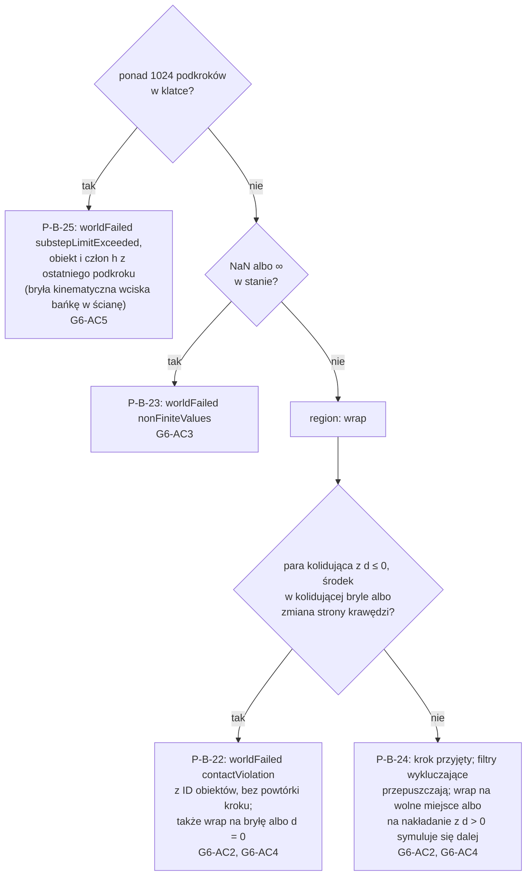
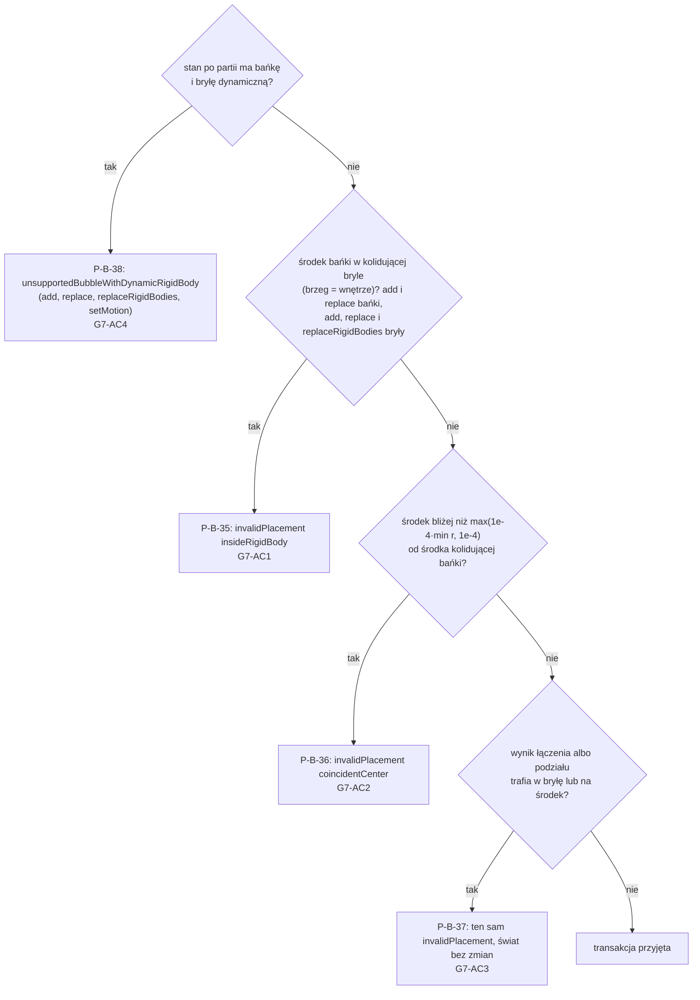

# Plan: Silnik BubblePhysics 4.0.0 — kontakt z granicą na promieniu i całkowanie siłowe z podkrokami

> **For agentic workers:** REQUIRED PHASE COMMAND: Run `/tt-agentic-sdlc:implement` with this file's path to execute this plan. It runs one slice per session, and only a slice with tasks. The program design below is binding: build the call trees as drawn, and turn each behaviour into a failing test before you write the code.

**Date:** 2026-11-23
**Artifact:** plan
**Design:** [change-design.md](change-design.md)
**References:** specyfikacja autora `2KBubbles-iOS/docs/benchmarks/stage-0/v4.0.0-engine-spec.md` (gałąź gry `feature/2kbubbles-ios-prd`, commit `ef1e7f7`); punkt wyjścia tag `v3.0.2` (`74c3503`)
**Strategy:** slices
**Test command:** `swift test`
**Status:** Approved
**Template version:** default/0.3.3

**Plugin version:** 0.7.11
**Agent Sessions:** claude-code: ca9caf94-f667-4817-9350-6d22399ebca1, 16e9c99f-b156-404d-bed6-ef59c058ff89, dc45740c-21ae-481c-991f-1c346cfdbf2e, b9859b36-3130-4774-a0fb-198eedd4318d

---

## Program design

Ścieżki są względne do korzenia repozytorium. `NM/` to `Sources/BubblePhysicsNativeMetal/`, `RT/` to `Sources/BubblePhysicsRuntime/`, `PUB/` to `Sources/BubblePhysicsPublic/`. Skróty jak w projekcie: K_c, γ, ε, h, dt, bańki „2”, 128 i 7168.

### R0 — Headline

Bańka przestaje przenikać ściany i inne bańki, bo siła kontaktu rośnie bez granic, zanim środek dojdzie do przeszkody. Ruch liczą same siły, w podkrokach dobranych do prędkości i sztywności. Znikają łaty 3.0.x: XPBD, CCD, strażniki i tłumienie kontaktu. Materiał bańki to tylko sztywność i opór.

### R1 — The whole flow

Jeden krok stały 1/60 po zmianie. Patrz na środek: broadphase i pętla podkroków zastępują predykcję, XPBD i łańcuch łat. Host przestaje liczyć siły i tylko przekazuje ich opis do GPU.

```mermaid
flowchart LR
    subgraph legend["legend"]
      direction LR
      L1["unchanged"]:::same
      L2["added"]:::added
      L3["modified"]:::changed
      L4["removed"]:::removed
      L1 ~~~ L2 ~~~ L3 ~~~ L4
    end

    W["BubbleWorld.advance<br/>FixedStepDriver"]:::same
    ST["TransactionStager + validate(change)<br/>bryła nad bańką, bańka + dynamiczna,<br/>próg gumki 0,25, bez walidacji α"]:::changed
    MC["MotionControllers.prepare<br/>tylko prędkość ról kinematycznych"]:::changed
    NPW["NativePublicWorld.step<br/>rekord bańki K_c, γ, m<br/>+ rekordy gumki, pól, motoru, pozy brył"]:::changed
    RB["solver brył raz na krok<br/>8 iteracji, bez gałęzi baniek"]:::changed
    BP["broadphase baniek i kandydaci bańka–bryła<br/>zapas obwiedni, bez krawędzi wejścia i cache λ"]:::changed
    SUB["NEW pętla podkroków leapfrog<br/>siły, półimpulsy, ruch, redukcja h,<br/>przebudowa siatki, limit 1024"]:::added
    END["region → NEW asercje kontaktu<br/>→ kontur cięciwą ε → zdarzenia"]:::changed
    OLD["predykcja, XPBD Jacobi, warm start,<br/>CCD, strażniki, zawarcie, dashpot ζ_c"]:::removed

    W --> ST --> MC --> NPW --> RB --> BP --> SUB --> END
    BP -.-> OLD

    classDef same fill:#f6f8fa,stroke:#8c959f,stroke-width:1px,color:#24292f
    classDef added fill:#dafbe1,stroke:#2da44e,stroke-width:3px,color:#24292f
    classDef changed fill:#fff8c5,stroke:#bf8700,stroke-width:3px,color:#24292f
    classDef removed fill:#ffebe9,stroke:#cf222e,stroke-width:2px,stroke-dasharray:4 3,color:#24292f
```



### R2 — Seams — where the change attaches to existing code

**Pliki.** Rdzeń zmiany siedzi w `NM/` i w shaderach. Model i Runtime zmieniają kształt danych i walidację. Wszystko poza wierszami oznaczonymi `(slice 2)` buduje wycinek 1.

```diff
  Package.swift                                   # + zasób NativeForceKernels, NativeXPBDKernels → NativeContactKernels
  Sources/BubblePhysicsPublic/Model/
+   Resources.swift          # PhysicsMaterial: .bubble = contactStiffness (K_c) + damping (γ); - BubbleContactCompliance, contactDampingRatio, deformability
+   Objects.swift            # - BubbleDescriptor.contactCompliance
+   Transitions.swift        # PhysicsParameter: - .deformability, + .contactStiffness
+   WorldTransaction.swift   # - BubbleResult.contactCompliance
+   WorldFrame.swift         # + TransactionRejectionReason.unsupportedBubbleWithDynamicRigidBody
  Sources/BubblePhysicsPublic/
+   Diagnostics.swift        # WorldFailureReason + .contactViolation, .substepLimitExceeded; + WorldFailureDetail (ID obiektów, krawędź, d, człon h); SolverGuardCause tylko .rigidRotationBudget; - containedBubblePairCount
+   BubbleWorld.swift        # mapowanie nowych przyczyn; makeBenchmarkWorld(configuration:device:) bez parametrów solvera; NEW pakietowe makeBenchmarkWorld(configuration:device:native:); NEW pakietowe benchmarkRenderWaitMilliseconds z commitAndWait (slice 2)
  Sources/BubblePhysicsRuntime/
+   MotionControllers.swift  # prepare: tylko .static = 0, .kinematic/.pathDriven = prędkość z toru; przejścia K_c i γ
+   TransactionStager.swift  # placement także dla add/replace/replaceRigidBodies bryły; validateBandStability ω·dt ≤ 0,25; - validateWorstAlpha
+   PlacementGeometry.swift  # positionTolerance jako stała (dzisiejsze 1e-4)
+   CompleteStep.swift       # - baseContactCompliance; - containedBubblePairCount
+   NativeCompleteStepper.swift # validate(change): bańka + bryła dynamiczna; przekazuje gumkę, siłę globalną, pola, motor, pozy brył; - walidacja deformability
  Sources/BubblePhysicsNativeMetal/
+   NativePublicWorld.swift  # rekord bańki (K_c, γ, m), rekordy sił i pozy brył; przeguby bez baniek
+   NativeForceRecords.swift # NEW lustra Swift: NativeMetalBandDrive, NativeMetalForceField, NativeMetalMotor, NativeMetalKinematicPose, NativeMetalSubstepControl
+   NativeSolverInput.swift  # - pola XPBD/tolerancji, - bit centerCrossing; + przyczyny contactViolation, substepLimit
+   NativeMetalBackend.swift # NativeMetalConfiguration bez pól publicznych, przełączniki pakietowe; telemetria podkroków
+   NativeMetalSolver.swift  # nowy potok kroku; stała rigidSolverIterationCount = 8; - XPBD, CCD, strażniki, cache λ, teleport
+   NativeMetalSubstepLoop.swift # NEW pary buforów (podkroki + koniec kroku), podwajanie, odczyt licznika, przebudowa, limit
+   NativeMetalChainKernels.swift # NativeMetalRigidCandidates: kandydaci bańka–bryła z zapasem w broadphase
+   NativeMetalBufferLayout.swift # NativeMetalBubble w nowym układzie; NativeMetalControl bez XPBD
+   NativeJointState.swift, NativeRigidPolygonState.swift # przeguby i kontakty tylko bryła–bryła; iteracje ze stałej
    NativeStaticPolygonEdges.swift # bez zmian: krawędzie jednostronne i wierzchołki
  Sources/BubblePhysicsNativeMetal/Shaders/
+   NativeGeometryKernels.metal-source  # NativeBubble w nowym układzie; - nativePredict; nativeBuildContacts bez krawędzi wejścia i cache; obwiednie z zapasem
+   NativeContactKernels.metal-source   # dawne NativeXPBDKernels: zostają skan, kompaktowanie, sąsiedztwo, bryła–bryła; - XPBD, cache λ, gałęzie baniek
+   NativeForceKernels.metal-source     # NEW prawo kontaktu, siły, półimpulsy, ruch, redukcja h, asercje
+   NativePostSolveKernels.metal-source # - CCD, strażniki, zawarcie, nacisk z λ; cięciwa r·(1 − ε)
+ Sources/BubblePhysicsNativeMetalDiagnostics/    # runnery i adapter na nowym NativeSolverInput i telemetrii
+ Benchmarks/macOS/BubblePhysicsReferenceBench/   # kompiluje się z nowym modułem diagnostycznym
+ Sources/BubblePhysicsMetalRenderBenchmark/PublicWorldStressBenchmark.swift # K_c, bez brył dynamicznych z bańkami; PublicWorldStressReport z histogramem podkroków, najdłuższą klatką i czasem GPU fizyki osobno od konturu, nowe przypadki Scene: cztery sceny G8-AC2 po 150 baniek, .restingCrowd, .bandToWall, .headOn128, .shotIntoCrowd o nazwach raportu resting-crowd, band-to-wall, head-on-128, shot-into-crowd; uderzenia powtarzane co 20 klatek przez stepTransaction (slice 2)
+ Benchmarks/macOS/BubblePhysicsPerfGuard/        # działa na K_c; bazy w docs/benchmarks/perf-guard.json odświeżone przez --record (slice 2)
+ Benchmarks/iOS/BubblePhysicsBench/App/PublicWorldStressView.swift # kompiluje się; cztery sceny G8-AC2 w przełączniku scen (slice 2)
+ Examples/BubblePhysicsShowcase/App/BubbleScene.swift # contactStiffness zamiast deformability
+ docs/integration-guide.md  # bloki kodu zgodne ze Showcase; proza na K_c i γ, tytuł 4.0 (slice 2)
+ docs/MIGRATION-v4.md       # NEW tabela symboli, zmiany zachowania i znane ograniczenia; przeguby z bańkami i sztywne K_c (slice 2)
+ docs/benchmarks/           # NEW raporty v4.0.0: Mac naprzemiennie z v3.0.2, iPhone X, bramka gry (slice 2)
+ CHANGELOG.md, README.md    # wydanie 4.0.0, README bez XPBD w opisie produktu (slice 2)
+ Tests/                     # audyt według spec. 4, w tym BubblePhysicsMetalRenderTests (sceny z materiałem bańki); MigrationGuideTests na 4.0.0 (slice 2)
```

Promień z przejścia (`bubbleRadius`) host ustala raz na krok w `MotionControllers.prepare`, przed broadphase. Siatka, kandydaci i zapas widzą więc już nowy promień, a w trakcie kroku promień się nie zmienia, więc zapas nie musi pokrywać jego przyrostu. Przyrost zwiększa tylko wgniecenie przy tej samej odległości d > 0, a większe ω daje więcej podkroków ([P-B-21](#p-b-21)).

Stan przejściowy wewnątrz wycinka 1: od zadania 2 do zadania 7 `NativePublicWorld` liczy dawną podatność XPBD jako c = r / K_c, żeby pakiet się kompilował, a stare sceny działały. Zadanie 7 usuwa to razem z XPBD. Od zadania 7 do zadania 8 pętla podkroków ma jeden bufor z 1024 podkrokami (puste wychodzą od razu), a zadanie 8 zastępuje go parami buforów z podwajaniem. Żaden z tych stanów nie trafia do `main`.

**Kolejność kernelów.** Pliki shaderów łączą się w jedną jednostkę w kolejności `NativeMetalShaderSource.solverFiles` (`NM/NativeMetalSolver.swift:1273`): Geometry → Contact → Force → PostSolve. `NativeForceKernels` widzi więc struktury z Geometry. Każdy nowy kernel trafia do `NativeMetalPipelineCache.stageNames` (`:1230`).

**Krok natywny.** Stos wywołań `NativeMetalSolver.executeSnapshot` (`NM/NativeMetalSolver.swift:316`), dziś i po zmianie:

```diff
  BubbleWorld.advance(by:commandBuffer:encodeRender:) # PUB/BubbleWorld.swift:265
  └── NativeCompleteStepper.performStep               # RT/NativeCompleteStepper.swift:105
      ├── MotionControllers.prepare                   # tylko prędkość zadana ról kinematycznych
      └── NativePublicWorld.step                      # NM/NativePublicWorld.swift:151
          └── NativeMetalSolver.executeSnapshot
-             ├── nativePredict
              ├── nativeRigidPredict … nativeRigidApplyCCD   # bryły raz na krok, bez zmian
-             ├── for solverIterationCount: nativeRigidContacts (z gałęzią baniek), nativeRigidApplyBodies,
-             │       nativeSolveJoints, nativeApplyJointBodies, nativeApplyJointBubbles, nativeRigidGuardWalls, nativeRigidApplyBubbles
+             ├── for rigidSolverIterationCount (8, dzisiejsza wartość domyślna): nativeRigidContacts (bryła–bryła),
+             │       nativeRigidApplyBodies, nativeSolveJoints, nativeApplyJointBodies, nativeRigidGuardWalls
+             ├── nativeAccelerationWithoutContacts     # a₀: gumka, siła globalna, pola, motor
+             ├── nativeBroadphaseMargin                # zapas max(1,05·(|v|·t + ½|a₀|·t²), r/4), x₀ ← x
              ├── nativePrepareGrid … nativeCompactCandidates   # bańka–bańka i bańka–krawędź, obwiednie z zapasem
              ├── NativeMetalRigidCandidates.encode     # przeniesione z fazy XPBD: bańka–bryła (koło, kapsuła, kinematyczna + droga w kroku)
              ├── nativeBuildContacts                   # - krawędź wejścia, - odczyt cache
-             ├── nativeMatchContactCache, nativeRetainContactCache, nativeCompactContactCache
-             ├── nativePrepareSolverContacts, nativeApplyWarmStart, for: nativeUpdateContactMultipliers, nativeSolveJacobi, nativeMeasureResidual
+             ├── nativeContactForces                   # siły pełne z kontaktami → a (początek kroku)
+             └── NativeMetalSubstepLoop.run            # para k: bufor podkroków + bufor końca kroku, oba commit bez czekania między nimi
+                 ├── bufor podkroków: 2 × poprzednia klatka (min. 2), każda kolejna para tej klatki 2 × więcej
+                 │   └── for substep:
+                 │       ├── nativeReduceSubstep        # h = min(t_poz, 1/ω_max, d/(4v), h_zapasu); człon i obiekt; limit 1024; znacznik przebudowy
+                 │       └── nativeIntegrateSubstep     # ½ impulsu → ruch (+ poza kinematyczna) → nativeContactForces → ½ impulsu; znacznik strony krawędzi
+                 ├── bufor końca kroku: dyspozycje pośrednie, zero grup, dopóki czas kroku nie minął
-                 │   (dziś: nativeFindFastCandidates, nativeResolveCCD, nativeApplyCenterGuards, nativeValidateBubbleContainment,
-                 │    nativeFinalizeSolverContacts, nativeUpdateVelocities, nativeDampContactNormalMotion, nativeInvalidateSafetyCache)
                  │   ├── nativeCheckFinite
                  │   ├── nativeApplyPublicRegion          # przeniesione przed asercje
+                 │   ├── nativeAssertContacts             # d > 0 w parach według filtrów, środek poza bryłą, znacznik strony
                  │   ├── nativeAccumulateContactPressure  # cięciwa r·(1 − ε), - nacisk z λ
                  │   ├── nativeGenerateContoursFused, nativePrepareRenderDataGrouped
                  │   └── nativeCompactMergeEvents, sensory, nativeRigidFinish, nativeHitTest
+                 ├── await bufora końca kroku → odczyt licznika: następna para (od przebudowy siatki) albo koniec
+                 └── bufor wywołującego: tylko render przez beforeCommit, po końcu kroku
```

Typowa klatka ma jedną parę buforów ([CD-D-18](change-design.md#cd-d-18)) i dwa czekania CPU: na bufor końca kroku i na bufor renderu wywołującego, bo `BubbleWorld.advance` publikuje stan po renderze (odchylenie implementacji nr 15). Czas GPU fizyki to suma `gpuEndTime − gpuStartTime` buforów podkroków, a czas konturu to ten sam pomiar bufora końca kroku. Nie trzeba więc próbkowania liczników. Dziś fizyka koduje się w buforze wywołującego (`NM/NativeMetalSolver.swift:572`). Po zmianie ten bufor dostaje tylko render, z końcowego stanu kroku ([P-B-39](#p-b-39)).

**Transakcja.** `TransactionStager.stageBatch` (`RT/TransactionStager.swift:178`), dziś i po zmianie:

```diff
  StagingContext.apply
  ├── .add / .replace bańki → validatePlacement → PlacementGeometry.issue     # bez zmian (to także „zmiana pozycji bańki”)
- │                         → validateWorstAlpha
+ ├── .add / .replace bryły, add(_:) z .replaceRigidBodies → PlacementGeometry.issue dla każdej kolidującej bańki   # .insideRigidBody
  ├── mergeBubbles / splitBubble → PlacementGeometry.issue                   # bez zmian
  └── validate(object) → validateBandStability                               # K_band ≤ m / (16 · dt²)
  NativeCompleteStepper.validate(change)                                     # RT/NativeCompleteStepper.swift:34, stan po całej partii
+ └── rejectBubbleWithDynamicRigidBody(change.state)                         # dowolna operacja: add, replace, replaceRigidBodies, setMotion
```

`WorldOperation` nie ma osobnej operacji zmiany pozycji bańki ani pozy bryły. Pozycję bańki zmienia tylko `.replace`, który już jest walidowany. Pozę bryły zmieniają `.add`, `.replace` i `.replaceRigidBodies`, i to one dostają nową walidację ([G7-AC1](change-design.md#g7-ac1)). Bryłą dynamiczną jest bryła w roli `.dynamic`, `.motorDriven`, `.playerDriven` albo `.pathDriven`. Reguła sprawdza cały stan po partii, więc nie zależy od tego, która operacja wprowadziła bryłę.

**Szew testów.** Testy świata tworzą go przez nowe pakietowe `BubbleWorld.makeBenchmarkWorld(configuration:device:native:)`, gdzie `native` to `NativeMetalConfiguration` z przełącznikami:
- `substepSplitMultiplier`: wymusza drobniejszy podział ([G4-AC3](change-design.md#g4-ac3));
- `minimumMarginOnly`: zapas tylko r / 4 ([G5-AC3](change-design.md#g5-ac3));
- `captureSubsteps`: zapis x, v i h po każdym podkroku, rozwinięcie `nativeCapturePositions`;
- `assertEverySubstep` i `injectedSubstepState`: asercja po podkroku i wstrzyknięcie stanu ([G6-AC2](change-design.md#g6-ac2)).

**Para różnych materiałów.** Newton ma stałe 12 kroków ([CD-D-16](change-design.md#cd-d-16)). Rachunek w Double przy zbieżności 1e-4 dał najwyżej 10 kroków dla K_b / K_a do 1000, przy r 24–148 i q od 10⁻⁴ do 10⁶.

Najważniejsze do sprawdzenia dwa razy: `nativeReduceSubstep`. Wyznacza h, przebudowę i limit, a od niego zależy cała gwarancja braku przejścia.

### R3 — Behaviour

Sceny i progi są w kryteriach projektu. Tabela podaje sytuację i wynik w skrócie.

| P-B-ID | Situation | Result | Proves |
|---|---|---|---|
| <a id="p-b-1"></a>P-B-1 | materiał `.bubble` z K_c, γ; złe wartości; tarcie, restytucja albo limit na bańce; przejścia materiału | tworzy się albo `valueOutOfRange` z nazwą pola; przejście K_c i γ działa, tarcia i restytucji na bańce odrzucone | [G1-AC1](change-design.md#g1-ac1) |
| <a id="p-b-2"></a>P-B-2 | graf symboli pięciu modułów publicznych | żadnego z usuniętych symboli; `MIGRATION-v4.md` ma każdy z zastępstwem | [G1-AC2](change-design.md#g1-ac2) |
| <a id="p-b-3"></a>P-B-3 | materiał `.rigid`, sceny brył bez baniek, budżet obrotu | jak w `v3.0.2`, także `rigidRotationBudget` | [G1-AC3](change-design.md#g1-ac3) |
| <a id="p-b-4"></a>P-B-4 | „2” i 7168 dociśnięte do ściany, pary ściśnięte polami, F od 10² do 10⁵, γ = 0, 20 s | d trzyma d* w ±0,5 % + 1e-3 j w każdej klatce, d > 0 | [G2-AC1](change-design.md#g2-ac1) |
| <a id="p-b-5"></a>P-B-5 | odwrotność prawa w float32, q od 10⁻⁴ do 10⁶ | błąd względny ε ≤ 1e-3 wobec Double | [G2-AC2](change-design.md#g2-ac2) |
| <a id="p-b-6"></a>P-B-6 | para tego samego i różnych K | podział r_a : r_b ± 2 %; siła z Newtona ± 1 % wobec Double | [G2-AC3](change-design.md#g2-ac3) |
| <a id="p-b-7"></a>P-B-7 | „2” dociśnięta do statycznego koła, kapsuły i stojącej bryły kinematycznej | to samo prawo co przy ścianie | [G2-AC4](change-design.md#g2-ac4) |
| <a id="p-b-8"></a>P-B-8 | para w kontakcie | cięciwy obu konturów różnią się ≤ 1e-3 · R, bez przenikania | [G2-AC5](change-design.md#g2-ac5) |
| <a id="p-b-9"></a>P-B-9 | „2”, 128, 7168 w ścianę grubości 1, prostopadle i ukośnie, do 3 · 10³ j/s | środek po stronie startowej po każdym podkroku; d_min z bilansu energii ± 10 %; bez `worldFailed` | [G3-AC1](change-design.md#g3-ac1) |
| <a id="p-b-10"></a>P-B-10 | para czołowa i ukośna, także „2” na 7168 | odległość środków > 0, bez zamiany stron | [G3-AC2](change-design.md#g3-ac2) |
| <a id="p-b-11"></a>P-B-11 | obracająca się bryła kinematyczna 10³ j/s uderza w „2” | środek poza bryłą po każdym podkroku, odbicie, tor bryły bez zmian | [G3-AC3](change-design.md#g3-ac3) |
| <a id="p-b-12"></a>P-B-12 | uderzenie w ścianę bez oporu | prędkość odbicia ± 2 % | [G4-AC1](change-design.md#g4-ac1) |
| <a id="p-b-13"></a>P-B-13 | uderzenie z γ ∈ {1; 5} | ubytek energii = ∫ γ m \|v\|² dt z zapisu podkroków ± 5 % (+1 % energii początkowej) | [G4-AC2](change-design.md#g4-ac2) |
| <a id="p-b-14"></a>P-B-14 | cztery sceny liczone naturalnie i z podziałem 4 × drobniejszym | po 1 s pozycje do 1 j, prędkości do 2 % największej | [G4-AC3](change-design.md#g4-ac3) |
| <a id="p-b-15"></a>P-B-15 | gumka K_band = 22 z celem jadącym 100 j/s, „2” i 7168, γ ∈ {1; 5}, 60 s; stager przy K_band 22, 224, 226 | prędkość u ± 1 %, naciągnięcie u·m·γ / K_band ± 1 %; obcięcie tylko z `maximumForce`; puszczenie zachowuje prędkość; 226 → `valueOutOfRange("drive.bandStiffness")` | [G4-AC4](change-design.md#g4-ac4) |
| <a id="p-b-16"></a>P-B-16 | pole radialne przyciągające, „2” z prędkością styczną, 2 s | pozycja do 1 j wobec całkowania w Double | [G4-AC5](change-design.md#g4-ac5) |
| <a id="p-b-17"></a>P-B-17 | bańka `.pathDriven` bez kontaktów i z kontaktem; bańka `.kinematic` nadal odrzucana | poza z toru ± 1e-3 j; kontakt działa siłą; `unsupportedMotionRole` jak w `v3.0.2` | [G4-AC6](change-design.md#g4-ac6) |
| <a id="p-b-18"></a>P-B-18 | tłum w spoczynku, wolny ruch, gumka gry | dokładnie 1 podkrok na krok | [G5-AC1](change-design.md#g5-ac1) |
| <a id="p-b-19"></a>P-B-19 | docisk F = 20 000; uderzenie 10³ j/s | 3 ± 1 podkroki; szczyt ± 20 % wobec symulacji 1D reguły h; po kontakcie znów 1 | [G5-AC2](change-design.md#g5-ac2) |
| <a id="p-b-20"></a>P-B-20 | 128 wybija lekką „2” w ścianę albo w drugą „2” spoza listy kandydatów | bez przejścia; co najmniej jedna przebudowa w klatce wybicia; to samo przy `minimumMarginOnly` | [G5-AC3](change-design.md#g5-ac3) |
| <a id="p-b-21"></a>P-B-21 | tłum 150 baniek rośnie do pełnego promienia, gumka bez `maximumForce` przez 60 s | zero `worldFailed`, zero NaN, d > 0, przenikanie 0 | [G6-AC1](change-design.md#g6-ac1) |
| <a id="p-b-26"></a>P-B-26 | sceny obracającej się bryły, tłumu i uderzeń | żadna klatka nie przekracza 1024 podkroków (limit nie daje fałszywych alarmów w zakresie gry) | [G6-AC5](change-design.md#g6-ac5) |
| <a id="p-b-27"></a>P-B-27 | `NativeMetalFrameTelemetry` | osobno: podkroki, przebudowy, czas GPU fizyki i konturu; bez pól XPBD, CCD i strażników | [G8-AC1](change-design.md#g8-ac1) |
| <a id="p-b-28"></a>P-B-28 | benchmark stress | raport z histogramem podkroków (p95, maksimum) | [G8-AC1](change-design.md#g8-ac1) |
| <a id="p-b-29"></a>P-B-29 | iPhone X, Release, 150 baniek, cztery sceny | p95 klatki ≤ 16,67 ms; raport z histogramem, najdłuższą klatką i czasem fizyki osobno od konturu; przekroczenie wstrzymuje tag | [G8-AC2](change-design.md#g8-ac2) |
| <a id="p-b-30"></a>P-B-30 | perf guard i stress na Macu, naprzemiennie z `v3.0.2` | nowe bazy i raport zmiany w `docs/benchmarks/` | [G8-AC3](change-design.md#g8-ac3) |
| <a id="p-b-31"></a>P-B-31 | audyt testów według spec. 4 | lista „do usunięcia” usunięta, „do zachowania” przeliczona, nowe testy są; `swift test` zielone | [G9-AC1](change-design.md#g9-ac1) |
| <a id="p-b-32"></a>P-B-32 | Showcase i benchmark iOS | budują się i działają na K_c; bańki tylko z bryłami statycznymi i kinematycznymi; przewodnik zgodny ze Showcase | [G9-AC2](change-design.md#g9-ac2) |
| <a id="p-b-33"></a>P-B-33 | bramka przeciskania na gałęzi gry | 15/15, 40 łączeń w każdym przebiegu, przenikanie i ucieczki 0, zero `worldFailed` | [G9-AC3](change-design.md#g9-ac3) |
| <a id="p-b-34"></a>P-B-34 | wydanie | `CHANGELOG.md`, `README.md` i `MigrationGuideTests` na 4.0.0; `MIGRATION-v4.md` opisuje zachowanie i ograniczenia | [G9-AC4](change-design.md#g9-ac4) |
| <a id="p-b-39"></a>P-B-39 | `advance(by:commandBuffer:encodeRender:)` w klatce z jedną i z kilkoma parami buforów | render w buforze wywołującego pokazuje stan końca kroku; testy przekazania renderu (`NativeMetalRenderHandoffTests`, `RenderHookTests`) przechodzą | [G9-AC1](change-design.md#g9-ac1) |

**Wynik końca kroku.** Liście to zachowania [P-B-22](#p-b-22) do [P-B-25](#p-b-25): <a id="p-b-22"></a><a id="p-b-23"></a><a id="p-b-24"></a><a id="p-b-25"></a>limit podkroków sprawdza się najpierw, potem skończoność, potem region, a asercja kontaktu biegnie po regionie i nie odrzuca kroku. Dowodzą [G6-AC2](change-design.md#g6-ac2), [G6-AC3](change-design.md#g6-ac3), [G6-AC4](change-design.md#g6-ac4) i [G6-AC5](change-design.md#g6-ac5).



**Walidacja transakcji.** Liście to zachowania [P-B-35](#p-b-35) do [P-B-38](#p-b-38): <a id="p-b-35"></a><a id="p-b-36"></a><a id="p-b-37"></a><a id="p-b-38"></a>odrzucona transakcja zostawia świat bez zmian, a sprawdzane są tylko pary kolidujące według filtrów. Dowodzą [G7-AC1](change-design.md#g7-ac1), [G7-AC2](change-design.md#g7-ac2), [G7-AC3](change-design.md#g7-ac3) i [G7-AC4](change-design.md#g7-ac4).



Zachowania kodu zastępowanego, które muszą przetrwać:
- zdarzenia kontaktu, łączenia i sensory czytają rekordy kontaktów końca kroku;
- `contactCandidateOverflow` raportuje przepełnienie listy kandydatów jak dziś ([CD-D-26](change-design.md#cd-d-26));
- odrzucenie kroku przez budżet obrotu bryły i wyniki scen z samymi bryłami są jak w `v3.0.2` (8 iteracji solvera brył).

### Test strategy

| Level | What it proves | Behaviours |
|---|---|---|
| model (bez GPU) | walidacja materiału, przejść i API | [P-B-1](#p-b-1), [P-B-3](#p-b-3) |
| runtime (bez GPU) | walidacja transakcji, gumki i ról | [P-B-15](#p-b-15) (stager), [P-B-17](#p-b-17) (odrzucenie `.kinematic`), [P-B-35](#p-b-35)–[P-B-38](#p-b-38) |
| świat na GPU (szew `makeBenchmarkWorld(configuration:device:native:)`, porównanie z odniesieniem w Double z testu) | prawo kontaktu, brak przejścia, całkowanie, podkroki, asercje, telemetria, render | [P-B-4](#p-b-4)–[P-B-27](#p-b-27), [P-B-39](#p-b-39) |
| kontrola statyczna i build Xcode | graf symboli bez usuniętych nazw; pełny pakiet zielony; Showcase i benchmark iOS się budują | [P-B-2](#p-b-2), [P-B-31](#p-b-31), [P-B-32](#p-b-32) |
| raport benchmarku (bez urządzenia docelowego, slice 2) | raport stress ma histogram podkroków, najdłuższą klatkę i czasy GPU fizyki i konturu; cztery sceny [G8-AC2](change-design.md#g8-ac2) budują się ze 150 bańkami i liczą bez `worldFailed` | [P-B-28](#p-b-28), [P-B-29](#p-b-29) (sceny) |
| pomiar (slice 2) | perf guard i stress na Macu naprzemiennie z `v3.0.2`; iPhone X | [P-B-29](#p-b-29), [P-B-30](#p-b-30) |
| dokumentacja (slice 2) | wersja i przewodnik migracji | [P-B-34](#p-b-34) |
| bramka gry (poza repozytorium, ręcznie, slice 2) | przyjęcie w realnym tłumie | [P-B-33](#p-b-33) |

**Where:**
- testy modelu: `Tests/BubblePhysicsPublicTests/`, nowa klasa `BubbleMaterialTests`;
- testy runtime: `Tests/BubblePhysicsRuntimeTests/`, nowe klasy `RigidPlacementTests`, `DynamicRigidExclusionTests` i `BandStabilityThresholdTests`;
- testy świata: `Tests/BubblePhysicsRuntimeTests/`, jedna klasa na zadanie: `ContactLawStaticsTests` ([P-B-4](#p-b-4)–[P-B-6](#p-b-6)), `ForceIntegrationTests` ([P-B-12](#p-b-12), [P-B-13](#p-b-13)), `NoCrossingTests` ([P-B-9](#p-b-9), [P-B-10](#p-b-10)), `SubstepCountTests` ([P-B-18](#p-b-18), [P-B-19](#p-b-19)), `GridRebuildTests` ([P-B-20](#p-b-20)), `SubstepForceTests` ([P-B-14](#p-b-14)–[P-B-16](#p-b-16)), `RigidContactTests` ([P-B-7](#p-b-7), [P-B-11](#p-b-11), [P-B-17](#p-b-17)), `ContactAssertionTests` ([P-B-22](#p-b-22)–[P-B-26](#p-b-26)), `ContourChordTests` ([P-B-8](#p-b-8)), `SubstepTelemetryTests` ([P-B-27](#p-b-27)), `CrowdStabilityTests` ([P-B-21](#p-b-21));
- odniesienie w Double: `Tests/BubblePhysicsRuntimeTests/ContactLawReference.swift`, obok `CrowdSceneSupport.swift`;
- testy natywne i ABI rekordów: `Tests/BubblePhysicsNativeMetalTests/` (`NativeMetalShaderABITests`, `NativeMetalRenderHandoffTests`);
- testy raportu benchmarku: `Tests/BubblePhysicsMetalRenderTests/`, nowe klasy `StressSubstepReportTests` ([P-B-28](#p-b-28)) i `BudgetSceneTests` ([P-B-29](#p-b-29), sceny); perf guard: `swift run -c release BubblePhysicsPerfGuard`, testy `Tests/BubblePhysicsPerfGuardTests/`;
- testy dokumentacji: `Tests/BubblePhysicsPublicTests/MigrationGuideTests.swift`, `IntegrationGuideTests.swift` ([P-B-34](#p-b-34)).

Testy GPU pomijają się (`XCTSkip`) bez urządzenia Metal, więc liczą się tylko przebiegi na Macu z GPU. Repozytorium nie ma lintera ani CI.

**Test command:** `swift test`

## Slice Status

| Slice | Name | Delivers | Seams | Behaviours | Status |
|-------|------|----------|-------|------------|--------|
| 1 | Silnik 4.0.0 w pakiecie | Gra może zbudować się na gałęzi silnika: nowy materiał, prawo kontaktu, podkroki, asercje, walidacja transakcji, telemetria; Showcase i benchmark iOS się budują ([G1](change-design.md#g1-ac1)–[G7](change-design.md#g7-ac4), [G8-AC1](change-design.md#g8-ac1) w części silnika, [G9-AC1](change-design.md#g9-ac1), [G9-AC2](change-design.md#g9-ac2)) | Model, Runtime, `NM/`, shadery, moduł diagnostyczny, `BubblePhysicsReferenceBench`, stress i perf guard na K_c, Showcase, bloki kodu przewodnika, tabela symboli `docs/MIGRATION-v4.md` | [P-B-1](#p-b-1)–[P-B-27](#p-b-27), [P-B-31](#p-b-31), [P-B-32](#p-b-32), [P-B-35](#p-b-35)–[P-B-39](#p-b-39) | done |
| 2 | Wydanie 4.0.0 | Pomiar na iPhonie X, nowe bazy, dokumentacja wydania, bramka gry i tag ([G8-AC1](change-design.md#g8-ac1) w części benchmarku, [G8-AC2](change-design.md#g8-ac2), [G8-AC3](change-design.md#g8-ac3), [G9-AC3](change-design.md#g9-ac3), [G9-AC4](change-design.md#g9-ac4)) | `PublicWorldStressBenchmark` (raport z histogramem, cztery sceny [G8-AC2](change-design.md#g8-ac2)), przełącznik scen benchmarku iOS, bazy perf guard, raporty w `docs/benchmarks/`, `CHANGELOG.md`, `README.md`, `MigrationGuideTests`, `docs/MIGRATION-v4.md` (uzupełnienie), proza `docs/integration-guide.md` | [P-B-28](#p-b-28)–[P-B-30](#p-b-30), [P-B-33](#p-b-33), [P-B-34](#p-b-34) | wip |

Wycinek 1 ma sens sam: cały pakiet, Showcase i benchmark iOS działają na nowym silniku z zielonym `swift test`, a autor może od razu podpiąć gałąź gry i stroić. Brakuje w nim dowodu wydajności na iPhonie X, nowych baz, dokumentacji wydania i bramki gry. Bez nich nie ma tagu. Wycinek 2 domyka wydanie i może zmienić się po pomiarze: przekroczenie budżetu wraca do autora jako decyzja o lokalnym h.

## Slice 1: Silnik 4.0.0 w pakiecie

**Delivers:** pakiet BubblePhysics liczy bańki nowym prawem kontaktu w podkrokach, bez XPBD i łat, z zielonym `swift test`.

Każde zadanie zostawia pakiet z kompilującymi się testami (`swift build --build-tests`). Każde zaczyna od czerwonego testu swojej klasy. Od zadania 6 do zadania 10 istniejące testy gumki, oporu, pól i motoru (`BandDriveTests`, `MotionDampingTests` i podobne) są czerwone: host przestaje liczyć te siły w zadaniu 6, a GPU zaczyna w zadaniu 10. To spodziewany stan przejściowy, a nie regresja.

1. Odniesienie w Double dla testów (`ContactLawReference`: ε(q), U(ε), d*, Newton dla różnych K, symulacja 1D reguły h, całkowanie pola) z własnymi testami · verify: `swift test --filter BubblePhysicsRuntimeTests.ContactLawReferenceTests`

    ```text
    $ swift test --filter BubblePhysicsRuntimeTests.ContactLawReferenceTests
    Executed 19 tests, with 0 failures (0 unexpected)
    exit=0
    ```

2. `PhysicsMaterial` dla `.bubble` z K_c i γ oraz `PhysicsParameter.contactStiffness` w modelu, z dostosowaniem wszystkich wywołań i testów (podatność przejściowo c = r / K_c), covering [P-B-1](#p-b-1), [P-B-3](#p-b-3) · verify: `swift build --build-tests && swift test --filter BubblePhysicsPublicTests.BubbleMaterialTests`

    ```text
    $ swift build --build-tests && swift test --filter BubblePhysicsPublicTests.BubbleMaterialTests
    Build complete!
    Executed 9 tests, with 0 failures (0 unexpected)
    exit=0
    ```

3. Walidacja w stagerze i w `validate(change)`: bryła nad bańką, bańka z bryłą dynamiczną, próg gumki 0,25, stała tolerancja położenia, bez walidacji α, covering [P-B-35](#p-b-35)–[P-B-38](#p-b-38), [P-B-15](#p-b-15) (stager) · verify: `swift test --filter "RigidPlacementTests|DynamicRigidExclusionTests|BandStabilityThresholdTests"`

    ```text
    $ swift test --filter "RigidPlacementTests|DynamicRigidExclusionTests|BandStabilityThresholdTests"
    Executed 25 tests, with 0 failures (0 unexpected)
    exit=0
    ```

4. Powierzchnia bez działania: szew `makeBenchmarkWorld(configuration:device:native:)`, przełączniki pakietowe, nowe przyczyny `worldFailed` z `WorldFailureDetail` i pola telemetrii · verify: `swift build --build-tests && grep -q "substepSplitMultiplier" Sources/BubblePhysicsNativeMetal/NativeMetalBackend.swift`

    ```text
    $ swift build --build-tests && grep -q "substepSplitMultiplier" Sources/BubblePhysicsNativeMetal/NativeMetalBackend.swift
    Build complete!
    exit=0
    ```

5. Czerwone testy świata w klasach z „Where”, covering [P-B-4](#p-b-4)–[P-B-27](#p-b-27) · verify: `swift build --build-tests && ! swift test --filter "ContactLawStaticsTests|ForceIntegrationTests|NoCrossingTests|SubstepCountTests|GridRebuildTests|SubstepForceTests|RigidContactTests|ContactAssertionTests|ContourChordTests|SubstepTelemetryTests|CrowdStabilityTests"`

    ```text
    $ swift build --build-tests && ! swift test --filter "ContactLawStaticsTests|…|CrowdStabilityTests"
    @fccba27 (faza czerwona, raport porcji): 61 testów, 236 błędów → verify exit 0
    @e03ccb2 (po wycinku): Executed 67 tests, with 0 failures (0 unexpected)
    exit=1 — oczekiwane: negacja dowodziła czerwonej fazy; testy są teraz zielone
    ```

6. Host i rekordy: `MotionControllers.prepare` tylko z prędkością ról kinematycznych, rekordy bańki, gumki, pól, motoru i pozy brył w `NativeForceRecords.swift` · verify: `swift test --filter "MotionControllersPrepareTests|NativeMetalShaderABITests"` z nowym przypadkiem ABI dla `NativeMetalBandDrive`

    ```text
    $ swift test --filter "MotionControllersPrepareTests|NativeMetalShaderABITests"
    Executed 16 tests, with 0 failures (0 unexpected)
    exit=0
    ```

7. `NativeForceKernels` z prawem kontaktu dla ściany, wierzchołka i pary, redukcja h (1/ω_max z Gershgorina, d / 4 w obu kierunkach) i zapis `captureSubsteps` w pętli podkroków w miejsce XPBD, przejściowo w jednym buforze z 1024 podkrokami, z solverem brył na stałych 8 iteracjach, covering [P-B-4](#p-b-4)–[P-B-6](#p-b-6), [P-B-12](#p-b-12), [P-B-13](#p-b-13) · verify: `swift test --filter "ContactLawStaticsTests|ForceIntegrationTests|RigidPolygonRuntimeTests"`

    ```text
    $ swift test --filter "ContactLawStaticsTests|ForceIntegrationTests|RigidPolygonRuntimeTests"
    Executed 13 tests, with 0 failures (0 unexpected) in 47.154 seconds
    exit=0
    ```

8. Pary buforów w `NativeMetalSubstepLoop` (2 × poprzednia klatka, podwajanie) w miejsce przejściowego bufora, render po końcu kroku i limit 1024 z obiektem wyznaczającym h, covering [P-B-9](#p-b-9), [P-B-10](#p-b-10), [P-B-18](#p-b-18), [P-B-19](#p-b-19), [P-B-39](#p-b-39) · verify: `swift test --filter "NoCrossingTests|SubstepCountTests|NativeMetalRenderHandoffTests|RenderHookTests"`

    ```text
    $ swift test --filter "NoCrossingTests|SubstepCountTests|NativeMetalRenderHandoffTests|RenderHookTests"
    Executed 18 tests, with 0 failures (0 unexpected)
    exit=0
    ```

9. Zapas obwiedni, h_zapasu i przebudowa siatki w tej samej klatce z przełącznikiem `minimumMarginOnly`, z promieniem z przejścia ustalonym raz na krok przed broadphase, covering [P-B-20](#p-b-20) · verify: `swift test --filter GridRebuildTests`

    ```text
    $ swift test --filter GridRebuildTests
    Executed 4 tests, with 0 failures (0 unexpected)
    exit=0
    ```

10. Gumka, siła globalna, pola i motor w każdym podkroku z przełącznikiem `substepSplitMultiplier`, covering [P-B-14](#p-b-14)–[P-B-16](#p-b-16) · verify: `swift test --filter "SubstepForceTests|BandDriveTests|MotionDampingTests"`

    ```text
    $ swift test --filter "SubstepForceTests|BandDriveTests|MotionDampingTests"
    Executed 22 tests, with 0 failures (0 unexpected)
    exit=0
    ```

11. Kandydaci bańka–bryła w broadphase i kontakt ze statycznym kołem, kapsułą i bryłą kinematyczną z pozą interpolowaną, bez gałęzi baniek w solverze brył i przegubach, covering [P-B-7](#p-b-7), [P-B-11](#p-b-11), [P-B-17](#p-b-17) · verify: `swift test --filter "RigidContactTests|KinematicStagingTests"`

    ```text
    $ swift test --filter "RigidContactTests|KinematicStagingTests"
    Executed 15 tests, with 0 failures (0 unexpected)
    exit=0
    ```

12. Region przed asercjami, `nativeAssertContacts` ze znacznikiem strony krawędzi i wstrzyknięcie stanu, covering [P-B-22](#p-b-22)–[P-B-26](#p-b-26) · verify: `swift test --filter "ContactAssertionTests|RegionPolicyTests"`

    ```text
    $ swift test --filter "ContactAssertionTests|RegionPolicyTests"
    Executed 32 tests, with 0 failures (0 unexpected)
    exit=0
    ```

13. Cięciwa konturu r·(1 − ε) i telemetria podkroków, przebudów oraz czasów GPU fizyki i konturu, covering [P-B-8](#p-b-8), [P-B-27](#p-b-27) · verify: `swift test --filter "ContourChordTests|SubstepTelemetryTests|ContactContourTests"`

    ```text
    $ swift test --filter "ContourChordTests|SubstepTelemetryTests|ContactContourTests"
    Executed 9 tests, with 0 failures (0 unexpected)
    exit=0
    ```

14. Usunięcie kerneli i kodu Swift po XPBD, CCD, strażnikach, cache λ i zawarciu, pól publicznych `NativeMetalConfiguration`, `centerCrossing` i licznika zawartych par, z tabelą symboli w nowym `docs/MIGRATION-v4.md`, covering [P-B-2](#p-b-2) · verify: `swift package dump-symbol-graph && for m in BubblePhysicsModel BubblePhysics BubblePhysicsRuntime BubblePhysicsNativeMetal BubblePhysicsMetalRender; do ls .build/*/symbolgraph/$m.symbols.json >/dev/null || exit 1; done && ! grep -lE '"(BubbleContactCompliance|contactCompliance|contactDampingRatio|deformability|centerCrossing|solverIterationCount|cacheExpiryFrames|teleportDistanceMultiplier|ccdVelocityMultiplier)"' .build/*/symbolgraph/BubblePhysicsModel.symbols.json .build/*/symbolgraph/BubblePhysics.symbols.json .build/*/symbolgraph/BubblePhysicsRuntime.symbols.json .build/*/symbolgraph/BubblePhysicsNativeMetal.symbols.json .build/*/symbolgraph/BubblePhysicsMetalRender.symbols.json`

    ```text
    $ swift package dump-symbol-graph && … ! grep -lE '"(BubbleContactCompliance|…|ccdVelocityMultiplier)"' …
    Build complete!
    SYMBOLS-CLEAN
    exit=0
    ```

15. Audyt testów według spec. 4 oraz dostosowanie modułu diagnostycznego, `BubblePhysicsReferenceBench`, stress i perf guard (bez brył dynamicznych z bańkami), covering [P-B-31](#p-b-31) · verify: `for f in Tests/BubblePhysicsNativeMetalDiagnosticsTests/NativeMetalXPBDTests.swift Tests/BubblePhysicsNativeMetalDiagnosticsTests/NativeMetalCenterGuardEdgeTests.swift Tests/BubblePhysicsNativeMetalDiagnosticsTests/NativeMetalRestDampingTests.swift Tests/BubblePhysicsRuntimeTests/ContainmentResolutionTests.swift Tests/BubblePhysicsRuntimeTests/ContactDynamicsTests.swift; do test ! -e "$f" || exit 1; done && swift build --build-tests`

    ```text
    $ for f in …NativeMetalXPBDTests.swift …ContactDynamicsTests.swift; do test ! -e "$f" || exit 1; done && swift build --build-tests
    Build complete!
    exit=0
    ```

16. Showcase na `contactStiffness` z blokami kodu przewodnika zgodnymi z regionami Showcase oraz build benchmarku iOS, covering [P-B-32](#p-b-32) · verify: `swift test --filter IntegrationGuideTests && xcodebuild -project Examples/BubblePhysicsShowcase/BubblePhysicsShowcase.xcodeproj -scheme BubblePhysicsShowcase -sdk iphonesimulator -destination 'generic/platform=iOS Simulator' CODE_SIGNING_ALLOWED=NO build && xcodebuild -project Benchmarks/iOS/BubblePhysicsBench/BubblePhysicsBench.xcodeproj -scheme BubblePhysicsBench -configuration Release -destination 'generic/platform=iOS' CODE_SIGNING_ALLOWED=NO build`

    ```text
    $ swift test --filter IntegrationGuideTests && xcodebuild … BubblePhysicsShowcase … && xcodebuild … BubblePhysicsBench -configuration Release …
    Executed 4 tests, with 0 failures (0 unexpected)
    ** BUILD SUCCEEDED **
    ** BUILD SUCCEEDED **
    exit=0
    ```

17. Pełny przebieg pakietu na Macu z GPU, covering [P-B-21](#p-b-21), [P-B-31](#p-b-31) i wszystkie zachowania wycinka · verify: `swift test`

    ```text
    $ swift test
    Executed 1545 tests, with 1 test skipped and 0 failures (0 unexpected) in 751.784 seconds
    exit=0
    ```

## Slice 2: Wydanie 4.0.0

**Delivers:** tag `v4.0.0` na `main` z dowodem wydajności na iPhonie X, nowymi bazami z Maca, zaliczoną bramką gry i dokumentacją wydania.

Zadania 18–22 wykonuje agent. Zadania 23–25 wymagają człowieka albo wychodzą poza tę maszynę. Pomiary na Macu biegną na bezczynnej maszynie (load average ≤ 2 w `uptime`, README).

18. Powierzchnia bez działania i czerwone testy: cztery nowe przypadki `PublicWorldStressBenchmark.Scene` (na razie pusty świat) i nowe klucze raportu z zerami, a do tego klasy `StressSubstepReportTests` (klucze z telemetrii klatek), `BudgetSceneTests` (każda scena ma 150 baniek i liczy bez `worldFailed`; w `.headOn128` i `.shotIntoCrowd` co najmniej 10 % mierzonych klatek ma więcej niż 1 podkrok, a `substep_max` jest co najmniej 3 × większe niż w `.restingCrowd`) i `MigrationGuideTests` (README „Wersja 4.0.0” z linkiem do `MIGRATION-v4.md`, `## 4.0.0` w `CHANGELOG.md`, w `MIGRATION-v4.md` nazwy `substepLimitExceeded`, `unsupportedJointBody`, `unsupportedBubbleWithDynamicRigidBody` i ograniczenie sztywnego `contactStiffness`), covering [P-B-28](#p-b-28), [P-B-29](#p-b-29), [P-B-34](#p-b-34) · verify: `swift build --build-tests && ! swift test --filter "StressSubstepReportTests|BudgetSceneTests|MigrationGuideTests"`

    ```text
    $ swift build --build-tests && ! swift test --filter "StressSubstepReportTests|BudgetSceneTests|MigrationGuideTests"
    @8e309a1 (faza czerwona, raport porcji): testy czerwone → verify exit 0
    @6ce1cd8 (po wycinku): Executed 23 tests, with 0 failures (0 unexpected)
    exit=1 — oczekiwane: negacja dowodziła czerwonej fazy; testy są teraz zielone
    ```

19. Nowe klucze `PublicWorldStressReport` z `benchmarkTelemetry` każdej mierzonej klatki: `substep_p95`, `substep_max`, `substep_histogram`, `grid_rebuild_max`, `longest_frame_ms`, `telemetry_physics_gpu_p95_ms`, `telemetry_contour_gpu_p95_ms` oraz `host_render_wait_p95_ms` z nowego pakietowego `BubbleWorld.benchmarkRenderWaitMilliseconds`, mierzonego wokół `commitAndWait` (`PUB/BubbleWorld.swift:390`). To część `host_publication_p95_ms` („w tym”), a nie osobny odcinek: publikacja, suma odcinków klatki i prognoza iPhone'a X (`DevicePrediction.swift:210`) zostają bez zmian. `host_waiting_p95_ms` dalej mierzy czekanie na bufor końca kroku (`NM/NativeMetalSolver.swift:926`). Dotychczasowy `gpu_physics_p95_ms` z serii samej fizyki zostaje bez zmian, bo czyta go prognoza iPhone'a X w perf guardzie (`DevicePrediction.swift:115`), covering [P-B-28](#p-b-28) · verify: `swift test --filter "StressSubstepReportTests|PerfGuardTests|AcceptanceSceneTests"`

    ```text
    $ swift test --filter "StressSubstepReportTests|PerfGuardTests|AcceptanceSceneTests"
    Executed 73 tests, with 0 failures (0 unexpected)
    exit=0
    ```

20. Cztery sceny [G8-AC2](change-design.md#g8-ac2) w przypadkach `Scene` (tłum w spoczynku; gumka w pełnym naciągnięciu do ściany; dwie bańki 128 czołowo po 10³ j/s; „2” wystrzelona 3 · 10³ j/s w tłum). Nazwy scen w raporcie (`Scene.name`) mają myślniki jak `stress-300`: `resting-crowd`, `band-to-wall`, `head-on-128`, `shot-into-crowd`. Uczestnicy uderzeń startują z toru, którego tłum nie zajmie: tłum jest w ramce ścian z otworem, „2” startuje poza ramką i wlatuje przez otwór, a para 128 ma osobny pas oddzielony statyczną krawędzią. W obu scenach uderzenia `stepTransaction` co 20 klatek, także w części mierzonej, nadaje od nowa pozycje i prędkości uczestników (`.replace`), żeby uderzenia nie skończyły się w rozgrzewce i nie zniknęły poniżej p95. Sceny mają próg `p95_gate` 16,67 ms, i w liście `scenes` w `PublicWorldStressView`, covering [P-B-29](#p-b-29) · verify: `swift test --filter BudgetSceneTests && test "$(grep -cE '\.(restingCrowd|bandToWall|headOn128|shotIntoCrowd)' Benchmarks/iOS/BubblePhysicsBench/App/PublicWorldStressView.swift)" -eq 4 && xcodebuild -project Benchmarks/iOS/BubblePhysicsBench/BubblePhysicsBench.xcodeproj -scheme BubblePhysicsBench -configuration Release -destination 'generic/platform=iOS' CODE_SIGNING_ALLOWED=NO build`

    ```text
    $ swift test --filter BudgetSceneTests && test "$(grep -cE …PublicWorldStressView.swift)" -eq 4 && xcodebuild … BubblePhysicsBench -configuration Release …
    Executed 9 tests, with 0 failures (0 unexpected)
    ** BUILD SUCCEEDED **
    exit=0
    ```

21. `MIGRATION-v4.md` uzupełniony o odrzucanie przegubów z bańkami i o sztywne K_c jako znane ograniczenie. Proza `docs/integration-guide.md` przepisana na 4.0.0: tytuł, wiersz 17 (fizyka we własnych buforach, render w buforze gry), 93–101, 119–122 (opór i gumka liczone na GPU w podkrokach, zakres K_band ≤ m / (16 · dt²), [CD-D-20](change-design.md#cd-d-20)), 128–130 i 246. `README.md`: wersja w wierszu 5 z linkiem do `MIGRATION-v4.md` i opis w wierszu 17. Sekcja `## 4.0.0` w `CHANGELOG.md` i link do `MIGRATION-v4.md` we wstępie, covering [P-B-34](#p-b-34) · verify: `swift test --filter "MigrationGuideTests|IntegrationGuideTests" && grep -q '^# Przewodnik integracji BubblePhysics 4.0' docs/integration-guide.md && ! grep -nE 'contactCompliance|contactDampingRatio|BubbleContactCompliance|XPBD|3600 · m|jednym buforze poleceń na klatkę' docs/integration-guide.md README.md`

    ```text
    $ swift test --filter "MigrationGuideTests|IntegrationGuideTests" && grep -q '^# Przewodnik integracji BubblePhysics 4.0' … && ! grep -nE '…' docs/integration-guide.md README.md
    Executed 12 tests, with 0 failures (0 unexpected)
    exit=0
    ```

22. Nowe bazy perf guard (`--record` dla każdej sceny) i raport `docs/benchmarks/v4.0.0-mac-ab-<data>.md`: perf guard i stress z worktree tagu `v3.0.2` i z tej gałęzi na zmianę, na tym samym Macu. Raport mówi, że scena stress-300 w 4.0.0 jest inna (trójkąt po torze, 287 baniek), i że kalibracja prognozy iPhone'a X (`docs/benchmarks/iphone-x-calibration.json`) pochodzi ze starego silnika, więc `--check-prediction` jest do czasu nowej kalibracji mylące, covering [P-B-30](#p-b-30) · verify: `! git diff --quiet main -- docs/benchmarks/perf-guard.json && swift run -c release BubblePhysicsPerfGuard && grep -q 'v3.0.2' docs/benchmarks/v4.0.0-mac-ab-*.md && grep -q 'iphone-x-calibration' docs/benchmarks/v4.0.0-mac-ab-*.md`

    ```text
    $ ! git diff --quiet main -- docs/benchmarks/perf-guard.json && swift run -c release BubblePhysicsPerfGuard && grep -q 'v3.0.2' … && grep -q 'iphone-x-calibration' …
    PASS stress-300: p95 15.5872 ms, punkt odniesienia 15.1889 ms, limit 16.7078 ms (+2.6%)
    FAIL mixed: p95 2.9209 ms, punkt odniesienia 2.3189 ms, limit 2.5508 ms (+26.0%)
    PASS decals: p95 15.6633 ms, punkt odniesienia 15.6729 ms, limit 17.2402 ms (-0.1%)
    PASS acceptance: p95 16.0980 ms, punkt odniesienia 15.7069 ms, limit 17.2776 ms (+2.5%)
    load averages: 5,51 6,51 6,18 (plan: ≤ 2)
    exit=1 — NIEZALICZONE (@6ce1cd8); zob. odchylenie nr 31
    ```

23. **Człowiek:** pomiar na iPhonie X w Release (podpis z własnego `Signing.local.xcconfig`, fizyczne urządzenie), cztery sceny [G8-AC2](change-design.md#g8-ac2), raporty z jednego przebiegu na jednym commicie w jednym pliku `docs/benchmarks/v4.0.0-iphone-x.md` (powtórka nadpisuje plik, historia zostaje w git), z mierzonym commitem i z oboma czekaniami CPU (`host_waiting_p95_ms`, `host_render_wait_p95_ms`), co mierzy koszt odstępstwa od [CD-D-18](change-design.md#cd-d-18); p95 klatki powyżej 16,67 ms w którejkolwiek scenie wstrzymuje tag i wraca do autora jako decyzja o lokalnym h, covering [P-B-29](#p-b-29) · verify: `F=docs/benchmarks/v4.0.0-iphone-x.md && for n in resting-crowd band-to-wall head-on-128 shot-into-crowd; do grep -q "scene=$n" $F || exit 1; done && test "$(grep -o 'p95_gate=pass' $F | wc -l)" -eq 4 && ! grep -q 'p95_gate=fail' $F`
24. **Człowiek, poza repozytorium:** bramka przeciskania na gałęzi gry wskazującej na `feature/engine-4-0-0` (warunek wejścia: gra zmigrowana do 4.0.0), raport w `docs/benchmarks/v4.0.0-game-gate.md` ze stałymi kluczami `runs=15/15`, `joins_all=yes` (40 łączeń w każdym przebiegu), `penetration=0`, `escapes=0`, `worldFailed=0` i z wersjami `PhysicsGate.json` i `PhysicsTuning.json` oraz rozbieżnościami względem specyfikacji, covering [P-B-33](#p-b-33) · verify: `F=docs/benchmarks/v4.0.0-game-gate.md && for k in 'runs=15/15' 'joins_all=yes' 'penetration=0' 'escapes=0' 'worldFailed=0'; do grep -qx "$k" $F || exit 1; done`
25. **Człowiek:** PR gałęzi do `main` (opis zmieniany przez `gh api PATCH`), scalenie po zaliczeniu zadań 23 i 24, anotowany tag `v4.0.0` („BubblePhysics 4.0.0”) na commicie scalającym · verify: `git ls-remote --tags origin v4.0.0 | grep -q v4.0.0`

    ```text
    Zadania 23–25 (człowiek) jeszcze niewykonane @6ce1cd8: verify każdego exit=1 (brak docs/benchmarks/v4.0.0-iphone-x.md, docs/benchmarks/v4.0.0-game-gate.md, tagu v4.0.0)
    $ swift test   # komenda testów planu, @6ce1cd8
    Executed 1562 tests, with 1 test skipped and 0 failures (0 unexpected) in 802.560 seconds
    exit=0
    ```

## Deviations from Design

| ID | Type | Status | Design updated? | Note |
|----|------|--------|-----------------|------|
| [G4-AC6](change-design.md#g4-ac6) | change | approved | yes, §G4-AC6 edited 2026-11-23 | Kryterium wymaga bańki `.kinematic` „jak w `v3.0.2`”, ale `v3.0.2` odrzuca bańkę `.kinematic` błędem `unsupportedMotionRole` (`RT/TransactionStager.swift:515-517`, test `KinematicStagingTests.testKinematicBubbleIsRejectedOnAddReplaceAndSetMotion`), a [CD-D-9](change-design.md#cd-d-9) mówi „bez zmian w API ról ruchu”. Plan sprawdza bańkę `.pathDriven` i zostawia odrzucenie `.kinematic`. Autor zatwierdził, a brzmienie G4-AC6 w projekcie jest poprawione. |
| [CD-D-18](change-design.md#cd-d-18) | change | approved | yes, §Decisions CD-D-18 (Consequences) edited 2026-11-24 | Klatka czeka na CPU dwa razy (bufor końca kroku i bufor renderu), a nie raz jak w `v3.0.2`. Wynika to z kontraktu `BubbleWorld.advance`: publikacja po renderze, a błąd renderu jest błędem świata (odchylenie implementacji nr 15, zatwierdzone). Koszt drugiego czekania mierzy wycinek 2 na iPhonie X. |

## Replan log

| Slice | Assumed | Found | Plan change | Date |
|-------|---------|-------|-------------|------|
| 2 | Zmiany zachowania i znane ograniczenia w `MIGRATION-v4.md` pisze wycinek 2 | Wycinek 1 je napisał (odchylenie nr 20); brakuje przegubów z bańkami (`unsupportedJointBody`, odchylenie nr 18); test nie sprawdza trzech nowych przyczyn | zadanie 21 tylko uzupełnia; zadanie 18 rozszerza `MigrationGuideTests` | 2026-11-24 |
| 2 | W przewodniku integracji zostaje tylko „reszta wydania” | Proza wierszy 93–101, 128–130 i 246 opisuje usunięte API, tytuł mówi 3.0 (odchylenie nr 25) | zadanie 21 przepisuje prozę; R2 opisuje to wprost | 2026-11-24 |
| 2 | Jedno czekanie CPU na klatkę ([CD-D-18](change-design.md#cd-d-18)) | Dwa czekania (odchylenie nr 15) | R2 poprawione; wiersz w Deviations from Design; raport z iPhone'a X podaje koszt | 2026-11-24 |
| 2 | Sceny [G8-AC2](change-design.md#g8-ac2) powstają w `Benchmarks/iOS/BubblePhysicsBench` | Sceny są w `PublicWorldStressBenchmark.Scene`, aplikacja iOS ma tylko przełącznik i raport na ekranie; żadnej z czterech scen nie ma, moduł nie używa gumki | R2: sceny w module benchmarku, w aplikacji tylko przełącznik; zadanie 20 | 2026-11-24 |
| 2 | Stress ma dane do histogramu podkroków | Raport czyta tylko `gpuMilliseconds`; pola podkroków, przebudów i czasów GPU istnieją w `NativeMetalFrameTelemetry` | zadanie 19; nowa warstwa testów „raport benchmarku” w strategii testów | 2026-11-24 |
| 2 | Pomiar naprzemienny z `v3.0.2` na gotowym narzędziu | Brak skryptu A/B; scena stress-300 w 4.0.0 inna niż w `v3.0.2` (odchylenie nr 21) | zadanie 22 ręcznie z worktree tagu, raport opisuje różnicę scen | 2026-11-24 |
| 2 | README zmienia tylko numer wersji | Wiersz 17 opisuje solver XPBD i cache kontaktów | zadanie 21 obejmuje wiersz 17 | 2026-11-24 |
| 2 | Obserwacje sztywnego K_c zostają w odchyleniu nr 26 | Autor zatwierdził dopisanie ich do znanych ograniczeń | zadanie 21 | 2026-11-24 |
| 2 | Uwagi autora do planu wycinka 2 | Sceny uderzeń kończyłyby się w rozgrzewce albo ginęły poniżej p95; czekanie na render nie ma źródła w profilu klatki (`BubbleWorld.swift:390`); verify bramki gry sprawdza 1 z 4 warunków; wzorzec pliku z iPhone'a łapie powtórki; kalibracja prognozy iPhone'a X pochodzi ze starego silnika | zadania 18–20 i 22–24 poprawione; `BubbleWorld.benchmarkRenderWaitMilliseconds` w R2 | 2026-11-24 |
| 2 | Druga runda uwag autora | Wyjęcie czekania na render z publikacji łamało `AcceptanceSceneTests` i prognozę iPhone'a X; nazwy scen w raporcie mają myślniki (`Scene.name`); klucze bramki gry bez kotwicy końca; `.replace` mógł trafić w tłum | render jako część publikacji, verify zadania 19 z `AcceptanceSceneTests`; nazwy scen ustalone; `grep -qx`; wolny tor startu uczestników | 2026-11-24 |
| 2 | Wydanie kończy tag | Tag idzie na commit scalający PR na `main`; gałąź nie ma jeszcze PR | zadanie 25 dla człowieka | 2026-11-24 |

## Implementation deviations

| # | Slice | Task | Type (change/gap) | Description | Status | Date |
|---|-------|------|-------------------|-------------|--------|------|
| 1 | 1 | 1 | change | `ContactLawReference` liczy parę różnych K bisekcją, nie Newtonem; jego reguła h to min(t, 1/ω, d/(4\|v\|)) z ω² = (k + K_band)/m, bez członu przyspieszenia. Silnik ma Newtona 12 kroków (sprawdzony testem komponentowym wobec odniesienia). | approved | 2026-11-24 |
| 2 | 1 | 2 | change | `PhysicsMaterial(kind:contactStiffness:damping:friction:restitution:maximumLinearSpeed:maximumAngularSpeed:)`, `contactStiffness: Float?` (`nil` dla `.rigid`); `.bubble` odrzuca tarcie, restytucję i limity `valueOutOfRange(<pole>)`, `.rigid` odrzuca K_c. Stager odrzuca przejście `.contactStiffness` poza bańką lub ≤ 0 oraz `.friction`/`.restitution` na bańce: `valueOutOfRange("transition.material")`. Plan nie podawał kształtu. | approved | 2026-11-24 |
| 3 | 1 | 2, 3, 7, 14, 15 | change | Audyt testów (spec. 4) rozłożony na zadania 2, 3, 7, 14 i 15 zamiast tylko 15, bo usuwane mechanizmy łamały testy wcześniej. Zadanie 15 było ok. 8× większe niż w planie (ok. 40 klas) i szło w trzech porcjach. Lista spec. 4 brana z repozytorium gry (`git show ef1e7f7:…/v4.0.0-engine-spec.md`). | approved | 2026-11-24 |
| 4 | 1 | 14 | gap | Usunięty w całości `NativeMetalSafetyTests` miał też ważne testy spoza XPBD (promień efektywny, deformacja, granice, limity prędkości w `nativeCheckFinite`). Nie zostały przywrócone. | approved | 2026-11-24 |
| 5 | 1 | 3 | change | Odrzucenie `unsupportedBubbleWithDynamicRigidBody` wskazuje ostatnią operację partii; `invalidPlacement` przy bryle nad bańką niesie ID bańki (najniższe kolidujące); nowe `PlacementGeometry.containsIncludingBoundary` (brzeg = wnętrze); z protokołu `CompleteStepper`, `stage`/`stageBatch` i `NativeCompleteStepper.init` usunięte `baseContactCompliance` i `positionTolerance`. | approved | 2026-11-24 |
| 6 | 1 | 4, 5 | change | Szew testów szerszy niż w R2: `NativeMetalInjectedSubstepState`, `NativeMetalFailureDetail`, `NativeMetalSubstepTerm`, publiczne `WorldSubstepTerm` i `WorldDiagnostics.failureDetail`, `NativeMetalSubstepSample` z łańcuchem `capturedSubsteps` (solver → `NativePublicWorld` → `NativeCompleteStepper` → `BubbleWorld.benchmarkCapturedSubsteps`) i `benchmarkNativeConfiguration`; dodatkowe klasy testów `NativeMetalSubstepSurfaceTests`, `SubstepSeamTests`, `ObsoleteSolverTelemetryTests`, `NativeMetalContactLawTests`, `NativeMetalSubstepKernelTests`, `NativeMetalSubstepPipelineTests`, `NativeMetalSubstepPairsTests`. | approved | 2026-11-24 |
| 7 | 1 | 5 | change | Projekt testów: P-B-5 dla q = 10⁶ na bańce 7168 (dla „2” ponad 1024 podkroki); wstrzyknięcie stanu po podkroku 0 każdej klatki; tor `.pathDriven` ±5e-3 j w klatkach pośrednich, ±1e-3 j na końcu; P-B-6 mierzone cięciwą. | approved | 2026-11-24 |
| 8 | 1 | 6 | change | `MotionControllers.prepare` zdejmuje siły hosta tylko z baniek; bryły dynamiczne dalej dostają opór, siłę globalną, pola, motor i gumkę z hosta jak w `v3.0.2` (G1-AC3), bo plan nie przenosi brył na GPU. | approved | 2026-11-24 |
| 9 | 1 | 6, 7 | change | Rekord `NativeMetalBubble` bez nowego układu: K_c w `contact.y`, flaga sterowania siłą w `contact.w`, γ w `material.x`. Układy rekordów sił wybrane przez workera. | approved | 2026-11-24 |
| 10 | 1 | 7 | change | Zadanie 7 nie mieściło się w jednym oknie i szło w trzech porcjach (prawo kontaktu, kernele podkroku, podmiana potoku). Jego verify wymagało już siły globalnej i pól w a₀ (plan: zadanie 10), zapasu obwiedni w broadphase (plan: zadanie 9) i cięciwy r·(1 − ε) (plan: zadanie 13), więc weszły w zadaniu 7. | approved | 2026-11-24 |
| 11 | 1 | 7, 8, 11, 12, 15 | change | Kształt potoku inny niż drzewo R2: `nativeIntegrateSubstep` z fazą wokół osobnego `nativeContactForces` (4 dyspozycje na podkrok); `nativeContactForces` i przyspieszenie początkowe na początku każdej pary; siły z wierszy sąsiedztwa i bieżących pozycji; `nativeBuildContacts` przeniesione do bufora końca kroku; `NativeMetalRigidCandidates.encode` dwa razy (`NativeRigidCandidateMode` `.bodies`/`.bubbles`); nowe kernele `nativeBeginStep`, `nativeEmitCandidateAdjacency`, `nativeEmitRigidAdjacency`, `nativeBubbleBodyContacts`, `nativeContactImpulses`, `nativePrepareEndGates`, `nativeInjectSubstepState`. | approved | 2026-11-24 |
| 12 | 1 | 7 | change | Krawędź jednostronna pcha tylko, gdy środek jest po jej zewnętrznej stronie (tylna krawędź cienkiej ściany nie przepycha). Test natywny używa `ContactLawReference.swift` przez dowiązanie symboliczne do pliku z `BubblePhysicsRuntimeTests`. | approved | 2026-11-24 |
| 13 | 1 | 8, 12 | change | Koniec kroku: region → rekordy kontaktów → `nativeCheckFinite` → asercja (R2: `nativeCheckFinite` przed regionem); kolejność rozstrzygania przyczyn (limit, skończoność, kontakt) zachowana po stronie hosta. `commandBufferCount` i `encoderCount` = 2 × liczba par. | approved | 2026-11-24 |
| 14 | 1 | 8 | change | **Kryterium do decyzji:** w `NoCrossingTests` para ukośna przy 10³ i 3·10³ j/s sprawdza tylko d > 0, bez zamiany stron. Przy odsunięciu R/2 bańka mija drugą przez strefę nakładania (miękkie prawo), a stare kryterium strony z pierwszego nakładania oznacza to jako zamianę. G3-AC2 wymaga „środki nie zamieniają się stronami wzdłuż prostej zderzenia” także dla pary ukośnej. | approved | 2026-11-24 |
| 15 | 1 | 8, przegląd | change | **Do decyzji:** klatka czeka na CPU dwa razy (bufor końca kroku i bufor renderu wywołującego), a [CD-D-18](change-design.md#cd-d-18) i R2 mówią o jednym czekaniu jak dziś. Drugie czekanie wynika z kontraktu `BubbleWorld.advance` (publikacja po renderze, błąd renderu = błąd świata, strona t−1 ping-pong). Wpływa na budżet [G8-AC2](change-design.md#g8-ac2) w wycinku 2. | approved | 2026-11-24 |
| 16 | 1 | 10 | change | `substepSplitMultiplier` w `time.w` `NativeMetalSubstepControl`; podział obejmuje limit czasu, sztywność i odległość, nie zapas; reszta < 1e-5 kroku dołączana do bieżącego podkroku; gumka i motor szukane binarnie po ID; moment motoru tylko dla baniek sterowanych siłą; `BandDriveTests` i `MotionDampingTests` przeliczone na nowe całkowanie. | approved | 2026-11-24 |
| 17 | 1 | 11 | change | Przeszkody dla baniek: statyczne koła i kapsuły oraz każda bryła kinematyczna (wielokąt statyczny zostaje krawędziami); rekordy kontaktu bańka–bryła z nowego `nativeBubbleBodyContacts` z impulsem F·Δt, żeby zdarzenia i blokada sterowania działały. | approved | 2026-11-24 |
| 18 | 1 | 15 | change | **Do potwierdzenia:** `TransactionStager` odrzuca każdy przegub z bańką (`unsupportedJointBody`). Wcześniej stager go przyjmował, a GPU po cichu pomijał. Plan nie wspominał stagera; opis zachowania dla `MIGRATION-v4.md` należy do wycinka 2. | approved | 2026-11-24 |
| 19 | 1 | 12 | change | **Do decyzji:** `nativeAssertContacts` pomija pary dwóch baniek statycznych i bańkę statyczną w bryle lub przy krawędzi (silnik ich nie całkuje, a stager nie dopuszcza takiego stanu); G6-AC2 nie ma tego wyjątku. Znacznik strony krawędzi liczy asercja (strona z początku kroku wobec końca), nie `nativeIntegrateSubstep`, więc nie łapie przejścia i powrotu w jednym kroku; asercja przegląda wszystkie obiekty, bez list kandydatów. | approved | 2026-11-24 |
| 20 | 1 | 14 | change | `docs/MIGRATION-v4.md` ma już zmiany zachowania i znane ograniczenia (plan: wycinek 2). `NativeMetalSafetyControl` zmniejszony do `counts`; `NativeContactCacheRecord` i `NativeMetalContactCache` zostają pod starymi nazwami; `NativeSolverReport` trzyma stare pola jako zera. | approved | 2026-11-24 |
| 21 | 1 | 15 | change | Scena akceptacyjna i stress: trójkąt kinematyczny z torem zamiast podmiany co krok, obrys startowy pusty (287 baniek, `Stress300Scene.placedBubbleCount`), K_c 229, scena mieszana bez brył dynamicznych i przegubów. Hashe wzorca przypięte na nowo na M1 Pro (obiekty `0x6feaf1c4e855b2a3`, kontur `0x2c276c3f6edfa6eb`, piksele `0x7107d3404a48d192`). | approved | 2026-11-24 |
| 22 | 1 | 15 | change | Ścieżka diagnostyczna: `NativeSolverBubble` dostał `contactStiffness` i `damping` (poza modułem diagnostycznym, który R2 wymienia), adapter podaje K_c 229 i γ z konfiguracji. | approved | 2026-11-24 |
| 23 | 1 | 15 | change | **Do przeglądu:** próg `NativeMetalPerceptualProbeTests` dla kształtu konturu p95 z 0,01 na 0,03 (zmierzone 0,0165), krok konturu ≤ 0,07 zastąpiony równością p95 natywnego i CPU ±0,01. Nie jest to kryterium projektu; stary próg opisywał usuniętą miękką korektę XPBD. W scenie sondy krok konturu p95 ≈ 0,96 r na klatkę wynika z fizyki trójkąta. | approved | 2026-11-24 |
| 24 | 1 | przegląd | change | Poprawki po przeglądzie końcowym (e03ccb2): zdarzenia łączenia, sensory i `nativeRigidFinish` idą przez bramki końca kroku (wcześniej dublowały się przy kilku parach), więc łączenie wykrywa się tylko z kontaktów końca kroku; `contactCandidateOverflowCount` to maksimum po parach z jednego budowania siatki; nowe pole telemetrii `marginRebuildCount` (przebudowy wymuszone zapasem); usunięty martwy `NativeMetalKinematicPose`. | approved | 2026-11-24 |
| 25 | 1 | 16 | gap | Proza `docs/integration-guide.md` (linie 96, 99, 246) dalej opisuje `contactCompliance`, `contactDampingRatio` i `BubbleResult.contactCompliance`; `IntegrationGuideTests` sprawdza tylko bloki kodu. Do przepisania w wycinku 2. | approved | 2026-11-24 |
| 26 | 1 | 15 | gap | Obserwacje bez zmian w silniku: przy sztywnym K_c (10⁵) dojazd kandydata bez członu 1/ω w h pozwala leapfrogowi wnieść energię (odbicie ok. 4× szybsze); tłum 150 baniek przy B = 2,5 i K_c ≈ 5·10⁵ kończy się `substepLimitExceeded`. Poza zakresem gry (K_c ≈ 229), ważne przy twardszych materiałach. | approved | 2026-11-24 |
| 27 | 2 | 19, przegląd | change | Czekanie na render nie mierzy się wokół `commitAndWait` (`PUB/BubbleWorld.swift:390`), bo w klatce z solverem bufor wywołującego kończy `NativeMetalSolver`; pomiar wokół `commandExecutor.complete` w solverze, nowe pole `NativeMetalFrameProfile.renderWaitMilliseconds` (`package`, po przeglądzie; wcześniej `public`), `BubbleWorld.benchmarkRenderWaitMilliseconds` = to pole + `commitAndWait`; nowe `NativePublicWorld.discardPublishedRenderWait()` zeruje je w kroku bez ciał. Część `host_publication_p95_ms`, odcinki klatki bez zmian. | approved | 2026-11-24 |
| 28 | 2 | 19 | change | `PublicWorldStressFrameSample` ma pola prymitywne (`substepCount`, `gridRebuildCount`, `physicsGPUMilliseconds`, `contourGPUMilliseconds`, `renderWaitMilliseconds`) zamiast `NativeMetalFrameTelemetry?`, żeby moduł benchmarku nie zależał od `BubblePhysicsNativeMetal`. `substep_histogram` w tekście raportu ma przedziały potęg dwójki (`1:…,2:…,3-4:…`), dokładne liczby są w polu `substepHistogram`. | approved | 2026-11-24 |
| 29 | 2 | 20, przegląd | change | Parametry scen [G8-AC2](change-design.md#g8-ac2) wybrane w implementacji: tłum r 12 / m 0,36 / nakładanie 0,5 j / γ = 1, „2” r 24 / m 1, gumka K_band 22 do celu 900 j. `band-to-wall` po przeglądzie: „2” startuje w spoczynku w równowadze d* przy ścianie (wcześniej rozpędzała się i odbijała, 132/300 klatek bez kontaktu); teraz 2 podkroki w każdej klatce. `BudgetScenes` zawężone do `fileprivate`. Nagłówek raportu `path=… same command buffer` (`PublicWorldStressBenchmark.swift:179`) zostaje nieaktualny, bo czytają go `PerfGuardTests` i parser kalibracji iPhone'a. | approved | 2026-11-24 |
| 30 | 2 | 21, przegląd | change | Poza wierszami z zadania 21: komentarz regionu `mtkview-loop` w `Examples/BubblePhysicsShowcase/App/MetalHostView.swift` (i blok w przewodniku); podsekcja „Wystrzał z zawartej pary miękkiej” zastąpiona opisem sztywnego materiału i limitu podkroków, nagłówek „Tłok baniek, sztywność kontaktu i zły punkt”; po przeglądzie przewodnik :121 (bez `maximumLinearSpeed`, v ≈ K·s/(m·γ)) i :126 (gumka w podkrokach); `README.md` także zdanie o kernelach zawierania, :63 (przyczyny `contactViolation`, `substepLimitExceeded`), :79 (osobne bufory fizyki) i tabela scen (287 baniek, `mixed` bez brył dynamicznych, cztery sceny G8-AC2). | approved | 2026-11-24 |
| 31 | 2 | 22 | gap | **Do decyzji:** pomiar A/B i bazy `perf-guard.json` zapisane przy load average 3–7 (plan: ≤ 2; Spotlight, Docker, inne sesje). v3.0.2 skakało o ok. 40 % między rundami, `mixed` jest dwumodalne (2,3 / 3,9 ms). Verify zadania 22 w weryfikacji końcowej (load ok. 6) nie przeszło: `mixed` +26 % ponad bazę 2,32 ms; pozostałe trzy sceny PASS. Do wyboru: ponowny `--record` i A/B na bezczynnej maszynie albo przyjęcie baz jak są. | approved — opcja (b): bazy przyjęte jak są | 2026-11-24 |
| 32 | 2 | 22 | gap | **Do decyzji (ustalenie pomiaru):** gęste sceny na Macu ok. 4× wolniejsze niż w v3.0.2: p95 `stress-300` 3,4 → 15,3 ms, `decals` 3,7 → 15,5, `acceptance` 4,9 → 15,7; `gpu_physics` w `acceptance` ok. 1,1 → 12,7 ms. Przyczyna: `substep_p95=49`, `substep_max=69` (9–64 podkroków na klatkę). Sceny G8-AC2 na Macu (informacyjnie): `shot-into-crowd` p95 10,2 ms przy 53 podkrokach. Wpływa na ocenę na iPhonie X (zadanie 23) i decyzję o lokalnym h. Prognoza iPhone'a X ze starej kalibracji (113,6 ms) jest bez znaczenia. | approved | 2026-11-24 |
